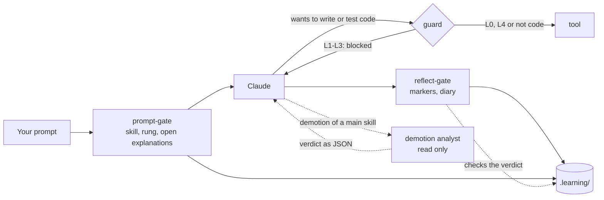

# How it works

The harness consists of four Claude Code hooks, a skill record, and a few commands that only you run.

## Levels per skill

| Level | Claude | You |
|---|---|---|
| **L0 Demonstrate** | makes a worked example on a different topic; for a new skill only after your attempt | explain it and predict the output |
| **L1 Complete** | writes a skeleton, the core stays `TODO(human)`; for a new skill only after your attempt | fill the gaps, build and test |
| **L2 Guided** | gives no solution code, only hints from the ladder | write everything yourself |
| **L3 Independent** | nothing up front; a review only after your attempt | make it and defend it |
| **L4 Automated** | may do it directly | supervise; when the review is due, you do it yourself |

A skill can have **microskills**: sub-patterns with their own level. Filtering lists can already be at L3 while chaining void methods is still at L2.

**A new skill** (without tasks and without history) has no fixed place yet. You try it yourself first, with the L2 hint ladder. The highest rung of your first task sets the level: rung 0 → L3, 1–2 → L2, 3–4 → L1, 5 → L0. If the harness places you too low, you set it higher yourself.

## The hint ladder (L2)

1. A Socratic question.
2. Where to find it, or which concept it is.
3. Pseudocode or a sketch of the structure.
4. A small example of at most 5 lines, on a different topic.
5. A worked solution, only after confirmation. The task then counts as **not solved**.

The first hint may come right away. The next rung only comes after a **visible attempt**: changed code, an error or test outcome, or a hypothesis. Or after 12 minutes of being stuck. These are minutes of **active time**: a break of more than 20 minutes (`idleMinutes`) does not count. So after dinner you do not get a higher rung by itself.

For a **new skill** time does not count. A rung only goes up when you say you are stuck, share the same error or test outcome twice, or do not know the concept. If you ask for more explanation after an attempt of your own, Claude may go straight to a higher rung, and that rung is logged honestly.

## The guard

At L1–L3, `guard.mjs` blocks Claude from writing, deleting, building or testing code. Which files are code and which commands build is set in the [settings](configuration.md). The guard also protects:

- the record and the state in `.learning/`;
- the harness itself: the hooks, `.claude/settings.json`, the diary skill and the rules.

The guard first splits a shell command into simple commands. It looks at the program that runs, not at words in the arguments: `grep "msbuild"` is not a build, but `bash -c "dotnet test"` is.

If you still want Claude to do something, you set an override yourself: `! node .claude/hooks/skill.mjs override ood.overerving 30 "reason"`. It is logged and shows up in the diary.

## Tasks and explanations in your own words

A task is logged when a test goes from red to green (`check.mjs`), when you log it yourself (`done`), or when you say in the chat that the tests pass. It only counts after an explanation **in your own words**, with two keys:

1. Claude judges the content and writes `[explain-ok <tid>]` or `[explain-no <tid>]`.
2. The Stop hook checks your message: at least 12 words outside code, a *why* (because, so that, otherwise …), and not copied from Claude's text.

The explanation belongs **right after** the green. A next task in the same folder may come first, and one message may explain several tasks. If you start another exercise, or the session ends, the task **lapses**: it does not count and shows up on the dashboard as skipped. If an approved explanation got lost through a harness bug, you recover it with `replay`.

A test that was green once, turned red and is green again is a **repaired regression** and does not count as a new task.

## Promotion and reviews

- **Up** is your decision: **L2 → L3** at about 85% solved (at most rung 2) over at least 5 tasks. The harness gives the advice, you set the level with `set`.
- **Down** follows the evidence, when `autoDemote` is on: with at least 3 explained tasks and under 70% solved, or the last 2 not solved. A microskill goes down one level right away. For a main skill the **demotion analyst** decides first: an agent that only reads, looks at the test output, your code and the transcript, and decides whether the problem is one sub-pattern (then only that microskill goes down or is created) or broad (then the main skill goes down). If two microskills of the same parent go down within 14 days, the parent goes down too. You get a message and can revert it with `set`.
- **Reviews** only exist at L4, at Fibonacci intervals: 1, 2, 3, 5, 8, 13 … days. There are no separate review exercises. When such a skill comes by in your work while its review is due, you do that part yourself, without AI. Your next task decides the outcome: rung 0 is a pass (one step on), rung 1–2 shaky (the same), more help a fail (two steps back). If it does not come by, nothing happens; the practice exams are the safety net.

## The diary

When you stop, `/diary` writes down the facts of the session, and you write the reflection: what you learned, what was confusing, and how confident you are. Without a diary entry the Stop hook does not let the session close (at most twice per stop request).

Why it works this way is in the [research](research.md), especially §2 and §5.
