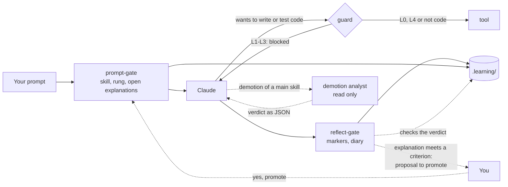

# How it works

The harness consists of four Claude Code hooks, a skill record, and a few commands that only you run.



In the harness, every prompt passes the prompt-gate, and the guard blocks Claude from writing or testing code at levels L1–L3. A level never goes up by itself: you confirm the reflect-gate's proposal with "yes, promote", or set it yourself.

## Levels per skill

| Level | Claude | You |
|---|---|---|
| **L0 Demonstrate** | makes a worked example on a different topic; for a new skill only after your attempt | explain it and predict the output |
| **L1 Complete** | writes a skeleton, the core stays `TODO(human)`; for a new skill only after your attempt | fill the gaps, build and test |
| **L2 Guided** | gives no solution code, only hints from the ladder | write everything yourself |
| **L3 Independent** | nothing up front; a review only after your attempt | make it and defend it |
| **L4 Automated** | may do it directly | supervise; when the review is due, you do it yourself |

A skill can have **microskills**: sub-patterns with their own level. Filtering lists can already be at L3 while chaining void methods is still at L2.

**A new skill** (without tasks and without history) has no fixed place yet. You try it yourself first, with the L2 hint ladder. The highest rung of your first task sets the level: rung 0 → L3, 1–2 → L2, 3–4 → L1, 5 → L0. If the harness places you too low, you set it higher yourself.

## The hint ladder (L2)

1. A Socratic question.
2. Where to find it, or which concept it is.
3. Pseudocode or a sketch of the structure.
4. A small example of at most 5 lines, on a different topic.
5. A worked solution, only after confirmation. The task then counts as **not solved**.

The first hint may come right away. The next rung only comes after a **visible attempt**: changed code, an error or test outcome, or a hypothesis. Or after 12 minutes of being stuck. These are minutes of **active time**: a break of more than 20 minutes (`idleMinutes`) does not count. So after dinner you do not get a higher rung by itself.

For a **new skill** time does not count. A rung only goes up when you say you are stuck, share the same error or test outcome twice, or do not know the concept. If you ask for more explanation after an attempt of your own, Claude may go straight to a higher rung, and that rung is logged honestly.

## The guard

At L1–L3, `guard.mjs` blocks Claude from writing, deleting, building or testing code. Which files are code and which commands build is set in the [settings](configuration.md). The guard also protects:

- the record and the state in `.learning/`;
- the harness itself: the hooks, `.claude/settings.json`, the diary, mastery-check and update-dashboard skills, and the rules.

The guard first splits a shell command into simple commands. It looks at the program that runs, not at words in the arguments: `grep "msbuild"` is not a build, but `bash -c "dotnet test"` is.

One program is allowed on purpose, even though it writes in `.learning/state/`: the dashboard export `node <repo>/harness/export.mjs <practice folder>`, to update the dashboard after `/diary`. In your practice folder it only writes `last-export.json` (a moment and three totals), and never with `--out` into your practice folder.

If you still want Claude to do something, you set an override yourself: `! node .claude/hooks/skill.mjs override ood.overerving 30 "reason"`. It is logged and shows up in the diary.

## Tasks and explanations in your own words

**A task begins** when you start new work. The harness only goes by fixed signals, never by a keyword: code changed in another exercise folder, `check.mjs` in another folder, or the full name of another exercise folder (such as `10-artsen-en-patienten`) or a `#id` of another skill family in your message. Then the hint ladder and the task time start again. Ordinary help since the previous task was for work you did not finish: it does not count for the new task, but it is logged as `help-dropped`, so you can still see it.

**Run `check.mjs` first.** When you pick an exercise, Claude gives you `! node .claude/hooks/check.mjs <folder>`. Run it before you write code: that first run is the start. Did you write the code first, and is the first run all green at once? Then it still counts as a task, as long as you changed the code in this session.

A task is logged when a test goes from red to green (`check.mjs`), when you log it yourself (`done`), or when you say in the chat that the tests pass. It only counts after an explanation **in your own words**, with two keys:

1. Claude judges the content and writes `[explain-ok <tid>]` or `[explain-no <tid>]`. The question depends on what happened. After a failed attempt (red, a compile error or a hint): why does it work now, and why did the first attempt not? Green at once: one question about the principle of the exercise. Claude keeps asking until the principle is right.
2. The Stop hook checks your own words: **all your messages since the task was logged, together**. An answer in three short messages counts as one. Together they need at least 12 words outside code, a *why* (because, so that, otherwise …), and they must not be copied from Claude's text. A message from before the task was logged does not count.

The explanation belongs **right after** the green. A next task in the same folder may come first, and one message may explain several tasks. If you start another exercise, or the session ends, the task **lapses**: it does not count and shows up on the dashboard as skipped. If an approved explanation got lost through a harness bug, you recover it with `replay`.

A test that was green once, turned red and is green again is a **repaired regression** and does not count as a new task.

**A review after a task** is optional. Claude offers it with a topic and a time estimate, and you choose. After one wrong answer, or when you say you do not get it, Claude gives the concept right away instead of another question. Help in a review is marked `[review-rung N #id]`, with the id of the concept. It does not count for your next task about something else, but it does for the next task about the same concept: the same id, its parent skill or one of its microskills. Without a valid id, or after you started new work, it counts as an ordinary rung. Whatever stays open becomes a proposed microskill.

## Promotion and reviews

- **Up** is your decision, on evidence. The evidence is the last 10 explained tasks **since the previous level change**, so the same tasks never carry two promotions.
  - **L0 → L1:** two examples explained and predicted correctly.
  - **L1 → L2:** three tasks at rung 1 at most (gaps filled).
  - **L2 → L3:** about 85% solved (at most rung 2) over at least 5 tasks, and at least half with hint 0–1.
  - **L3 → L4:** rung 0 three times on at least 2 days, plus a **transfer task**: with `/mastery-check <id>` you solve a new exercise in another domain, without any hint, and then defend the design. A hint during the transfer task makes it not count.
  - **Jump:** from L2 up the evidence may carry a jump when the next criterion holds too, for example L2 → L4 with the transfer task. From L0 and L1 it goes one step at a time, because a worked example or a skeleton was help up front.
- **The proposal** comes right after the explanation that meets the criterion. The harness shows it itself, with the evidence and what changes:

  ```
  [learning harness] Promote? ood.klassen-properties L2 → L3
    evidence: 5 of 5 solved (rung 1, 1, 2, 1, 1), on 1 day(s), in 05-de-auto, 06-studenten
    what changes: no hint ladder any more: Claude gives nothing up front and only reviews after your attempt
    yes: type "yes, promote" · no: type "no" · you can always undo it with set
  ```

  If you type "yes, promote" (or "ja, doorzetten"), the harness sets the level. That only works on your own prompt, never on Claude's text. If you say "no" or "later", the proposal only comes back after a new task that meets the criterion again. `set` still works too.
- **Down** follows the evidence, when `autoDemote` is on: with at least 3 explained tasks and under 70% solved, or the last 2 not solved. A microskill goes down one level right away. For a main skill the **demotion analyst** decides first: an agent that only reads, looks at the test output, your code and the transcript, and decides whether the problem is one sub-pattern (then only that microskill goes down or is created) or broad (then the main skill goes down). If two microskills of the same parent go down within 14 days, the parent goes down too. You get a message and can revert it with `set`.
- **Reviews** only exist at L4, at Fibonacci intervals: 1, 2, 3, 5, 8, 13 … days. There are no separate review exercises. When such a skill comes by in your work while its review is due, you do that part yourself, without AI. Your next task decides the outcome: rung 0 is a pass (one step on), rung 1–2 shaky (the same), more help a fail (two steps back). If it does not come by, nothing happens; the practice exams are the safety net.

## The diary

When you stop, `/diary` writes down the facts of the session, and you write the reflection: what you learned, what was confusing, and how confident you are. Without a diary entry the Stop hook does not let the session close (at most twice per stop request).

Above the three reflection questions there is a warning: *"Note: your answers appear word for word, with a translation, on the public dashboard."* There is no private option. Whatever must not go online goes into `.learning/private.json`.

Then Claude asks: **Update the dashboard now?** On yes, Claude updates the dashboard in the same session, up to a pull request, which you merge yourself. On later nothing happens. See [After the diary](progress-dashboard.md#after-the-diary), also when you do not use the dashboard.

Why it works this way is in the [research](research.md), especially §2 and §5.
