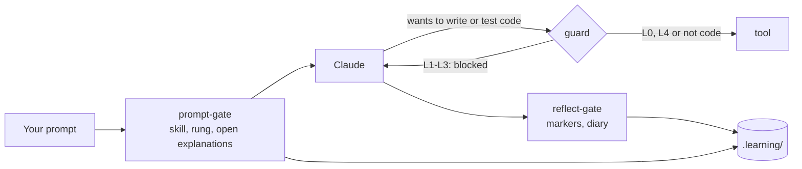

# How it works

The harness consists of four Claude Code hooks, a skill record, and a few commands that only you run.

## Levels per skill

| Level | Claude | You |
|---|---|---|
| **L0 Demonstrate** | makes a worked example on a different topic | explain it and predict the output |
| **L1 Complete** | writes a skeleton, the core stays `TODO(human)` | fill the gaps, build and test |
| **L2 Guided** | gives no solution code, only hints from the ladder | write everything yourself |
| **L3 Independent** | nothing up front; a review only after your attempt | make it and defend it |
| **L4 Automated** | may do it directly | supervise and do the reviews |

A skill can have **microskills**: sub-patterns with their own level. Filtering lists can already be at L3 while chaining void methods is still at L2.

## The hint ladder (L2)

1. A Socratic question.
2. Where to find it, or which concept it is.
3. Pseudocode or a sketch of the structure.
4. A small example of at most 5 lines, on a different topic.
5. A worked solution, only after confirmation. The task then counts as **not solved**.

The first hint may come right away. The next rung only comes after a **visible attempt**: changed code, an error or test outcome, or a hypothesis. Or after 12 minutes of being stuck.

## The guard

At L1–L3, `guard.mjs` blocks Claude from writing, deleting, building or testing code. Which files are code and which commands build is set in the [settings](configuration.md). The guard also protects:

- the record and the state in `.learning/`;
- the harness itself: the hooks, `.claude/settings.json`, the diary skill and the rules.

If you still want Claude to do something, you set an override yourself: `! node .claude/hooks/skill.mjs override ood.overerving 30 "reason"`. It is logged and shows up in the diary.

## Tasks and explanations in your own words

A task is logged when a test goes from red to green (`check.mjs`), when you log it yourself (`done`), or when you say in the chat that the tests pass. It only counts after an explanation **in your own words**, with two keys:

1. Claude judges the content and writes `[explain-ok <tid>]` or `[explain-no <tid>]`.
2. The Stop hook checks your message: at least 12 words outside code, a *why* (because, so that, otherwise …), and not copied from Claude's text.

A test that was green once, turned red and is green again is a **repaired regression** and does not count as a new task.

## Promotion and reviews

- **L2 → L3** at about 85% solved (at most rung 2) over at least 5 tasks. **Back** below 70%, or after two failures in a row.
- From L3 you get **reviews** at Fibonacci intervals: 1, 2, 3, 5, 8, 13 … days. Pass is one step further, shaky stays the same, fail is two steps back. With an exam date, every review falls before the exam.
- The harness **advises**; you set the level yourself.

## The diary

When you stop, `/diary` writes down the facts of the session, and you write the reflection: what you learned, what was confusing, and how confident you are. Without a diary entry the Stop hook does not let the session close (at most twice per stop request).

Why it works this way is in the [research](research.md), especially §2 and §5.
