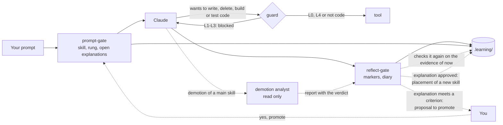

# How it works

The harness consists of five Claude Code hooks (at the session start, at every prompt, before every tool, when Claude stops and at the session end; see the [reference](reference.md#hooks)), a skill record, and a few commands that only you run.



In the harness, every prompt passes the prompt-gate, and the guard blocks Claude from writing, deleting, building or testing code at levels L1–L3 (at L1 it only lets through a skeleton with `TODO(human)` gaps). A level never goes up by itself: you confirm the reflect-gate's proposal with "yes, promote", or set it yourself.

## Levels per skill

| Level | Claude | You |
|---|---|---|
| **L0 Demonstrate** | makes a worked example on a different topic; for a new skill only after your attempt | explain it and predict the output |
| **L1 Complete** | writes a skeleton, the core stays `TODO(human)`; for a new skill only after your attempt | fill the gaps, build and test |
| **L2 Guided** | gives no solution code, only hints from the ladder; rung 5, a worked solution, only if you confirm | write everything yourself |
| **L3 Independent** | nothing up front; a review only after your attempt | make it and defend it |
| **L4 Automated** | may do it directly | supervise; when the review is due, you do it yourself |

**How the table and the guard fit together.** At L1 the guard does not block the skeleton: it lets a write through when it keeps or adds `TODO(human)` gaps, and refuses one that fills or removes them. At L2 the worked solution of rung 5 is an exception you ask for yourself. Claude shows it in the chat, the guard still keeps Claude out of your files, so you type it in yourself, and the task counts as not solved.

A skill can have **microskills**: sub-patterns with their own level. Filtering lists can already be at L3 while chaining void methods is still at L2.

**A new skill** (without tasks and without history) has no fixed place yet. You try it yourself first, with the L2 hint ladder. The highest rung of your first task sets the level: rung 0 → L3, 1–2 → L2, 3–4 → L1, 5 → L0. That happens when your explanation of that task is approved; if the explanation lapses, the placement stays open. Help about another concept does not count here. A placement up to L3 gets its own message with the evidence. If the harness places you too low, you set it higher yourself.

## The hint ladder (L2)

1. A Socratic question.
2. Where to find it, or which concept it is.
3. Pseudocode or a sketch of the structure.
4. A small example of at most 5 lines, on a different topic.
5. A worked solution, only after confirmation. The task then counts as **not solved**.

In [graded work](#graded-work) the ladder stops at rung 4: a worked solution is not available there.

The first hint may come right away. The next rung only comes after a **visible attempt**: changed code, an error or test outcome, or a hypothesis. Or after 12 minutes of being stuck. These are minutes of **active time**: a break of more than 20 minutes (`idleMinutes`) does not count. So after dinner you do not get a higher rung by itself.

For a **new skill** time does not count. A rung only goes up when you say you are stuck, share the same error or test outcome twice, or do not know the concept. If you ask for more explanation after an attempt of your own, Claude may go straight to a higher rung, and that rung is logged honestly.

## The guard

At L1–L3, `guard.mjs` blocks Claude from writing, deleting, building or testing code. At L1 it lets a skeleton through: a write that keeps or adds `TODO(human)` gaps, not one that fills them. Which files are code and which commands build is set in the [settings](configuration.md). The guard also protects:

- the record and the state in `.learning/`, also when the record is in another folder (`--learning-dir`);
- the paths of [graded work](#graded-work) and its AI-use log, at every level, without override, also outside the project;
- the harness itself: the hooks, `.claude/settings.json`, the diary, mastery-check and update-dashboard skills, and the rules, also as a whole folder (`rm -rf .claude/hooks`);
- the user-level files the harness installs: `~/.claude/settings.json` and `~/.claude/leerharnas/`.

The guard reads a command as the shell does: quotes and escapes removed, `~` and variables such as `${HOME}` filled in, and the real path behind a link or a Windows short name. When it cannot resolve a path while graded work is set, it refuses. This came out of the [security review of 13 November](https://github.com/piethanegraaf/piethanegraaf.github.io/blob/main/research/security-review-2026-11-13.md).

The guard first splits a shell command into simple commands. It looks at the program that runs, not at words in the arguments: `grep "msbuild"` is not a build, but `bash -c "dotnet test"` is.

One program is allowed on purpose, even though it writes in `.learning/state/`: the dashboard export `node <repo>/harness/export.mjs <practice folder>`, to update the dashboard after `/diary`. In your practice folder it only writes `last-export.json` (a moment and three totals), and never with `--out` into your practice folder.

If you still want Claude to do something, you set an override yourself: `! node .claude/hooks/skill.mjs override ood.overerving 30 "reason"`. It is logged and shows up in the diary.

## Graded work

Some work is graded, for example the final assignment of a course. Your institution decides how much AI may help there. At CHE, for example, the exam rules (OER art. 7.11) allow AI level 1: AI as an aid, "for example to generate ideas or bring structure", with a statement of how you used it. Code or text made by AI in graded work counts as fraud. The harness does not recognise graded work by itself: you name its paths yourself, once, for example the folder of its repo:

```text
! node .claude/hooks/skill.mjs setting graded add "C:/Users/<you>/source/repos/<assignment>"
```

In those paths:

- **The hint ladder of L2 holds for every skill**, also for one at L3 or L4, with the stuck timer. It goes up to rung 4 (`setting graded maxRung` can lower it). A worked solution (rung 5) is never available there. Ask for one and Claude refuses, with a reference to the exam rules.
- **Rung 4 is an example of at most 5 lines on another topic.** It implements nothing the assignment asks for. You type your own code, and you never paste the example.
- **Claude writes no content there**, at no level: no code, text, diagram, Dockerfile or pipeline, and no commit or push (version control is graded too). It does not build or test there. The guard blocks it, also from a session in another folder, and there is no override. You type everything and run the tests yourself. Reading is allowed.
- **Fixed tooling is allowed.** There a generator or an official template makes the content, not the AI: `dotnet new` (sln, console, classlib, nunit, xunit, gitignore), `dotnet sln add`, `dotnet add reference` or `package`, `git init`, `git remote add`, `git branch -m`, `mkdir`, and `node .claude/hooks/scaffold.mjs arc42 <folder> --from <zip>`, which puts the official [arc42](https://arc42.org) template into a new or empty folder, unchanged and checked against a pinned sha256. The harness does not download the zip itself; without `--from` the script shows the link and the `curl` command, to a temporary folder outside the assignment. Every such command gets a row "tooling (no AI content)" in the log. Anything else stays blocked.
- **Tasks and explanations in your own words still count.** Who can explain their code can also defend it.
- **Every answer goes into an AI-use log**, in `ai-verantwoording/` in the repo (`ai-use/` in English). The hooks write it, never Claude:
    - `logboek.md`: one row per answer, with the time, the session, the skill, the rung and the kind of help (question, concept, sketch, code example, review, tooling). The last column is yours: what you did with it and how you checked it. `/diary` asks for it; your answer goes into that column word for word. The hook checks that the words are yours before it writes them, and Claude never writes there.
    - `sessies/<date>-<session>.md`: your prompts and Claude's text of that session, without the output of tools. Claude Code has no share link to a session, so this export takes its place. A privacy filter removes e-mail addresses, your home folder (it becomes `~`) and the messages of the hooks.
    - `README.md`: the AI level, the ladder, an APA reference and how the export is made. It is written once; after that it is yours.

**Closed from other folders.** A question about the assignment asked in another folder, for example in the repo of this site, gets no limit on rungs and no row in the log. You can close that gap with a gate at user level:

```text
node harness/install.mjs <folder with the harness> --user-guard
```

It writes in `~/.claude/` only, after showing the plan: from then on, in every other folder, a prompt that names the assignment is blocked, and every tool on its paths is refused, also reading. The setup itself (`.claude/` and `CLAUDE.md` there) stays open. `--remove` takes it away again. A general question without the name, such as "how does a Mermaid class diagram work?", is not visible to a hook, so a rule in `~/.claude/CLAUDE.md` asks Claude to check first whether it is about the assignment.

**Work between sessions.** Did you work on the assignment in your IDE while no session ran? Then the next session start lists the files that changed, with the skill they belong to: through the paths of a skill, or through the content (a Mermaid `classDiagram` belongs to `uml.klassendiagram`). Claude then proposes a task per finished part.

At AI level 0 (`setting graded aiLevel 0`) Claude gives no help at all on that work. Ask your teacher which parts of an assessment are level 0 and which are level 1. The research explains the choices in [§10.8](research/build-log.md#108-revision-of-13-november-2026-graded-work-under-the-exam-rules).

## Tasks and explanations in your own words

**A task begins** when you start new work. The harness only goes by fixed signals, never by a keyword: code changed in another exercise folder, `check.mjs` in another folder, or the full name of another exercise folder (such as `10-artsen-en-patienten`) or a `#id` of another skill family in your message. Then the hint ladder and the task time start again. Ordinary help since the previous task was for work you did not finish: it does not count for the new task, but it is logged as `help-dropped`, so you can still see it.

**Run `check.mjs` first.** When you pick an exercise, Claude gives you `! node .claude/hooks/check.mjs <folder>`. Run it before you write code: that first run is the start. Did you write the code first, and is the first run all green at once? Then it still counts as a task, as long as you changed the code in this session.

A task is logged when a test goes from red to green (`check.mjs`), when you log it yourself (`done`, or a message that starts with `done: <part>`, without a command), or when you say in the chat that the tests pass. Work without a test, such as a class diagram, is split into **parts with a name**: "the Product class", "the inheritance to the product types". Each finished part is a task of its own, with its own explanation. Small, named steps help learning and an honest view of what you can do; splitting only to get more tasks does not ([research §10.10](research/build-log.md#1010-revision-of-13-november-2026-night-the-first-sessions-on-the-final-assignment)). In graded work `done:` only counts when a file of the assignment changed since the last task of that skill. It only counts after an explanation **in your own words**, with two keys:

1. Claude judges the content and writes `[explain-ok <tid>]` or `[explain-no <tid>]`. With `explain-no` Claude first names what is already right, and then asks one follow-up question that points to the gap: a follow-up question, not a rejection. The requirement stays just as strict. The question depends on what happened. After help (rung 1 or higher): about the concept of the highest hint, because that is where you were stuck. After a failed attempt without a hint (red or a compile error): why does it work now, and why did the first attempt not? Green at once: one question about the principle of the exercise. Claude keeps asking until the principle is right.
2. The Stop hook checks your own words: **all your messages since the task was logged, together**. An answer in three short messages counts as one. Together they need at least 12 words outside code, a *why* (because, so that, otherwise …, or a reasoning "if …, then/would …" in one sentence), and they must not be copied from Claude's text. A message from before the task was logged does not count.

The explanation belongs **right after** the green. A next task in the same folder may come first, and one message may explain several tasks. If you start another exercise, or the session ends, the task **lapses**: it does not count and shows up on the dashboard as skipped. If an approved explanation got lost through a harness bug, you recover it with `replay`.

A test that was green once, turned red and is green again is a **repaired regression** and does not count as a new task.

**Praise first, in honest words.** After a green, `check.mjs` first says what worked and which skill, and then invites the explanation. "Independently" only means rung 0. At rung 1–4 the harness says "solved with help up to rung N", and where the learning was: the concept of the highest hint. Effort is the goal here, not failure; the harness says so once, at your first session start. A worked example (rung 5) counts as not solved: then you explain the worked example back.

**Help about another concept** is logged for that concept too. Suppose Claude helps you with the syntax of a loop during an exercise on inheritance. Then Claude writes `[rung N #id]`, with the id of the loop skill. The task keeps that rung, because you made it with that help. The concept gets its own event, `concept-help`. That is not a task of that concept: `status` shows it, and it counts as evidence for a proposal for a microskill. The status line Claude sees with every prompt shows the help given for this task, also at L3 (`help given: rung N`); at L2 also the unlocked rung.

**A review after a task** is optional, and only about your own code. Claude offers it with a topic and a time estimate, and you choose. A question about an alternative becomes an experiment: you rebuild it, run `check.mjs` and revert it, so the outcome is real feedback. There is no review after the notice of an hour of active time, or when the task already took rung 2 or higher. After one wrong answer, or when you say you do not get it, Claude gives the concept right away instead of another question. Help in a review is marked `[review-rung N #id]`, with the id of the concept. It does not count for your next task about something else, but it does for the next task about the same concept: the same id, its parent skill or one of its microskills. Without a valid id, or after you started new work, it counts as an ordinary rung.

**A proposal for a microskill** comes from the harness itself, like a proposal to promote. It needs evidence from this session that you needed real help with that part: help at rung 2 or higher in a review or about another concept, or a task that took rung 2 or higher. Claude names the part and its keywords; the harness checks them and shows you:

```
[harness] Add a microskill? ood.associaties.<part> (title) under ood.associaties, at L2 Guided
  why: task <tid> of ood.associaties took rung 2
  keywords: …
  what changes: this part gets its own level and its own hint ladder; ood.associaties stays at L3
  yes: type "yes, add" · no: type "no"
```

Only your own "yes, add" (or "ja, toevoegen") adds it, at the main skill's level minus 1. Nothing goes down automatically: one hard moment is weak evidence, so you decide.

## Promotion and reviews

- **Up** is your decision, on evidence. The evidence is the last 10 explained tasks **since the previous level change**, plus the task that placed the skill, so the same tasks never carry two promotions.
  - **L0 → L1:** two examples explained and predicted correctly.
  - **L1 → L2:** three tasks at rung 1 at most (gaps filled).
  - **L2 → L3:** about 85% solved (at most rung 2) over at least 5 tasks, and at least half with hint 0–1.
  - **L3 → L4:** rung 0 three times on at least 2 days, and a **transfer task** is one of them: with `/mastery-check <id>` you solve a new exercise in another domain, without any hint, and then defend the design. Its day counts as a day. So after two tasks without a hint, the transfer task can be the third; were those two on one day, then do it on another day. A hint during the transfer task makes it not count.
  - **The design goal:** whoever practises daily and masters the skill reaches L4 in about 3 sessions on 2 days. A test guards that.
  - **When the exercise folders of a skill at L3 run out,** Claude points to an existing next exercise: another exercise of the course, or a question from a practice test. A practice-test question counts when you do it without help, check it with the answer key, explain it and log it with `done`. Claude never makes up an exercise.
  - **Jump:** from L2 up the evidence may carry a jump when the next criterion holds too, for example L2 → L4 with the transfer task. From L0 and L1 it goes one step at a time, because a worked example or a skeleton was help up front.
- **The proposal** comes right after the explanation that meets the criterion. The harness shows it itself, with the evidence and what changes:

  ```
  [learning harness] Promote? ood.klassen-properties L2 → L3
    evidence: 5 of 5 solved (rung 1, 1, 2, 1, 1), on 1 day(s), in 05-de-auto, 06-studenten
    what changes: no hint ladder any more: Claude gives nothing up front and only reviews after your attempt
    yes: type "yes, promote" · no: type "no" · you can always undo it with set
  ```

  If you type "yes, promote" (or "ja, doorzetten"), the harness sets the level and says so with ↑ and the evidence. That only works on your own prompt, never on Claude's text. If you say "no" or "later", the proposal only comes back after a new task that meets the criterion again. `set` still works too.
- **How far is the next level?** After each task, at `status` and at the session start the harness shows it in steps, never as a percentage:

  ```
  ↗ ood.encapsulatie L3 → L4: without a hint 3/3 ✓ · days 1/2 · transfer task ○
  ```

- **Down** follows the evidence, when `autoDemote` is on: with at least 4 explained tasks and under 70% solved, or the last 2 not solved. "Solved" counts the help within the skill's own family: help about another concept (`[rung N #id]`) is no failure of this skill. Down waits until no explanation of that family is open, and it is checked again on the evidence of that moment. A microskill goes down one level right away. For a main skill the **demotion analyst** decides first: an agent that only reads, looks at the test output, your code and the transcript, and decides whether the problem is one sub-pattern (then only that microskill goes down or is created) or broad (then the main skill goes down). When the help was really about an existing microskill of another family, the analyst may choose that one. The harness reads the verdict from the analyst's report itself: no JSON in the chat. If two microskills of the same parent go down within 14 days, the parent goes down too. You get one quiet line, "extra support for …", and can revert it with `set`.
- **Reviews** only exist at L4, at Fibonacci intervals: 1, 2, 3, 5, 8, 13 … days. There are no separate review exercises. When such a skill comes by in your work while its review is due, you do that part yourself, without AI. Your next task decides the outcome: rung 0 is a pass (one step on), rung 1–2 shaky (the same), more help a fail (two steps back). If it does not come by, nothing happens; the practice exams are the safety net.

## The diary

**The start needs no command.** The hooks start the session themselves when you open Claude Code. Your first message is logged as the plan, and the number you give when Claude asks for your confidence (1–5) as your confidence beforehand. The diary compares that number with what happened.

When you stop, `/diary` writes down the facts of the session, and you write the reflection: what you learned, what was confusing, and how confident you are. You do not have to ask for anything: "done", "I want to stop" or "let's wrap up" is enough. Claude then asks everything in **one message**: open explanations, 2 to 3 **check questions** about the concepts of this session, the three reflection questions, and for graded work the log question. Check questions are answered from memory and ask for a reason or an application in your own work. You get feedback per answer; an open answer is not a failure, it is what comes back next time. Without a diary entry the Stop hook does not let the session close (at most twice per stop request).

Closed a session without a diary entry, for example by closing the window? Then the next start offers a short catch-up diary for that session, once.

With a dashboard (`dashboardRepo` set to the path of your clone), there is a warning above the three reflection questions: *"Note: your answers appear word for word, with a translation, on the public dashboard."* There is no private option then. Whatever must not go online goes into `.learning/private.json`. Without a dashboard (`dashboardRepo` not set, or `off`) the line says instead that your answers stay in your folder: nothing goes online until you set up a dashboard and publish it yourself.

Then Claude asks: **Update the dashboard now?** On yes, Claude updates the dashboard in the same session, up to a pull request, which you merge yourself. On later nothing happens. See [After the diary](progress-dashboard.md#after-the-diary), also when you do not use the dashboard.

Why it works this way is in the [research](research/index.md), especially §2 and §5.
