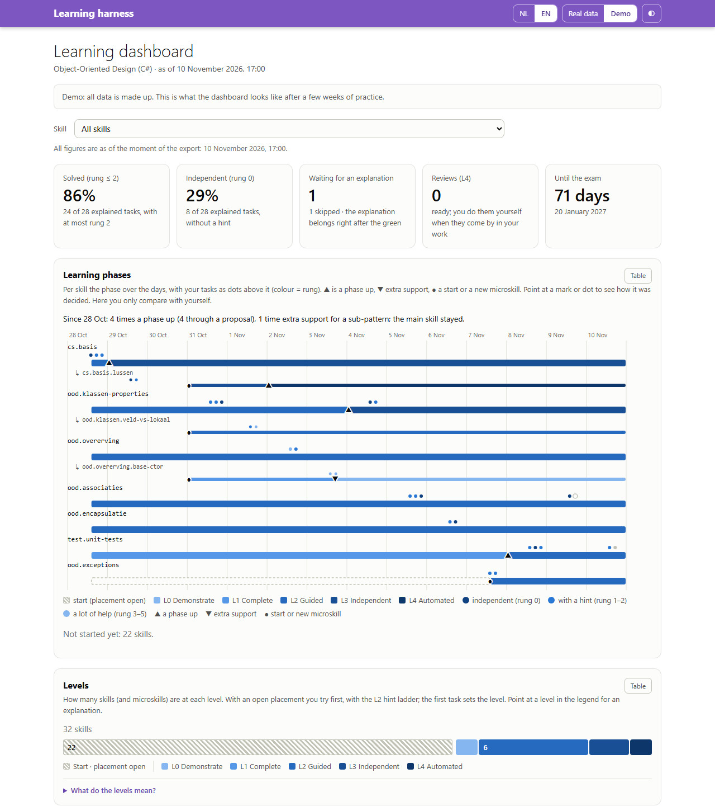

# Updating the dashboard

## What the dashboard shows



*The dashboard with made-up demo data.*

The [dashboard](/dashboard/?lang=en) shows progress per skill and microskill:

- two tiles: **solved** (at most rung 2) and **independent** (rung 0), counted as the harness counts them;
- the **learning phases**: per skill one band over the days, in the colour of the level, with "start" dashed while the placement was open. Microskills are thinner, under their parent. Your tasks are dots above the band, in the colour of the rung. Each change has a mark (▲ a phase up, ▼ extra support, ● a start or a new microskill); point at it to see how it was decided: a proposal you confirmed, a placement, by hand, a reverted demotion, or the analyst. One sentence on top compares you only with yourself, never with others;
- your **level** and its history;
- what each **level means**: point at a level in the legend or the bar (or Tab to it) for what it is and the step to the next level. Esc closes the explanation. Why, the evidence and the route from the start (placement open) to L4 are under *What do the levels mean?*: the criteria per step, and how you go up and down;
- what you still need **for the next level**, in the shape of that criterion. At L2 that is a bar with the 85% target and the three conditions. At L0, L1 and L3 it is pips, and at L3 also the days and the transfer task. At L4 you see the maintenance. One line says what still has to happen. This only counts the tasks since your last level change, just like the harness, so after a step up you start again;
- how the **last 10** explained tasks went: solved means with at most rung 2;
- per task: the rung, the source (test, logged yourself, chat), your **explanation**, and when it was **rejected** or **corrected**;
- the **reviews** (only L4, Fibonacci), neutral: when the next one is ready, and when you **last** saw the skill in your work. Nothing is "overdue": a review waits until the skill comes by;
- **skipped** tasks: the explanation did not come right away, so they do not count. They are shown apart from failed and from waiting for an explanation, and hatched in the chart;
- **how each level change was decided**, in the level history: a placement, a proposal, by hand, a reverted demotion, or extra support (automatic, the analyst or the backstop). Changes without a difference (L3 → L3) are left out;
- **help during another task**: help about this skill while you worked on an exercise of another skill (`[rung N #id]`). That task kept the rung; here it does not count as a task or in the success rate;
- the **proposals for a microskill** that the harness showed you, with the reason (review help, help about another concept, or a task at rung 2 or higher) and your answer: added, no, or no answer;
- **promotion and relapse signals**, **regressions** and **overrides**;
- a **diary timeline** with your reflections and the **calibration**: your confidence before and after.

Every chart has a table view. You can switch between Dutch and English, and between the real data and the [demo with made-up data](/dashboard/?lang=en&data=demo).

## Publishing your own data

The dashboard is part of this repo, so publishing means a pull request to a repo you can push to. **Is this repo not yours?** Then fork it on GitHub first, clone your fork, and turn on GitHub Pages in the fork (Settings → Pages → Source: GitHub Actions). Your dashboard then appears on your own Pages address. In the steps below, "this repo" is your fork: `/update-dashboard` pushes to `origin` (your fork) and opens the pull request there, never in the original repo. Without a fork, keep the dashboard local and set `dashboardRepo off`.

1. Create `.learning/private.json` with the names and terms that must not go online (see [Configuration and privacy](configuration.md#privacy)).
2. Did an approved explanation get lost, for example through a harness bug? Recover it first with `replay` (see the [reference](reference.md)). Otherwise the task shows up online as open or skipped.
3. Look at what will be filtered: `node harness/export.mjs ../my-practice-folder --dry-run`
4. Export: `node harness/export.mjs ../my-practice-folder`. Are there texts without a translation (see [Translations](#translations))? Then the export writes no data. It stops with exit code 2 and lists those texts in `site-src/dashboard/data/translations.todo.json`.
5. Let Claude fill in the translations ("fill in translations.todo.json") and export again. The export takes the translations over, removes the todo file and writes `progress.json`.
6. Check the diff of `site-src/dashboard/data/progress.json`, the translations too, then commit and push it yourself. The dashboard shows the date and time of the export, so you can see how current it is.

In Claude Code, `/update-dashboard` does steps 3 to 6 for you, up to a pull request. In this repo you give it the practice folder: `/update-dashboard ../my-practice-folder`. In a practice session `/diary` asks for it itself (see [After the diary](#after-the-diary)). The skill works like this:

- **In its own worktree.** It never works in your main checkout. Is a dashboard pull request still open? Then it continues on that branch: the two do not conflict, and the translations in it are kept. Otherwise it starts a new branch `dashboard-YYYY-MM-DD` from `origin/main`. It gives every `gh` command `--repo` with the repo of `origin`: in a fork, `gh` would otherwise open the pull request in the original repo.
- **Checked.** After the export and the translations it runs `--check` and the security check, with the private terms of your practice folder. A fresh worktree has no `.learning/private.json` of its own, because that file is never committed.
- **Only after your approval.** It shows you the diff and the translations it was unsure of, and asks whether it may go on. Only then does it commit `progress.json`, push the branch and open the pull request (or add a commit to the open one). Merging is up to you.

## After the diary

At the end of `/diary` Claude asks: **Update the dashboard now?** (yes / later).

- **Yes:** Claude follows `/update-dashboard` in the same session, with your practice folder, up to the pull request. The approval before the commit and the push stays. Merging is up to you.
- **Later:** nothing happens. After an earlier export, the next session start says what is new.

The question comes when something is new since the last export, and also when no export is known yet (no `last-export.json`). When nothing is new, Claude does not ask.

**Where is the repo?** The practice session finds your clone of this repo (or of your fork) through the setting `dashboardRepo`:

```text
! node .claude/hooks/skill.mjs setting dashboardRepo "D:\repos\leerharnas"
```

Without that setting, Claude asks for the path once and suggests this command. The work always happens in its own worktree of the repo, never in your main checkout. The guard allows the export (`node <repo>/harness/export.mjs <practice folder>`) from the practice session on purpose: in your practice folder that program only writes `last-export.json`.

**No dashboard?** Turn it off with `! node .claude/hooks/skill.mjs setting dashboardRepo off`. Then `/diary` does not ask about it, and the session start says nothing about exports.

**The warning.** With a dashboard (`dashboardRepo` set to the path of your clone), there is a warning above the three reflection questions: *"Note: your answers appear word for word, with a translation, on the public dashboard."* There is no private option then. Whatever must not go online goes into `.learning/private.json`. Without a dashboard (`dashboardRepo` not set, or `off`) the line says instead that your answers stay in your folder: nothing goes online until you set up a dashboard and publish it yourself.

## Since the last export

When the export writes the data, it also writes `.learning/state/last-export.json` in your practice folder: the moment and three totals (tasks, diary sessions and level changes). No texts and no paths.

From then on the harness says in one line what is new since that export, for example:

> Since the last export (11 Nov 13:50): 3 tasks, 1 diary session, 2 level changes. Update the dashboard with /update-dashboard.

- **At the start of a session**, only when something is new.
- **At the end of `/diary`**, always, followed by the question whether to update the dashboard now. You can also run `! node .claude/hooks/skill.mjs since-export` yourself.
- **Without an export** the session start says nothing. `/diary` then says that no export is known yet, and asks anyway.
- **Without a dashboard** (`dashboardRepo` is `off`) the harness says nothing about it.

A level change is every new line in the level history, so a placement and an automatic demotion count too. The counter starts again at every export that writes the data, also when you do not approve the pull request after all. `--dry-run` and an export that stops for translations (exit code 2) do not touch it.

## Translations

Your record is in one language (`settings.language`), and the dashboard is in Dutch and English. That is why every free text gets a translation in the other language: explanations, the diary (the facts and your reflection), your own notes and microskills, and the reasons for corrections and overrides. Titles from the skill map, the fixed notes of the harness and the signals already exist in both languages.

- **Claude translates, not the export.** The export has no network access. Claude translates faithfully: the same meaning and tone, nothing corrected or added. Code, test names and skill ids stay as they are.
- **Only new texts.** The export reuses the translations of the previous export. A text that changes is asked for again, and a text that is gone takes its translation with it.
- **One button for the original.** A notice at the top says the texts are translated. *Show original* shows all of the learner's texts in the language they were written in, and *Show translation* switches back.
- **The same privacy filters.** The translations pass the same filters as the originals, including `.learning/private.json`.
- **Checked in the build.** The build of the site runs `node harness/export.mjs --check site-src/dashboard/data/progress.json`. A missing translation stops the build, so the dashboard never shows half of it in the other language. With `--allow-untranslated` the export writes the data anyway, for example to have a look locally, but the build still refuses it.

The dashboard is static: HTML, CSS and JavaScript without dependencies, with a strict Content Security Policy. All text from the data goes into the page through `textContent`.
