# Learning to Code (and OOD) with AI: Literature Review, Risk Assessment & a Learning-Preserving Claude Code Setup

**Piet Hanegraaf, with Claude (Anthropic)** · [About the author](about.md) · [How to cite](#cite)

*Prepared 7 November 2026 · revised 8 November 2026, rewritten for students and teachers on 10 November 2026 and updated with new literature the same day, extended for junior developers at work on 11 November 2026 (see §11) · For students who learn programming and Object-Oriented Design (OOD) with AI, for their teachers, and for junior developers at work*

> **Published version.** This review was first written for one student. This version is written for students and teachers in general; that student's situation remains as examples in boxes. Since 11 November 2026 it also covers junior developers at work (§2.12), and it invites researchers to test the harness (§6.1). Files it refers to, such as the session logs, are not published.

---

## Key findings {#key-findings}

1. **AI that does the thinking during practice lowers what you can do without it.** Unrestricted GPT-4 raised practice scores by 48% but lowered exam scores by 17% once access was removed (Bastani et al., 2025). An AI tutor used mostly for direct answers lowered final grades by 0.37 SD in a trial with 2,379 students (Liu et al., 2026, working paper). See [§1](#summary).
2. **In programming, students retained less after practising with AI.** Copilot raised scores during the session, but students retained less a week later (Gardella et al., 2026). The group that programmed and debugged without AI retained more after seven weeks (Albadarin, 2026, dissertation).
3. **AI used as a tutor can help.** In a proctored trial, ChatGPT access raised test scores without AI by 0.28 SD, mainly for students who used it like a tutor (Contractor & Reyes, 2026, working paper).
4. **Developers who learned a new library with AI learned less and were not faster.** They scored 50% against 67% on a follow-up quiz, with the largest gap on debugging (Shen & Tamkin, 2026, preprint).
5. **Guardrails work when they are enforced, not when they are requested.** Telling a tutor in its system prompt to scaffold changed nothing in a trial with 1,059 students (Barth et al., 2026). Gates built into the workflow did better.
6. **Pooled positive effects are mostly publication bias.** The most rigorous 2026 meta-analysis shrinks g = 0.84 to 0.08 after correction (Boolzen et al., 2026), and an audit of 14 positive meta-analyses found impossible statistics and fabricated references (O'Neill, 2026, preprint).
7. **The skill shift is real, but keep writing code by hand while you learn.** The bottleneck has moved to reviewing and testing (Chen & Stratton, 2026), and hand practice builds those supervision skills. See §2.9 and §2.10.
8. **Juniors at work face the same risk: the eternal-junior problem.** Short-term experiments show the mechanism and interviews describe the pattern, but no study has followed juniors at work over time yet. See [§2.12](#212-the-eternal-junior-problem).

## Contents

The table of contents is in the sidebar.

> **Status note.** Sections 1–9 are the original design. §1–4, §6–8 and §5.3/§5.7 were revised on 8 November 2026 with research from May–November 2026, the shift in skill needs, and a critical review of the original literature review; what changed and why is in the change log (§11). The harness as actually built differs in places: there are microskills, a test runner (`check.mjs`) instead of a PostToolUse evidence hook, a hard own-words explanation check, placement of a new skill by a first attempt, automatic demotion on evidence, Fibonacci reviews at L4 through real work, and a tooling zone. Those differences are summarized in §10, which reports what the first sessions showed; §10.4 covers the revision of 10 November 2026. If you use the harness, its `CLAUDE.md` is authoritative for day-to-day rules. A short literature update on 10 November 2026 added seven sources (change log, §11). On 11 November 2026, §2.12 (the eternal-junior problem) and §6.1 (an invitation to run a randomized trial) were added. On 13 November 2026, §2.13 (secure code as a first niche for juniors) was added.

---

<a id="1-executive-summary"></a>

## 1. Executive summary {#summary}

**The literature does not show that AI harms learning by itself. Letting AI do the thinking during practice lowers what you can do without it afterwards. AI that explains or tutors does no harm or helps a little.** The strongest evidence:

- **Performance with AI is not learning.**
    - **High-school maths:** unrestricted GPT-4 raised practice scores by 48% but lowered exam scores by **17%** once access was removed. A tutor that gave hints and no answers avoided the harm (Bastani et al., 2025).
    - **University course:** in a 2026 trial with 2,379 students, an AI tutor used mostly for direct answers lowered final grades by 0.37 SD within the same course (Liu et al., 2026, working paper).
    - **Programming:** in a small study, Copilot raised scores during the session, but students retained less a week later (Gardella et al., 2026). In a quasi-experiment with 152 students, the group that programmed and debugged without AI retained more after seven weeks (Albadarin, 2026, dissertation).
- **AI can also help.** In a proctored trial, ChatGPT access raised test scores without AI by 0.28 SD, mainly for students who used it like a tutor (Contractor & Reyes, 2026, working paper). What decides it is whether the AI replaces your thinking or supports it (Boolzen et al., 2026).
- **Developers learning a new library** with an AI assistant scored 50% vs. 67% on a follow-up quiz, with the largest gap on debugging, and were not significantly faster (Shen & Tamkin, 2026, preprint).
- **Enforced guardrails work better than requested ones.** Telling a tutor in its system prompt to scaffold changed nothing in a trial with 1,059 students (Barth et al., 2026). Gates built into the workflow did better: mastery rules, explanation gates, blocks outside the model. That is the case for hooks over a "learning mode" prompt.
- **Pooled positive effects are mostly publication bias.** The most rigorous 2026 meta-analysis shrinks g = 0.84 to 0.08 after correction, and the most-cited 2025 meta-analysis was retracted. An independent audit of 14 positive meta-analyses found impossible statistics and fabricated references (O'Neill, 2026, preprint).
- **Weaker than the first version claimed** (see the change log, §11):
    - that specific interaction patterns *cause* better learning: every study so far let students choose their own pattern;
    - that LLMs widen the gap between strong and weak students: this rests on an exploratory analysis;
    - that the "85% rule" applies to people: it was shown only in simulations;
    - that expanding review intervals beat equal ones: they do not, reliably;
    - the "Google effect": its first experiment failed to replicate, twice.

**The skill shift is real, but it is not a reason to stop writing code by hand while you are learning it (§2.9).**

- **For the shift:**
    - most new code at AI-forward companies is now drafted by AI;
    - the tool costs about 1–2% of a developer's labour cost;
    - US projections expect "programmer" jobs to shrink, and "developer" jobs to grow more slowly than forecast before.

    For routine, well-specified code at work, writing it by hand is no longer the cheapest way.

- **Against dropping hand practice:**
    - the bottleneck has moved to reviewing and testing, which a study of 655 firms has now measured independently (Chen & Stratton, 2026);
    - AI code still fails more than a third of security checks;
    - entry-level hiring has weakened in the US, but how much of that is due to AI is contested;
    - new interview formats test reading, debugging and checking AI output.

    Hand practice builds those supervision skills, and delegation erodes them most (§2.10).

So the evidence argues for **adding** deliberate practice of AI-era skills (review, testing, specification, verification) on top of hand-written fundamentals, not for replacing them. It also fits programmes that hold the final assessment at AI level 0/1. That matches the Dutch two-lane consensus (Npuls); it is not an outlier.

**Two horizons.** Until your exam, the target is competence without AI under the conditions of your exam. That means practising timed, without AI, in the environment of your exam (§2.6). After the exam, and for your work after your studies, the target follows the shift in skill needs: the supervision side of working with AI, such as specifying, testing and reviewing AI output (§2.9). The risk register (§3) covers both horizons, including the risks of investing too much and too little in writing code by hand.

!!! example "Example: one student's situation"
    This review was first written for a second-year HBO-ICT student. The student's OOD exam at CHE was timed, at AI level 0/1, and about ten weeks after the review was written. For that student, the first horizon ran until that exam date. After it, the focus could widen to the supervision skills of §2.9.

**A second target group: junior developers at work.** The risk does not end with the exam. A junior who lets an agent do the work before they can do it themselves gets the work done, but skips the practice through which a junior becomes a medior or senior. This review calls that the **eternal-junior problem** (§2.12). Experiments show the mechanism in the short term, and interviews in software teams describe the pattern. Practitioners warn about it in talks and blog posts (grade D). No study has followed juniors at work over time yet, and AI can also help people learn on the job.

The learning-science foundations line up with this:

- **Effort:** learning depends on effortful generation and retrieval (Bjork, 1994; Roediger & Karpicke, 2006).
- **Expertise:** the right amount of help changes with your expertise (Kalyuga et al., 2003).
- **Fading:** scaffolds should be **faded** (Renkl & Atkinson, 2003; Wood, Bruner & Ross, 1976).
- **Difficulty:** practice should be hard enough that you sometimes fail.
- **Decay:** mastered skills **decay** unless they are reinforced at spaced intervals (Arthur et al., 1998; Cepeda et al., 2006).
- **Transfer:** practice transfers best when it matches the conditions of the test (Morris, Bransford & Franks, 1977).

**Proposal:** a Claude Code setup in which every skill moves up an **Autonomy Ladder**. The ladder goes from *AI demonstrates*, to *I complete*, to *I write with hints*, to *I write alone*, to *mastered → AI automates*, and ends with spaced "maintenance" checks that can demote the skill again. Three pieces of infrastructure enforce it:

1. A **skill record** (`skills.json`) that tracks the level, evidence and next review date for each skill.
2. An **AI diary**: one entry per session, with facts logged by the AI and reflection written by you.
3. **Hooks** (`SessionStart`, `UserPromptSubmit`, `PreToolUse`, `PostToolUse`, `Stop`) that inject level-appropriate tutoring rules, block the AI from writing code you are still supposed to write, schedule reviews and prompt reflection.

The hooks are a **commitment device** you choose for yourself (Ariely & Wertenbroch, 2002), not a prison. You can step out deliberately, and stepping out gets logged.

**The trade-off in one line:** build a skill by hand first, delegate it to the AI once you have mastered it, and maintain it with practice by hand now and then. Each part follows a principle with empirical support (§2.11). Whether the combination works, for students or for juniors at work, has not been tested. A literature review cannot settle that, so §6.1 invites researchers to test it in a randomized trial.

**For teachers and programmes.** This review is written mainly for students. §4.2 is a separate part for teachers and programmes: it turns this evidence into points for the AI policy of a course or programme.

---

<a id="2-literature-review"></a>

## 2. Literature review {#literature-review}

### 2.0 Scope, method and evidence grades

This is a **narrative review**, not a systematic one. The first version (7 November 2026) had no search protocol, no inclusion criteria and no quality appraisal, and it mixed randomized trials, small interview studies and preprints in single tables. The revision of 8 November 2026 added:

- **Targeted searches.** Four searches covered May–November 2026: learning research, the labour market, the economics of AI coding, and skills and assessment policy. Two citation checks compared the original claims with their primary sources. The notes, with a link for every figure, are in the [research notes](notes/index.md); the synthesis is in `reports/` and is not published. A short follow-up search on 10 November 2026 covered 8–10 November and studies the first searches had missed (see the [notes of the update](notes/update_2026-11-10.md)).
- **Corrections** wherever a claim went further than its source (listed in the change log, §11).
- **An evidence grade** for each study:

| Grade | Meaning |
|---|---|
| **A** | Randomized trial with an outcome measured *without* AI or after a delay, or a meta-analysis corrected for publication bias |
| **B** | Randomized or quasi-experimental, but only short-term or with-AI outcomes |
| **C** | Observational, correlational, qualitative, small, or descriptive usage data |
| **D** | Claims by companies or executives, press reports, opinion |

**Conflicts of interest.** Several key sources come from AI vendors:

- **Anthropic:** Shen & Tamkin, the Education Report, and the study of its own engineers.
- **Microsoft and GitHub:** Peng et al., Cui et al., Lee et al.
- **Google:** DORA.

This document was written with Claude, Anthropic's model, and Claude agents did the research for the revision. A vendor study that reports *harm* from the vendor's own product, such as Shen & Tamkin, is more credible than a vendor claim about how much code AI already writes; such claims are graded D. Check important claims through the linked primary source.

**Three questions.** The review answers three different questions, and the evidence answers them differently:

- **Short term (§2.1–2.8):** what helps you pass an exam at AI level 0/1 on your exam date.
- **Long term (§2.9):** which skills will matter in the labour market after your studies.
- **At work (§2.12):** how a junior developer keeps growing when an agent can do the work.

### 2.1 How programming and OOD skills are learned

**Programming is hard to learn, and the difficulty lies in problem decomposition and mental models more than in syntax.** The multinational McCracken et al. (2001) study found that most first-year students could not solve a moderate programming problem. Robins, Rountree & Rountree (2003) reviewed the field and concluded that novices lack *schemas* (plans) and *mental models* of program execution. Novices have trouble combining known constructs into solutions. Knowing the constructs is not the bottleneck.

**Reading and tracing come before writing.** Lister et al. (2004) showed that many students cannot reliably *trace* code. Lopez et al. (2008) found a hierarchy in which tracing and explaining code predict writing ability. **This matters for AI use:** if AI writes the code, you get *reading* practice at best. Reading practice only pays off when you actually trace and explain the code. Passively accepting it does not count.

**OOD has its own misconceptions.** Holland, Griffiths & Woodman (1997) described common object misconceptions, for example confusing a class with an instance, or seeing objects as mere data records. Ragonis & Ben-Ari (2005) followed novices over a long period and found persistent difficulties with object state, constructors and the static/dynamic distinction. Eckerdal & Thuné (2005) showed that students' *conceptions* of object and class range from "a piece of code" to "a model of something in the problem domain". The last of these is the conception OOD needs. Sanders & Thomas (2007) built a checklist of OO concepts and misconceptions for assessment. Kölling (1999) argued that OOP needs an "objects first" approach with suitable tools. **What this means for you:** OOD skill is largely *design judgment*, which shows up as choosing responsibilities, abstractions and relationships. An AI that hands over finished, pattern-heavy designs lets you skip exactly that judgment.

**Instructional techniques with good evidence in computing education:**

- **Worked examples** cut cognitive load for novices (Sweller & Cooper, 1985; Sweller, 1988).
- **Subgoal labels** (named steps in a worked example) improve problem solving and transfer in programming (Margulieux, Catrambone & Guzdial, 2012; Morrison, Margulieux & Guzdial, 2015).
- **Parsons problems** (rearranging given code fragments) are an efficient bridge between reading and writing (Parsons & Haden, 2006; Ericson, Margulieux & Rick, 2017).
- **Self-explanation** of examples strongly predicts learning (Chi et al., 1989).
- **Generating answers yourself** improves memory compared with reading them: the *generation effect* (Slamecka & Graf, 1978; meta-analysis Bertsch et al., 2007).

### 2.2 Friction: desirable difficulties vs. getting stuck

**Desirable difficulties.** Bjork (1994) and Bjork & Bjork (2011) showed that conditions which slow down *apparent* progress during practice often *improve* long-term retention and transfer. Examples are spacing, interleaving, retrieval and generation. Fluent, easy practice gives an *illusion of competence*: students judge their learning by how easy practice felt, and that judgment is systematically wrong (Koriat & Bjork, 2005; Kornell & Bjork, 2008). AI assistance is close to the ultimate fluency machine.

**But difficulty has to be *desirable*, meaning you can overcome it:**

- **Minimal guidance fails novices.** Kirschner, Sweller & Clark (2006) reviewed the evidence that unguided discovery overloads working memory.
- **Productive failure.** Kapur (2008, 2016) showed that struggling with a problem *before* instruction can improve conceptual understanding and transfer, but only if the struggle is followed by consolidation. Kapur (2016) separates *productive failure* from *unproductive failure*, where a student flounders without support. A meta-analysis of 53 studies found a moderate advantage for problem solving before instruction (g = 0.36, 95% CI 0.20–0.51), and a larger one (0.37–0.58) when the design followed productive-failure principles. Instruction first was better for young learners and for domain-general skills (Sinha & Kapur, 2021). So the debate with Kirschner et al. is moderated, not settled. An attempt only counts as productive failure if an explanation follows that builds on it and compares it with a canonical solution. Without that, "attempt first" is the minimally guided case Kirschner et al. criticise.
- **Confusion can help.** D'Mello et al. (2014) found that confusion improves learning *when it is resolved*. Unresolved confusion turns into frustration and disengagement.
- **The 85% rule is a heuristic, not evidence.** Wilson et al. (2019) derived that learners trained by stochastic gradient descent on *binary classification* tasks learn fastest at a training error rate of about 15.87% (accuracy ≈ 85%).
    - **Simulations only:** they showed it in a perceptron, a two-layer network on MNIST digits and a model of monkey perceptual learning. They collected no human data and call a human test future work.
    - **Depends on noise:** with non-Gaussian noise the optimum moves to 82% or 75%.
    - **Difficulty, not mastery:** the number is a difficulty target *during* practice, not a mastery threshold.
    - **Not measurable here:** over 5 tasks a success rate can only be 80% or 100%.

    The harness therefore uses "about 85%" only as a rule of thumb: practice should be hard enough that you sometimes fail.

- **Zone of proximal development / region of proximal learning.** Vygotsky (1978) described the zone where you succeed *with* help but not yet alone. Metcalfe & Kornell (2005) showed that students gain most from studying items just beyond their current mastery.
- **Flow.** Csikszentmihalyi (1990) found that engagement peaks when challenge matches skill. Too easy leads to boredom and too hard to anxiety.

**Help-seeking itself can go wrong.** Aleven & Koedinger (2000) and Aleven et al. (2003) showed that students in tutoring systems often *misuse* help: they click through hints to reach the answer ("help abuse") or avoid help when they need it. Baker et al. (2004) documented "gaming the system" and its negative link with learning. **An AI coding assistant is a hint button with no limit.** Help-seeking behaviour therefore needs structure, such as hint ladders, time limits and attempt requirements.

**Bottom line for friction:** aim for *struggle with a safety net*. You try first, help escalates gradually and only after a real attempt, you are never left stuck and alone for too long, and every struggle ends with consolidation (an explanation, a reflection, or a worked solution *after* the attempt).

### 2.3 Scaffolding, fading and the expertise-reversal effect

- **Scaffolding** was defined by Wood, Bruner & Ross (1976) as tutor support that controls the parts of a task beyond the student's capacity. Pea (2004) and Puntambekar & Hübscher (2005) stressed that a scaffold only counts as one if it is **faded**. Permanent support is just a crutch.
- **Cognitive apprenticeship** (Collins, Brown & Newman, 1989) runs through *modelling → coaching → scaffolding → fading → articulation → reflection → exploration*. This sequence is practically the blueprint for the Autonomy Ladder in §5.
- **Faded worked examples.** Renkl & Atkinson (2003) and Atkinson, Renkl & Merrill (2003) showed that gradually removing solution steps from worked examples (*backward fading*) works better than jumping from examples to problems all at once.
- **Expertise-reversal effect.** Kalyuga et al. (2003) showed that guidance which helps novices becomes *redundant and harmful* for more advanced students. **Help level must therefore follow your expertise in each skill.** A fixed "tutor mode" is too much for some skills and too little for others.
- **Contingent tutoring.** The rule *give more help after failure, less after success* goes back to observations of mothers helping their young children (Wood & Middleton 1975) and an experiment with four ways of teaching (Wood, Wood & Middleton 1978). Wood & Wood (1999) built it into a computer tutor. The rule can be implemented directly (§5.3), but the evidence that the contingency itself helps is weak:
    - a preregistered direct replication of the 1978 experiment, with 285 three-year-olds, did not find its effect on independent performance (Smit et al. 2025);
    - in a meta-analysis of computer-based scaffolding in STEM, scaffolding helped (ḡ = 0.46 over 144 studies), but the effect did not depend on whether or how the scaffolding changed over time (Belland et al. 2017);
    - in a classroom experiment, contingent support only helped when students had first worked on their own for longer (van de Pol et al. 2015).

    So help in steps is well supported; that it must follow every success and failure is not.

### 2.4 Mastery, skill acquisition stages and when to automate

- **Stages of skill acquisition.** Fitts & Posner (1967) proposed cognitive → associative → autonomous stages. Anderson (1982) formalized this as declarative knowledge compiled into procedures. Dreyfus & Dreyfus (1980) described novice → advanced beginner → competent → proficient → expert. Once a skill is *autonomous*, it no longer needs conscious attention. **That is the right moment to hand it to automation:** cognitive resources are then free for the next skill, and you still have the competence to *supervise* the automation.
- **Mastery learning.** Bloom (1968, 1984) proposed that students move on only after showing mastery (≈ 80–90% on a criterion test).
    - **Course exams:** a meta-analysis of 108 evaluations found positive effects, strongest for weaker students (Kulik, Kulik & Bangert-Drowns, 1990).
    - **Standardized tests:** effects are essentially zero, a point Kulik et al. accepted (Slavin, 1987, 1990).
    - **Cost:** mastery gates take time and reduce coverage.

    Both points matter here. The gains show up on narrow tests aligned with the course, which a course exam is. A strict gate, such as "no promotion while explanations are open", trades coverage for depth.

- **The "2 sigma" claim does not hold.** Bloom's (1984) two-standard-deviation effect of one-to-one tutoring rested on two three-week dissertation studies with narrow tests. About half of it came from the mastery tests and corrective feedback, not from tutoring itself (von Hippel, 2024). Better estimates:
    - human tutoring d ≈ 0.79 and intelligent tutoring systems d ≈ 0.76 (VanLehn, 2011);
    - tutoring programmes about 0.29 SD (Nickow, Oreopoulos & Quan, 2024);
    - tutoring systems a median 0.66 SD, much larger on locally made tests than on standardized ones (Kulik & Fletcher, 2016).

    A realistic expectation for an AI tutor is a fraction of a standard deviation, not two.

- **Knowledge tracing.** Corbett & Anderson (1994) modelled the probability that a skill is known, updating it after each attempt, and declared mastery at P(known) ≥ 0.95. This idea is behind the skill record in §5.5. Anderson et al. (1995) and VanLehn (2011) showed that step-based intelligent tutoring comes close to the effectiveness of human tutoring.
- **Deliberate practice.** Ericsson, Krampe & Tesch-Römer (1993) identified effortful practice on specific weaknesses, with immediate feedback, as the engine of expertise. Practice in easy "autopilot" mode does not have the same effect. Treat this as a principle of practice *quality*. It does not show that the amount of practice explains most differences between people:
    - **Variance explained:** deliberate practice explained 26% in games, 21% in music, 18% in sports, 4% in education and under 1% in professions (Macnamara, Hambrick & Oswald, 2014).
    - **Replication:** a direct replication of the original study failed (Macnamara & Maitra, 2019).
    - **Counter-claim:** Ericsson & Harwell (2019) report higher shares when they keep only studies that match the original definition.
- **Overlearning** (practice beyond first mastery) improves retention, but the benefit fades over time (Driskell, Willis & Copper, 1992). *Spacing* is a more efficient use of extra practice (Rohrer et al., 2005).

### 2.5 Retention after mastery: spacing, retrieval and skill decay

- **Forgetting** follows a steep curve that slows over time (Ebbinghaus, 1885).
- **Spacing effect.** Cepeda et al. (2006) reviewed 317 experiments: practice spread out over time beats massed practice. Cepeda et al. (2008) found that the optimal gap grows with the retention interval but shrinks as a share of it, from about **20–40% of a one-week** test delay to about **5–10% of a one-year** delay. If your exam is about ten weeks away, this points to gaps of one to two weeks between reviews of a learned skill. The study used trivia facts with a single review, so applying it to programming skill is an extrapolation. Kang (2016) reviewed spacing as a practical, efficient strategy.
- **Expanding intervals are not proven better.**
    - **Spaced vs. massed:** spaced retrieval beats massed retrieval (g = 0.74).
    - **Expanding vs. equal:** expanding schedules, like the harness's Fibonacci intervals, did not beat equal spacing (g = 0.034, not significant). They gain only when items are retrieved many times (Latimier, Peyre & Ramus, 2021).
    - **First retrieval:** what matters most is delaying the first retrieval (Karpicke & Roediger, 2007).
    - **During training:** expanding and equal spacing tie on a test eight weeks later, but expanding keeps recall much higher during the training period (Kang et al., 2014).

    So the Fibonacci schedule is defensible because it keeps early reviews successful and puts them before your exam. Growing intervals are not proven superior.

- **Retrieval practice (the testing effect).** Retrieving from memory beats re-studying (Roediger & Karpicke, 2006; Karpicke & Roediger, 2008). Meta-analyses: Adesope, Trevisan & Sundararajan (2017); for spaced retrieval specifically, Latimier, Peyre & Ramus (2021). Dunlosky et al. (2013) rated practice testing and distributed practice the two *highest-utility* learning techniques.
- **Interleaving** (mixing problem types) improves the ability to *choose* the right strategy (Rohrer & Taylor, 2007). A meta-analysis found g = 0.42, largest when the categories are similar (Brunmair & Richter, 2019). There is no randomized trial in programming yet. Choosing is crucial in OOD, where the hard part is knowing *which* pattern or principle applies. Students judge interleaving as harder and wrongly believe they learn less from it (Samani & Pan, 2021), so a review session that feels worse is not evidence that it works worse.
- **Skill decay.** Arthur et al. (1998) meta-analysed 53 articles.
    - **Over time:** skill loss grew from d ≈ −0.01 right after training to d ≈ −1.4 after more than a year of non-use.
    - **By task type:** **cognitive, artificial and accuracy-based tasks decay faster** than physical, natural and speed-based ones.
    - **Retrieval conditions:** retention tests under conditions similar to training showed less loss.
    - **Newer estimate:** a 2025 meta-analysis of procedural skills found half of the initial accuracy gains lost after about 6.5 months (Tatel & Ackerman, 2025).

    Writing correct code from memory, for example C#, falls in the fast-decaying class.

- **Adaptive scheduling.** The Leitner system (Leitner, 1972) and half-life regression (Settles & Meeder, 2016, from Duolingo) set review intervals adaptively from success history. This is the model behind §5.7.

### 2.6 Practice conditions and transfer to the test

How and where you practise affects how well your skill carries over to the exam. Two conditions matter here: whether you have practised timed and without help, and whether you have practised in the IDE that your exam uses. The literature supports paying attention to both, with one correction about what matters most.

!!! example "Example: one student's situation"
    A second-year HBO-ICT student practised OOD in Visual Studio, with AI available. A diagnostic test at CHE was in Rider, timed and without AI. The student's own analysis named the practice conditions as a main cause of the result: there had been no timed practice without help, and the test was in a different IDE.

- **Transfer-appropriate processing.** Performance depends on how well the processing during practice matches the processing at the test (Morris, Bransford & Franks, 1977; see also encoding specificity, Tulving & Thomson, 1973). Practice in the test's format transfers better:
    - **Classroom quizzing:** g ≈ 0.50, moderated by how consistent the practice format is with the test format (Yang et al., 2021).
    - **Test-enhanced learning:** it transfers with d ≈ 0.40, mostly across formats and to application questions. Once publication bias is corrected, there is hardly any transfer without those supporting conditions (Pan & Rickard, 2018).
- **The room matters less than the task.** Effects of the physical environment are reliable but modest (d ≈ 0.28; Smith & Vela, 2001, as summarised by Smith et al., 2014), and the classic underwater study failed to replicate (Murre, 2021). An IDE is not background context, though. Creating classes, running tests and reading compiler output in the IDE of your exam are part of the procedure being tested.
- **Stress and stakes.** Retrieval practice protected recall against acute stress in one study (Smith, Floerke & Thomas, 2016), with mixed follow-ups. High-stakes quizzes *during learning* removed the benefit of retrieval practice (Hinze & Rapp, 2014). Training under stress improves performance under stress and carries over to new stressors and tasks (Saunders et al., 1996; Driskell, Johnston & Salas, 2001).
- **What this means.** Learn at low stakes, with hints, first. In the last weeks before your exam, rehearse timed sessions without AI in the IDE of your exam, starting short and working up to full mock exams. No study has measured the cost of an unfamiliar IDE specifically, so this is an inference from the principles above.

### 2.7 Reflection, learning journals and self-regulation

- **Self-regulated learning (SRL).** Zimmerman (2002) described a cycle of *forethought → performance → self-reflection*. Students who plan, monitor and reflect learn more.
- **Writing learning protocols.** Nückles, Hübner & Renkl (2009) showed that journal writing with **cognitive and metacognitive prompts** improves learning outcomes. Nückles et al. (2020) refined this into a self-regulation account of writing-to-learn. Moon (2006) gives practical guidance on learning journals. Schön (1983) and Boud, Keogh & Walker (1985) laid the foundations of reflective practice.
- **Feedback** is among the stronger influences on learning, especially when it is rich in information and addresses the task, the process and self-regulation rather than the person (Hattie & Timperley, 2007; Shute, 2008).
    - **Average effect:** the newer meta-analytic estimate is d = 0.48 (95% CI 0.44–0.51) (Wisniewski, Zierer & Hattie, 2020).
    - **By feedback type:** high-information feedback reaches d ≈ 0.99, praise or rewards d ≈ 0.24 (same source).
    - **Harm:** over a third of feedback interventions made performance *worse* (Kluger & DeNisi, 1996).

    For the harness, positive signals should name the specific (micro)skill and strategy that worked, not praise the person. **Learning from errors** works best when the errors are corrected and reflected on (Metcalfe, 2017).

- **Self-determination theory.** Ryan & Deci (2000) showed that autonomy, competence and relatedness sustain motivation. A setup that *you* configure and that makes your progress visible supports autonomy and competence. One that nags and blocks you arbitrarily undermines them.

**Implication for an AI diary:** the *facts* can be logged automatically (skills touched, hints used, levels, test results). The *reflection* has to be **written by you**, prompted with specific questions. If the AI writes your reflection, you lose the generation effect (Slamecka & Graf, 1978; Bertsch et al., 2007) and the benefit of writing to learn (Nückles et al., 2009). Fan et al. (2025) are often cited here, but they did not study AI-written reflections. They found that ChatGPT support improved an essay without improving knowledge gain or transfer, and *interpreted* that as metacognitive laziness.

### 2.8 Generative AI and learning to program: the evidence so far

**Capabilities and early framing.** By 2022 LLMs could already solve typical CS1 exam problems (Finnie-Ansley et al., 2022). Becker et al. (2023) and Denny et al. (2024) argued that this changes what computing education must teach. The ITiCSE working group of Prather et al. (2023) surveyed students and instructors. Lau & Guo (2023) documented instructor attitudes ranging from "ban it" to "resistance is futile". Zastudil et al. (2023) found that students and instructors both worried about over-reliance.

By 2026, five current models scored above the average student on the tests and exam tasks of an introductory university OOP course: ChatGPT-5.2, DeepSeek-V3, Gemini 2.5 Flash, Claude Sonnet 4.5 and M365 Copilot. They often got full marks on the longer tasks. They still sometimes produced code that did not compile, and they **struggled with interfaces, abstract classes and some inheritance tasks** (Lepp & Kaimre, 2026, preprint). Those are core OOD constructs, so relying on AI there means relying on it where it is least reliable.

**Studies of AI and novice programmers** (grades as in §2.0):

| Study | Design | Key finding | Grade |
|---|---|---|---|
| Kazemitabaar et al. (2023), CHI | Randomized; 69 novices aged 10–17; Codex vs. none; retention test after a week | Better code authoring with Codex, less frustration. **No significant difference in one-week retention**; the Codex group did slightly better. Students with more prior experience benefited more. | A (small) |
| Kazemitabaar et al. (2023b), Koli Calling | Observational; only the 33 students who had Codex | Copy-pasting whole tasks went with worse retention, and writing code first and then asking AI went with better retention. **These were trends, not significant.** | C |
| Prather et al. (2024b), TOCHI | Qualitative; novices using Copilot | New metacognitive difficulties: being "drawn in" by suggestions, losing your own plan. | C |
| Prather et al. (2024), ICER "Widening Gap" | Qualitative lab study; 21 novices; observation, eye tracking, interviews | Strong students accelerated, weak students were derailed. **Illusion of competence.** | C |
| Margulieux et al. (2024), ITiCSE | Observational; novices with LLMs | Self-regulation, self-efficacy and fear of failure shaped *how* students used LLMs. | C |
| Kazemitabaar et al. (2024), CHI: CodeAid | Deployment; 700 students, 12 weeks; tool withholds full solutions | Educators valued the pedagogical design. Risks: occasional wrong feedback, and **students defaulting to ChatGPT** for direct answers. | C |
| Liffiton et al. (2023): CodeHelp | Deployment; guardrailed LLM help in classes | Guardrails (no code solutions) were feasible at scale and well received. | C |
| Liu et al. (2024): CS50 "duck" | Deployment; AI tutor in Harvard CS50 | A pedagogically constrained AI tutor ran at scale; students reported it as helpful. | C |
| Lyu et al. (2024): CodeTutor | Semester field study; 50 students; **not randomized** (researchers assigned the groups) | Scores rose within both groups, but there was no direct test between them. Critical thinking and prompt quality mattered. | C |
| Jošt, Taneski & Karakatič (2024) | Correlational; 32 students over 10 weeks; no control group | Heavier LLM reliance went with **lower** grades. | C |
| Hellas et al. (2023), ICER | Analysis of LLM answers to novice help requests | Often helpful, but **frequently included incorrect** content or full solutions. | C |
| Leinonen et al. (2023); Sarsa et al. (2022) | LLM error explanations and exercise generation | Useful as *generators* of explanations and exercises, a good role for AI. | C |
| Denny et al. (2024b): Prompt Problems | New exercise type | Students learn to specify problems precisely for AI, a new skill worth practising. | C |
| Kazemitabaar et al. (2025), IUI | Randomized; 82 between-subjects, then 42 within-subjects; seven ways to engage with AI-generated code | The best technique walks students through the problem step by step and asks what each stage needs *before* revealing the code. Engaging techniques beat passive viewing. | B |
| **New:** Gardella et al. (2026), ICER | Within-subjects; 22 CS2/CS3 students; Copilot vs. a human pair, 20 min each; solo retest without AI a week later | With Copilot, performance rose 14 points (g = 0.99) and workload fell. From the session to the retest, scores dropped 18.9 points more after the Copilot trial (g = −1.13, p_adj = .054). The absolute retest difference was not significant. | A (small) |
| **New:** Barth et al. (2026), ICER | Preregistered crossover; 1,059 CS1 students over six weeks | Steering the tutor's pedagogy through system prompts (self-regulation or ICAP scaffolds) made **no difference** on any preregistered outcome. The authors conclude that tutor pedagogy "may not be easily steered by system prompts alone". | A |
| **New:** Pădurean et al. (2026), ICER | Log study; 917 CS1 students, 2,636 sessions; realistic bugs injected into AI-generated solutions | Injected bugs made students edit and repair the code itself, with more success on the next attempt. Natural prompt failures made them reword the prompt instead. | C |
| **New:** Prather et al. (2026), ICER: "Scaffolding Autocomplete" | An exercise that trains telling good from bad AI suggestions | Students did better with one suggestion than with several. Sample and design not verified. | C |
| **New:** Ardic, Le Dilavrec & Zaidman (2026), *Empirical Software Engineering* | Observational; 12 students using ChatGPT (GPT-3.5) to write unit tests | Four strategies, depending on who had the test idea and who wrote the code. Students saved time but trusted the tests less and felt less ownership. | C |
| Sankaranarayanan (2026), preprint, February | 78 online learners; manual vs. unrestricted AI vs. AI behind an "explanation gate" (teach-back), in Cursor | Both AI arms produced more working code. On a later 30-minute maintenance task with AI blacked out, **77% failed after unrestricted AI vs. 39% after the explanation gate**. Randomization not stated. | C |
| **New (10 Nov):** Bergh, Tag, Vassar & Renzella (2026), preprint, September | Controlled between-subjects experiment; 55 CS undergraduates; three C tasks with ChatGPT vs. web search; recall quizzes right after and 48 hours later | With ChatGPT, coding scores were higher (89% vs. 69%), but **recall was lower** right away (41% vs. 53%) and after 48 hours (39% vs. 52%). Students credited themselves with 45% of their submitted code, against 81% without ChatGPT. Mental effort rose less across the tasks. Randomization not stated in the abstract. | B |
| **New (10 Nov):** Albadarin (2026), doctoral dissertation, University of Eastern Finland | Quasi-experimental; 152 university students; programming and debugging with Llama 3.1 vs. without AI; retention test seven weeks later | The AI group was better and faster on some debugging tasks, but **the group without AI retained more after seven weeks**. Figures from a university Q&A (10 Nov 2026); scores and effect sizes not yet seen. | B |
| **New (10 Nov):** Lepp (2026), FIE, preprint | Survey; 210 first-year students in an OOP course where AI was allowed for coursework and banned in assessments; cluster analysis | Five usage profiles, including a "smart" one (little code generation, much conceptual and debugging help). **No significant difference in assessment scores** between the profiles. | C |

**Studies of AI and learning in general:**

- **Bastani et al. (2025), PNAS.** *Grade A.* Randomized by classroom; about 1,000 students in grades 9–11 at one Turkish high school.
    - **GPT Base** (unrestricted): +48% in practice, but **−17% on the exam** after access was removed.
    - **GPT Tutor** (hints, guardrails): +127% in practice and no exam harm (−0.004, not significant).

    Students used the unrestricted tool "as a crutch".

- **Shen & Tamkin (2026), arXiv preprint (Anthropic Fellows).** *Grade A for the main effect, C for the patterns.*
    - **Design:** randomized; 52 mostly professional or freelance developers (aged about 25–35, recruited through a crowdworker platform) learned the asynchronous Python library Trio, with or without a GPT-4o-based assistant.
    - **Result:** the AI group scored **50% vs. 67%** on the follow-up quiz (d = 0.74, p = 0.01), with the largest gap on debugging. It was only about two minutes faster, which was not significant. The paper calls the gap "17%"; its own numbers give 15.4 points.
    - **Patterns:** the six interaction patterns with cognitive engagement (asking conceptual questions; generating code, then checking understanding) scored 65–86%, against 24–39% for delegation. **The patterns were identified afterwards from screen recordings, with 2–7 people each, so they are correlational.** Stronger or more motivated participants may simply choose them.
    - **Vendor:** a vendor study, but its result runs against the vendor's commercial interest.
- **Lehmann, Cornelius & Sting (2025), arXiv preprint, still unpublished.** *Grade A for the null effect, C for the rest.*
    - **Design:** a field study (observational) plus two preregistered lab experiments in which only LLM access was randomized.
    - **Average effect:** **neither lab experiment found an average effect on learning** (n = 107 and n = 69).
    - **Solutions vs. explanations:** the contrast between asking for solutions (breadth without depth) and asking for explanations (depth) comes from the observational data.
    - **"Widening gap":** the gap between students with low and high prior knowledge is an **exploratory** median split (pooled n = 176, interaction p = 0.028).
- **Fan et al. (2025), BJET, "metacognitive laziness".** *Grade B.* Lab experiment, 117 students in four conditions: ChatGPT, a human expert, writing analytics, nothing. ChatGPT improved the essay *product* most, but knowledge gain and transfer did not differ. "Metacognitive laziness" is the authors' interpretation, not a measured outcome.
- **Stadler, Bannert & Sailer (2024), Computers in Human Behavior.** *Grade B.* Randomized; 91 students; ChatGPT-3.5 vs. Google search. LLMs reduced mental effort during scientific inquiry, but the reasoning was less deep.
- **Darvishi et al. (2024), Computers & Education.** *Grade A.* Randomized; 1,625 students in 10 courses. Students leaned on AI assistance in peer feedback, and their own performance dropped when it was removed. Self-regulation strategies helped them keep agency.
- **Kestin et al. (2025), Scientific Reports.** *Grade B, short-term only.* Two-week crossover in a Harvard physics course; 194 of 233 students analysed. An AI tutor built on pedagogical best practice beat in-class active learning (0.73–1.3 SD) in less time (median 49 vs. about 60 minutes). Limits:
    - the post-test came **right after each lesson, with no retention test**;
    - the tutor was used at home;
    - it relied on pre-written answers.
- **Kosmyna et al. (2025), arXiv preprint, not peer reviewed.** *Grade C.* 54 participants, only 18 in the fourth session. In an essay task, the LLM group showed the lowest EEG connectivity, the lowest sense of ownership and poor recall of their own essays ("cognitive debt"). A formal methodological critique exists (Stanković et al., 2026).
- **Gerlich (2025), Societies; Lee et al. (2025), CHI.** *Grade C.* Both correlational:
    - Gerlich: a survey of 666 people, with a published correction to a table.
    - Lee et al.: a self-report survey of 319 knowledge workers (936 examples), by Microsoft authors.

    Heavier AI use and more trust in AI go with less critical-thinking effort. For knowledge workers, critical thinking shifts towards checking output.

- **Anthropic (2025a), Education Report.** *Grade C, vendor data.* 574,740 student conversations; **≈ 47% were "direct"**, meaning the student wanted the answer with minimal engagement. Students also delegated higher-order tasks such as creating and analysing. Computer science made up 36.8% of conversations (38.6% in the body of the report), against 5.4% of US degrees.
- **Productivity is not learning.**
    - **Peng et al. (2023):** developers were 55.8% faster with Copilot (95% CI 21–89%) on one well-specified greenfield task. 95 were recruited and 35 per group completed. Preprint, by GitHub and Microsoft authors.
    - **METR (Becker et al., 2025):** 16 experienced open-source developers, working on 246 of their own tasks, were **19% slower** with early-2025 tools (CI +2% to +39%). They had forecast a 24% speed-up and afterwards believed it had been 20%.
    - **METR follow-up (February 2026):** 57 developers and over 800 tasks gave estimated speed-ups of 18% and 4%, both with intervals that include zero. METR calls the data unreliable, because 30–50% of the developers held back tasks they did not want to do without AI, and is redesigning the study.

    Perceived and actual gains can diverge, even for experts.

- **Vendor "learning modes".** Several products build pedagogy into the model's behaviour:
    - Claude Code's *Learning* output style, with `TODO(human)` markers;
    - OpenAI's ChatGPT study mode (July 2025);
    - Google's Guided Learning in Gemini (August 2025); LearnLM is no longer a separate model.

    All are **opt-in and easy to switch off**, none tracks mastery per skill, and **no evaluation of their learning outcomes** was found.

**New evidence, May–November 2026:**

- **Maryland trial (Liu et al., 2026; working paper).** *Grade A, not peer reviewed.*
    - **Design:** randomized by instructor; 2,379 undergraduates and 30 instructors. A GPT-4o tutor was built into the course, mostly in direct-answer mode, and both arms also had ChatGPT and Gemini. Only about 15% of students used the tutor.
    - **Grades:** final grades fell by **0.37 SD** in comparisons within the same course. Across the full sample the drop was not significant.
    - **Engagement:** recorded participation fell by 0.90 SD.
    - **Equity:** first-generation students lost more (−0.50 vs. −0.22 SD).
    - **Use:** 73.8% of requests sought information, explanations or solutions; 0.7% asked for feedback on the student's own work.
- **Middlebury trial (Contractor & Reyes, 2026; working paper).** *Grade A, not peer reviewed; one short task.*
    - **Design:** randomized and proctored; 211 undergraduates had a 35-minute learning phase on an unfamiliar topic, and then took all tests without AI.
    - **Result:** ChatGPT access **raised** AI-free test scores by 0.28 SD, and by about 0.21 SD a week later (p = 0.068).
    - **Use type:** students who used it like a tutor gained, while students who let it write for them lost their essay advantage once AI was removed. That split is self-selected.
    - **Caveats:** not programming; figures from the arXiv HTML version.
- **Mastery-practice trial (Oreopoulos, Liut, Sungu & Low, 2026; working paper; middle school).** *Grade A, K-12.* Individually randomized; over 6,000 students. A guard-railed tutor improved a one-week test by only **3.1 percentage points (p = 0.065)**, and only inside a mastery workflow. Mastery alone did not improve delayed learning. One author is a co-author of Bastani et al.
- **MBA field experiment (Yang, Van Alstyne & Dellarocas, 2026; preprint).** *Grade B.* Preregistered; 86 students. A structured tutor grounded in the course beat freely available consumer AI by 6.63 points (p = .007).
- **"Generative AI learning penalty" (Strömberg, Lei & Wu, 2026; CEPR working paper).** *Grade B, quasi-experimental, not higher education.* Difference-in-differences on 26,811 secondary-school students in China. After AI adoption, homework scores rose 18% while closed-book exam scores fell about 20% within six months. About 80% of users showed signs of outsourcing their homework.
- **AI tutors over-help (Teo et al., 2026; preprint).** *Grade C.* In simulations, LLM "teachers" step in earlier and more often than human teachers, and hand out complete solutions instead of targeted hints.
- **Meta-analyses.** The most rigorous one (Boolzen et al., 2026, *Artificial Intelligence Review*, preregistered) pooled 49 studies of AI in STEM education:
    - the uncorrected g = 0.84 falls to **0.08 after correcting for publication bias**;
    - none of the 34 randomized trials had low risk of bias;
    - 33 studies showed large effects only because the two groups did different cognitive work;
    - AI helped when it augmented the student's activity and could harm when it replaced it.

    Two other 2026 meta-analyses report g = 0.50 and g = 1.10 without bias correction (Fan, Ke, Chen & Lv, 2026; Liu, Xie & Xu, 2026). The most-cited 2025 meta-analysis (Wang & Fan, g = 0.87) **was retracted in 2026** after a critique of its methods; it had been cited more than 500 times. *Uncorrected pooled effects should not be cited as evidence that AI improves learning.*

    An independent audit (O'Neill, 2026, EdArXiv preprint) of 14 of the 39 meta-analyses that reported positive effects found "impossible statistics", "hallucinated references", comparisons of AI-supported study with no study at all, and no correction for publication bias. Two-thirds of the calls for papers seemed to discourage null or negative results. His preliminary pooling of 44 well-designed experiments averaged out to roughly zero. *Preliminary; known from press coverage, the preprint itself was not read.*

- **Stanford SCALE evidence review (Walker, Fesler, Martinez Claeys, Agnew & Loeb, 10 November 2026).** *A screened synthesis, not a meta-analysis.* An LLM pre-screened 868 papers from October 2025 to June 2026 on What Works Clearinghouse criteria, and at least two researchers reviewed each causal paper. 52 papers now meet its bar for strong causal evidence, 32 of them new. Despite the "K-12" title, most new papers come from higher education, and most of the repository is unreviewed preprints. Its conclusions:
    - AI "appears to be better for learning when students use it for learning support than when they use it for producing work, although neither type of use consistently improves learning";
    - outsourcing work to AI can lower performance when students later work without it;
    - AI can improve the learning *experience* without improving learning outcomes;
    - the evidence "still does not show whether AI tools can produce long-term learning gains".
- **Assignments overstate mastery.**
    - **Đức Minh (2026):** *grade C, observational.* In 1,498 Vietnamese undergraduates, AI-assisted assignments averaged 7.62, while mastery checked at random without devices averaged 5.55.
    - **Eleftheriou, Pallis & Constantinides (2026):** *grade B; April, just before the window; n = 85.* A standard LLM gave the highest *perceived* understanding and the lowest *measured* learning, and guided hints gave the largest gains.
- **Agentic tools and OOD: an evidence vacuum.** No controlled study yet measures student learning with Claude Code, Cursor, Copilot agent mode or Codex. No study measures design skill without AI after AI-assisted practice; the one UML experiment (EDULEARN26) measured performance and perceptions only *with* ChatGPT. Everything this document says about agentic tools is extrapolated from chat and autocomplete studies.

**What the evidence supports, and how strongly:**

- **Strong (several grade-A studies agree): performance with AI is not learning.** When AI does the cognitive work during practice, performance without AI later is the same or lower (Bastani; Liu; Gardella; Strömberg; and at grade B, Bergh after 48 hours and Albadarin after seven weeks). When AI explains or tutors, results range from no harm to modest gains (Bastani's tutor; Contractor & Reyes; Kazemitabaar 2023). Boolzen's moderator, augment vs. substitute, says the same, and so does the Stanford SCALE review of 52 causal studies (November 2026).
- **Moderate: guardrails work when they are enforced in the workflow** (mastery gates, explanation gates, structured tutors, blocks outside the model), and much less when they are only asked for in a system prompt (Barth's null result; Teo's over-helping tutors). That supports the harness's hooks over relying on a "learning mode" prompt.
- **Weak, correlational only: that specific interaction patterns cause better learning.** This covers asking for explanations and attempting first. In every study so far the student chose the pattern (Shen & Tamkin; Contractor & Reyes; Kazemitabaar 2023b). No randomized trial has compared attempt-first with AI-first. The pattern idea is the best working hypothesis, not a finding. It fits the experimental result that only explanation *without* the answer produced learning (Gajos & Mamykina, 2022; §2.10). An observational OOP study adds a null: students with a "smart" usage profile did not score better on AI-free assessments than the other profiles (Lepp, 2026).
- **Equity: weaker and first-generation students are hurt more and use escape hatches more** (Liu; Kapoor et al., 2025; Lehmann, exploratory; Prather, qualitative). **Guardrails matter most for the students least likely to choose them.**
- **Unknown or thin:** retention beyond about a week in higher education (so far one quasi-experiment, on debugging, with a seven-week test: Albadarin, 2026), agentic tools, and design-level OOD skill.

### 2.9 The shift in skill needs: jobs, the economics of hand-written code, and what to practise

The first version of this review assumed that the goal is to write code without AI. That holds for an exam without AI, for example an assessment that allows AI only at level 0/1 and includes an oral defence. It was never argued for the career that follows. This section tests the claim that **writing code by hand is no longer economical**, and asks which skills employers now pay for.

Most of the evidence is from the US, and Dutch data are added where they exist. Most sources here are working papers, government statistics or industry reports rather than peer-reviewed studies. Grades follow §2.0.

**How much code does AI already write?** The figures measure different things and cannot be compared directly.

| Source | Claim | What is counted | Grade |
|---|---|---|---|
| Google (Pichai, April 2026) | 75% of new code, up from 50% in autumn 2025 and 25% in 2024 | "AI-generated and approved by engineers"; no definition given | D |
| Anthropic (May 2026) | More than 80% of merged code | Lines merged to production that can be attributed to Claude | D (vendor) |
| Snap (April 2026) | 65% | Not disclosed. Planned headcount was cut right after | D |
| GitHub Octoverse (October 2026) | Agents started 17% of pull requests in March 2026 and over 40% in September | Pull requests whose first draft came from an agent GitHub can detect. A floor, and pull requests, not lines | C (vendor telemetry) |
| Daniotti et al. (2026), *Science* | About 29% of Python functions by US developers, end of 2024 | A classifier on more than 30 million public GitHub commits | C (peer reviewed, independent) |
| Sonar survey (January 2026) | Developers estimate 42% of their committed code, and expect 65% by 2027 | Self-estimate | C (vendor) |

The direction is clear on every measure: steep growth from 2024 to 2026, with a step from autocomplete to agent-drafted pull requests in 2026. "Most new code at AI-forward companies is drafted by AI" is plausible. "Most code everywhere is written by AI" is not established. Every company claim adds that engineers approve the code, so a human is still accountable for every merged line.

**Productivity: who gains, and where the bottleneck went.**

- **Field experiments with 2022–23 code completion** (Cui et al., 2025): 4,867 developers at Microsoft, Accenture and a Fortune-100 firm completed about 26% more tasks (SE 10.3%). Less experienced developers adopted more and gained more. Two co-authors work at Microsoft. *Grade A, working paper.*
- **Google's internal trial** (Paradis et al., 2024): about 21% less time on one enterprise task, with 96 Google engineers. *Grade B, vendor.*
- **METR:** experienced developers were 19% *slower* on their own mature repositories, and the 2026 follow-up was unreliable (§2.8). *Grade A/B.*
- **Cursor adoption** (He et al., 2026; difference-in-differences on GitHub projects): a large but **transient** speed-up, significant only in the first two months. It came with a **persistent** rise in static-analysis warnings (about +30%) and code complexity (about +41%), which later slowed the projects down. *Grade B.*
- **Task type:** gains of about 35–40% on simple greenfield tasks and 10% or less on complex legacy code (Stanford research cited in DORA's ROI report). *Grade C.*
- **Firm telemetry on agents** (Chen & Stratton, 2026; Harvard working paper, version of 9 November 2026). *Grade B, quasi-experimental (timing of adoption).* Data from the engineering-analytics platform Jellyfish: 720,542 workers at 655 firms, January 2021 – August 2026. Twelve months after adopting AI agents, lines of code rose 44.0% and pull requests 35.7%, but resolved Jira issues rose only 13.7% (borderline significant). The time from review submission to approval rose **56.1%**. There was no detectable effect on employment. An August version with 718 firms reported different figures, so cite this one.
- **Writing code vs. shipping code** (Demirer, Musolff & Yang, 2026; NBER working paper, revised September 2026). *Grade B.* Over 500,000 GitHub developers with AI-usage telemetry: autonomous agents raised commits by 240%, but projects by only 80% and releases by 30%.
- **The bottleneck has moved to review, testing and change approval.** Chen & Stratton now measure this independently (above). The sources below have different commercial interests and still agree:
    - Anthropic: "human code review has become a new bottleneck".
    - DORA: models a "verification tax".
    - Sonar: 96% of developers do not fully trust AI-generated code, yet only 48% always check it before committing.

**Quality and security.**

- **Veracode's benchmark** (Veracode sells security testing): the average security pass rate for AI-generated code was 55–56% until July 2026 and 62% in October 2026. C# passed 59.6%; cross-site scripting (18%) and log injection (12.6%) still mostly fail. The syntax is almost always correct. *Grade C, vendor benchmark.*
- **GitClear** (sells developer analytics; correlational): duplicated code blocks rose 81% compared with 2023. Moved, meaning refactored, code fell from 21% of changes (2022) to 3.8% (2026). *Grade C.*
- **CodeRabbit** (sells AI code review): about 1.7 times as many issues in AI-co-authored pull requests (470 pull requests). *Grade C.*
- **Incidents in 2025–26:** these were mostly agents with too many permissions taking destructive actions, such as deleting a production database and its backups, rather than subtle bugs. *Grade D, secondary reports.*

**Cost.** The tool is cheap compared with labour.

- **Tool:** Anthropic reports about $13 per developer per active day ($150–250 a month) for Claude Code (vendor).
- **Labour:** DORA's ROI model assumes $176,000 fully loaded per engineer, roughly $800 per working day.

So the tool costs about 1–2% of labour (own arithmetic). The economics turn on the human minutes spent specifying, reviewing and fixing. **No study compares the total cost per delivered feature of generated vs. hand-written code**, counting generation, review, rework and incidents.

**Capability.**

- **METR (May 2026):** the public frontier completes tasks of about 12 hours half the time, but only about 1.5 hours reliably (80% of the time). METR warns that a 50% horizon of X hours "does not mean we can delegate tasks under X hours".
- **SWE-bench Verified:** saturated and contaminated.
- **SWE-bench Pro:** independently standardized top scores are around 60%; vendor-reported scores go up to 89.9%.

*Grade B/C.*

**Adoption and trust.**

- **Stack Overflow 2026** (over 30,000 respondents):
    - 66% use coding assistants or agents; the top use is generating code in familiar areas (69.3%).
    - 48% trust AI only when they can easily check its answers, and only 6.6% trust it with important decisions.
    - Design (49%) and communication (35%) are rated least useful for AI.
    - 17.1% avoid AI because they worry about losing job skills.
- **JetBrains 2026:** 90% use agents at least weekly (vendor).

*Grade C.*

**Jobs.**

- **Young workers in the US: evidence for an AI effect.** *Grade B, quasi-experimental working papers.*
    - **Stanford "Canaries"** (revised August 2026; ADP payroll data to June 2026): employment of 22–25-year-olds in the most AI-exposed occupations is 19% below where it would be had it kept pace with less-exposed peers, up from 15% a year earlier. The gap comes through less hiring, not layoffs, and older workers show none. The authors call the result descriptive.
    - **Fed Board** (Crane & Soto, March 2026): coder employment growth is about 3 percentage points a year lower since ChatGPT, after controlling for industry shocks.
    - **Census** (Tucker, April 2026): early-career employment in the most exposed industries fell 12% over 10 quarters, and monetary policy explains at most a quarter of that.
- **Evidence against an AI cause.** *Grade B/C.*
    - In the national ACS survey the Stanford gap shrinks to about −2%, with a confidence interval that includes zero, and controlling for education halves it.
    - The NY Fed attributes 64% of the rise in young-graduate unemployment to remote work (June 2026).
    - Fairlie & Wu (NBER, September 2026) find no spike in recent-graduate unemployment in summer 2026.
    - The Yale Budget Lab tracker finds no clear AI footprint (September 2026).
    - The Danish study rules out effects on earnings and hours larger than 2% (Humlum & Vestergaard, revised March 2026).
    - LinkedIn (owned by Microsoft) finds that real interest rates explain most of the variation in software-engineer hiring.
- **Job postings.** *Grade C.*
    - **US recovery:** US software-development postings recovered, up 23.8% on a year earlier by 30 October 2026, though still 18% below February 2020.
    - **Senior-heavy:** only 4.5% were entry-level in Q1 2026, 71% of the recent increase was senior, and 37% of the increase had "AI" in the job title (Indeed, a job platform).
    - **Europe weaker:** Germany (−14.6% on a year earlier, a new low in October 2026) and France (−7.3%).
    - **Netherlands:** no Dutch series exists.
- **Programmers vs. developers (US BLS, August 2026).** *Grade C, forecast.*
    - **"Computer programmers"** (110,800 jobs): projected −7% over 2025–35, with AI automating "repetitive programming tasks" named as a reason.
    - **"Software developers"** (1,717,800 jobs): +10%, down from +15.8% and +17% in the two previous projections.

    So writing code to a specification is the part expected to be automated. The surrounding work (requirements, design, integration, testing) is expected to grow, but less than forecast a year earlier.

- **Netherlands.** *Grade C.*
    - **UWV:** ICT employment is still rising (589,000 people). But ICT vacancies have been falling since 2023 (about 18,900 in Q2 2026), and ICT unemployment-benefit claims rose to nearly 6,400 in July 2026, partly from bank reorganisations.
    - **ROA** (November 2025): ICT job growth slows from 2.5% a year (2019–2024) to 0.3% (2025–2030), with "virtually no bottlenecks" for software developers by 2030 but "good" prospects for bachelor ICT graduates. ROA says its forecasts do not capture the effect of AI.
    - **Most direct evidence for HBO-ICT:** employment of hbo and wo ICT graduates was "barely" negative through the 2024 cohort (Cnossen, July 2026; CBS microdata; correlational).
    - **Disputed:** RaboResearch's −13% for young workers in AI-exposed jobs is contested by economists who point to monetary tightening (Salomons & van den Berge, 2026).
- **Wage premia.** *Grade C.*
    - **Sellers' figures:** PwC (2026) reports a 62% premium for AI skills and Lightcast 28%. Both sell AI or labour-market services, and both figures are correlational.
    - **Independent wage data:** they point to experience and judgement as what protects pay. AI exposure hurts wage growth only where the experience premium is low (Dallas Fed, 2026).
    - **PwC's own finding:** AI-exposed entry-level roles are seven times more likely to require senior "human-intensive" skills.

**What employers ask of juniors now.** *Grade D, press accounts of memos.*

- **Expectation:** employers moved from allowing AI to expecting it. Shopify, Microsoft and Coinbase did so in 2025, and Meta and JPMorgan tied it to performance reviews.
- **Usage counts mislead:** in September 2026 Meta dropped token counts from reviews after employees inflated their usage.
- **AI in interviews:** Google is piloting an interview round for junior and mid-level roles, from the second half of 2026. Candidates use Gemini to **read, debug and improve an existing codebase**, and are graded on validating output and debugging.
- **AI bans:** other firms still ban AI in some rounds; Anysphere, the maker of Cursor, does so in its first coding round.

**How curricula respond.**

- **UC San Diego's CS1-LLM** (556 students): it replaced writing code from scratch with prompting, tracing, explaining, testing and debugging, but kept most exams free of AI. Exam scores were comparable to an international benchmark and 11% higher on explaining code in plain English. There was no randomized control.
- **Npuls** (May 2025), the Dutch national guidance, adopts the **two-lane approach**:
    - "Lane 1" assures crucial learning outcomes in supervised moments without AI.
    - "Lane 2" allows or even requires AI, and asks students to show how they used it.
    - "Students must ultimately be able to practise their profession without AI where needed."
- **The University of Sydney's Green Paper** (August 2026) requires foundational skills before AI-supported tasks and "opportunities for performance independent of AI".
- **Institutional rules** turn this into AI levels. CHE's rules (OER 2026–27, ICT, art. 7.11) are an example, and this review uses their three levels:
    - **Level 0:** no AI, in a controlled setting.
    - **Level 1:** AI as an aid for ideas or structure.
    - **Level 2:** AI built into the task.

    At levels 1 and 2 students must account for their use, link their prompts, cite in APA and check the output for correctness and relevance.

**Verdict on "writing code by hand is no longer economical":**

| Claim | Evidence | Verdict |
|---|---|---|
| For routine, well-specified code at work, writing it by hand is no longer the cheapest way | Tool cost about 1–2% of labour; most new code at AI-forward firms is drafted by AI; gains largest on simple greenfield tasks; BLS expects programmer jobs to shrink | **Largely supported** (grades B–D, many vendor sources) |
| Writing code by hand has no economic value any more | Gains small or negative on complex legacy code; AI code has more security and maintainability problems; review is the bottleneck (now measured independently: Chen & Stratton); incidents need human judgement | **Not supported** |
| Juniors are hired less because of AI | US gap for young workers in exposed jobs (−19% in ADP data) vs. near zero in the ACS; remote work and interest rates explain much; Dutch data show cooling, not collapse | **Contested.** Direction plausible, size unknown |
| Employers pay for checking and judging AI output | Interview formats (Google); trust only when checkable (Stack Overflow); "approved by engineers" in every claim; PwC's entry-level finding; the Dallas Fed experience premium | **Consistent across sources**, but no study measures the return to specific review skills |
| Practising by hand is still how you build the skills to check AI | Shen & Tamkin (debugging gap); Gardella (retention); Yu & Moon (productive struggle); CS1-LLM keeps AI-free exams | **Supported for learning** (grades A–C). No study gives the best mix |

**What this means for what to practise.** The economic claim and the learning claim are about different things:

- **As a way to produce code**, writing by hand is becoming less economical.
- **As a way to build skill**, it is still the main route to the reading, debugging and design judgement that make AI output safe to accept. The 2026 interview formats test exactly those skills, and delegation erodes them most (§2.8, §2.10).

So the shift argues for **adding** deliberate practice of AI-era skills, not for dropping hand practice before a skill is learned:

1. **Keep, by hand, until L3:** core OOD and C# (classes and state, encapsulation, inheritance and interfaces, the patterns). They are what an exam without AI tests, and the base for judging AI code. AI is also weakest on interfaces, abstract classes and inheritance (Lepp & Kaimre, 2026).
2. **Add, as a new skill track:**
            - reading and reviewing AI-generated code;
            - finding a planted bug;
            - writing tests that would catch AI mistakes;
            - specifying a task precisely enough for an agent;
            - predicting what the AI will produce and comparing;
            - checking AI code for common security flaws such as missing input validation and injection.

   Do this on topics you can already write yourself, so you can judge the output.

3. **Delegate (already L4):** tooling, project setup, and boilerplate you have mastered.

### 2.10 Automation, offloading, over-reliance and deskilling

- **Cognitive offloading.** People offload cognition to external tools when that is cheaper (Risko & Gilbert, 2016). Offloading does not only cost memory:
    - **Freed capacity:** saving information can free capacity for new material ("saving-enhanced memory"; Storm & Stone, 2015, with later replications).
    - **Parallel tasks:** it improves performance on a concurrent task (Grinschgl et al., 2023).
    - **The cost:** it lowers memory for the offloaded content mainly when there is no explicit goal to learn it. An explicit goal almost cancels the cost (Grinschgl, Papenmeier & Meyerhoff, 2021).

    That is the line the harness draws. Offload tooling and boilerplate freely (L4), but not the skill you are learning, and make the learning goal explicit (attempt first, explain in your own words).

- **The "Google effect" is contested.** Sparrow, Liu & Wegner (2011) reported that people remember *where* information is rather than the information itself.
    - **Failed replications:** their first experiment failed to replicate (Camerer et al., 2018; Hesselmann, 2020).
    - **Never replicated:** the "where, not what" experiment has never been directly replicated.
    - **What did replicate:** saved information is remembered less, but only when the saving is experienced as reliable (Schooler & Storm, 2021).

    An always-available AI tutor is exactly that reliable condition, which argues for deliberate practice without AI.

- **Ironies of automation.** Bainbridge (1983) pointed out that automating the routine work removes the practice operators need to handle the rare hard cases. The more reliable the automation, the less able the human is to take over.
- **Complacency and automation bias.** Parasuraman & Manzey (2010) showed that humans over-trust and under-monitor reliable automation. Endsley & Kiris (1995) showed that *out-of-the-loop* operators lose situation awareness. Parasuraman, Sheridan & Wickens (2000) proposed choosing *levels of automation* for each function. This is precisely the idea of per-skill levels.
- **Forcing people to think first works, at a cost.**
    - **Deciding first:** designs that make people decide before they see the AI's answer, or that delay or hide the answer, reduce over-reliance compared with simply showing an explanation. Users rate them least favourably, and people high in need for cognition benefit most (Buçinca, Malaya & Gajos, 2021; n = 199).
    - **Explanations alone:** they *increase* acceptance of AI advice whether it is right or wrong (Bansal et al., 2021), unless they make checking cheaper than doing the task (Vasconcelos et al., 2023).
    - **Learning:** this is the most important result for a tutor. In Gajos & Mamykina (2022), deciding first and then seeing the AI's recommendation improved decisions but produced **no learning**. Only an explanation *without* the answer, so that people had to reach the answer themselves, produced learning gains.
    - **Escape hatches get used:** in one course, 50% of 885 students used an optional "See Solution" button at least once. Low performers used it more, and more often close to deadlines (Kapoor et al., 2025, preprint).
- **Deskilling in professional practice.** The first strong real-world signal comes from medicine. After routine use of AI-assisted colonoscopy, experienced endoscopists' adenoma detection rate *without* AI fell from 28.4% to 22.4% (Budzyń et al., 2025; observational, 19 endoscopists in four Polish centres).
    - **No longitudinal software study:** for software developers there is no longitudinal study of skill decay yet.
    - **Anthropic's study of its own engineers:** 132 surveyed and 53 interviewed; a vendor source, and not anonymous. It reports self-reported Claude use rising from 28% to 59% of their work, and worries about skill atrophy. It names the **"paradox of supervision"**: checking AI output needs the very skills that delegating to it erodes (Anthropic, 2025b).
    - **Juniors:** interviewees describe entry-level work being absorbed into seniors' AI workflows, so juniors lose the "productive struggle" through which expertise develops (Yu & Moon, 2026; 14 interviews). §2.12 works this out for junior developers at work.
    - **For a student it is sharper:** an engineer has to *keep* supervision skills, a student has to *acquire* them. Medical educators call this "never-skilling" (Abdulnour, Gin & Boscardin, 2025).

**Implication:** automating a mastered skill is fine, and it is the goal of the system. Three conditions apply:

- **(a) Supervise:** the human keeps a *supervisory* role, reviewing, predicting and spot-checking AI output.
- **(b) Maintain:** the skill gets *periodic maintenance practice*, so the ability to supervise and take over does not decay.
- **(c) Train supervision itself:** supervision is a skill that has to be practised deliberately (§2.9). It comes neither from writing code by hand nor from delegating.

### 2.11 Synthesis: design principles

| # | Principle | Evidence base | Strength |
|---|---|---|---|
| P1 | **Attempt first, then help.** You generate before the AI reveals. Attempting first is not enough on its own: the learning comes from what follows. | Generation effect; productive failure (Sinha & Kapur 2021); Bastani 2025; Gajos & Mamykina 2022 (attempting first, then seeing the answer, gave no learning) | Moderate |
| P2 | **Help follows expertise in each skill and fades.** | Expertise reversal; faded worked examples; cognitive apprenticeship | Strong |
| P3 | **Graduated hints, after an own attempt** (more after failure, less after success). That the help follows every success and failure is the weaker part. | Help in steps: Belland et al. 2017 (meta-analysis, ḡ = 0.46); Aleven et al. 2003; Kestin 2025 (short-term). The contingency: Wood & Wood 1999 (a tutor that applies it); no added effect in Belland et al. 2017; only after longer independent work in van de Pol et al. 2015; the classic experiment did not replicate (Smit et al. 2025) | Low to moderate: moderate (graduated hints), weak (contingency) |
| P4 | **Keep practice hard enough that you sometimes fail** (about 70–90% success as a rule of thumb), and time-box stuckness. | Desirable difficulties; Kapur 2016; D'Mello 2014. Wilson et al. 2019 only as computational inspiration | Heuristic |
| P5 | **Explanations without the answer, over solutions.** Self-explain AI output. | Gajos & Mamykina 2022; Bastani 2025 (tutor arm); Kazemitabaar 2025; Chi 1989 | Moderate |
| P6 | **Mastery gate with transfer and explanation**, not just "it works". | Mastery learning (gains on aligned tests; Kulik 1990, Slavin 1990); Corbett & Anderson; illusion of competence (Đức Minh 2026; Eleftheriou 2026) | Moderate |
| P7 | **Automate only after mastery; keep supervising.** | Fitts & Posner; Bainbridge; Parasuraman & Manzey; deskilling (Budzyń 2025) | Moderate |
| P8 | **Spaced, interleaved retrieval after mastery; demote on failure.** Spacing matters more than expanding intervals. | Cepeda 2008; Latimier 2021; Roediger & Karpicke; Arthur 1998; Tatel & Ackerman 2025 | Strong (spacing), weak (expanding) |
| P9 | **Reflection you write yourself, in a structured diary.** | Nückles 2009; Zimmerman 2002; generation effect | Moderate |
| P10 | **Autonomy-supportive, transparent enforcement** that you chose. | Ryan & Deci 2000; Ariely & Wertenbroch 2002; acceptance cost of forcing functions (Buçinca 2021) | Moderate |
| P11 | **Enforce guardrails in the workflow, not only in prompts.** | Barth 2026 (prompts alone: no effect); Oreopoulos 2026; Sankaranarayanan 2026; Teo 2026 (tutors over-help) | Moderate |
| P12 | **Practise under test conditions before the test**: timed, without AI, in the IDE of your exam, after low-stakes learning. | Transfer-appropriate processing (Morris 1977); Pan & Rickard 2018; Hinze & Rapp 2014; Driskell 2001 | Moderate (no IDE-specific study) |
| P13 | **Train supervision as its own skill**: read, test, debug and specify AI output, on topics you can already write yourself. | Paradox of supervision (Anthropic 2025b); employer interview formats; CS1-LLM; Pădurean 2026; §2.9 | Inference, consistent across sources |
| P14 | **Levels inform; they do not reward.** No points, badges, streaks or leaderboards: a level says which help you get, not which status you have. Show progress against your own earlier work, not against others. | Gamification: small effects, only the cognitive one stable in rigorous studies (Sailer & Homner 2020); points, levels and leaderboards raised the amount of output, not its quality or intrinsic motivation (Mekler et al. 2017); a course with badges and a leaderboard went with less motivation and lower exam scores (Hanus & Fox 2015, two courses compared); performance-contingent rewards lowered free-choice motivation (Deci et al. 1999); a broken streak lowers engagement (Silverman & Barasch 2023); feedback against your own work beat social comparison (Shih & Alexander 2000) | Moderate (against adding these elements) |

Read together, P1–P6 and P11 build a skill, P7 and P13 delegate it, and P8 maintains it. P14 keeps the levels informative, and shows progress against yourself (§10.7). §2.12 applies that trade-off to junior developers at work.

### 2.12 The eternal-junior problem

**The problem.** A junior developer who hands work to an agent before they can do it themselves gets the work done, but does not build the skills that make a medior or senior: debugging, reading code, design judgement and checking AI output. The output looks productive, so the gap stays hidden. Medical educators call the version for trainees "never-skilling" (Abdulnour, Gin & Boscardin, 2025). This review calls it the **eternal-junior problem**. It is a different question from the one in §2.9. That one asks whether juniors still get hired; this one asks whether the juniors who are hired still grow.

**Evidence that the mechanism is real.**

- **Experiment.** In a randomized trial with 52 mostly junior engineers learning a new library, the AI group scored 50% vs. 67% on a quiz afterwards. Those who delegated code generation scored below 40%; those who asked the AI conceptual questions scored 65% or more. The AI group was not significantly faster (Shen & Tamkin, 2026; grade B, short-term, vendor).
- **Interviews in software teams:**
    - Entry-level work is absorbed into seniors' AI workflows. Juniors lose the productive struggle through which expertise develops, and seniors and juniors see the situation differently (Yu & Moon, 2026; 14 interviews; grade C).
    - Juniors swing "between over-reliance and cautious avoidance". Seniors steer the AI with skills they built before AI existed. What juniors may do with AI is set mainly by the policy of their organization (Feng, Yun & Wang, 2026; 10 juniors and 10 seniors; grade C).
    - Anthropic's own engineers worry about skill atrophy and describe the "paradox of supervision" (Anthropic, 2025b; grade C, vendor; §2.10).
- **Other professions:**
    - **Robotic surgery.** Trainees got far less hands-on practice than in open surgery. Those who still became skilled did so through "shadow learning" outside the approved paths, which led to hyperspecialization and fewer experts (Beane, 2019; a two-year ethnography at five sites plus interviews at 13 teaching hospitals; grade C). Beane (2024) generalizes this to intelligent technology at work: skill grows through challenge, complexity and connection with experts, and technology that is used to make experts more productive cuts into all three.
    - **Medicine.** Experienced endoscopists found fewer adenomas without AI after routine use with AI (Budzyń et al., 2025; §2.10).

**Practitioners describe the same pattern (grade D).** Since 2024, engineers, managers and executives have described it in talks, interviews, news articles and blog posts. The quotes and links are in the [notes](notes/eternal_junior.md#3-practitioner-sources-talks-interviews-news-and-blogs-grade-d).

- **Juniors who do not grow.** "The output looked senior. The understanding was still junior" (Scalzo, LeadDev 2026). AI removed the learning experiences of each rung of the career ladder: "The result is juniors who ship like mids but can't debug like them" (Allan, QCon London 2026). Juniors who skip the "hard way" "may plateau early" (Osmani, 2025). In a survey of the Pragmatic Engineer (2026), juniors get fewer tasks they could grow from.
- **The pipeline.** It takes "seven-plus years" to forge a competent engineer, and not training juniors is "cannibalizing our own future" (Majors, 2024). The CEO of AWS called replacing juniors with AI "the dumbest thing I've ever heard" (Garman, 2025). Two Microsoft leaders describe an "AI drag" on early-career developers and propose a preceptor programme with senior mentors (Russinovich & Hanselman, CACM 2026).
- **The Netherlands.** In a YouGov survey for the recruiter SThree (793 Dutch STEM professionals, 2026), four in ten say seniors now do work that used to go to juniors. The work through which juniors learn the trade is done more and more by AI (AG Connect, 2026).
- **The remedies they propose look like the harness.** Try it yourself for 15–30 minutes before asking the AI, a day a week without AI, a learning journal, and explaining the AI's solution in your own words (Osmani, 2025); AI-off sessions and "Explain the Machine" (Scalzo, 2026); "manage juniors for learning, not production" (Beck, 2025). That is a match in direction, not evidence that the harness works.
- **Counter-voices.** Beck (2025) and Willison (2025) see AI as a patient tutor that speeds up learning, on one condition: do not outsource "the bits you need to learn" (Willison). Juniors adopt AI faster than seniors (Yegge, 2025). Juniors will adapt, and seniors who never grew are the bigger risk (Danjou, 2026). A Randstad director calls the drop in junior IT hiring mainly cyclical (AG Connect, 2026). In a vendor survey, 85% of juniors say AI improved their understanding, while 16% of seniors think juniors fully understand the AI code they submit (BairesDev, 2026).
- **Interests.** Many of these voices have a stake: AI vendors (AWS, Microsoft, GitHub, Google, Sourcegraph) and recruiters or staffing firms (SThree, Randstad). The vendors themselves also warn.

**Counter-evidence.**

- **AI can also teach on the job.** At a call centre with 5,172 agents, an AI assistant helped novices most. During outages of the AI, agents with three months of AI exposure still handled chats faster than before, but only those who had followed the AI's suggestions closely (Brynjolfsson, Li & Raymond, 2025; grade B; the authors call the outage estimates noisy). There, the agents still did the work themselves and saw how customers responded. An agent that writes the code takes that part away.
- **The cost is real.** Juniors gain the most productivity from AI tools (Cui et al., 2025). Every hour of practice by hand at L1–L3 is an hour of slower output. The cost may be smallest while a skill is new: in Shen & Tamkin (2026), the AI group was not significantly faster while learning a new library.

**What is missing.** No study has followed juniors at work over time. No study measures the best mix of practice by hand and delegation (§2.9). The evidence from the workplace is qualitative, small and recent.

**The trade-off the harness makes.** The harness does not ban AI. It ties the moment of delegation to mastery, for each skill:

| Phase | Levels | What happens | Principles |
|---|---|---|---|
| **Build** | L0–L3 | The junior writes the code. The AI demonstrates, gives a skeleton or gives hints. A task counts after an explanation in the junior's own words. | P1–P6, P11 |
| **Delegate** | L4 | The AI does the work straight away, and the junior supervises. | P7, P13 |
| **Maintain** | L4 | At Fibonacci intervals, the next time the skill comes by in real work, the junior does that part without AI. A failure moves the skill down. | P8 |

Aviation made the same trade-off. Airline pilots supervise the autopilot most of the time. In a simulator study with 16 airline pilots, the skills of flying by hand were mostly retained. The cognitive skills of manual flight, such as tracking the aircraft's position, deciding the next step and recognizing failures, showed more frequent and larger problems, and these went together with mind-wandering while the automation flew (Casner et al., 2014; grade C). The FAA encourages airlines to give pilots opportunities to fly by hand, and to include manual flight in training and checks (FAA, 2013, 2017; policy, grade D). That is maintenance at L4: delegate, and still do it yourself now and then. For software, it is the cognitive side (design, debugging, reading code) that matters most.

**What the harness does not solve.**

- **Connection.** Contact with experts, Beane's third condition, is not something a tool supplies. The harness does not replace a mentor or a review by a senior.
- **The organization.** Whether a junior gets time to practise by hand depends on the team (Feng, Yun & Wang, 2026; Yu & Moon, 2026). The harness is a commitment device the junior chooses (P10). Imposed by an employer, that argument no longer holds, and the learning data would need other privacy rules.
- **The map.** There is an example map for juniors at work in C#/.NET (`junior-dotnet`). In it, code outside the mapped skills is L4, so the AI may write it and only the skills being learned are protected. A junior has to adapt its paths to their own codebase, the guard only protects skills that have paths, and automatic logging of tasks from tests only works with `dotnet test`.

**How strong is this?** Every part of the trade-off follows a principle with empirical support (§2.11). The combination, and its use at work, have not been tested. A narrative review cannot show that this is the best trade-off; only a trial can. §6.1 proposes one. The sources, with a link for every claim, are in the [notes on the eternal-junior problem](notes/eternal_junior.md).

### 2.13 Secure code as a first niche for juniors

**The problem.** A junior asks Claude Code for a search page that shows the user's search term back. The code compiles, the tests pass and the page works. Whether the search term is encoded before it goes into the HTML, the junior does not see, and that is exactly where AI code fails most often. Security adds a second gap to the one in §2.12: code that works but is not safe. This section asks whether secure coding is a good first niche for the harness, and which angle fits the current phase of the project: (A) junior developers who learn basic security at work, or (B) junior security specialists in a SOC, as a pentester or as an AppSec engineer. All sources below were checked on 13 November 2026 ([citation check](https://github.com/piethanegraaf/piethanegraaf.github.io/blob/main/research/citation-checks/citation_check_learning_science.md), section H).

**AI code is often insecure, especially when an agent builds a whole feature.**

- **Single snippets.** In security scenarios about 40% of Copilot's programs were vulnerable (Pearce et al., 2022; evidence grade C). A replication in Python saw that share fall from 36.5% to 27.3% (Majdinasab et al., 2024; C). In real GitHub projects, 29.5% of the Python snippets and 24.2% of the JavaScript snippets from AI assistants had a weakness, spread over 43 CWE types (Fu et al., 2025; C).
- **Whole features.** In BaxBench the best model was correct and secure on 35% of the backend tasks (Vero et al., 2025; C). In SusVibes, with real feature requests for agents, the best setup (SWE-agent with Claude 4 Sonnet) was functionally correct on 57% of the tasks, but also secure on 11.8%. Naming the vulnerability type in the prompt barely helped (Zhao et al., 2026; C).
- **By language and kind of flaw.** In Veracode's measurement of October 2026, C# scored 60%. Cross-site scripting was handled correctly in 18% of cases and log injection in 13%, while SQL injection (84%) and cryptography (87%) mostly go right. The best models, among them Claude Opus 5.5, reached 73% (Veracode, 2026; C, vendor).
- **New kinds of flaws.** Code models invent package names: at least 5.2% for commercial and 21.7% for open-source models. An attacker can register such a name (Spracklen et al., 2025; C).

**The most persistent effect is confidence that is not justified.** In a randomized study, participants with an AI assistant wrote less secure code and more often believed it was secure. Those who trusted the AI less did better (Perry et al., 2023; B, n = 47). Other experiments found no difference, or only a small one, in the code itself (Sandoval et al., 2023; Mousavi et al., 2026; Jost et al., 2026, preprint; all B). What does keep coming back is that people do not notice that their code is insecure. Developers say they check AI code like a colleague's code, and rarely report security problems. The authors conclude that they overestimate their own checking (Klemmer et al., 2024; C). Participants picked the most and the least secure AI suggestion about equally often (37.7% vs 35.0%), and those who edited suggestions more had fewer vulnerabilities (Khalid et al., 2026; C, to appear at IEEE S&P 2027). Almost no one put security requirements in the first prompt (Bappy et al., 2026; C).

Whether juniors are more vulnerable to this has not been shown. Experience predicted secure code significantly, but modestly (Jost et al., 2026), and a study that compares juniors and seniors with AI directly on security is missing. So the harness can say "experience counts in security, and AI does not replace it". It cannot yet say that AI puts juniors at extra risk.

**What juniors lack.** The problem is understanding, not carelessness. In a contest where teams built, attacked and fixed software, the mistakes in 78% of the 94 projects came from misunderstanding security concepts, and in 21% from a simple slip (Votipka et al., 2020; C). Security also stays an afterthought as long as nobody asks for it. None of the ten students without an instruction stored passwords securely, and with the instruction four of ten did (Naiakshina et al., 2017; C). Freelancers did not either, unless they were asked (Naiakshina et al., 2019; C).

What helps is attention at the moment of the decision. Reviewers who were told to focus on security had about eight times higher odds of finding the vulnerability; a checklist added nothing significant (Braz et al., 2022; B, n = 150, mostly professionals). A plug-in that flagged security problems in the IDE reduced the errors in the code being written (Nguyen et al., 2017; B, n = 39). Six hours of workshops over three months changed the practice of teams, and after twelve months that was still visible in the two teams that could be interviewed again (Weir et al., 2020; C). No training method has been tested in a randomized trial with juniors at work.

**What employers have to show.** Job ads say little: no study counts security requirements in ads for developers. The pressure comes from laws and standards, and reaches the developer through the employer.

- **The Dutch Cyberbeveiligingswet** (Stb. 2026, 187), the Dutch implementation of NIS2, has applied since 15 August 2026 to more than 8,000 organisations (Rijksoverheid, 2026; law).
- **The Cyber Resilience Act** has required manufacturers since 11 September 2026 to give an early warning of actively exploited vulnerabilities within 24 hours and a notification within 72 hours. From 11 December 2027, products with digital elements must, on the basis of the risk assessment, be made available without known exploitable vulnerabilities, and the manufacturer keeps an SBOM (Regulation (EU) 2024/2847; law).
- **Standards and guidelines** make it concrete. ISO/IEC 27001:2022 gained its own control for secure coding (A.8.28). NIST SSDF asks for role-based training (PO.2.2), secure coding practices (PW.5) and code review (PW.7). OWASP SAMM starts with awareness for everyone who builds software, and level 1 of OWASP ASVS 5.0 is the baseline. In Dutch there are the NCSC's ICT security guidelines for web applications (May 2024).
- **Not a job, but part of the job.** The European ECSF has twelve role profiles, and none of them is software developer (ENISA, 2022). For a developer, security is not a role but a skill within their own work.

**Two angles.**

| | A: junior developer learns secure coding | B: junior security specialist |
|---|---|---|
| Where the work happens | in code files, where the guard works | in terminals, tools and reports |
| Fits C# and `dotnet test` | yes; `security.basics` is already in `junior-dotnet` | hardly |
| What the harness addresses | confidence in AI code, and explaining why something is secure | explaining and reporting yes, the guard no |
| New risks | small: defensive work | dual use: an agent with a shell can run scans or exploits |
| Audience | all junior developers | smaller, and the entry route is shrinking |

Angle B fits this phase poorly. SOC analysts check alarms by hand (Alahmadi et al., 2022; C). Security work needs much technical knowledge, but the tasks and skills asked for are largely non-technical (PTvT & Dialogic, 2024; C). The "answer" there is a command or a judgement, and the AI can give it in the chat without writing a file. The shortages are mainly at medior and senior level; according to the same report, the supply of junior graduates matches demand, except for specialist profiles. Of 856 security professionals who use AI, 56% said AI has already reduced the need for entry-level roles (ISC2, 2026; C, industry association). The idea behind the hint ladder does work in security education: on pwn.college, 309 students asked a Socratic tutor that did not know the solutions directly for the solution in only 3.5% of their questions (Tompkins et al., 2026; C).

**The plan, as a hypothesis.** Angle A becomes the first niche, as a deepening of `junior-dotnet` and not as a new product. It fits what the research finds most often: people do not notice that AI code is insecure. The harness already asks for an explanation in your own words of why something works. For security that becomes: what does an attacker control, which measure stops it, and how do you check that? Built on 13 November 2026 (§10.9):

- splitting `security.basics` into four skills: output encoding and input validation, parameterized queries, secrets and configuration, and reviewing AI code for security;
- a static analyser next to `dotnet test` whose warnings the learner explains, with the caveat that a clean run does not mean the code is secure;
- a rule that examples at rungs 4 and 5 never contain an insecure pattern, in every map including `ood`, because Claude makes those examples itself;
- filtering security findings out of the dashboard export, so that no employer's vulnerabilities go online.

**How strong is this?** The evidence that AI code is often insecure is broad, but comes mostly from benchmarks, and the figures per language come from a vendor. That juniors are more vulnerable has not been shown, and no training method has been tested in a randomized trial with juniors at work. Whether the harness makes juniors code more securely is a hypothesis for the trial in §6.1. There is also an opportunity: no study measures, with an agentic tool, both whether code is secure and whether its author rightly thinks so. The sources are in the [notes on secure code for juniors](notes/secure_coding_juniors.md).

---

<a id="3-risk-assessment"></a>

## 3. Risk assessment {#risks}

Likelihood (L) and Impact (I) are scored 1–5. Risk = L × I. Scores assume **no mitigation** for a student who practises with an agentic coding assistant such as Claude Code before an exam without AI.

- **Judgements, not measurements:** the scores are judgements. The evidence grade in brackets (A–D, §2.0) shows how well each mechanism is supported. A high score with weak evidence is a reason to watch closely, not a fact.
- **Horizon:** *Exam* means your exam without AI; *Career* means the labour market after you graduate.
- **New and changed:** R14–R18 are new in the revision of 8 November 2026, and R9 and R12 were re-scored.

| ID | Risk | Mechanism | Evidence [grade] | L | I | Score | Horizon |
|---|---|---|---|---|---|---|---|
| R1 | **Skills never form** | The AI writes the code and design, and you never generate solutions yourself. Agentic tools make full delegation the default. | Bastani 2025 [A]; Liu 2026 [A]; Shen & Tamkin 2026 [A]; Gardella 2026 [A, small]; Strömberg 2026 [B]; Bergh 2026 [B]; Albadarin 2026 [B, seven weeks] | 5 | 5 | **25** | Both |
| R2 | **Illusion of competence** | Working code and fluent explanations make you overestimate what you can do alone. | Koriat & Bjork 2005 [A]; METR 2025 [A]; Eleftheriou 2026 [B]; Prather 2024 [C]; Đức Minh 2026 [C] | 5 | 4 | **20** | Exam |
| R3 | **Metacognitive laziness** | Planning, monitoring and debugging are offloaded to the AI. | Darvishi 2024 [A]; Liu 2026 (0.7% of requests asked for feedback on own work) [A]; Stadler 2024 [B]; Fan 2025 [B, interpretation] | 4 | 4 | **16** | Both |
| R4 | **Design judgment does not develop (OOD-specific)** | The AI picks classes, responsibilities and patterns, so you never weigh trade-offs. | OOD misconceptions: Eckerdal & Thuné 2005, Ragonis & Ben-Ari 2005 [C, pre-AI]; AI weakest on interfaces, abstract classes and inheritance (Lepp & Kaimre 2026) [C]. No study of OOD skill with AI exists yet | 4 | 5 | **20** | Both |
| R5 | **Hint abuse / bypassing guardrails** | You switch to an unrestricted chat or reword the prompt to get answers, especially under time pressure. | Aleven 2003; Baker 2004 [A/B]; CodeAid 2024 [C]; Kapoor 2025: 50% of 885 students used "See Solution", more often near deadlines [C] | 4 | 4 | **16** | Exam |
| R6 | **Unproductive struggle → frustration → giving up** | Friction is set too high and no help arrives. | Kirschner 2006; Kapur 2016; Sinha & Kapur 2021 [A]; D'Mello 2014; Ryan & Deci 2000 | 3 | 4 | **12** | Exam |
| R7 | **Expertise reversal** | The same heavy scaffolding is used for skills you have already mastered, which wastes time and annoys you. | Kalyuga 2003 [A] | 3 | 3 | **9** | Exam |
| R8 | **Mastered skills decay after automation** | No practice after hand-off, so you can no longer review or take over. | Arthur 1998; Tatel & Ackerman 2025 [A, meta-analyses]; Budzyń 2025 [C]; Bainbridge 1983; Parasuraman & Manzey 2010 | 4 | 4 | **16** | Career |
| R9 | **Learning wrong things from wrong AI output** *(L raised 3 → 4)* | Hallucinated APIs, bad OO practice, insecure code or subtly wrong explanations get absorbed. | Hellas 2023 [C]; CodeAid 2024 [C]; Veracode 2026: 38% of tasks introduce a vulnerability [C]; Lepp & Kaimre 2026 [C] | 4 | 4 | **16** | Both |
| R10 | **Weaker ownership and memory of your own work** | You cannot explain or defend your project in an assessment. Offloaded content is remembered less when the store is reliable. | Schooler & Storm 2021; Grinschgl 2021 [A, lab]; Kosmyna 2025 [C, preprint, critiqued]; Bergh 2026 [B]: students credited themselves with 45% of their code with ChatGPT vs. 81% without | 4 | 4 | **16** | Exam |
| R11 | **Assessment and integrity problems** | Graded work isn't your own, or AI use isn't declared. Unauthorized AI use can count as fraud, and level-1 work can require prompt links, APA citation and a check of the output. CHE's rules are an example (OER art. 1.41 and art. 7.11). Detection is unreliable, so your own records are your protection. | CHE OER 2026–27 [policy]; Npuls 2025 [policy]; Scarfe 2024 (94% of AI answers undetected) [B]; Lau & Guo 2023 | 3 | 5 | **15** | Exam |
| R12 | **The harness becomes the goal** *(re-scored from 3 × 2)* | Time goes into tuning the setup, or into research about it (such as revising this review), instead of practice. Or the system gets abandoned. | A diagnostic test in the pilot (time went to a cheat sheet instead of practice); in the pilot, time also went to revising this review and fixing a hook; SDT | 4 | 3 | **12** | Exam |
| R13 | **Privacy of the diary and skill data** | Reflections, research notes and transcripts are synced to cloud storage (such as OneDrive) or shared, or more goes online with a public dashboard than the learner meant. | — | 2 | 2 | **4** | Both |
| R14 | **Practice does not match the test** *(new)* | You practise with AI, untimed, in the IDE you are used to. The test is without AI, timed, and perhaps in another IDE. Skill practised in one mode transfers poorly to another. | A diagnostic test in the pilot; transfer-appropriate processing (Morris 1977); Pan & Rickard 2018 [A, meta]; Hinze & Rapp 2014 [A]; no IDE-specific study | 5 | 5 | **25** | Exam |
| R15 | **Investing too much in hand-writing production code** *(new)* | Practice time goes to writing routine code by hand beyond what learning requires (boilerplate, syntax drills, re-writing mastered code), while the market pays for specifying, reviewing and verifying. | Routine code is cheap to generate: tool about 1–2% of labour cost [C]; Google, Anthropic code-share claims [D]; Octoverse 2026 [C]; BLS: programmers −7% [C]. Low likelihood with the harness, because it already automates mastered skills (L4), and an exam without AI requires hand-writing | 2 | 3 | **6** | Career |
| R16 | **Supervision skills stay untrained** *(new)* | The harness blocks AI code at L1–L3 and automates at L4, but nothing trains specifying, testing, reviewing and debugging AI output. Employers now test these skills, and delegation erodes them ("paradox of supervision"). | Anthropic 2025b [C, vendor]; Google interview pilot 2026 [D]; Stack Overflow 2026 [C]; Veracode 2026 [C]; CS1-LLM [C]; Pădurean 2026 [C] | 4 | 4 | **16** | Career (testing may also count in your final assessment) |
| R17 | **Career-path uncertainty** *(new)* | The junior-developer squeeze: fewer entry-level openings and choosier employers. The evidence is descriptive and contested, so its effect on any one student is uncertain. | Junior squeeze: Canaries 2026 [B, descriptive, contested]; Crane & Soto 2026; Tucker 2026 [B]; Indeed (4.5% entry-level) [C]; UWV, ROA, Cnossen 2026 [C]; null results: Humlum & Vestergaard, Fairlie & Wu, NY Fed [B] | 3 | 4 | **12** | Career |
| R18 | **Decisions driven by vendor claims or hype** *(new)* | You change what you practise because of vendor numbers ("80–90% of code is AI-written"), inflated benchmarks or uncorrected meta-analyses. Or you trust this document too much: it was written by an Anthropic model and leans on Anthropic sources. | Vendor-reported vs. independent benchmark scores (89.9% vs. about 60%) [C]; retracted Wang & Fan 2025 meta-analysis; Boolzen 2026 (g 0.84 → 0.08) [A]; O'Neill 2026, audit of 14 meta-analyses [preprint]; METR on self-reports [A] | 3 | 3 | **9** | Both |

<div class="risk-matrix">
<table class="risk-grid">
<caption>Risks by likelihood and impact, before mitigation. Darker = higher score (likelihood × impact). Hover over a number for its name; the table above lists every risk.</caption>
<thead><tr><td></td><th scope="colgroup" colspan="5" class="axis">Likelihood →</th></tr>
<tr><th scope="col" class="axis">Impact ↓</th><th scope="col">1</th><th scope="col">2</th><th scope="col">3</th><th scope="col">4</th><th scope="col">5</th></tr></thead>
<tbody>
<tr><th scope="row">5</th><td class="s2"></td><td class="s3"></td><td class="s4"><span title="R11 Assessment and integrity problems">R11</span></td><td class="s5"><span title="R4 Design judgment does not develop (OOD-specific)">R4</span></td><td class="s5"><span title="R1 Skills never form">R1</span> <span title="R14 Practice does not match the test">R14</span></td></tr>
<tr><th scope="row">4</th><td class="s1"></td><td class="s2"></td><td class="s3"><span title="R6 Unproductive struggle → frustration → giving up">R6</span> <span title="R17 Career-path uncertainty">R17</span></td><td class="s4"><span title="R3 Metacognitive laziness">R3</span> <span title="R5 Hint abuse / bypassing guardrails">R5</span> <span title="R8 Mastered skills decay after automation">R8</span> <span title="R9 Learning wrong things from wrong AI output">R9</span> <span title="R10 Weaker ownership and memory of your own work">R10</span> <span title="R16 Supervision skills stay untrained">R16</span></td><td class="s5"><span title="R2 Illusion of competence">R2</span></td></tr>
<tr><th scope="row">3</th><td class="s1"></td><td class="s2"><span title="R15 Investing too much in hand-writing production code">R15</span></td><td class="s3"><span title="R7 Expertise reversal">R7</span> <span title="R18 Decisions driven by vendor claims or hype">R18</span></td><td class="s3"><span title="R12 The harness becomes the goal">R12</span></td><td class="s4"></td></tr>
<tr><th scope="row">2</th><td class="s1"></td><td class="s1"><span title="R13 Privacy of the diary and skill data">R13</span></td><td class="s2"></td><td class="s2"></td><td class="s3"></td></tr>
<tr><th scope="row">1</th><td class="s1"></td><td class="s1"></td><td class="s1"></td><td class="s1"></td><td class="s2"></td></tr>
</tbody>
</table>
<p class="risk-legend">Score: <span class="sw s1"></span>1–4 <span class="sw s2"></span>5–8 <span class="sw s3"></span>9–12 <span class="sw s4"></span>13–16 <span class="sw s5"></span>17–25</p>
</div>

**What changed in the picture.**

- **Top risks:** R1 (skills never form) and R14 (practice–test mismatch) are joint highest. R14 is not an AI risk as such, but in the pilot it is the one that actually happened (see the example below).
- **Asymmetric skill-shift risks:** too much hand-writing (R15) is a small risk if you use the harness, because the harness already hands mastered skills to the AI, and an exam without AI requires hand-writing. Too little supervision practice (R16) is a real one. Nothing in the harness trains it yet; §4.1 proposes how to add it.

!!! example "Example: one student's situation"
    A second-year HBO-ICT student at CHE practised for an OOD exam with AI at hand, untimed, in Visual Studio. A diagnostic test before the exam was timed, without AI and in Rider. Its analysis named the practice conditions as a main cause of the result, and debugging was where it went wrong. Time had also gone to a cheat sheet instead of practice (R12).

---

<a id="4-how-to-apply-it-mitigation-plan"></a>

## 4. How to apply it: mitigation plan {#mitigation}

This section turns the risks into a plan you can lay on your own exam date. The table gives one mitigation for each risk. The step plan after it says when to do what, counted from your exam.

| Risk | Mitigation | Implemented by | Residual risk |
|---|---|---|---|
| R1 | Autonomy Ladder: the AI may write code for a skill only at L0 (demonstration) and L4 (automated). At L1–L3 a `PreToolUse` hook blocks AI edits to code you own. | Skill record + `PreToolUse` hook + CLAUDE.md policy | Low |
| R2 | Mastery gate needs (a) independent success on a **novel transfer task**, (b) a correct **explanation** in your own words, (c) success spread over ≥ 2 separate days. The diary shows hints used vs. independent work. | `/mastery-check` skill; diary statistics | Low–medium |
| R3 | `SessionStart` asks for a plan ("what will you try today?"). The `Stop` hook triggers a reflection that *you* write. Hints are Socratic questions first. | Hooks + diary | Medium |
| R4 | OOD skills start at **"you propose, the AI critiques"**. You draw the class diagram or name the responsibilities *before* the AI comments. Trade-off questions are required ("why composition here?"). | `/learn` skill protocol for the design category | Medium |
| R5 | Hint ladder with time limits and an attempt requirement. **Escape hatch** `/override <reason>` is allowed, but it gets logged and the skill is flagged. Weekly diary review of overrides. Treat the system as a self-chosen commitment device. Students bypass guardrails most under deadline pressure (Kapoor et al., 2025), so plan practice so that the crunch before a test is not when you need hints most. | `UserPromptSubmit` hook; diary | Medium (cannot be eliminated) |
| R6 | Stuck timer: after about 10–15 minutes without progress, the next hint rung unlocks automatically. Consolidation (worked solution plus explanation) comes after a failed attempt. Target success rate is about 85%; the skill gets *easier* tasks if you fall below 70%. | `UserPromptSubmit` hook + session state | Low |
| R7 | Help level is set *per skill*, not globally. Promotion criteria move you up quickly when evidence is strong. | Skill record | Low |
| R8 | Spaced maintenance checks on expanding intervals (e.g. 3 → 7 → 21 → 60 → 120 days). A failed check demotes the skill to L3. At L4 you must predict or review the AI's approach on samples. | `SessionStart` hook + `/review-due` skill | Low |
| R9 | The AI must cite docs, and you run the tests yourself (`check.mjs`). Treat AI code and explanations as untrusted. Be especially careful with interfaces, abstract classes and inheritance, where AI is weakest, and with anything security-related: cross-check those with the course material or the C# docs. Explanation errors you find get logged as "AI errors". | CLAUDE.md, `check.mjs` | Medium |
| R10 | Diary records what *you* wrote. Before handing in, a "defend your design" rehearsal with `/mastery-check --defend`. | Diary + skill | Low |
| R11 | Graded work (§10.8): name its paths with `setting graded`. There the hint ladder goes up to rung 4 for every skill, a worked solution is never available, and the guard blocks every write by Claude, also outside the project. The hooks keep an AI-use log in the repo: a row per answer, an export of each session (Claude Code has no share link), and an APA reference. You fill in what you did with the help and how you checked it (as CHE's OER art. 7.11 asks, for example). Ask your teacher which parts of your final assessment are level 0 and which are level 1 (§4.2). Always follow course and institution rules. | Hooks (guard, prompt-gate, Stop) + `ai-verantwoording/` | Low |
| R12 | Keep the harness small (~5 hooks, 1 skill) and review it monthly. Time-box harness work: at most one fix per session, and research only when it would change what you practise. Research about the harness counts as harness work too: stop it until after your exam, unless a hook misfires. | Diary (note minutes spent on the harness vs. practice) | Medium |
| R13 | Keep `.learning/`, `research_notes/` and transcripts out of shared repos (`.gitignore`), and store only what is needed. Publishing is the learner's choice, and then only a filtered selection goes online: the dashboard export takes listed fields only and filters the learner's private terms (`.learning/private.json`), a security check runs before every push, and the learner reads the diff first. The diary says that reflections appear on the public dashboard. The pilot student chose to publish such a selection. | `.gitignore`, `export.mjs`, `security-check.mjs` | Low |
| R14 | **Practise under test conditions.** From about two weeks before each test, do timed sessions without AI in the IDE of your exam. Start short, then do full mock exams (your course's practice tests). Learn at low stakes first. Review afterwards, and use `claude-study` only for what you found yourself. | Step plan below; diary | Medium |
| R15 | Don't drill what is already at L3/L4. The Fibonacci reviews keep it fresh, and boilerplate goes to the AI (L4). Hand practice goes to skills below L3. | Skill register; L4 policy | Low |
| R16 | **Add a supervision track (§4.1):** find planted bugs in code you did not write, write tests that catch mistakes, review AI code against OOD principles, predict and then compare. Only do this on topics at L3 or higher, so you can judge the output. Before your exam, limit it to the part that overlaps with the exam (debugging, testing). After your exam, extend it: acceptance criteria that become tests, domain models in UML, and judging AI-built work against them. | New microskills (you add them); exercise code from Claude in `voorbeelden/` or the chat | Medium |
| R17 | Build visible judgement that employers can see: tests and a test plan, design rationale in the report, explaining your code aloud (oral defence). | Final project; diary | Medium (outside your control) |
| R18 | Use the evidence grades (§2.0). Act on A/B evidence, treat C as a signal and D as a claim. Check important figures in the primary source, and keep in mind who wrote this document. Re-run this review only when it could change what you practise. | This document | Low–medium |

**Step plan, relative to your exam**

| Phase | When (relative to your exam) | What |
|---|---|---|
| Setup | At the start, ideally about ten weeks before your exam. Plan about nine days. | CLAUDE.md pedagogy policy and skill map; skill record and diary templates; hooks (`SessionStart`, `UserPromptSubmit`, `Stop`); `PreToolUse` ownership guard and `PostToolUse` tests |
| Learning | From the end of setup until your exam | Learn the OOD skills on the ladder. Review your diary once a week (15 minutes). |
| Month-1 check | About a month after you start, roughly five weeks before your exam | Check your success rate and your overrides (§6). |
| Exam conditions (R14) | The last two weeks before your exam | Timed mock exams without AI, in the IDE of your exam. Start short, then do full mock exams. |
| Transfer test | Just before your exam | An unassisted mini-exam or transfer test (§6). |
| Supervision track (R16) | From the day after your exam, for about a month | The full supervision track (§4.1). |

The timings come from one example semester of about ten weeks. If you start later, shorten setup and learning, not the two weeks under exam conditions.

### 4.1 Rebalancing practice: proposed register changes (you decide)

The harness already does two of the three things §2.9 recommends: it keeps hand practice for skills below mastery, and it hands mastered skills to the AI (L4). What's missing is supervision (R16). The changes below are proposals. You decide whether to make them.

| When | What | Why |
|---|---|---|
| Until your exam | Keep your exam plan. Close the gaps in your core OOD skills by hand, and from about two weeks before your exam do timed mocks without AI in the IDE of your exam (R14). Add only the overlap between supervision and the exam: **debugging code you did not write**, and **writing tests that catch mistakes**. | Check whether your exam grades them. In the example (§3), the assessment graded a test plan, and debugging was where the diagnostic test went wrong. AI-era interviews test both too. |
| After your exam | Add a top-level skill for supervising AI output. It covers:<br>• specifying a task or user story precisely enough for an agent or a team;<br>• writing acceptance criteria that become tests;<br>• reviewing AI-built work against them and against OOD principles;<br>• predicting what the AI will produce, then comparing. | The career horizon (§2.9). This is not material for an exam without AI, so it doesn't belong before your exam. |

**Example commands.** You run them yourself, because the guard does not let Claude change the register:

```
! node .claude/hooks/skill.mjs add-micro debug.zonder-foutmelding debug.code-van-ander L1 "bug vinden in code die je niet zelf schreef" "geplante bug, code van een ander, ai-code debuggen"
! node .claude/hooks/skill.mjs add-micro test.unit-tests test.fouten-vangen L1 "tests schrijven die fouten in andermans code vangen" "test die fout vangt, ai-code testen, grenswaarde vergeten"
```

Claude writes the exercise code, with a planted bug, in `voorbeelden/` or in the chat. You debug it in your own exercise folder, so `check.mjs` can log the result. Use only topics you already have at L3 or higher, so you can judge the code. A top-level skill such as `ai.supervisie` cannot be added with `add-micro`. You would add it to `skills.json` yourself after your exam.

### 4.2 For teachers and programmes

This part is for teachers, curriculum designers and exam committees. Each point gives the evidence and ends with what you can do. The research found that supporting AI-free assessment of core skills, and closing the gaps around it, is a stronger position than arguing against it.

1. **Assess core skills at AI level 0, under supervision.** This is the consensus, not an outlier.
            - **Matches the two-lane model:** it is "lane 1" in the Dutch national vision (Npuls, 2025) and in the University of Sydney's two-lane model. Sydney's Green Paper also requires foundational skills before AI-supported tasks and "opportunities for performance independent of AI" (University of Sydney, 2026).
            - **Why supervision is needed:** a ban on AI in unsupervised work cannot be verified. In one blind test, 94% of AI-written exam answers went undetected (Scarfe et al., 2024).
            - **Why AI-assisted work overstates mastery:** AI-assisted assignments averaged 7.62, while mastery checked at random without devices averaged 5.55 (Đức Minh, 2026; grade C).
            - *What you can do:* state for each part of the final assessment whether it is level 0 or level 1, and tell students before they start practising.
2. **AI-allowed work is only as strong as how it is checked.** Rules about permitted use are "discursive" changes that students can ignore (Corbin, Dawson & Liu, 2025). What makes them work is structure: prompt links and records of AI use (CHE's OER art. 7.11 requires them, for example), and an oral check.
            - **The oral defence:** it targets a risk from §3: students who cannot explain or defend their own work (R10). Tracing and explaining code predict writing ability (Lopez et al., 2008), so explaining is a fair test of skill. Requiring an explanation also helps during practice: on a later task with AI blacked out, 77% failed after unrestricted AI, against 39% after an "explanation gate" (Sankaranarayanan, 2026; grade C).
            - **A gap in the evidence:** none of the studies in this review tests the oral defence itself as an assessment format.
            - *What you can do:* say in every level-1 assignment how it is verified, for example prompt links, an AI-use log and a short oral defence.
3. **Give lane 2 a place in the programme, and grade supervision of AI output.** Npuls says the two lanes "complement each other", and employers now test reading, debugging and validating AI output (Google's 2026 interview pilot). Students have to *acquire* supervision skills, not just keep them ("never-skilling"; Abdulnour, Gin & Boscardin, 2025). A rule such as CHE's art. 7.11 already makes students responsible for checking AI output "op juistheid en relevantie" (for correctness and relevance). That could be assessed as a skill, not only as compliance.
            - **No cost to exam results:** CS1-LLM shows that AI-integrated practice can coexist with AI-free exams without worse exam results.
            - **Exercise formats with early evidence (grade C):** realistic bugs injected into AI-generated solutions made students repair the code itself, while natural prompt failures made them reword the prompt (Pădurean et al., 2026). "Prompt Problems" train precise specification (Denny et al., 2024b).
            - **Order matters:** foundations first, then supervision practice on topics students can already write themselves, so they can judge the output (P13).
            - *What you can do:* name at least one course or assignment at level 2 where checking AI output is graded, and place it after the core skills are in place.
4. **Let students practise under exam conditions.** Practice transfers best when it matches the test (§2.6). Keep it low-stakes, though: high-stakes quizzes during learning removed the benefit of retrieval practice (Hinze & Rapp, 2014). No study has measured the cost of an unfamiliar IDE, but creating classes, running tests and reading compiler output are part of the procedure being tested. The example in §3 shows the gap: practice with AI in one IDE, then a diagnostic test without AI, timed, in another.
            - *What you can do:* make practice tests available in the exam environment beforehand (same IDE, same time limit, no AI), and keep them low-stakes.
5. **Don't overclaim.**
            - **AI Act:** EU AI Act Article 4 (AI literacy) is about the staff of providers and deployers. Since 27 July 2026 it only requires that organisations *support* AI literacy. It does not require AI in student assessment.
            - **Labour market:** the evidence on junior jobs is contested.
            - **Code-share figures:** vendor figures about how much code AI writes are claims, not evidence.
            - **Learning gains:** after correcting for publication bias, the most rigorous 2026 meta-analysis shrinks g = 0.84 to 0.08 (Boolzen et al., 2026).
            - *What you can do:* base programme changes on grade A/B evidence (§2.0), and treat vendor figures as claims.
6. **Detection is not proof.** Npuls states that AI-detection scores are not watertight proof and that suspicions need human investigation, for example oral questioning. CHE is one institution that allows Turnitin in fraud investigations. Students' own prompt links and records protect them.
            - *What you can do:* treat a detection score as a reason for a conversation, not as evidence, and ask students to keep their prompt links and records.
7. **See a tool like this harness as an example** of transparent, self-limited AI use. It logs hints, overrides and explanations, which is the kind of AI-use statement level-1 work asks for. If your course offers its own AI tutor, the evidence favours guardrails built into the workflow over instructions in a prompt.
            - **Prompts alone:** steering a tutor through its system prompt made no difference for 1,059 CS1 students (Barth et al., 2026). A guard-railed tutor helped only inside a mastery workflow (Oreopoulos et al., 2026).
            - **Equity:** weaker and first-generation students are hurt more and use escape hatches more (Liu et al., 2026; Kapoor et al., 2025). Guardrails matter most for the students least likely to choose them.
            - *What you can do:* consider accepting logs like these as part of an AI-use statement. When you choose an AI tutor, ask where its guardrails are enforced.

---

<a id="5-proposed-claude-code-setup"></a>

## 5. Proposed Claude Code setup {#setup}

This section describes what the harness does during a session, and why. If you install it, this is what you will work with. If you teach, it shows which rules the harness enforces and which are only advice to the AI.

### 5.1 Architecture

The harness is a small set of parts in your project: a `CLAUDE.md` with the teaching policy, an output style, a few skills, five hooks, and a local `.learning/` folder that holds your data.

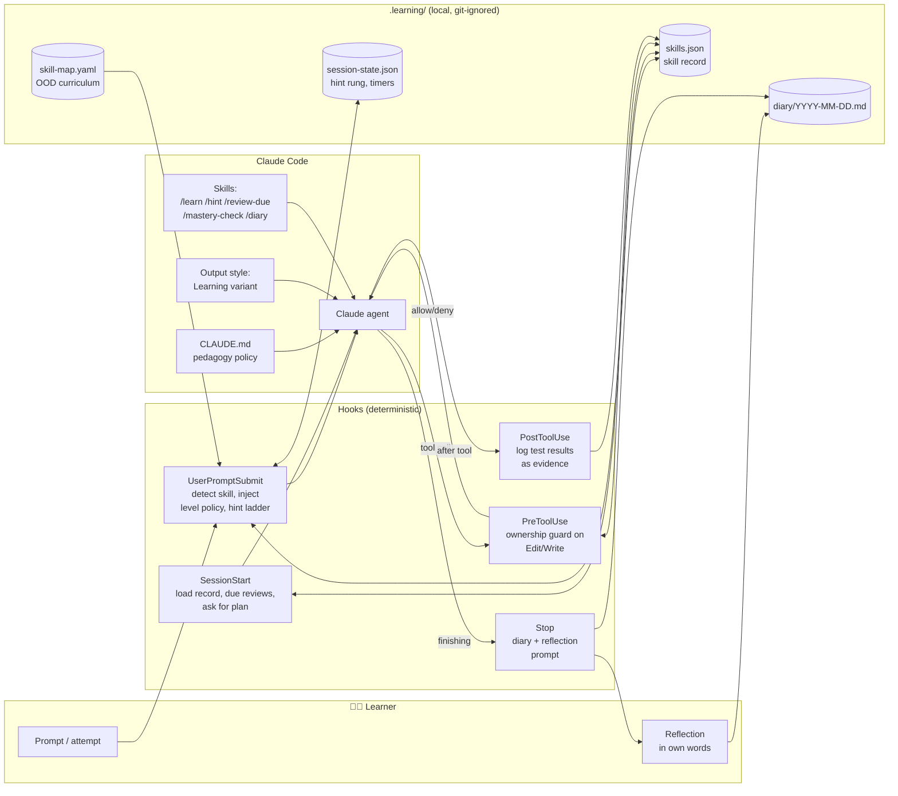

The harness puts five deterministic hooks around the Claude agent, and keeps your skill record, diary and session state in a local `.learning/` folder. CLAUDE.md, the output style and the skills shape how the agent teaches, but only the hooks enforce rules.

**As built (12 November 2026):** four hooks, two commands that only you run, three skills and one agent. The design above had a fifth hook (PostToolUse), a skill map in YAML and more skills. The build replaced the fifth hook with `check.mjs`, which you run yourself, and the map with `skills.json` (§10).

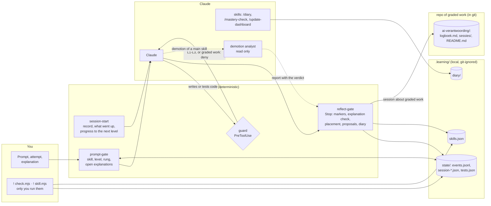

As built, the four hooks are deterministic. The guard blocks code at L1–L3, and every write in graded work (§10.8). The reflect-gate checks markers and explanations, places a new skill and shows proposals. The demotion analyst only reads, and its report goes to the reflect-gate, not into the chat.

**Design choices:**

- **Rules that must hold go in hooks.** Hooks are deterministic. Instructions in CLAUDE.md are *advisory*: the model usually follows them, but it can drift from them in long sessions. So the rule "do not write code that you own" has to be a hook.
- **Teaching behaviour goes in skills, CLAUDE.md and the output style.** This covers Socratic questions, explanations and the tone of feedback.
- **The harness keeps its state in plain files** that you can read and edit (JSON/Markdown). That keeps the system transparent, and transparency supports your autonomy (P10).

### 5.2 The Autonomy Ladder (per skill)

The harness gives each skill its own level. The five levels follow cognitive apprenticeship and worked examples that are faded step by step, with automation at the top.

| Level | Name | Who writes the code? | AI role | You must… | Grounding |
|---|---|---|---|---|---|
| **L0** | *Demonstrate* | AI | Writes a worked example with **subgoal labels** and explains it | Give text input (intent and requirements), then **self-explain** 2–3 key lines and predict outputs | Worked examples, subgoals, self-explanation |
| **L1** | *Complete* | AI writes the skeleton, you write the core | Writes scaffolding with `TODO(human)` gaps, or Parsons-style fragments | Fill in the gaps and run the tests | Completion/Parsons problems, backward fading |
| **L2** | *Guided* | You | Hint ladder only: question → concept → pseudocode → partial snippet (last resort, time-gated) | Write everything, ask for hints | Scaffolding, contingent tutoring, desirable difficulty |
| **L3** | *Independent* | You | Reviews **after** your attempt: code review, design critique, test ideas | Solve it alone, then defend your choices | Deliberate practice, feedback |
| **L4** | *Automated* | AI | Writes the code. You **review** the diff and predict the approach on samples | Supervise, plus periodic maintenance retrieval | Autonomous stage, levels of automation, ironies of automation |

**As built (10 November 2026, §10.4):** a new skill starts with your attempt, and its first task places it on a level. Going down is automatic when the evidence shows it. Going up stays your decision. Maintenance reviews exist at L4 only.

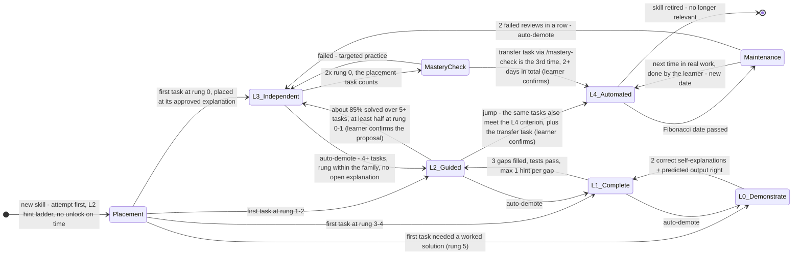

In the autonomy ladder as built, a new skill's level is set by the highest hint rung of its first task. After that, a skill can go down automatically, but going up is always your decision, and maintenance reviews happen only at L4.

- **Placement.** A skill below L4 with no history and no explained tasks of its own has an open placement. Until then it counts as L2, for the hint ladder and for the guard. So a new skill no longer starts at L0: L0 and L1 are forms of help that come *after* an attempt. The highest rung of the first task sets the level (§5.3), at the approved explanation of that task; help about another concept does not count (§10.7).
- **Auto-demote** happens only when `settings.autoDemote` is on; it is off by default. The rule looks at the skill's own explained tasks since its last level change, at most the last 10. With at least 4 of them (§10.7; 3 until 12 November), it applies when under 70% were solved (at rung ≤ 2 within the skill's own family) or the last 2 were not solved. It also applies after 2 failed reviews in a row. It waits while an explanation of that family is open, and a pending demotion is checked again on the evidence of the moment it is applied. A microskill then goes down one level. For a parent skill, the demotion analyst first decides whether a microskill or the parent goes down (§10.4.2).
- **Up** never happens automatically. You can undo any automatic change with `set`.
- **L3 → L4 (§10.7):** the task that placed the skill counts, and the transfer task is one of the three times without a hint; its day counts as a day.

??? note "Earlier version (7–9 November 2026)"

    ```mermaid
    stateDiagram-v2
        direction LR
        [*] --> L0_Demonstrate : new skill encountered

        L0_Demonstrate --> L1_Complete : 2 correct self-explanations + predicted output right
        L1_Complete --> L2_Guided : 3 gaps filled, tests pass, ≤1 hint per gap
        L2_Guided --> L3_Independent : success rate ≥85% over ≥5 tasks, avg hint rung ≤1
        L3_Independent --> MasteryCheck : 3 independent successes on ≥2 different days
        MasteryCheck --> L4_Automated : novel transfer task passed + explanation correct
        MasteryCheck --> L3_Independent : failed → targeted practice

        L1_Complete --> L0_Demonstrate : stuck twice / under 50% success
        L2_Guided --> L1_Complete : success rate under 70%
        L3_Independent --> L2_Guided : 2 failures in a row

        L4_Automated --> Maintenance : spaced review due
        L3_Independent --> Maintenance : spaced review due (revised: reviews start at L3)
        Maintenance --> L4_Automated : retrieval passed → interval grows
        Maintenance --> L3_Independent : 2 failed reviews in a row → advice to demote (learner decides)

        L4_Automated --> [*] : skill retired - no longer relevant
    ```

    In the earlier autonomy ladder (7–9 November 2026), every new skill started at L0 and moved up on fixed criteria. Reviews started at L3, and two failed reviews in a row only gave you advice to demote; the decision stayed yours.

> **"Just giving text input" at the start** is L0. You describe your intent and requirements in prose, and the AI writes a fully annotated example. Even here you are never fully passive: at L0 you give a short self-explanation or prediction before the session counts as progress (Chi et al., 1989; Kazemitabaar et al., 2025).

### 5.3 Friction calibration & the hint ladder

The hint ladder puts two ideas into practice: contingent tutoring (more help after failure, less after success; §2.3) and productive struggle (§2.2). The evidence for help in steps is good; for the contingency itself it is weak (§2.3). Help only after an own attempt fits the one classroom finding where contingency did help: after a longer period of working alone (van de Pol et al. 2015). You get the next rung only after **(a)** a visible attempt, such as code you changed or a hypothesis you stated, **or (b)** when the stuck timer runs out. This rule keeps the struggle productive, so that it does not turn into floundering.

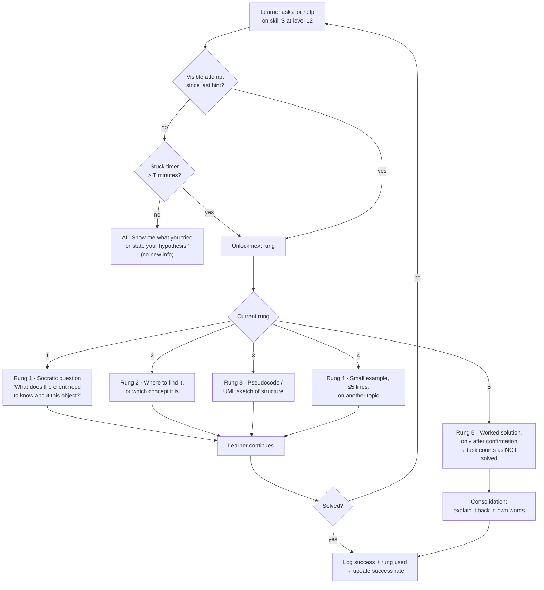

At level L2, the next hint rung unlocks only after a visible attempt, or when the stuck timer runs out. The five rungs run from a Socratic question to a worked solution; a task that needs the worked solution counts as failed.

**Calibration rules** (contingent tutoring, with about 85% success as a rule of thumb; §2.2 explains why this is a heuristic and not evidence):

- The harness keeps a **rolling success rate** for each skill. It counts only successes at rung ≤ 2.
- **> 95%** → too easy. Make the tasks harder, or mix in other skills (interleaving). Check whether you meet the criteria for the next level.
- **70–95%** → in the zone. Keep going.
- **< 70%** → too hard. Shorten the stuck timer `T` (e.g. 15 → 8 min), choose easier tasks, or go down one level.
- For L2, `T` starts at **10–15 minutes**. That is within the time in which confusion can still be productive (D'Mello et al., 2014). You can change `T`.

**As built (10 November 2026, §10.4):** for a **new skill** whose placement is still open (§5.2), rungs do **not** unlock on time. A rung goes up only when:

- you say you are stuck;
- you share the same error or test outcome twice;
- you say you do not know the concept.

If you ask for more explanation after an attempt of your own, Claude may go straight up to rung 4. The rung Claude really gives is logged through its `[trede N]` marker, and it counts towards the placement. For normal L2 tasks the stuck timer `T` stays at 12 minutes, but it counts active time only: a break longer than `idleMinutes` (default 20) does not count.

### 5.4 Hook pipeline

The diagram follows one session and shows when each hook steps in.

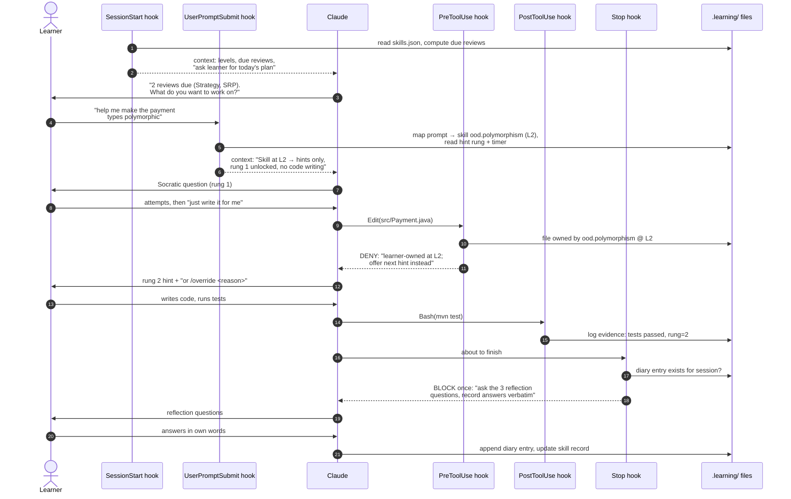

In an example session, the PreToolUse hook denies Claude's edit to a file of an L2 skill, so Claude gives the next hint instead. At the end, the Stop hook blocks once, so that Claude asks three reflection questions and you answer them in your own words.

**As built (12 November 2026):** the same session with the hooks and the command that exist now.

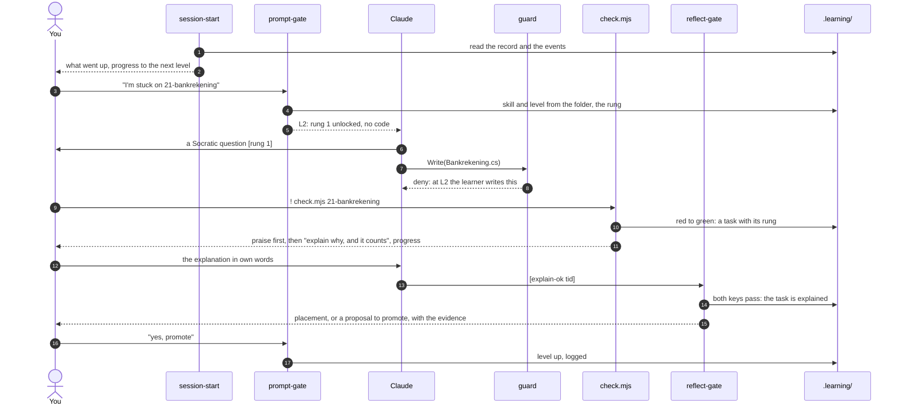

As built, you run the tests yourself with `check.mjs`. It logs the task, praises first and shows your progress. The reflect-gate approves the explanation with two keys. A placement or a proposal to promote comes from the harness itself, and only your own "yes, promote" raises the level.

| Hook | Event | Job | Can it block? |
|---|---|---|---|
| `session-start.mjs` | `SessionStart` | Gives Claude a summary of your skill record, the reviews due today, and the instruction to ask you for a plan (*forethought*). *Revised (§10.4, §10.7):* no reviews at the start any more; it shows you what went up in the last 7 days, your progress towards the next level in steps, and once that effort is the goal | No (context only) |
| `prompt-gate.mjs` | `UserPromptSubmit` | Matches your prompt to a skill using keywords from `skill-map.yaml`, adds the policy for that level and the current hint rung, starts or updates the stuck timer, and handles `/override`. *Revised (§10.2, item 10):* ignores agent reports, task notifications and system reminders, and logs `prompt-ignored` | Can add context. Can block only on abuse patterns (optional) |
| `ownership-guard.mjs` | `PreToolUse` (matcher `Edit\|Write\|MultiEdit\|NotebookEdit`) | Blocks AI edits to files, or parts of files, that belong to a skill at L1–L3. At L1 it allows a write only if it contains `TODO(human)` gaps | **Yes** (`permissionDecision: deny`) |
| ~~`evidence-log.mjs`~~ → `check.mjs` (built) | CLI, which you run yourself with `!` | *Revised (§10):* because you run the tests yourself, a PostToolUse hook never sees them. `check.mjs` runs `dotnet test` with a trx logger, prints a readable summary, remembers per test method whether it was green, and logs a red→green transition as a task with the current hint rung. It works for any .NET test project (practice exercises and project work) | No |
| `reflect-gate.mjs` | `Stop` | If you worked on a skill and there is no diary entry yet, it blocks **once** and tells Claude to run the reflection. It uses `stop_hook_active` to avoid loops. *Revised (§10):* it also reads Claude's last answer from the transcript and processes the `[trede N]` and `[uitleg-ok <tid>]` markers. That second marker is accepted only if your own message passes the deterministic explanation check. *Revised (§10.7):* at an approved explanation it places a new skill; it checks a pending demotion again; and it reads the demotion analyst's verdict from the agent's report. *Revised (§10.10):* it logs check questions, notes when Claude asked for the confidence, and writes the learner's own words in the AI-use log | Yes, once |
| `session-end.mjs` | `SessionEnd` | *Added (§10.10):* notes how a session ended and whether there was work without a diary entry, so the next start can offer a catch-up diary | No |
| `graded-gate.mjs` (user level, optional) | `UserPromptSubmit` and `PreToolUse`, in every project outside the graded folder | *Added (§10.10):* blocks a prompt that names the graded assignment and refuses every tool on its paths, reading too; the setup (`.claude/`, `CLAUDE.md`) stays open | **Yes** |

!!! example "Example: one student's situation"
    The harness was first tried by a second-year HBO-ICT student who practised OOD in C#. The course exercises came with .NET unit tests, and the student ran them, not Claude. That is why `check.mjs` runs `dotnet test`. The diagrams and examples in this section still use Java from the original design (`mvn test`, `src/Payment.java`).

### 5.5 Skill record (data model)

The skill record is where the harness keeps track of your progress. It follows the idea of knowledge tracing (a probability of mastery for each skill, updated from evidence) and the scheduling of spaced repetition. The subject is OOD, so here it is as a class diagram:

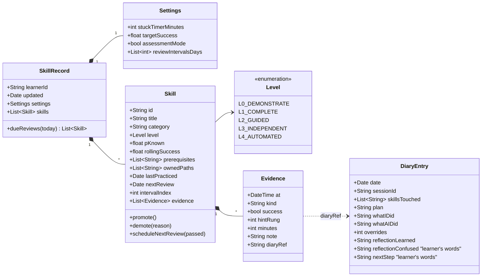

As designed, the skill record gives each skill a level (L0–L4), a probability of mastery, review dates and its own evidence. Each evidence item records success, hint rung and minutes, and can link to a diary entry.

**Example `skills.json` entry:**

```json
{
  "id": "ood.strategy-pattern",
  "title": "Strategy pattern",
  "category": "design",
  "level": "L3_INDEPENDENT",
  "pKnown": 0.82,
  "rollingSuccess": 0.86,
  "prerequisites": ["ood.polymorphism", "ood.interfaces"],
  "ownedPaths": ["src/main/java/shop/pricing/**"],
  "lastPracticed": "2026-11-05",
  "nextReview": "2026-11-12",
  "intervalIndex": 1,
  "evidence": [
    {"at": "2026-11-03T14:10", "kind": "task", "success": true, "hintRung": 1, "minutes": 22, "diaryRef": "2026-11-03#s2"},
    {"at": "2026-11-05T10:02", "kind": "task", "success": true, "hintRung": 0, "minutes": 14, "diaryRef": "2026-11-05#s1"}
  ]
}
```

**As built (after the first sessions, §10):** the record is flatter than the class diagram above. Each entry has `id`, `title`, `level`, `paths`, `nextReview`, `intervalIndex`, `failStreak` and `history`. The harness does not store evidence inside the skill. It writes it to a log that only grows (append-only), `.learning/state/events.jsonl`, with events such as `task`, `task-explained`, `test-green`, `hint-unlock` and `review`. **Microskills** are parts of a skill: entries with a `parent` and their own `keywords`:

```json
{ "id": "cs.basis.void-chaining", "parent": "cs.basis", "title": "void-methoden en chainen",
  "level": "L2", "keywords": ["reverse()", "chainen", "void"], "nextReview": null, "intervalIndex": 0 }
```

### 5.6 AI diary & reflection loop

The diary follows the cycle of self-regulated learning (Zimmerman, 2002) and uses **prompted learning protocols** (Nückles et al., 2009): you write in answer to a few set questions. The AI logs the facts. You write the reflection.

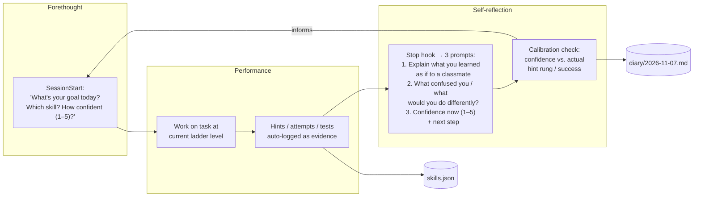

The diary and reflection loop runs from forethought (goal and confidence) through performance (work, logged as evidence) to self-reflection at the Stop hook. A calibration check compares your confidence with your actual hint rung and success, and informs your next plan.

**Diary entry template** (for example `.learning/diary/2026-11-07.md`):

```markdown
## Session 2 · 14:05–15:10 · skills: ood.polymorphism (L2), ood.srp (review)

**Plan (me):** Refactor PaymentProcessor so new payment types don't need if/else. Confidence: 2/5

**Facts (logged):**
- Hint rungs used: 1, 2 (no rung ≥3) · stuck timer fired: 0×
- Tests: 3 runs, last ✅ 12/12
- AI wrote: test skeleton only · I wrote: Payment interface, 3 implementations
- Overrides: 0 · Review SRP: passed → next review 2026-11-14

**Reflection (my words):**
1. *Learned:* The if/else on type was a smell; each payment class now owns its own `process()` behaviour...
2. *Confused / differently:* Not sure whether `validate()` belongs in the interface or a separate validator...
3. *Confidence now:* 4/5 · *Next:* try the same with discounts (Strategy?)

**Calibration:** predicted 2 → performed at rung ≤2 → under-confident ✅ (good sign)
```

**Weekly diary review** (15 minutes, `/diary --week`): Claude summarizes the trends of the week: the success rate per skill, the number of overrides, gaps in calibration, and the skills closest to the next level. *You* decide what to focus on next week. In this way the review helps you monitor your own learning, without doing the monitoring for you.

### 5.7 Spaced reinforcement after mastery

Once you have mastered a skill, the harness keeps checking it now and then. Reviews use **expanding intervals**, adjusted to your results in the style of Leitner and half-life regression. They also **interleave** skills, which trains you to choose the right principle. Expanding intervals are not proven better than equal ones (§2.5). Spacing and retrieval do the work. The schedule mainly makes sure that early reviews succeed and that reviews fall before your exam. Review tasks are *retrieval* tasks, not re-reading:

- *"Without looking: sketch the class diagram for a Strategy-based shipping cost calculator."*
- *"Here are 3 code snippets. Which violates LSP, and why?"* (interleaved discrimination)
- *"Predict what the AI's design for X will look like before it generates it, then compare."* This supervision check is for L4 skills.

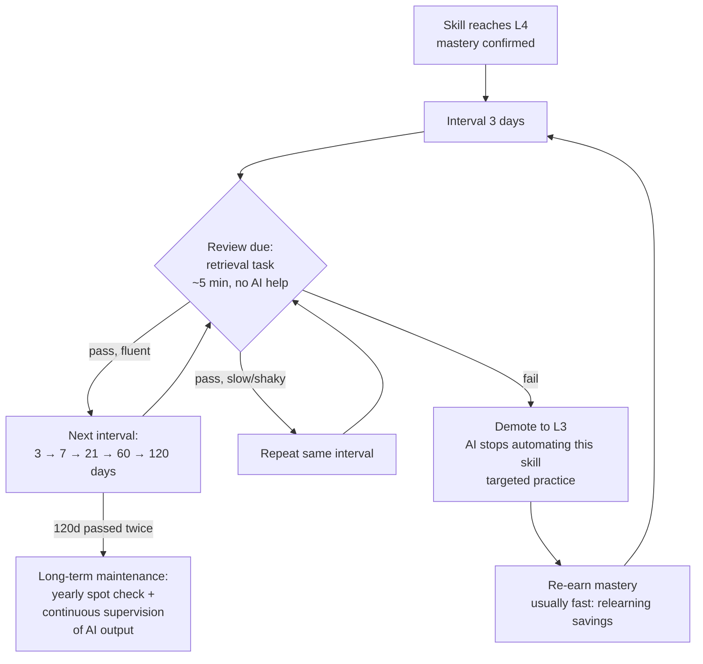

In the original design, an L4 skill gets retrieval reviews without AI at growing intervals: 3, 7, 21, 60 and 120 days. A shaky pass repeats the interval, and a fail demotes the skill to L3, so the AI stops automating it.

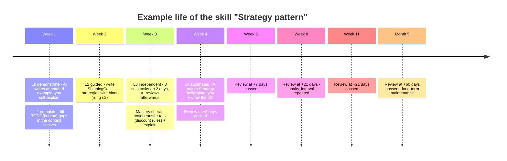

In an example timeline from the original design, the skill "Strategy pattern" goes from L0 in week 1 to L4 in week 4. After that it is still checked, less and less often, and a shaky review at +21 days repeats that interval.

At the start of each session, the **`SessionStart` hook** shows the reviews that are due. So reinforcement happens automatically, and you do not have to remember it. This is the "enforce learning as long as needed" part: a skill is *never permanently out of the loop*. It just gets checked less and less often.

**As built (10 November 2026, §10.4):** reviews now happen in your real work, and only at L4.

- **No separate review exercises.** A review is the **next time the skill comes up in your real work** after its date: through its folder, its keywords, or a `check.mjs` run that is mapped to it. The hook then says so once. This time you do that part yourself, not the AI: while the review is due, the guard treats the skill's paths as L3.
- **Fibonacci intervals:** 1, 2, 3, 5, 8, 13, 21, 34 … days, for **L4 skills and microskills only**. An L3 skill needs no schedule, because you do it yourself whenever it comes up.
- **The rung of that task sets the outcome:**
    - rung 0 → `pass`, one step up the sequence;
    - rung 1–2 → `shaky`, the interval repeats;
    - rung 3–5 or a failed task → `fail`, **two steps back**.
- **After two fails in a row:** the rule for automatic demotion applies (§5.2, §10.4.2). With `autoDemote` off, you get advice to go down one level.
- **If the skill does not come up:** nothing happens, and the review waits. Nothing appears at the start of a session. The dashboard shows no "overdue", only when you last saw the skill.
- **Before your exam:** with `settings.examDate` set, a review falls no later than 3 days before the exam. The safety net before the exam is your course's practice exams. They are deliberately outside the harness.

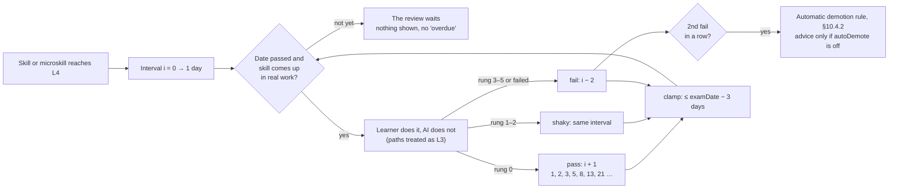

As built, an L4 skill is reviewed when it first comes up in real work after its date; you do that part yourself. Rung 0 moves the Fibonacci interval one step up, rung 1–2 repeats it, and rung 3–5 or a fail moves it two steps back.

??? note "Earlier version as built (§10, 7 November 2026)"

    The harness replaced the 3 → 7 → 21 → 60 → 120 schedule above.

    - **Fibonacci intervals:** 1, 2, 3, 5, 8, 13, 21, 34 … days.
    - **Starting point:** reviews start as soon as a skill or microskill reaches **L3**, not L4. That fits the goal "mastered → only occasional reinforcement".
    - **After a review:** `pass` moves one step up the sequence, `shaky` repeats the interval, and `fail` moves **two steps back**.
    - **After two fails in a row:** the harness *advises* you to go down one level. It never demotes a skill automatically.
    - **Before your exam:** if you set your exam date in `settings.examDate`, the harness shortens every interval so that the review falls no later than 3 days before the exam.

    ```mermaid
    flowchart LR
        S[Skill or microskill reaches L3] --> I["Interval i = 0 → 1 day"]
        I --> Q{Retrieval review<br/>~5 min, no help}
        Q -- pass --> UP["i + 1<br/>1, 2, 3, 5, 8, 13, 21 …"]
        Q -- shaky --> SAME[same interval]
        Q -- fail --> BACK["i − 2"]
        BACK --> F{2nd fail<br/>in a row?}
        F -- yes --> ADV[Advice: one level down<br/>learner decides]
        UP & SAME & BACK --> C["clamp: ≤ examDate − 3 days"] --> Q
    ```

    In the earlier version as built (7 November 2026), reviews were short retrieval tasks without help, on Fibonacci intervals from L3 onwards. After two fails in a row, the harness only advised you to go down one level and never demoted a skill automatically.

### 5.8 OOD skill map

The OOD map in the harness (`harness/maps/ood/skills.json`) is a list of skills, each with its own exercise folders and keywords. It was built from the gaps the diagnostic test showed. Since 11 November 2026 it also has the OO design that the course's final assessment grades: polymorphism, SOLID and modularity, layers with controllers and dependency injection, and the UML sequence and component diagrams. Later that evening the map was laid next to the test assignment, the grading form and the pilot student's cheat sheet. Ten skills came out of that: logging (indicator 3.1.1), integration, system and UI tests (indicator 3.1.4 and the test plan), and from the cheat sheet upcasting and downcasting, static members, records and structs, object methods, other C# (sealed, indexers, operator overloading, nested classes) and the three families of design patterns. A family is one skill; if you practise one pattern on its own, it becomes a microskill.

The map has **no prerequisites**. The order comes from the numbered exercises, and a new skill starts with a placement: your first task sets the level (§5.2). If something is missing, you add a skill yourself with `skill.mjs add`.

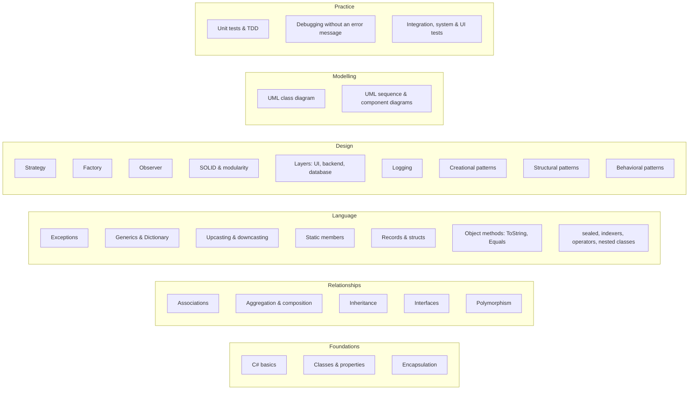

The skills of the OOD map, by group. There are no arrows between them: the order comes from the exercises, not from the map.

**What the map does not cover.** The final assessment also grades security, the cloud and a CI/CD pipeline, the database and the report. They are not in the map; the pilot student chose that on 11 November 2026. The guard does protect the files of such a project: next to C# also `.razor`, `.cshtml`, `.sql`, the pipeline (`.yml`), `Dockerfile` and `appsettings*.json` (see [Configuration](configuration.md)).

??? note "Original design (7 November 2026): a graph with prerequisites"

    `skill-map.yaml` defines the curriculum as a graph: which skills unlock which, and which keywords the harness uses to detect skills in your prompts. A skill becomes available at L0 once its prerequisites are at L2 or higher. A skill can only be automated (L4) when its prerequisites are at L4 as well. That way the AI never automates something whose foundations you cannot supervise.

    ```mermaid
    flowchart TD
        subgraph Foundations
            A1[Classes & objects<br/>state, identity, behaviour]
            A2[Encapsulation<br/>& access modifiers]
            A3[Constructors &<br/>object lifecycle]
        end
        subgraph Relationships
            B1[Association /<br/>aggregation / composition]
            B2[Inheritance]
            B3[Interfaces &<br/>abstract classes]
            B4[Polymorphism<br/>dynamic dispatch]
        end
        subgraph Modelling
            C1[UML class diagrams]
            C2[UML sequence diagrams]
            C3[Responsibility assignment<br/>GRASP / CRC]
        end
        subgraph Principles
            D1[SRP]
            D2[Open/Closed]
            D3[Liskov Substitution]
            D4[Interface Segregation]
            D5[Dependency Inversion]
            D6[Composition over<br/>inheritance]
        end
        subgraph Patterns
            E1[Strategy]
            E2[Observer]
            E3[Factory Method /<br/>Abstract Factory]
            E4[Decorator]
            E5[Adapter]
            E6[State]
        end
        subgraph Practice
            F1[Unit testing / TDD]
            F2[Code smells &<br/>refactoring]
            F3[Dependency injection]
        end
        A1 --> A2 --> A3
        A1 --> B1 & B2
        B2 --> B3 --> B4
        A1 --> C1
        B1 & B2 --> C1
        C1 --> C2
        C1 --> C3 --> D1
        B4 --> D2 & D3
        B3 --> D4 & D5
        B1 & B2 --> D6
        D2 & B4 --> E1
        D5 --> E2
        D5 --> E3
        D6 --> E4 & E5
        E1 --> E6
        D1 --> F2
        F1 --> F2
        D5 --> F3
    ```

    The OOD skill map shows which skills unlock which: from classes and objects, through relationships and modelling, to principles and then patterns. A skill can only reach L4, the level where the AI automates it, once its prerequisites are at L4 too.

---

<a id="6-evaluation"></a>

## 6. Evaluation {#evaluation}

How do you know whether the harness protects your learning and does not just add friction? Check these points:

1. **Unassisted transfer tests** at the start (baseline), after about a month, and shortly before your exam. Use small OOD tasks *without AI*: design a class diagram, refactor a smelly class, apply a pattern to a new domain. This is the measure that matters most. Bastani et al. (2025) showed that how well you do in practice with AI tells you little about how well you do without it.
2. **Success rate per skill** should stay around 70–95%. If it stays above 95%, the friction is too low. If it stays below 70%, the friction is too high.
3. **Override rate.** If it rises, that is a sign of frustration (R6) or of bypassing the rules (R5). Read the reasons in the diary.
4. **Calibration.** The gap between your predicted confidence and how independently you actually work should shrink over time (R2).
5. **Review pass rate** for L4 skills should be 80% or higher. If it is lower, shorten the intervals.
6. **Time to mastery per skill.** It should *decrease* for later skills that build on prerequisites you have already mastered. This is a transfer effect.
7. **Mock exam vs. practice (R14).** Do a timed mock exam without AI, in the same environment (IDE) as your exam. Compare your score with your success rate in practice. A big gap means that your practice conditions are too easy, or too different from the test.
8. **Supervision check (R16, after your exam).** Take a short class written by AI, with planted OOD and test flaws, and count how many flaws you find without help. Repeat this every month.

### 6.1 Invitation to researchers: a randomized trial

The checks above are for one learner. Whether the harness works in general needs a randomized controlled trial. The page [For researchers](researchers.md) proposes one. In short:

- **Arms:** Claude Code without restrictions; Claude Code with a learning prompt only (the *Learning* output style); Claude Code with the harness.
- **Participants:** students in a programming course, or junior developers with 0–2 years of experience.
- **Primary outcome:** a timed transfer test without AI, at least eight weeks after the last practice.
- **Secondary outcomes:** planted flaws found in code written by AI, tasks completed, time to L4, and overrides.
- **Maintenance within one person:** randomize which L4 skills get reviews.

---

<a id="7-limitations"></a>

## 7. Limitations {#limitations}

- **The evidence base is young.** Most studies on generative AI date from 2023–2026. They often have small samples or short durations, or they are preprints and working papers (e.g. Kosmyna et al., 2025; Shen & Tamkin, 2026; Lehmann et al., 2025; most of the 2026 trials in §2.8). In higher education, only one study has measured retention beyond about a week: a quasi-experiment with a seven-week test (Albadarin, 2026). The Stanford SCALE review (November 2026) also finds long-term gains still unshown. Effects may change as the tools change.
- **A narrative review, corrected once.** There was no search protocol, and the first version overstated several findings (§11). The revision added evidence grades and targeted searches. It is still not systematic, so selection bias is possible.
- **Little OOD-specific AI research, and none on agentic tools.** Most studies of AI in computing education focus on programming tasks from CS1 (the first programming course). Applying them to design skills is an inference from research on OOD misconceptions plus general learning science. No controlled study yet exists of how students learn with agentic tools like Claude Code.
- **The evidence on the skill shift is mostly American, descriptive and commercial.** Causal labour-market studies disagree. Dutch data are thin and correlational. The figures on how much code AI writes come mainly from companies that sell AI. No study measures the best mix of practice by hand and practice in supervision, so §2.9 and §4.1 are inferences.
- **Conflict of interest.** This document was written by Claude, an Anthropic model, and it relies in places on Anthropic research. Check the important claims through the linked sources.
- **Hooks are a commitment device, not security.** You can always switch them off, and the AI can sometimes find routes around the rules (e.g. shell commands that write files). So the harness cannot prove to a teacher that a student worked without AI. It works because *you* chose it. The `PreToolUse` matcher can be extended to `Bash` for common file-writing commands, but this will never be airtight. Hooks can also misfire the other way. In the first sessions of the pilot, reports from background agents were treated as the student's own prompts and unlocked hint rungs, until this was fixed (§10.2, item 10).
- **Tried by one student so far.** The design was first tried in a pilot with one student. What §10 reports comes from those first sessions. It shows what went wrong and what was changed, not how well the harness works for students in general.
- **Not tried at work.** The case for junior developers at work (§2.12) rests on a short-term experiment, small interview studies, analogies with other professions, and practitioner sources of grade D. No junior developer has used the harness at work yet.
- **Practitioner sources show concern, not proof.** The talks, interviews, news articles and blog posts in §2.12 show that the concern is widespread. They do not show that it is true.
- **Mastery thresholds are heuristics.** The numbers (85%, 3 successes over 2 days, the intervals) come from the literature, but they have not been validated for this setup. Adjust them using your own evaluation data (§6).
- **Detecting skills from prompts is approximate.** Matching on keywords will sometimes pick the wrong skill. Let the AI propose a skill and confirm it, or name the skill yourself (`/learn ood.strategy`).

---

<a id="how-to-cite-this-review"></a>

## How to cite this review {#cite}

Written by Piet Hanegraaf with Claude (Anthropic); see the [AI statement](ai-statement.md). Cite the version and the date you read, because the review is updated.

**APA**

> Hanegraaf, P. (2026). *Learning to code (and OOD) with AI: Literature review, risk assessment and a learning-preserving Claude Code setup* (version of 11 November 2026; written with Claude, Anthropic). https://piethanegraaf.github.io/en/research/

**BibTeX**

```bibtex
@misc{hanegraaf2026learning,
  author       = {Hanegraaf, Piet},
  title        = {Learning to Code (and {OOD}) with {AI}: Literature Review, Risk Assessment and a Learning-Preserving {Claude Code} Setup},
  year         = {2026},
  month        = nov,
  howpublished = {\url{https://piethanegraaf.github.io/research/}},
  note         = {Version of 11 November 2026. Written with Claude (Anthropic).}
}
```

---

<a id="8-references"></a>

## 8. References {#references}

*Classic references are cited from established literature. Recent generative AI studies were checked against the publisher or arXiv records at the time of writing. Preprints (not peer reviewed) are marked.*

**How the sources were verified.** Two citation checks compared the claims in this review with their primary sources: one for the [generative AI studies](https://github.com/piethanegraaf/piethanegraaf.github.io/blob/main/research/citation-checks/citation_check_genai.md) and one for the [learning science](https://github.com/piethanegraaf/piethanegraaf.github.io/blob/main/research/citation-checks/citation_check_learning_science.md). The corrections that came out of them are in the [change log](#11-change-log).

**Learning to program & OOD**

- Becker, B. A., Denny, P., Finnie-Ansley, J., Luxton-Reilly, A., Prather, J., & Santos, E. A. (2023). Programming is hard – or at least it used to be: Educational opportunities and challenges of AI code generation. *Proc. SIGCSE 2023*, 500–506.
- Chi, M. T. H., Bassok, M., Lewis, M. W., Reimann, P., & Glaser, R. (1989). Self-explanations: How students study and use examples in learning to solve problems. *Cognitive Science, 13*(2), 145–182.
- Eckerdal, A., & Thuné, M. (2005). Novice Java programmers' conceptions of "object" and "class", and variation theory. *Proc. ITiCSE 2005*, 89–93.
- Ericson, B. J., Margulieux, L. E., & Rick, J. (2017). Solving Parsons problems versus fixing and writing code. *Proc. Koli Calling 2017*, 20–29.
- Holland, S., Griffiths, R., & Woodman, M. (1997). Avoiding object misconceptions. *Proc. SIGCSE 1997*, 131–134.
- Kölling, M. (1999). The problem of teaching object-oriented programming, Part 1: Languages. *Journal of Object-Oriented Programming, 11*(8), 8–15.
- Lister, R., et al. (2004). A multi-national study of reading and tracing skills in novice programmers. *ACM SIGCSE Bulletin, 36*(4), 119–150.
- Lopez, M., Whalley, J., Robbins, P., & Lister, R. (2008). Relationships between reading, tracing and writing skills in introductory programming. *Proc. ICER 2008*, 101–112.
- Margulieux, L. E., Catrambone, R., & Guzdial, M. (2012). Subgoal-labeled instructional material improves performance and transfer in learning to develop mobile applications. *Proc. ICER 2012*, 71–78.
- McCracken, M., et al. (2001). A multi-national, multi-institutional study of assessment of programming skills of first-year CS students. *ACM SIGCSE Bulletin, 33*(4), 125–180.
- Morrison, B. B., Margulieux, L. E., & Guzdial, M. (2015). Subgoals, context, and worked examples in learning computing problem solving. *Proc. ICER 2015*, 21–29.
- Parsons, D., & Haden, P. (2006). Parson's programming puzzles: A fun and effective learning tool for first programming courses. *Proc. ACE 2006*, 157–163.
- Ragonis, N., & Ben-Ari, M. (2005). A long-term investigation of the comprehension of OOP concepts by novices. *Computer Science Education, 15*(3), 203–221.
- Robins, A., Rountree, J., & Rountree, N. (2003). Learning and teaching programming: A review and discussion. *Computer Science Education, 13*(2), 137–172.
- Sanders, K., & Thomas, L. (2007). Checklists for grading object-oriented CS1 programs: Concepts and misconceptions. *Proc. ITiCSE 2007*, 166–170.

**Learning science: friction, scaffolding, mastery, retention, reflection**

- Adesope, O. O., Trevisan, D. A., & Sundararajan, N. (2017). Rethinking the use of tests: A meta-analysis of practice testing. *Review of Educational Research, 87*(3), 659–701.
- Aleven, V., & Koedinger, K. R. (2000). Limitations of student control: Do students know when they need help? *Proc. ITS 2000*, LNCS 1839, 292–303.
- Aleven, V., Stahl, E., Schworm, S., Fischer, F., & Wallace, R. (2003). Help seeking and help design in interactive learning environments. *Review of Educational Research, 73*(3), 277–320.
- Anderson, J. R. (1982). Acquisition of cognitive skill. *Psychological Review, 89*(4), 369–406.
- Anderson, J. R., Corbett, A. T., Koedinger, K. R., & Pelletier, R. (1995). Cognitive tutors: Lessons learned. *Journal of the Learning Sciences, 4*(2), 167–207.
- Ariely, D., & Wertenbroch, K. (2002). Procrastination, deadlines, and performance: Self-control by precommitment. *Psychological Science, 13*(3), 219–224.
- Arthur, W., Jr., Bennett, W., Jr., Stanush, P. L., & McNelly, T. L. (1998). Factors that influence skill decay and retention: A quantitative review and analysis. *Human Performance, 11*(1), 57–101.
- Atkinson, R. K., Renkl, A., & Merrill, M. M. (2003). Transitioning from studying examples to solving problems: Effects of self-explanation prompts and fading worked-out steps. *Journal of Educational Psychology, 95*(4), 774–783.
- Baker, R. S., Corbett, A. T., Koedinger, K. R., & Wagner, A. Z. (2004). Off-task behavior in the cognitive tutor classroom: When students "game the system". *Proc. CHI 2004*, 383–390.
- Bertsch, S., Pesta, B. J., Wiscott, R., & McDaniel, M. A. (2007). The generation effect: A meta-analytic review. *Memory & Cognition, 35*(2), 201–210.
- Bjork, R. A. (1994). Memory and metamemory considerations in the training of human beings. In J. Metcalfe & A. Shimamura (Eds.), *Metacognition: Knowing about knowing* (pp. 185–205). MIT Press.
- Bjork, E. L., & Bjork, R. A. (2011). Making things hard on yourself, but in a good way: Creating desirable difficulties to enhance learning. In M. A. Gernsbacher et al. (Eds.), *Psychology and the real world* (pp. 56–64). Worth.
- Bloom, B. S. (1968). Learning for mastery. *Evaluation Comment, 1*(2). UCLA-CSEIP.
- Bloom, B. S. (1984). The 2 sigma problem: The search for methods of group instruction as effective as one-to-one tutoring. *Educational Researcher, 13*(6), 4–16.
- Boud, D., Keogh, R., & Walker, D. (Eds.). (1985). *Reflection: Turning experience into learning*. Kogan Page.
- Brunmair, M., & Richter, T. (2019). Similarity matters: A meta-analysis of interleaved learning and its moderators. *Psychological Bulletin, 145*(11), 1029–1052.
- Cepeda, N. J., Pashler, H., Vul, E., Wixted, J. T., & Rohrer, D. (2006). Distributed practice in verbal recall tasks: A review and quantitative synthesis. *Psychological Bulletin, 132*(3), 354–380.
- Cepeda, N. J., Vul, E., Rohrer, D., Wixted, J. T., & Pashler, H. (2008). Spacing effects in learning: A temporal ridgeline of optimal retention. *Psychological Science, 19*(11), 1095–1102.
- Collins, A., Brown, J. S., & Newman, S. E. (1989). Cognitive apprenticeship: Teaching the crafts of reading, writing, and mathematics. In L. B. Resnick (Ed.), *Knowing, learning, and instruction* (pp. 453–494). Erlbaum.
- Corbett, A. T., & Anderson, J. R. (1994). Knowledge tracing: Modeling the acquisition of procedural knowledge. *User Modeling and User-Adapted Interaction, 4*(4), 253–278.
- Csikszentmihalyi, M. (1990). *Flow: The psychology of optimal experience*. Harper & Row.
- D'Mello, S., Lehman, B., Pekrun, R., & Graesser, A. (2014). Confusion can be beneficial for learning. *Learning and Instruction, 29*, 153–170.
- Dreyfus, S. E., & Dreyfus, H. L. (1980). *A five-stage model of the mental activities involved in directed skill acquisition*. University of California, Berkeley (ORC 80-2).
- Driskell, J. E., Willis, R. P., & Copper, C. (1992). Effect of overlearning on retention. *Journal of Applied Psychology, 77*(5), 615–622.
- Dunlosky, J., Rawson, K. A., Marsh, E. J., Nathan, M. J., & Willingham, D. T. (2013). Improving students' learning with effective learning techniques. *Psychological Science in the Public Interest, 14*(1), 4–58.
- Ebbinghaus, H. (1885/1913). *Memory: A contribution to experimental psychology*. Teachers College.
- Ericsson, K. A., Krampe, R. T., & Tesch-Römer, C. (1993). The role of deliberate practice in the acquisition of expert performance. *Psychological Review, 100*(3), 363–406.
- Fitts, P. M., & Posner, M. I. (1967). *Human performance*. Brooks/Cole.
- Hattie, J., & Timperley, H. (2007). The power of feedback. *Review of Educational Research, 77*(1), 81–112.
- Kalyuga, S., Ayres, P., Chandler, P., & Sweller, J. (2003). The expertise reversal effect. *Educational Psychologist, 38*(1), 23–31.
- Kang, S. H. K. (2016). Spaced repetition promotes efficient and effective learning: Policy implications for instruction. *Policy Insights from the Behavioral and Brain Sciences, 3*(1), 12–19.
- Kapur, M. (2008). Productive failure. *Cognition and Instruction, 26*(3), 379–424.
- Kapur, M. (2016). Examining productive failure, productive success, unproductive failure, and unproductive success in learning. *Educational Psychologist, 51*(2), 289–299.
- Karpicke, J. D., & Roediger, H. L. (2008). The critical importance of retrieval for learning. *Science, 319*(5865), 966–968.
- Kirschner, P. A., Sweller, J., & Clark, R. E. (2006). Why minimal guidance during instruction does not work. *Educational Psychologist, 41*(2), 75–86.
- Koriat, A., & Bjork, R. A. (2005). Illusions of competence in monitoring one's knowledge during study. *Journal of Experimental Psychology: Learning, Memory, and Cognition, 31*(2), 187–194.
- Kornell, N., & Bjork, R. A. (2008). Learning concepts and categories: Is spacing the "enemy of induction"? *Psychological Science, 19*(6), 585–592.
- Kulik, C.-L. C., Kulik, J. A., & Bangert-Drowns, R. L. (1990). Effectiveness of mastery learning programs: A meta-analysis. *Review of Educational Research, 60*(2), 265–299.
- Latimier, A., Peyre, H., & Ramus, F. (2021). A meta-analytic review of the benefit of spacing out retrieval practice episodes on retention. *Educational Psychology Review, 33*, 959–987.
- Leitner, S. (1972). *So lernt man lernen*. Herder.
- Metcalfe, J. (2017). Learning from errors. *Annual Review of Psychology, 68*, 465–489.
- Metcalfe, J., & Kornell, N. (2005). A region of proximal learning model of study time allocation. *Journal of Memory and Language, 52*(4), 463–477.
- Moon, J. A. (2006). *Learning journals: A handbook for reflective practice and professional development* (2nd ed.). Routledge.
- Nückles, M., Hübner, S., & Renkl, A. (2009). Enhancing self-regulated learning by writing learning protocols. *Learning and Instruction, 19*(3), 259–271.
- Nückles, M., Roelle, J., Glogger-Frey, I., Waldeyer, J., & Renkl, A. (2020). The self-regulation-view in writing-to-learn: Using journal writing to optimize cognitive load in self-regulated learning. *Educational Psychology Review, 32*, 1089–1126.
- Pea, R. D. (2004). The social and technological dimensions of scaffolding and related theoretical concepts. *Journal of the Learning Sciences, 13*(3), 423–451.
- Puntambekar, S., & Hübscher, R. (2005). Tools for scaffolding students in a complex learning environment: What have we gained and what have we missed? *Educational Psychologist, 40*(1), 1–12.
- Renkl, A., & Atkinson, R. K. (2003). Structuring the transition from example study to problem solving in cognitive skill acquisition. *Educational Psychologist, 38*(1), 15–22.
- Roediger, H. L., & Karpicke, J. D. (2006). Test-enhanced learning: Taking memory tests improves long-term retention. *Psychological Science, 17*(3), 249–255.
- Rohrer, D., & Taylor, K. (2007). The shuffling of mathematics problems improves learning. *Instructional Science, 35*, 481–498.
- Rohrer, D., Taylor, K., Pashler, H., Wixted, J. T., & Cepeda, N. J. (2005). The effect of overlearning on long-term retention. *Applied Cognitive Psychology, 19*(3), 361–374.
- Ryan, R. M., & Deci, E. L. (2000). Self-determination theory and the facilitation of intrinsic motivation, social development, and well-being. *American Psychologist, 55*(1), 68–78.
- Schön, D. A. (1983). *The reflective practitioner*. Basic Books.
- Settles, B., & Meeder, B. (2016). A trainable spaced repetition model for language learning. *Proc. ACL 2016*, 1848–1858.
- Shute, V. J. (2008). Focus on formative feedback. *Review of Educational Research, 78*(1), 153–189.
- Slamecka, N. J., & Graf, P. (1978). The generation effect: Delineation of a phenomenon. *Journal of Experimental Psychology: Human Learning and Memory, 4*(6), 592–604.
- Sweller, J. (1988). Cognitive load during problem solving: Effects on learning. *Cognitive Science, 12*(2), 257–285.
- Sweller, J., & Cooper, G. A. (1985). The use of worked examples as a substitute for problem solving in learning algebra. *Cognition and Instruction, 2*(1), 59–89.
- VanLehn, K. (2011). The relative effectiveness of human tutoring, intelligent tutoring systems, and other tutoring systems. *Educational Psychologist, 46*(4), 197–221.
- Vygotsky, L. S. (1978). *Mind in society: The development of higher psychological processes*. Harvard University Press.
- Wilson, R. C., Shenhav, A., Straccia, M., & Cohen, J. D. (2019). The eighty five percent rule for optimal learning. *Nature Communications, 10*, 4646.
- Wood, D., Bruner, J. S., & Ross, G. (1976). The role of tutoring in problem solving. *Journal of Child Psychology and Psychiatry, 17*(2), 89–100.
- Wood, H., & Wood, D. (1999). Help seeking, learning and contingent tutoring. *Computers & Education, 33*(2–3), 153–169.
- Zimmerman, B. J. (2002). Becoming a self-regulated learner: An overview. *Theory Into Practice, 41*(2), 64–70.

**Automation & cognitive offloading**

- Bainbridge, L. (1983). Ironies of automation. *Automatica, 19*(6), 775–779.
- Endsley, M. R., & Kiris, E. O. (1995). The out-of-the-loop performance problem and level of control in automation. *Human Factors, 37*(2), 381–394.
- Parasuraman, R., & Manzey, D. H. (2010). Complacency and bias in human use of automation: An attentional integration. *Human Factors, 52*(3), 381–410.
- Parasuraman, R., Sheridan, T. B., & Wickens, C. D. (2000). A model for types and levels of human interaction with automation. *IEEE Transactions on Systems, Man, and Cybernetics – Part A, 30*(3), 286–297.
- Risko, E. F., & Gilbert, S. J. (2016). Cognitive offloading. *Trends in Cognitive Sciences, 20*(9), 676–688.
- Sparrow, B., Liu, J., & Wegner, D. M. (2011). Google effects on memory: Cognitive consequences of having information at our fingertips. *Science, 333*(6043), 776–778. [Contested: Experiment 1 failed to replicate (Camerer et al., 2018; Hesselmann, 2020).]

**Generative AI & learning (programming and general)**

- Anthropic. (2025a, April 8). *Anthropic Education Report: How university students use Claude* [vendor]. https://www.anthropic.com/news/anthropic-education-report-how-university-students-use-claude
- Anthropic. (n.d.). *Output styles* (Claude Code documentation; *Learning* style with `TODO(human)`). https://code.claude.com/docs/en/output-styles
- Anthropic. (n.d.). *Hooks reference* (Claude Code documentation). https://code.claude.com/docs/en/hooks
- Bastani, H., Bastani, O., Sungu, A., Ge, H., Kabakcı, Ö., & Mariman, R. (2025). Generative AI without guardrails can harm learning: Evidence from high school mathematics. *PNAS, 122*(26), e2422633122. https://doi.org/10.1073/pnas.2422633122
- Becker, J., Rush, N., Barnes, E., & Rein, D. (2025). *Measuring the impact of early-2025 AI on experienced open-source developer productivity*. METR. arXiv:2507.09089 [preprint].
- Darvishi, A., Khosravi, H., Sadiq, S., Gašević, D., & Siemens, G. (2024). Impact of AI assistance on student agency. *Computers & Education, 210*, 104967.
- Denny, P., Prather, J., Becker, B. A., et al. (2024). Computing education in the era of generative AI. *Communications of the ACM, 67*(2), 56–67.
- Denny, P., Leinonen, J., Prather, J., et al. (2024b). Prompt problems: A new programming exercise for the generative AI era. *Proc. SIGCSE 2024*, 296–302.
- Fan, Y., Tang, L., Le, H., et al. (2025). Beware of metacognitive laziness: Effects of generative artificial intelligence on learning motivation, processes, and performance. *British Journal of Educational Technology, 56*(2), 489–530. https://doi.org/10.1111/bjet.13544
- Finnie-Ansley, J., Denny, P., Becker, B. A., Luxton-Reilly, A., & Prather, J. (2022). The robots are coming: Exploring the implications of OpenAI Codex on introductory programming. *Proc. ACE 2022*, 10–19.
- Gerlich, M. (2025). AI tools in society: Impacts on cognitive offloading and the future of critical thinking. *Societies, 15*(1), 6. [A correction to a table appeared in *Societies, 15*(9), 252.]
- Hellas, A., Leinonen, J., Sarsa, S., Koutcheme, C., Kujanpää, L., & Sorva, J. (2023). Exploring the responses of large language models to beginner programmers' help requests. *Proc. ICER 2023*, 93–105.
- Jošt, G., Taneski, V., & Karakatič, S. (2024). The impact of large language models on programming education and student learning outcomes. *Applied Sciences, 14*(10), 4115.
- Karpathy, A. (2025, February 2). "There's a new kind of coding I call 'vibe coding'…" [Post on X].
- Kazemitabaar, M., Chow, J., Ma, C. K. T., Ericson, B. J., Weintrop, D., & Grossman, T. (2023). Studying the effect of AI code generators on supporting novice learners in introductory programming. *Proc. CHI 2023*. arXiv:2302.07427.
- Kazemitabaar, M., Hou, X., Henley, A., Ericson, B. J., Weintrop, D., & Grossman, T. (2023b). How novices use LLM-based code generators to solve CS1 coding tasks in a self-paced learning environment. *Proc. Koli Calling 2023*. arXiv:2309.14049.
- Kazemitabaar, M., Ye, R., Wang, X., Henley, A. Z., Denny, P., Craig, M., & Grossman, T. (2024). CodeAid: Evaluating a classroom deployment of an LLM-based programming assistant that balances student and educator needs. *Proc. CHI 2024*. arXiv:2401.11314.
- Kazemitabaar, M., Huang, O., Suh, S., Henley, A. Z., & Grossman, T. (2025). Exploring the design space of cognitive engagement techniques with AI-generated code for enhanced learning. *Proc. IUI 2025*.
- Kestin, G., Miller, K., Klales, A., Milbourne, T., & Ponti, G. (2025). AI tutoring outperforms in-class active learning: An RCT introducing a novel research-based design in an authentic educational setting. *Scientific Reports, 15*, 17458. https://doi.org/10.1038/s41598-025-97652-6
- Kosmyna, N., Hauptmann, E., Yuan, Y. T., et al. (2025). *Your brain on ChatGPT: Accumulation of cognitive debt when using an AI assistant for essay writing task*. arXiv:2506.08872 [preprint, not peer reviewed; v2, December 2025; critiqued by Stanković et al., 2026].
- Lau, S., & Guo, P. (2023). From "Ban it till we understand it" to "Resistance is futile": How university programming instructors plan to adapt as more students use AI code generation and explanation tools such as ChatGPT and GitHub Copilot. *Proc. ICER 2023*, 106–121.
- LearnLM Team, Google. (2024). *LearnLM: Improving Gemini for learning*. arXiv:2412.16429 [preprint]. [LearnLM is no longer a separate model. Its capabilities are part of Gemini 2.5 and later, and the student mode is called "Guided Learning" (August 2025).]
- Lee, H.-P., Sarkar, A., Tankelevitch, L., et al. (2025). The impact of generative AI on critical thinking: Self-reported reductions in cognitive effort and confidence effects from a survey of knowledge workers. *Proc. CHI 2025*.
- Lehmann, M., Cornelius, P. B., & Sting, F. J. (2025). *AI meets the classroom: When do large language models harm learning?* arXiv:2409.09047 [preprint; still unpublished as of November 2026].
- Leinonen, J., Hellas, A., Sarsa, S., et al. (2023). Using large language models to enhance programming error messages. *Proc. SIGCSE 2023*, 563–569.
- Liffiton, M., Sheese, B., Savelka, J., & Denny, P. (2023). CodeHelp: Using large language models with guardrails for scalable support in programming classes. *Proc. Koli Calling 2023*.
- Liu, R., Zenke, C., Liu, C., Holmes, A., Thornton, P., & Malan, D. J. (2024). Teaching CS50 with AI: Leveraging generative artificial intelligence in computer science education. *Proc. SIGCSE 2024*, 750–756.
- Lyu, W., Wang, Y., Chung, T., Sun, Y., & Zhang, Y. (2024). Evaluating the effectiveness of LLMs in introductory computer science education: A semester-long field study. *Proc. L@S 2024*, 63–74.
- Margulieux, L. E., Prather, J., Reeves, B. N., et al. (2024). Self-regulation, self-efficacy, and fear of failure interactions with how novices use LLMs to solve programming problems. *Proc. ITiCSE 2024*, 276–282.
- Peng, S., Kalliamvakou, E., Cihon, P., & Demirer, M. (2023). *The impact of AI on developer productivity: Evidence from GitHub Copilot*. arXiv:2302.06590 [preprint; 95 recruited, 35 per group completed].
- Prather, J., Denny, P., Leinonen, J., et al. (2023). The robots are here: Navigating the generative AI revolution in computing education. *Proc. ITiCSE-WGR 2023*, 108–159.
- Prather, J., Reeves, B. N., Leinonen, J., et al. (2024). The widening gap: The benefits and harms of generative AI for novice programmers. *Proc. ICER 2024*. arXiv:2405.17739.
- Prather, J., Reeves, B. N., Denny, P., et al. (2024b). "It's weird that it knows what I want": Usability and interactions with Copilot for novice programmers. *ACM Transactions on Computer-Human Interaction, 31*(1), 1–31.
- Sarsa, S., Denny, P., Hellas, A., & Leinonen, J. (2022). Automatic generation of programming exercises and code explanations using large language models. *Proc. ICER 2022*, 27–43.
- Shen, J. H., & Tamkin, A. (2026). *How AI impacts skill formation*. arXiv:2601.20245 [preprint, v2 1 February 2026; Anthropic Fellows Program, vendor]. https://arxiv.org/abs/2601.20245
- Stadler, M., Bannert, M., & Sailer, M. (2024). Cognitive ease at a cost: LLMs reduce mental effort but compromise depth in student scientific inquiry. *Computers in Human Behavior, 160*, 108386.
- Zastudil, C., Rogalska, M., Kapp, C., Vaughn, J., & MacNeil, S. (2023). Generative AI in computing education: Perspectives of students and instructors. *Proc. IEEE FIE 2023*.

**Added in the revision of 8 November 2026**

*Initials are omitted, and "[title not verified]" is shown, where those details could not be checked; the DOI or URL leads to the source. Preprints and working papers are not peer reviewed. Per-figure source links are in `research_notes/AI learning and skill shift 2026/`.*

*Learning science*

- Camerer, C. F., Dreber, A., Holzmeister, F., et al. (2018). Evaluating the replicability of social science experiments in Nature and Science between 2010 and 2015. *Nature Human Behaviour, 2*, 637–644. https://doi.org/10.1038/s41562-018-0399-z
- Driskell, J. E., Johnston, J. H., & Salas, E. (2001). Does stress training generalize to novel settings? *Human Factors, 43*(1), 99–110. https://doi.org/10.1518/001872001775992471
- Ericsson, K. A., & Harwell, K. W. (2019). Deliberate practice and proposed limits on the effects of practice on the acquisition of expert performance: Why the original definition matters and recommendations for future research. *Frontiers in Psychology, 10*, 2396. https://doi.org/10.3389/fpsyg.2019.02396
- Grinschgl, S., Papenmeier, F., & Meyerhoff, H. S. (2021). Consequences of cognitive offloading: Boosting performance but diminishing memory. *Quarterly Journal of Experimental Psychology, 74*(9), 1477–1496. https://doi.org/10.1177/17470218211008060
- Grinschgl et al. (2023). [Cognitive offloading and concurrent-task performance; title not verified]. *Psychonomic Bulletin & Review, 30*(6), 2250–2261. https://doi.org/10.3758/s13423-023-02312-3
- Hesselmann, G. (2020). No conclusive evidence that difficult general knowledge questions cause a "Google Stroop effect". A replication study. *PeerJ, 8*, e10325. https://doi.org/10.7717/peerj.10325
- Hinze, S. R., & Rapp, D. N. (2014). Retrieval (sometimes) enhances learning: Performance pressure reduces the benefits of retrieval practice. *Applied Cognitive Psychology, 28*(4), 597–606. https://doi.org/10.1002/acp.3032
- Kang, S. H. K., Lindsey, R. V., Mozer, M. C., & Pashler, H. (2014). Retrieval practice over the long term: Should spacing be expanding or equal-interval? *Psychonomic Bulletin & Review, 21*(6), 1544–1550. https://doi.org/10.3758/s13423-014-0636-z
- Karpicke, J. D., & Roediger, H. L. (2007). Expanding retrieval practice promotes short-term retention, but equally spaced retrieval enhances long-term retention. *Journal of Experimental Psychology: Learning, Memory, and Cognition, 33*(4), 704–719. https://doi.org/10.1037/0278-7393.33.4.704
- Kluger, A. N., & DeNisi, A. (1996). The effects of feedback interventions on performance: A historical review, a meta-analysis, and a preliminary feedback intervention theory. *Psychological Bulletin, 119*(2), 254–284. https://doi.org/10.1037/0033-2909.119.2.254
- Kulik, J. A., & Fletcher, J. D. (2016). Effectiveness of intelligent tutoring systems: A meta-analytic review. *Review of Educational Research, 86*(1), 42–78. https://doi.org/10.3102/0034654315581420
- Macnamara, B. N., Hambrick, D. Z., & Oswald, F. L. (2014). Deliberate practice and performance in music, games, sports, education, and professions: A meta-analysis. *Psychological Science, 25*(8), 1608–1618. https://doi.org/10.1177/0956797614535810
- Macnamara, B. N., & Maitra, M. (2019). The role of deliberate practice in expert performance: Revisiting Ericsson, Krampe & Tesch-Römer (1993). *Royal Society Open Science, 6*(8), 190327. https://doi.org/10.1098/rsos.190327
- Morris, C. D., Bransford, J. D., & Franks, J. J. (1977). Levels of processing versus transfer appropriate processing. *Journal of Verbal Learning and Verbal Behavior, 16*(5), 519–533. https://doi.org/10.1016/S0022-5371(77)80016-9
- Murre, J. M. J. (2021). The Godden and Baddeley (1975) experiment on context-dependent memory on land and underwater: A replication. *Royal Society Open Science, 8*(11), 200724. https://doi.org/10.1098/rsos.200724
- Nickow, A., Oreopoulos, P., & Quan, V. (2024). The promise of tutoring for PreK–12 learning: A systematic review and meta-analysis of the experimental evidence. *American Educational Research Journal, 61*(1), 74–107. https://doi.org/10.3102/00028312231208687
- Pan, S. C., & Rickard, T. C. (2018). Transfer of test-enhanced learning: Meta-analytic review and synthesis. *Psychological Bulletin, 144*(7), 710–756. https://doi.org/10.1037/bul0000151
- Samani, J., & Pan, S. C. (2021). Interleaved practice enhances memory and problem-solving ability in undergraduate physics. *npj Science of Learning, 6*, 32. https://doi.org/10.1038/s41539-021-00110-x
- Saunders, T., Driskell, J. E., Johnston, J. H., & Salas, E. (1996). The effect of stress inoculation training on anxiety and performance. *Journal of Occupational Health Psychology, 1*(2), 170–186. https://doi.org/10.1037/1076-8998.1.2.170
- Schooler & Storm (2021). Saved information is remembered less well than deleted information, if the saving process is perceived as reliable. *Memory, 29*(9), 1101–1110. https://doi.org/10.1080/09658211.2021.1962356
- Sinha, T., & Kapur, M. (2021). When problem solving followed by instruction works: Evidence for productive failure. *Review of Educational Research, 91*(5), 761–798. https://doi.org/10.3102/00346543211019105
- Slavin, R. E. (1987). Mastery learning reconsidered. *Review of Educational Research, 57*(2), 175–213. https://doi.org/10.3102/00346543057002175
- Slavin, R. E. (1990). Mastery learning re-reconsidered. *Review of Educational Research, 60*(2), 300ff. https://doi.org/10.2307/1170613
- Smith, A. M., Floerke, V. A., & Thomas, A. K. (2016). Retrieval practice protects memory against acute stress. *Science, 354*(6315), 1046–1048. https://doi.org/10.1126/science.aah5067
- Smith, S. M., Handy, J. D., Angello, G., & Manzano, I. (2014). Effects of similarity on environmental context cueing. *Memory, 22*(5), 493–508. https://doi.org/10.1080/09658211.2013.800553
- Smith, S. M., & Vela, E. (2001). Environmental context-dependent memory: A review and meta-analysis. *Psychonomic Bulletin & Review, 8*(2), 203–220. https://doi.org/10.3758/BF03196157
- Storm, B. C., & Stone, S. M. (2015). Saving-enhanced memory: The benefits of saving on the learning and remembering of new information. *Psychological Science, 26*(2), 182–188. https://doi.org/10.1177/0956797614559285
- Tatel & Ackerman (2025). [Meta-analysis of decay in procedural skills; title not verified]. *Psychological Bulletin, 151*(6), 696–736. https://doi.org/10.1037/bul0000481
- Tulving, E., & Thomson, D. M. (1973). Encoding specificity and retrieval processes in episodic memory. *Psychological Review, 80*(5), 352–373. https://doi.org/10.1037/h0020071
- von Hippel, P. T. (2024). Two-sigma tutoring: Separating science fiction from science fact. *Education Next, 24*(2), 22–31. https://www.educationnext.org/two-sigma-tutoring-separating-science-fiction-from-science-fact/
- Wisniewski, B., Zierer, K., & Hattie, J. (2020). The power of feedback revisited: A meta-analysis of educational feedback research. *Frontiers in Psychology, 10*, 3087. https://doi.org/10.3389/fpsyg.2019.03087
- Yang, C., Luo, L., Vadillo, M. A., Yu, R., & Shanks, D. R. (2021). Testing (quizzing) boosts classroom learning: A systematic and meta-analytic review. *Psychological Bulletin, 147*(4), 399–435. https://doi.org/10.1037/bul0000309

*Over-reliance, AI tutors and learning with AI (2021–2026)*

- Ardic, Le Dilavrec, & Zaidman (2026). How students use generative AI for software testing: An observational study. *Empirical Software Engineering*. https://doi.org/10.1007/s10664-026-10898-0
- Bansal, G., Wu, T., Zhou, J., Fok, R., Nushi, B., Kamar, E., Ribeiro, M. T., & Weld, D. (2021). Does the whole exceed its parts? The effect of AI explanations on complementary team performance. *Proc. CHI 2021*. https://doi.org/10.1145/3411764.3445717
- Barth, Thorgeirsson, Etemadi, Leinonen, Cotrini, & Su (2026). Steering AI tutors through system prompts: A crossover study on self-regulated learning and cognitive engagement scaffolds in CS1. *Proc. ICER 2026*. https://doi.org/10.1145/3765964.3811656
- Boolzen, C., Kuhn, J., Flegr, S., Rott, E.-M., Stausberg, N., …, & Küchemann, S. (2026). Evidence of impact and interpretational limits of generative AI in STEM education: A systematic review and meta-analysis on cognitive learning outcomes. *Artificial Intelligence Review, 59*, 223. https://doi.org/10.1007/s10462-026-11665-9
- Buçinca, Z., Malaya, M. B., & Gajos, K. Z. (2021). To trust or to think: Cognitive forcing functions can reduce overreliance on AI in AI-assisted decision-making. *Proceedings of the ACM on Human-Computer Interaction, 5*(CSCW1), 188. https://doi.org/10.1145/3449287
- Contractor, Z., & Reyes, G. (2026). *Experimental evidence on the learning impact of generative AI*. arXiv:2607.08849; IZA Discussion Paper 18792 [working paper]. https://arxiv.org/abs/2607.08849
- Đức Minh (2026). AI-assisted learning and the illusion of competence: Measuring the AI-learning gap through random knowledge verification. *Journal of Interdisciplinary Studies in Education, 15*(4), 45–82. https://doi.org/10.32674/nrmwyw65
- Eleftheriou, Pallis, & Constantinides (2026). Confidence without competence in AI-assisted knowledge work. *Proc. CHIWORK '26*. arXiv:2604.09444.
- Fan, C., Ke, L., Chen, Z., & Lv, P. (2026). Exploring the effect of GenAI on learning outcomes in higher education: A three-level meta-analysis. *Frontiers in Psychology, 17*, 1758670. https://doi.org/10.3389/fpsyg.2026.1758670
- Gajos, K. Z., & Mamykina, L. (2022). Do people engage cognitively with AI? Impact of AI assistance on incidental learning. *Proc. IUI 2022*. https://doi.org/10.1145/3490099.3511138
- Gardella, N., Prather, J., Leinonen, J., Denny, P., Pettit, R., & Riggs, S. L. (2026). Fast and forgettable: A controlled study of novices' performance, learning, workload, and emotion in AI-assisted and human pair programming paradigms. *Proc. ICER 2026*. arXiv:2604.18538.
- Kapoor, Diaz, MacNeil, Porter, & Denny (2025). [AI teaching assistant with an optional "See Solution" guardrail bypass; title not verified]. arXiv:2504.11146 [preprint].
- Lepp & Kaimre (2026). *Revisiting the performance of generative AI on introductory object-oriented programming assessments: Insights from 2026*. arXiv:2608.16318 [preprint].
- Liu, C., Xie, L., & Xu, G. (2026). Generative AI in higher education: A meta-analysis of intellectual and social–emotional outcomes. *Frontiers in Psychology, 17*, 1848745. https://doi.org/10.3389/fpsyg.2026.1848745
- Liu, J., Sweet, T., Chen, M. H., Engelberg, J., Masters, M. C., Clark, M., Persaud, A., Lancaster, A., Hollingsworth, J. K., & Rice, J. K. (2026). *The effects of course-integrated AI tutoring on student performance and engagement: A randomized university trial* (EdWorkingPaper 26-1598). Annenberg Institute at Brown University. https://doi.org/10.26300/y3f8-vh05
- Oreopoulos, Liut, Sungu, & Low (2026). *Making AI tutoring productive: Evidence from a mastery-based math practice experiment* (EdWorkingPaper 26-1552). https://doi.org/10.26300/01qv-6c22
- Pădurean, Riegel, Gotovos, Mahapatra, Ghosh, Denny, Leinonen, Prather, & Singla (2026). When AI is wrong on purpose: How students respond to buggy GenAI code. *Proc. ICER 2026*. arXiv:2607.05068.
- Prather, MacNeil, Luxton-Reilly, Margulieux, Reeves, Denny, Leinonen, Homer, Nabid, & Rossetti (2026). Scaffolding autocomplete: Improving guidance for learners using generative code suggestions. *Proc. ICER 2026*.
- Sankaranarayanan (2026). *Mitigating "epistemic debt" …* [full title not verified]. arXiv:2602.20206 [preprint].
- Stanković et al. (2026). [Methodological critique of Kosmyna et al., 2025; title not verified]. arXiv:2601.00856.
- Strömberg, Lei, & Wu (2026). *The generative AI learning penalty* (CEPR Discussion Paper 21577) [working paper].
- Teo, Jain, Gerstenberg, & Kleiman-Weiner (2026). *AI assistants overassist*. arXiv:2607.21306 [preprint].
- Vasconcelos, H., Jörke, M., Grunde-McLaughlin, M., Gerstenberg, T., Bernstein, M. S., & Krishna, R. (2023). Explanations can reduce overreliance on AI systems during decision-making. *Proceedings of the ACM on Human-Computer Interaction, 7*(CSCW1), 129. https://doi.org/10.1145/3579605
- Wang & Fan (2025). [Meta-analysis of ChatGPT and learning performance]. *Humanities and Social Sciences Communications*. **Retracted in 2026.** https://www.nature.com/articles/s41599-025-04787-y
- Yang, Van Alstyne, & Dellarocas (2026). *When AI tutors speak* [full title not verified]. arXiv:2609.23958 [preprint].

*Skill shift: industry, labour market, deskilling and assessment policy*

- Abdulnour, Gin, & Boscardin (2025). Educational strategies for clinical supervision of artificial intelligence use. *New England Journal of Medicine, 393*(8), 786–797. https://doi.org/10.1056/NEJMra2503232
- Anthropic. (2025b, December 2). *How AI is transforming work at Anthropic* [vendor]. https://www.anthropic.com/research/how-ai-is-transforming-work-at-anthropic
- Anthropic. (2026). *When AI builds itself* [vendor; updated 18 September 2026]. https://www.anthropic.com/institute/recursive-self-improvement
- Brynjolfsson, E., Chandar, B., & Chen, R. (2026). *Canaries in the coal mine? Six facts about the recent employment effects of artificial intelligence* (revised August 2026) [working paper]. Stanford Digital Economy Lab. https://digitaleconomy.stanford.edu/news/canariesaug26/
- Budzyń, K., Romańczyk, M., Kitala, D., et al. (2025). Endoscopist deskilling risk after exposure to artificial intelligence in colonoscopy: A multicentre, observational study. *The Lancet Gastroenterology & Hepatology, 10*(10), 896–903. https://doi.org/10.1016/S2468-1253(25)00133-5
- CHE (Christelijke Hogeschool Ede). (2026). *Onderwijs- en examenregeling 2026–2027*: Algemene bepalingen (art. 1.41) and Opleidingsdeel Bachelor ICT (art. 7.11). https://che.nl/algemeen/oer
- Cnossen, F. (2026, July 8). Voor de meeste starters verandert AI de arbeidsmarkt nog niet. *ESB*. https://esb.nu/voor-de-meeste-starters-verandert-ai-de-arbeidsmarkt-nog-niet/
- CodeRabbit. (2025, December 17). *State of AI vs. human code generation* [vendor]. https://www.coderabbit.ai/blog/state-of-ai-vs-human-code-generation-report
- Corbin, T., Dawson, P., & Liu, D. (2025). Talk is cheap: Why structural assessment changes are needed for a time of GenAI. *Assessment & Evaluation in Higher Education*. https://doi.org/10.1080/02602938.2025.2503964
- Crane & Soto (2026). *AI and coder employment: Compiling the evidence* (FEDS 2026-018). Federal Reserve Board. https://www.federalreserve.gov/econres/feds/ai-and-coder-employment-compiling-the-evidence.htm
- Cui, K. Z., Demirer, M., Jaffe, S., Musolff, L., Peng, S., & Salz, T. (2025). *The effects of generative AI on high-skilled work: Evidence from three field experiments with software developers* [working paper; two authors at Microsoft]. https://www.mertdemirer.com/Papers/Demirer_AI_productivity.pdf
- Daniotti, S., Wachs, J., Feng, X., & Neffke, F. (2026). Who is using AI to code? Global diffusion and impact of generative AI. *Science*. https://doi.org/10.1126/science.adz9311 [authors as on the 2025 preprint; publication date not verified]
- Davis (2026, February 24). [AI exposure, experience premiums and wage growth; title not verified]. Federal Reserve Bank of Dallas. https://www.dallasfed.org/research/economics/2026/0224
- DORA. (2025). *State of AI-assisted software development* [Google Cloud]. https://dora.dev/research/2025/dora-report/
- DORA. (2026). *ROI of AI-assisted software development (2026.01)* [Google Cloud]. https://dora.dev/ai/roi/report/
- Emanuel, N., Harrington, E., & Pallais, A. (2026, June 1). Remote work leaves younger workers sidelined. *Liberty Street Economics*, Federal Reserve Bank of New York. https://libertystreeteconomics.newyorkfed.org/2026/06/remote-work-leaves-younger-workers-sidelined/
- European Union. (2024). Regulation (EU) 2024/1689 (Artificial Intelligence Act), Article 4, as amended by the Digital Omnibus on AI (in force 27 July 2026). https://eur-lex.europa.eu/eli/reg/2024/1689/oj
- Eurostat. (2026). *ICT specialists in employment*. https://ec.europa.eu/eurostat/statistics-explained/index.php?title=ICT_specialists_in_employment
- Fairlie & Wu (2026). [Recent-graduate unemployment in summer 2026; title not verified] (NBER Working Paper 35796). https://www.nber.org/papers/w35796
- GitClear. (2026). *AI code quality in 2026: The maintainability gap* [vendor]. https://www.gitclear.com/the_ai_code_quality_maintainability_gap
- GitHub. (2026, October 28). *Octoverse 2026* [vendor]. https://octoverse.github.com/
- Groenewegen, Van Limbergen, & Vrieselaar (2026, January 22). Dalende werkgelegenheid onder Nederlandse jongeren die concurreren met GenAI. *ESB*. https://esb.nu/dalende-werkgelegenheid-onder-nederlandse-jongeren-die-concurreren-met-genai/
- He, Miller, Agarwal, Kästner, & Vasilescu (2026). Does AI-assisted coding deliver? A difference-in-differences study of Cursor's impact on software projects. arXiv:2511.04427; published as "Speed at the cost of quality". https://doi.org/10.1145/3793302.3793349
- Humlum, A., & Vestergaard, E. (2026). *Still waters, rapid currents: Early labor market transformation under generative AI* (NBER Working Paper 33777, revised March 2026; first circulated as "Large language models, small labor market effects"). https://www.nber.org/papers/w33777
- Indeed Hiring Lab (Aidala & Puri). (2026, July 23). *The labor market is tilting toward seniority*. https://hiringlab.indeed.com/2026/07/23/the-labor-market-is-tilting-toward-seniority/
- JetBrains. (2026). *AI coding agent adoption 2026* [vendor survey]. https://blog.jetbrains.com/research/2026/08/ai-coding-agent-adoption-2026/
- Lightcast. (2025, July 23). *Beyond the buzz* [AI skills in job postings]. https://lightcast.io/resources/blog/beyond-the-buzz-press-release-2025-07-23
- LinkedIn Economic Graph. (2026, February). *U.S. software engineer talent landscape* [Microsoft-owned].
- Liu & Bridgeman (2023, December 8). [The two-lane approach to assessment; title not verified]. *Teaching@Sydney*. https://educational-innovation.sydney.edu.au/teaching@sydney/?p=19768
- METR. (2026a, February 24). *Uplift update* [follow-up of the developer-productivity study]. https://metr.org/blog/2026-02-24-uplift-update/
- METR. (2026b, May 19). *Frontier risk report*. https://metr.org/blog/2026-05-19-frontier-risk-report/
- Npuls. (2025). *Visie op toetsing en examinering: Naar een AI-bewuste toetspraktijk*. https://npuls.nl/kennisbank/visie-op-toetsing-examinering-en-ai-handreikingen
- NVAO. (2026). *Startverkenning generatieve artificiële intelligentie*. https://www.nvao.net/files/attachments/.13866/Startverkenning_Generatieve_Artificiele_Intelligentie.pdf
- Paradis et al. (2024). *How much does AI impact development speed? An enterprise-based randomized controlled trial*. arXiv:2410.12944 [preprint; Google].
- PwC. (2026, June 15). *2026 Global AI Jobs Barometer* [industry report].
- ROA. (2025). *De arbeidsmarkt naar opleiding en beroep tot 2030* (ROA-R-2025/8). Maastricht University. https://cris.maastrichtuniversity.nl/ws/portalfiles/portal/286490364/ROA_R_2025_8_anob_tot_2030.pdf
- Salomons, A., & van den Berge, W. (2026, February 6). Niet zeker dat werkgelegenheid onder Nederlandse jongeren daalt door GenAI. *ESB*. https://esb.nu/niet-zeker-dat-werkgelegenheid-onder-nederlandse-jongeren-daalt-door-genai/
- Scarfe et al. (2024). [Blind test of AI-written answers in university take-home exams; title not verified]. *PLOS ONE*.
- Semafor. (2026, April 24). *Google CEO says 75% of company's new code is AI-generated*. https://www.semafor.com/article/04/24/2026/google-ceo-says-75-of-companys-new-code-is-ai-generated
- Sonar. (2026, January 8). *State of Code developer survey* [vendor]. https://www.sonarsource.com/company/press-releases/sonar-data-reveals-critical-verification-gap-in-ai-coding/
- Stack Overflow. (2026, October 6). *2026 Developer Survey*. https://survey.stackoverflow.co/2026/ai
- Tucker (2026). [Early-career employment and AI exposure; title not verified] (CES-WP-26-27). U.S. Census Bureau. https://www.census.gov/library/working-papers/2026/adrm/CES-WP-26-27.html
- U.S. Bureau of Labor Statistics. (2026, August 27). *Occupational Outlook Handbook*: Computer programmers; Software developers, quality assurance analysts, and testers (2025–35 projections). https://www.bls.gov/ooh/computer-and-information-technology/
- University of Sydney. (2026). *Education in the age of AI* [Green Paper]. https://educational-innovation.sydney.edu.au/teaching@sydney/wp-content/uploads/2026/08/AI-in-Education-at-The-University-of-Sydney-Green-Paper.pdf
- UWV. (2026). *ICT-beroepen* [labour-market information]. https://www.uwv.nl/nl/arbeidsmarktinformatie/sector/ict
- Vadaparty et al. (2024). CS1-LLM: Integrating LLMs into CS1 instruction. *Proc. ITiCSE 2024*. arXiv:2406.15379. Outcomes paper: arXiv:2510.18806.
- Veracode. (2026). *2026 GenAI code security report* (28 July) and *Fall 2026 update* (29 October) [vendor]. https://www.veracode.com/blog/fall-2026-genai-code-security
- Yale Budget Lab. (2026). *Tracking the impact of AI on the labor market* (updated 15 September 2026). https://budgetlab.yale.edu/research/tracking-impact-ai-labor-market
- Yu & Moon (2026). Who will become the next senior? How generative AI erodes the development pathway in software engineering. *Proc. AIES 2026*. arXiv:2607.17067.

**Added in the literature update of 10 November 2026**

*Per-figure source links are in the [notes of the update](notes/update_2026-11-10.md). Preprints, working papers and the dissertation are not peer reviewed.*

- Albadarin, Y. (2026). *Capturing the impact of generative AI on higher-order thinking, creativity, and cognitive dynamics during debugging* [doctoral dissertation, University of Eastern Finland; figures from the university Q&A of 10 November 2026, dissertation not read]. https://phys.org/news/2026-11-qa-exploring-generative-ai-impact.html
- Bergh, C., Tag, B., Vassar, A., & Renzella, J. (2026). *Your programming students' cognition with ChatGPT: Higher performance, lower retention, and reduced ownership*. arXiv:2609.21194 [preprint]. https://arxiv.org/abs/2609.21194
- Chen, F., & Stratton, J. (2026). *Artificial intelligence in the firm: Bottlenecks in software production* [working paper, Harvard University; version of 9 November 2026; data from Jellyfish]. https://fion.ac/jellyfish.pdf
- Demirer, M., Musolff, L., & Yang, L. (2026). *Writing code vs. shipping code: Productivity effects across generations of AI coding tools* (NBER Working Paper 35275; revised September 2026) [working paper]. https://doi.org/10.3386/w35275
- Lepp, M. (2026). Patterns of learner-AI interaction and academic performance in an object-oriented programming course. *Proc. IEEE FIE 2026*. arXiv:2607.24755 [preprint].
- O'Neill, P. (2026). [Audit of AI-in-education meta-analyses; title not verified]. EdArXiv preprint, https://osf.io/preprints/edarxiv/n29zd_v3. Reported by Barshay, J. (2026, October 26), *The Hechinger Report*, https://hechingerreport.org/proof-points-ai-education-meta-analysis/
- Walker, Fesler, Martinez Claeys, Agnew, & Loeb (2026). *The evidence base on AI in K-12: A November 2026 review*. SCALE Initiative, Stanford Graduate School of Education. https://doi.org/10.26300/80wn-ca81

**Added on 11 November 2026: junior developers at work**

*Per-claim source links, and the practitioner sources (talks, interviews, news and blog posts), are in the [notes on the eternal-junior problem](notes/eternal_junior.md).*

- Beane, M. (2019). Shadow learning: Building robotic surgical skill when approved means fail. *Administrative Science Quarterly, 64*(1), 87–123. https://doi.org/10.1177/0001839217751692
- Beane, M. (2024). *The skill code: How to save human ability in an age of intelligent machines*. Harper Business.
- Brynjolfsson, E., Li, D., & Raymond, L. (2025). Generative AI at work. *Quarterly Journal of Economics, 140*(2), 889–942. https://doi.org/10.1093/qje/qjae044
- Casner, S. M., Geven, R. W., Recker, M. P., & Schooler, J. W. (2014). The retention of manual flying skills in the automated cockpit. *Human Factors, 56*(8), 1506–1516. https://doi.org/10.1177/0018720814535628
- Federal Aviation Administration. (2013). *Manual flight operations* (SAFO 13002, 4 January 2013). https://www.faa.gov/sites/faa.gov/files/other_visit/aviation_industry/airline_operators/airline_safety/SAFO13002.pdf
- Federal Aviation Administration. (2017). *Manual flight operations proficiency* (SAFO 17007, 4 May 2017). https://www.faa.gov/sites/faa.gov/files/2022-11/SAFO17007.pdf
- Feng, D., Yun, B., & Wang, A. Y. (2026). From junior to senior: Allocating agency and navigating professional growth in agentic AI-mediated software engineering. *Proc. CHI 2026*. https://doi.org/10.1145/3772318.3791642 (arXiv:2602.00496)

**Added on 11 November 2026: explanations and reviews**

- Bisra, K., Liu, Q., Nesbit, J. C., Salimi, F., & Winne, P. H. (2018). Inducing self-explanation: A meta-analysis. *Educational Psychology Review, 30*(3), 703–725. https://doi.org/10.1007/s10648-018-9434-x
- Graesser, A. C., Lu, S., Jackson, G. T., Mitchell, H. H., Ventura, M., Olney, A., & Louwerse, M. M. (2004). AutoTutor: A tutor with dialogue in natural language. *Behavior Research Methods, Instruments, & Computers, 36*(2), 180–192. https://doi.org/10.3758/BF03195563
- Koedinger, K. R., & Aleven, V. (2007). Exploring the assistance dilemma in experiments with Cognitive Tutors. *Educational Psychology Review, 19*(3), 239–264. https://doi.org/10.1007/s10648-007-9049-0
- Nückles, M., Hübner, S., Dümer, S., & Renkl, A. (2010). Expertise reversal effects in writing-to-learn. *Instructional Science, 38*(3), 237–258. https://doi.org/10.1007/s11251-009-9106-9
- Nye, B. D., Graesser, A. C., & Hu, X. (2014). AutoTutor and family: A review of 17 years of natural language tutoring. *International Journal of Artificial Intelligence in Education, 24*(4), 427–469. https://doi.org/10.1007/s40593-014-0029-5
- Renkl, A. (1997). Learning from worked-out examples: A study on individual differences. *Cognitive Science, 21*(1), 1–29. https://doi.org/10.1207/s15516709cog2101_1
- Rozenblit, L., & Keil, F. (2002). The misunderstood limits of folk science: An illusion of explanatory depth. *Cognitive Science, 26*(5), 521–562. https://doi.org/10.1207/s15516709cog2605_1

**Added on 11 November 2026 (afternoon review): help per concept and the open learner model**

- Beck, J. E., & Gong, Y. (2013). Wheel-spinning: Students who fail to master a skill. In *Artificial Intelligence in Education (AIED 2013)*, LNCS 7926, 431–440. https://doi.org/10.1007/978-3-642-39112-5_44
- Bull, S., & Kay, J. (2016). SMILI☺: A framework for interfaces to learning data in open learner models, learning analytics and related fields. *International Journal of Artificial Intelligence in Education, 26*(1), 293–331. https://doi.org/10.1007/s40593-015-0090-8
- Smit, N., de Kleijn, R. A. M., Wicherts, J. M., & van de Pol, J. (2025). What it takes to tutor: A preregistered direct replication of the scaffolding experimental study by D. Wood et al. (1978). *Journal of Educational Psychology, 117*(8), 1313–1329. https://doi.org/10.1037/edu0000965
- VanLehn, K., Siler, S., Murray, C., Yamauchi, T., & Baggett, W. B. (2003). Why do only some events cause learning during human tutoring? *Cognition and Instruction, 21*(3), 209–249. https://doi.org/10.1207/S1532690XCI2103_01
- Wood, D., & Middleton, D. (1975). A study of assisted problem-solving. *British Journal of Psychology, 66*(2), 181–191. https://doi.org/10.1111/j.2044-8295.1975.tb01454.x
- Wood, D., Wood, H., & Middleton, D. (1978). An experimental evaluation of four face-to-face teaching strategies. *International Journal of Behavioral Development, 1*(2), 131–147. https://doi.org/10.1177/016502547800100203

**Added on 11 November 2026 (night): scaffolding and contingency**

- Belland, B. R., Walker, A. E., Kim, N. J., & Lefler, M. (2017). Synthesizing results from empirical research on computer-based scaffolding in STEM education: A meta-analysis. *Review of Educational Research, 87*(2), 309–344. https://doi.org/10.3102/0034654316670999
- van de Pol, J., Volman, M., Oort, F., & Beishuizen, J. (2015). The effects of scaffolding in the classroom: Support contingency and student independent working time in relation to student achievement, task effort and appreciation of support. *Instructional Science, 43*(5), 615–641. https://doi.org/10.1007/s11251-015-9351-z

**Added on 12 November 2026: positive feedback, demotions and the phase history**

- Aguilar, S. J. (2018). Examining the relationship between comparative and self-focused academic data visualizations in at-risk college students' academic motivation. *Journal of Research on Technology in Education, 50*(1), 84–103. https://doi.org/10.1080/15391523.2017.1401498
- Baumeister, R. F., Bratslavsky, E., Finkenauer, C., & Vohs, K. D. (2001). Bad is stronger than good. *Review of General Psychology, 5*(4), 323–370. https://doi.org/10.1037/1089-2680.5.4.323
- de Bruin, A. B. H., Biwer, F., Hui, L., Onan, E., David, L., & Wiradhany, W. (2023). Worth the effort: The Start and Stick to Desirable Difficulties (S2D2) framework. *Educational Psychology Review, 35*(2), 41. https://doi.org/10.1007/s10648-023-09766-w
- Deci, E. L., Koestner, R., & Ryan, R. M. (1999). A meta-analytic review of experiments examining the effects of extrinsic rewards on intrinsic motivation. *Psychological Bulletin, 125*(6), 627–668. https://doi.org/10.1037/0033-2909.125.6.627
- Eskreis-Winkler, L., & Fishbach, A. (2019). Not learning from failure—the greatest failure of all. *Psychological Science, 30*(12), 1733–1744. https://doi.org/10.1177/0956797619881133
- Finkelstein, S. R., & Fishbach, A. (2012). Tell me what I did wrong: Experts seek and respond to negative feedback. *Journal of Consumer Research, 39*(1), 22–38. https://doi.org/10.1086/661934
- Gok, S., & Fyfe, E. R. (2024). Learning from failure: The roles of self-focused feedback, task expectations, and subsequent instruction. *Journal of Experimental Psychology: General, 153*(9), 2328–2344. https://doi.org/10.1037/xge0001632
- Hanus, M. D., & Fox, J. (2015). Assessing the effects of gamification in the classroom: A longitudinal study on intrinsic motivation, social comparison, satisfaction, effort, and academic performance. *Computers & Education, 80*, 152–161. https://doi.org/10.1016/j.compedu.2014.08.019
- Harkin, B., Webb, T. L., Chang, B. P. I., Prestwich, A., Conner, M., Kellar, I., Benn, Y., & Sheeran, P. (2016). Does monitoring goal progress promote goal attainment? A meta-analysis of the experimental evidence. *Psychological Bulletin, 142*(2), 198–229. https://doi.org/10.1037/bul0000025
- Henderlong, J., & Lepper, M. R. (2002). The effects of praise on children's intrinsic motivation: A review and synthesis. *Psychological Bulletin, 128*(5), 774–795. https://doi.org/10.1037/0033-2909.128.5.774
- Kaliisa, R., Misiejuk, K., López-Pernas, S., Khalil, M., & Saqr, M. (2024). Have learning analytics dashboards lived up to the hype? A systematic review of impact on students' achievement, motivation, participation and attitude. *Proc. LAK '24*, 295–304. https://doi.org/10.1145/3636555.3636884
- Kay, J., & Kummerfeld, B. (2012). Creating personalized systems that people can scrutinize and control: Drivers, principles and experience. *ACM Transactions on Interactive Intelligent Systems, 2*(4), 1–42. https://doi.org/10.1145/2395123.2395129
- Keith, N., Horvath, D., Klamar, A., & Frese, M. (2022). Failure to learn from failure is mitigated by loss-framing and corrective feedback: A replication and test of the boundary conditions of the tune-out effect. *Journal of Experimental Psychology: General, 151*(8), e19–e25. https://doi.org/10.1037/xge0001170
- Kirk-Johnson, A., Galla, B. M., & Fraundorf, S. H. (2019). Perceiving effort as poor learning: The misinterpreted-effort hypothesis of how experienced effort and perceived learning relate to study strategy choice. *Cognitive Psychology, 115*, 101237. https://doi.org/10.1016/j.cogpsych.2019.101237
- Kivetz, R., Urminsky, O., & Zheng, Y. (2006). The goal-gradient hypothesis resurrected: Purchase acceleration, illusionary goal progress, and customer retention. *Journal of Marketing Research, 43*(1), 39–58. https://doi.org/10.1509/jmkr.43.1.39
- Koo, M., & Fishbach, A. (2012). The small-area hypothesis: Effects of progress monitoring on goal adherence. *Journal of Consumer Research, 39*(3), 493–509. https://doi.org/10.1086/663827
- Long, Y., & Aleven, V. (2017). Enhancing learning outcomes through self-regulated learning support with an open learner model. *User Modeling and User-Adapted Interaction, 27*(1), 55–88. https://doi.org/10.1007/s11257-016-9186-6
- Mekler, E. D., Brühlmann, F., Tuch, A. N., & Opwis, K. (2017). Towards understanding the effects of individual gamification elements on intrinsic motivation and performance. *Computers in Human Behavior, 71*, 525–534. https://doi.org/10.1016/j.chb.2015.08.048
- Mitrovic, A., Ohlsson, S., & Barrow, D. K. (2013). The effect of positive feedback in a constraint-based intelligent tutoring system. *Computers & Education, 60*(1), 264–272. https://doi.org/10.1016/j.compedu.2012.07.002
- Person, N. K., Kreuz, R. J., Zwaan, R. A., & Graesser, A. C. (1995). Pragmatics and pedagogy: Conversational rules and politeness strategies may inhibit effective tutoring. *Cognition and Instruction, 13*(2), 161–188. https://doi.org/10.1207/s1532690xci1302_1
- Rawson, K. A., & Dunlosky, J. (2011). Optimizing schedules of retrieval practice for durable and efficient learning: How much is enough? *Journal of Experimental Psychology: General, 140*(3), 283–302. https://doi.org/10.1037/a0023956
- Rewley, J., Guszcza, J., Dierst-Davies, R., Steier, D., Szwartz, G., & Patel, M. (2021). Loss aversion explains physical activity changes in a behavioral gamification trial. *Games for Health Journal, 10*(6), 430–436. https://doi.org/10.1089/g4h.2021.0130
- Sailer, M., & Homner, L. (2020). The gamification of learning: A meta-analysis. *Educational Psychology Review, 32*(1), 77–112. https://doi.org/10.1007/s10648-019-09498-w
- Shih, S.-S., & Alexander, J. M. (2000). Interacting effects of goal setting and self- or other-referenced feedback on children's development of self-efficacy and cognitive skill within the Taiwanese classroom. *Journal of Educational Psychology, 92*(3), 536–543. https://doi.org/10.1037/0022-0663.92.3.536
- Silverman, J., & Barasch, A. (2023). On or off track: How (broken) streaks affect consumer decisions. *Journal of Consumer Research, 49*(6), 1095–1117. https://doi.org/10.1093/jcr/ucac029
- Soderstrom, N. C., & Bjork, R. A. (2015). Learning versus performance: An integrative review. *Perspectives on Psychological Science, 10*(2), 176–199. https://doi.org/10.1177/1745691615569000
- Usher, E. L., & Pajares, F. (2008). Sources of self-efficacy in school: Critical review of the literature and future directions. *Review of Educational Research, 78*(4), 751–796. https://doi.org/10.3102/0034654308321456
- Villar, A., Callegaro, M., & Yang, Y. (2013). Where am I? A meta-analysis of experiments on the effects of progress indicators for web surveys. *Social Science Computer Review, 31*(6), 744–762. https://doi.org/10.1177/0894439313497468
- Zepeda, C. D., Martin, R. S., & Butler, A. C. (2020). Motivational strategies to engage learners in desirable difficulties. *Journal of Applied Research in Memory and Cognition, 9*(4), 468–474. https://doi.org/10.1016/j.jarmac.2020.08.007

**Added on 13 November 2026: graded work**

- Loibl, K., Roll, I., & Rummel, N. (2017). Towards a theory of when and how problem solving followed by instruction supports learning. *Educational Psychology Review, 29*(4), 693–715. https://doi.org/10.1007/s10648-016-9379-x
- Shih, B., Koedinger, K. R., & Scheines, R. (2008). A response time model for bottom-out hints as worked examples. *Proc. EDM 2008*, 117–126.
- van Gog, T., Kester, L., & Paas, F. (2011). Effects of worked examples, example-problem, and problem-example pairs on novices' learning. *Contemporary Educational Psychology, 36*(3), 212–218. https://doi.org/10.1016/j.cedpsych.2010.10.004

**Added on 13 November 2026: secure code for juniors**

- Alahmadi, B. A., Axon, L., & Martinovic, I. (2022). 99% false positives: A qualitative study of SOC analysts' perspectives on security alarms. *Proc. USENIX Security 2022*, 2783–2800. https://www.usenix.org/conference/usenixsecurity22/presentation/alahmadi
- Bappy, F. H., et al. (2026). From preventive to reactive: How AI coding assistants transform developers' security awareness. *Proc. SOUPS 2026*, 257–274. https://www.usenix.org/conference/soups2026/presentation/bappy
- Braz, L., Aeberhard, C., Çalikli, G., & Bacchelli, A. (2022). Less is more: Supporting developers in vulnerability detection during code review. *Proc. ICSE 2022*, 1317–1329. https://doi.org/10.1145/3510003.3511560
- ENISA. (2022). *European Cybersecurity Skills Framework (ECSF): Role profiles* [framework]. https://doi.org/10.2824/859537
- European Parliament & Council. (2024). Regulation (EU) 2024/2847 on horizontal cybersecurity requirements for products with digital elements (Cyber Resilience Act) [law]. https://eur-lex.europa.eu/eli/reg/2024/2847/oj/eng
- Fu, Y., et al. (2025). Security weaknesses of Copilot-generated code in GitHub projects: An empirical study. *ACM Transactions on Software Engineering and Methodology, 34*(8), 1–34. https://doi.org/10.1145/3716848
- ISC2. (2026). *Rethinking AI's impact on cybersecurity roles* [industry survey, 14 July]. https://www.isc2.org/Insights/2026/07/rethinking-ai-impact-on-cybersecurity-roles
- ISO/IEC. (2022). *ISO/IEC 27001:2022, Information security management systems: Requirements* (Annex A, control 8.28 Secure coding) [standard]. https://www.iso.org/standard/27001
- Jost, N., Berens, B., Karl, M., Horstmann, S. A., Johns, M., & Naiakshina, A. (2026). The impact of AI-assisted development on software security: A study of Gemini and developer experience [Preprint]. arXiv:2603.15298. https://arxiv.org/abs/2603.15298
- Khalid, H., Thompson, R. E., Sabater, A., Mussiba, P., Fulton, K. R., & Votipka, D. (2026). (Don't) trust, but (don't) verify: Developers' attention to security in AI-generated code. To appear in *Proc. IEEE S&P 2027*. arXiv:2609.21020. https://arxiv.org/abs/2609.21020
- Klemmer, J. H., et al. (2024). Using AI assistants in software development: A qualitative study on security practices and concerns. *Proc. ACM CCS 2024*, 2726–2740. https://doi.org/10.1145/3658644.3690283
- Majdinasab, V., et al. (2024). Assessing the security of GitHub Copilot's generated code: A targeted replication study. *Proc. SANER 2024*, 435–444. https://doi.org/10.1109/SANER60148.2024.00051
- Mousavi, Z., Islam, C., Babar, M. A., Abuadbba, A., & Moore, K. (2026). Understanding the impact of AI code assistants on security API usage: An empirical study. Accepted at *RAID 2026*. arXiv:2607.11348. https://arxiv.org/abs/2607.11348
- Naiakshina, A., Danilova, A., Tiefenau, C., Herzog, M., Dechand, S., & Smith, M. (2017). Why do developers get password storage wrong? A qualitative usability study. *Proc. ACM CCS 2017*, 311–328. https://doi.org/10.1145/3133956.3134082
- Naiakshina, A., Danilova, A., Gerlitz, E., von Zezschwitz, E., & Smith, M. (2019). "If you want, I can store the encrypted password." A password-storage field study with freelance developers. *Proc. CHI 2019*. https://doi.org/10.1145/3290605.3300370
- NCSC. (2024). *ICT-beveiligingsrichtlijnen voor webapplicaties* [guideline, May]. https://www.ncsc.nl/api/media/sites/default/files/Richtlijn%20ICT%20beveiligingsrichtlijnen%20webapplicaties%2007-24_0.pdf
- Nguyen, D. C., Wermke, D., Acar, Y., Backes, M., Weir, C., & Fahl, S. (2017). A stitch in time: Supporting Android developers in writing secure code. *Proc. ACM CCS 2017*, 1065–1077. https://doi.org/10.1145/3133956.3133977
- OWASP. (2025). *Application Security Verification Standard 5.0.0*; *Software Assurance Maturity Model: Education & Guidance* [standards]. https://owasp.org/www-project-application-security-verification-standard/ ; https://owaspsamm.org/model/governance/education-and-guidance/
- Pearce, H., Ahmad, B., Tan, B., Dolan-Gavitt, B., & Karri, R. (2022). Asleep at the keyboard? Assessing the security of GitHub Copilot's code contributions. *Proc. IEEE S&P 2022*, 754–768. https://doi.org/10.1109/SP46214.2022.9833571
- Perry, N., Srivastava, M., Kumar, D., & Boneh, D. (2023). Do users write more insecure code with AI assistants? *Proc. ACM CCS 2023*, 2785–2799. https://doi.org/10.1145/3576915.3623157
- Platform Talent voor Technologie & Dialogic. (2024). *Onderzoeksrapportage onderwijs en arbeidsmarkt cybersecurity* [report for the Ministry of Economic Affairs; Kamerstuk 26643, nr. 1164]. https://open.overheid.nl/documenten/c0ac3595-28e3-43df-aa85-7d9e8a426c25/file
- Rijksoverheid. (2026, 7 July). *Cyberbeveiligingswet en Wet weerbaarheid kritieke entiteiten vanaf 15 augustus 2026 van kracht* [news]; Cyberbeveiligingswet, Stb. 2026, 187 [law]. https://www.rijksoverheid.nl/actueel/nieuws/2026/07/07/cyberbeveiligingswet-en-wet-weerbaarheid-kritieke-entiteiten-vanaf-15-augustus-2026-van-kracht ; https://zoek.officielebekendmakingen.nl/stb-2026-187.html
- Sandoval, G., Pearce, H., Nys, T., Karri, R., Garg, S., & Dolan-Gavitt, B. (2023). Lost at C: A user study on the security implications of large language model code assistants. *Proc. USENIX Security 2023*, 2205–2222. https://www.usenix.org/conference/usenixsecurity23/presentation/sandoval
- Souppaya, M., Scarfone, K., & Dodson, D. (2022). *Secure Software Development Framework (SSDF) version 1.1* (NIST SP 800-218) [standard]. https://doi.org/10.6028/NIST.SP.800-218
- Spracklen, J., Wijewickrama, R., Sakib, A. H. M. N., Maiti, A., Viswanath, B., & Jadliwala, M. (2025). We have a package for you! A comprehensive analysis of package hallucinations by code generating LLMs. *Proc. USENIX Security 2025*, 3687–3706. https://www.usenix.org/conference/usenixsecurity25/presentation/spracklen
- Tompkins, M., et al. (2026). Do hackers dream of electric teachers? A large-scale, in-situ measurement of cybersecurity student behaviors and educational performance with AI tutors. *Proc. ACM CCS 2026*, 1820–1834. https://doi.org/10.1145/3830454.3846694
- Vero, M., et al. (2025). BaxBench: Can LLMs generate correct and secure backends? *Proc. ICML 2025*, PMLR 267. https://arxiv.org/abs/2502.11844
- Votipka, D., Fulton, K. R., Parker, J., Hou, M., Mazurek, M. L., & Hicks, M. (2020). Understanding security mistakes developers make: Qualitative analysis from Build It, Break It, Fix It. *Proc. USENIX Security 2020*, 109–126. https://www.usenix.org/conference/usenixsecurity20/presentation/votipka-understanding
- Weir, C., Becker, I., Noble, J., Blair, L., Sasse, M. A., & Rashid, A. (2020). Interventions for long-term software security: Creating a lightweight program of assurance techniques for developers. *Software: Practice and Experience, 50*(3), 275–298. https://doi.org/10.1002/spe.2774
- Zhao, S., Wang, D., Zhang, K., Luo, J., Li, Z., & Li, L. (2026). Is vibe coding safe? Benchmarking vulnerability of agent-generated code in real-world tasks (SusVibes). *Proc. ICML 2026*, PMLR 306. https://arxiv.org/abs/2512.03262

**Added on 13 November 2026 (night): a task per part and check questions**

- Bandura, A., & Schunk, D. H. (1981). Cultivating competence, self-efficacy, and intrinsic interest through proximal self-motivation. *Journal of Personality and Social Psychology, 41*(3), 586–598. https://doi.org/10.1037/0022-3514.41.3.586
- Yang, C., Luo, L., Vadillo, M. A., Yu, R., & Shanks, D. R. (2021). Testing (quizzing) boosts classroom learning: A systematic and meta-analytic review. *Psychological Bulletin, 147*(4), 399–435. https://doi.org/10.1037/bul0000309

---

<a id="appendix-implementation-sketches"></a>

## Appendix: implementation sketches {#appendix}

> These are **sketches** that show the design can be built. They are not part of your Claude Code configuration unless you add them yourself. Paths assume a project-level `.claude/` folder and a `.learning/` data folder. Node.js is used because Claude Code already requires it, so it works the same on Windows, macOS and Linux.

### A. Folder layout

**As built for the pilot:**

```text
ood/
├── CLAUDE.md                     # authoritative rules for Claude (Dutch)
├── .claude/
│   ├── settings.json             # SessionStart, UserPromptSubmit, PreToolUse, Stop
│   ├── hooks/
│   │   ├── lib.mjs               # record, microskills, Fibonacci, tasks, explanation check
│   │   ├── session-start.mjs     # record + due reviews + open explanations + wins/advice
│   │   ├── prompt-gate.mjs       # skill/microskill detection, hint ladder, task logging
│   │   ├── guard.mjs             # PreToolUse: blocks writing/building/testing at L1–L3
│   │   ├── reflect-gate.mjs      # Stop: [trede N] / [uitleg-ok] markers + diary gate
│   │   ├── skill.mjs             # learner CLI (list, status, set, review, add-micro, done, …)
│   │   └── check.mjs             # learner test runner: trx → red→green evidence
│   └── skills/diary/SKILL.md
└── .learning/
    ├── skills.json               # record incl. microskills and settings.examDate
    ├── keywords.json
    ├── diary/JJJJ-MM-DD.md
    └── state/                    # events.jsonl, tests.json, session-*.json, overrides.json
```

*Original sketch:*

```text
ood/
├── CLAUDE.md                     # pedagogy policy (below)
├── .claude/
│   ├── settings.json             # hook registration
│   ├── hooks/
│   │   ├── lib.mjs               # read/write skills.json, skill detection
│   │   ├── session-start.mjs
│   │   ├── prompt-gate.mjs
│   │   ├── ownership-guard.mjs
│   │   ├── evidence-log.mjs
│   │   └── reflect-gate.mjs
│   └── skills/
│       ├── learn/SKILL.md        # ladder-aware tutoring protocol
│       ├── review-due/SKILL.md   # spaced retrieval quiz
│       ├── mastery-check/SKILL.md
│       └── diary/SKILL.md
└── .learning/                    # git-ignored
    ├── skill-map.yaml
    ├── skills.json
    ├── session-state.json
    └── diary/2026-11-07.md
```

### B. `.claude/settings.json` (hook registration)

```json
{
  "hooks": {
    "SessionStart": [
      { "hooks": [{ "type": "command", "command": "node \"$CLAUDE_PROJECT_DIR/.claude/hooks/session-start.mjs\"" }] }
    ],
    "UserPromptSubmit": [
      { "hooks": [{ "type": "command", "command": "node \"$CLAUDE_PROJECT_DIR/.claude/hooks/prompt-gate.mjs\"" }] }
    ],
    "PreToolUse": [
      { "matcher": "Edit|Write|MultiEdit|NotebookEdit",
        "hooks": [{ "type": "command", "command": "node \"$CLAUDE_PROJECT_DIR/.claude/hooks/ownership-guard.mjs\"" }] }
    ],
    "PostToolUse": [
      { "matcher": "Bash",
        "hooks": [{ "type": "command", "command": "node \"$CLAUDE_PROJECT_DIR/.claude/hooks/evidence-log.mjs\"" }] }
    ],
    "Stop": [
      { "hooks": [{ "type": "command", "command": "node \"$CLAUDE_PROJECT_DIR/.claude/hooks/reflect-gate.mjs\"" }] }
    ]
  }
}
```

### C. `ownership-guard.mjs` (the core enforcement)

```js
// PreToolUse: deny AI edits to learner-owned code for skills at L1–L3.
import { readStdin, loadSkills, skillForPath, isOverrideActive } from "./lib.mjs";

const input = JSON.parse(await readStdin());
const file = input.tool_input?.file_path ?? input.tool_input?.notebook_path;
if (!file) process.exit(0);

const skills = loadSkills();
const skill = skillForPath(skills, file);           // matches ownedPaths globs
if (!skill || isOverrideActive(skill.id)) process.exit(0);

const newText = input.tool_input?.content ?? input.tool_input?.new_string ?? "";
const level = skill.level;

let deny = null;
if (level === "L1_COMPLETE" && !newText.includes("TODO(human)")) {
  deny = `Skill '${skill.title}' is at L1 (complete). You may write scaffolding only ` +
         `if the core logic is left as TODO(human) gaps for the learner.`;
}
if (level === "L2_GUIDED" || level === "L3_INDEPENDENT") {
  deny = `Skill '${skill.title}' is at ${level}. The learner writes this code. ` +
         (level === "L2_GUIDED" ? "Offer the next hint rung instead." :
                                  "Only review after the learner's attempt.") +
         ` The learner can type /override <reason> to bypass (logged).`;
}

if (deny) {
  console.log(JSON.stringify({
    hookSpecificOutput: {
      hookEventName: "PreToolUse",
      permissionDecision: "deny",
      permissionDecisionReason: deny
    }
  }));
}
process.exit(0);
```

### D. `prompt-gate.mjs` (inject the level policy and hint ladder)

```js
// UserPromptSubmit: detect skill, inject ladder policy + hint rung as context.
import { readStdin, loadSkills, detectSkills, loadState, saveState, logOverride } from "./lib.mjs";

const { prompt, session_id } = JSON.parse(await readStdin());
const skills = loadSkills();
const state = loadState(session_id);

if (prompt.trim().startsWith("/override")) {
  logOverride(state.activeSkill, prompt);           // goes to diary + evidence
}

const hits = detectSkills(skills, prompt);          // keyword map from skill-map.yaml
const POLICY = {
  L0_DEMONSTRATE: "Write a worked example with subgoal labels. Then ask the learner to self-explain 2 lines and predict an output before moving on.",
  L1_COMPLETE:    "Write scaffolding only; leave the core logic as TODO(human). Wait for the learner, then give feedback.",
  L2_GUIDED:      "Do NOT write the solution. Use the hint ladder. Current unlocked rung: {rung}. Require a visible attempt before going higher.",
  L3_INDEPENDENT: "Do NOT write or hint unless asked for review AFTER an attempt. Then give a code/design review with questions.",
  L4_AUTOMATED:   "You may implement directly. Before generating, ask the learner to predict the approach in one sentence; show a reviewable diff."
};

const now = Date.now();
const minutesStuck = (now - (state.lastProgressAt ?? now)) / 60000;
const rung = Math.min(5, (state.rung ?? 0) + (minutesStuck >= skills.settings.stuckTimerMinutes ? 1 : 0));

const ctx = hits.map(s =>
  `[learning-harness] Skill ${s.id} is at ${s.level}. ${POLICY[s.level].replace("{rung}", rung)}`
).join("\n");

saveState(session_id, { ...state, activeSkill: hits[0]?.id ?? state.activeSkill, rung });
if (ctx) console.log(JSON.stringify({
  hookSpecificOutput: { hookEventName: "UserPromptSubmit", additionalContext: ctx }
}));
```

### E. `reflect-gate.mjs` (Stop: make sure reflection happens once)

```js
import { readStdin, loadState, diaryHasEntry } from "./lib.mjs";
const input = JSON.parse(await readStdin());
if (input.stop_hook_active) process.exit(0);        // never loop
const state = loadState(input.session_id);
if (state.activeSkill && !diaryHasEntry(input.session_id)) {
  console.log(JSON.stringify({
    decision: "block",
    reason: "Before finishing: ask the learner the 3 reflection questions " +
            "(learned / confused / confidence+next). Record their answers VERBATIM " +
            "with the logged facts via the /diary skill. Do not write the reflection yourself."
  }));
}
```

### F. `CLAUDE.md` pedagogy policy (excerpt)

```markdown
# Learning policy (this project is for LEARNING OOD, not just shipping code)

- Treat `[learning-harness]` context as binding for the named skill.
- Never write the learner's reflection; record their words verbatim.
- Prefer explanations, questions and reviews over solutions unless the skill is L4.
- For design skills: ask the learner to propose classes/responsibilities/UML FIRST,
  then critique with trade-off questions (why this abstraction? what changes next?).
- When you are uncertain or the API might be wrong, say so and point to docs/tests.
- If the learner seems stuck >10–15 min or frustrated, offer the next hint rung —
  struggle should be productive, not punishing.
- Assessment mode (graded work): behave as L3 for every skill; log all AI help.
```

### G. `/mastery-check` skill protocol (summary)

1. Generate a **novel transfer task** for the skill in an unfamiliar domain (e.g. Strategy for tax rules instead of shipping).
2. The student solves it **with no hints**. The `prompt-gate` treats rung = 0 as locked.
3. Ask 3 explanation questions: *why this design?*, *what would break with alternative X?*, *when would you NOT use it?*
4. Score it against a rubric. Pass means a working solution, ≥ 2/3 explanation answers correct, and ≥ 2 independent successes in the skill record on different days.
5. On pass: `level = L4`, `nextReview = today + 3d`. On fail: stay at L3 and log the specific gaps as next-session focus.

---

<a id="10-what-we-learned-from-the-first-sessions"></a>

## 10. What we learned from the first sessions {#first-sessions}

In the first sessions of the pilot, one student used the harness for three learning sessions: setting up the snek exercises, `02-namen` and `03-lijsten`. Afterwards, the transcripts and `events.jsonl` were analysed. This section reports what went wrong and what was changed as a result. The student's guiding requirement was: **recognize what is mastered as quickly as possible, then only reinforce it occasionally, so that most time goes to new material before the assessment.**

!!! example "Example: one student's situation"
    The pilot student was a second-year HBO-ICT student preparing for an OOD exam without AI (AI level 0/1). In the harness, `examDate` was set to the working date 2027-01-20, and the assessment assignment would be published in week 10. The three sessions took place on 7 November 2026. A check after the first month was planned for 15 December 2026.

### 10.1 What the data showed

| Observation | Evidence | Consequence |
|---|---|---|
| Independent successes were invisible | `02-namen`, `MetDonald`, `EersteDrie`, `ZonderGoofy` and `ZonderE` were solved with **no hints**, but none were logged. The only logged task was the one struggle (`LaatsteDrie`, rung 3) | The record showed the opposite of reality. Promotion criteria (≥ 5 tasks) could never be met |
| Keyword logging was too narrow and too loose | "er failt er een minder" and "ik heb een paar unit tests zelfstandig laten slagen" were missed. "dat werkt nu met snek" was logged as a test task | Wrong evidence in both directions |
| Skills were too coarse | `cs.basis` mixes list filtering (mastered), strings (mastered), `GetRange` (rung 2), void/chaining and reference-vs-copy (hard) | One hard sub-topic demoted the whole skill L3 → L2 after a single task, against the stated "< 70% or 2 failures" rule |
| Help at L3 was not measured | At L3, Claude gave analogies and concept explanations (effectively rung 2–3), but no rung was recorded | A task could have been logged as "independent" after substantial help |
| Reviews only existed at L4 | `nextReview` was set only when a skill was set to L4 | "Mastered → occasional reinforcement" was weeks away |
| Tooling ate learning time | About an hour went to snek, the `.vs` lock, the VS 2022 vs .NET 10 mismatch, and usings disappearing on save | Not exam material. The guard also blocked `dotnet --list-sdks` and read-only `find … 2>/dev/null` (false positives) |
| The consolidation explanation never came | It was asked for twice and not answered, yet the task still counted | No consolidation |
| Reading test output was only half mastered | Expected/But was was reasoned through correctly, but the summary was not readable. "Is it the test's fault?" showed a misconception about observable behaviour | This is real learning content for `test.*` microskills |

### 10.2 What was changed

1. **Objective evidence: `check.mjs`.** The student runs it. It works for any .NET test project, snek exercises or project work. A red→green transition is logged as a task with the rung that applied at that moment. The first run per folder is a baseline. Skill mapping, in order: the path of the solution folder, then keywords in test and class names, then the active session skill. Claude may not run it at L1–L3 (guard).
2. **Stricter keyword logging, plus the `done` command.** "het werkt" counts only with code or test context and never with tooling words. Claude proposes the `done` command for successes without tests, such as design or UML.
3. **Microskills.** Entries with a `parent`, their own level, keywords and reviews. They drive the hint ladder. The guard stays path-based on the parent's level. Claude proposes new ones (`add-micro`) and the student creates them. Parent statistics include microskill tasks. *Changed on 10 November 2026 (§10.4.2): with `autoDemote` on, the demotion analyst can also create one.*
4. **Hard own-words explanation check (two keys).** A task stays open, also across sessions, until it is explained. *Changed on 10 November 2026 (§10.4.1, D4): the explanation is asked right away, and an open task lapses when the session ends or the student starts another exercise.*
            - Key 1: Claude judges the content and writes `[uitleg-ok <tid>]`.
            - Key 2: `reflect-gate.mjs` checks the student's own message deterministically: at least 12 words outside code, a causal connective, and at most 40% of its 5-word sequences copied from Claude's earlier text.
            - There is no CLI command to mark a task explained. Promotion via `set` is refused while tasks of that skill are open. Claude cannot write `.learning/state/`.
            - *Rationale:* self-explanation and retrieval (Chi et al., 1989; Roediger & Karpicke, 2006), and avoiding the illusion of competence (Prather et al., 2024).
5. **Honest rung logging at every level.** Claude marks substantive help with `[trede N]`, and the Stop hook raises the task's maximum rung from it.
6. **Active positive signalling.** This happens right after a task at rung 0–2, at session start (recent rung-0 wins and promotion candidates with the exact command) and in the diary. Promotion criteria were *not* loosened. The student explicitly chose against a fast-track challenge route.
7. **Fibonacci reviews from L3,** clamped to the exam date (§5.7). *Changed on 10 November 2026 (§10.4.1, D3): reviews at L4 only, through real work.*
8. **Tooling as an L4 zone, plus guard fixes.**
            - Only `dotnet build|test|run|new|add|…` and `check.mjs` count as building or testing.
            - Redirects to `/dev/null` or `$null`, and `=>` / `->`, no longer count as writes.
            - A leading `cd <dir> &&` sets the effective working directory.
            - Paths inside `.claude/` and `.learning/` are not the student's code.
9. **Demotion discipline.** A single struggle leads to a microskill at a lower level or a short override, not a demotion of the parent skill.
10. **Agent messages are not the student's words (a later fix).**
                - **The problem:** in a session that used background research agents, every agent report and task notification reached `UserPromptSubmit` as if the student had typed it.
                        - `prompt-gate.mjs` detected skills in the report text and unlocked hint rungs as "attempt detected", because reports contain words like *error* and *I think*.
                        - A report saying "all tests passed" could have logged a fake task.
                        - The report also became `lastPrompt`, the text the explanation check reads.
                        - Five spurious `hint-unlock` events were logged within ten minutes in one session.
                - **The fix:** `learnerText()` and `isLearnerEntry()` in `lib.mjs`.
                        - A prompt that starts like an agent report or task notification is ignored as a whole.
                        - System-reminder blocks inside a real message are stripped.
                        - `prompt-gate` then logs one `prompt-ignored` event and stops.
                        - `reflect-gate` treats only the student's own messages as the start of "the last answer".
                - **Why text-based:** the real hook input has no origin field (`cwd, hook_event_name, permission_mode, prompt, prompt_id, scratchpad_dir, session_id, transcript_path`), so detection has to rely on the text.

### 10.3 Open points to evaluate after the first month

- **Threshold checks:**
    - Is 12 words / 40% overlap a good threshold, or does it reject honest short explanations? Check the `explain-rejected` events.
    - Does skill mapping by path or keyword in `check.mjs` work for the project structure of the assessment?
- **Behaviour checks:**
    - Does Claude really mark help at L3 with `[trede N]`? Compare `rung-mark` events with the transcripts.
    - Does the number of `untask` events stay low? A high number would mean the logging is still noisy.
- **Guard:** shell text that merely *mentions* a record command (e.g. in a heredoc) is blocked. This is a deliberate trade-off: the guard is a commitment device, so it errs on the strict side.
- **Agent traffic:**
    - Check that every agent report produces a `prompt-ignored` event and that no real message does.
    - Filter the five spurious `hint-unlock` events of that session out of any evaluation.

### 10.4 Revision of 10 November 2026: learning order, reviews and explanations

A later session of the pilot covered two more exercises, `05-de-auto` and `06-studenten`. Afterwards the setup was reviewed again: a fresh check of the literature, a diagnosis of the bugs with evidence from the code, and a build plan. That review is not published. The student made six decisions (D1–D6). Each was first checked against this literature review, and all of them are now built into the harness. Where the build differs in detail from the plan, this section describes the build.

**Process rule (new):** the student's ideas for the harness are first checked against this literature review (§2, P1–P13). Only then are they decided and built.

#### 10.4.1 Decisions

| # | Decision | Checked against | Verdict and condition |
|---|---|---|---|
| D1 | **Attempt first, also for a new skill.** A skill below L4 with no history and no tasks of its own has an open *placement*. Until its first task it counts as L2, for the hint ladder and the guard. The first task places it by its highest rung: 0 → L3, 1–2 → L2, 3–4 → L1, 5 → L0. The hint ladder stays, because it measures the level. With an open placement, a rung never unlocks on time. It goes up only on a stuck signal: the student says so, shares the same error or test outcome twice, or does not know the concept. After an own attempt, an explicit request for more explanation may go straight up to rung 4. The rung Claude really gives is logged. | P1, P2; generation effect; productive failure (Sinha & Kapur 2021); expertise reversal (Kalyuga et al. 2003); help abuse (Aleven et al. 2003) | **Supported.** The consolidation that productive failure needs comes from D4. Help abuse corrects itself, because a requested rung lowers the placement. A placement after one task is noisy: D2 catches a placement that is too high, and the student fixes one that is too low with `set`. |
| D2 | **Automatic demotion, manual promotion.** The rule: at least 3 explained tasks of the skill itself (the last 10 since its last level change), and under 70% solved (rung ≤ 2) or the last 2 not solved; or 2 failed reviews in a row. A microskill goes down one level right away. For a parent skill the **demotion analyst** decides first (§10.4.2). Backstop: if two different microskills of the same parent go down (or are created by the analyst) within 14 days, the parent goes down too. Up never happens automatically. | P2, P3 (contingent tutoring, Wood & Wood 1999); illusion of competence (Koriat & Bjork 2005); P10 (autonomy through a rule you chose yourself) | **Supported, but only on reliable data.** So it sits behind `settings.autoDemote`, which is off by default. The student turns it on once the fixed logging (§10.4.3) has given reliable data for a few sessions. It is an exception to "only the student changes the record", and the student chose it: whether a skill is mastered shows in practice, which is why there are tests at all. Every change is logged, and the student can undo it with `set`. |
| D3 | **Reviews only through real work, Fibonacci only at L4** (§5.7). No separate review exercises, nothing at the session start, no "overdue". When a due L4 skill comes up in real work, the student does it, not the AI: rung 0 pass, 1–2 shaky, 3–5 or failed fail. If the skill does not come up, the review waits. | P8 (spacing: strong); skill decay (Arthur et al. 1998; Tatel & Ackerman 2025); transfer-appropriate processing (P12); P7 (maintenance after automation) | **Partly supported. The one real tension:** "it happens to come up" does not guarantee spacing. Accepted because the snek exercises build on each other (natural interleaving), and because the safety net is the course's practice exams, **deliberately outside the harness**. The student's reason: a work context differs from a test context. Only rung 0 counts as a pass. |
| D4 | **Own-words explanation only right away.** A task is open from the moment it is logged. It lapses at the first of these: the session ends (after the diary, or at the next session start if the session was left open), or the student starts another exercise (`check.mjs` in another folder, or `done` for a skill of another family). A next task in the same folder does not lapse it, and one message may explain several tasks. A lapsed task does not count. The dashboard shows it as "skipped", apart from failed. The follow-up questions are as strict as before. | Self-explanation (Chi et al. 1989); consolidation after struggle (D'Mello et al. 2014); the cost of a strict gate (§2.4) | **Supported.** It removes the pile of stale explanations that blocked promotion. |
| D5 | Mastery gate unchanged (3× rung 0 on ≥ 2 days, plus a transfer task). Stuck timer for normal L2 tasks unchanged (12 min), but it now counts active time. A recap after a break only on request ("Where was I?"): the status, with no new information. | P6 | No change. |
| D6 | **Tooling:** Claude Code's prompt suggestions off (`"promptSuggestionEnabled": false`), because a suggested next prompt gave hints away. AI completion in the IDE off (for example Rider's Full Line Code Completion). | P11; Gajos & Mamykina 2022 | The installer sets the first. The install guide lists the second. |

#### 10.4.2 The demotion analyst

`check.mjs` almost always logs a task under the **parent** skill, so one weak sub-pattern could take the parent down. That would give the AI more freedom in *every* exercise of that skill. So for a parent skill, a read-only Claude agent, `demotie-analist`, first looks at the failed tasks:

- It reads the test output, the code and the hint exchange in the transcript.
- It links each failure to a sub-pattern: an existing microskill (matched on meaning, not on keywords), or a new one. A one-off slip or a tooling problem is left out.
- It returns a JSON verdict: `micro` when all failures share one sub-pattern, or `ouder` (parent) when there are two or more sub-patterns, or when a failure hits the core of the parent skill. In doubt, it chooses `micro` and says it is in doubt.

How a verdict is applied:

1. When the rule is met for a parent skill, the Stop hook sets a pending demotion.
2. With the next prompt, `prompt-gate` asks Claude to call the agent after the student's current point, not in the middle of a hint.
3. Claude puts the agent's JSON in its answer, in a `[demotie {...}]` marker.
4. The Stop hook applies the verdict only if:
    - the schema is valid;
    - the tasks it names are failed tasks of that family;
    - it goes down one level at most. A new microskill always gets the parent's level minus 1, set by the harness, not by the agent;
    - the agent really ran in that turn: the transcript shows a call to the subagent `demotie-analist`.

With `micro`, only that microskill goes down one level, or it is created, and the failed tasks are moved to it. With `ouder`, the parent goes down one level. A doubt is noted in the diary. As a backstop, the parent goes down too when two different microskills of it go down, or are created by the analyst, within 14 days. If the agent does not run in that session, nothing changes automatically; the rule is checked again after the next explained task.

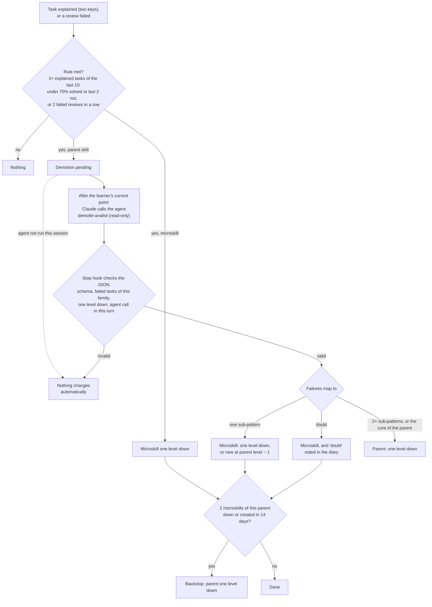

When the demotion rule is met for a parent skill, the read-only demotion analyst decides whether a microskill or the parent goes down. The Stop hook applies the agent's verdict only if its JSON passes the checks; otherwise nothing changes automatically.

#### 10.4.3 Bugs found in the same session (all fixed)

1. **The Stop hook missed 10 of 19 markers.** The cause was a race with Claude Code's buffered transcript writer: it flushes every 100 ms, and not before the hook runs. *Fixed:* the Stop hook also reads the `last_assistant_message` field of its input. Four approved explanations had been lost. The new `replay` command checks both keys again from the transcript and logs only what passes (source `replay`), also for a task that has lapsed in the meantime.
2. **A failed build was not stored as a starting point,** so the first green after fixing compile errors was never logged. *Fixed:* a compile error is now a starting point for `check.mjs`.
3. **A keyword beat the folder.** `prompt-gate` never looked at the folder, and rung marks went to the active skill instead of the task's skill. *Fixed:* the folder decides the skill family. A keyword can only pick a microskill within it; `#id` or the name of an exercise switches to another family.
4. **Guard false positives:** `msbuild` and `check.mjs` were matched anywhere in the command text. *Fixed:* the guard splits a shell command into simple commands and judges each one by its program. It refuses `eval` and `iex`, because it cannot see what they run.
5. **Session time was wall-clock time.** The one-hour nudge fired after about 8 minutes of real work, and a break of 12 minutes or more could unlock a rung without an attempt. *Fixed:* the session hour, the task minutes and the stuck timer count active time. A break longer than `idleMinutes` (default 20) does not count.
6. **Minor:** `!` commands bypass `prompt-gate`, and `check.mjs` attached itself to the most recently changed session file, which is wrong with two sessions open at once. *Fixed:* a `!` command now picks the session that is working on that skill family.

#### 10.4.4 Task lifecycle (D4)

A task waits for its explanation only as long as the student is still on that exercise.

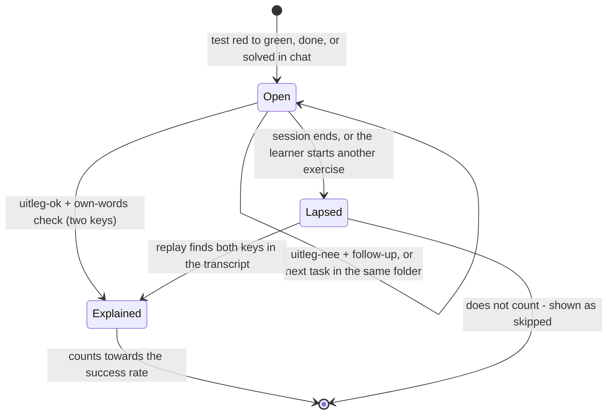

A task stays open until its own-words explanation is approved, and lapses when the session ends or another exercise starts. Only an explained task counts towards the success rate; a lapsed task shows as skipped unless `replay` recovers its explanation.

### 10.5 Revision of 11 November 2026: the start of a task, reviews and explanations

After the session of 11 November the setup was reviewed again. That review is not published, because it contains learning data. The student made seven decisions (13–19; the numbers continue from the review of 10 November). Each was first checked against the literature, and for 13 and 14 the student asked for a critical check. All of them are now built into the harness. Where the build differs from the plan, §10.5.3 says so.

#### 10.5.1 Decisions

| # | Decision | Checked against | Verdict |
|---|---|---|---|
| 13 | **The explanation stays strict, without two side effects of the build.** Claude keeps asking until the principle is right (D4). The question now depends on what happened. After a failed attempt (red, a compile error or a hint): "why does it work now, and why did the first attempt not?" Green at once: one question about the principle of the exercise, because "why does it work?" invites "because I did it right". The Stop hook judges **all the student's own messages since the task was logged, together**, with the same requirements as before. | People overestimate how well they understand a mechanism until they try to explain it (Rozenblit & Keil 2002). The quality of self-explanations, such as naming the principle, predicted learning beyond time on task (Renkl 1997, correlational). Self-explanation (Chi et al. 1989; Bisra et al. 2018). | **Strict stays supported.** Rozenblit & Keil show that explaining exposes the gap; they do not test whether more follow-up questions give more learning. The two side effects had no grounds: they cost rounds without measuring more. Fading the explanation prompts is an open point: in Nückles et al. (2010) fading helped, but for strategies the students already used. |
| 14 | **The optional review after a task stays, with three adjustments.** Claude offers it with a topic and a time estimate. After one wrong answer, or "I don't get it", Claude states the concept (rung 2), and if needed gives an example (rung 4), instead of asking another question. What stays open becomes a proposed microskill, with the exercise where it comes back. | Confusion helps when it is resolved (D'Mello et al. 2014). AutoTutor escalates from the move that tells the least to an assertion, and stops as soon as the student gives the answer (Graesser et al. 2004; the named cycle pump → hint → prompt → assertion in Nye et al. 2014). When to give or withhold help is an open problem: the assistance dilemma (Koedinger & Aleven 2007). P10 (a choice with a known cost). | **Supported.** A review can expose a real misconception. The fix is in how it escalates: when the student cannot produce the answer, the tutor states it. |
| 15 | **Bug: help in a review leaked into the next task.** Every `[rung N]` raised the session's highest rung, and the next logged task took it over, also when that task was about something else. Fix: (a) review help is logged separately (`review-help`), (b) with its own marker `[review-rung N #id]`, (c-1) it counts for a next task about the same concept only, (c-2) new work is recognized by fixed signals, (c-3) a task begins at such a signal. | R2 ("independent" must be honest); P11 (guardrails in the workflow, not in prompts) | **Fixed.** A keyword is never a signal: a misrecognized skill must not erase real help (the bug of 10 November, §10.4.3). Whether an agent should recognize new work instead is an open point. |
| 16 | **A concept id is required** in a review marker. Without a valid id it counts as an ordinary rung, which is the cautious side. | R2 | Built. |
| 17 | **One folder of the OOD example map was linked to the wrong skill:** an association exercise was under inheritance. Fixed in the map, and a new command `skill.mjs paths` lets the student fix the links in their own record. | (data) | Built. |
| 18 | **Code written before the first run did not count.** The first run of `check.mjs` was all green, became the baseline and logged nothing. Now Claude gives the `check.mjs` command first, when the student picks an exercise. And a first run that is all green counts as a task when code in that folder was changed in this session. | (measurement error) | Built. The first run in another folder is also a signal of new work (15c-3). |
| 19 | **The confidence question once,** together with the chosen exercise, and not repeated. Without an answer the diary says "unknown". Cleaning up the folder argument of `check.mjs` was not chosen. | P10 | Built, in the rules for Claude only. |

#### 10.5.2 How a task begins and ends

The harness knew when a task **ends**: a test goes from red to green, the student logs it with `done`, or says in the chat that the tests pass. It did not know when a task **begins**, so all help since the last task counted for the next one. Now a task begins at a fixed signal of new work:

- code changed in another exercise folder than the one of the last task;
- `check.mjs` in another folder;
- the full name of another exercise folder, or a `#id` of another skill family, in the student's own message.

At such a signal the ladder and the task time start again. Ordinary help since the last task was for work that was not finished: it does not count for the new task, and it is logged as `help-dropped`, so it stays visible in the diary and on the dashboard. Review help stays: it still counts when the new task is about the same concept.

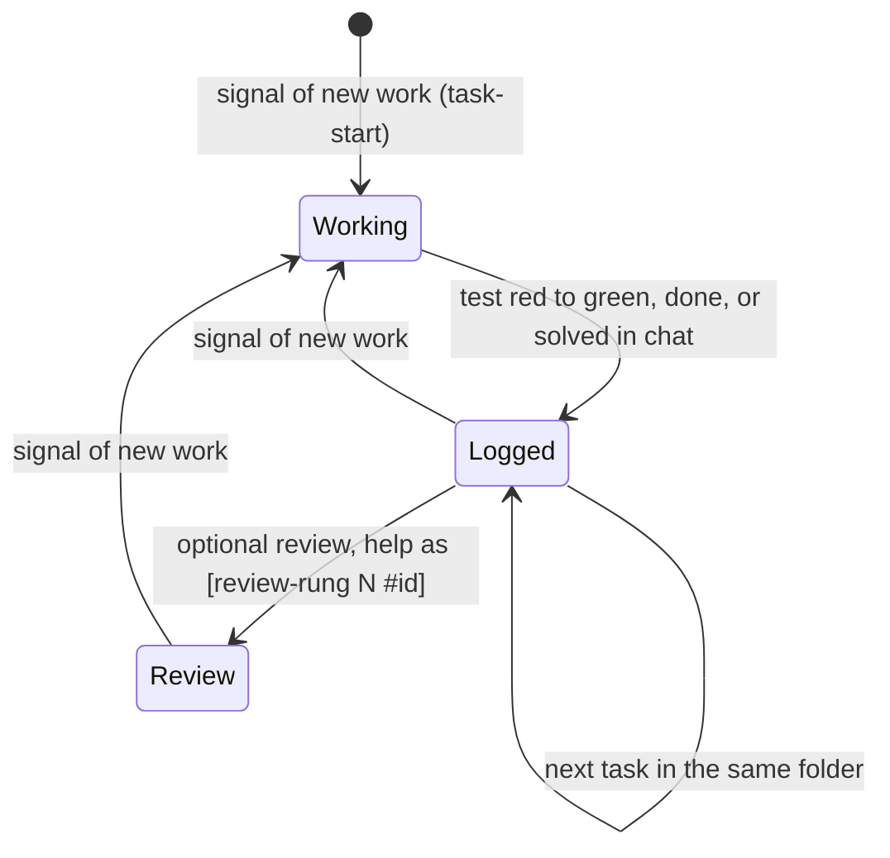

A task begins at a signal of new work and ends when it is logged. After a logged task, an optional review may follow; help in that review only counts for a next task about the same concept.

#### 10.5.3 Where the build differs from the plan

- **`done` for another family is not a signal.** The plan listed it. But `done` reports finished work, and work without code (design, UML) gives no other signal. Dropping the help there would hide real help (R2). So `done` keeps all help since the last task, as before.
- **A review marker without an id is still recognized,** so it can count as an ordinary rung instead of being missed.
- **Signals are relative to the last task.** After a signal there is no last task, until the next one is logged. Help on work that is abandoned again before then is not dropped: that is the cautious side.

### 10.6 Revision of 11 November 2026 (afternoon): help per concept, a proposal for a microskill, and honest words

After the second session of 11 November the setup was reviewed critically once more. That review is not published either, because it contains learning data. The numbers continue (22–30); 22 and 24 were open from the previous round. Each point was first checked against the literature, then the student decided. The chosen points are now built into the harness; 24 was not chosen. Where the build differs from the plan, §10.6.3 says so.

#### 10.6.1 Decisions

| # | Decision | Checked against | Verdict |
|---|---|---|---|
| 26 | **Help is logged per concept.** Help during a task went to the skill of the exercise folder, also when it was about a concept of another skill. That skill then looked weaker than it was, and the real gap stayed out of sight. Now Claude writes `[rung N #id]`. The task keeps its highest rung, because it was made with that help. The concept gets its own event, `concept-help`. That is not a task of that concept: `status` shows it, and it is evidence for 22. | Knowledge tracing keeps an estimate per rule and updates it at each chance to apply that rule (Corbett & Anderson 1994; Anderson et al. 1995). | **Supported (a measurement error).** That help itself is evidence is a design choice: the texts that were read update on correct or wrong. Whether concept help at rung 2 or higher should count in the success rate of that skill is open: first log and show it, and decide after a few sessions. |
| 22 | **The harness proposes a microskill itself,** like a promotion. Claude names the part with `[micro-proposal <id> "title" "keywords"]`. The harness checks it and shows the proposal, at the main skill's level minus 1. Only the student's own "yes, add" adds it. Nothing goes down automatically. | Open learner models: the learner sees the model and can negotiate it, with reflection and self-regulation as stated purposes (Bull & Kay 2016; a framework, not a test). A text from Claude is not part of the model. Against: one wrong answer is weak evidence, so the student decides. | **Supported.** |
| 27 | **Honest words.** `check.mjs` said "counts as solved independently" at rung 2, while the record only calls rung 0 independent. Now rung 0 is "solved independently", rung 1–2 "solved, with help up to rung N", and more help as before. Also in the signal to Claude and in the rules. | Illusion of competence (Koriat & Bjork 2005; R2): a success message has to name the help honestly. | **Supported, for the words only.** A stricter "solved" at L3 (rung 1 at most) waits for 26: part of the help belonged to another concept, and with `autoDemote` a stricter line could lower a skill for the wrong reason. |
| 28 | **The explanation is about the concept of the highest hint** when the task had help (rung 1 or higher). Without help, as before (13). | Learning went with impasses: outside an impasse, explanations rarely went with learning, at an impasse sometimes (VanLehn et al. 2003, correlational). Self-explanation pays off most on the principle that is not yet in place (Chi et al. 1989; Bisra et al. 2018). | **Supported.** That the highest hint marks the impasse is an inference. |
| 29 | **A review is only about the student's own code.** A question about an alternative becomes an experiment: rebuild it, run `check.mjs`, revert it. No review after the notice of an hour of active time, or after a task that took rung 2 or higher; then only the proposal for a microskill (22). | Without an own attempt and feedback there is no impasse (VanLehn et al. 2003). That a hard question at the end colours the confidence about the whole session: no source was checked, so a signal, not evidence. | **Supported.** |
| 23 | **Bug: the status line said "rung 0: no hint yet" at L3,** while the task was at rung 2. The line came from the unlocked rung of the L2 ladder, which stays 0 at L3. It now shows the help given; at L2 also the unlocked rung. | (bug) | **Fixed.** |
| 30 | **`install.mjs --update` checks for a running session.** In the pilot the rules were replaced in the middle of a practice session, by an update from another session. Nothing went wrong, but the rules changed under a running session. | R12 | **Built** (see §10.6.3). R12 itself, time-boxing harness work, stays the student's choice: the pilot goes against it on purpose. |
| 24 | **Stuck without saying so.** `check.mjs` would say "nothing changed since the last run", and at L3 Claude would give one rung more after an unanswered or wrong review question. | Students often do not seek help when they need it (Aleven & Koedinger 2000; Aleven et al. 2003). Wheel-spinning (Beck & Gong 2013). Contingent tutoring gives more help after a failure (Wood & Wood 1999); Wood & Middleton (1975) first observed it with mothers and their children. | **Supported, but not chosen:** the student kept it as it is. A preregistered replication of the 1978 experiment on contingent tutoring (Wood, Wood & Middleton 1978) did not find its effect on the children's independent performance (Smit et al. 2025). That bears on the hint ladder (P3), and is for the next review round. |
| 25 | **Deviations of Claude.** The confidence question came twice, against 19. The notice after an hour of active time was not late. | — | For information. |

#### 10.6.2 Help per concept and the proposal for a microskill

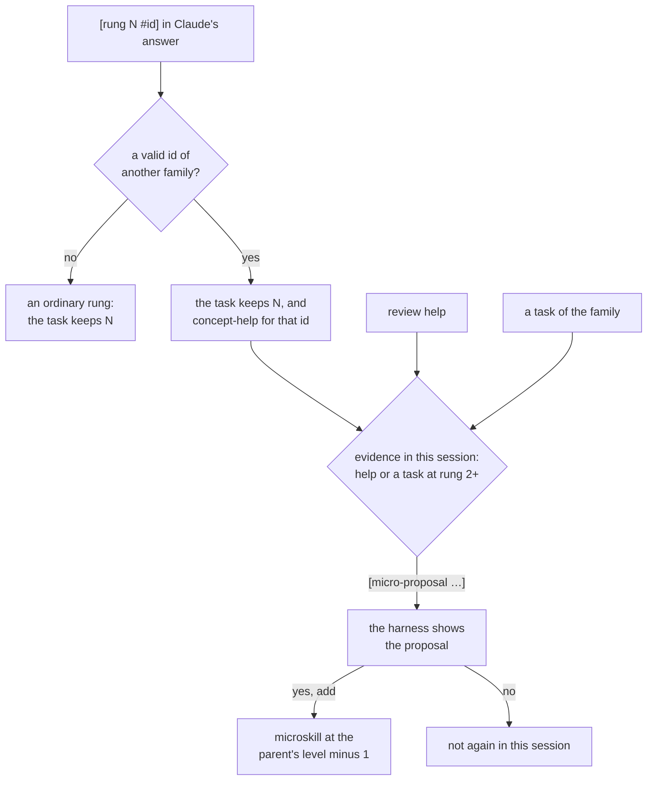

Help about a concept of another family stays with the task and is also logged for that concept. With evidence of real help, the harness proposes a microskill, and only the student's own "yes" adds it.

#### 10.6.3 Where the build differs from the plan

- **22: a task at rung 2 or higher is evidence too.** The plan only named review help and concept help at rung 2 or higher. But 29 says that after such a task there is no review, only the proposal; without this, that proposal could not come. The student chose this during the build.
- **22: the evidence must come from the same session and the same family** as the proposed microskill. A proposal the student declined does not come back in that session.
- **26: the concept help knows its task in advance.** The help is logged when Claude gives it, before the task has an id. So the first concept help reserves the id the task will get (`taskTid`). If new work begins first, that id is never used, and `help-dropped` names it.
- **26: a concept of the same family** (the parent or one of its microskills) is the task's own concept. Its rung already says it, so there is no extra event. This is the family logic of the review marker (15c-1).
- **28: also in `check.mjs`.** After help, its line about the explanation now asks about the point where the help was needed. The Stop hook is unchanged.
- **30: with `--yes` or without a terminal it stops,** unless `--force` is given too. A question alone would not have helped in the pilot: the update came from another Claude session, which cannot answer a question. "Running" means a session that was active in the last `idleMinutes` (default 20). The hooks cannot tell practice from talk about the harness, so every session in the folder counts.

### 10.7 Revision of 12 November 2026: positive feedback, demotions and the phase history

After the sessions of 11 and 12 November the student said: "why have I only had automatic demotions so far, and no promotions?" The setup was reviewed critically against that feeling, and against the literature on positive feedback, gamification and desirable difficulties. That review is not published, because it contains learning data. The numbers continue (31–46). Each point was first checked against the literature, then the student decided. The chosen points are built into the harness; where the build differs from the plan, §10.7.3 says so.

**Facts against the feeling.** The log showed 4 times up (1 promotion the student confirmed, 3 placements) and 1 time down: a new microskill, while its parent stayed at L3. No existing level had ever gone down automatically. But the 4 times up were quiet (one line in the output of `check.mjs`), and the one time down was the loudest moment of the harness: a hook message, an agent run and a block of JSON in the chat. Around it, almost every approved explanation had first been rejected once (24 approved, 22 rejected). The feeling was an honest signal about how the feedback *felt*, not about how the student did.

#### 10.7.1 Decisions

| # | Decision | Checked against | Verdict |
|---|---|---|---|
| 31 | **Up is loud, down is quiet.** A placement or promotion gets its own message with ↑ and the evidence, also at the session start and in `status`. Down is one line, "extra support for …", with the way back. The harness reads the demotion analyst's verdict from the agent's own report, so no JSON goes into the chat; the check of the verdict stays. | Bad events and bad feedback weigh more than good ones (Baumeister et al. 2001). Loss aversion appeared, generally, for levels that were earned, not for levels that were given (Rewley et al. 2021). Mastery experience is typically the strongest source of self-efficacy (Usher & Pajares 2008), and only when it is seen as one. | **Supported.** |
| 32 | **Bug: a demotion was applied on old evidence.** When the analyst's verdict was processed, the criterion no longer held (3 of 4 solved, 75%). Now the criterion is checked again, in the prompt gate and when the verdict is applied; when it no longer holds, nothing goes down (`demotion-cancelled`). Down also waits while an explanation of that family is open, just like up. | (bug) | **Fixed.** |
| 33 | **At least 4 explained tasks before going down** (it was 3), for both rules. The analyst keeps only `micro` and `ouder`. | The harness aims at about 85% success (P4). With 3 tasks, one hard task is enough: at exactly 85% that happens in 39% of the cases; with 4 tasks it takes two (about 11%). More than a third of feedback interventions lower performance, mostly when attention goes to the self (Kluger & DeNisi 1996). | **Supported.** The plan was 5 tasks and a third verdict "do not demote"; the student chose 4, as a middle way. |
| 34 | **Down counts the rung within the family.** Help about a concept of another family (`[rung N #id]`) is no failure of the task's skill. The task keeps its full rung (honest, #26). The analyst may choose an existing microskill of another family. | Knowledge tracing: the evidence belongs to the rule it was about (Corbett & Anderson 1994). | **Supported (a measurement error, like #26).** |
| 35 | **Progress towards the next level, in the chat,** in steps, never as a percentage: after each task, at `status` and at the session start. | Effort rises as the goal comes closer (Kivetz et al. 2006); show what is done early on and what remains near the end (Koo & Fishbach 2012). Monitoring progress helps reach goals (Harkin et al. 2016). A progress bar that starts slowly increases drop-out (Villar et al. 2013): so steps, not a percentage. | **Supported.** |
| 36 | **L4 within reach.** (a) The task that placed a skill counts after the placement. (b) The transfer task is one of the three times without a hint, and its day a day. When the exercise folders of an L3 skill run out, Claude points to an existing next exercise; a practice-test question counts via `done`. Design goal: whoever practises daily and masters the skill reaches L4 in about 3 sessions on 2 days; a test guards it. The day stays the UTC date. | Mastery learning works through enough chances to practise with feedback (Kulik et al. 1990). A criterion that cannot be reached is a ceiling, and that undermines the sense of competence (Ryan & Deci 2000). Relearning in later sessions mattered more than extra correct answers in the first session (Rawson & Dunlosky 2011). Their sessions were widely spaced and the material was concepts, not code: "about 3 sessions on 2 days" is an inference, and a tight one. | **Supported.** The student's words: the slow road to L4 "is not workable for a junior dev". |
| 37 | **Praise first, then the requirement.** `check.mjs` names what worked and the (micro)skill, and gives the explanation as an invitation. With help: "this is where the learning was: `<concept>`". A worked example (rung 5) has its own honest text (a bug: it got the soft text of rung 3–4). | Verbal positive feedback raised free-choice intrinsic motivation for college students, not for children (Deci, Koestner & Ryan 1999). Praise works when it is sincere and points to causes the learner controls (Henderlong & Lepper 2002). With positive feedback on correct steps, students in SQL-Tutor learned the same in about half the time (Mitrovic et al. 2013; 41 students, no difference on the exam). | **Supported.** |
| 38 | **First name what is right, then one follow-up question.** The requirement stays. The why check also accepts "if …, then/would …" in one sentence. | Novices seek and use positive feedback (Finkelstein & Fishbach 2012). People learned less from failure than from success with the same information (Eskreis-Winkler & Fishbach 2019); in replications that effect disappeared when corrective feedback or a brief instruction followed (Keith et al. 2022; Gok & Fyfe 2024), which is what a follow-up question does. Against softening: politeness can hide the error (Person et al. 1995), so the gap is still named. The requirement itself stays supported (self-explanation, Bisra et al. 2018). | **Supported for the form, not for less strictness.** The "if … then" rule came from a session in which a good explanation was rejected for having no reason word. |
| 39 | **Effort is the goal, not failure.** After a task with help: "this is where the learning was". Once, at the first session start, a short explanation. | Performance during practice is a poor index of learning (Soderstrom & Bjork 2015). Learners judged the effortful strategy as less effective and chose it less (Kirk-Johnson et al. 2019). Learners need support to start and stick with desirable difficulties (de Bruin et al. 2023); one lever is to reframe effort (Zepeda et al. 2020). | **Supported**, as a framework: little empirical work on these levers yet. |
| 40 | **Bug in the words of the dashboard:** the tile "solved independently" counted rung ≤ 2. Now two tiles: "solved (rung ≤ 2)" and "independent (rung 0)". | #27 | **Fixed.** |
| 45 | **The phase history on the dashboard** (with #41): per skill one band over the days, with "start" apart; tasks as dots; microskills under their parent; each change marked with how it was decided; one sentence that compares only with yourself. The export now says how a change was decided (`kind`, a fixed list of words) and leaves out changes without a difference. | Feedback against your own earlier work gave more skill and self-efficacy than feedback against classmates (Shih & Alexander 2000, an experiment with 84 children). A class average disheartened some students (Aguilar 2018, interviews). Opening the learner model can help (Long & Aleven 2017), and a model should show why it believes something (Kay & Kummerfeld 2012). | **Supported, as an inference:** no study was found that tests a history view of a learner model. Dashboards in general showed no effect on achievement, a modest one on motivation and a larger one on participation (Kaliisa et al. 2024). The real test: ask after two weeks whether the feeling "only down" changed. |
| 42 | **Rejections per task on the public dashboard.** | Reporting progress publicly helps (Harkin et al. 2016); failure can make people tune out (Eskreis-Winkler & Fishbach 2019). | **Partly supported, not chosen:** the student kept them public, with the reasons. |
| 43 | **No points, badges, streaks or leaderboards.** A level informs: it says which help you get, not what status you have. | See P14 (§2.11). | **Supported, a design rule.** |
| 44 | **Small points.** The placement now happens at the approved explanation. The errors in the course material are not reported. The Mermaid diagrams were checked after the build. | — | **Built.** |
| 46 | **One task of the student "should count as independent"**, because the course's test was wrong. The rung came from a question about what the test expects, not from the error. | Honest logging (R2). | **Not supported, kept as it is.** |

#### 10.7.2 Down, as built

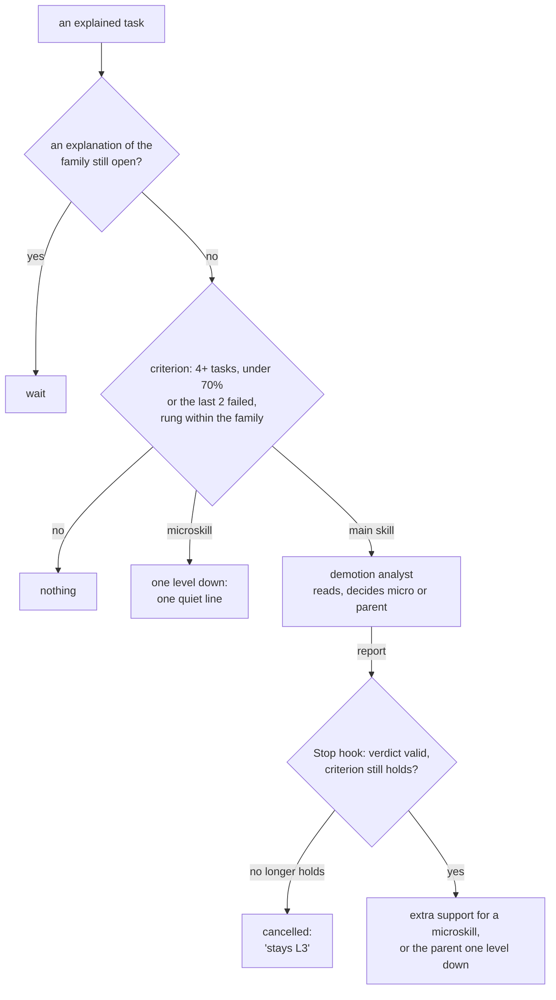

Down waits for open explanations, counts only the help within the family, and is checked again on the evidence of the moment it is applied. The analyst's report goes to the Stop hook, not into the chat.

#### 10.7.3 Where the build differs from the plan

- **38: only "then" or "would".** "If …" counts as a why only with "then"/"dan" or "would"/"zou" in the same sentence. Looser words ("can", "is") would let a bare statement through.
- **44 and 36 (a) together.** Because the placement now happens at the explanation, after the task, the placement task has to be added to the window explicitly; otherwise (a) would never count. Older placements without a task id find it in the `placement` event.
- **34: also the placement.** The placement uses the rung within the family too: help about another concept says nothing about the new skill.
- **31: the analyst's report is read, not pasted.** A background agent hands its report back as a message; the Stop hook takes the verdict from there (or from the result of a synchronous agent). A verdict in that report that the harness refuses does not block Claude: the demotion stays pending. The `[demotie {...}]` marker still works as a fallback.
- **35: which skills.** The progress lines cover the skills with at least one task since their last level change.
- **36: the next exercise once per session.** The hook tells Claude once per skill and session that the folders have run out.
- **45: on the dashboard, a microskill only when something happened to it** (a task, a change, or extra support). A placement counts as a phase up when it lands on L3 or L4.
- **45: `levelChanges` without changes without a difference.** The first "since the last export" after the update may count one change less.
- **An older session file** has no family rung yet: it counts all help, until the next task starts.

### 10.8 Revision of 13 November 2026: graded work under the exam rules

The student asked to make the setup fit the exam rules (OER), so the harness can help with the final assignment of the course. The rules allow AI level 1 there: GenAI as an aid, "for example to generate ideas or bring structure", with a statement of how it was used. Unauthorized use of AI that makes content ("text, images, code") counts as fraud (OER art. 1.41(3c)). The setup document with the decisions stays private, because it is about the student's own assignment. The numbers continue (49–54). The student decided 49, 50 and 53 with multiple-choice questions; 51 was done right away; 52 stays open.

#### 10.8.1 Decisions

| # | Decision | Checked against | Verdict |
|---|---|---|---|
| 49 | **The hint ladder up to rung 4 in graded work.** In the paths of `settings.graded` the L2 ladder and the stuck timer hold for every skill, also at L3 and L4. Rung 5 (a worked solution) does not exist there; a request for it is refused with a reference to the exam rules. Rung 4 is an example of at most 5 lines on another topic. Claude writes nothing there, at no level. | Learning came only from an explanation *without* the answer; an own choice followed by the AI's answer gave none (Gajos & Mamykina 2022). Try first, then an example was not better than practice alone for novices (van Gog et al. 2011), while problem solving before instruction helps on average (Sinha & Kapur 2021), when the instruction builds on the student's attempt (Loibl et al. 2017). The most concrete hint can work as a worked example when the student thinks about it (Shih et al. 2008). LLM tutors draw the line differently: CodeAid shows generic example code (Kazemitabaar et al. 2024), CodeHelp removes all of it (Liffiton et al. 2023). R10: lower ownership with unrestricted ChatGPT (Bergh et al. 2026, preprint), not tested for small examples. | **Supported, with conditions.** The advice is the same as the decision. Three conditions go into the rules for Claude: the example implements no behaviour of the assignment and does not fit by renaming; the student types their own code and never pastes; the explanation after the task also asks how the example differs from the student's solution. Whether a rung-4 example still counts as "generating ideas or bringing structure" is for the institution to say; the log names it. |
| 50 | **An AI-use log in the repo of the assignment** (`ai-verantwoording/`): a row per answer (when, session, skill, rung, kind of help) written by the Stop hook, a last column the student fills in ("what I did with it / how I checked it"), an export of every session, and a README with the AI level, an APA reference and "Claude Code has no share link". The privacy filters of the dashboard export are reused: e-mail, the home folder (becomes `~`), hook and system messages. | The exam rules at level 1 ask for prompt links or a statement that the tool has none, an APA reference, and a check of the output by the student. Detection of AI text is unreliable (Scarfe et al. 2024), so the student's own record is the protection (R11). | **Built.** A policy requirement, not a learning claim. |
| 51 | **Keep the prompts until the assessment:** Claude Code keeps transcripts 365 days instead of 30. | The exam rules: keep the prompts until the assessment. | **Done** by the student, in the Claude Code settings. |
| 52 | **Practice for the moments at level 0** (the diagnostic test and the extension during the assessment, without AI). | — | **Open.** A proposal for January. |
| 53 | **The harness in the repo of the assignment, with one record.** The repo uses the record of the practice folder (`install.mjs --learning-dir`), so a task in the assignment counts for the same skill. `.claude/` and `ai-verantwoording/` go into git (the teacher sees the rules the AI followed); `.learning/` does not. | The evidence belongs to the skill it is about (Corbett & Anderson 1994). R13 (privacy). | **Built.** |
| 54 | **Bug: the guard let a write outside the project through.** A session in the practice folder could write freely in the repo of the assignment. Now the paths of graded work are tested always, also outside the project. | (bug) | **Fixed.** |

#### 10.8.2 Graded work, as built

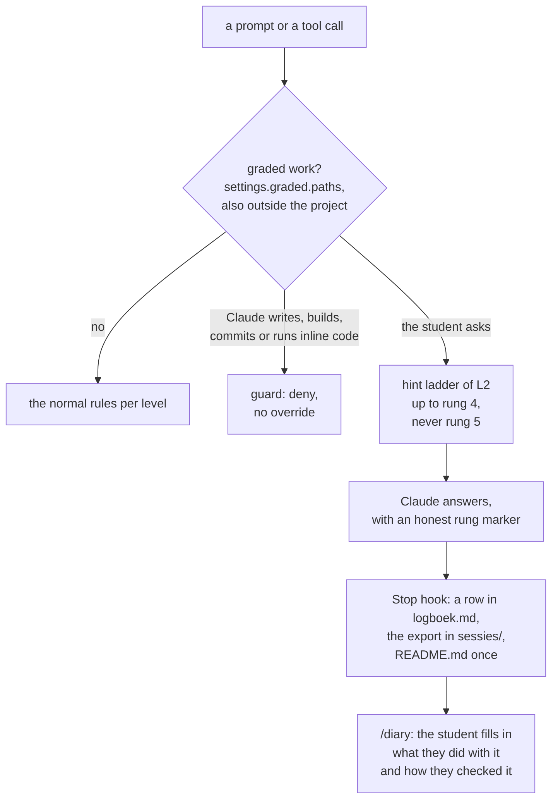

The guard decides on the path, not on the level: graded work is protected at every level and from every folder. The log is written by the hooks only; the student writes the last column.

#### 10.8.3 Where the build differs from the plan

- **The export of a session is written after every answer**, not only at the end. A session that ends without a clean exit is still complete in the log.
- **When a session counts as graded:** this project is graded work, the working folder is, the prompt names the folder of the assignment, or Claude used a tool on a graded path (it read a file there). After that, the session stays graded: the cautious side.
- **The guard also blocks building and testing** in graded work, as at L2, and git commands that change the repo, and inline code (`node -e`, `python -c`) run there. Reading is allowed. A script that Claude would write elsewhere and that writes into the repo when run cannot be seen by the guard; the rules forbid such a detour.
- **The path of the record is not in the manifest** but in `.claude/leerharnas.local.json`, which is not in git: the manifest goes into the repo, and the path contains the home folder.
- **The last column is not checked with the two keys** of the explanation check: the student writes it in the file. `/diary` asks for it, and at the end of the session the harness names the rows that are still empty.
- **The three conditions of the literature check** are rules for Claude (CLAUDE.md), not enforced by a hook.
- **Open:** the form of the APA reference against the guide of the institution's library.

### 10.9 Revision of 13 November 2026 (evening): the security map

The pilot student chose the whole plan of §2.13 at once, with four separate skills instead of one family with microskills.

#### 10.9.1 Decisions

| Decision | Built |
|---|---|
| `security.basics` becomes four separate skills | `security.output-encoding`, `security.sql-params`, `security.secrets-config` and `security.ai-review`, at L2, without paths, each with keywords. `review.ai-code` stays separate, for review in general. |
| The attacker first | In the notes of the map: rung 1 is always "What does an attacker control here?", and the explanation of a security task has three parts (what the attacker controls, which measure stops it, how you check that) plus a confidence from 1 to 5 (Braz et al., 2022; Perry et al., 2023). |
| An analyser next to `dotnet test` | `check.mjs` with the setting `securityAnalyzer` (on in `junior-dotnet`): first a full build with every security rule of the .NET SDK's analyzers, then the tests. The learner explains the warnings; Claude does not fix them at L1–L3. |
| Examples teach no insecure pattern | A rule in the rules of every map, also `ood`: the example at rung 4, the worked solution at rung 5 and an example at L0 never contain concatenated SQL, unencoded input in HTML or a log, a secret in the code, `System.Random` for a token, or certificate validation switched off. |
| Nothing about vulnerabilities online | A skill can be `sensitive`; the four security skills are. The export then keeps the numbers of their tasks, but not the free texts: the test names, the explanation, the reasons of a rejection or correction, free notes on a level change, and the title of a microskill below it. |

#### 10.9.2 A security task, as built

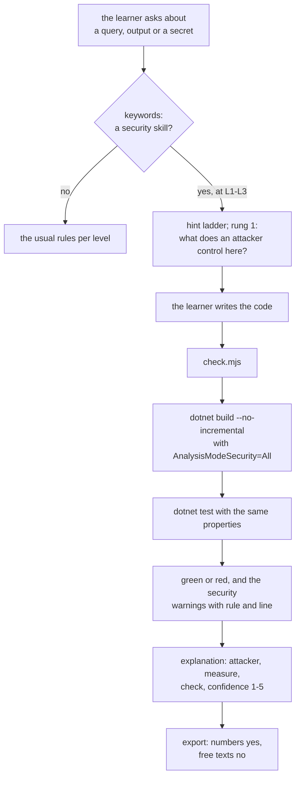

The analyser only looks for patterns it knows. A clean run is therefore no proof, and `check.mjs` says so.

#### 10.9.3 Where the build differs from the plan

- **The analyser rebuilds.** The plan was one build. A trial with a real project showed that the analyzers only report while the compiler runs: after a build that was already up to date, not a single warning came, not even for `System.Random`. So `check.mjs` first builds with `--no-incremental`, and runs the tests with the same properties, so they do not compile again. That takes time in a large solution; the setting can be turned off.
- **A project that treats warnings as errors keeps building.** `CodeAnalysisTreatWarningsAsErrors=false` keeps the security rules at warning level, also with `TreatWarningsAsErrors` in the project. Tested on a real project.
- **The guard does not protect the security skills.** Security cuts across files, so the skills have no paths. At L1–L3 Claude keeps to the notes of the map; no hook enforces it.
- **The dashboard shows no separate note** for a task without texts. The export sets `withheld: true`; the task is shown with its rung and outcome.
- **An existing install keeps `security.basics`.** `--update` leaves your record alone. To get the four skills, add them with `add` or install again.
- **Not built:** access control and dependencies (§2.13: no analyser finds access-control flaws reliably, and a package check needs a network), and exercises with attack strings as tests.

### 10.10 Revision of 13 November 2026 (night): the first sessions on the final assignment

The pilot student worked on the final assignment for the first time, and the harness got in the way in four places. Claude refused to put the official arc42 template in the repo, although the exam rules allow AI to "bring structure" and the template is not AI content. Nothing showed that the session had started, and the confidence question went unanswered without trace. A class diagram the student finished in the IDE, between two sessions, counted for nothing. And the closing questions only came after the student asked for them. A review of that evening also found three gaps: "I want to stop" and "laten we afronden" were not recognised as a stop request, the guard refused `git remote -v` as a write, and help on the assignment asked in another folder had no rung limit and no row in the log. The student decided points 55–62 with multiple-choice questions; 62 fell away because 61 covers it. The setup document stays private.

#### 10.10.1 Decisions

| # | Decision | Checked against | Verdict |
|---|---|---|---|
| 55 | **Fixed tooling in graded work.** The guard allows a short list of deterministic commands there: `dotnet new` (sln, console, classlib, nunit, xunit, gitignore; not with `--force`), `dotnet sln add`, `dotnet add reference\|package`, `git init`, `git remote add`, `git branch -m`, `mkdir`, and `scaffold.mjs arc42`, which unpacks the official template unchanged after a sha256 check. Each becomes a row "tooling (no AI content)" in the log. Content, commits, the pipeline and the Dockerfile stay the student's. | The grading form scores the code, the UML, the tests, the pipeline, version control and the report, so all of that stays closed. The exam rules forbid AI that makes content (OER art. 1.41(3c)); a generator or an official template makes no AI content. | **Policy, built.** |
| 56 | **The start stays automatic** (a start command can be forgotten, and then nothing counts). The harness logs the plan (the first message) and the confidence (a number after Claude's "(1–5)") itself. A SessionEnd hook notes how a session ended; the next start offers a catch-up diary, once, for a session with work but without a diary entry. | Calibration of self-judgement needs the confidence beforehand (see §10.4). | **Built.** |
| 57 | **A task per part.** Work without a test is split into named parts; each finished part is a task with its own explanation. `af: <what>` (or `done: <what>`) at the start of a message counts as `done`, without a `!` command. The start lists the files changed in the graded folder since the previous session, with their skill by `paths` or by content (a Mermaid `classDiagram` → `uml.klassendiagram`). | Proximal subgoals beat a distal goal for learning, self-efficacy and accurate self-judgement (Bandura & Schunk, 1981). | **Supported, with a condition:** a part must be a real step the learner can explain on its own, or the promotion criterion is reached by splitting. The rules for Claude say so; the explanation gate per part keeps it honest. |
| 58 | **Ending in one message.** More stop phrases ("ik wil stoppen", "laten we afronden", "I want to finish this session"), only at the end of a short message. Then one message with the open explanations, 2–3 check questions, the reflection and the log question. Check questions are logged (`check-question`) as evidence for a microskill, never for a level. | Retrieval beats restudying for later retention (Roediger & Karpicke, 2006; Adesope et al., 2017), also in real courses, with corrective feedback as a moderator (Yang et al., 2021). Transfer is largest for application and inference questions (Pan & Rickard, 2018). | **Supported, with three conditions:** answers from memory; questions about a reason or an application in the learner's own work, not a definition; feedback per answer. **Advice, not built:** one open question again at the start of the next session would add a spaced repetition. |
| 59 | **The learner's own words in the last column of the log.** Claude marks the part of the learner's answer with `[log "…"]`; the Stop hook writes it only when it is, word for word, part of what the learner typed, and only in empty cells of that session. | The exam rules ask the student to check and account for the output; the words must be the student's (R11). | **Built.** Two keys, as for an explanation. |
| 60 | **git commands that only read** (`remote -v`, `branch --show-current`, `config --get`, `stash list`, `tag -l` …) are allowed in graded work. | (bug) | **Fixed.** |
| 61 | **Graded work is closed from other folders.** A gate at user level (`install.mjs <folder> --user-guard`) runs in every project outside the graded folder: it blocks a prompt that names the assignment, and refuses every tool on its paths, reading too. Only the setup (`.claude/`, `CLAUDE.md`) stays open. A rule in `~/.claude/CLAUDE.md` covers general questions a hook cannot see. | The help that evening came from a session in another folder: no rung limit, no log row (R11). | **Built**, not installed on any machine: that is the student's step. |
| 62 | Log per turn instead of per session outside the graded folder. | — | **Dropped:** 61 closes the other folders. |

#### 10.10.2 A session on the final assignment, as built

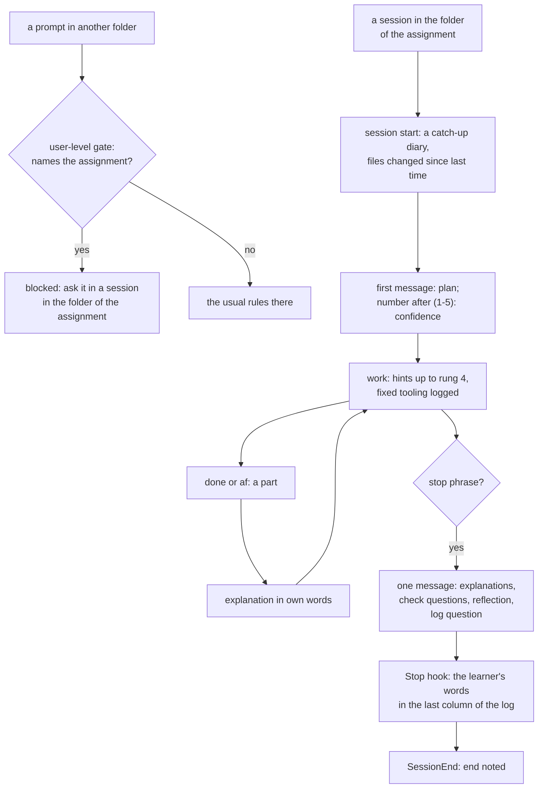

The gate and the project's own harness never judge the same prompt: inside the folder of the assignment the gate steps aside.

#### 10.10.3 Where the build differs from the plan

- **The template is pinned, and the harness does not download it.** The plan was a script that downloads the template. The security check refuses network code in the harness (SECURITY.md promises none), and that block cannot be allowed. So the zip is downloaded first, outside the graded folder, by the student or by Claude with `curl`; `scaffold.mjs --from <zip>` then checks a sha256 pinned in the script (release 2026.10.19 of arc42, GitHub Markdown, one file per chapter) and unpacks it. A zip with another checksum is refused: otherwise Claude could pack its own content into a zip. It only unpacks into a new or empty folder. The guard now also treats a download into graded work (`curl -o`, `curl -O`, `wget`) as a write.
- **The guard only allows its own copy** of `scaffold.mjs` (`.claude/hooks/`, protected like every hook). A script that Claude writes elsewhere and runs with `node` is still not visible to the guard, as noted in §10.8.3.
- **`af:` needs a change in graded work.** A part counts only when a file of the assignment changed since the last task of that skill. Outside graded work `af:` works like `done`.
- **The plan is the first message**, not a summary of it. A "hello" becomes the plan. The diary uses it as it is.
- **A catch-up diary is offered for sessions of the last 7 days**, once each, newest first, never for a session that is still active in another window.
- **The gate needs a config** in `~/.claude/leerharnas/graded.json`, written by the installer from the record. After `setting graded add` the student runs `--user-guard` again. Names that are too general (`src`, `Tests`, `Domain`) are not blocked in prompts; a solution folder such as `Webshop` is.
- **A general question without the name** of the assignment cannot be seen by a hook. The block in `~/.claude/CLAUDE.md` asks Claude to check first; that is a rule, not enforcement.
- **This section is §10.10**, because §10.9 was taken by the security map the same evening.

### 10.11 Revision of 13 November 2026 (night): a practice map with exercises

The security map of §10.9 worked, but not like the OOD practice folder: there was no practice material, the guard protected nothing, `check.mjs` only found the skill through keywords, and code outside the skills was L4. The pilot student chose a separate practice map with two exercises per skill, and texts in Dutch and English. `junior-dotnet` stays the map for a team repository.

#### 10.11.1 What was built

| Gap in §10.9 | Now, with `--map security-dotnet` |
|---|---|
| No practice material | Eight exercises in `oefeningen/`, each a small xUnit project on .NET 10 with a story in its `README.md`. In 01–06 the attack tests start red; in 07–08 an AI wrote the code, all tests are green, and the learner first writes a failing test. |
| The guard protects nothing | Each skill has paths to its two exercises. |
| `check.mjs` only finds the skill through keywords | The folder of the exercise decides the skill, as in OOD. |
| Code outside the skills at L4 | `defaultLevel` L2, as in OOD. |

#### 10.11.2 A practice folder, as built

```mermaid
flowchart TD
    I["install.mjs --map security-dotnet"] --> O["oefeningen/01 to 08,<br/>the learner's own"]
    O --> C1["check.mjs oefeningen/01-sql-search"]
    C1 --> B["baseline: attack tests red,<br/>analyser: CA2100"]
    B --> H["hint ladder; rung 1:<br/>what does an attacker control here?"]
    H --> F["the learner fixes the code"]
    F --> C2["check.mjs"]
    C2 --> G["red to green: a task<br/>for security.sql-params"]
    G --> U["explanation: attacker, measure,<br/>check, confidence 1-5"]
    U --> P["placement or promotion,<br/>as in OOD"]
```

#### 10.11.3 What stood out, and where it differs

- **The analyser finds four of the eight vulnerabilities:** SQL built from strings (01, 02, 08) and `System.Random` (06, 08). Missing HTML encoding, log injection, missing validation and a key in the code it does not see. The READMEs say so, and it is part of the lesson that a clean run is no proof.
- **Three ordinary tests also start red**, because they share the cause of the attack: a name with an apostrophe (01), an ampersand (03) and a username with a newline at the end (04). The READMEs name them.
- **Exercises 05 and 06 read their own source code** to find a key in the code and `System.Random`. That is a rough check, and they say so.
- **The reference solutions are not in the repository**, so that neither Claude nor the learner can find them. Every exercise was verified against them, with SDK 10.0.401 and SDK 11 rc.
- **An exercise belongs to the learner.** `--update` never replaces an exercise that is already there; a new exercise does arrive.
- **The security check** of the repository allows C# files only in the exercises of a map, and checks their content like any other text file.
- **Not built:** the dashboard reads one practice folder, so a second one is not on it yet. The map has not been used in a real practice session yet.

---

<a id="11-change-log"></a>

## 11. Change log {#changelog}

### 13 November 2026 (later): security review and its fixes

A security review of the whole repository, with Claude Code agents, found nine issues. They are listed with their severity and fix in [the security review](https://github.com/piethanegraaf/piethanegraaf.github.io/blob/main/research/security-review-2026-11-13.md), and were fixed in order of severity.

- **High:** a quoted subcommand of `skill.mjs`, and graded work behind `${HOME}`, an escape or brace expansion, passed the guard.
- **Medium:** whole folders of the harness and the record, folders of protected code, and the user-level files were not protected.
- **Low:** links and Windows short names, the reason of an override for a sensitive skill in the export, names with é or ë in the privacy filter, and full test names in a task.
- **Not changed:** the conclusions of §2, and the limit of §7: the hooks are a commitment device, not a sandbox.

### 13 November 2026 (night): a practice map with exercises, and the docs in sync again

- **§10.11 (new):** the practice map `security-dotnet` with eight exercises, a diagram of a practice folder as built, and what stood out.
- **The site:** README, Home, Install, Configuration, Reference, For junior developers and For researchers describe the three maps. Install now names every file the installer writes, `git pull` before an update, and that the placement sets the starting level.
- **Not changed:** the conclusions of §2. There are no new sources.
### 13 November 2026 (night): the first sessions on the final assignment

The pilot student decided points 55–62 after the first sessions on the final assignment; 55–61 were built the same night, 62 fell away.

- **§10.10 (new):** the decisions, a diagram of a session on the final assignment as built, and where the build differs from the plan.
- **§8:** 2 new references (Bandura & Schunk, 1981; Yang et al., 2021). They were checked first, together with Roediger & Karpicke (2006), Adesope et al. (2017) and Pan & Rickard (2018), which were already cited; the notes are in [the citation check](https://github.com/piethanegraaf/piethanegraaf.github.io/blob/main/research/citation-checks/citation_check_learning_science.md), section I. The check adds conditions, no correction: a part must be a real step, and a check question asks for a reason or an application. It also advises a spaced repeat of one open question at the next start; that was not built.
- **Not changed:** the conclusions of §2.

### 13 November 2026 (evening): the security map

The pilot student chose the whole plan of §2.13; it was built the same evening.

- **§10.9 (new):** the decisions, a diagram of a security task as built, and where the build differs from the plan (the analyser rebuilds, the guard does not protect the security skills).
- **§2.13:** the plan now says what was built.
- **Not changed:** the conclusions of §2. There are no new sources.

### 13 November 2026: secure code as a first niche for juniors

The pilot student asked whether cybersecurity is a good first niche, and which angle fits: junior developers who learn basic security at work, or junior security specialists.

- **§2.13 (new):** AI code and security, confidence that is not justified, what juniors lack, what laws and standards ask of employers, the two angles side by side, and the plan as a hypothesis: angle A, as a deepening of `junior-dotnet`.
- **§8:** 30 new references. They were checked first; the notes are in [the citation check](https://github.com/piethanegraaf/piethanegraaf.github.io/blob/main/research/citation-checks/citation_check_learning_science.md), section H. The check corrected, among other things, the SusVibes figures (57% correct and 11.8% secure in the ICML version, not 61% and 10.5%), the Staatsblad number of the Cyberbeveiligingswet (2026, 187), the source of a UWV figure (no longer used), and that the effect in Braz et al. is an odds ratio.
- **Notes:** [secure code for juniors](notes/secure_coding_juniors.md).
- **Not changed:** the harness itself. The security map, the analyser and the rule for examples have not been built.

### 13 November 2026: graded work under the exam rules

The pilot student decided points 49–54 of the setup of 13 November; 49, 50, 53 and 54 were built the same day.

- **§10.8 (new):** the decisions, the literature check of rung 4, a diagram of graded work as built, and where the build differs from the plan.
- **§3, R11:** the mitigation names what the harness now does for graded work.
- **§5.1:** the "as built" architecture shows the AI-use log in the repo.
- **§8:** three new references. The sources of decision 49 were checked first; the notes are in [the citation check](https://github.com/piethanegraaf/piethanegraaf.github.io/blob/main/research/citation-checks/citation_check_learning_science.md), section G. The check found no study of exactly this case: the evidence is indirect. It also found that Bergh et al. (2026) is a preprint and had no condition with small examples.
- **Not changed:** the conclusions of §2.

### 12 November 2026: positive feedback, demotions and the phase history

The pilot student decided points 31–46 of the review of 12 November; they were built the same day.

- **§10.7 (new):** the decisions, what they were checked against, a diagram of going down as built, and where the build differs from the plan.
- **§2.11, P14 (new):** levels inform; they do not reward (decision 43).
- **§5, the Mermaid check (decision 44):** an "as built" architecture (§5.1) and session (§5.4); the state diagram and its bullets (§5.2) and the hint ladder (§5.3) follow the build; the hook table notes what changed. The diagrams of §10.4–§10.6 stay as records of those revisions.
- **§8:** new references. Each was first checked against its abstract; the notes are in [the citation check](https://github.com/piethanegraaf/piethanegraaf.github.io/blob/main/research/citation-checks/citation_check_learning_science.md), section F. The check changed some claims:
  - Rawson & Dunlosky (2011) supports the design goal for L4 only partly: their relearning sessions were widely spaced.
  - Eskreis-Winkler & Fishbach (2019) is cited with the replications that limit it (Keith et al. 2022; Gok & Fyfe 2024).
  - Kirk-Johnson et al. (2019) is cited for the judgement of effort, not for better memory.
  - Henderlong & Lepper (2002) is the right name.
- **Not changed:** the conclusions of §2.

### 11 November 2026 (night, last): the evidence for contingent hints (P3)

The pilot student chose this change after the check of the sources of the afternoon review (§10.6, decision 24).

- **§2.3:** the rule "more help after failure, less after success" is now attributed to where it comes from (Wood & Middleton 1975; Wood, Wood & Middleton 1978), not to Wood & Wood (1999), who built it into a tutor. Added: the failed replication of the 1978 experiment (Smit et al. 2025), a meta-analysis in which changing the scaffolding over time made no difference (Belland et al. 2017), and a classroom experiment in which contingency only helped after longer independent work (van de Pol et al. 2015).
- **§2.11, P3:** the evidence goes from moderate to low to moderate: moderate for graduated hints, weak for the contingency itself.
- **§5.3:** one sentence on what this means for the hint ladder.
- **§8:** new references. Each was first checked against its abstract; the notes are in [the citation check](https://github.com/piethanegraaf/piethanegraaf.github.io/blob/main/research/citation-checks/citation_check_learning_science.md), section E.
- **Not changed:** the harness, and the conclusions of §2.

### 11 November 2026 (night, later): the map next to the assessment and the cheat sheet

- **§5.8:** ten more skills, from the grading form (logging; integration, system and UI tests) and from the pilot student's cheat sheet (casting, static, records and structs, object methods, other C#, and the three families of design patterns). The map now has 29 skills.
- **Not changed:** the conclusions of §2, and what the map deliberately leaves out (security, cloud and CI/CD, the database, the report).

### 11 November 2026 (night): help per concept, a proposal for a microskill, and honest words (decisions of 11 November, afternoon)

The pilot student decided these changes after the second session of 11 November, and each was first checked against the literature. They are now built into the harness. Details and verdicts are in §10.6.

- **§10.6, new:** decisions 22–30, help per concept and the proposal for a microskill, and where the build differs from the plan.
- **§3, R13:** publishing is the learner's choice, and then only a filtered selection goes online. The text no longer says that nothing goes online.
- **§8:** new references. Each was first checked against its primary source or its abstract; the notes are in [the citation check](https://github.com/piethanegraaf/piethanegraaf.github.io/blob/main/research/citation-checks/citation_check_learning_science.md), section D. Two findings are for the next round: the knowledge-tracing paper updates on correct or wrong, not on help; and the 1978 experiment on contingent tutoring did not replicate (Smit et al. 2025).
- **Not changed:** the conclusions of §2.

### 11 November 2026 (evening, later): the skill map and the final assessment

- **§5.8:** now shows the map that is really in the harness, without prerequisites, with four new skills for the OO design of the final assessment. The original graph is in a collapsed block.
- **Not changed:** the conclusions of §2.

### 11 November 2026 (evening): the start of a task, reviews and explanations (decisions of 11 November)

The pilot student decided these changes after a later session, and each was first checked against the literature. They are now built into the harness. Details and verdicts are in §10.5.

- **§10.5, new:** decisions 13–19, how a task begins and ends, and where the build differs from the plan.
- **§8:** new references. Each was first checked against its primary source or its abstract; the notes are in [the citation check](https://github.com/piethanegraaf/piethanegraaf.github.io/blob/main/research/citation-checks/citation_check_learning_science.md), section C.
- **Not changed:** the conclusions of §2.

### 11 November 2026 (later): junior developers at work, and an invitation to researchers

- **A second target group.** The review now also covers junior developers at work, who risk staying junior when an agent does the work before they can do it themselves (§1, §2.0, §2.10).
- **§2.12, new:** the eternal-junior problem. The evidence for the mechanism, the practitioner sources (grade D), the counter-evidence, what is missing, the trade-off of the harness (build, delegate, maintain), aviation as an analogy for maintenance at L4, and what the harness does not solve.
- **§2.11:** one sentence that groups the principles into build, delegate and maintain.
- **An example map for juniors at work** (`junior-dotnet`, C#/.NET), in which code outside the mapped skills is L4 (§2.12, "What the harness does not solve").
- **§6.1, new:** an invitation to run a randomized trial, with the full proposal on the page [For researchers](researchers.md).
- **§7:** two new limitations: not tried at work, and practitioner sources show concern, not proof.
- **§8:** new references, with the source links in the [notes on the eternal-junior problem](notes/eternal_junior.md).
- **How strong the claim is.** The harness is presented as built from principles with empirical support, with a combination that has not been tested. It is not presented as the best or the most validated approach: a narrative review cannot show that.
- **Not changed:** the design (§5) and the conclusions of §2.1–2.11.
- **How:** targeted web searches by Claude in one session. Each scientific source was checked against its primary text or publisher page. The practitioner sources were checked against their own pages; the notes say where that was not possible.

### 11 November 2026: learning order, reviews and explanations revised (decisions of 10 November)

The pilot student decided these changes after a later session, and each was first checked against §2. They are now built into the harness. Details and verdicts are in §10.4.

- **§5.2:** a new autonomy-ladder diagram: placement by a first attempt, automatic demotion, and maintenance at L4 only. The earlier diagram is in a collapsed block.
- **§5.3:** unlock rules for new skills: no unlock on time, only on stuck signals, or on an explicit request after a first attempt.
- **§5.7:** reviews through real work, at L4 only, with a new diagram. The earlier "as built" version is in a collapsed block.
- **§10.4:** new: decisions D1–D6, the demotion analyst, the bugs found in the same session (all fixed), and the task lifecycle.
- **Elsewhere:** the status note at the top, and short notes in §10.2, items 3, 4 and 7.

### 10 November 2026 (later): literature update, 8–10 November

A short search for studies that appeared after the notes of 7 November, and for studies those searches had missed. The notes, with a link for every figure, are in the [notes of the update](notes/update_2026-11-10.md).

- **New since 8 November:**
    - Albadarin (2026), dissertation: in a quasi-experiment, the group without AI retained more after seven weeks (§1, §2.8, §3 R1, §7);
    - the Stanford SCALE evidence review of 52 causal studies (§2.8, §7);
    - Chen & Stratton (2026), version of 9 November: the first independent measurement of the review bottleneck (§1, §2.9).
- **Missed by the searches of 7 November:**
    - Bergh et al. (2026): higher coding scores with ChatGPT, but lower recall and less ownership (§2.8; §3 R1 and R10);
    - Lepp (2026): in an OOP course, no difference in AI-free assessment scores between usage profiles (§2.8);
    - O'Neill (2026): an audit of 14 positive meta-analyses (§1, §2.8, §3 R18);
    - Demirer, Musolff & Yang (2026): writing code vs. shipping code (§2.9).
- **Changed:** "Unknown" in §2.8 now reads "Unknown or thin". §7 no longer says that no study in higher education measured retention beyond about a week.
- **Not changed:** the conclusions of §2.8–2.11 and the design (§5). The new studies support the existing conclusions.
- **Checked and not added:** Nathaniel et al. (2026, *Frontiers in Computer Science*; no outcome measured without AI), a narrative review on Zenodo (nothing new), and two vendor reports (OpenAI, Google). The OpenAI trial still has to be checked, because its page could not be opened.
- **How:** about twenty targeted web searches by Claude in one session, each finding checked against its primary source where that could be reached. The Albadarin figures come from a university Q&A; the dissertation itself was not read.

### 10 November 2026: rewritten for students and teachers

- **General main text.** The main text now addresses students who learn programming with AI. The situation of the student it was first written for remains as short, anonymised example boxes. Evidence, grades, citations and references are unchanged.
- **§4 as a step plan.** §4 is now a general step plan, timed relative to the reader's own exam date. The chart with fixed dates became a table.
- **§4.2 for teachers and programmes.** §4.2 is now a separate part for teachers and programmes.
- **§10 as an experience report.** §10 now reports, in the third person, what the first sessions of the pilot showed and what was changed as a result.

### 8 November 2026: research update and critical review of the literature review

**Why.** The first version (7 November) had three weaknesses:

- **No method:** it had no search method.
- **Mixed evidence:** it put evidence of very different strength side by side.
- **One-sided risks:** it looked only at the risks of *using* AI.

A critical read and two citation checks against primary sources found the problems below. Four targeted searches covered May–November 2026. The full citation checks are in the [repository](https://github.com/piethanegraaf/piethanegraaf.github.io/tree/main/research/citation-checks).

**Claims corrected in place:**

| Where | Was | Now | Source of the correction |
|---|---|---|---|
| §1, §2.8 | "The interaction pattern decides the learning outcome" ("what the field agrees on") | The pattern effects are correlational; the best working hypothesis, not a finding | In every study students chose their own pattern. Shen & Tamkin's patterns were identified afterwards, with 2–7 people each |
| §1, §2.8 | Lehmann et al.: solutions vs. explanations; LLMs widen gaps | Neither lab experiment found an average effect; the contrast is observational; the "widening gap" is an exploratory median split | Citation check |
| §2.8 | Kazemitabaar 2023b: copy-paste "linked to worse retention" | Observational; trends, not significant | Citation check |
| §2.8 | Lyu 2024: "gains for AI users" | Not randomized; no direct test between groups | Citation check |
| §1, §2.8 | Kestin 2025: AI tutors "outperform" active learning | Short-term only; no retention test | Citation check |
| §2.7 | Fan 2025 cited for losing the benefit of reflection when AI writes it | Fan did not study reflections; "metacognitive laziness" is an interpretation | Citation check |
| §1, §2.2 | The 85% rule as a "useful quantitative target" | A heuristic: derived for gradient-descent learners, shown only in simulations | Wilson et al. 2019, full text |
| §2.4 | Bloom's 2 sigma without caveat | Contested; human tutoring ≈ 0.79 SD, tutoring programmes ≈ 0.29 SD | VanLehn 2011; von Hippel 2024; Nickow et al. 2024 |
| §2.4 | Mastery learning "confirmed" | Gains on aligned course tests, about zero on standardized tests | Slavin 1987, 1990 |
| §2.4 | Deliberate practice as "the engine of expertise" | A quality principle; 4% of variance explained in education | Macnamara et al. 2014 |
| §2.5 | Optimal spacing gap "10–20% of the retention interval" | 20–40% for a one-week delay, falling to 5–10% for a one-year delay | Cepeda et al. 2008 |
| §2.5, §5.7 | Expanding intervals implied to be better | Not better than equal spacing at a delayed test | Latimier et al. 2021; Karpicke & Roediger 2007; Kang et al. 2014 |
| §2.10 | Sparrow's "Google effect" as a finding | Contested: its first experiment failed to replicate | Camerer et al. 2018; Hesselmann 2020 |
| §2.10 | Offloading "reduces internal memory" | It can also free capacity; it costs memory mainly without a goal to learn | Storm & Stone 2015; Grinschgl et al. 2021 |
| §2.7 | Feedback d ≈ 0.79 (Hattie & Timperley) | d = 0.48; over a third of feedback interventions harm performance | Wisniewski et al. 2020; Kluger & DeNisi 1996 |
| §2.8 | Peng et al.: "n = 95" | 95 recruited, 35 per group completed | Citation check |
| §2.8 | METR "19% slower" as the current picture | The February 2026 follow-up was unreliable, and METR is redesigning the study | METR 2026a |
| §2.8 | LearnLM as a current product | No longer a separate model: "Guided Learning" in Gemini | Citation check |
| §2.8 | Anthropic Education Report: CS "heavily over-represented" | 36.8% (key findings) or 38.6% (body) of conversations vs. 5.4% of US degrees | Citation check |

**Added:**

- **§2.0:** method, evidence grades A–D, conflicts of interest (including this document's own), and the two time horizons.
- **§2.6:** practice conditions and transfer to the test.
- **§2.8:** evidence grades in the tables, the May–November 2026 studies, the retraction of Wang & Fan (2025), and graded conclusions.
- **§2.9:** the shift in skill needs: how much code AI writes, productivity, quality, cost, jobs (US, EU, Netherlands), employer expectations, curricula and an institution's own AI levels, and a graded verdict on "hand-written code is no longer economical".
- **§2.10:** cognitive forcing and over-reliance, plus deskilling and the "paradox of supervision".
- **§2.11:** principles P11–P13 and a strength column.
- **§3:** evidence grades and a horizon for every risk; R9 and R12 re-scored; new risks R14–R18.
- **§4:** mitigations for R14–R18, plus §4.1 (rebalancing practice) and §4.2 (talking points for the AI-policy conversation).
- **Elsewhere:**
    - §6 items 7–8 and the §7 limitations;
    - in §8, corrections to existing references and over 100 new ones;
    - §10.2 item 10 (the hook fix).

**Not changed:** the harness design (§5) and its rules (`CLAUDE.md`). The register changes in §4.1 are proposals; the student who uses the harness decides whether to make them.

**How this revision was made:**

- **Research:** six Claude research agents searched the web on 7–8 November 2026. Four covered new evidence and two checked the original citations.
- **Notes:** their notes, with a link for every figure, are in the [research notes](notes/index.md). Figures the agents saw only in search snippets or secondary coverage are marked as such there.
- **Synthesis:** a separate synthesis report was attempted, but the writing agent stalled twice, so the synthesis was written directly into this document from the notes.
