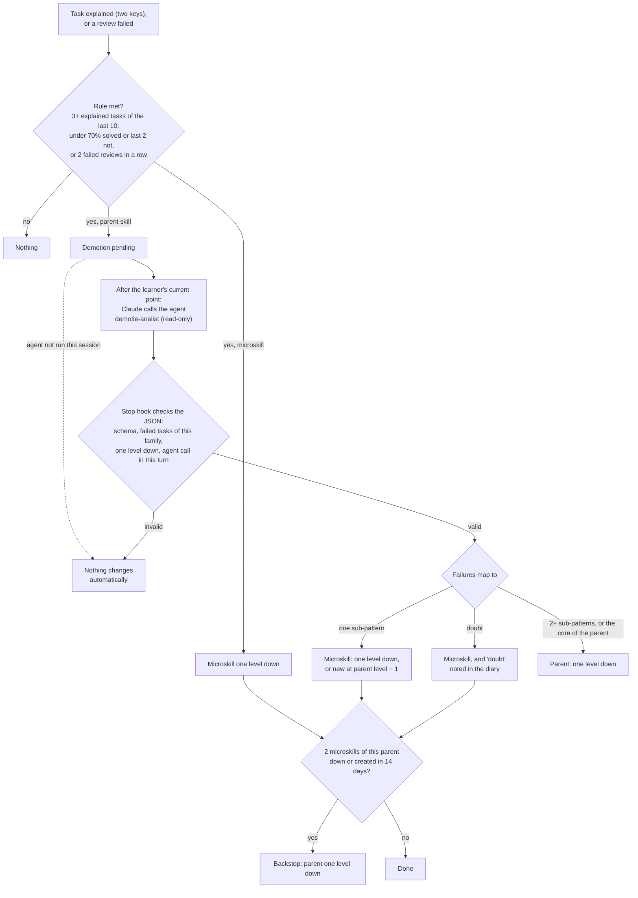
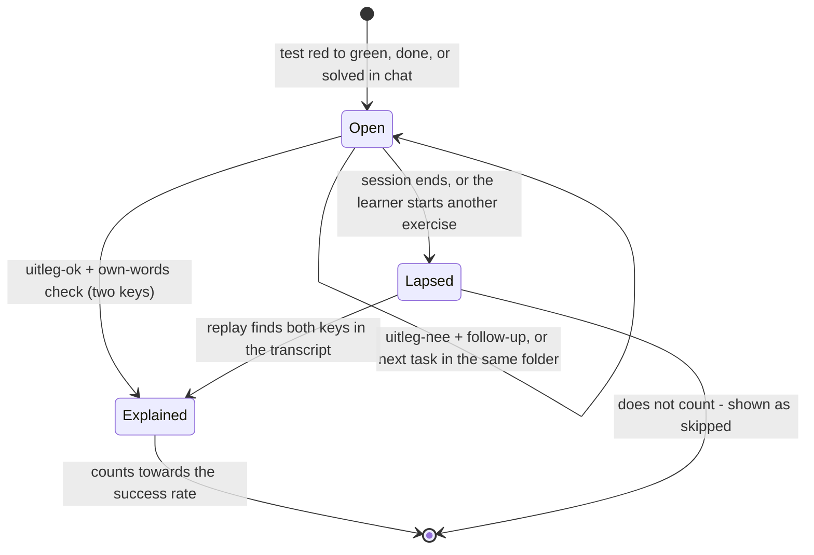
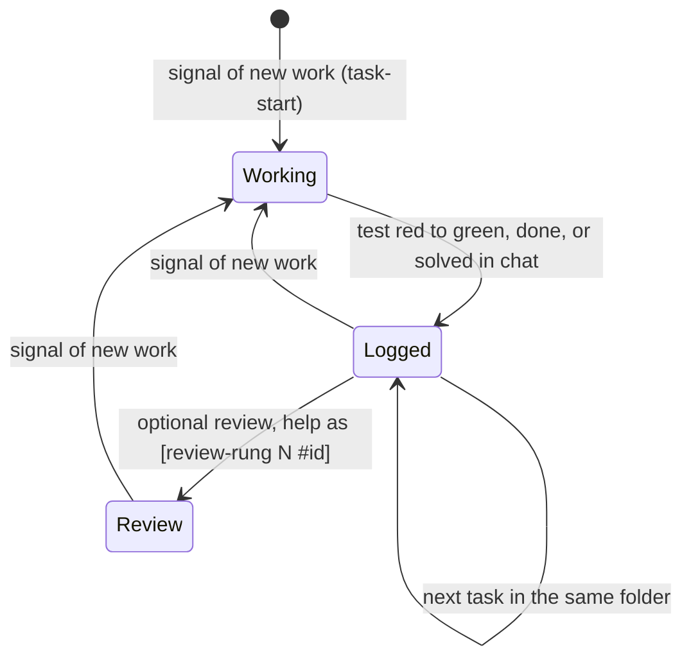
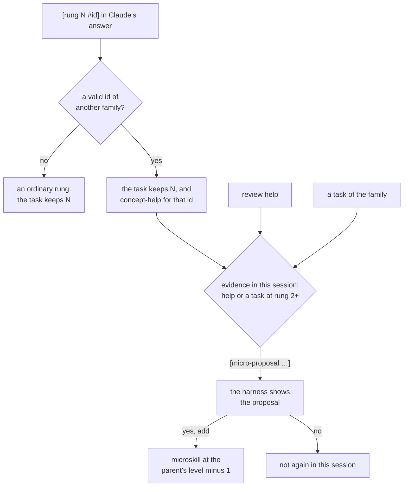
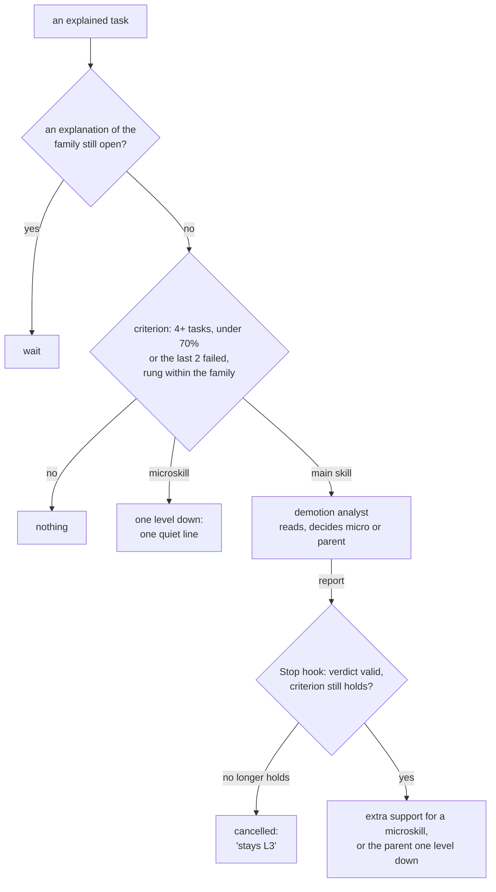
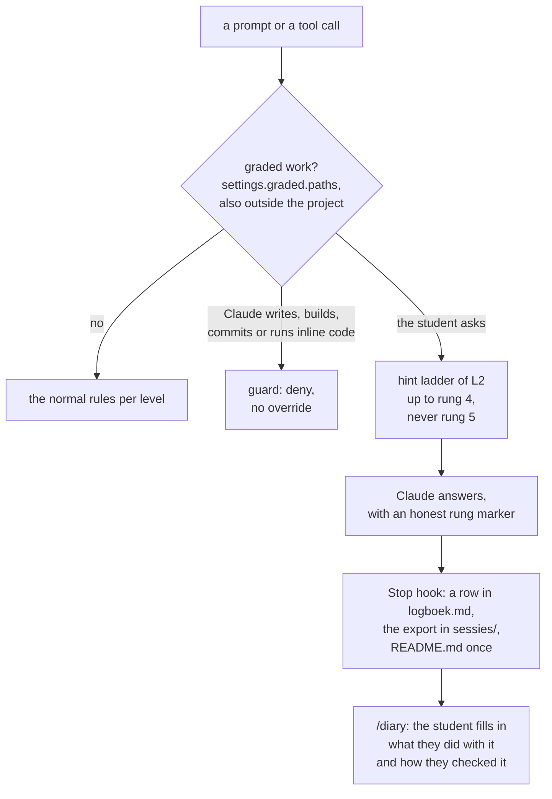
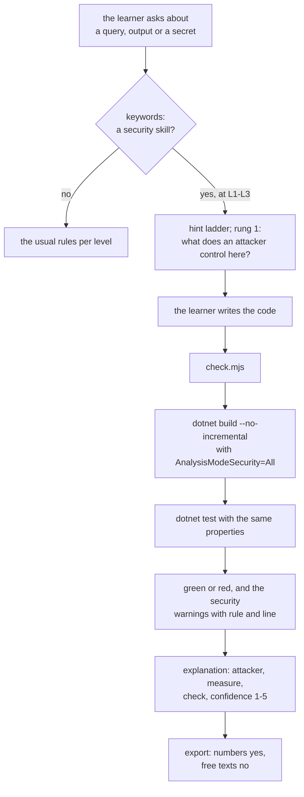
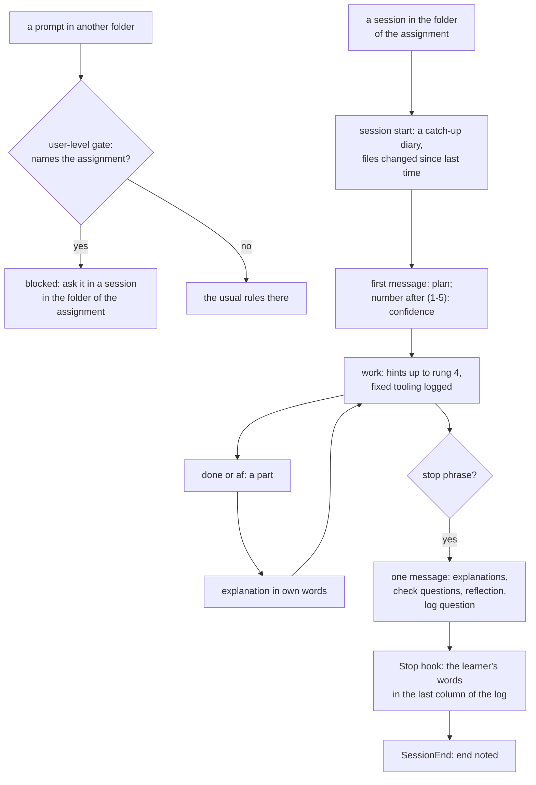
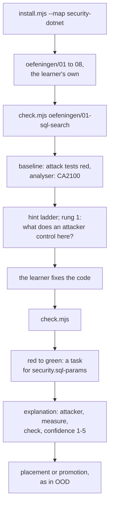

# Build log: the first sessions and the change log

## 10. What we learned from the first sessions {#first-sessions}

In the first sessions of the pilot, one student used the harness for three learning sessions: setting up the snek exercises, `02-namen` and `03-lijsten`. Afterwards, the transcripts and `events.jsonl` were analysed. This section reports what went wrong and what was changed as a result. The student's guiding requirement was: **recognize what is mastered as quickly as possible, then only reinforce it occasionally, so that most time goes to new material before the assessment.**

!!! example "Example: one student's situation"
    The pilot student was a second-year HBO-ICT student preparing for an OOD exam without AI (AI level 0/1). In the harness, `examDate` was set to the working date 2027-01-20, and the assessment assignment would be published in week 10. The three sessions took place on 7 November 2026. A check after the first month was planned for 15 December 2026.

### 10.1 What the data showed

| Observation | Evidence | Consequence |
|---|---|---|
| Independent successes were invisible | `02-namen`, `MetDonald`, `EersteDrie`, `ZonderGoofy` and `ZonderE` were solved with **no hints**, but none were logged. The only logged task was the one struggle (`LaatsteDrie`, rung 3) | The record showed the opposite of reality. Promotion criteria (≥ 5 tasks) could never be met |
| Keyword logging was too narrow and too loose | "er failt er een minder" and "ik heb een paar unit tests zelfstandig laten slagen" were missed. "dat werkt nu met snek" was logged as a test task | Wrong evidence in both directions |
| Skills were too coarse | `cs.basis` mixes list filtering (mastered), strings (mastered), `GetRange` (rung 2), void/chaining and reference-vs-copy (hard) | One hard sub-topic demoted the whole skill L3 → L2 after a single task, against the stated "< 70% or 2 failures" rule |
| Help at L3 was not measured | At L3, Claude gave analogies and concept explanations (effectively rung 2–3), but no rung was recorded | A task could have been logged as "independent" after substantial help |
| Reviews only existed at L4 | `nextReview` was set only when a skill was set to L4 | "Mastered → occasional reinforcement" was weeks away |
| Tooling ate learning time | About an hour went to snek, the `.vs` lock, the VS 2022 vs .NET 10 mismatch, and usings disappearing on save | Not exam material. The guard also blocked `dotnet --list-sdks` and read-only `find … 2>/dev/null` (false positives) |
| The consolidation explanation never came | It was asked for twice and not answered, yet the task still counted | No consolidation |
| Reading test output was only half mastered | Expected/But was was reasoned through correctly, but the summary was not readable. "Is it the test's fault?" showed a misconception about observable behaviour | This is real learning content for `test.*` microskills |

### 10.2 What was changed

1. **Objective evidence: `check.mjs`.** The student runs it. It works for any .NET test project, snek exercises or project work. A red→green transition is logged as a task with the rung that applied at that moment. The first run per folder is a baseline. Skill mapping, in order: the path of the solution folder, then keywords in test and class names, then the active session skill. Claude may not run it at L1–L3 (guard).
2. **Stricter keyword logging, plus the `done` command.** "het werkt" counts only with code or test context and never with tooling words. Claude proposes the `done` command for successes without tests, such as design or UML.
3. **Microskills.** Entries with a `parent`, their own level, keywords and reviews. They drive the hint ladder. The guard stays path-based on the parent's level. Claude proposes new ones (`add-micro`) and the student creates them. Parent statistics include microskill tasks. *Changed on 10 November 2026 (§10.4.2): with `autoDemote` on, the demotion analyst can also create one.*
4. **Hard own-words explanation check (two keys).** A task stays open, also across sessions, until it is explained. *Changed on 10 November 2026 (§10.4.1, D4): the explanation is asked right away, and an open task lapses when the session ends or the student starts another exercise.*
            - Key 1: Claude judges the content and writes `[uitleg-ok <tid>]`.
            - Key 2: `reflect-gate.mjs` checks the student's own message deterministically: at least 12 words outside code, a causal connective, and at most 40% of its 5-word sequences copied from Claude's earlier text.
            - There is no CLI command to mark a task explained. Promotion via `set` is refused while tasks of that skill are open. Claude cannot write `.learning/state/`.
            - *Rationale:* self-explanation and retrieval (Chi et al., 1989; Roediger & Karpicke, 2006), and avoiding the illusion of competence (Prather et al., 2024).
5. **Honest rung logging at every level.** Claude marks substantive help with `[trede N]`, and the Stop hook raises the task's maximum rung from it.
6. **Active positive signalling.** This happens right after a task at rung 0–2, at session start (recent rung-0 wins and promotion candidates with the exact command) and in the diary. Promotion criteria were *not* loosened. The student explicitly chose against a fast-track challenge route.
7. **Fibonacci reviews from L3,** clamped to the exam date (§5.7). *Changed on 10 November 2026 (§10.4.1, D3): reviews at L4 only, through real work.*
8. **Tooling as an L4 zone, plus guard fixes.**
            - Only `dotnet build|test|run|new|add|…` and `check.mjs` count as building or testing.
            - Redirects to `/dev/null` or `$null`, and `=>` / `->`, no longer count as writes.
            - A leading `cd <dir> &&` sets the effective working directory.
            - Paths inside `.claude/` and `.learning/` are not the student's code.
9. **Demotion discipline.** A single struggle leads to a microskill at a lower level or a short override, not a demotion of the parent skill.
10. **Agent messages are not the student's words (a later fix).**
                - **The problem:** in a session that used background research agents, every agent report and task notification reached `UserPromptSubmit` as if the student had typed it.
                        - `prompt-gate.mjs` detected skills in the report text and unlocked hint rungs as "attempt detected", because reports contain words like *error* and *I think*.
                        - A report saying "all tests passed" could have logged a fake task.
                        - The report also became `lastPrompt`, the text the explanation check reads.
                        - Five spurious `hint-unlock` events were logged within ten minutes in one session.
                - **The fix:** `learnerText()` and `isLearnerEntry()` in `lib.mjs`.
                        - A prompt that starts like an agent report or task notification is ignored as a whole.
                        - System-reminder blocks inside a real message are stripped.
                        - `prompt-gate` then logs one `prompt-ignored` event and stops.
                        - `reflect-gate` treats only the student's own messages as the start of "the last answer".
                - **Why text-based:** the real hook input has no origin field (`cwd, hook_event_name, permission_mode, prompt, prompt_id, scratchpad_dir, session_id, transcript_path`), so detection has to rely on the text.

### 10.3 Open points to evaluate after the first month

- **Threshold checks:**
    - Is 12 words / 40% overlap a good threshold, or does it reject honest short explanations? Check the `explain-rejected` events.
    - Does skill mapping by path or keyword in `check.mjs` work for the project structure of the assessment?
- **Behaviour checks:**
    - Does Claude really mark help at L3 with `[trede N]`? Compare `rung-mark` events with the transcripts.
    - Does the number of `untask` events stay low? A high number would mean the logging is still noisy.
- **Guard:** shell text that merely *mentions* a record command (e.g. in a heredoc) is blocked. This is a deliberate trade-off: the guard is a commitment device, so it errs on the strict side.
- **Agent traffic:**
    - Check that every agent report produces a `prompt-ignored` event and that no real message does.
    - Filter the five spurious `hint-unlock` events of that session out of any evaluation.

### 10.4 Revision of 10 November 2026: learning order, reviews and explanations

A later session of the pilot covered two more exercises, `05-de-auto` and `06-studenten`. Afterwards the setup was reviewed again: a fresh check of the literature, a diagnosis of the bugs with evidence from the code, and a build plan. That review is not published. The student made six decisions (D1–D6). Each was first checked against this literature review, and all of them are now built into the harness. Where the build differs in detail from the plan, this section describes the build.

**Process rule (new):** the student's ideas for the harness are first checked against this literature review (§2, P1–P13). Only then are they decided and built.

#### 10.4.1 Decisions

| # | Decision | Checked against | Verdict and condition |
|---|---|---|---|
| D1 | **Attempt first, also for a new skill.** A skill below L4 with no history and no tasks of its own has an open *placement*. Until its first task it counts as L2, for the hint ladder and the guard. The first task places it by its highest rung: 0 → L3, 1–2 → L2, 3–4 → L1, 5 → L0. The hint ladder stays, because it measures the level. With an open placement, a rung never unlocks on time. It goes up only on a stuck signal: the student says so, shares the same error or test outcome twice, or does not know the concept. After an own attempt, an explicit request for more explanation may go straight up to rung 4. The rung Claude really gives is logged. | P1, P2; generation effect; productive failure (Sinha & Kapur 2021); expertise reversal (Kalyuga et al. 2003); help abuse (Aleven et al. 2003) | **Supported.** The consolidation that productive failure needs comes from D4. Help abuse corrects itself, because a requested rung lowers the placement. A placement after one task is noisy: D2 catches a placement that is too high, and the student fixes one that is too low with `set`. |
| D2 | **Automatic demotion, manual promotion.** The rule: at least 3 explained tasks of the skill itself (the last 10 since its last level change), and under 70% solved (rung ≤ 2) or the last 2 not solved; or 2 failed reviews in a row. A microskill goes down one level right away. For a parent skill the **demotion analyst** decides first (§10.4.2). Backstop: if two different microskills of the same parent go down (or are created by the analyst) within 14 days, the parent goes down too. Up never happens automatically. | P2, P3 (contingent tutoring, Wood & Wood 1999); illusion of competence (Koriat & Bjork 2005); P10 (autonomy through a rule you chose yourself) | **Supported, but only on reliable data.** So it sits behind `settings.autoDemote`, which is off by default. The student turns it on once the fixed logging (§10.4.3) has given reliable data for a few sessions. It is an exception to "only the student changes the record", and the student chose it: whether a skill is mastered shows in practice, which is why there are tests at all. Every change is logged, and the student can undo it with `set`. |
| D3 | **Reviews only through real work, Fibonacci only at L4** (§5.7). No separate review exercises, nothing at the session start, no "overdue". When a due L4 skill comes up in real work, the student does it, not the AI: rung 0 pass, 1–2 shaky, 3–5 or failed fail. If the skill does not come up, the review waits. | P8 (spacing: strong); skill decay (Arthur et al. 1998; Tatel & Ackerman 2025); transfer-appropriate processing (P12); P7 (maintenance after automation) | **Partly supported. The one real tension:** "it happens to come up" does not guarantee spacing. Accepted because the snek exercises build on each other (natural interleaving), and because the safety net is the course's practice exams, **deliberately outside the harness**. The student's reason: a work context differs from a test context. Only rung 0 counts as a pass. |
| D4 | **Own-words explanation only right away.** A task is open from the moment it is logged. It lapses at the first of these: the session ends (after the diary, or at the next session start if the session was left open), or the student starts another exercise (`check.mjs` in another folder, or `done` for a skill of another family). A next task in the same folder does not lapse it, and one message may explain several tasks. A lapsed task does not count. The dashboard shows it as "skipped", apart from failed. The follow-up questions are as strict as before. | Self-explanation (Chi et al. 1989); consolidation after struggle (D'Mello et al. 2014); the cost of a strict gate (§2.4) | **Supported.** It removes the pile of stale explanations that blocked promotion. |
| D5 | Mastery gate unchanged (3× rung 0 on ≥ 2 days, plus a transfer task). Stuck timer for normal L2 tasks unchanged (12 min), but it now counts active time. A recap after a break only on request ("Where was I?"): the status, with no new information. | P6 | No change. |
| D6 | **Tooling:** Claude Code's prompt suggestions off (`"promptSuggestionEnabled": false`), because a suggested next prompt gave hints away. AI completion in the IDE off (for example Rider's Full Line Code Completion). | P11; Gajos & Mamykina 2022 | The installer sets the first. The install guide lists the second. |

#### 10.4.2 The demotion analyst

`check.mjs` almost always logs a task under the **parent** skill, so one weak sub-pattern could take the parent down. That would give the AI more freedom in *every* exercise of that skill. So for a parent skill, a read-only Claude agent, `demotie-analist`, first looks at the failed tasks:

- It reads the test output, the code and the hint exchange in the transcript.
- It links each failure to a sub-pattern: an existing microskill (matched on meaning, not on keywords), or a new one. A one-off slip or a tooling problem is left out.
- It returns a JSON verdict: `micro` when all failures share one sub-pattern, or `ouder` (parent) when there are two or more sub-patterns, or when a failure hits the core of the parent skill. In doubt, it chooses `micro` and says it is in doubt.

How a verdict is applied:

1. When the rule is met for a parent skill, the Stop hook sets a pending demotion.
2. With the next prompt, `prompt-gate` asks Claude to call the agent after the student's current point, not in the middle of a hint.
3. Claude puts the agent's JSON in its answer, in a `[demotie {...}]` marker.
4. The Stop hook applies the verdict only if:
    - the schema is valid;
    - the tasks it names are failed tasks of that family;
    - it goes down one level at most. A new microskill always gets the parent's level minus 1, set by the harness, not by the agent;
    - the agent really ran in that turn: the transcript shows a call to the subagent `demotie-analist`.

With `micro`, only that microskill goes down one level, or it is created, and the failed tasks are moved to it. With `ouder`, the parent goes down one level. A doubt is noted in the diary. As a backstop, the parent goes down too when two different microskills of it go down, or are created by the analyst, within 14 days. If the agent does not run in that session, nothing changes automatically; the rule is checked again after the next explained task.

When the demotion rule is met for a parent skill, the read-only demotion analyst decides whether a microskill or the parent goes down. The Stop hook applies the agent's verdict only if its JSON passes the checks; otherwise nothing changes automatically.

#### 10.4.3 Bugs found in the same session (all fixed)

1. **The Stop hook missed 10 of 19 markers.** The cause was a race with Claude Code's buffered transcript writer: it flushes every 100 ms, and not before the hook runs. *Fixed:* the Stop hook also reads the `last_assistant_message` field of its input. Four approved explanations had been lost. The new `replay` command checks both keys again from the transcript and logs only what passes (source `replay`), also for a task that has lapsed in the meantime.
2. **A failed build was not stored as a starting point,** so the first green after fixing compile errors was never logged. *Fixed:* a compile error is now a starting point for `check.mjs`.
3. **A keyword beat the folder.** `prompt-gate` never looked at the folder, and rung marks went to the active skill instead of the task's skill. *Fixed:* the folder decides the skill family. A keyword can only pick a microskill within it; `#id` or the name of an exercise switches to another family.
4. **Guard false positives:** `msbuild` and `check.mjs` were matched anywhere in the command text. *Fixed:* the guard splits a shell command into simple commands and judges each one by its program. It refuses `eval` and `iex`, because it cannot see what they run.
5. **Session time was wall-clock time.** The one-hour nudge fired after about 8 minutes of real work, and a break of 12 minutes or more could unlock a rung without an attempt. *Fixed:* the session hour, the task minutes and the stuck timer count active time. A break longer than `idleMinutes` (default 20) does not count.
6. **Minor:** `!` commands bypass `prompt-gate`, and `check.mjs` attached itself to the most recently changed session file, which is wrong with two sessions open at once. *Fixed:* a `!` command now picks the session that is working on that skill family.

#### 10.4.4 Task lifecycle (D4)

A task waits for its explanation only as long as the student is still on that exercise.

A task stays open until its own-words explanation is approved, and lapses when the session ends or another exercise starts. Only an explained task counts towards the success rate; a lapsed task shows as skipped unless `replay` recovers its explanation.

### 10.5 Revision of 11 November 2026: the start of a task, reviews and explanations

After the session of 11 November the setup was reviewed again. That review is not published, because it contains learning data. The student made seven decisions (13–19; the numbers continue from the review of 10 November). Each was first checked against the literature, and for 13 and 14 the student asked for a critical check. All of them are now built into the harness. Where the build differs from the plan, §10.5.3 says so.

#### 10.5.1 Decisions

| # | Decision | Checked against | Verdict |
|---|---|---|---|
| 13 | **The explanation stays strict, without two side effects of the build.** Claude keeps asking until the principle is right (D4). The question now depends on what happened. After a failed attempt (red, a compile error or a hint): "why does it work now, and why did the first attempt not?" Green at once: one question about the principle of the exercise, because "why does it work?" invites "because I did it right". The Stop hook judges **all the student's own messages since the task was logged, together**, with the same requirements as before. | People overestimate how well they understand a mechanism until they try to explain it (Rozenblit & Keil 2002). The quality of self-explanations, such as naming the principle, predicted learning beyond time on task (Renkl 1997, correlational). Self-explanation (Chi et al. 1989; Bisra et al. 2018). | **Strict stays supported.** Rozenblit & Keil show that explaining exposes the gap; they do not test whether more follow-up questions give more learning. The two side effects had no grounds: they cost rounds without measuring more. Fading the explanation prompts is an open point: in Nückles et al. (2010) fading helped, but for strategies the students already used. |
| 14 | **The optional review after a task stays, with three adjustments.** Claude offers it with a topic and a time estimate. After one wrong answer, or "I don't get it", Claude states the concept (rung 2), and if needed gives an example (rung 4), instead of asking another question. What stays open becomes a proposed microskill, with the exercise where it comes back. | Confusion helps when it is resolved (D'Mello et al. 2014). AutoTutor escalates from the move that tells the least to an assertion, and stops as soon as the student gives the answer (Graesser et al. 2004; the named cycle pump → hint → prompt → assertion in Nye et al. 2014). When to give or withhold help is an open problem: the assistance dilemma (Koedinger & Aleven 2007). P10 (a choice with a known cost). | **Supported.** A review can expose a real misconception. The fix is in how it escalates: when the student cannot produce the answer, the tutor states it. |
| 15 | **Bug: help in a review leaked into the next task.** Every `[rung N]` raised the session's highest rung, and the next logged task took it over, also when that task was about something else. Fix: (a) review help is logged separately (`review-help`), (b) with its own marker `[review-rung N #id]`, (c-1) it counts for a next task about the same concept only, (c-2) new work is recognized by fixed signals, (c-3) a task begins at such a signal. | R2 ("independent" must be honest); P11 (guardrails in the workflow, not in prompts) | **Fixed.** A keyword is never a signal: a misrecognized skill must not erase real help (the bug of 10 November, §10.4.3). Whether an agent should recognize new work instead is an open point. |
| 16 | **A concept id is required** in a review marker. Without a valid id it counts as an ordinary rung, which is the cautious side. | R2 | Built. |
| 17 | **One folder of the OOD example map was linked to the wrong skill:** an association exercise was under inheritance. Fixed in the map, and a new command `skill.mjs paths` lets the student fix the links in their own record. | (data) | Built. |
| 18 | **Code written before the first run did not count.** The first run of `check.mjs` was all green, became the baseline and logged nothing. Now Claude gives the `check.mjs` command first, when the student picks an exercise. And a first run that is all green counts as a task when code in that folder was changed in this session. | (measurement error) | Built. The first run in another folder is also a signal of new work (15c-3). |
| 19 | **The confidence question once,** together with the chosen exercise, and not repeated. Without an answer the diary says "unknown". Cleaning up the folder argument of `check.mjs` was not chosen. | P10 | Built, in the rules for Claude only. |

#### 10.5.2 How a task begins and ends

The harness knew when a task **ends**: a test goes from red to green, the student logs it with `done`, or says in the chat that the tests pass. It did not know when a task **begins**, so all help since the last task counted for the next one. Now a task begins at a fixed signal of new work:

- code changed in another exercise folder than the one of the last task;
- `check.mjs` in another folder;
- the full name of another exercise folder, or a `#id` of another skill family, in the student's own message.

At such a signal the ladder and the task time start again. Ordinary help since the last task was for work that was not finished: it does not count for the new task, and it is logged as `help-dropped`, so it stays visible in the diary and on the dashboard. Review help stays: it still counts when the new task is about the same concept.

A task begins at a signal of new work and ends when it is logged. After a logged task, an optional review may follow; help in that review only counts for a next task about the same concept.

#### 10.5.3 Where the build differs from the plan

- **`done` for another family is not a signal.** The plan listed it. But `done` reports finished work, and work without code (design, UML) gives no other signal. Dropping the help there would hide real help (R2). So `done` keeps all help since the last task, as before.
- **A review marker without an id is still recognized,** so it can count as an ordinary rung instead of being missed.
- **Signals are relative to the last task.** After a signal there is no last task, until the next one is logged. Help on work that is abandoned again before then is not dropped: that is the cautious side.

### 10.6 Revision of 11 November 2026 (afternoon): help per concept, a proposal for a microskill, and honest words

After the second session of 11 November the setup was reviewed critically once more. That review is not published either, because it contains learning data. The numbers continue (22–30); 22 and 24 were open from the previous round. Each point was first checked against the literature, then the student decided. The chosen points are now built into the harness; 24 was not chosen. Where the build differs from the plan, §10.6.3 says so.

#### 10.6.1 Decisions

| # | Decision | Checked against | Verdict |
|---|---|---|---|
| 26 | **Help is logged per concept.** Help during a task went to the skill of the exercise folder, also when it was about a concept of another skill. That skill then looked weaker than it was, and the real gap stayed out of sight. Now Claude writes `[rung N #id]`. The task keeps its highest rung, because it was made with that help. The concept gets its own event, `concept-help`. That is not a task of that concept: `status` shows it, and it is evidence for 22. | Knowledge tracing keeps an estimate per rule and updates it at each chance to apply that rule (Corbett & Anderson 1994; Anderson et al. 1995). | **Supported (a measurement error).** That help itself is evidence is a design choice: the texts that were read update on correct or wrong. Whether concept help at rung 2 or higher should count in the success rate of that skill is open: first log and show it, and decide after a few sessions. |
| 22 | **The harness proposes a microskill itself,** like a promotion. Claude names the part with `[micro-proposal <id> "title" "keywords"]`. The harness checks it and shows the proposal, at the main skill's level minus 1. Only the student's own "yes, add" adds it. Nothing goes down automatically. | Open learner models: the learner sees the model and can negotiate it, with reflection and self-regulation as stated purposes (Bull & Kay 2016; a framework, not a test). A text from Claude is not part of the model. Against: one wrong answer is weak evidence, so the student decides. | **Supported.** |
| 27 | **Honest words.** `check.mjs` said "counts as solved independently" at rung 2, while the record only calls rung 0 independent. Now rung 0 is "solved independently", rung 1–2 "solved, with help up to rung N", and more help as before. Also in the signal to Claude and in the rules. | Illusion of competence (Koriat & Bjork 2005; R2): a success message has to name the help honestly. | **Supported, for the words only.** A stricter "solved" at L3 (rung 1 at most) waits for 26: part of the help belonged to another concept, and with `autoDemote` a stricter line could lower a skill for the wrong reason. |
| 28 | **The explanation is about the concept of the highest hint** when the task had help (rung 1 or higher). Without help, as before (13). | Learning went with impasses: outside an impasse, explanations rarely went with learning, at an impasse sometimes (VanLehn et al. 2003, correlational). Self-explanation pays off most on the principle that is not yet in place (Chi et al. 1989; Bisra et al. 2018). | **Supported.** That the highest hint marks the impasse is an inference. |
| 29 | **A review is only about the student's own code.** A question about an alternative becomes an experiment: rebuild it, run `check.mjs`, revert it. No review after the notice of an hour of active time, or after a task that took rung 2 or higher; then only the proposal for a microskill (22). | Without an own attempt and feedback there is no impasse (VanLehn et al. 2003). That a hard question at the end colours the confidence about the whole session: no source was checked, so a signal, not evidence. | **Supported.** |
| 23 | **Bug: the status line said "rung 0: no hint yet" at L3,** while the task was at rung 2. The line came from the unlocked rung of the L2 ladder, which stays 0 at L3. It now shows the help given; at L2 also the unlocked rung. | (bug) | **Fixed.** |
| 30 | **`install.mjs --update` checks for a running session.** In the pilot the rules were replaced in the middle of a practice session, by an update from another session. Nothing went wrong, but the rules changed under a running session. | R12 | **Built** (see §10.6.3). R12 itself, time-boxing harness work, stays the student's choice: the pilot goes against it on purpose. |
| 24 | **Stuck without saying so.** `check.mjs` would say "nothing changed since the last run", and at L3 Claude would give one rung more after an unanswered or wrong review question. | Students often do not seek help when they need it (Aleven & Koedinger 2000; Aleven et al. 2003). Wheel-spinning (Beck & Gong 2013). Contingent tutoring gives more help after a failure (Wood & Wood 1999); Wood & Middleton (1975) first observed it with mothers and their children. | **Supported, but not chosen:** the student kept it as it is. A preregistered replication of the 1978 experiment on contingent tutoring (Wood, Wood & Middleton 1978) did not find its effect on the children's independent performance (Smit et al. 2025). That bears on the hint ladder (P3), and is for the next review round. |
| 25 | **Deviations of Claude.** The confidence question came twice, against 19. The notice after an hour of active time was not late. | — | For information. |

#### 10.6.2 Help per concept and the proposal for a microskill

Help about a concept of another family stays with the task and is also logged for that concept. With evidence of real help, the harness proposes a microskill, and only the student's own "yes" adds it.

#### 10.6.3 Where the build differs from the plan

- **22: a task at rung 2 or higher is evidence too.** The plan only named review help and concept help at rung 2 or higher. But 29 says that after such a task there is no review, only the proposal; without this, that proposal could not come. The student chose this during the build.
- **22: the evidence must come from the same session and the same family** as the proposed microskill. A proposal the student declined does not come back in that session.
- **26: the concept help knows its task in advance.** The help is logged when Claude gives it, before the task has an id. So the first concept help reserves the id the task will get (`taskTid`). If new work begins first, that id is never used, and `help-dropped` names it.
- **26: a concept of the same family** (the parent or one of its microskills) is the task's own concept. Its rung already says it, so there is no extra event. This is the family logic of the review marker (15c-1).
- **28: also in `check.mjs`.** After help, its line about the explanation now asks about the point where the help was needed. The Stop hook is unchanged.
- **30: with `--yes` or without a terminal it stops,** unless `--force` is given too. A question alone would not have helped in the pilot: the update came from another Claude session, which cannot answer a question. "Running" means a session that was active in the last `idleMinutes` (default 20). The hooks cannot tell practice from talk about the harness, so every session in the folder counts.

### 10.7 Revision of 12 November 2026: positive feedback, demotions and the phase history

After the sessions of 11 and 12 November the student said: "why have I only had automatic demotions so far, and no promotions?" The setup was reviewed critically against that feeling, and against the literature on positive feedback, gamification and desirable difficulties. That review is not published, because it contains learning data. The numbers continue (31–46). Each point was first checked against the literature, then the student decided. The chosen points are built into the harness; where the build differs from the plan, §10.7.3 says so.

**Facts against the feeling.** The log showed 4 times up (1 promotion the student confirmed, 3 placements) and 1 time down: a new microskill, while its parent stayed at L3. No existing level had ever gone down automatically. But the 4 times up were quiet (one line in the output of `check.mjs`), and the one time down was the loudest moment of the harness: a hook message, an agent run and a block of JSON in the chat. Around it, almost every approved explanation had first been rejected once (24 approved, 22 rejected). The feeling was an honest signal about how the feedback *felt*, not about how the student did.

#### 10.7.1 Decisions

| # | Decision | Checked against | Verdict |
|---|---|---|---|
| 31 | **Up is loud, down is quiet.** A placement or promotion gets its own message with ↑ and the evidence, also at the session start and in `status`. Down is one line, "extra support for …", with the way back. The harness reads the demotion analyst's verdict from the agent's own report, so no JSON goes into the chat; the check of the verdict stays. | Bad events and bad feedback weigh more than good ones (Baumeister et al. 2001). Loss aversion appeared, generally, for levels that were earned, not for levels that were given (Rewley et al. 2021). Mastery experience is typically the strongest source of self-efficacy (Usher & Pajares 2008), and only when it is seen as one. | **Supported.** |
| 32 | **Bug: a demotion was applied on old evidence.** When the analyst's verdict was processed, the criterion no longer held (3 of 4 solved, 75%). Now the criterion is checked again, in the prompt gate and when the verdict is applied; when it no longer holds, nothing goes down (`demotion-cancelled`). Down also waits while an explanation of that family is open, just like up. | (bug) | **Fixed.** |
| 33 | **At least 4 explained tasks before going down** (it was 3), for both rules. The analyst keeps only `micro` and `ouder`. | The harness aims at about 85% success (P4). With 3 tasks, one hard task is enough: at exactly 85% that happens in 39% of the cases; with 4 tasks it takes two (about 11%). More than a third of feedback interventions lower performance, mostly when attention goes to the self (Kluger & DeNisi 1996). | **Supported.** The plan was 5 tasks and a third verdict "do not demote"; the student chose 4, as a middle way. |
| 34 | **Down counts the rung within the family.** Help about a concept of another family (`[rung N #id]`) is no failure of the task's skill. The task keeps its full rung (honest, #26). The analyst may choose an existing microskill of another family. | Knowledge tracing: the evidence belongs to the rule it was about (Corbett & Anderson 1994). | **Supported (a measurement error, like #26).** |
| 35 | **Progress towards the next level, in the chat,** in steps, never as a percentage: after each task, at `status` and at the session start. | Effort rises as the goal comes closer (Kivetz et al. 2006); show what is done early on and what remains near the end (Koo & Fishbach 2012). Monitoring progress helps reach goals (Harkin et al. 2016). A progress bar that starts slowly increases drop-out (Villar et al. 2013): so steps, not a percentage. | **Supported.** |
| 36 | **L4 within reach.** (a) The task that placed a skill counts after the placement. (b) The transfer task is one of the three times without a hint, and its day a day. When the exercise folders of an L3 skill run out, Claude points to an existing next exercise; a practice-test question counts via `done`. Design goal: whoever practises daily and masters the skill reaches L4 in about 3 sessions on 2 days; a test guards it. The day stays the UTC date. | Mastery learning works through enough chances to practise with feedback (Kulik et al. 1990). A criterion that cannot be reached is a ceiling, and that undermines the sense of competence (Ryan & Deci 2000). Relearning in later sessions mattered more than extra correct answers in the first session (Rawson & Dunlosky 2011). Their sessions were widely spaced and the material was concepts, not code: "about 3 sessions on 2 days" is an inference, and a tight one. | **Supported.** The student's words: the slow road to L4 "is not workable for a junior dev". |
| 37 | **Praise first, then the requirement.** `check.mjs` names what worked and the (micro)skill, and gives the explanation as an invitation. With help: "this is where the learning was: `<concept>`". A worked example (rung 5) has its own honest text (a bug: it got the soft text of rung 3–4). | Verbal positive feedback raised free-choice intrinsic motivation for college students, not for children (Deci, Koestner & Ryan 1999). Praise works when it is sincere and points to causes the learner controls (Henderlong & Lepper 2002). With positive feedback on correct steps, students in SQL-Tutor learned the same in about half the time (Mitrovic et al. 2013; 41 students, no difference on the exam). | **Supported.** |
| 38 | **First name what is right, then one follow-up question.** The requirement stays. The why check also accepts "if …, then/would …" in one sentence. | Novices seek and use positive feedback (Finkelstein & Fishbach 2012). People learned less from failure than from success with the same information (Eskreis-Winkler & Fishbach 2019); in replications that effect disappeared when corrective feedback or a brief instruction followed (Keith et al. 2022; Gok & Fyfe 2024), which is what a follow-up question does. Against softening: politeness can hide the error (Person et al. 1995), so the gap is still named. The requirement itself stays supported (self-explanation, Bisra et al. 2018). | **Supported for the form, not for less strictness.** The "if … then" rule came from a session in which a good explanation was rejected for having no reason word. |
| 39 | **Effort is the goal, not failure.** After a task with help: "this is where the learning was". Once, at the first session start, a short explanation. | Performance during practice is a poor index of learning (Soderstrom & Bjork 2015). Learners judged the effortful strategy as less effective and chose it less (Kirk-Johnson et al. 2019). Learners need support to start and stick with desirable difficulties (de Bruin et al. 2023); one lever is to reframe effort (Zepeda et al. 2020). | **Supported**, as a framework: little empirical work on these levers yet. |
| 40 | **Bug in the words of the dashboard:** the tile "solved independently" counted rung ≤ 2. Now two tiles: "solved (rung ≤ 2)" and "independent (rung 0)". | #27 | **Fixed.** |
| 45 | **The phase history on the dashboard** (with #41): per skill one band over the days, with "start" apart; tasks as dots; microskills under their parent; each change marked with how it was decided; one sentence that compares only with yourself. The export now says how a change was decided (`kind`, a fixed list of words) and leaves out changes without a difference. | Feedback against your own earlier work gave more skill and self-efficacy than feedback against classmates (Shih & Alexander 2000, an experiment with 84 children). A class average disheartened some students (Aguilar 2018, interviews). Opening the learner model can help (Long & Aleven 2017), and a model should show why it believes something (Kay & Kummerfeld 2012). | **Supported, as an inference:** no study was found that tests a history view of a learner model. Dashboards in general showed no effect on achievement, a modest one on motivation and a larger one on participation (Kaliisa et al. 2024). The real test: ask after two weeks whether the feeling "only down" changed. |
| 42 | **Rejections per task on the public dashboard.** | Reporting progress publicly helps (Harkin et al. 2016); failure can make people tune out (Eskreis-Winkler & Fishbach 2019). | **Partly supported, not chosen:** the student kept them public, with the reasons. |
| 43 | **No points, badges, streaks or leaderboards.** A level informs: it says which help you get, not what status you have. | See P14 (§2.11). | **Supported, a design rule.** |
| 44 | **Small points.** The placement now happens at the approved explanation. The errors in the course material are not reported. The Mermaid diagrams were checked after the build. | — | **Built.** |
| 46 | **One task of the student "should count as independent"**, because the course's test was wrong. The rung came from a question about what the test expects, not from the error. | Honest logging (R2). | **Not supported, kept as it is.** |

#### 10.7.2 Down, as built

Down waits for open explanations, counts only the help within the family, and is checked again on the evidence of the moment it is applied. The analyst's report goes to the Stop hook, not into the chat.

#### 10.7.3 Where the build differs from the plan

- **38: only "then" or "would".** "If …" counts as a why only with "then"/"dan" or "would"/"zou" in the same sentence. Looser words ("can", "is") would let a bare statement through.
- **44 and 36 (a) together.** Because the placement now happens at the explanation, after the task, the placement task has to be added to the window explicitly; otherwise (a) would never count. Older placements without a task id find it in the `placement` event.
- **34: also the placement.** The placement uses the rung within the family too: help about another concept says nothing about the new skill.
- **31: the analyst's report is read, not pasted.** A background agent hands its report back as a message; the Stop hook takes the verdict from there (or from the result of a synchronous agent). A verdict in that report that the harness refuses does not block Claude: the demotion stays pending. The `[demotie {...}]` marker still works as a fallback.
- **35: which skills.** The progress lines cover the skills with at least one task since their last level change.
- **36: the next exercise once per session.** The hook tells Claude once per skill and session that the folders have run out.
- **45: on the dashboard, a microskill only when something happened to it** (a task, a change, or extra support). A placement counts as a phase up when it lands on L3 or L4.
- **45: `levelChanges` without changes without a difference.** The first "since the last export" after the update may count one change less.
- **An older session file** has no family rung yet: it counts all help, until the next task starts.

### 10.8 Revision of 13 November 2026: graded work under the exam rules

The student asked to make the setup fit the exam rules (OER), so the harness can help with the final assignment of the course. The rules allow AI level 1 there: GenAI as an aid, "for example to generate ideas or bring structure", with a statement of how it was used. Unauthorized use of AI that makes content ("text, images, code") counts as fraud (OER art. 1.41(3c)). The setup document with the decisions stays private, because it is about the student's own assignment. The numbers continue (49–54). The student decided 49, 50 and 53 with multiple-choice questions; 51 was done right away; 52 stays open.

#### 10.8.1 Decisions

| # | Decision | Checked against | Verdict |
|---|---|---|---|
| 49 | **The hint ladder up to rung 4 in graded work.** In the paths of `settings.graded` the L2 ladder and the stuck timer hold for every skill, also at L3 and L4. Rung 5 (a worked solution) does not exist there; a request for it is refused with a reference to the exam rules. Rung 4 is an example of at most 5 lines on another topic. Claude writes nothing there, at no level. | Learning came only from an explanation *without* the answer; an own choice followed by the AI's answer gave none (Gajos & Mamykina 2022). Try first, then an example was not better than practice alone for novices (van Gog et al. 2011), while problem solving before instruction helps on average (Sinha & Kapur 2021), when the instruction builds on the student's attempt (Loibl et al. 2017). The most concrete hint can work as a worked example when the student thinks about it (Shih et al. 2008). LLM tutors draw the line differently: CodeAid shows generic example code (Kazemitabaar et al. 2024), CodeHelp removes all of it (Liffiton et al. 2023). R10: lower ownership with unrestricted ChatGPT (Bergh et al. 2026, preprint), not tested for small examples. | **Supported, with conditions.** The advice is the same as the decision. Three conditions go into the rules for Claude: the example implements no behaviour of the assignment and does not fit by renaming; the student types their own code and never pastes; the explanation after the task also asks how the example differs from the student's solution. Whether a rung-4 example still counts as "generating ideas or bringing structure" is for the institution to say; the log names it. |
| 50 | **An AI-use log in the repo of the assignment** (`ai-verantwoording/`): a row per answer (when, session, skill, rung, kind of help) written by the Stop hook, a last column the student fills in ("what I did with it / how I checked it"), an export of every session, and a README with the AI level, an APA reference and "Claude Code has no share link". The privacy filters of the dashboard export are reused: e-mail, the home folder (becomes `~`), hook and system messages. | The exam rules at level 1 ask for prompt links or a statement that the tool has none, an APA reference, and a check of the output by the student. Detection of AI text is unreliable (Scarfe et al. 2024), so the student's own record is the protection (R11). | **Built.** A policy requirement, not a learning claim. |
| 51 | **Keep the prompts until the assessment:** Claude Code keeps transcripts 365 days instead of 30. | The exam rules: keep the prompts until the assessment. | **Done** by the student, in the Claude Code settings. |
| 52 | **Practice for the moments at level 0** (the diagnostic test and the extension during the assessment, without AI). | — | **Open.** A proposal for January. |
| 53 | **The harness in the repo of the assignment, with one record.** The repo uses the record of the practice folder (`install.mjs --learning-dir`), so a task in the assignment counts for the same skill. `.claude/` and `ai-verantwoording/` go into git (the teacher sees the rules the AI followed); `.learning/` does not. | The evidence belongs to the skill it is about (Corbett & Anderson 1994). R13 (privacy). | **Built.** |
| 54 | **Bug: the guard let a write outside the project through.** A session in the practice folder could write freely in the repo of the assignment. Now the paths of graded work are tested always, also outside the project. | (bug) | **Fixed.** |

#### 10.8.2 Graded work, as built

The guard decides on the path, not on the level: graded work is protected at every level and from every folder. The log is written by the hooks only; the student writes the last column.

#### 10.8.3 Where the build differs from the plan

- **The export of a session is written after every answer**, not only at the end. A session that ends without a clean exit is still complete in the log.
- **When a session counts as graded:** this project is graded work, the working folder is, the prompt names the folder of the assignment, or Claude used a tool on a graded path (it read a file there). After that, the session stays graded: the cautious side.
- **The guard also blocks building and testing** in graded work, as at L2, and git commands that change the repo, and inline code (`node -e`, `python -c`) run there. Reading is allowed. A script that Claude would write elsewhere and that writes into the repo when run cannot be seen by the guard; the rules forbid such a detour.
- **The path of the record is not in the manifest** but in `.claude/leerharnas.local.json`, which is not in git: the manifest goes into the repo, and the path contains the home folder.
- **The last column is not checked with the two keys** of the explanation check: the student writes it in the file. `/diary` asks for it, and at the end of the session the harness names the rows that are still empty.
- **The three conditions of the literature check** are rules for Claude (CLAUDE.md), not enforced by a hook.
- **Open:** the form of the APA reference against the guide of the institution's library.

### 10.9 Revision of 13 November 2026 (evening): the security map

The pilot student chose the whole plan of §2.13 at once, with four separate skills instead of one family with microskills.

#### 10.9.1 Decisions

| Decision | Built |
|---|---|
| `security.basics` becomes four separate skills | `security.output-encoding`, `security.sql-params`, `security.secrets-config` and `security.ai-review`, at L2, without paths, each with keywords. `review.ai-code` stays separate, for review in general. |
| The attacker first | In the notes of the map: rung 1 is always "What does an attacker control here?", and the explanation of a security task has three parts (what the attacker controls, which measure stops it, how you check that) plus a confidence from 1 to 5 (Braz et al., 2022; Perry et al., 2023). |
| An analyser next to `dotnet test` | `check.mjs` with the setting `securityAnalyzer` (on in `junior-dotnet`): first a full build with every security rule of the .NET SDK's analyzers, then the tests. The learner explains the warnings; Claude does not fix them at L1–L3. |
| Examples teach no insecure pattern | A rule in the rules of every map, also `ood`: the example at rung 4, the worked solution at rung 5 and an example at L0 never contain concatenated SQL, unencoded input in HTML or a log, a secret in the code, `System.Random` for a token, or certificate validation switched off. |
| Nothing about vulnerabilities online | A skill can be `sensitive`; the four security skills are. The export then keeps the numbers of their tasks, but not the free texts: the test names, the explanation, the reasons of a rejection or correction, free notes on a level change, and the title of a microskill below it. |

#### 10.9.2 A security task, as built

The analyser only looks for patterns it knows. A clean run is therefore no proof, and `check.mjs` says so.

#### 10.9.3 Where the build differs from the plan

- **The analyser rebuilds.** The plan was one build. A trial with a real project showed that the analyzers only report while the compiler runs: after a build that was already up to date, not a single warning came, not even for `System.Random`. So `check.mjs` first builds with `--no-incremental`, and runs the tests with the same properties, so they do not compile again. That takes time in a large solution; the setting can be turned off.
- **A project that treats warnings as errors keeps building.** `CodeAnalysisTreatWarningsAsErrors=false` keeps the security rules at warning level, also with `TreatWarningsAsErrors` in the project. Tested on a real project.
- **The guard does not protect the security skills.** Security cuts across files, so the skills have no paths. At L1–L3 Claude keeps to the notes of the map; no hook enforces it.
- **The dashboard shows no separate note** for a task without texts. The export sets `withheld: true`; the task is shown with its rung and outcome.
- **An existing install keeps `security.basics`.** `--update` leaves your record alone. To get the four skills, add them with `add` or install again.
- **Not built:** access control and dependencies (§2.13: no analyser finds access-control flaws reliably, and a package check needs a network), and exercises with attack strings as tests.

### 10.10 Revision of 13 November 2026 (night): the first sessions on the final assignment

The pilot student worked on the final assignment for the first time, and the harness got in the way in four places. Claude refused to put the official arc42 template in the repo, although the exam rules allow AI to "bring structure" and the template is not AI content. Nothing showed that the session had started, and the confidence question went unanswered without trace. A class diagram the student finished in the IDE, between two sessions, counted for nothing. And the closing questions only came after the student asked for them. A review of that evening also found three gaps: "I want to stop" and "laten we afronden" were not recognised as a stop request, the guard refused `git remote -v` as a write, and help on the assignment asked in another folder had no rung limit and no row in the log. The student decided points 55–62 with multiple-choice questions; 62 fell away because 61 covers it. The setup document stays private.

#### 10.10.1 Decisions

| # | Decision | Checked against | Verdict |
|---|---|---|---|
| 55 | **Fixed tooling in graded work.** The guard allows a short list of deterministic commands there: `dotnet new` (sln, console, classlib, nunit, xunit, gitignore; not with `--force`), `dotnet sln add`, `dotnet add reference\|package`, `git init`, `git remote add`, `git branch -m`, `mkdir`, and `scaffold.mjs arc42`, which unpacks the official template unchanged after a sha256 check. Each becomes a row "tooling (no AI content)" in the log. Content, commits, the pipeline and the Dockerfile stay the student's. | The grading form scores the code, the UML, the tests, the pipeline, version control and the report, so all of that stays closed. The exam rules forbid AI that makes content (OER art. 1.41(3c)); a generator or an official template makes no AI content. | **Policy, built.** |
| 56 | **The start stays automatic** (a start command can be forgotten, and then nothing counts). The harness logs the plan (the first message) and the confidence (a number after Claude's "(1–5)") itself. A SessionEnd hook notes how a session ended; the next start offers a catch-up diary, once, for a session with work but without a diary entry. | Calibration of self-judgement needs the confidence beforehand (see §10.4). | **Built.** |
| 57 | **A task per part.** Work without a test is split into named parts; each finished part is a task with its own explanation. `af: <what>` (or `done: <what>`) at the start of a message counts as `done`, without a `!` command. The start lists the files changed in the graded folder since the previous session, with their skill by `paths` or by content (a Mermaid `classDiagram` → `uml.klassendiagram`). | Proximal subgoals beat a distal goal for learning, self-efficacy and accurate self-judgement (Bandura & Schunk, 1981). | **Supported, with a condition:** a part must be a real step the learner can explain on its own, or the promotion criterion is reached by splitting. The rules for Claude say so; the explanation gate per part keeps it honest. |
| 58 | **Ending in one message.** More stop phrases ("ik wil stoppen", "laten we afronden", "I want to finish this session"), only at the end of a short message. Then one message with the open explanations, 2–3 check questions, the reflection and the log question. Check questions are logged (`check-question`) as evidence for a microskill, never for a level. | Retrieval beats restudying for later retention (Roediger & Karpicke, 2006; Adesope et al., 2017), also in real courses, with corrective feedback as a moderator (Yang et al., 2021). Transfer is largest for application and inference questions (Pan & Rickard, 2018). | **Supported, with three conditions:** answers from memory; questions about a reason or an application in the learner's own work, not a definition; feedback per answer. **Advice, not built:** one open question again at the start of the next session would add a spaced repetition. |
| 59 | **The learner's own words in the last column of the log.** Claude marks the part of the learner's answer with `[log "…"]`; the Stop hook writes it only when it is, word for word, part of what the learner typed, and only in empty cells of that session. | The exam rules ask the student to check and account for the output; the words must be the student's (R11). | **Built.** Two keys, as for an explanation. |
| 60 | **git commands that only read** (`remote -v`, `branch --show-current`, `config --get`, `stash list`, `tag -l` …) are allowed in graded work. | (bug) | **Fixed.** |
| 61 | **Graded work is closed from other folders.** A gate at user level (`install.mjs <folder> --user-guard`) runs in every project outside the graded folder: it blocks a prompt that names the assignment, and refuses every tool on its paths, reading too. Only the setup (`.claude/`, `CLAUDE.md`) stays open. A rule in `~/.claude/CLAUDE.md` covers general questions a hook cannot see. | The help that evening came from a session in another folder: no rung limit, no log row (R11). | **Built**, not installed on any machine: that is the student's step. |
| 62 | Log per turn instead of per session outside the graded folder. | — | **Dropped:** 61 closes the other folders. |

#### 10.10.2 A session on the final assignment, as built

The gate and the project's own harness never judge the same prompt: inside the folder of the assignment the gate steps aside.

#### 10.10.3 Where the build differs from the plan

- **The template is pinned, and the harness does not download it.** The plan was a script that downloads the template. The security check refuses network code in the harness (SECURITY.md promises none), and that block cannot be allowed. So the zip is downloaded first, outside the graded folder, by the student or by Claude with `curl`; `scaffold.mjs --from <zip>` then checks a sha256 pinned in the script (release 2026.10.19 of arc42, GitHub Markdown, one file per chapter) and unpacks it. A zip with another checksum is refused: otherwise Claude could pack its own content into a zip. It only unpacks into a new or empty folder. The guard now also treats a download into graded work (`curl -o`, `curl -O`, `wget`) as a write.
- **The guard only allows its own copy** of `scaffold.mjs` (`.claude/hooks/`, protected like every hook). A script that Claude writes elsewhere and runs with `node` is still not visible to the guard, as noted in §10.8.3.
- **`af:` needs a change in graded work.** A part counts only when a file of the assignment changed since the last task of that skill. Outside graded work `af:` works like `done`.
- **The plan is the first message**, not a summary of it. A "hello" becomes the plan. The diary uses it as it is.
- **A catch-up diary is offered for sessions of the last 7 days**, once each, newest first, never for a session that is still active in another window.
- **The gate needs a config** in `~/.claude/leerharnas/graded.json`, written by the installer from the record. After `setting graded add` the student runs `--user-guard` again. Names that are too general (`src`, `Tests`, `Domain`) are not blocked in prompts; a solution folder such as `Webshop` is.
- **A general question without the name** of the assignment cannot be seen by a hook. The block in `~/.claude/CLAUDE.md` asks Claude to check first; that is a rule, not enforcement.
- **This section is §10.10**, because §10.9 was taken by the security map the same evening.

### 10.11 Revision of 13 November 2026 (night): a practice map with exercises

The security map of §10.9 worked, but not like the OOD practice folder: there was no practice material, the guard protected nothing, `check.mjs` only found the skill through keywords, and code outside the skills was L4. The pilot student chose a separate practice map with two exercises per skill, and texts in Dutch and English. `junior-dotnet` stays the map for a team repository.

#### 10.11.1 What was built

| Gap in §10.9 | Now, with `--map security-dotnet` |
|---|---|
| No practice material | Eight exercises in `oefeningen/`, each a small xUnit project on .NET 10 with a story in its `README.md`. In 01–06 the attack tests start red; in 07–08 an AI wrote the code, all tests are green, and the learner first writes a failing test. |
| The guard protects nothing | Each skill has paths to its two exercises. |
| `check.mjs` only finds the skill through keywords | The folder of the exercise decides the skill, as in OOD. |
| Code outside the skills at L4 | `defaultLevel` L2, as in OOD. |

#### 10.11.2 A practice folder, as built

#### 10.11.3 What stood out, and where it differs

- **The analyser finds four of the eight vulnerabilities:** SQL built from strings (01, 02, 08) and `System.Random` (06, 08). Missing HTML encoding, log injection, missing validation and a key in the code it does not see. The READMEs say so, and it is part of the lesson that a clean run is no proof.
- **Three ordinary tests also start red**, because they share the cause of the attack: a name with an apostrophe (01), an ampersand (03) and a username with a newline at the end (04). The READMEs name them.
- **Exercises 05 and 06 read their own source code** to find a key in the code and `System.Random`. That is a rough check, and they say so.
- **The reference solutions are not in the repository**, so that neither Claude nor the learner can find them. Every exercise was verified against them, with SDK 10.0.401 and SDK 11 rc.
- **An exercise belongs to the learner.** `--update` never replaces an exercise that is already there; a new exercise does arrive.
- **The security check** of the repository allows C# files only in the exercises of a map, and checks their content like any other text file.
- **Not built:** the dashboard reads one practice folder, so a second one is not on it yet. The map has not been used in a real practice session yet.

---

## 11. Change log {#changelog}

### 13 November 2026 (later): security review and its fixes

A security review of the whole repository, with Claude Code agents, found nine issues. They are listed with their severity and fix in [the security review](https://github.com/piethanegraaf/piethanegraaf.github.io/blob/main/research/security-review-2026-11-13.md), and were fixed in order of severity.

- **High:** a quoted subcommand of `skill.mjs`, and graded work behind `${HOME}`, an escape or brace expansion, passed the guard.
- **Medium:** whole folders of the harness and the record, folders of protected code, and the user-level files were not protected.
- **Low:** links and Windows short names, the reason of an override for a sensitive skill in the export, names with é or ë in the privacy filter, and full test names in a task.
- **Not changed:** the conclusions of §2, and the limit of §7: the hooks are a commitment device, not a sandbox.

### 13 November 2026 (night): a practice map with exercises, and the docs in sync again

- **§10.11 (new):** the practice map `security-dotnet` with eight exercises, a diagram of a practice folder as built, and what stood out.
- **The site:** README, Home, Install, Configuration, Reference, For junior developers and For researchers describe the three maps. Install now names every file the installer writes, `git pull` before an update, and that the placement sets the starting level.
- **Not changed:** the conclusions of §2. There are no new sources.
### 13 November 2026 (night): the first sessions on the final assignment

The pilot student decided points 55–62 after the first sessions on the final assignment; 55–61 were built the same night, 62 fell away.

- **§10.10 (new):** the decisions, a diagram of a session on the final assignment as built, and where the build differs from the plan.
- **§8:** 2 new references (Bandura & Schunk, 1981; Yang et al., 2021). They were checked first, together with Roediger & Karpicke (2006), Adesope et al. (2017) and Pan & Rickard (2018), which were already cited; the notes are in [the citation check](https://github.com/piethanegraaf/piethanegraaf.github.io/blob/main/research/citation-checks/citation_check_learning_science.md), section I. The check adds conditions, no correction: a part must be a real step, and a check question asks for a reason or an application. It also advises a spaced repeat of one open question at the next start; that was not built.
- **Not changed:** the conclusions of §2.

### 13 November 2026 (evening): the security map

The pilot student chose the whole plan of §2.13; it was built the same evening.

- **§10.9 (new):** the decisions, a diagram of a security task as built, and where the build differs from the plan (the analyser rebuilds, the guard does not protect the security skills).
- **§2.13:** the plan now says what was built.
- **Not changed:** the conclusions of §2. There are no new sources.

### 13 November 2026: secure code as a first niche for juniors

The pilot student asked whether cybersecurity is a good first niche, and which angle fits: junior developers who learn basic security at work, or junior security specialists.

- **§2.13 (new):** AI code and security, confidence that is not justified, what juniors lack, what laws and standards ask of employers, the two angles side by side, and the plan as a hypothesis: angle A, as a deepening of `junior-dotnet`.
- **§8:** 30 new references. They were checked first; the notes are in [the citation check](https://github.com/piethanegraaf/piethanegraaf.github.io/blob/main/research/citation-checks/citation_check_learning_science.md), section H. The check corrected, among other things, the SusVibes figures (57% correct and 11.8% secure in the ICML version, not 61% and 10.5%), the Staatsblad number of the Cyberbeveiligingswet (2026, 187), the source of a UWV figure (no longer used), and that the effect in Braz et al. is an odds ratio.
- **Notes:** [secure code for juniors](../notes/secure_coding_juniors.md).
- **Not changed:** the harness itself. The security map, the analyser and the rule for examples have not been built.

### 13 November 2026: graded work under the exam rules

The pilot student decided points 49–54 of the setup of 13 November; 49, 50, 53 and 54 were built the same day.

- **§10.8 (new):** the decisions, the literature check of rung 4, a diagram of graded work as built, and where the build differs from the plan.
- **§3, R11:** the mitigation names what the harness now does for graded work.
- **§5.1:** the "as built" architecture shows the AI-use log in the repo.
- **§8:** three new references. The sources of decision 49 were checked first; the notes are in [the citation check](https://github.com/piethanegraaf/piethanegraaf.github.io/blob/main/research/citation-checks/citation_check_learning_science.md), section G. The check found no study of exactly this case: the evidence is indirect. It also found that Bergh et al. (2026) is a preprint and had no condition with small examples.
- **Not changed:** the conclusions of §2.

### 12 November 2026: positive feedback, demotions and the phase history

The pilot student decided points 31–46 of the review of 12 November; they were built the same day.

- **§10.7 (new):** the decisions, what they were checked against, a diagram of going down as built, and where the build differs from the plan.
- **§2.11, P14 (new):** levels inform; they do not reward (decision 43).
- **§5, the Mermaid check (decision 44):** an "as built" architecture (§5.1) and session (§5.4); the state diagram and its bullets (§5.2) and the hint ladder (§5.3) follow the build; the hook table notes what changed. The diagrams of §10.4–§10.6 stay as records of those revisions.
- **§8:** new references. Each was first checked against its abstract; the notes are in [the citation check](https://github.com/piethanegraaf/piethanegraaf.github.io/blob/main/research/citation-checks/citation_check_learning_science.md), section F. The check changed some claims:
  - Rawson & Dunlosky (2011) supports the design goal for L4 only partly: their relearning sessions were widely spaced.
  - Eskreis-Winkler & Fishbach (2019) is cited with the replications that limit it (Keith et al. 2022; Gok & Fyfe 2024).
  - Kirk-Johnson et al. (2019) is cited for the judgement of effort, not for better memory.
  - Henderlong & Lepper (2002) is the right name.
- **Not changed:** the conclusions of §2.

### 11 November 2026 (night, last): the evidence for contingent hints (P3)

The pilot student chose this change after the check of the sources of the afternoon review (§10.6, decision 24).

- **§2.3:** the rule "more help after failure, less after success" is now attributed to where it comes from (Wood & Middleton 1975; Wood, Wood & Middleton 1978), not to Wood & Wood (1999), who built it into a tutor. Added: the failed replication of the 1978 experiment (Smit et al. 2025), a meta-analysis in which changing the scaffolding over time made no difference (Belland et al. 2017), and a classroom experiment in which contingency only helped after longer independent work (van de Pol et al. 2015).
- **§2.11, P3:** the evidence goes from moderate to low to moderate: moderate for graduated hints, weak for the contingency itself.
- **§5.3:** one sentence on what this means for the hint ladder.
- **§8:** new references. Each was first checked against its abstract; the notes are in [the citation check](https://github.com/piethanegraaf/piethanegraaf.github.io/blob/main/research/citation-checks/citation_check_learning_science.md), section E.
- **Not changed:** the harness, and the conclusions of §2.

### 11 November 2026 (night, later): the map next to the assessment and the cheat sheet

- **§5.8:** ten more skills, from the grading form (logging; integration, system and UI tests) and from the pilot student's cheat sheet (casting, static, records and structs, object methods, other C#, and the three families of design patterns). The map now has 29 skills.
- **Not changed:** the conclusions of §2, and what the map deliberately leaves out (security, cloud and CI/CD, the database, the report).

### 11 November 2026 (night): help per concept, a proposal for a microskill, and honest words (decisions of 11 November, afternoon)

The pilot student decided these changes after the second session of 11 November, and each was first checked against the literature. They are now built into the harness. Details and verdicts are in §10.6.

- **§10.6, new:** decisions 22–30, help per concept and the proposal for a microskill, and where the build differs from the plan.
- **§3, R13:** publishing is the learner's choice, and then only a filtered selection goes online. The text no longer says that nothing goes online.
- **§8:** new references. Each was first checked against its primary source or its abstract; the notes are in [the citation check](https://github.com/piethanegraaf/piethanegraaf.github.io/blob/main/research/citation-checks/citation_check_learning_science.md), section D. Two findings are for the next round: the knowledge-tracing paper updates on correct or wrong, not on help; and the 1978 experiment on contingent tutoring did not replicate (Smit et al. 2025).
- **Not changed:** the conclusions of §2.

### 11 November 2026 (evening, later): the skill map and the final assessment

- **§5.8:** now shows the map that is really in the harness, without prerequisites, with four new skills for the OO design of the final assessment. The original graph is in a collapsed block.
- **Not changed:** the conclusions of §2.

### 11 November 2026 (evening): the start of a task, reviews and explanations (decisions of 11 November)

The pilot student decided these changes after a later session, and each was first checked against the literature. They are now built into the harness. Details and verdicts are in §10.5.

- **§10.5, new:** decisions 13–19, how a task begins and ends, and where the build differs from the plan.
- **§8:** new references. Each was first checked against its primary source or its abstract; the notes are in [the citation check](https://github.com/piethanegraaf/piethanegraaf.github.io/blob/main/research/citation-checks/citation_check_learning_science.md), section C.
- **Not changed:** the conclusions of §2.

### 11 November 2026 (later): junior developers at work, and an invitation to researchers

- **A second target group.** The review now also covers junior developers at work, who risk staying junior when an agent does the work before they can do it themselves (§1, §2.0, §2.10).
- **§2.12, new:** the eternal-junior problem. The evidence for the mechanism, the practitioner sources (grade D), the counter-evidence, what is missing, the trade-off of the harness (build, delegate, maintain), aviation as an analogy for maintenance at L4, and what the harness does not solve.
- **§2.11:** one sentence that groups the principles into build, delegate and maintain.
- **An example map for juniors at work** (`junior-dotnet`, C#/.NET), in which code outside the mapped skills is L4 (§2.12, "What the harness does not solve").
- **§6.1, new:** an invitation to run a randomized trial, with the full proposal on the page [For researchers](../researchers.md).
- **§7:** two new limitations: not tried at work, and practitioner sources show concern, not proof.
- **§8:** new references, with the source links in the [notes on the eternal-junior problem](../notes/eternal_junior.md).
- **How strong the claim is.** The harness is presented as built from principles with empirical support, with a combination that has not been tested. It is not presented as the best or the most validated approach: a narrative review cannot show that.
- **Not changed:** the design (§5) and the conclusions of §2.1–2.11.
- **How:** targeted web searches by Claude in one session. Each scientific source was checked against its primary text or publisher page. The practitioner sources were checked against their own pages; the notes say where that was not possible.

### 11 November 2026: learning order, reviews and explanations revised (decisions of 10 November)

The pilot student decided these changes after a later session, and each was first checked against §2. They are now built into the harness. Details and verdicts are in §10.4.

- **§5.2:** a new autonomy-ladder diagram: placement by a first attempt, automatic demotion, and maintenance at L4 only. The earlier diagram is in a collapsed block.
- **§5.3:** unlock rules for new skills: no unlock on time, only on stuck signals, or on an explicit request after a first attempt.
- **§5.7:** reviews through real work, at L4 only, with a new diagram. The earlier "as built" version is in a collapsed block.
- **§10.4:** new: decisions D1–D6, the demotion analyst, the bugs found in the same session (all fixed), and the task lifecycle.
- **Elsewhere:** the status note at the top, and short notes in §10.2, items 3, 4 and 7.

### 10 November 2026 (later): literature update, 8–10 November

A short search for studies that appeared after the notes of 7 November, and for studies those searches had missed. The notes, with a link for every figure, are in the [notes of the update](../notes/update_2026-11-10.md).

- **New since 8 November:**
    - Albadarin (2026), dissertation: in a quasi-experiment, the group without AI retained more after seven weeks (§1, §2.8, §3 R1, §7);
    - the Stanford SCALE evidence review of 52 causal studies (§2.8, §7);
    - Chen & Stratton (2026), version of 9 November: the first independent measurement of the review bottleneck (§1, §2.9).
- **Missed by the searches of 7 November:**
    - Bergh et al. (2026): higher coding scores with ChatGPT, but lower recall and less ownership (§2.8; §3 R1 and R10);
    - Lepp (2026): in an OOP course, no difference in AI-free assessment scores between usage profiles (§2.8);
    - O'Neill (2026): an audit of 14 positive meta-analyses (§1, §2.8, §3 R18);
    - Demirer, Musolff & Yang (2026): writing code vs. shipping code (§2.9).
- **Changed:** "Unknown" in §2.8 now reads "Unknown or thin". §7 no longer says that no study in higher education measured retention beyond about a week.
- **Not changed:** the conclusions of §2.8–2.11 and the design (§5). The new studies support the existing conclusions.
- **Checked and not added:** Nathaniel et al. (2026, *Frontiers in Computer Science*; no outcome measured without AI), a narrative review on Zenodo (nothing new), and two vendor reports (OpenAI, Google). The OpenAI trial still has to be checked, because its page could not be opened.
- **How:** about twenty targeted web searches by Claude in one session, each finding checked against its primary source where that could be reached. The Albadarin figures come from a university Q&A; the dissertation itself was not read.

### 10 November 2026: rewritten for students and teachers

- **General main text.** The main text now addresses students who learn programming with AI. The situation of the student it was first written for remains as short, anonymised example boxes. Evidence, grades, citations and references are unchanged.
- **§4 as a step plan.** §4 is now a general step plan, timed relative to the reader's own exam date. The chart with fixed dates became a table.
- **§4.2 for teachers and programmes.** §4.2 is now a separate part for teachers and programmes.
- **§10 as an experience report.** §10 now reports, in the third person, what the first sessions of the pilot showed and what was changed as a result.

### 8 November 2026: research update and critical review of the literature review

**Why.** The first version (7 November) had three weaknesses:

- **No method:** it had no search method.
- **Mixed evidence:** it put evidence of very different strength side by side.
- **One-sided risks:** it looked only at the risks of *using* AI.

A critical read and two citation checks against primary sources found the problems below. Four targeted searches covered May–November 2026. The full citation checks are in the [repository](https://github.com/piethanegraaf/piethanegraaf.github.io/tree/main/research/citation-checks).

**Claims corrected in place:**

| Where | Was | Now | Source of the correction |
|---|---|---|---|
| §1, §2.8 | "The interaction pattern decides the learning outcome" ("what the field agrees on") | The pattern effects are correlational; the best working hypothesis, not a finding | In every study students chose their own pattern. Shen & Tamkin's patterns were identified afterwards, with 2–7 people each |
| §1, §2.8 | Lehmann et al.: solutions vs. explanations; LLMs widen gaps | Neither lab experiment found an average effect; the contrast is observational; the "widening gap" is an exploratory median split | Citation check |
| §2.8 | Kazemitabaar 2023b: copy-paste "linked to worse retention" | Observational; trends, not significant | Citation check |
| §2.8 | Lyu 2024: "gains for AI users" | Not randomized; no direct test between groups | Citation check |
| §1, §2.8 | Kestin 2025: AI tutors "outperform" active learning | Short-term only; no retention test | Citation check |
| §2.7 | Fan 2025 cited for losing the benefit of reflection when AI writes it | Fan did not study reflections; "metacognitive laziness" is an interpretation | Citation check |
| §1, §2.2 | The 85% rule as a "useful quantitative target" | A heuristic: derived for gradient-descent learners, shown only in simulations | Wilson et al. 2019, full text |
| §2.4 | Bloom's 2 sigma without caveat | Contested; human tutoring ≈ 0.79 SD, tutoring programmes ≈ 0.29 SD | VanLehn 2011; von Hippel 2024; Nickow et al. 2024 |
| §2.4 | Mastery learning "confirmed" | Gains on aligned course tests, about zero on standardized tests | Slavin 1987, 1990 |
| §2.4 | Deliberate practice as "the engine of expertise" | A quality principle; 4% of variance explained in education | Macnamara et al. 2014 |
| §2.5 | Optimal spacing gap "10–20% of the retention interval" | 20–40% for a one-week delay, falling to 5–10% for a one-year delay | Cepeda et al. 2008 |
| §2.5, §5.7 | Expanding intervals implied to be better | Not better than equal spacing at a delayed test | Latimier et al. 2021; Karpicke & Roediger 2007; Kang et al. 2014 |
| §2.10 | Sparrow's "Google effect" as a finding | Contested: its first experiment failed to replicate | Camerer et al. 2018; Hesselmann 2020 |
| §2.10 | Offloading "reduces internal memory" | It can also free capacity; it costs memory mainly without a goal to learn | Storm & Stone 2015; Grinschgl et al. 2021 |
| §2.7 | Feedback d ≈ 0.79 (Hattie & Timperley) | d = 0.48; over a third of feedback interventions harm performance | Wisniewski et al. 2020; Kluger & DeNisi 1996 |
| §2.8 | Peng et al.: "n = 95" | 95 recruited, 35 per group completed | Citation check |
| §2.8 | METR "19% slower" as the current picture | The February 2026 follow-up was unreliable, and METR is redesigning the study | METR 2026a |
| §2.8 | LearnLM as a current product | No longer a separate model: "Guided Learning" in Gemini | Citation check |
| §2.8 | Anthropic Education Report: CS "heavily over-represented" | 36.8% (key findings) or 38.6% (body) of conversations vs. 5.4% of US degrees | Citation check |

**Added:**

- **§2.0:** method, evidence grades A–D, conflicts of interest (including this document's own), and the two time horizons.
- **§2.6:** practice conditions and transfer to the test.
- **§2.8:** evidence grades in the tables, the May–November 2026 studies, the retraction of Wang & Fan (2025), and graded conclusions.
- **§2.9:** the shift in skill needs: how much code AI writes, productivity, quality, cost, jobs (US, EU, Netherlands), employer expectations, curricula and an institution's own AI levels, and a graded verdict on "hand-written code is no longer economical".
- **§2.10:** cognitive forcing and over-reliance, plus deskilling and the "paradox of supervision".
- **§2.11:** principles P11–P13 and a strength column.
- **§3:** evidence grades and a horizon for every risk; R9 and R12 re-scored; new risks R14–R18.
- **§4:** mitigations for R14–R18, plus §4.1 (rebalancing practice) and §4.2 (talking points for the AI-policy conversation).
- **Elsewhere:**
    - §6 items 7–8 and the §7 limitations;
    - in §8, corrections to existing references and over 100 new ones;
    - §10.2 item 10 (the hook fix).

**Not changed:** the harness design (§5) and its rules (`CLAUDE.md`). The register changes in §4.1 are proposals; the student who uses the harness decides whether to make them.

**How this revision was made:**

- **Research:** six Claude research agents searched the web on 7–8 November 2026. Four covered new evidence and two checked the original citations.
- **Notes:** their notes, with a link for every figure, are in the [research notes](../notes/index.md). Figures the agents saw only in search snippets or secondary coverage are marked as such there.
- **Synthesis:** a separate synthesis report was attempted, but the writing agent stalled twice, so the synthesis was written directly into this document from the notes.
