# Design: principles and Claude Code setup

## 2.11 Synthesis: design principles

| # | Principle | Evidence base | Strength |
|---|---|---|---|
| P1 | **Attempt first, then help.** You generate before the AI reveals. Attempting first is not enough on its own: the learning comes from what follows. | Generation effect; productive failure (Sinha & Kapur 2021); Bastani 2025; Gajos & Mamykina 2022 (attempting first, then seeing the answer, gave no learning) | Moderate |
| P2 | **Help follows expertise in each skill and fades.** | Expertise reversal; faded worked examples; cognitive apprenticeship | Strong |
| P3 | **Graduated hints, after an own attempt** (more after failure, less after success). That the help follows every success and failure is the weaker part. | Help in steps: Belland et al. 2017 (meta-analysis, ḡ = 0.46); Aleven et al. 2003; Kestin 2025 (short-term). The contingency: Wood & Wood 1999 (a tutor that applies it); no added effect in Belland et al. 2017; only after longer independent work in van de Pol et al. 2015; the classic experiment did not replicate (Smit et al. 2025) | Low to moderate: moderate (graduated hints), weak (contingency) |
| P4 | **Keep practice hard enough that you sometimes fail** (about 70–90% success as a rule of thumb), and time-box stuckness. | Desirable difficulties; Kapur 2016; D'Mello 2014. Wilson et al. 2019 only as computational inspiration | Heuristic |
| P5 | **Explanations without the answer, over solutions.** Self-explain AI output. | Gajos & Mamykina 2022; Bastani 2025 (tutor arm); Kazemitabaar 2025; Chi 1989 | Moderate |
| P6 | **Mastery gate with transfer and explanation**, not just "it works". | Mastery learning (gains on aligned tests; Kulik 1990, Slavin 1990); Corbett & Anderson; illusion of competence (Đức Minh 2026; Eleftheriou 2026) | Moderate |
| P7 | **Automate only after mastery; keep supervising.** | Fitts & Posner; Bainbridge; Parasuraman & Manzey; deskilling (Budzyń 2025) | Moderate |
| P8 | **Spaced, interleaved retrieval after mastery; demote on failure.** Spacing matters more than expanding intervals. | Cepeda 2008; Latimier 2021; Roediger & Karpicke; Arthur 1998; Tatel & Ackerman 2025 | Strong (spacing), weak (expanding) |
| P9 | **Reflection you write yourself, in a structured diary.** | Nückles 2009; Zimmerman 2002; generation effect | Moderate |
| P10 | **Autonomy-supportive, transparent enforcement** that you chose. | Ryan & Deci 2000; Ariely & Wertenbroch 2002; acceptance cost of forcing functions (Buçinca 2021) | Moderate |
| P11 | **Enforce guardrails in the workflow, not only in prompts.** | Barth 2026 (prompts alone: no effect); Oreopoulos 2026; Sankaranarayanan 2026; Teo 2026 (tutors over-help) | Moderate |
| P12 | **Practise under test conditions before the test**: timed, without AI, in the IDE of your exam, after low-stakes learning. | Transfer-appropriate processing (Morris 1977); Pan & Rickard 2018; Hinze & Rapp 2014; Driskell 2001 | Moderate (no IDE-specific study) |
| P13 | **Train supervision as its own skill**: read, test, debug and specify AI output, on topics you can already write yourself. | Paradox of supervision (Anthropic 2025b); employer interview formats; CS1-LLM; Pădurean 2026; §2.9 | Inference, consistent across sources |
| P14 | **Levels inform; they do not reward.** No points, badges, streaks or leaderboards: a level says which help you get, not which status you have. Show progress against your own earlier work, not against others. | Gamification: small effects, only the cognitive one stable in rigorous studies (Sailer & Homner 2020); points, levels and leaderboards raised the amount of output, not its quality or intrinsic motivation (Mekler et al. 2017); a course with badges and a leaderboard went with less motivation and lower exam scores (Hanus & Fox 2015, two courses compared); performance-contingent rewards lowered free-choice motivation (Deci et al. 1999); a broken streak lowers engagement (Silverman & Barasch 2023); feedback against your own work beat social comparison (Shih & Alexander 2000) | Moderate (against adding these elements) |

Read together, P1–P6 and P11 build a skill, P7 and P13 delegate it, and P8 maintains it. P14 keeps the levels informative, and shows progress against yourself (§10.7). §2.12 applies that trade-off to junior developers at work.


---

<a id="5-proposed-claude-code-setup"></a>

## 5. Proposed Claude Code setup {#setup}

This section describes what the harness does during a session, and why. If you install it, this is what you will work with. If you teach, it shows which rules the harness enforces and which are only advice to the AI.

### 5.1 Architecture

The harness is a small set of parts in your project: a `CLAUDE.md` with the teaching policy, an output style, a few skills, five hooks, and a local `.learning/` folder that holds your data.

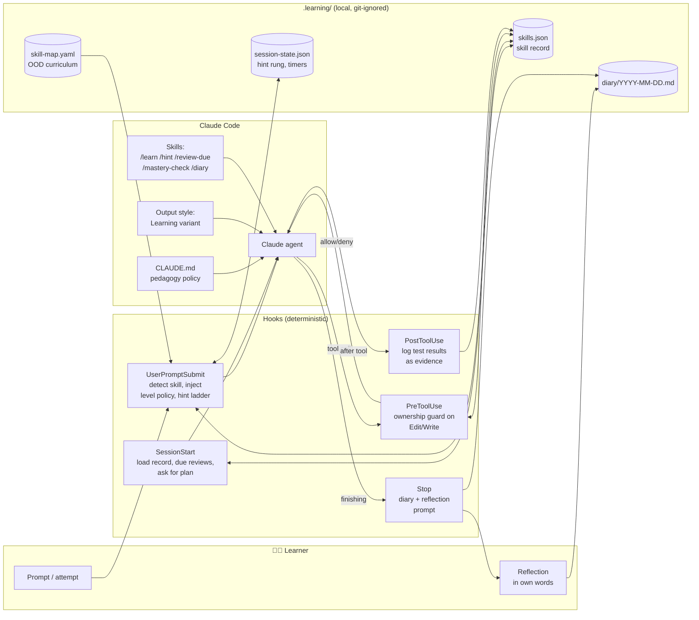

The harness puts five deterministic hooks around the Claude agent, and keeps your skill record, diary and session state in a local `.learning/` folder. CLAUDE.md, the output style and the skills shape how the agent teaches, but only the hooks enforce rules.

**As built (12 November 2026):** four hooks, two commands that only you run, three skills and one agent. The design above had a fifth hook (PostToolUse), a skill map in YAML and more skills. The build replaced the fifth hook with `check.mjs`, which you run yourself, and the map with `skills.json` (§10).

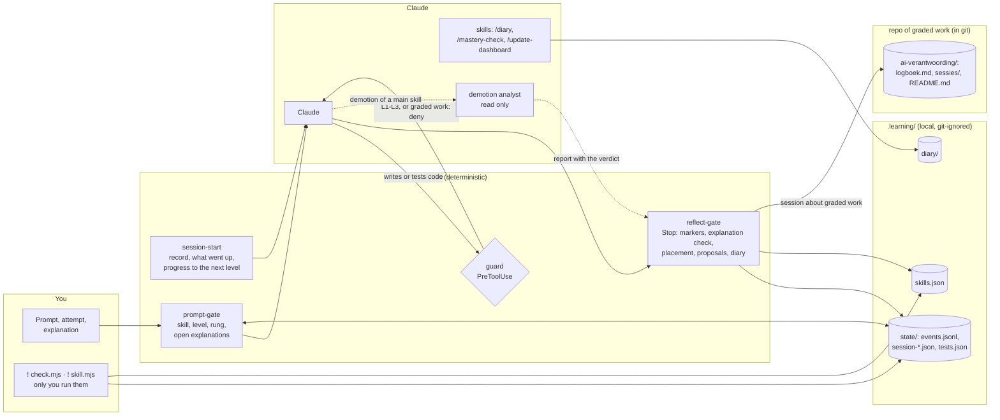

As built, the four hooks are deterministic. The guard blocks code at L1–L3, and every write in graded work (§10.8). The reflect-gate checks markers and explanations, places a new skill and shows proposals. The demotion analyst only reads, and its report goes to the reflect-gate, not into the chat.

**Design choices:**

- **Rules that must hold go in hooks.** Hooks are deterministic. Instructions in CLAUDE.md are *advisory*: the model usually follows them, but it can drift from them in long sessions. So the rule "do not write code that you own" has to be a hook.
- **Teaching behaviour goes in skills, CLAUDE.md and the output style.** This covers Socratic questions, explanations and the tone of feedback.
- **The harness keeps its state in plain files** that you can read and edit (JSON/Markdown). That keeps the system transparent, and transparency supports your autonomy (P10).

### 5.2 The Autonomy Ladder (per skill)

The harness gives each skill its own level. The five levels follow cognitive apprenticeship and worked examples that are faded step by step, with automation at the top.

| Level | Name | Who writes the code? | AI role | You must… | Grounding |
|---|---|---|---|---|---|
| **L0** | *Demonstrate* | AI | Writes a worked example with **subgoal labels** and explains it | Give text input (intent and requirements), then **self-explain** 2–3 key lines and predict outputs | Worked examples, subgoals, self-explanation |
| **L1** | *Complete* | AI writes the skeleton, you write the core | Writes scaffolding with `TODO(human)` gaps, or Parsons-style fragments | Fill in the gaps and run the tests | Completion/Parsons problems, backward fading |
| **L2** | *Guided* | You | Hint ladder only: question → concept → pseudocode → partial snippet (last resort, time-gated) | Write everything, ask for hints | Scaffolding, contingent tutoring, desirable difficulty |
| **L3** | *Independent* | You | Reviews **after** your attempt: code review, design critique, test ideas | Solve it alone, then defend your choices | Deliberate practice, feedback |
| **L4** | *Automated* | AI | Writes the code. You **review** the diff and predict the approach on samples | Supervise, plus periodic maintenance retrieval | Autonomous stage, levels of automation, ironies of automation |

**As built (10 November 2026, §10.4):** a new skill starts with your attempt, and its first task places it on a level. Going down is automatic when the evidence shows it. Going up stays your decision. Maintenance reviews exist at L4 only.

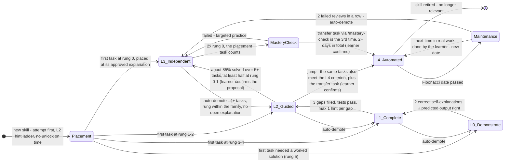

In the autonomy ladder as built, a new skill's level is set by the highest hint rung of its first task. After that, a skill can go down automatically, but going up is always your decision, and maintenance reviews happen only at L4.

- **Placement.** A skill below L4 with no history and no explained tasks of its own has an open placement. Until then it counts as L2, for the hint ladder and for the guard. So a new skill no longer starts at L0: L0 and L1 are forms of help that come *after* an attempt. The highest rung of the first task sets the level (§5.3), at the approved explanation of that task; help about another concept does not count (§10.7).
- **Auto-demote** happens only when `settings.autoDemote` is on; it is off by default. The rule looks at the skill's own explained tasks since its last level change, at most the last 10. With at least 4 of them (§10.7; 3 until 12 November), it applies when under 70% were solved (at rung ≤ 2 within the skill's own family) or the last 2 were not solved. It also applies after 2 failed reviews in a row. It waits while an explanation of that family is open, and a pending demotion is checked again on the evidence of the moment it is applied. A microskill then goes down one level. For a parent skill, the demotion analyst first decides whether a microskill or the parent goes down (§10.4.2).
- **Up** never happens automatically. You can undo any automatic change with `set`.
- **L3 → L4 (§10.7):** the task that placed the skill counts, and the transfer task is one of the three times without a hint; its day counts as a day.

??? note "Earlier version (7–9 November 2026)"

    ```mermaid
    stateDiagram-v2
        direction LR
        [*] --> L0_Demonstrate : new skill encountered

        L0_Demonstrate --> L1_Complete : 2 correct self-explanations + predicted output right
        L1_Complete --> L2_Guided : 3 gaps filled, tests pass, ≤1 hint per gap
        L2_Guided --> L3_Independent : success rate ≥85% over ≥5 tasks, avg hint rung ≤1
        L3_Independent --> MasteryCheck : 3 independent successes on ≥2 different days
        MasteryCheck --> L4_Automated : novel transfer task passed + explanation correct
        MasteryCheck --> L3_Independent : failed → targeted practice

        L1_Complete --> L0_Demonstrate : stuck twice / under 50% success
        L2_Guided --> L1_Complete : success rate under 70%
        L3_Independent --> L2_Guided : 2 failures in a row

        L4_Automated --> Maintenance : spaced review due
        L3_Independent --> Maintenance : spaced review due (revised: reviews start at L3)
        Maintenance --> L4_Automated : retrieval passed → interval grows
        Maintenance --> L3_Independent : 2 failed reviews in a row → advice to demote (learner decides)

        L4_Automated --> [*] : skill retired - no longer relevant
    ```

    In the earlier autonomy ladder (7–9 November 2026), every new skill started at L0 and moved up on fixed criteria. Reviews started at L3, and two failed reviews in a row only gave you advice to demote; the decision stayed yours.

> **"Just giving text input" at the start** is L0. You describe your intent and requirements in prose, and the AI writes a fully annotated example. Even here you are never fully passive: at L0 you give a short self-explanation or prediction before the session counts as progress (Chi et al., 1989; Kazemitabaar et al., 2025).

### 5.3 Friction calibration & the hint ladder

The hint ladder puts two ideas into practice: contingent tutoring (more help after failure, less after success; §2.3) and productive struggle (§2.2). The evidence for help in steps is good; for the contingency itself it is weak (§2.3). Help only after an own attempt fits the one classroom finding where contingency did help: after a longer period of working alone (van de Pol et al. 2015). You get the next rung only after **(a)** a visible attempt, such as code you changed or a hypothesis you stated, **or (b)** when the stuck timer runs out. This rule keeps the struggle productive, so that it does not turn into floundering.

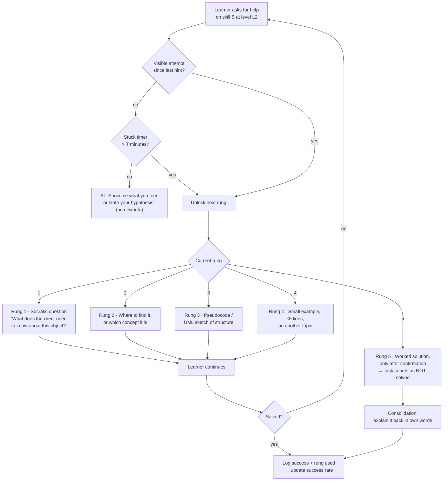

At level L2, the next hint rung unlocks only after a visible attempt, or when the stuck timer runs out. The five rungs run from a Socratic question to a worked solution; a task that needs the worked solution counts as failed.

**Calibration rules** (contingent tutoring, with about 85% success as a rule of thumb; §2.2 explains why this is a heuristic and not evidence):

- The harness keeps a **rolling success rate** for each skill. It counts only successes at rung ≤ 2.
- **> 95%** → too easy. Make the tasks harder, or mix in other skills (interleaving). Check whether you meet the criteria for the next level.
- **70–95%** → in the zone. Keep going.
- **< 70%** → too hard. Shorten the stuck timer `T` (e.g. 15 → 8 min), choose easier tasks, or go down one level.
- For L2, `T` starts at **10–15 minutes**. That is within the time in which confusion can still be productive (D'Mello et al., 2014). You can change `T`.

**As built (10 November 2026, §10.4):** for a **new skill** whose placement is still open (§5.2), rungs do **not** unlock on time. A rung goes up only when:

- you say you are stuck;
- you share the same error or test outcome twice;
- you say you do not know the concept.

If you ask for more explanation after an attempt of your own, Claude may go straight up to rung 4. The rung Claude really gives is logged through its `[trede N]` marker, and it counts towards the placement. For normal L2 tasks the stuck timer `T` stays at 12 minutes, but it counts active time only: a break longer than `idleMinutes` (default 20) does not count.

### 5.4 Hook pipeline

The diagram follows one session and shows when each hook steps in.

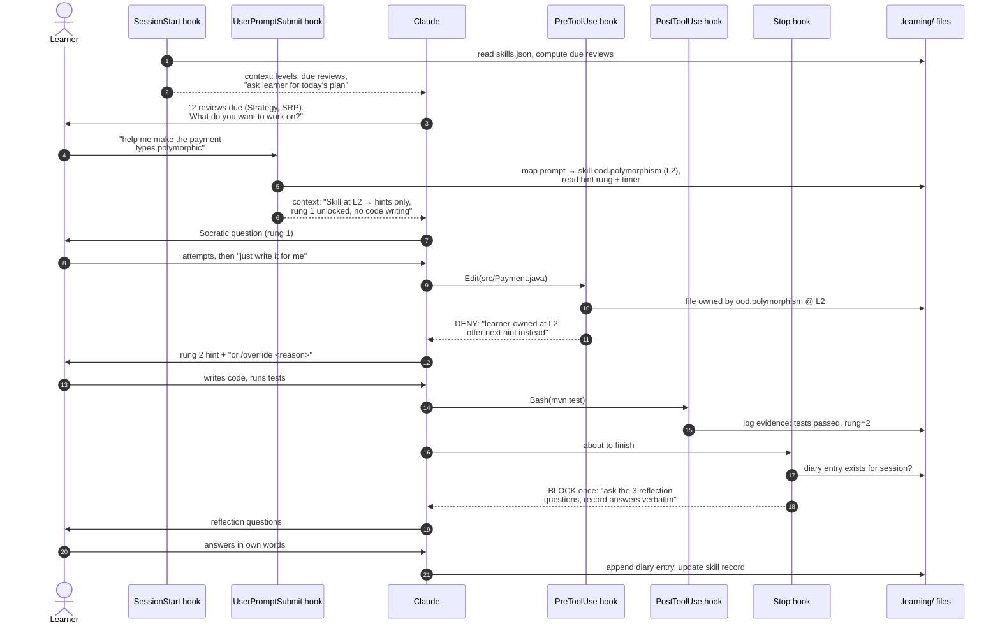

In an example session, the PreToolUse hook denies Claude's edit to a file of an L2 skill, so Claude gives the next hint instead. At the end, the Stop hook blocks once, so that Claude asks three reflection questions and you answer them in your own words.

**As built (12 November 2026):** the same session with the hooks and the command that exist now.

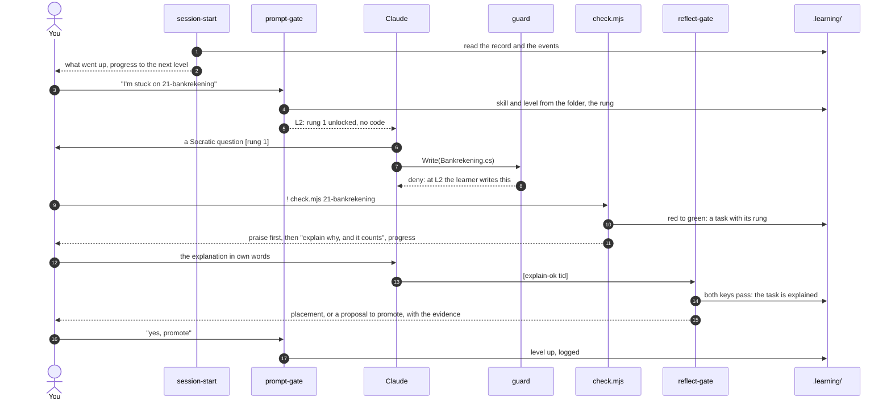

As built, you run the tests yourself with `check.mjs`. It logs the task, praises first and shows your progress. The reflect-gate approves the explanation with two keys. A placement or a proposal to promote comes from the harness itself, and only your own "yes, promote" raises the level.

| Hook | Event | Job | Can it block? |
|---|---|---|---|
| `session-start.mjs` | `SessionStart` | Gives Claude a summary of your skill record, the reviews due today, and the instruction to ask you for a plan (*forethought*). *Revised (§10.4, §10.7):* no reviews at the start any more; it shows you what went up in the last 7 days, your progress towards the next level in steps, and once that effort is the goal | No (context only) |
| `prompt-gate.mjs` | `UserPromptSubmit` | Matches your prompt to a skill using keywords from `skill-map.yaml`, adds the policy for that level and the current hint rung, starts or updates the stuck timer, and handles `/override`. *Revised (§10.2, item 10):* ignores agent reports, task notifications and system reminders, and logs `prompt-ignored` | Can add context. Can block only on abuse patterns (optional) |
| `ownership-guard.mjs` | `PreToolUse` (matcher `Edit\|Write\|MultiEdit\|NotebookEdit`) | Blocks AI edits to files, or parts of files, that belong to a skill at L1–L3. At L1 it allows a write only if it contains `TODO(human)` gaps | **Yes** (`permissionDecision: deny`) |
| ~~`evidence-log.mjs`~~ → `check.mjs` (built) | CLI, which you run yourself with `!` | *Revised (§10):* because you run the tests yourself, a PostToolUse hook never sees them. `check.mjs` runs `dotnet test` with a trx logger, prints a readable summary, remembers per test method whether it was green, and logs a red→green transition as a task with the current hint rung. It works for any .NET test project (practice exercises and project work) | No |
| `reflect-gate.mjs` | `Stop` | If you worked on a skill and there is no diary entry yet, it blocks **once** and tells Claude to run the reflection. It uses `stop_hook_active` to avoid loops. *Revised (§10):* it also reads Claude's last answer from the transcript and processes the `[trede N]` and `[uitleg-ok <tid>]` markers. That second marker is accepted only if your own message passes the deterministic explanation check. *Revised (§10.7):* at an approved explanation it places a new skill; it checks a pending demotion again; and it reads the demotion analyst's verdict from the agent's report. *Revised (§10.10):* it logs check questions, notes when Claude asked for the confidence, and writes the learner's own words in the AI-use log | Yes, once |
| `session-end.mjs` | `SessionEnd` | *Added (§10.10):* notes how a session ended and whether there was work without a diary entry, so the next start can offer a catch-up diary | No |
| `graded-gate.mjs` (user level, optional) | `UserPromptSubmit` and `PreToolUse`, in every project outside the graded folder | *Added (§10.10):* blocks a prompt that names the graded assignment and refuses every tool on its paths, reading too; the setup (`.claude/`, `CLAUDE.md`) stays open | **Yes** |

!!! example "Example: one student's situation"
    The harness was first tried by a second-year HBO-ICT student who practised OOD in C#. The course exercises came with .NET unit tests, and the student ran them, not Claude. That is why `check.mjs` runs `dotnet test`. The diagrams and examples in this section still use Java from the original design (`mvn test`, `src/Payment.java`).

### 5.5 Skill record (data model)

The skill record is where the harness keeps track of your progress. It follows the idea of knowledge tracing (a probability of mastery for each skill, updated from evidence) and the scheduling of spaced repetition. The subject is OOD, so here it is as a class diagram:

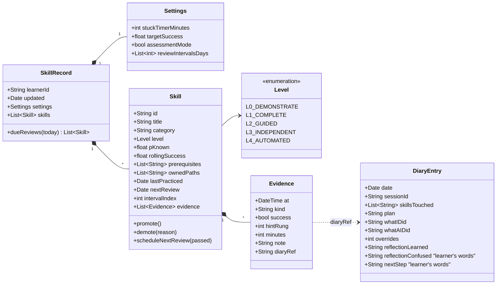

As designed, the skill record gives each skill a level (L0–L4), a probability of mastery, review dates and its own evidence. Each evidence item records success, hint rung and minutes, and can link to a diary entry.

**Example `skills.json` entry:**

```json
{
  "id": "ood.strategy-pattern",
  "title": "Strategy pattern",
  "category": "design",
  "level": "L3_INDEPENDENT",
  "pKnown": 0.82,
  "rollingSuccess": 0.86,
  "prerequisites": ["ood.polymorphism", "ood.interfaces"],
  "ownedPaths": ["src/main/java/shop/pricing/**"],
  "lastPracticed": "2026-11-05",
  "nextReview": "2026-11-12",
  "intervalIndex": 1,
  "evidence": [
    {"at": "2026-11-03T14:10", "kind": "task", "success": true, "hintRung": 1, "minutes": 22, "diaryRef": "2026-11-03#s2"},
    {"at": "2026-11-05T10:02", "kind": "task", "success": true, "hintRung": 0, "minutes": 14, "diaryRef": "2026-11-05#s1"}
  ]
}
```

**As built (after the first sessions, §10):** the record is flatter than the class diagram above. Each entry has `id`, `title`, `level`, `paths`, `nextReview`, `intervalIndex`, `failStreak` and `history`. The harness does not store evidence inside the skill. It writes it to a log that only grows (append-only), `.learning/state/events.jsonl`, with events such as `task`, `task-explained`, `test-green`, `hint-unlock` and `review`. **Microskills** are parts of a skill: entries with a `parent` and their own `keywords`:

```json
{ "id": "cs.basis.void-chaining", "parent": "cs.basis", "title": "void-methoden en chainen",
  "level": "L2", "keywords": ["reverse()", "chainen", "void"], "nextReview": null, "intervalIndex": 0 }
```

### 5.6 AI diary & reflection loop

The diary follows the cycle of self-regulated learning (Zimmerman, 2002) and uses **prompted learning protocols** (Nückles et al., 2009): you write in answer to a few set questions. The AI logs the facts. You write the reflection.

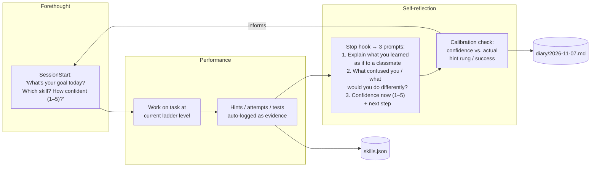

The diary and reflection loop runs from forethought (goal and confidence) through performance (work, logged as evidence) to self-reflection at the Stop hook. A calibration check compares your confidence with your actual hint rung and success, and informs your next plan.

**Diary entry template** (for example `.learning/diary/2026-11-07.md`):

```markdown
## Session 2 · 14:05–15:10 · skills: ood.polymorphism (L2), ood.srp (review)

**Plan (me):** Refactor PaymentProcessor so new payment types don't need if/else. Confidence: 2/5

**Facts (logged):**
- Hint rungs used: 1, 2 (no rung ≥3) · stuck timer fired: 0×
- Tests: 3 runs, last ✅ 12/12
- AI wrote: test skeleton only · I wrote: Payment interface, 3 implementations
- Overrides: 0 · Review SRP: passed → next review 2026-11-14

**Reflection (my words):**
1. *Learned:* The if/else on type was a smell; each payment class now owns its own `process()` behaviour...
2. *Confused / differently:* Not sure whether `validate()` belongs in the interface or a separate validator...
3. *Confidence now:* 4/5 · *Next:* try the same with discounts (Strategy?)

**Calibration:** predicted 2 → performed at rung ≤2 → under-confident ✅ (good sign)
```

**Weekly diary review** (15 minutes, `/diary --week`): Claude summarizes the trends of the week: the success rate per skill, the number of overrides, gaps in calibration, and the skills closest to the next level. *You* decide what to focus on next week. In this way the review helps you monitor your own learning, without doing the monitoring for you.

### 5.7 Spaced reinforcement after mastery

Once you have mastered a skill, the harness keeps checking it now and then. Reviews use **expanding intervals**, adjusted to your results in the style of Leitner and half-life regression. They also **interleave** skills, which trains you to choose the right principle. Expanding intervals are not proven better than equal ones (§2.5). Spacing and retrieval do the work. The schedule mainly makes sure that early reviews succeed and that reviews fall before your exam. Review tasks are *retrieval* tasks, not re-reading:

- *"Without looking: sketch the class diagram for a Strategy-based shipping cost calculator."*
- *"Here are 3 code snippets. Which violates LSP, and why?"* (interleaved discrimination)
- *"Predict what the AI's design for X will look like before it generates it, then compare."* This supervision check is for L4 skills.

```mermaid
flowchart TD
    M[Skill reaches L4<br/>mastery confirmed] --> I0[Interval 3 days]
    I0 --> Q{Review due:<br/>retrieval task<br/>~5 min, no AI help}
    Q -- pass, fluent --> UP[Next interval:<br/>3 → 7 → 21 → 60 → 120 days]
    Q -- pass, slow/shaky --> SAME[Repeat same interval]
    Q -- fail --> DEM[Demote to L3<br/>AI stops automating this skill<br/>targeted practice]
    UP --> Q
    SAME --> Q
    DEM --> RE[Re-earn mastery<br/>usually fast: relearning savings]
    RE --> I0
    UP -- 120d passed twice --> RET[Long-term maintenance:<br/>yearly spot check +<br/>continuous supervision<br/>of AI output]
```

In the original design, an L4 skill gets retrieval reviews without AI at growing intervals: 3, 7, 21, 60 and 120 days. A shaky pass repeats the interval, and a fail demotes the skill to L3, so the AI stops automating it.

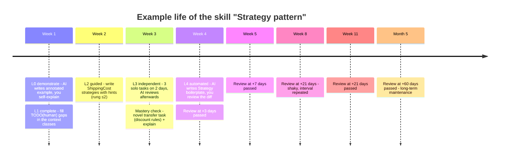

In an example timeline from the original design, the skill "Strategy pattern" goes from L0 in week 1 to L4 in week 4. After that it is still checked, less and less often, and a shaky review at +21 days repeats that interval.

At the start of each session, the **`SessionStart` hook** shows the reviews that are due. So reinforcement happens automatically, and you do not have to remember it. This is the "enforce learning as long as needed" part: a skill is *never permanently out of the loop*. It just gets checked less and less often.

**As built (10 November 2026, §10.4):** reviews now happen in your real work, and only at L4.

- **No separate review exercises.** A review is the **next time the skill comes up in your real work** after its date: through its folder, its keywords, or a `check.mjs` run that is mapped to it. The hook then says so once. This time you do that part yourself, not the AI: while the review is due, the guard treats the skill's paths as L3.
- **Fibonacci intervals:** 1, 2, 3, 5, 8, 13, 21, 34 … days, for **L4 skills and microskills only**. An L3 skill needs no schedule, because you do it yourself whenever it comes up.
- **The rung of that task sets the outcome:**
    - rung 0 → `pass`, one step up the sequence;
    - rung 1–2 → `shaky`, the interval repeats;
    - rung 3–5 or a failed task → `fail`, **two steps back**.
- **After two fails in a row:** the rule for automatic demotion applies (§5.2, §10.4.2). With `autoDemote` off, you get advice to go down one level.
- **If the skill does not come up:** nothing happens, and the review waits. Nothing appears at the start of a session. The dashboard shows no "overdue", only when you last saw the skill.
- **Before your exam:** with `settings.examDate` set, a review falls no later than 3 days before the exam. The safety net before the exam is your course's practice exams. They are deliberately outside the harness.

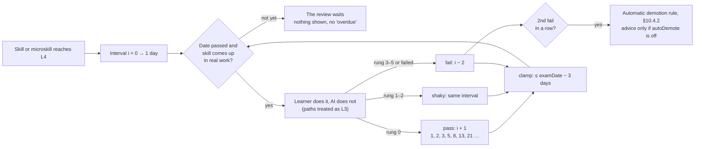

As built, an L4 skill is reviewed when it first comes up in real work after its date; you do that part yourself. Rung 0 moves the Fibonacci interval one step up, rung 1–2 repeats it, and rung 3–5 or a fail moves it two steps back.

??? note "Earlier version as built (§10, 7 November 2026)"

    The harness replaced the 3 → 7 → 21 → 60 → 120 schedule above.

    - **Fibonacci intervals:** 1, 2, 3, 5, 8, 13, 21, 34 … days.
    - **Starting point:** reviews start as soon as a skill or microskill reaches **L3**, not L4. That fits the goal "mastered → only occasional reinforcement".
    - **After a review:** `pass` moves one step up the sequence, `shaky` repeats the interval, and `fail` moves **two steps back**.
    - **After two fails in a row:** the harness *advises* you to go down one level. It never demotes a skill automatically.
    - **Before your exam:** if you set your exam date in `settings.examDate`, the harness shortens every interval so that the review falls no later than 3 days before the exam.

    ```mermaid
    flowchart LR
        S[Skill or microskill reaches L3] --> I["Interval i = 0 → 1 day"]
        I --> Q{Retrieval review<br/>~5 min, no help}
        Q -- pass --> UP["i + 1<br/>1, 2, 3, 5, 8, 13, 21 …"]
        Q -- shaky --> SAME[same interval]
        Q -- fail --> BACK["i − 2"]
        BACK --> F{2nd fail<br/>in a row?}
        F -- yes --> ADV[Advice: one level down<br/>learner decides]
        UP & SAME & BACK --> C["clamp: ≤ examDate − 3 days"] --> Q
    ```

    In the earlier version as built (7 November 2026), reviews were short retrieval tasks without help, on Fibonacci intervals from L3 onwards. After two fails in a row, the harness only advised you to go down one level and never demoted a skill automatically.

### 5.8 OOD skill map

The OOD map in the harness (`harness/maps/ood/skills.json`) is a list of skills, each with its own exercise folders and keywords. It was built from the gaps the diagnostic test showed. Since 11 November 2026 it also has the OO design that the course's final assessment grades: polymorphism, SOLID and modularity, layers with controllers and dependency injection, and the UML sequence and component diagrams. Later that evening the map was laid next to the test assignment, the grading form and the pilot student's cheat sheet. Ten skills came out of that: logging (indicator 3.1.1), integration, system and UI tests (indicator 3.1.4 and the test plan), and from the cheat sheet upcasting and downcasting, static members, records and structs, object methods, other C# (sealed, indexers, operator overloading, nested classes) and the three families of design patterns. A family is one skill; if you practise one pattern on its own, it becomes a microskill.

The map has **no prerequisites**. The order comes from the numbered exercises, and a new skill starts with a placement: your first task sets the level (§5.2). If something is missing, you add a skill yourself with `skill.mjs add`.

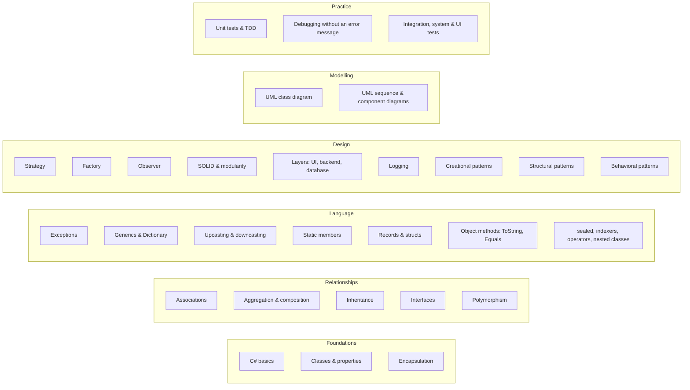

The skills of the OOD map, by group. There are no arrows between them: the order comes from the exercises, not from the map.

**What the map does not cover.** The final assessment also grades security, the cloud and a CI/CD pipeline, the database and the report. They are not in the map; the pilot student chose that on 11 November 2026. The guard does protect the files of such a project: next to C# also `.razor`, `.cshtml`, `.sql`, the pipeline (`.yml`), `Dockerfile` and `appsettings*.json` (see [Configuration](../configuration.md)).

??? note "Original design (7 November 2026): a graph with prerequisites"

    `skill-map.yaml` defines the curriculum as a graph: which skills unlock which, and which keywords the harness uses to detect skills in your prompts. A skill becomes available at L0 once its prerequisites are at L2 or higher. A skill can only be automated (L4) when its prerequisites are at L4 as well. That way the AI never automates something whose foundations you cannot supervise.

    ```mermaid
    flowchart TD
        subgraph Foundations
            A1[Classes & objects<br/>state, identity, behaviour]
            A2[Encapsulation<br/>& access modifiers]
            A3[Constructors &<br/>object lifecycle]
        end
        subgraph Relationships
            B1[Association /<br/>aggregation / composition]
            B2[Inheritance]
            B3[Interfaces &<br/>abstract classes]
            B4[Polymorphism<br/>dynamic dispatch]
        end
        subgraph Modelling
            C1[UML class diagrams]
            C2[UML sequence diagrams]
            C3[Responsibility assignment<br/>GRASP / CRC]
        end
        subgraph Principles
            D1[SRP]
            D2[Open/Closed]
            D3[Liskov Substitution]
            D4[Interface Segregation]
            D5[Dependency Inversion]
            D6[Composition over<br/>inheritance]
        end
        subgraph Patterns
            E1[Strategy]
            E2[Observer]
            E3[Factory Method /<br/>Abstract Factory]
            E4[Decorator]
            E5[Adapter]
            E6[State]
        end
        subgraph Practice
            F1[Unit testing / TDD]
            F2[Code smells &<br/>refactoring]
            F3[Dependency injection]
        end
        A1 --> A2 --> A3
        A1 --> B1 & B2
        B2 --> B3 --> B4
        A1 --> C1
        B1 & B2 --> C1
        C1 --> C2
        C1 --> C3 --> D1
        B4 --> D2 & D3
        B3 --> D4 & D5
        B1 & B2 --> D6
        D2 & B4 --> E1
        D5 --> E2
        D5 --> E3
        D6 --> E4 & E5
        E1 --> E6
        D1 --> F2
        F1 --> F2
        D5 --> F3
    ```

    The OOD skill map shows which skills unlock which: from classes and objects, through relationships and modelling, to principles and then patterns. A skill can only reach L4, the level where the AI automates it, once its prerequisites are at L4 too.

---

<a id="appendix-implementation-sketches"></a>

## Appendix: implementation sketches {#appendix}

> These are **sketches** that show the design can be built. They are not part of your Claude Code configuration unless you add them yourself. Paths assume a project-level `.claude/` folder and a `.learning/` data folder. Node.js is used because Claude Code already requires it, so it works the same on Windows, macOS and Linux.

### A. Folder layout

**As built for the pilot:**

```text
ood/
├── CLAUDE.md                     # authoritative rules for Claude (Dutch)
├── .claude/
│   ├── settings.json             # SessionStart, UserPromptSubmit, PreToolUse, Stop
│   ├── hooks/
│   │   ├── lib.mjs               # record, microskills, Fibonacci, tasks, explanation check
│   │   ├── session-start.mjs     # record + due reviews + open explanations + wins/advice
│   │   ├── prompt-gate.mjs       # skill/microskill detection, hint ladder, task logging
│   │   ├── guard.mjs             # PreToolUse: blocks writing/building/testing at L1–L3
│   │   ├── reflect-gate.mjs      # Stop: [trede N] / [uitleg-ok] markers + diary gate
│   │   ├── skill.mjs             # learner CLI (list, status, set, review, add-micro, done, …)
│   │   └── check.mjs             # learner test runner: trx → red→green evidence
│   └── skills/diary/SKILL.md
└── .learning/
    ├── skills.json               # record incl. microskills and settings.examDate
    ├── keywords.json
    ├── diary/JJJJ-MM-DD.md
    └── state/                    # events.jsonl, tests.json, session-*.json, overrides.json
```

*Original sketch:*

```text
ood/
├── CLAUDE.md                     # pedagogy policy (below)
├── .claude/
│   ├── settings.json             # hook registration
│   ├── hooks/
│   │   ├── lib.mjs               # read/write skills.json, skill detection
│   │   ├── session-start.mjs
│   │   ├── prompt-gate.mjs
│   │   ├── ownership-guard.mjs
│   │   ├── evidence-log.mjs
│   │   └── reflect-gate.mjs
│   └── skills/
│       ├── learn/SKILL.md        # ladder-aware tutoring protocol
│       ├── review-due/SKILL.md   # spaced retrieval quiz
│       ├── mastery-check/SKILL.md
│       └── diary/SKILL.md
└── .learning/                    # git-ignored
    ├── skill-map.yaml
    ├── skills.json
    ├── session-state.json
    └── diary/2026-11-07.md
```

### B. `.claude/settings.json` (hook registration)

```json
{
  "hooks": {
    "SessionStart": [
      { "hooks": [{ "type": "command", "command": "node \"$CLAUDE_PROJECT_DIR/.claude/hooks/session-start.mjs\"" }] }
    ],
    "UserPromptSubmit": [
      { "hooks": [{ "type": "command", "command": "node \"$CLAUDE_PROJECT_DIR/.claude/hooks/prompt-gate.mjs\"" }] }
    ],
    "PreToolUse": [
      { "matcher": "Edit|Write|MultiEdit|NotebookEdit",
        "hooks": [{ "type": "command", "command": "node \"$CLAUDE_PROJECT_DIR/.claude/hooks/ownership-guard.mjs\"" }] }
    ],
    "PostToolUse": [
      { "matcher": "Bash",
        "hooks": [{ "type": "command", "command": "node \"$CLAUDE_PROJECT_DIR/.claude/hooks/evidence-log.mjs\"" }] }
    ],
    "Stop": [
      { "hooks": [{ "type": "command", "command": "node \"$CLAUDE_PROJECT_DIR/.claude/hooks/reflect-gate.mjs\"" }] }
    ]
  }
}
```

### C. `ownership-guard.mjs` (the core enforcement)

```js
// PreToolUse: deny AI edits to learner-owned code for skills at L1–L3.
import { readStdin, loadSkills, skillForPath, isOverrideActive } from "./lib.mjs";

const input = JSON.parse(await readStdin());
const file = input.tool_input?.file_path ?? input.tool_input?.notebook_path;
if (!file) process.exit(0);

const skills = loadSkills();
const skill = skillForPath(skills, file);           // matches ownedPaths globs
if (!skill || isOverrideActive(skill.id)) process.exit(0);

const newText = input.tool_input?.content ?? input.tool_input?.new_string ?? "";
const level = skill.level;

let deny = null;
if (level === "L1_COMPLETE" && !newText.includes("TODO(human)")) {
  deny = `Skill '${skill.title}' is at L1 (complete). You may write scaffolding only ` +
         `if the core logic is left as TODO(human) gaps for the learner.`;
}
if (level === "L2_GUIDED" || level === "L3_INDEPENDENT") {
  deny = `Skill '${skill.title}' is at ${level}. The learner writes this code. ` +
         (level === "L2_GUIDED" ? "Offer the next hint rung instead." :
                                  "Only review after the learner's attempt.") +
         ` The learner can type /override <reason> to bypass (logged).`;
}

if (deny) {
  console.log(JSON.stringify({
    hookSpecificOutput: {
      hookEventName: "PreToolUse",
      permissionDecision: "deny",
      permissionDecisionReason: deny
    }
  }));
}
process.exit(0);
```

### D. `prompt-gate.mjs` (inject the level policy and hint ladder)

```js
// UserPromptSubmit: detect skill, inject ladder policy + hint rung as context.
import { readStdin, loadSkills, detectSkills, loadState, saveState, logOverride } from "./lib.mjs";

const { prompt, session_id } = JSON.parse(await readStdin());
const skills = loadSkills();
const state = loadState(session_id);

if (prompt.trim().startsWith("/override")) {
  logOverride(state.activeSkill, prompt);           // goes to diary + evidence
}

const hits = detectSkills(skills, prompt);          // keyword map from skill-map.yaml
const POLICY = {
  L0_DEMONSTRATE: "Write a worked example with subgoal labels. Then ask the learner to self-explain 2 lines and predict an output before moving on.",
  L1_COMPLETE:    "Write scaffolding only; leave the core logic as TODO(human). Wait for the learner, then give feedback.",
  L2_GUIDED:      "Do NOT write the solution. Use the hint ladder. Current unlocked rung: {rung}. Require a visible attempt before going higher.",
  L3_INDEPENDENT: "Do NOT write or hint unless asked for review AFTER an attempt. Then give a code/design review with questions.",
  L4_AUTOMATED:   "You may implement directly. Before generating, ask the learner to predict the approach in one sentence; show a reviewable diff."
};

const now = Date.now();
const minutesStuck = (now - (state.lastProgressAt ?? now)) / 60000;
const rung = Math.min(5, (state.rung ?? 0) + (minutesStuck >= skills.settings.stuckTimerMinutes ? 1 : 0));

const ctx = hits.map(s =>
  `[learning-harness] Skill ${s.id} is at ${s.level}. ${POLICY[s.level].replace("{rung}", rung)}`
).join("\n");

saveState(session_id, { ...state, activeSkill: hits[0]?.id ?? state.activeSkill, rung });
if (ctx) console.log(JSON.stringify({
  hookSpecificOutput: { hookEventName: "UserPromptSubmit", additionalContext: ctx }
}));
```

### E. `reflect-gate.mjs` (Stop: make sure reflection happens once)

```js
import { readStdin, loadState, diaryHasEntry } from "./lib.mjs";
const input = JSON.parse(await readStdin());
if (input.stop_hook_active) process.exit(0);        // never loop
const state = loadState(input.session_id);
if (state.activeSkill && !diaryHasEntry(input.session_id)) {
  console.log(JSON.stringify({
    decision: "block",
    reason: "Before finishing: ask the learner the 3 reflection questions " +
            "(learned / confused / confidence+next). Record their answers VERBATIM " +
            "with the logged facts via the /diary skill. Do not write the reflection yourself."
  }));
}
```

### F. `CLAUDE.md` pedagogy policy (excerpt)

```markdown
# Learning policy (this project is for LEARNING OOD, not just shipping code)

- Treat `[learning-harness]` context as binding for the named skill.
- Never write the learner's reflection; record their words verbatim.
- Prefer explanations, questions and reviews over solutions unless the skill is L4.
- For design skills: ask the learner to propose classes/responsibilities/UML FIRST,
  then critique with trade-off questions (why this abstraction? what changes next?).
- When you are uncertain or the API might be wrong, say so and point to docs/tests.
- If the learner seems stuck >10–15 min or frustrated, offer the next hint rung —
  struggle should be productive, not punishing.
- Assessment mode (graded work): behave as L3 for every skill; log all AI help.
```

### G. `/mastery-check` skill protocol (summary)

1. Generate a **novel transfer task** for the skill in an unfamiliar domain (e.g. Strategy for tax rules instead of shipping).
2. The student solves it **with no hints**. The `prompt-gate` treats rung = 0 as locked.
3. Ask 3 explanation questions: *why this design?*, *what would break with alternative X?*, *when would you NOT use it?*
4. Score it against a rubric. Pass means a working solution, ≥ 2/3 explanation answers correct, and ≥ 2 independent successes in the skill record on different days.
5. On pass: `level = L4`, `nextReview = today + 3d`. On fail: stay at L3 and log the specific gaps as next-session focus.
