# Design: principles and Claude Code setup

This page sets out the design of the learning harness: the principles I drew from [the literature](literature.md) (§2.11) and the Claude Code setup that puts them into practice (§5). For each choice I say how strong the evidence behind it is, with one of three labels: **Strong evidence**, **Limited evidence** or **Pragmatic choice**. A pragmatic choice is a rule the harness needs where the research does not settle the question; I say why I made it.

!!! note "Where the build differs from this design"
    I wrote §5 as a proposal, and the harness as built differs from it in seven places:

    - **Microskills.** A skill can have parts with their own level and their own hint ladder.
    - **A test runner instead of an evidence hook.** The learner runs the tests with `check.mjs`. There is no PostToolUse hook that logs evidence.
    - **A hard own-words explanation check.** A task counts only after the learner explains it in their own words: Claude judges the content, and the Stop hook checks that the words are the learner's.
    - **Placement by a first attempt.** A new skill starts with the learner's attempt, and the first task sets its level.
    - **Automatic demotion on evidence.** With `autoDemote` on, a skill goes down when the evidence shows it. Going up stays the learner's decision.
    - **Fibonacci reviews at L4, through real work.** There are no separate review exercises.
    - **A tooling zone.** The development environment, SDK versions, IDE settings, `.gitignore` and lock files count as L4. In graded work the guard allows only a short list of fixed tooling commands.

    [How it works](../how-it-works.md) and the [Reference](../reference.md) describe the harness as built. The [build log](build-log.md#first-sessions) explains each change. For the day-to-day rules, the harness's own `CLAUDE.md` is authoritative.

## 2.11 Synthesis: design principles

I drew fourteen principles from the literature. The label column says how strong the evidence is for each.

| # | Principle | Evidence base | Label |
|---|---|---|---|
| P1 | **Attempt first, then help.** The learner generates before the AI reveals. Attempting first is not enough on its own: the learning comes from what follows. | Generation effect; productive failure ([Sinha & Kapur 2021](https://doi.org/10.3102/00346543211019105)); [Bastani 2025](https://doi.org/10.1073/pnas.2422633122); [Gajos & Mamykina 2022](https://doi.org/10.1145/3490099.3511138) (attempting first, then seeing the answer, gave no learning) | **Limited evidence.** Productive failure has support, but attempting first gave no learning when the answer simply followed. |
| P2 | **Help follows expertise in each skill and fades.** | Expertise reversal; faded worked examples; cognitive apprenticeship | **Strong evidence.** Expertise reversal and faded worked examples are well established in instructional research. |
| P3 | **Graduated hints, after an own attempt** (more after failure, less after success). That the help follows every success and failure is the weaker part. | Help in steps: [Belland et al. 2017](https://doi.org/10.3102/0034654316670999) (meta-analysis, ḡ = 0.46); [Aleven et al. 2003](https://doi.org/10.3102/00346543073003277); [Kestin 2025](https://doi.org/10.1038/s41598-025-97652-6) (short-term). The contingency: [Wood & Wood 1999](https://doi.org/10.1016/s0360-1315%2899%2900030-5) (a tutor that applies it); no added effect in [Belland et al. 2017](https://doi.org/10.3102/0034654316670999); only after longer independent work in [van de Pol et al. 2015](https://doi.org/10.1007/s11251-015-9351-z); the classic experiment did not replicate ([Smit et al. 2025](https://doi.org/10.1037/edu0000965)) | **Limited evidence.** Moderate for graduated hints, weak for the contingency, whose classic experiment did not replicate. |
| P4 | **Keep practice hard enough that the learner sometimes fails** (about 70–90% success as a rule of thumb), and time-box stuckness. | Desirable difficulties; [Kapur 2016](https://doi.org/10.1080/00461520.2016.1155457); [D'Mello 2014](https://doi.org/10.1016/j.learninstruc.2012.05.003). [Wilson et al. 2019](https://doi.org/10.1038/s41467-019-12552-4) only as computational inspiration | **Pragmatic choice.** The studies support some failure and some confusion, not the 70–90% band itself. |
| P5 | **Explanations without the answer, over solutions.** The learner self-explains AI output. | [Gajos & Mamykina 2022](https://doi.org/10.1145/3490099.3511138); [Bastani 2025](https://doi.org/10.1073/pnas.2422633122) (tutor arm); [Kazemitabaar 2025](https://doi.org/10.1145/3708359.3712104); [Chi 1989](https://doi.org/10.1207/s15516709cog1302_1) | **Limited evidence.** Self-explanation is long established; the AI studies behind explanations over solutions are few and recent. |
| P6 | **Mastery gate with transfer and explanation**, not just "it works". | Mastery learning (gains on aligned tests; [Kulik 1990](https://doi.org/10.2307/1170612), [Slavin 1990](https://doi.org/10.2307/1170613)); Corbett & Anderson; illusion of competence ([Đức Minh 2026](https://doi.org/10.32674/nrmwyw65); [Eleftheriou 2026](https://arxiv.org/abs/2604.09444)) | **Limited evidence.** The gains of mastery learning show mainly on aligned tests, and the studies on the illusion of competence are recent. |
| P7 | **Automate only after mastery; keep supervising.** | Fitts & Posner; Bainbridge; Parasuraman & Manzey; deskilling ([Budzyń 2025](https://doi.org/10.1016/S2468-1253%2825%2900133-5)) | **Limited evidence.** Skill-acquisition and automation research support the order; the deskilling evidence is one observational study in medicine. |
| P8 | **Spaced, interleaved retrieval after mastery; demote on failure.** Spacing matters more than expanding intervals. | [Cepeda 2008](https://doi.org/10.1111/j.1467-9280.2008.02209.x); [Latimier 2021](https://doi.org/10.1007/s10648-020-09572-8); Roediger & Karpicke; [Arthur 1998](https://doi.org/10.1207/s15327043hup1101_3); [Tatel & Ackerman 2025](https://doi.org/10.1037/bul0000481) | **Strong evidence** for spacing and retrieval; the evidence for expanding over equal intervals is weak. |
| P9 | **Reflection the learner writes, in a structured diary.** | [Nückles 2009](https://doi.org/10.1016/j.learninstruc.2008.05.002); [Zimmerman 2002](https://doi.org/10.1207/s15430421tip4102_2); generation effect | **Limited evidence.** Writing in answer to set prompts has experimental support; using it in an AI diary is my own step. |
| P10 | **Autonomy-supportive, transparent enforcement** that the learner chose. The hooks are a commitment device that the learner takes on. | [Ryan & Deci 2000](https://doi.org/10.1037/0003-066x.55.1.68); acceptance cost of forcing functions ([Buçinca 2021](https://doi.org/10.1145/3449287)) | **Limited evidence.** Self-determination theory and one study on forcing functions support it; the commitment device is a pragmatic choice without direct evidence. |
| P11 | **Enforce guardrails in the workflow, not only in prompts.** | [Barth 2026](https://doi.org/10.1145/3765964.3811656) (prompts alone: no effect); [Oreopoulos 2026](https://doi.org/10.26300/01qv-6c22); [Sankaranarayanan 2026](https://arxiv.org/abs/2602.20206); [Teo 2026](https://arxiv.org/abs/2607.21306) (tutors over-help) | **Limited evidence.** Recent studies, partly preprints, agree that prompts alone do not stop an AI tutor from over-helping. |
| P12 | **Practise under test conditions before the test**: timed, without AI, in the IDE of the exam, after low-stakes learning. | Transfer-appropriate processing ([Morris 1977](https://doi.org/10.1016/S0022-5371%2877%2980016-9)); [Pan & Rickard 2018](https://doi.org/10.1037/bul0000151); [Hinze & Rapp 2014](https://doi.org/10.1002/acp.3032); [Driskell 2001](https://doi.org/10.1518/001872001775992471) | **Limited evidence.** Matching practice to test conditions has support, but no study looked at the exam IDE itself. |
| P13 | **Train supervision as its own skill**: read, test, debug and specify AI output, on topics the learner can already write. | Paradox of supervision ([Anthropic 2025b](https://www.anthropic.com/research/how-ai-is-transforming-work-at-anthropic)); employer interview formats; CS1-LLM; [Pădurean 2026](https://arxiv.org/abs/2607.05068); §2.9 | **Pragmatic choice.** An inference that several sources agree on, not a tested intervention. |
| P14 | **Levels inform; they do not reward.** No points, badges, streaks or leaderboards: a level says which help the learner gets, not which status they have. Progress is shown against the learner's own earlier work, not against others. | Gamification: small effects, only the cognitive one stable in rigorous studies ([Sailer & Homner 2020](https://doi.org/10.1007/s10648-019-09498-w)); points, levels and leaderboards raised the amount of output, not its quality or intrinsic motivation ([Mekler et al. 2017](https://doi.org/10.1016/j.chb.2015.08.048)); a course with badges and a leaderboard went with less motivation and lower exam scores ([Hanus & Fox 2015](https://doi.org/10.1016/j.compedu.2014.08.019), two courses compared); performance-contingent rewards lowered free-choice motivation ([Deci et al. 1999](https://doi.org/10.1037/0033-2909.125.6.627)); a broken streak lowers engagement ([Silverman & Barasch 2023](https://doi.org/10.1093/jcr/ucac029)); feedback against one's own work beat social comparison ([Shih & Alexander 2000](https://doi.org/10.1037/0022-0663.92.3.536)) | **Limited evidence**, against adding these elements: the gains of gamification are small, and several studies found harm. |

Read together, P1–P6 and P11 build a skill, P7 and P13 delegate it, and P8 maintains it. P14 keeps the levels informative and shows the learner's progress against their own earlier work. [§2.12](literature.md#212-the-eternal-junior-problem) applies that trade-off to junior developers at work.

**What the harness does not solve at work.**

- **Connection.** Contact with experts, Beane's third condition, is not something a tool supplies. The harness does not replace a mentor or a review by a senior.
- **The organization.** Whether a junior gets time to practise by hand depends on the team ([Feng, Yun & Wang, 2026](https://doi.org/10.1145/3772318.3791642); [Yu & Moon, 2026](https://arxiv.org/abs/2607.17067)). I designed the harness as a commitment device the junior chooses (P10). Imposed by an employer, that argument no longer holds, and the learning data would need other privacy rules.
- **The map.** There is an example map for juniors at work in C#/.NET (`junior-dotnet`). In it, code outside the mapped skills is L4, so the AI may write it and only the skills being learned are protected. A junior has to adapt its paths to their own codebase, the guard only protects skills that have paths, and automatic logging of tasks from tests only works with `dotnet test`.


---

<a id="5-proposed-claude-code-setup"></a>

## 5. The Claude Code setup {#setup}

This section describes what the harness does during a session, and why I built it that way. For a teacher, it shows which rules the harness enforces and which are only advice to the AI. Where the build differs from the proposal, a section shows the proposal first and then the harness as built.

### 5.1 Architecture

**Label:** Pragmatic choice. Putting the rules in hooks follows P11 (limited evidence); the rest of the split follows from how Claude Code works.

In the proposal, the harness is a small set of parts in the learner's project: a `CLAUDE.md` with the teaching policy, an output style, a few skills, five hooks, and a local `.learning/` folder that holds the learner's data.

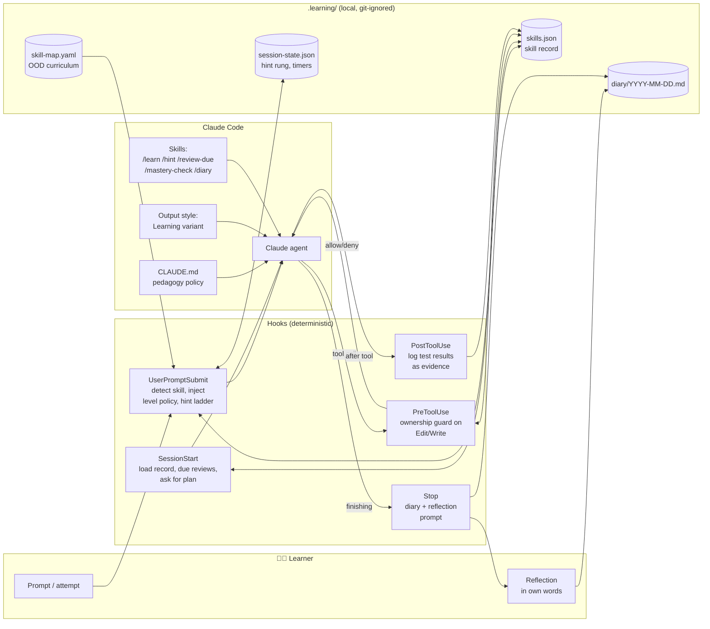

In the proposal, five deterministic hooks sit around the Claude agent, and the learner's skill record, diary and session state live in a local `.learning/` folder. CLAUDE.md, the output style and the skills shape how the agent teaches, but only the hooks enforce rules.

**As built:** the installer puts five hooks in the project. The diagram below shows the four that steer a session, two commands that only the learner runs, three skills and one agent. The table in §5.4 adds the fifth (`session-end`, which only takes notes) and the optional gate at user level for graded work (`graded-gate.mjs`). The proposal had a fifth hook (PostToolUse), a skill map in YAML and more skills. I replaced the fifth hook with `check.mjs`, which the learner runs, and the map with `skills.json`.

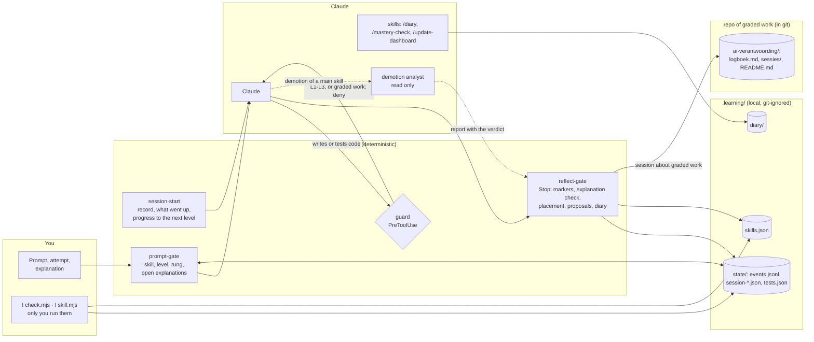

As built, the hooks are deterministic. The guard blocks code at L1–L3, and every write in [graded work](../how-it-works.md#graded-work). The reflect-gate checks markers and explanations, places a new skill and shows proposals. The demotion analyst only reads, and its report goes to the reflect-gate, not into the chat.

**Design choices.** I split the work as follows:

- **Rules that must hold go in hooks.** Hooks are deterministic. Instructions in CLAUDE.md are *advisory*: the model usually follows them, but it can drift from them in long sessions. So the rule "do not write code that the learner owns" has to be a hook (P11).
- **Teaching behaviour goes in skills, CLAUDE.md and the output style.** This covers Socratic questions, explanations and the tone of feedback.
- **The harness keeps its state in plain files** that the learner can read and edit (JSON/Markdown). That keeps the system transparent, and transparency supports the learner's autonomy (P10).

### 5.2 The Autonomy Ladder (per skill)

**Label:** Strong evidence. Help that fades as expertise in each skill grows is well supported (P2); the number of levels, the placement and the thresholds are pragmatic choices, marked below.

I gave each skill its own level. The five levels follow cognitive apprenticeship and worked examples that are faded step by step, with automation at the top.

| Level | Name | Who writes the code? | AI role | The learner must… | Grounding |
|---|---|---|---|---|---|
| **L0** | *Demonstrate* | AI | Writes a worked example with **subgoal labels** and explains it | Give text input (intent and requirements), then **self-explain** 2–3 key lines and predict outputs | Worked examples, subgoals, self-explanation |
| **L1** | *Complete* | AI writes the skeleton, the learner writes the core | Writes scaffolding with `TODO(human)` gaps, or Parsons-style fragments | Fill in the gaps and run the tests | Completion/Parsons problems, backward fading |
| **L2** | *Guided* | The learner | Hint ladder only: question → concept → pseudocode → partial snippet (last resort, time-gated) | Write everything, ask for hints | Scaffolding, contingent tutoring, desirable difficulty |
| **L3** | *Independent* | The learner | Reviews **after** the learner's attempt: code review, design critique, test ideas | Solve it alone, then defend the choices made | Deliberate practice, feedback |
| **L4** | *Automated* | AI | Writes the code. The learner **reviews** the diff and predicts the approach on samples | Supervise, plus periodic maintenance retrieval | Autonomous stage, levels of automation, ironies of automation |

**As built:** a new skill starts with the learner's attempt, and the highest hint rung of its first task sets its level. After that, a skill can go down automatically when `autoDemote` is on (it is off by default), but going up is always the learner's decision, and maintenance reviews happen only at L4.

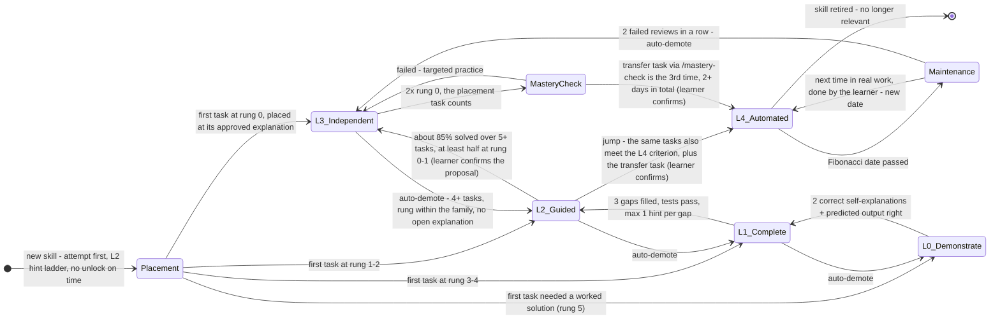

- **Placement.** A skill below L4 with no history and no explained tasks of its own has an open placement. Until then it counts as L2, for the hint ladder and for the guard. So a new skill does not start at L0: L0 and L1 are forms of help that come *after* an attempt (P1). The highest rung of the first task sets the level (§5.3), at the approved explanation of that task; help about another concept does not count. *Pragmatic choice:* one task is a noisy measure, so automatic demotion catches a placement that is too high, and the learner corrects one that is too low with `set`.
- **Promotion thresholds.** The criteria in the diagram (2 correct self-explanations, 3 gaps filled, about 85% solved over 5 or more tasks, and 3 times without a hint on at least 2 days, one of them the transfer task) are a *pragmatic choice*. The 85% is a rule of thumb (P4), not a finding; the transfer task follows P6.
- **Auto-demote** happens only when `settings.autoDemote` is on; it is off by default. The rule looks at the skill's own explained tasks since its last level change, at most the last 10. With at least 4 of them, it applies when under 70% were solved (at rung ≤ 2 within the skill's own family) or the last 2 were not solved. It also applies after 2 failed reviews in a row. It waits while an explanation of that family is open, and a pending demotion is checked again on the evidence of the moment it is applied. A microskill then goes down one level. For a parent skill, the demotion analyst first decides whether a microskill or the parent goes down (see [How it works](../how-it-works.md#promotion-and-reviews)). *Pragmatic choice:* the thresholds (4 tasks, 70%, 2 in a row) are mine, and the rule sits behind a setting that is off by default because it should only run on reliable data.
- **Up** never happens automatically. The learner can undo any automatic change with `set`.
- **L3 → L4:** the task that placed the skill counts, and the transfer task is one of the three times without a hint; its day counts as a day.

> **"Just giving text input"** is L0. The learner describes intent and requirements in prose, and the AI writes a fully annotated example. Even here the learner is never fully passive: at L0 they give a short self-explanation or prediction before the session counts as progress ([Chi et al., 1989](https://doi.org/10.1207/s15516709cog1302_1); [Kazemitabaar et al., 2025](https://doi.org/10.1145/3708359.3712104)). As built, L0 comes only after an attempt.

### 5.3 Friction calibration & the hint ladder

**Label:** Limited evidence. Help in steps has moderate support and help that follows each success and failure has weak support (P3); the success target and the stuck timer are pragmatic choices.

The hint ladder puts two ideas into practice: contingent tutoring (more help after failure, less after success; §2.3) and productive struggle (§2.2). The evidence for help in steps is moderate (P3); for the contingency itself it is weak (§2.3). I chose help only after an own attempt, because that fits the one classroom finding where contingency did help: after a longer period of working alone ([van de Pol et al. 2015](https://doi.org/10.1007/s11251-015-9351-z)). The learner gets the next rung only after **(a)** a visible attempt, such as changed code or a stated hypothesis, **or (b)** when the stuck timer runs out. This rule keeps the struggle productive, so that it does not turn into floundering.

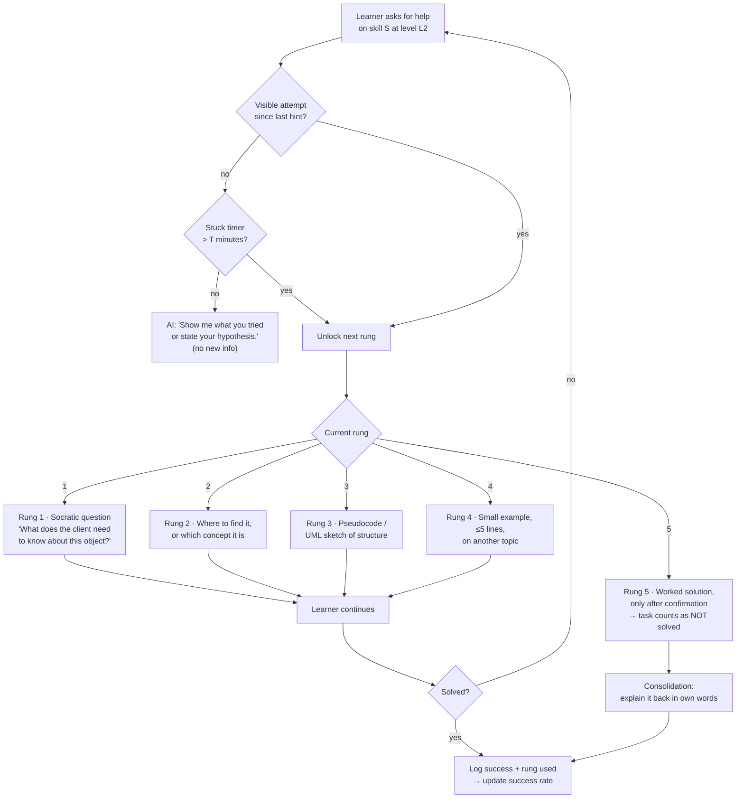

At level L2, the next hint rung unlocks only after a visible attempt, or when the stuck timer runs out. The five rungs run from a Socratic question to a worked solution; a task that needs the worked solution counts as failed. *Pragmatic choice:* the five rungs and what each one gives are mine; their order, from the least help to the most, follows graduated hints (P3).

**Calibration rules** (contingent tutoring). *Pragmatic choice:* the target of about 85% success is a rule of thumb, and so are the bands below; §2.2 explains why this is a heuristic and not evidence.

- The harness keeps a **rolling success rate** for each skill. It counts only successes at rung ≤ 2.
- **> 95%** → too easy. Make the tasks harder, or mix in other skills (interleaving). Check whether the learner meets the criteria for the next level.
- **70–95%** → in the zone. Keep going.
- **< 70%** → too hard. Shorten the stuck timer `T` (e.g. 15 → 8 min), choose easier tasks, or go down one level.
- For L2, `T` starts at **10–15 minutes**. *Limited evidence:* that is within the time in which confusion can still be productive ([D'Mello et al., 2014](https://doi.org/10.1016/j.learninstruc.2012.05.003)). The learner can change `T`.

**As built:** for a **new skill** whose placement is still open (§5.2), rungs do **not** unlock on time. A rung goes up only when the learner:

- says they are stuck;
- shares the same error or test outcome twice;
- says they do not know the concept.

If the learner asks for more explanation after an own attempt, Claude may go straight up to rung 4. The rung Claude really gives is logged through its `[trede N]` marker, and it counts towards the placement. *Pragmatic choice:* here the rung measures the level, so time alone should not raise it. For normal L2 tasks the stuck timer `T` is 12 minutes, but it counts active time only: a break longer than `idleMinutes` (default 20) does not count. *Pragmatic choice:* 12 and 20 minutes are settings, not findings, and counting active time stops a break from unlocking a rung without an attempt.

### 5.4 Hook pipeline

**Label:** Pragmatic choice. Each job sits at the Claude Code event where it can act; that is engineering, not a research finding.

The first diagram follows one session in the proposal and shows when each hook steps in.

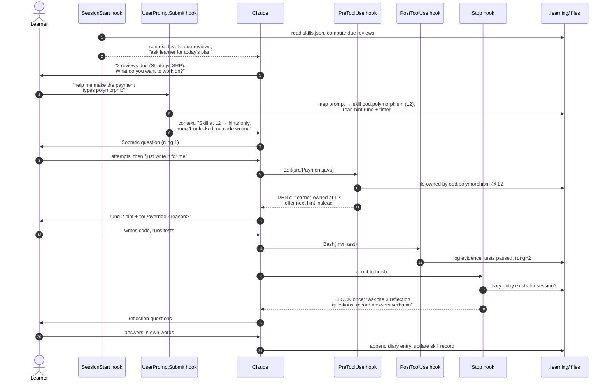

In an example session, the PreToolUse hook denies Claude's edit to a file of an L2 skill, so Claude gives the next hint instead. At the end, the Stop hook blocks once, so that Claude asks three reflection questions and the learner answers them in their own words.

**As built:** the same session with the hooks of the build and the test runner `check.mjs`.

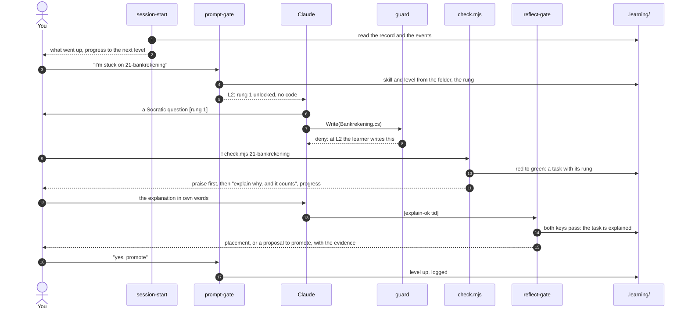

As built, the learner runs the tests with `check.mjs`. It logs the task, praises first and shows the learner's progress. The reflect-gate approves the explanation with two keys. A placement or a proposal to promote comes from the harness itself, and only the learner's own "yes, promote" raises the level.

The table gives each hook's job in the proposal and, where it differs, in the build.

| Hook | Event | Job | Can it block? |
|---|---|---|---|
| `session-start.mjs` | `SessionStart` | *Proposal:* gives Claude a summary of the learner's skill record, the reviews due today, and the instruction to ask the learner for a plan (*forethought*). *As built:* no reviews at the start; it shows what went up in the last 7 days, the progress towards the next level in steps, and, once, that effort is the goal | No (context only) |
| `prompt-gate.mjs` | `UserPromptSubmit` | Matches the learner's prompt to a skill using keywords from `skill-map.yaml`, adds the policy for that level and the current hint rung, starts or updates the stuck timer, and handles `/override`. *As built,* it also ignores agent reports, task notifications and system reminders, and logs `prompt-ignored` | Can add context. Can block only on abuse patterns (optional) |
| `ownership-guard.mjs` | `PreToolUse` (matcher `Edit\|Write\|MultiEdit\|NotebookEdit`) | Blocks AI edits to files, or parts of files, that belong to a skill at L1–L3. At L1 it allows a write only if it contains `TODO(human)` gaps. *As built:* `guard.mjs`, which also blocks building and testing at L1–L3 | **Yes** (`permissionDecision: deny`) |
| `check.mjs` (built in place of the proposed `evidence-log.mjs`) | CLI, which the learner runs with `!` (the proposal used `PostToolUse`) | The learner runs the tests, so a PostToolUse hook would never see them. `check.mjs` runs `dotnet test` with a trx logger, prints a readable summary, remembers per test method whether it was green, and logs a red→green transition as a task with the current hint rung. It works for any .NET test project (practice exercises and project work) | No |
| `reflect-gate.mjs` | `Stop` | If the learner worked on a skill and there is no diary entry yet, it blocks **once** and tells Claude to run the reflection. It uses `stop_hook_active` to avoid loops. *As built,* it also reads Claude's last answer from the transcript and processes the `[trede N]` and `[uitleg-ok <tid>]` markers. That second marker is accepted only if the learner's own message passes the deterministic explanation check. At an approved explanation it places a new skill; it checks a pending demotion again; and it reads the demotion analyst's verdict from the agent's report. It logs check questions, notes when Claude asked for the confidence, and writes the learner's own words in the AI-use log | Yes, once |
| `session-end.mjs` | `SessionEnd` | *Build only:* notes how a session ended and whether there was work without a diary entry, so the next start can offer a catch-up diary | No |
| `graded-gate.mjs` (user level, optional) | `UserPromptSubmit` and `PreToolUse`, in every project outside the graded folder | *Build only:* blocks a prompt that names the graded assignment and refuses every tool on its paths, reading too; the setup (`.claude/`, `CLAUDE.md`) stays open | **Yes** |

!!! example "Example: one student's situation"
    The harness was first tried by a second-year HBO-ICT student who practised OOD in C#. The course exercises came with .NET unit tests, and the student ran them, not Claude. That is why `check.mjs` runs `dotnet test`. The diagrams and examples in this section still use Java from the original design (`mvn test`, `src/Payment.java`).

### 5.5 Skill record (data model)

**Label:** Pragmatic choice. The record borrows ideas from knowledge tracing and spaced repetition, but its fields are a practical decision, not a tested model.

The skill record is where the harness keeps track of the learner's progress. In the proposal, it follows the idea of knowledge tracing (a probability of mastery for each skill, updated from evidence) and the scheduling of spaced repetition. The subject is OOD, so here it is as a class diagram:

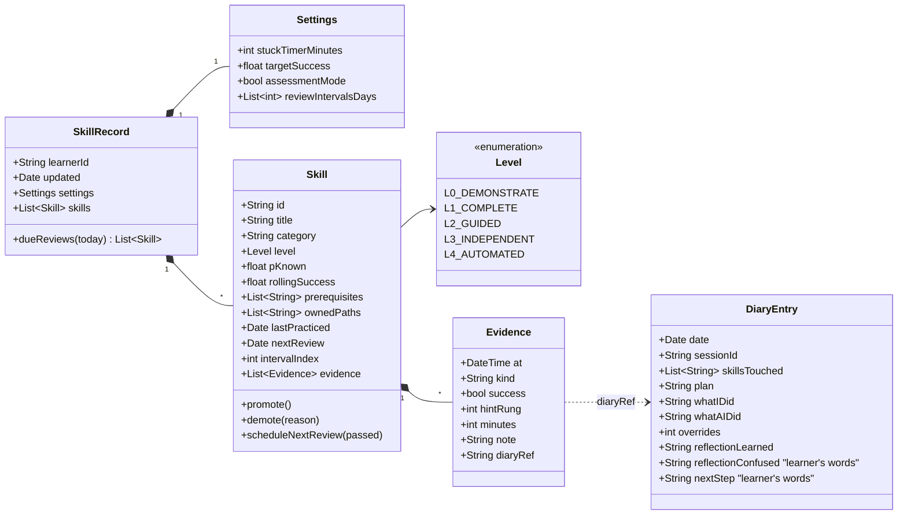

As designed, the skill record gives each skill a level (L0–L4), a probability of mastery, review dates and its own evidence. Each evidence item records success, hint rung and minutes, and can link to a diary entry.

**Example `skills.json` entry (proposal):**

```json
{
  "id": "ood.strategy-pattern",
  "title": "Strategy pattern",
  "category": "design",
  "level": "L3_INDEPENDENT",
  "pKnown": 0.82,
  "rollingSuccess": 0.86,
  "prerequisites": ["ood.polymorphism", "ood.interfaces"],
  "ownedPaths": ["src/main/java/shop/pricing/**"],
  "lastPracticed": "2026-11-05",
  "nextReview": "2026-11-12",
  "intervalIndex": 1,
  "evidence": [
    {"at": "2026-11-03T14:10", "kind": "task", "success": true, "hintRung": 1, "minutes": 22, "diaryRef": "2026-11-03#s2"},
    {"at": "2026-11-05T10:02", "kind": "task", "success": true, "hintRung": 0, "minutes": 14, "diaryRef": "2026-11-05#s1"}
  ]
}
```

**As built:** the record is flatter than the class diagram above. Each entry has `id`, `title`, `level`, `paths`, `nextReview`, `intervalIndex`, `failStreak` and `history`. The harness does not store evidence inside the skill. It writes it to a log that only grows (append-only), `.learning/state/events.jsonl`, with events such as `task`, `task-explained`, `test-green`, `hint-unlock` and `review`. **Microskills** are parts of a skill: entries with a `parent` and their own `keywords`:

```json
{ "id": "cs.basis.void-chaining", "parent": "cs.basis", "title": "void-methoden en chainen",
  "level": "L2", "keywords": ["reverse()", "chainen", "void"], "nextReview": null, "intervalIndex": 0 }
```

### 5.6 AI diary & reflection loop

**Label:** Limited evidence. Writing in answer to set prompts has experimental support (P9); the three questions, the confidence scale and the calibration check are pragmatic choices.

The diary follows the cycle of self-regulated learning ([Zimmerman, 2002](https://doi.org/10.1207/s15430421tip4102_2)) and uses **prompted learning protocols** ([Nückles et al., 2009](https://doi.org/10.1016/j.learninstruc.2008.05.002)): the learner writes in answer to a few set questions. The AI logs the facts. The learner writes the reflection. I split it this way so that the reflection stays the learner's own work (P9).

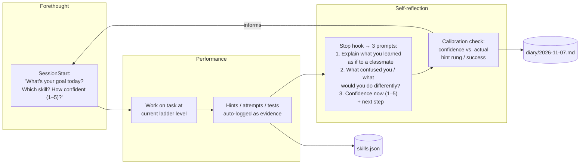

The diary and reflection loop runs from forethought (goal and confidence) through performance (work, logged as evidence) to self-reflection at the Stop hook. A calibration check compares the learner's confidence with the actual hint rung and success, and informs the next plan.

**Diary entry template** (for example `.learning/diary/2026-11-07.md`):

```markdown
## Session 2 · 14:05–15:10 · skills: ood.polymorphism (L2), ood.srp (review)

**Plan (me):** Refactor PaymentProcessor so new payment types don't need if/else. Confidence: 2/5

**Facts (logged):**
- Hint rungs used: 1, 2 (no rung ≥3) · stuck timer fired: 0×
- Tests: 3 runs, last ✅ 12/12
- AI wrote: test skeleton only · I wrote: Payment interface, 3 implementations
- Overrides: 0 · Review SRP: passed → next review 2026-11-14

**Reflection (my words):**
1. *Learned:* The if/else on type was a smell; each payment class now owns its own `process()` behaviour...
2. *Confused / differently:* Not sure whether `validate()` belongs in the interface or a separate validator...
3. *Confidence now:* 4/5 · *Next:* try the same with discounts (Strategy?)

**Calibration:** predicted 2 → performed at rung ≤2 → under-confident ✅ (good sign)
```

**Weekly diary review** (15 minutes, `/diary --week`): Claude summarises the trends of the week: the success rate per skill, the number of overrides, gaps in calibration, and the skills closest to the next level. *The learner* decides what to focus on next week. In this way the review supports the learner's own monitoring, without doing the monitoring for them. *Pragmatic choice:* the weekly rhythm and the 15 minutes are mine.

### 5.7 Spaced reinforcement after mastery

**Label:** Strong evidence. Spacing and retrieval are well supported (P8); the evidence for expanding intervals is weak, so the exact schedule is a pragmatic choice.

Once the learner has mastered a skill, the harness keeps checking it now and then. In the proposal, reviews use **expanding intervals**, adjusted to the learner's results in the style of Leitner and half-life regression. They also **interleave** skills, which trains the learner to choose the right principle. Expanding intervals are not proven better than equal ones (§2.5). Spacing and retrieval do the work. The schedule mainly makes sure that early reviews succeed and that reviews fall before the exam. Review tasks are *retrieval* tasks, not re-reading:

- *"Without looking: sketch the class diagram for a Strategy-based shipping cost calculator."*
- *"Here are 3 code snippets. Which violates LSP, and why?"* (interleaved discrimination)
- *"Predict what the AI's design for X will look like before it generates it, then compare."* This supervision check is for L4 skills.

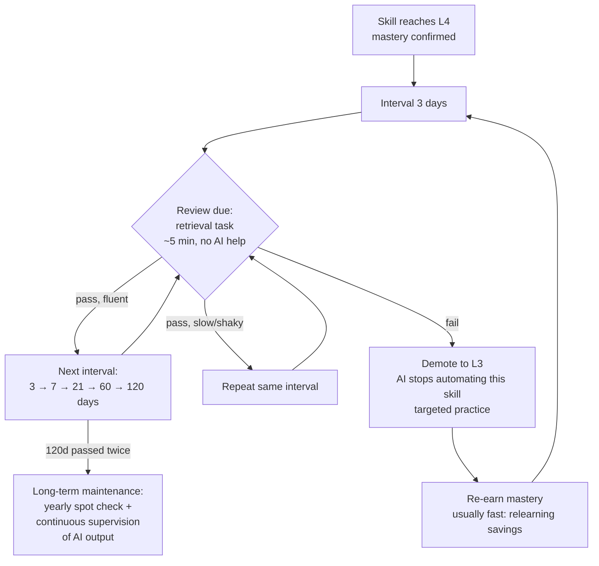

In the proposal, an L4 skill gets retrieval reviews without AI at growing intervals: 3, 7, 21, 60 and 120 days. A shaky pass repeats the interval, and a fail demotes the skill to L3, so the AI stops automating it. *Pragmatic choice:* these intervals are mine; the evidence for expanding intervals is weak (P8).

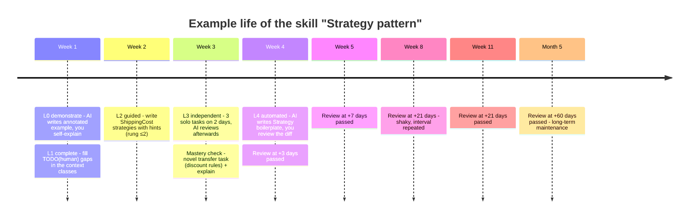

In an example timeline from the proposal, the skill "Strategy pattern" goes from L0 in week 1 to L4 in week 4. After that it is still checked, less and less often, and a shaky review at +21 days repeats that interval.

In the proposal, the **`SessionStart` hook** shows the reviews that are due at the start of each session. So reinforcement happens automatically, and the learner does not have to remember it. This is the "enforce learning as long as needed" part: a skill is *never permanently out of the loop*. It just gets checked less and less often.

**As built:** reviews happen in the learner's real work, and only at L4. *Pragmatic choice:* a skill that happens to come up in real work does not guarantee spacing. I accepted that, because the exercises build on each other, which interleaves skills by itself, and because the course's practice exams are the safety net.

- **No separate review exercises.** A review is the **next time the skill comes up in the learner's real work** after its date: through its folder, its keywords, or a `check.mjs` run that is mapped to it. The hook then says so once. This time the learner does that part, not the AI: while the review is due, the guard treats the skill's paths as L3.
- **Fibonacci intervals:** 1, 2, 3, 5, 8, 13, 21, 34 … days, for **L4 skills and microskills only**. An L3 skill needs no schedule, because the learner does it whenever it comes up. *Pragmatic choice:* the sequence starts short, so early reviews tend to succeed; no expanding sequence has strong evidence behind it (P8).
- **The rung of that task sets the outcome** (*pragmatic choice*: only rung 0 counts as a pass):
    - rung 0 → `pass`, one step up the sequence;
    - rung 1–2 → `shaky`, the interval repeats;
    - rung 3–5 or a failed task → `fail`, **two steps back**.
- **After two fails in a row:** the rule for automatic demotion applies (§5.2). With `autoDemote` off, the learner gets advice to go down one level.
- **If the skill does not come up:** nothing happens, and the review waits. Nothing appears at the start of a session. The dashboard shows no "overdue", only when the learner last saw the skill.
- **Before the exam:** with `settings.examDate` set, a review falls no later than 3 days before the exam (*pragmatic choice*). The safety net before the exam is the course's practice exams. They are deliberately outside the harness.

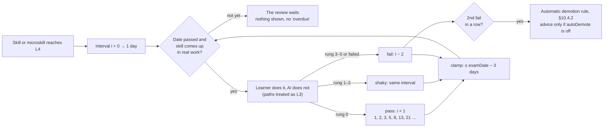

As built, an L4 skill is reviewed when it first comes up in real work after its date; the learner does that part. Rung 0 moves the Fibonacci interval one step up, rung 1–2 repeats it, and rung 3–5 or a fail moves it two steps back.

### 5.8 OOD skill map

**Label:** Pragmatic choice. The map follows one course (its exercises, its final assessment and the gaps of a diagnostic test), not a learning theory.

The OOD map in the harness (`harness/maps/ood/skills.json`) is a list of skills, each with its own exercise folders and keywords. I built it from the gaps the diagnostic test showed. It also has the OO design that the course's final assessment grades: polymorphism, SOLID and modularity, layers with controllers and dependency injection, and the UML sequence and component diagrams. I then laid the map next to the test assignment, the grading form and the pilot student's cheat sheet. Ten skills came out of that: logging (indicator 3.1.1), integration, system and UI tests (indicator 3.1.4 and the test plan), and from the cheat sheet upcasting and downcasting, static members, records and structs, object methods, other C# (sealed, indexers, operator overloading, nested classes) and the three families of design patterns. A family is one skill; if the learner practises one pattern on its own, it becomes a microskill.

The map has **no prerequisites**. The order comes from the numbered exercises, and a new skill starts with a placement: the learner's first task sets the level (§5.2). If something is missing, the learner adds a skill with `skill.mjs add`. *Pragmatic choice:* the course's numbered exercises already set the order, and a first attempt sets the level, so the map needs no graph.

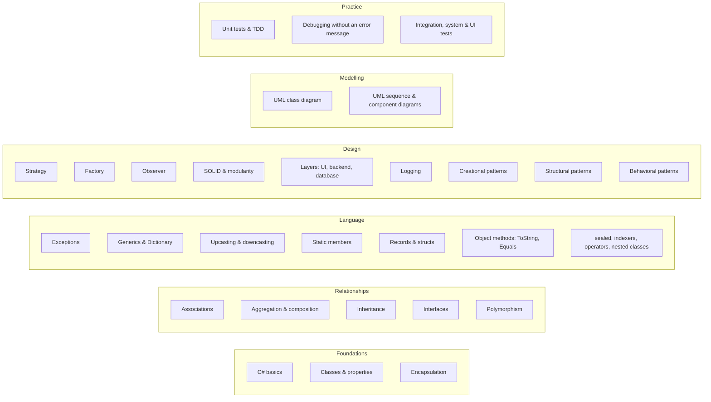

The skills of the OOD map, by group. There are no arrows between them: the order comes from the exercises, not from the map.

**What the map does not cover.** The final assessment also grades security, the cloud and a CI/CD pipeline, the database and the report. They are not in the map; the pilot student chose that. The guard does protect the files of such a project: next to C# also `.razor`, `.cshtml`, `.sql`, the pipeline (`.yml`), `Dockerfile` and `appsettings*.json` (see [Configuration](../configuration.md)).

---

<a id="appendix-implementation-sketches"></a>

## Appendix: implementation sketches {#appendix}

> I wrote these **sketches** early, to show that the design can be built; the built code lives in the `harness/` folder of the repository. The sketches assume a project-level `.claude/` folder and a `.learning/` data folder, and use Node.js because Claude Code already requires it, so they work the same on Windows, macOS and Linux.

### A. Folder layout

**As built for the pilot:**

```text
ood/
├── CLAUDE.md                     # authoritative rules for Claude (Dutch)
├── .claude/
│   ├── settings.json             # SessionStart, UserPromptSubmit, PreToolUse, Stop
│   ├── hooks/
│   │   ├── lib.mjs               # record, microskills, Fibonacci, tasks, explanation check
│   │   ├── session-start.mjs     # record + due reviews + open explanations + wins/advice
│   │   ├── prompt-gate.mjs       # skill/microskill detection, hint ladder, task logging
│   │   ├── guard.mjs             # PreToolUse: blocks writing/building/testing at L1–L3
│   │   ├── reflect-gate.mjs      # Stop: [trede N] / [uitleg-ok] markers + diary gate
│   │   ├── skill.mjs             # learner CLI (list, status, set, review, add-micro, done, …)
│   │   └── check.mjs             # learner test runner: trx → red→green evidence
│   └── skills/diary/SKILL.md
└── .learning/
    ├── skills.json               # record incl. microskills and settings.examDate
    ├── keywords.json
    ├── diary/JJJJ-MM-DD.md
    └── state/                    # events.jsonl, tests.json, session-*.json, overrides.json
```

*Original sketch:*

```text
ood/
├── CLAUDE.md                     # pedagogy policy (below)
├── .claude/
│   ├── settings.json             # hook registration
│   ├── hooks/
│   │   ├── lib.mjs               # read/write skills.json, skill detection
│   │   ├── session-start.mjs
│   │   ├── prompt-gate.mjs
│   │   ├── ownership-guard.mjs
│   │   ├── evidence-log.mjs
│   │   └── reflect-gate.mjs
│   └── skills/
│       ├── learn/SKILL.md        # ladder-aware tutoring protocol
│       ├── review-due/SKILL.md   # spaced retrieval quiz
│       ├── mastery-check/SKILL.md
│       └── diary/SKILL.md
└── .learning/                    # git-ignored
    ├── skill-map.yaml
    ├── skills.json
    ├── session-state.json
    └── diary/2026-11-07.md
```

### B. `.claude/settings.json` (hook registration)

```json
{
  "hooks": {
    "SessionStart": [
      { "hooks": [{ "type": "command", "command": "node \"$CLAUDE_PROJECT_DIR/.claude/hooks/session-start.mjs\"" }] }
    ],
    "UserPromptSubmit": [
      { "hooks": [{ "type": "command", "command": "node \"$CLAUDE_PROJECT_DIR/.claude/hooks/prompt-gate.mjs\"" }] }
    ],
    "PreToolUse": [
      { "matcher": "Edit|Write|MultiEdit|NotebookEdit",
        "hooks": [{ "type": "command", "command": "node \"$CLAUDE_PROJECT_DIR/.claude/hooks/ownership-guard.mjs\"" }] }
    ],
    "PostToolUse": [
      { "matcher": "Bash",
        "hooks": [{ "type": "command", "command": "node \"$CLAUDE_PROJECT_DIR/.claude/hooks/evidence-log.mjs\"" }] }
    ],
    "Stop": [
      { "hooks": [{ "type": "command", "command": "node \"$CLAUDE_PROJECT_DIR/.claude/hooks/reflect-gate.mjs\"" }] }
    ]
  }
}
```

### C. `ownership-guard.mjs` (the core enforcement)

```js
// PreToolUse: deny AI edits to learner-owned code for skills at L1–L3.
import { readStdin, loadSkills, skillForPath, isOverrideActive } from "./lib.mjs";

const input = JSON.parse(await readStdin());
const file = input.tool_input?.file_path ?? input.tool_input?.notebook_path;
if (!file) process.exit(0);

const skills = loadSkills();
const skill = skillForPath(skills, file);           // matches ownedPaths globs
if (!skill || isOverrideActive(skill.id)) process.exit(0);

const newText = input.tool_input?.content ?? input.tool_input?.new_string ?? "";
const level = skill.level;

let deny = null;
if (level === "L1_COMPLETE" && !newText.includes("TODO(human)")) {
  deny = `Skill '${skill.title}' is at L1 (complete). You may write scaffolding only ` +
         `if the core logic is left as TODO(human) gaps for the learner.`;
}
if (level === "L2_GUIDED" || level === "L3_INDEPENDENT") {
  deny = `Skill '${skill.title}' is at ${level}. The learner writes this code. ` +
         (level === "L2_GUIDED" ? "Offer the next hint rung instead." :
                                  "Only review after the learner's attempt.") +
         ` The learner can type /override <reason> to bypass (logged).`;
}

if (deny) {
  console.log(JSON.stringify({
    hookSpecificOutput: {
      hookEventName: "PreToolUse",
      permissionDecision: "deny",
      permissionDecisionReason: deny
    }
  }));
}
process.exit(0);
```

### D. `prompt-gate.mjs` (inject the level policy and hint ladder)

```js
// UserPromptSubmit: detect skill, inject ladder policy + hint rung as context.
import { readStdin, loadSkills, detectSkills, loadState, saveState, logOverride } from "./lib.mjs";

const { prompt, session_id } = JSON.parse(await readStdin());
const skills = loadSkills();
const state = loadState(session_id);

if (prompt.trim().startsWith("/override")) {
  logOverride(state.activeSkill, prompt);           // goes to diary + evidence
}

const hits = detectSkills(skills, prompt);          // keyword map from skill-map.yaml
const POLICY = {
  L0_DEMONSTRATE: "Write a worked example with subgoal labels. Then ask the learner to self-explain 2 lines and predict an output before moving on.",
  L1_COMPLETE:    "Write scaffolding only; leave the core logic as TODO(human). Wait for the learner, then give feedback.",
  L2_GUIDED:      "Do NOT write the solution. Use the hint ladder. Current unlocked rung: {rung}. Require a visible attempt before going higher.",
  L3_INDEPENDENT: "Do NOT write or hint unless asked for review AFTER an attempt. Then give a code/design review with questions.",
  L4_AUTOMATED:   "You may implement directly. Before generating, ask the learner to predict the approach in one sentence; show a reviewable diff."
};

const now = Date.now();
const minutesStuck = (now - (state.lastProgressAt ?? now)) / 60000;
const rung = Math.min(5, (state.rung ?? 0) + (minutesStuck >= skills.settings.stuckTimerMinutes ? 1 : 0));

const ctx = hits.map(s =>
  `[learning-harness] Skill ${s.id} is at ${s.level}. ${POLICY[s.level].replace("{rung}", rung)}`
).join("\n");

saveState(session_id, { ...state, activeSkill: hits[0]?.id ?? state.activeSkill, rung });
if (ctx) console.log(JSON.stringify({
  hookSpecificOutput: { hookEventName: "UserPromptSubmit", additionalContext: ctx }
}));
```

### E. `reflect-gate.mjs` (Stop: make sure reflection happens once)

```js
import { readStdin, loadState, diaryHasEntry } from "./lib.mjs";
const input = JSON.parse(await readStdin());
if (input.stop_hook_active) process.exit(0);        // never loop
const state = loadState(input.session_id);
if (state.activeSkill && !diaryHasEntry(input.session_id)) {
  console.log(JSON.stringify({
    decision: "block",
    reason: "Before finishing: ask the learner the 3 reflection questions " +
            "(learned / confused / confidence+next). Record their answers VERBATIM " +
            "with the logged facts via the /diary skill. Do not write the reflection yourself."
  }));
}
```

### F. `CLAUDE.md` pedagogy policy (excerpt)

```markdown
# Learning policy (this project is for LEARNING OOD, not just shipping code)

- Treat `[learning-harness]` context as binding for the named skill.
- Never write the learner's reflection; record their words verbatim.
- Prefer explanations, questions and reviews over solutions unless the skill is L4.
- For design skills: ask the learner to propose classes/responsibilities/UML FIRST,
  then critique with trade-off questions (why this abstraction? what changes next?).
- When you are uncertain or the API might be wrong, say so and point to docs/tests.
- If the learner seems stuck >10–15 min or frustrated, offer the next hint rung —
  struggle should be productive, not punishing.
- Assessment mode (graded work): behave as L3 for every skill; log all AI help.
```

### G. `/mastery-check` skill protocol (summary)

1. Generate a **novel transfer task** for the skill in an unfamiliar domain (e.g. Strategy for tax rules instead of shipping).
2. The learner solves it **with no hints**. The `prompt-gate` treats rung = 0 as locked.
3. Ask 3 explanation questions: *why this design?*, *what would break with alternative X?*, *when would you NOT use it?*
4. Score it against a rubric. Pass means a working solution, ≥ 2/3 explanation answers correct, and ≥ 2 independent successes in the skill record on different days.
5. On pass: `level = L4`, `nextReview = today + 3d`. On fail: stay at L3 and log the specific gaps as next-session focus.
