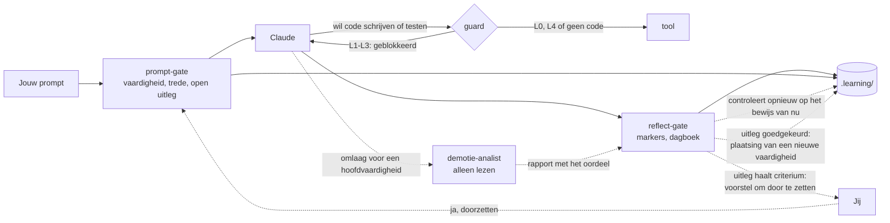

# Hoe het werkt

De harnas bestaat uit vier hooks van Claude Code, een vaardighedenregister en een paar commando's die alleen jij draait.



In de harnas gaat elke prompt door de prompt-gate, en bij L1–L3 blokkeert de guard dat Claude code schrijft of test. Een niveau gaat nooit vanzelf omhoog: je bevestigt het voorstel van de reflect-gate met "ja, doorzetten", of je zet het zelf.

## Niveaus per vaardigheid

| Niveau | Claude | Jij |
|---|---|---|
| **L0 Voordoen** | maakt een uitgewerkt voorbeeld met een ander onderwerp; bij een nieuwe vaardigheid pas na jouw poging | legt het uit en voorspelt de uitvoer |
| **L1 Aanvullen** | schrijft een skelet, de kern blijft `TODO(human)`; bij een nieuwe vaardigheid pas na jouw poging | vult de gaten, bouwt en test |
| **L2 Begeleid** | geeft geen oplossingscode, alleen hints uit de ladder | schrijft alles zelf |
| **L3 Zelfstandig** | niets vooraf; review pas na jouw poging | maakt en verdedigt het |
| **L4 Geautomatiseerd** | mag het direct doen | superviseert; is de herhaling aan de beurt, dan doe je het zelf |

Een vaardigheid kan **microvaardigheden** hebben: deelpatronen met een eigen niveau. Lijsten filteren kan al op L3 staan, terwijl void-methoden chainen nog op L2 staat.

**Een nieuwe vaardigheid** (zonder taken en zonder geschiedenis) heeft nog geen vaste plaats. Je probeert het eerst zelf, met de hintladder van L2. De hoogste trede van je eerste taak bepaalt het niveau: trede 0 → L3, 1–2 → L2, 3–4 → L1, 5 → L0. Dat gebeurt als je uitleg van die taak is goedgekeurd; vervalt de uitleg, dan blijft de plaatsing open. Hulp over een ander concept telt hier niet mee. Een plaatsing omhoog naar L3 krijgt een eigen melding met het bewijs. Plaatst de harnas je te laag, dan zet je het zelf hoger.

## De hintladder (L2)

1. Een Socratische vraag.
2. Waar het staat, of welk concept het is.
3. Pseudocode of een schets van de structuur.
4. Een klein voorbeeld van hooguit 5 regels, met een ander onderwerp.
5. Een uitwerking, alleen na bevestiging. De taak telt dan als **niet gelukt**.

De eerste hint mag meteen. Een volgende trede komt pas na een **zichtbare poging**: gewijzigde code, een foutmelding of testuitkomst, of een hypothese. Of na 12 minuten vastzitten. Dat zijn minuten **actieve tijd**: een pauze van meer dan 20 minuten (`idleMinutes`) telt niet mee. Na het eten krijg je dus niet vanzelf een hogere trede.

Bij een **nieuwe vaardigheid** telt de tijd niet. Een trede gaat pas omhoog als je zegt dat je vastzit, twee keer dezelfde foutmelding of testuitkomst deelt, of het concept niet kent. Vraag je na een eigen poging zelf om meer uitleg, dan mag Claude meteen naar een hogere trede, en die trede wordt eerlijk gelogd.

## De guard

Bij L1–L3 blokkeert `guard.mjs` dat Claude code schrijft, verwijdert, bouwt of test. Welke bestanden code zijn en welke commando's bouwen, staat in de [instellingen](configuration.md). De guard beschermt ook:

- het register en de state in `.learning/`, ook als het register in een andere map staat (`--learning-dir`);
- de paden van [beoordeeld werk](#beoordeeld-werk) en het AI-logboek daarvan, op elk niveau, zonder override, ook buiten het project;
- de harnas zelf: de hooks, `.claude/settings.json`, de skills diary, mastery-check en update-dashboard, en de regels, ook als hele map (`rm -rf .claude/hooks`);
- de bestanden op gebruikersniveau die de harnas installeert: `~/.claude/settings.json` en `~/.claude/leerharnas/`.

De guard leest een commando zoals de shell het doet: aanhalingstekens en escapes weg, `~` en variabelen als `${HOME}` ingevuld, en het echte pad achter een link of een korte Windows-naam. Kan hij een pad niet oplossen terwijl er beoordeeld werk is ingesteld, dan weigert hij het. Zo kwam het uit de [securityreview van 13 november](https://github.com/piethanegraaf/piethanegraaf.github.io/blob/main/research/security-review-2026-11-13.md).

Een shell-commando splitst de guard eerst in losse commando's. Hij kijkt naar het programma dat draait, niet naar woorden in de argumenten: `grep "msbuild"` is geen build, maar `bash -c "dotnet test"` wel.

Eén programma laat de guard bewust toe, ook al schrijft het in `.learning/state/`: de dashboardexport `node <repo>/harness/export.mjs <oefenmap>`, om het dashboard na `/diary` bij te werken. Die schrijft in je oefenmap alleen `last-export.json` (een moment en drie totalen), en nooit met `--out` in je oefenmap.

Wil je toch dat Claude iets doet, dan zet je zelf een override: `! node .claude/hooks/skill.mjs override ood.overerving 30 "reden"`. Die wordt gelogd en staat in het dagboek.

## Beoordeeld werk

Sommig werk wordt beoordeeld, bijvoorbeeld de eindopdracht van een vak. Je instelling bepaalt hoeveel AI daar mag helpen. Bij CHE staat de OER (art. 7.11) bijvoorbeeld AI-niveau 1 toe: AI als hulpmiddel, "bijvoorbeeld om ideeën te genereren of structuur aan te brengen", met een verantwoording van hoe je het gebruikte. Code of tekst die AI maakte in beoordeeld werk geldt als fraude. Je noemt de paden van dat werk zelf, bijvoorbeeld de map van de repo:

```text
! node .claude/hooks/skill.mjs setting graded add "C:/Users/<jij>/source/repos/<opdracht>"
```

In die paden:

- **Geldt de hintladder van L2 voor elke vaardigheid**, ook voor een op L3 of L4, met de vasttimer. Hij gaat tot trede 4 (`setting graded maxRung` kan hem lager zetten). Een uitwerking (trede 5) is daar nooit beschikbaar. Vraag je erom, dan weigert Claude, met een verwijzing naar de OER.
- **Is trede 4 een voorbeeld van hooguit 5 regels over een ander onderwerp.** Het implementeert niets wat de opdracht vraagt. Je typt je eigen code, en je plakt het voorbeeld nooit.
- **Schrijft Claude geen inhoud**, op geen enkel niveau: geen code, tekst, diagram, Dockerfile of pipeline, en geen commit of push (versiebeheer wordt ook beoordeeld). Claude bouwt of test daar niet. De guard blokkeert het, ook vanuit een sessie in een andere map, en er is geen override. Jij typt alles en draait de tests zelf. Lezen mag.
- **Mag vaste tooling wel.** Daar maakt een generator of een officieel sjabloon de inhoud, niet de AI: `dotnet new` (sln, console, classlib, nunit, xunit, gitignore), `dotnet sln add`, `dotnet add reference` of `package`, `git init`, `git remote add`, `git branch -m`, `mkdir`, en `node .claude/hooks/scaffold.mjs arc42 <map> --from <zip>`. Dat laatste zet het officiële [arc42](https://arc42.org)-sjabloon ongewijzigd in een nieuwe of lege map, gecontroleerd met een vaste sha256. De harnas downloadt de zip niet zelf; zonder `--from` toont het script de link en het `curl`-commando, naar een tijdelijke map buiten de opdracht. Elk zo'n commando krijgt een regel "tooling (geen AI-inhoud)" in het logboek. Al het andere blijft geblokkeerd.
- **Tellen taken en uitleg in eigen woorden gewoon mee.** Wie de eigen code kan uitleggen, kan die ook verdedigen.
- **Komt elk antwoord in een AI-logboek**, in `ai-verantwoording/` in de repo. De hooks schrijven het, nooit Claude:
    - `logboek.md`: een regel per antwoord, met de tijd, de sessie, de vaardigheid, de trede en de soort hulp (vraag, concept, schets, codevoorbeeld, review, tooling). De laatste kolom is van jou: wat je ermee deed en hoe je het controleerde. `/diary` vraagt erom, en je antwoord komt letterlijk in die kolom. De hook controleert eerst dat de woorden van jou zijn; Claude schrijft daar nooit.
    - `sessies/<datum>-<sessie>.md`: je prompts en de tekst van Claude in die sessie, zonder de uitvoer van tools. Claude Code heeft geen deellink naar een sessie, dus deze export komt daarvoor in de plaats. Een privacyfilter haalt e-mailadressen, je thuismap (wordt `~`) en de berichten van de hooks weg.
    - `README.md`: het AI-niveau, de ladder, een APA-verwijzing en hoe de export tot stand komt. Hij wordt één keer geschreven; daarna is hij van jou.

**Dicht vanuit andere mappen.** Een vraag over de opdracht die je in een andere map stelt, bijvoorbeeld in de repo van deze site, krijgt geen trede-grens en geen regel in het logboek. Dat gat sluit je met een poort op gebruikersniveau:

```text
node harness/install.mjs <map met de harnas> --user-guard
```

Die schrijft alleen in `~/.claude/`, nadat hij het plan heeft laten zien. Vanaf dan wordt in elke andere map een prompt die de opdracht noemt tegengehouden, en elke tool op de paden ervan geweigerd, ook lezen. De setup zelf (`.claude/` en `CLAUDE.md` daar) blijft open. Met `--remove` haal je hem weer weg. Een algemene vraag zonder de naam, zoals "hoe werkt een Mermaid-klassendiagram?", ziet een hook niet. Daarom vraagt een regel in `~/.claude/CLAUDE.md` Claude om eerst na te gaan of het over de opdracht gaat.

**Werk tussen sessies.** Werkte je in je IDE aan de opdracht terwijl er geen sessie liep? Dan noemt de volgende sessiestart de gewijzigde bestanden, met de vaardigheid waar ze bij horen: via de paden van een vaardigheid, of via de inhoud (een Mermaid-`classDiagram` hoort bij `uml.klassendiagram`). Claude stelt dan per afgerond onderdeel een taak voor.

Op AI-niveau 0 (`setting graded aiLevel 0`) geeft Claude bij dat werk geen enkele hulp. Vraag je docent welke delen van een assessment op niveau 0 zijn en welke op niveau 1. Het onderzoek legt de keuzes uit in [§10.8](research.md#108-herziening-van-13-november-2026-beoordeeld-werk-volgens-de-oer).

## Taken en uitleg in eigen woorden

**Een taak begint** als je aan nieuw werk begint. De harnas gaat alleen af op vaste signalen, nooit op een trefwoord: code gewijzigd in een andere opdrachtmap, `check.mjs` in een andere map, of de volledige naam van een andere opdrachtmap (zoals `10-artsen-en-patienten`) of een `#id` van een andere vaardigheidsfamilie in je bericht. Dan beginnen de hintladder en de tijd van de taak opnieuw. Gewone hulp sinds de vorige taak hoorde bij werk dat je niet afmaakte: die telt niet voor de nieuwe taak, maar wordt gelogd als `help-dropped`, zodat je hem nog ziet.

**Draai eerst `check.mjs`.** Kies je een opdracht, dan geeft Claude je `! node .claude/hooks/check.mjs <map>`. Draai hem vóór je code schrijft: die eerste run is het begin. Schreef je de code toch eerst, en is de eerste run meteen helemaal groen? Dan telt het toch als taak, zolang je de code in deze sessie hebt gewijzigd.

Een taak wordt gelogd als een test van rood naar groen gaat (`check.mjs`), als je hem zelf afmeldt (`done`, of een bericht dat begint met `af: <onderdeel>`, zonder commando), of als je in de chat zegt dat de tests groen zijn. Werk zonder test, zoals een klassendiagram, knip je op in **onderdelen met een naam**: "de klasse Product", "de overerving naar de producttypes". Elk afgerond onderdeel is een eigen taak, met een eigen uitleg. Kleine stappen met een naam helpen het leren en een eerlijk beeld van wat je kunt; opknippen om meer taken te krijgen niet ([onderzoek §10.10](research.md#1010-herziening-van-13-november-2026-nacht-de-eerste-sessies-aan-de-eindopdracht)). Bij beoordeeld werk telt `af:` alleen als er sinds de vorige taak van die vaardigheid een bestand in de opdracht is gewijzigd. Hij telt pas mee na een uitleg **in je eigen woorden**, met twee sleutels:

1. Claude beoordeelt de inhoud en zet `[uitleg-ok <tid>]` of `[uitleg-nee <tid>]`. Bij `uitleg-nee` noemt Claude eerst wat al klopt, en stelt dan één vervolgvraag die naar het gat wijst: een vervolgvraag, geen afwijzing. De eis blijft even streng. De vraag hangt af van wat er gebeurde. Na hulp (trede 1 of hoger): over het concept van de hoogste hint, want daar zat je vast. Na een mislukte poging zonder hint (rood of een compileerfout): waarom werkt het nu, en waarom de eerste poging niet? Meteen groen: één vraag naar het principe van de opdracht. Claude vraagt door tot het principe klopt.
2. De Stop-hook controleert je eigen woorden: **al je berichten sinds de taak is gelogd, samen**. Een antwoord in drie korte berichten telt als één. Samen moeten ze minstens 12 woorden buiten code hebben, een *waarom* (omdat, doordat, zodat …, of een redenering "als …, dan/zou …" in één zin), en ze mogen niet uit Claude's tekst zijn overgenomen. Een bericht van vóór het loggen telt niet mee.

De uitleg hoort **direct** na het groen worden. Een volgende taak in dezelfde map mag eerst, en één bericht mag meer taken uitleggen. Begin je aan een andere opdracht, of eindigt de sessie, dan **vervalt** de taak: hij telt niet mee en staat op het dashboard als overgeslagen. Ging een goedgekeurde uitleg verloren door een fout van de harnas, dan herstel je hem met `replay`.

Een test die al eens groen was, rood werd en weer groen is, is **herstel van een regressie** en telt niet als nieuwe taak.

**Eerst lof, in eerlijke woorden.** Na een groen zegt `check.mjs` eerst wat lukte en welke vaardigheid, en nodigt daarna uit tot de uitleg. "Zelfstandig" betekent alleen trede 0. Op trede 1–4 zegt de harnas "gelukt met hulp tot trede N", en waar het leren zat: het concept van de hoogste hint. Moeite is hier het doel, geen falen; dat zegt de harnas één keer, bij je eerste sessiestart. Een uitwerking (trede 5) telt als niet gelukt: dan leg je de uitwerking terug uit.

**Hulp over een ander concept** wordt ook bij dat concept gelogd. Stel dat Claude je helpt met de syntax van een lus, tijdens een opdracht over overerving. Dan zet Claude `[trede N #id]`, met het id van de vaardigheid van de lus. De taak houdt die trede, want je maakte hem met die hulp. Het concept krijgt een eigen event, `concept-help`. Dat is geen taak van dat concept: `status` laat het zien, en het telt als bewijs voor een voorstel voor een microvaardigheid. De statusregel die Claude bij elke prompt ziet, toont de gegeven hulp voor deze taak, ook op L3 (`gegeven hulp: trede N`); op L2 ook de ontgrendelde trede.

**Een review na een taak** is een keuze, en gaat alleen over je eigen code. Claude biedt hem aan met een onderwerp en een tijdsinschatting, en jij kiest. Een vraag over een alternatief wordt een experiment: je bouwt het om, draait `check.mjs` en zet het terug, zodat de uitkomst echte feedback is. Er komt geen review na de melding van een uur actieve tijd, of als de taak al trede 2 of hoger kostte. Na één fout antwoord, of als je zegt dat je het niet snapt, geeft Claude direct het concept in plaats van nog een vraag. Hulp in een review wordt gemarkeerd met `[review-trede N #id]`, met het id van het concept. Die telt niet voor je volgende taak over iets anders, maar wel voor de volgende taak over hetzelfde concept: hetzelfde id, de hoofdvaardigheid of een microvaardigheid ervan. Zonder geldig id, of als je intussen aan nieuw werk begon, telt hij als een gewone trede.

**Een voorstel voor een microvaardigheid** komt van de harnas zelf, net als een voorstel om door te zetten. Daarvoor is bewijs uit deze sessie nodig dat je bij dat deel echte hulp nodig had: hulp op trede 2 of hoger in een review of over een ander concept, of een taak die trede 2 of hoger kostte. Claude noemt het deel en de trefwoorden; de harnas controleert ze en laat je zien:

```
[leerharnas] Microvaardigheid toevoegen? ood.associaties.<deel> (titel) onder ood.associaties, op L2 Begeleid
  waarom: taak <tid> van ood.associaties kostte trede 2
  trefwoorden: …
  wat verandert: dit deel krijgt een eigen niveau en een eigen hintladder; ood.associaties blijft op L3
  ja: typ "ja, toevoegen" · nee: typ "nee"
```

Alleen jouw eigen "ja, toevoegen" (of "yes, add") voegt hem toe, op het niveau van de hoofdvaardigheid min 1. Er gaat niets automatisch omlaag: één moeilijk moment is zwak bewijs, dus jij beslist.

## Doorstromen en herhalingen

- **Omhoog** beslis jij, op bewijs. Het bewijs is de laatste 10 uitgelegde taken **sinds de vorige niveauwijziging**, plus de taak die de vaardigheid plaatste, zodat dezelfde taken nooit twee promoties dragen.
  - **L0 → L1:** twee voorbeelden goed uitgelegd en voorspeld.
  - **L1 → L2:** drie taken met hooguit trede 1 (gaten gevuld).
  - **L2 → L3:** ongeveer 85% gelukt (hooguit trede 2) over minstens 5 taken, en minstens de helft met hint 0–1.
  - **L3 → L4:** drie keer trede 0 op minstens 2 dagen, en een **transfertaak** is daar één van: met `/mastery-check <id>` maak je een nieuwe opdracht in een ander domein, zonder enige hint, en verdedig je daarna het ontwerp. Haar dag telt als een dag. Na twee taken zonder hint kan de transfertaak dus de derde zijn; lagen die twee op één dag, doe hem dan op een andere dag. Een hint tijdens de transfertaak laat hem niet tellen.
  - **Het ontwerpdoel:** wie dagelijks oefent en de stof beheerst, haalt L4 in ongeveer 3 sessies op 2 dagen. Een test bewaakt dat.
  - **Zijn de opdrachtmappen van een vaardigheid op L3 op,** dan wijst Claude een bestaande volgende oefening aan: een andere opdracht van het vak, of een vraag uit een oefentoets. Een oefentoetsvraag telt mee als je hem zonder hulp maakt, nakijkt met het antwoordmodel, uitlegt en afmeldt met `done`. Claude verzint nooit zelf een opdracht.
  - **Sprong:** vanaf L2 mag het bewijs een sprong dragen als ook het volgende criterium klopt, bijvoorbeeld L2 → L4 met de transfertaak. Vanaf L0 en L1 gaat het per stap, omdat een voorbeeld of skelet hulp vooraf was.
- **Het voorstel** komt direct na de uitleg die het criterium haalt. De harnas laat het zelf zien, met het bewijs en wat er verandert:

  ```
  [leerharnas] Doorzetten? ood.klassen-properties L2 → L3
    bewijs: 5 van 5 gelukt (trede 1, 1, 2, 1, 1), op 1 dag(en), in 05-de-auto, 06-studenten
    wat verandert: geen hintladder meer: Claude geeft niets vooraf en reviewt pas na je poging
    ja: typ "ja, doorzetten" · nee: typ "nee" · terugdraaien kan altijd met set
  ```

  Typ je "ja, doorzetten", dan zet de harnas het niveau en meldt het met ↑ en het bewijs. Dat werkt alleen op jouw eigen prompt, nooit op tekst van Claude. Zeg je "nee" of "later", dan komt het voorstel pas terug na een nieuwe taak die het criterium opnieuw haalt. `set` werkt ook nog.
- **Hoe ver is het volgende niveau?** Na elke taak, bij `status` en bij de sessiestart toont de harnas dat in stappen, nooit als percentage:

  ```
  ↗ ood.encapsulatie L3 → L4: zonder hint 3/3 ✓ · dagen 1/2 · transfertaak ○
  ```

- **Omlaag** volgt het bewijs, als `autoDemote` aan staat: bij minstens 4 uitgelegde taken met minder dan 70% gelukt, of de laatste 2 niet gelukt. "Gelukt" telt de hulp binnen de eigen familie: hulp over een ander concept (`[trede N #id]`) is geen mislukking van deze vaardigheid. Omlaag wacht tot er geen uitleg van die familie meer openstaat, en wordt opnieuw gecontroleerd op het bewijs van dat moment. Een microvaardigheid zakt meteen één niveau. Bij een hoofdvaardigheid beslist eerst de **demotie-analist**: een agent die alleen leest, de testuitvoer, je code en het transcript bekijkt, en bepaalt of het probleem in één deelpatroon zit (dan zakt of ontstaat alleen die microvaardigheid) of breed is (dan zakt de hoofdvaardigheid). Ging de hulp eigenlijk over een bestaande microvaardigheid van een andere familie, dan mag de analist die kiezen. De harnas leest het oordeel zelf uit het rapport van de analist: geen JSON in de chat. Zakken er binnen 14 dagen twee microvaardigheden van dezelfde ouder, dan zakt de ouder ook. Je krijgt één rustige regel, "extra steun voor …", en kunt het terugdraaien met `set`.
- **Herhalingen** krijg je alleen op L4, met Fibonacci-intervallen: 1, 2, 3, 5, 8, 13 … dagen. Er zijn geen losse herhaaloefeningen. Komt zo'n vaardigheid langs in je werk als de herhaling klaarstaat, dan doe je dat deel zelf, zonder AI. Je eerstvolgende taak bepaalt de uitkomst: trede 0 is geslaagd (een stap verder), trede 1–2 wankel (gelijk), meer hulp is mislukt (twee stappen terug). Komt hij niet langs, dan gebeurt er niets; de oefentoetsen zijn het vangnet.

## Het dagboek

**Voor de start is geen commando nodig.** De hooks starten de sessie zelf als je Claude Code opent. Je eerste bericht wordt gelogd als het plan, en het getal dat je geeft als Claude naar je zelfvertrouwen (1–5) vraagt, als je zelfvertrouwen vooraf. Het dagboek vergelijkt dat getal met wat er gebeurde.

Als je stopt, schrijft `/diary` de feiten van de sessie op, en jij de reflectie: wat je leerde, wat verwarrend was, en hoe zeker je bent. Je hoeft nergens om te vragen: "klaar", "ik wil stoppen" of "laten we afronden" is genoeg. Claude vraagt dan alles in **één bericht**: open uitleg, 2 tot 3 **controlevragen** over de concepten van deze sessie, de drie reflectievragen, en bij beoordeeld werk de logboekvraag. Controlevragen beantwoord je uit het hoofd, en ze vragen naar een reden of een toepassing in je eigen werk. Je krijgt per antwoord feedback; een open antwoord is geen falen, maar wat de volgende keer terugkomt. Zonder dagboekentry laat de Stop-hook de sessie niet sluiten (hooguit twee keer per stopverzoek).

Sloot je een sessie zonder dagboek, bijvoorbeeld door het venster te sluiten? Dan biedt de volgende start één keer een kort inhaaldagboek aan voor die sessie.

Boven de drie reflectievragen staat een waarschuwing: *"Let op: je antwoorden komen letterlijk, met een vertaling, op het openbare dashboard."* Een privé-optie is er niet. Wat niet online mag, zet je in `.learning/private.json`.

Daarna vraagt Claude: **Dashboard nu bijwerken?** Bij ja werkt Claude het dashboard in dezelfde sessie bij, tot en met een pull request, en die merge je zelf. Bij later gebeurt er niets. Zie [Na het dagboek](progress-dashboard.md#na-het-dagboek), ook als je geen dashboard gebruikt.

Waarom het zo werkt, staat in het [onderzoek](research.md), vooral §2 en §5.
