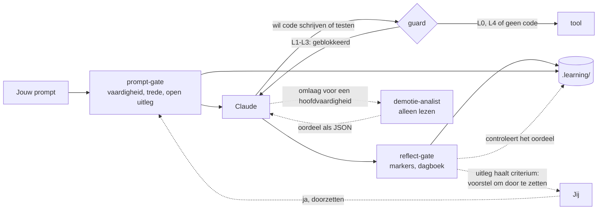

# Hoe het werkt

De harnas bestaat uit vier hooks van Claude Code, een vaardighedenregister en een paar commando's die alleen jij draait.



## Niveaus per vaardigheid

| Niveau | Claude | Jij |
|---|---|---|
| **L0 Voordoen** | maakt een uitgewerkt voorbeeld met een ander onderwerp; bij een nieuwe vaardigheid pas na jouw poging | legt het uit en voorspelt de uitvoer |
| **L1 Aanvullen** | schrijft een skelet, de kern blijft `TODO(human)`; bij een nieuwe vaardigheid pas na jouw poging | vult de gaten, bouwt en test |
| **L2 Begeleid** | geeft geen oplossingscode, alleen hints uit de ladder | schrijft alles zelf |
| **L3 Zelfstandig** | niets vooraf; review pas na jouw poging | maakt en verdedigt het |
| **L4 Geautomatiseerd** | mag het direct doen | superviseert; is de herhaling aan de beurt, dan doe je het zelf |

Een vaardigheid kan **microvaardigheden** hebben: deelpatronen met een eigen niveau. Lijsten filteren kan al op L3 staan, terwijl void-methoden chainen nog op L2 staat.

**Een nieuwe vaardigheid** (zonder taken en zonder geschiedenis) heeft nog geen vaste plaats. Je probeert het eerst zelf, met de hintladder van L2. De hoogste trede van je eerste taak bepaalt het niveau: trede 0 → L3, 1–2 → L2, 3–4 → L1, 5 → L0. Plaatst de harnas je te laag, dan zet je het zelf hoger.

## De hintladder (L2)

1. Een Socratische vraag.
2. Waar het staat, of welk concept het is.
3. Pseudocode of een schets van de structuur.
4. Een klein voorbeeld van hooguit 5 regels, met een ander onderwerp.
5. Een uitwerking, alleen na bevestiging. De taak telt dan als **niet gelukt**.

De eerste hint mag meteen. Een volgende trede komt pas na een **zichtbare poging**: gewijzigde code, een foutmelding of testuitkomst, of een hypothese. Of na 12 minuten vastzitten. Dat zijn minuten **actieve tijd**: een pauze van meer dan 20 minuten (`idleMinutes`) telt niet mee. Na het eten krijg je dus niet vanzelf een hogere trede.

Bij een **nieuwe vaardigheid** telt de tijd niet. Een trede gaat pas omhoog als je zegt dat je vastzit, twee keer dezelfde foutmelding of testuitkomst deelt, of het concept niet kent. Vraag je na een eigen poging zelf om meer uitleg, dan mag Claude meteen naar een hogere trede, en die trede wordt eerlijk gelogd.

## De guard

Bij L1–L3 blokkeert `guard.mjs` dat Claude code schrijft, verwijdert, bouwt of test. Welke bestanden code zijn en welke commando's bouwen, staat in de [instellingen](configuration.md). De guard beschermt ook:

- het register en de state in `.learning/`;
- de harnas zelf: de hooks, `.claude/settings.json`, de skills diary en mastery-check, en de regels.

Een shell-commando splitst de guard eerst in losse commando's. Hij kijkt naar het programma dat draait, niet naar woorden in de argumenten: `grep "msbuild"` is geen build, maar `bash -c "dotnet test"` wel.

Wil je toch dat Claude iets doet, dan zet je zelf een override: `! node .claude/hooks/skill.mjs override ood.overerving 30 "reden"`. Die wordt gelogd en staat in het dagboek.

## Taken en uitleg in eigen woorden

Een taak wordt gelogd als een test van rood naar groen gaat (`check.mjs`), als je hem zelf afmeldt (`done`), of als je in de chat zegt dat de tests groen zijn. Hij telt pas mee na een uitleg **in je eigen woorden**, met twee sleutels:

1. Claude beoordeelt de inhoud en zet `[uitleg-ok <tid>]` of `[uitleg-nee <tid>]`.
2. De Stop-hook controleert jouw bericht: minstens 12 woorden buiten code, een *waarom* (omdat, doordat, zodat …) en niet overgenomen uit Claude's tekst.

De uitleg hoort **direct** na het groen worden. Een volgende taak in dezelfde map mag eerst, en één bericht mag meer taken uitleggen. Begin je aan een andere opdracht, of eindigt de sessie, dan **vervalt** de taak: hij telt niet mee en staat op het dashboard als overgeslagen. Ging een goedgekeurde uitleg verloren door een fout van de harnas, dan herstel je hem met `replay`.

Een test die al eens groen was, rood werd en weer groen is, is **herstel van een regressie** en telt niet als nieuwe taak.

## Doorstromen en herhalingen

- **Omhoog** beslis jij, op bewijs. Het bewijs is de laatste 10 uitgelegde taken **sinds de vorige niveauwijziging**, zodat dezelfde taken nooit twee promoties dragen.
  - **L0 → L1:** twee voorbeelden goed uitgelegd en voorspeld.
  - **L1 → L2:** drie taken met hooguit trede 1 (gaten gevuld).
  - **L2 → L3:** ongeveer 85% gelukt (hooguit trede 2) over minstens 5 taken, en minstens de helft met hint 0–1.
  - **L3 → L4:** drie keer trede 0 op minstens 2 dagen, plus een **transfertaak**: met `/mastery-check <id>` maak je een nieuwe opdracht in een ander domein, zonder enige hint, en verdedig je daarna het ontwerp. Een hint tijdens de transfertaak laat hem niet tellen.
  - **Sprong:** vanaf L2 mag het bewijs een sprong dragen als ook het volgende criterium klopt, bijvoorbeeld L2 → L4 met de transfertaak. Vanaf L0 en L1 gaat het per stap, omdat een voorbeeld of skelet hulp vooraf was.
- **Het voorstel** komt direct na de uitleg die het criterium haalt. De harnas laat het zelf zien, met het bewijs en wat er verandert:

  ```
  [leerharnas] Doorzetten? ood.klassen-properties L2 → L3
    bewijs: 5 van 5 gelukt (trede 1, 1, 2, 1, 1), op 1 dag(en), in 05-de-auto, 06-studenten
    wat verandert: geen hintladder meer: Claude geeft niets vooraf en reviewt pas na je poging
    ja: typ "ja, doorzetten" · nee: typ "nee" · terugdraaien kan altijd met set
  ```

  Typ je "ja, doorzetten", dan zet de harnas het niveau. Dat werkt alleen op jouw eigen prompt, nooit op tekst van Claude. Zeg je "nee" of "later", dan komt het voorstel pas terug na een nieuwe taak die het criterium opnieuw haalt. `set` werkt ook nog.
- **Omlaag** volgt het bewijs, als `autoDemote` aan staat: bij minstens 3 uitgelegde taken met minder dan 70% gelukt, of de laatste 2 niet gelukt. Een microvaardigheid zakt meteen één niveau. Bij een hoofdvaardigheid beslist eerst de **demotie-analist**: een agent die alleen leest, de testuitvoer, je code en het transcript bekijkt, en bepaalt of het probleem in één deelpatroon zit (dan zakt of ontstaat alleen die microvaardigheid) of breed is (dan zakt de hoofdvaardigheid). Zakken er binnen 14 dagen twee microvaardigheden van dezelfde ouder, dan zakt de ouder ook. Je krijgt een melding en kunt het terugdraaien met `set`.
- **Herhalingen** krijg je alleen op L4, met Fibonacci-intervallen: 1, 2, 3, 5, 8, 13 … dagen. Er zijn geen losse herhaaloefeningen. Komt zo'n vaardigheid langs in je werk als de herhaling klaarstaat, dan doe je dat deel zelf, zonder AI. Je eerstvolgende taak bepaalt de uitkomst: trede 0 is geslaagd (een stap verder), trede 1–2 wankel (gelijk), meer hulp is mislukt (twee stappen terug). Komt hij niet langs, dan gebeurt er niets; de oefentoetsen zijn het vangnet.

## Het dagboek

Als je stopt, schrijft `/diary` de feiten van de sessie op, en jij de reflectie: wat je leerde, wat verwarrend was, en hoe zeker je bent. Zonder dagboekentry laat de Stop-hook de sessie niet sluiten (hooguit twee keer per stopverzoek).

Waarom het zo werkt, staat in het [onderzoek](research.md), vooral §2 en §5.
