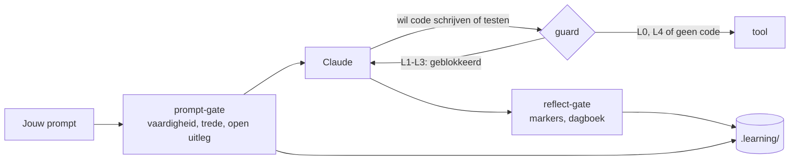

# Hoe het werkt

De harnas bestaat uit vier hooks van Claude Code, een vaardighedenregister en een paar commando's die alleen jij draait.

## Niveaus per vaardigheid

| Niveau | Claude | Jij |
|---|---|---|
| **L0 Voordoen** | maakt een uitgewerkt voorbeeld met een ander onderwerp | legt het uit en voorspelt de uitvoer |
| **L1 Aanvullen** | schrijft een skelet, de kern blijft `TODO(human)` | vult de gaten, bouwt en test |
| **L2 Begeleid** | geeft geen oplossingscode, alleen hints uit de ladder | schrijft alles zelf |
| **L3 Zelfstandig** | niets vooraf; review pas na jouw poging | maakt en verdedigt het |
| **L4 Geautomatiseerd** | mag het direct doen | superviseert en doet herhalingen |

Een vaardigheid kan **microvaardigheden** hebben: deelpatronen met een eigen niveau. Lijsten filteren kan al op L3 staan, terwijl void-methoden chainen nog op L2 staat.

## De hintladder (L2)

1. Een Socratische vraag.
2. Waar het staat, of welk concept het is.
3. Pseudocode of een schets van de structuur.
4. Een klein voorbeeld van hooguit 5 regels, met een ander onderwerp.
5. Een uitwerking, alleen na bevestiging. De taak telt dan als **niet gelukt**.

De eerste hint mag meteen. Een volgende trede komt pas na een **zichtbare poging**: gewijzigde code, een foutmelding of testuitkomst, of een hypothese. Of na 12 minuten vastzitten. Dat zijn minuten **actieve tijd**: een pauze van meer dan 20 minuten (`idleMinutes`) telt niet mee. Na het eten krijg je dus niet vanzelf een hogere trede.

## De guard

Bij L1–L3 blokkeert `guard.mjs` dat Claude code schrijft, verwijdert, bouwt of test. Welke bestanden code zijn en welke commando's bouwen, staat in de [instellingen](configuration.md). De guard beschermt ook:

- het register en de state in `.learning/`;
- de harnas zelf: de hooks, `.claude/settings.json`, de diary-skill en de regels.

Een shell-commando splitst de guard eerst in losse commando's. Hij kijkt naar het programma dat draait, niet naar woorden in de argumenten: `grep "msbuild"` is geen build, maar `bash -c "dotnet test"` wel.

Wil je toch dat Claude iets doet, dan zet je zelf een override: `! node .claude/hooks/skill.mjs override ood.overerving 30 "reden"`. Die wordt gelogd en staat in het dagboek.

## Taken en uitleg in eigen woorden

Een taak wordt gelogd als een test van rood naar groen gaat (`check.mjs`), als je hem zelf afmeldt (`done`), of als je in de chat zegt dat de tests groen zijn. Hij telt pas mee na een uitleg **in je eigen woorden**, met twee sleutels:

1. Claude beoordeelt de inhoud en zet `[uitleg-ok <tid>]` of `[uitleg-nee <tid>]`.
2. De Stop-hook controleert jouw bericht: minstens 12 woorden buiten code, een *waarom* (omdat, doordat, zodat …) en niet overgenomen uit Claude's tekst.

Een test die al eens groen was, rood werd en weer groen is, is **herstel van een regressie** en telt niet als nieuwe taak.

## Doorstromen en herhalingen

- **L2 → L3** bij ongeveer 85% gelukt (hooguit trede 2) over minstens 5 taken. **Terug** bij minder dan 70%, of twee keer op rij mislukt.
- Vanaf L3 krijg je **herhalingen** met Fibonacci-intervallen: 1, 2, 3, 5, 8, 13 … dagen. Geslaagd is een stap verder, wankel blijft gelijk, mislukt is twee stappen terug. Met een toetsdatum valt elke herhaling vóór de toets.
- De harnas **adviseert**; jij zet het niveau zelf.

## Het dagboek

Als je stopt, schrijft `/diary` de feiten van de sessie op, en jij de reflectie: wat je leerde, wat verwarrend was, en hoe zeker je bent. Zonder dagboekentry laat de Stop-hook de sessie niet sluiten (hooguit twee keer per stopverzoek).

Waarom het zo werkt, staat in het [onderzoek](research.md), vooral §2 en §5.
