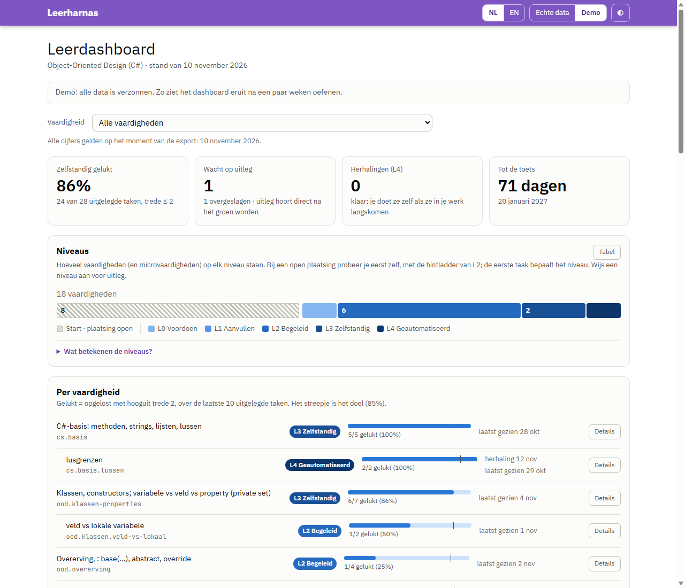

# Dashboard bijwerken

## Wat het dashboard laat zien



*Het dashboard met verzonnen demodata.*

Het [dashboard](/dashboard/?lang=nl) laat de voortgang per vaardigheid en microvaardigheid zien:

- twee tegels: **gelukt** (hooguit trede 2) en **zelfstandig** (trede 0), geteld zoals de harnas ze telt;
- de **leerfasen**: per vaardigheid één band over de dagen, in de kleur van het niveau, met "start" gestippeld zolang de plaatsing openstond. Microvaardigheden staan dunner onder hun ouder. Je taken zijn stippen boven de band, in de kleur van de trede: de hulp die die ene taak kostte. De fase en de trede zijn [twee verschillende schalen](how-it-works.md#leerfasen-en-de-hintladder). Elke wijziging heeft een markering (▲ een fase hoger, ▼ extra steun, ● een start of een nieuwe microvaardigheid); wijs hem aan om te zien hoe hij besloten is: een voorstel dat jij bevestigde, een plaatsing, met de hand, een teruggedraaide verlaging, of de analist. Eén zin bovenaan vergelijkt je alleen met jezelf, nooit met anderen;
- je **niveau** en de geschiedenis daarvan;
- wat elk **niveau betekent**: wijs een niveau aan in de legenda of de balk (of ga er met Tab naartoe) voor wat het inhoudt en de stap naar het volgende niveau. Esc sluit de uitleg. Het waarom, het bewijs en de route van de start (plaatsing open) naar L4 staan onder *Wat betekenen de niveaus?*: de criteria per stap, en hoe je omhoog en omlaag gaat;
- wat je nog nodig hebt **voor het volgende niveau**, in de vorm van dat criterium. Op L2 is dat een balk met het doel van 85% en de drie voorwaarden. Op L0, L1 en L3 zijn het stippen, en bij L3 ook de dagen en de transfertaak. Op L4 zie je het onderhoud. Er staat één regel bij met wat er nog moet gebeuren. Dit telt alleen de taken sinds je laatste niveauwijziging, net als de harnas, dus na een stap omhoog begin je opnieuw;
- hoe de **laatste 10** uitgelegde taken gingen: gelukt is opgelost met hooguit trede 2;
- per taak: de trede, de bron (test, zelf afgemeld, chat), je **uitleg**, en wanneer die werd **afgewezen** of **gecorrigeerd**;
- de **herhalingen** (alleen L4, Fibonacci), neutraal: wanneer de volgende klaarstaat, en wanneer je de vaardigheid **laatst** in je werk zag. Niets is "te laat": een herhaling wacht tot de vaardigheid langskomt;
- **overgeslagen** taken: de uitleg kwam niet direct, dus ze tellen niet. Ze staan apart van mislukt en van wacht op uitleg, en in de grafiek gearceerd;
- **hoe elke niveauwijziging besloten is**, in de niveaugeschiedenis: een plaatsing, een voorstel, met de hand, een teruggedraaide verlaging, of extra steun (automatisch, de analist of de achtervang). Wijzigingen zonder verschil (L3 → L3) staan er niet in;
- **hulp tijdens een andere taak**: hulp over deze vaardigheid terwijl je aan een opdracht van een andere vaardigheid werkte (`[trede N #id]`). Die taak hield de trede; hier telt het niet als taak en niet in het percentage gelukt;
- de **voorstellen voor een microvaardigheid** die de harnas je liet zien, met de reden (review-hulp, hulp over een ander concept, of een taak op trede 2 of hoger) en je antwoord: toegevoegd, nee of geen antwoord;
- **doorstroom- en terugvalsignalen**, **regressies** en **overrides**;
- een **dagboektijdlijn** met je reflecties en de **kalibratie**: je zelfvertrouwen vooraf en achteraf.

Elke grafiek heeft een tabelweergave. Je kunt wisselen tussen Nederlands en Engels, en tussen de echte data en de [demo met verzonnen data](/dashboard/?lang=nl&data=demo).

## Je eigen data publiceren

Het dashboard hoort bij deze repo, dus publiceren betekent een pull request naar een repo waar je naar mag pushen. **Is deze repo niet van jou?** Fork hem dan eerst op GitHub, clone je fork, en zet GitHub Pages aan in de fork (Settings → Pages → Source: GitHub Actions). Je dashboard komt dan op je eigen Pages-adres. In de stappen hieronder is "deze repo" je fork: `/update-dashboard` pusht naar `origin` (je fork) en opent de pull request daar, nooit in de oorspronkelijke repo. Zonder fork houd je het dashboard lokaal en zet je `dashboardRepo off`.

1. Maak `.learning/private.json` aan met de namen en termen die niet online mogen (zie [Configuratie en privacy](configuration.md#privacy)).
2. Ging een goedgekeurde uitleg verloren, bijvoorbeeld door een fout van de harnas? Herstel die dan eerst met `replay` (zie de [naslag](reference.md)). Anders staat de taak online als open of overgeslagen.
3. Bekijk wat er gefilterd wordt: `node harness/export.mjs ../mijn-oefenmap --dry-run`
4. Exporteer: `node harness/export.mjs ../mijn-oefenmap`. Zijn er teksten zonder vertaling (zie [Vertalingen](#vertalingen))? Dan schrijft de export geen data. Hij stopt met exitcode 2 en zet die teksten in `site-src/dashboard/data/translations.todo.json`.
5. Laat Claude de vertalingen invullen ("vul translations.todo.json in") en exporteer opnieuw. De export neemt de vertalingen over, verwijdert het todo-bestand en schrijft `progress.json`.
6. Controleer de diff van `site-src/dashboard/data/progress.json`, ook de vertalingen, en commit en push hem zelf. Het dashboard toont de datum en de tijd van de export, zodat je ziet hoe actueel het is.

In Claude Code doet `/update-dashboard` stap 3 tot en met 6 voor je, tot en met een pull request. In deze repo geef je de oefenmap mee: `/update-dashboard ../mijn-oefenmap`. In een oefensessie vraagt `/diary` er zelf om (zie [Na het dagboek](#na-het-dagboek)). De skill werkt zo:

- **In een eigen worktree.** Het werkt nooit in je hoofdcheckout. Staat er nog een dashboard-pull-request open? Dan gaat het verder op die branch: de twee botsen niet, en de vertalingen daarin blijven bewaard. Anders begint het een nieuwe branch `dashboard-JJJJ-MM-DD` vanaf `origin/main`. Elk `gh`-commando krijgt `--repo` met de repo van `origin`: in een fork zou `gh` de pull request anders in de oorspronkelijke repo openen.
- **Gecontroleerd.** Na de export en de vertalingen draait het `--check` en de securitycheck, met de privétermen van je oefenmap. Een nieuwe worktree heeft zelf geen `.learning/private.json`, want dat bestand wordt nooit gecommit.
- **Pas na je akkoord.** Het laat je de diff zien en de vertalingen waarover het twijfelde, en vraagt of het verder mag. Pas dan commit het `progress.json`, pusht het de branch en opent het de pull request (of zet het een commit op de open pull request). Mergen doe je zelf.

## Na het dagboek

Aan het eind van `/diary` vraagt Claude: **Dashboard nu bijwerken?** (ja / later).

- **Ja:** Claude volgt `/update-dashboard` in dezelfde sessie, met je oefenmap, tot en met de pull request. Het akkoord vóór de commit en de push blijft. Mergen doe je zelf.
- **Later:** er gebeurt niets. Na een eerdere export meldt de volgende sessiestart wat er nieuw is.

De vraag komt als er iets nieuw is sinds de laatste export, en ook als er nog geen export bekend is (geen `last-export.json`). Is er niets nieuw, dan vraagt Claude niets.

**Waar staat de repo?** De oefensessie vindt je clone van deze repo (of van je fork) via de instelling `dashboardRepo`:

```text
! node .claude/hooks/skill.mjs setting dashboardRepo "D:\repos\leerharnas"
```

Zonder die instelling vraagt Claude het pad één keer en stelt het dit commando voor. Het werk gebeurt altijd in een eigen worktree van de repo, nooit in je hoofdcheckout. De guard laat de export (`node <repo>/harness/export.mjs <oefenmap>`) vanuit de oefensessie bewust toe: in je oefenmap schrijft dat programma alleen `last-export.json`.

**Geen dashboard?** Zet het uit met `! node .claude/hooks/skill.mjs setting dashboardRepo off`. Dan vraagt `/diary` er niet naar, en meldt de sessiestart niets over exports.

**De waarschuwing.** Met een dashboard (`dashboardRepo` staat op het pad van je clone) staat er boven de drie reflectievragen een waarschuwing: *"Let op: je antwoorden komen letterlijk, met een vertaling, op het openbare dashboard."* Een privé-optie is er dan niet. Wat niet online mag, zet je in `.learning/private.json`. Zonder dashboard (`dashboardRepo` niet ingesteld, of `off`) zegt de regel juist dat je antwoorden in je map blijven: er gaat niets online tot je zelf een dashboard instelt en publiceert.

## Sinds de laatste export

Schrijft de export de data, dan schrijft hij ook `.learning/state/last-export.json` in je oefenmap: het moment en drie totalen (taken, dagboeksessies en niveauwijzigingen). Geen teksten en geen paden.

Vanaf dan meldt de harnas in één regel wat er sinds die export nieuw is, bijvoorbeeld:

> Sinds de laatste export (11-11 13:50): 3 taken, 1 dagboeksessie, 2 niveauwijzigingen. Werk het dashboard bij met /update-dashboard.

- **Bij de start van een sessie**, alleen als er iets nieuw is.
- **Aan het eind van `/diary`**, altijd, met daarna de vraag of je het dashboard nu bijwerkt. Je kunt ook zelf `! node .claude/hooks/skill.mjs since-export` draaien.
- **Zonder export** zegt de sessiestart niets. `/diary` zegt dan dat er nog geen export bekend is, en vraagt het toch.
- **Zonder dashboard** (`dashboardRepo` op `off`) zegt de harnas er niets over.

Een niveauwijziging is elke nieuwe regel in de niveaugeschiedenis, dus ook een plaatsing en automatisch omlaag. De teller begint opnieuw bij elke export die de data schrijft, ook als je de pull request daarna toch niet goedkeurt. `--dry-run` en een export die stopt voor vertalingen (exitcode 2) laten hem staan.

## Vertalingen

Je logboek staat in één taal (`settings.language`), en het dashboard is Nederlands en Engels. Daarom krijgt elke vrije tekst een vertaling in de andere taal: de uitleg, het dagboek (de feiten en je reflectie), je eigen notities en microvaardigheden, en de redenen bij correcties en overrides. Titels uit de vaardighedenkaart, de vaste notities van de harnas en de signalen bestaan al in beide talen.

- **Claude vertaalt, niet de export.** De export heeft geen netwerktoegang. Claude vertaalt getrouw: dezelfde betekenis en toon, niets verbeterd of toegevoegd. Code, testnamen en vaardigheids-id's blijven zoals ze zijn.
- **Alleen nieuwe teksten.** De export hergebruikt de vertalingen van de vorige export. Verandert een tekst, dan wordt hij opnieuw gevraagd. Verdwijnt een tekst, dan verdwijnt zijn vertaling ook.
- **Eén knop voor het origineel.** Bovenaan staat dat de teksten vertaald zijn. Met de knop *Toon origineel* zie je alle teksten van de student in de taal waarin ze geschreven zijn, en met *Toon vertaling* weer andersom.
- **Dezelfde privacyfilters.** De vertalingen gaan door dezelfde filters als de originelen, ook `.learning/private.json`.
- **Gecontroleerd in de build.** De build van de site draait `node harness/export.mjs --check site-src/dashboard/data/progress.json`. Ontbreekt er een vertaling, dan stopt de build. Zo toont het dashboard nooit de helft in de andere taal. Met `--allow-untranslated` schrijft de export de data toch, bijvoorbeeld om lokaal te kijken, maar de build weigert hem dan nog steeds.

Het dashboard is statisch: HTML, CSS en JavaScript zonder afhankelijkheden, met een strikte Content Security Policy. Alle tekst uit de data komt via `textContent` in de pagina.
