# Leren programmeren (en OOD) met AI: literatuuronderzoek, risicoanalyse en een Claude Code-opzet die het leren beschermt

**Piet Hanegraaf, met Claude (Anthropic)** · [Over de maker](about.md) · [Zo citeer je dit](#cite)

!!! warning "Machinevertaling"
    Dit is een machinevertaling door Claude (Anthropic) van het [Engelse origineel](../en/research/). Een mens heeft de vertaling niet nagekeken. Bij twijfel geldt de Engelse tekst.

*Opgesteld 7 november 2026 · herzien 8 november 2026, herschreven voor studenten en docenten op 10 november 2026 en dezelfde dag bijgewerkt met nieuwe literatuur, uitgebreid voor junior developers op hun werk op 11 november 2026 (zie §11) · Voor studenten die programmeren en Object-Oriented Design (OOD) leren met AI, voor hun docenten, en voor junior developers op hun werk*

> **Gepubliceerde versie.** Dit literatuuronderzoek is eerst geschreven voor één student. Deze versie is geschreven voor studenten en docenten in het algemeen; de situatie van die student staat er nog in als voorbeelden in kaders. Sinds 11 november 2026 gaat het ook over junior developers op hun werk (§2.12), en nodigt het onderzoekers uit om de harnas te toetsen (§6.1). Bestanden waarnaar het document verwijst, zoals de sessielogs, zijn niet gepubliceerd.

---

## Belangrijkste bevindingen {#key-findings}

1. **AI die tijdens het oefenen voor je denkt, verlaagt wat je daarna zonder AI kunt.** Onbeperkt GPT-4 verhoogde de oefenscores met 48%, maar verlaagde de examenscores met 17% toen de toegang wegviel (Bastani et al., 2025). Een AI-tutor die vooral directe antwoorden gaf, verlaagde de eindcijfers met 0,37 SD in een studie met 2.379 studenten (Liu et al., 2026, working paper). Zie [§1](#summary).
2. **Bij programmeren onthielden studenten minder na oefenen met AI.** Copilot verhoogde de scores tijdens de sessie, maar een week later onthielden studenten minder (Gardella et al., 2026). De groep die zonder AI programmeerde en debugde, onthield na zeven weken meer (Albadarin, 2026, proefschrift).
3. **AI als tutor kan helpen.** In een gesurveilleerde studie verhoogde toegang tot ChatGPT de toetsscores zonder AI met 0,28 SD, vooral bij studenten die het als tutor gebruikten (Contractor & Reyes, 2026, working paper).
4. **Ontwikkelaars die met AI een nieuwe library leerden, leerden minder en waren niet sneller.** Ze scoorden 50% tegen 67% op een quiz achteraf, met het grootste verschil bij debuggen (Shen & Tamkin, 2026, preprint).
5. **Grenzen werken als ze worden afgedwongen, niet als erom wordt gevraagd.** Een tutor via zijn systeemprompt vragen om te scaffolden veranderde niets in een studie met 1.059 studenten (Barth et al., 2026). Grenzen die in de werkwijze zijn ingebouwd, deden het beter.
6. **Gepoolde positieve effecten zijn vooral publicatiebias.** De strengste meta-analyse uit 2026 laat g = 0,84 na correctie krimpen tot 0,08 (Boolzen et al., 2026), en een audit van 14 positieve meta-analyses vond onmogelijke statistiek en verzonnen bronnen (O'Neill, 2026, preprint).
7. **De verschuiving in vaardigheden is echt, maar blijf zelf code schrijven zolang je leert.** Het knelpunt is verschoven naar reviewen en testen (Chen & Stratton, 2026), en oefenen met de hand bouwt juist die toezichtsvaardigheden op. Zie §2.9 en §2.10.
8. **Juniors op het werk lopen hetzelfde risico: het eeuwige-juniorprobleem.** Korte experimenten laten het mechanisme zien en interviews beschrijven het patroon, maar geen studie heeft juniors op het werk nog over langere tijd gevolgd. Zie [§2.12](#212-het-eeuwige-juniorprobleem).

## Inhoud

De inhoudsopgave staat in de zijbalk.

> **Statusnotitie.** Secties 1–9 zijn het oorspronkelijke ontwerp. §1–4, §6–8 en §5.3/§5.7 zijn op 8 november 2026 herzien met onderzoek uit mei–november 2026, de verschuiving in benodigde vaardigheden en een kritische beoordeling van het oorspronkelijke literatuuronderzoek. Wat er veranderd is en waarom, staat in het wijzigingslogboek (§11). De harnas zoals die echt is gebouwd, wijkt op punten af: er zijn microvaardigheden, een testrunner (`check.mjs`) in plaats van een PostToolUse-hook voor bewijs, een harde controle op uitleg in eigen woorden, plaatsing van een nieuwe vaardigheid door een eerste poging, automatisch omlaag op bewijs, Fibonacci-herhalingen op L4 via echt werk, en een toolingzone. Die verschillen staan samengevat in §10, waarin staat wat de eerste sessies lieten zien; §10.4 gaat over de herziening van 10 november 2026. Als je de harnas gebruikt, is de `CLAUDE.md` daarvan leidend voor de dagelijkse regels. Een korte literatuurupdate op 10 november 2026 voegde zeven bronnen toe (wijzigingslogboek, §11). Op 11 november 2026 kwamen §2.12 (het eeuwige-juniorprobleem) en §6.1 (een uitnodiging voor een gerandomiseerd experiment) erbij. Op 13 november 2026 kwam §2.13 erbij (veilige code als eerste niche voor juniors).

---

<a id="1-samenvatting"></a>

## 1. Samenvatting {#summary}

**De literatuur laat niet zien dat AI op zichzelf het leren schaadt. Als je AI het denkwerk laat doen tijdens het oefenen, kun je daarna minder zonder AI. AI die uitlegt of als tutor begeleidt, schaadt niet of helpt een beetje.** Het sterkste bewijs:

- **Presteren met AI is geen leren.**
    - **Wiskunde op de middelbare school:** onbeperkte GPT-4 verhoogde de oefenscores met 48%, maar verlaagde de toetsscores met **17%** zodra de toegang was weggehaald. Een tutor die hints gaf en geen antwoorden, voorkwam die schade (Bastani et al., 2025).
    - **Universitaire cursus:** in een experiment uit 2026 met 2,379 studenten verlaagde een AI-tutor die vooral voor directe antwoorden werd gebruikt, de eindcijfers met 0.37 SD binnen dezelfde cursus (Liu et al., 2026, working paper).
    - **Programmeren:** in een kleine studie verhoogde Copilot de scores tijdens de sessie, maar een week later hadden studenten minder onthouden (Gardella et al., 2026). In een quasi-experiment met 152 studenten onthield de groep die zonder AI programmeerde en debugde na zeven weken meer (Albadarin, 2026, proefschrift).
- **AI kan ook helpen.** In een experiment onder toezicht verhoogde toegang tot ChatGPT de toetsscores zonder AI met 0.28 SD, vooral bij studenten die het als tutor gebruikten (Contractor & Reyes, 2026, working paper). Doorslaggevend is of de AI jouw denken vervangt of ondersteunt (Boolzen et al., 2026).
- **Ontwikkelaars die een nieuwe library leerden** met een AI-assistent, scoorden 50% tegenover 67% op een quiz achteraf, met het grootste verschil bij debuggen. Ze waren niet significant sneller (Shen & Tamkin, 2026, preprint).
- **Afgedwongen vangrails werken beter dan gevraagde.** Een tutor in zijn systeemprompt opdragen om scaffolding (ondersteuning) te bieden, veranderde niets in een experiment met 1,059 studenten (Barth et al., 2026). Poorten die in de werkwijze zijn ingebouwd, deden het beter: beheersingsregels, uitlegpoorten, blokkades buiten het model. Dat is het argument voor hooks in plaats van een prompt voor een "leermodus".
- **Gepoolde positieve effecten zijn vooral publicatiebias.** De strengste meta-analyse uit 2026 laat g = 0.84 na correctie krimpen tot 0.08, en de meest geciteerde meta-analyse uit 2025 is ingetrokken. Een onafhankelijke audit van 14 positieve meta-analyses vond onmogelijke statistiek en verzonnen referenties (O'Neill, 2026, preprint).
- **Zwakker dan de eerste versie beweerde** (zie het wijzigingslogboek, §11):
    - dat bepaalde interactiepatronen beter leren *veroorzaken*: in elke studie tot nu toe kozen studenten hun eigen patroon;
    - dat LLM's de kloof tussen sterke en zwakke studenten groter maken: dit berust op een verkennende analyse;
    - dat de "85%-regel" voor mensen geldt: die is alleen in simulaties aangetoond;
    - dat groeiende intervallen tussen herhalingen beter werken dan gelijke: dat doen ze niet betrouwbaar;
    - het "Google-effect": het eerste experiment ervan is twee keer niet gerepliceerd.

**De verschuiving in vaardigheden is echt, maar het is geen reden om te stoppen met code met de hand schrijven terwijl je het nog leert (§2.9).**

- **Voor de verschuiving:**
    - bij bedrijven die voorop lopen met AI, stelt AI nu de meeste nieuwe code op;
    - de tool kost ongeveer 1–2% van de loonkosten van een ontwikkelaar;
    - Amerikaanse prognoses verwachten dat banen als "programmeur" krimpen, en dat banen als "ontwikkelaar" langzamer groeien dan eerder voorspeld.

    Voor routinematige, goed gespecificeerde code op het werk is met de hand schrijven niet meer de goedkoopste manier.

- **Tegen het schrappen van oefenen met de hand:**
    - het knelpunt is verschoven naar reviewen en testen, en een studie bij 655 bedrijven heeft dat nu onafhankelijk gemeten (Chen & Stratton, 2026);
    - AI-code zakt nog steeds voor meer dan een derde van de beveiligingscontroles;
    - in de VS wordt minder aangenomen op instapniveau, maar hoeveel daarvan door AI komt, staat ter discussie;
    - nieuwe vormen van sollicitatiegesprekken toetsen lezen, debuggen en het controleren van AI-uitvoer.

    Oefenen met de hand bouwt juist die toezichtsvaardigheden op, en delegeren tast ze het meest aan (§2.10).

Het bewijs pleit dus voor het **toevoegen** van doelbewust oefenen met vaardigheden uit het AI-tijdperk (reviewen, testen, specificeren, verifiëren) bovenop fundamenten die je met de hand schrijft, niet voor het vervangen daarvan. Het past ook bij opleidingen die het eindassessment op AI-niveau 0/1 houden. Dat sluit aan bij de Nederlandse consensus over twee sporen (Npuls); het is geen uitzondering.

**Twee horizonnen.** Tot je toets is het doel bekwaamheid zonder AI onder de omstandigheden van je toets. Dat betekent: getimed oefenen, zonder AI, in de omgeving van je toets (§2.6). Na de toets, en voor je werk na je studie, volgt het doel de verschuiving in benodigde vaardigheden: de toezichtskant van werken met AI, zoals specificeren, testen en reviewen van AI-uitvoer (§2.9). Het risicoregister (§3) dekt beide horizonnen, ook de risico's van te veel en te weinig investeren in code met de hand schrijven.

!!! example "Voorbeeld: de situatie van één student"
    Dit literatuuronderzoek is eerst geschreven voor een tweedejaars student HBO-ICT. De OOD-toets van die student bij CHE was getimed, op AI-niveau 0/1, en viel ongeveer tien weken na het schrijven van het onderzoek. Voor die student liep de eerste horizon tot die toetsdatum. Daarna kon de aandacht breder worden, naar de toezichtsvaardigheden uit §2.9.

**Een tweede doelgroep: junior developers op hun werk.** Het risico houdt niet op bij de toets. Een junior die het werk aan een agent overlaat voordat het zelf lukt, krijgt het werk wel af, maar slaat het oefenen over waardoor een junior medior of senior wordt. Dit onderzoek noemt dat het **eeuwige-juniorprobleem** (§2.12). Experimenten laten het mechanisme op korte termijn zien, en interviews in softwareteams beschrijven het patroon. Ontwikkelaars waarschuwen ervoor in talks en blogs (bewijsgraad D). Nog geen enkele studie heeft juniors op hun werk over langere tijd gevolgd, en AI kan mensen op het werk ook helpen leren.

De fundamenten uit de leerwetenschap sluiten hierop aan:

- **Inspanning:** leren hangt af van inspannend zelf genereren en ophalen (Bjork, 1994; Roediger & Karpicke, 2006).
- **Expertise:** de juiste hoeveelheid hulp verandert met je expertise (Kalyuga et al., 2003).
- **Afbouwen:** scaffolding moet worden **afgebouwd** (Renkl & Atkinson, 2003; Wood, Bruner & Ross, 1976).
- **Moeilijkheid:** oefenen moet zo moeilijk zijn dat je soms faalt.
- **Verval:** vaardigheden die je beheerst, **zakken weg**, tenzij ze met gespreide tussenpozen worden versterkt (Arthur et al., 1998; Cepeda et al., 2006).
- **Transfer:** oefenen leidt tot de beste transfer als het past bij de omstandigheden van de toets (Morris, Bransford & Franks, 1977).

**Voorstel:** een Claude Code-opzet waarin elke vaardigheid een **Autonomieladder** opklimt. De ladder loopt van *AI doet voor*, via *ik vul aan*, *ik schrijf met hints* en *ik schrijf zelfstandig*, naar *beheerst → AI automatiseert*. Hij eindigt met gespreide controles voor "onderhoud", die de vaardigheid weer kunnen terugzetten. Drie onderdelen van de infrastructuur dwingen dit af:

1. Een **vaardighedenregister** (`skills.json`) dat per vaardigheid het niveau, het bewijs en de volgende herhalingsdatum bijhoudt.
2. Een **AI-dagboek**: één notitie per sessie, met feiten die de AI vastlegt en reflectie die jij schrijft.
3. **Hooks** (`SessionStart`, `UserPromptSubmit`, `PreToolUse`, `PostToolUse`, `Stop`) die tutorregels voor het juiste niveau toevoegen, de AI tegenhouden als die code wil schrijven die jij nog zelf hoort te schrijven, herhalingen inplannen en tot reflectie aanzetten.

De hooks zijn een **zelfbindingsmechanisme** (commitment device) dat je zelf kiest (Ariely & Wertenbroch, 2002), geen gevangenis. Je kunt er bewust uitstappen, en dat uitstappen wordt gelogd.

**De afweging in één zin:** bouw een vaardigheid eerst met de hand op, besteed die uit aan de AI zodra je die beheerst, en onderhoud die af en toe door het weer met de hand te doen. Elk onderdeel volgt een principe met empirische steun (§2.11). Of de combinatie werkt, voor studenten of voor juniors op hun werk, is niet getest. Een literatuuronderzoek kan dat niet beslissen, dus §6.1 nodigt onderzoekers uit om het te toetsen in een gerandomiseerd experiment.

**Voor docenten en opleidingen.** Dit literatuuronderzoek is vooral voor studenten geschreven. §4.2 is een apart deel voor docenten en opleidingen: het vertaalt dit bewijs naar punten voor het AI-beleid van een cursus of opleiding.

---

<a id="2-literatuuronderzoek"></a>

## 2. Literatuuronderzoek {#literature-review}

### 2.0 Afbakening, methode en bewijsgraden

Dit is een **narratief literatuuroverzicht**, geen systematisch overzicht. De eerste versie (7 november 2026) had geen zoekprotocol, geen inclusiecriteria en geen kwaliteitsbeoordeling. Ook stonden gerandomiseerde experimenten, kleine interviewstudies en preprints door elkaar in dezelfde tabellen. De herziening van 8 november 2026 voegde toe:

- **Gerichte zoekopdrachten.** Vier zoekopdrachten besloegen mei–november 2026: leeronderzoek, de arbeidsmarkt, de economie van coderen met AI, en beleid over vaardigheden en toetsing. Twee citatiecontroles vergeleken de oorspronkelijke beweringen met hun primaire bronnen. De aantekeningen, met een link bij elk getal, staan in de [onderzoeksnotities](notes/index.md) (Engels). De synthese staat in `reports/` en is niet gepubliceerd. Een korte vervolgzoektocht op 10 november 2026 besloeg 8–10 november en studies die de eerste zoekopdrachten hadden gemist (zie de [notities bij de update](/en/notes/update_2026-11-10/){ hreflang="en" }, Engels).
- **Correcties** overal waar een bewering verder ging dan de bron (opgesomd in het wijzigingslogboek, §11).
- **Een bewijsgraad** voor elke studie:

| Graad | Betekenis |
|---|---|
| **A** | Gerandomiseerd experiment met een uitkomst die *zonder* AI of na een vertraging is gemeten, of een meta-analyse die is gecorrigeerd voor publicatiebias |
| **B** | Gerandomiseerd of quasi-experimenteel, maar alleen met uitkomsten op korte termijn of met AI |
| **C** | Observationeel, correlationeel, kwalitatief, klein, of beschrijvende gebruiksdata |
| **D** | Beweringen van bedrijven of bestuurders, berichten in de pers, meningen |

**Belangenconflicten.** Een aantal belangrijke bronnen komt van AI-leveranciers:

- **Anthropic:** Shen & Tamkin, het Education Report en de studie naar de eigen engineers.
- **Microsoft en GitHub:** Peng et al., Cui et al., Lee et al.
- **Google:** DORA.

Dit document is geschreven met Claude, het model van Anthropic, en Claude-agents deden het onderzoek voor de herziening. Een leveranciersstudie die *schade* door het eigen product meldt, zoals Shen & Tamkin, is geloofwaardiger dan een bewering van een leverancier over hoeveel code AI al schrijft. Zulke beweringen krijgen graad D. Controleer belangrijke beweringen via de gelinkte primaire bron.

**Drie vragen.** Het overzicht beantwoordt drie verschillende vragen, en het bewijs beantwoordt ze verschillend:

- **Korte termijn (§2.1–2.8):** wat je helpt om op je toetsdatum te slagen voor een toets op AI-niveau 0/1.
- **Lange termijn (§2.9):** welke vaardigheden na je studie tellen op de arbeidsmarkt.
- **Op het werk (§2.12):** hoe een junior developer blijft groeien als een agent het werk kan doen.

### 2.1 Hoe je programmeer- en OOD-vaardigheden leert

**Programmeren is moeilijk te leren, en de moeilijkheid zit meer in het opdelen van problemen en in mentale modellen dan in syntaxis.** De multinationale studie van McCracken et al. (2001) vond dat de meeste eerstejaars een middelzwaar programmeerprobleem niet konden oplossen. Robins, Rountree & Rountree (2003) brachten het vakgebied in kaart en concludeerden dat beginners *schema's* (plannen) en *mentale modellen* van programma-uitvoering missen. Beginners hebben moeite om bekende constructies te combineren tot oplossingen. De constructies kennen is niet het knelpunt.

**Lezen en traceren gaan voor schrijven.** Lister et al. (2004) lieten zien dat veel studenten code niet betrouwbaar kunnen *traceren*. Lopez et al. (2008) vonden een hiërarchie waarin het traceren en uitleggen van code het schrijfvermogen voorspellen. **Dit is belangrijk voor AI-gebruik:** als AI de code schrijft, krijg je hooguit *lees*oefening. Leesoefening levert alleen iets op als je de code echt traceert en uitlegt. Passief accepteren telt niet.

**OOD heeft eigen misvattingen.** Holland, Griffiths & Woodman (1997) beschreven veelvoorkomende misvattingen over objecten, bijvoorbeeld een klasse verwarren met een instantie, of objecten zien als alleen maar datarecords. Ragonis & Ben-Ari (2005) volgden beginners lange tijd en vonden hardnekkige problemen met de toestand van objecten, constructors en het onderscheid tussen statisch en dynamisch. Eckerdal & Thuné (2005) lieten zien dat de *opvattingen* van studenten over object en klasse lopen van "een stuk code" tot "een model van iets in het probleemdomein". Die laatste opvatting is wat OOD nodig heeft. Sanders & Thomas (2007) maakten een checklist van OO-concepten en misvattingen voor toetsing. Kölling (1999) betoogde dat OOP een "objects first"-aanpak nodig heeft, met geschikte tools. **Wat dit voor jou betekent:** OOD-vaardigheid is grotendeels *ontwerpoordeel*. Dat zie je aan het kiezen van verantwoordelijkheden, abstracties en relaties. Een AI die kant-en-klare ontwerpen vol patronen aanlevert, laat jou precies dat oordeel overslaan.

**Instructietechnieken met goed bewijs in het informatica-onderwijs:**

- **Uitgewerkte voorbeelden** verlagen de cognitieve belasting voor beginners (Sweller & Cooper, 1985; Sweller, 1988).
- **Subdoellabels** (benoemde stappen in een uitgewerkt voorbeeld) verbeteren probleemoplossen en transfer bij programmeren (Margulieux, Catrambone & Guzdial, 2012; Morrison, Margulieux & Guzdial, 2015).
- **Parsons-opgaven** (gegeven codefragmenten in de juiste volgorde zetten) zijn een efficiënte brug tussen lezen en schrijven (Parsons & Haden, 2006; Ericson, Margulieux & Rick, 2017).
- **Zelfuitleg** bij voorbeelden voorspelt sterk hoeveel je leert (Chi et al., 1989).
- **Zelf antwoorden genereren** verbetert het geheugen in vergelijking met ze lezen: het *generatie-effect* (Slamecka & Graf, 1978; meta-analyse Bertsch et al., 2007).

### 2.2 Frictie: wenselijke moeilijkheden (desirable difficulties) tegenover vastlopen

**Wenselijke moeilijkheden.** Bjork (1994) en Bjork & Bjork (2011) lieten zien dat omstandigheden die de *zichtbare* vooruitgang tijdens het oefenen vertragen, het onthouden en de transfer op lange termijn vaak *verbeteren*. Voorbeelden zijn gespreid oefenen, interleaving, ophalen en genereren. Vlot, makkelijk oefenen geeft een *illusie van bekwaamheid*: studenten beoordelen hun leren naar hoe makkelijk het oefenen voelde, en dat oordeel zit er systematisch naast (Koriat & Bjork, 2005; Kornell & Bjork, 2008). AI-hulp komt dicht bij de ultieme vlotheidsmachine.

**Maar de moeilijkheid moet *wenselijk* zijn. Dat betekent dat je die kunt overwinnen:**

- **Minimale begeleiding laat beginners in de steek.** Kirschner, Sweller & Clark (2006) zetten het bewijs op een rij dat ontdekken zonder begeleiding het werkgeheugen overbelast.
- **Productief falen.** Kapur (2008, 2016) liet zien dat worstelen met een probleem *vóór* de instructie het conceptuele begrip en de transfer kan verbeteren, maar alleen als er na het worstelen consolidatie volgt. Kapur (2016) onderscheidt *productief falen* van *onproductief falen*, waarbij een student zonder steun blijft ploeteren. Een meta-analyse van 53 studies vond een matig voordeel voor problemen oplossen vóór de instructie (g = 0.36, 95% CI 0.20–0.51), en een groter voordeel (0.37–0.58) als het ontwerp de principes van productief falen volgde. Eerst instructie werkte beter voor jonge lerenden en voor domeinoverstijgende vaardigheden (Sinha & Kapur, 2021). Het debat met Kirschner et al. is dus genuanceerd, niet beslecht. Een poging telt alleen als productief falen als er een uitleg op volgt die erop voortbouwt en de poging vergelijkt met een standaardoplossing. Zonder dat is "eerst proberen" het geval met minimale begeleiding dat Kirschner et al. bekritiseren.
- **Verwarring kan helpen.** D'Mello et al. (2014) vonden dat verwarring het leren verbetert *als ze wordt opgelost*. Onopgeloste verwarring slaat om in frustratie en afhaken.
- **De 85%-regel is een heuristiek, geen bewijs.** Wilson et al. (2019) leidden af dat lerende systemen die met stochastic gradient descent worden getraind op taken met *binaire classificatie*, het snelst leren bij een foutpercentage van ongeveer 15.87% tijdens de training (nauwkeurigheid ≈ 85%).
    - **Alleen simulaties:** ze lieten het zien in een perceptron, een netwerk met twee lagen op MNIST-cijfers en een model van perceptueel leren bij apen. Ze verzamelden geen gegevens van mensen en noemen een test bij mensen toekomstig werk.
    - **Hangt af van ruis:** bij niet-Gaussische ruis verschuift het optimum naar 82% of 75%.
    - **Moeilijkheid, geen beheersing:** het getal is een doel voor de moeilijkheid *tijdens* het oefenen, geen drempel voor beheersing.
    - **Hier niet meetbaar:** over 5 taken kan een succespercentage alleen 80% of 100% zijn.

    De harnas gebruikt "ongeveer 85%" daarom alleen als vuistregel: oefenen moet zo moeilijk zijn dat je soms faalt.

- **Zone van naaste ontwikkeling / region of proximal learning.** Vygotsky (1978) beschreef de zone waarin je slaagt *met* hulp, maar nog niet alleen. Metcalfe & Kornell (2005) lieten zien dat studenten het meest winnen bij het bestuderen van stof die net boven hun huidige beheersing ligt.
- **Flow.** Csikszentmihalyi (1990) vond dat betrokkenheid het hoogst is als de uitdaging past bij de vaardigheid. Te makkelijk leidt tot verveling, te moeilijk tot angst.

**Ook hulp zoeken kan misgaan.** Aleven & Koedinger (2000) en Aleven et al. (2003) lieten zien dat studenten in tutorsystemen hulp vaak *verkeerd gebruiken*: ze klikken door de hints heen om bij het antwoord te komen ("help abuse"), of ze vermijden hulp als ze die nodig hebben. Baker et al. (2004) beschreven "gaming the system" en het negatieve verband daarvan met leren. **Een AI-codeerassistent is een hintknop zonder limiet.** Hulpzoekgedrag heeft daarom structuur nodig, zoals hintladders, tijdslimieten en de eis dat je eerst een poging doet.

**Conclusie over frictie:** mik op *worstelen met een vangnet*. Je probeert eerst. Hulp neemt stap voor stap toe, en alleen na een echte poging. Als je vastzit, blijf je nooit te lang alleen. En elke worsteling eindigt met consolidatie (een uitleg, een reflectie of een uitgewerkte oplossing *na* de poging).

### 2.3 Scaffolding, afbouwen en het expertise-omkeereffect

- **Scaffolding** (ondersteuning) werd door Wood, Bruner & Ross (1976) gedefinieerd als steun van een tutor die de delen van een taak overneemt die de student nog niet aankan. Pea (2004) en Puntambekar & Hübscher (2005) benadrukten dat scaffolding alleen als scaffolding telt als die wordt **afgebouwd**. Blijvende steun is gewoon een kruk.
- **Cognitief leerlingschap** (cognitive apprenticeship; Collins, Brown & Newman, 1989) doorloopt *voordoen → coachen → scaffolding → afbouwen → verwoorden → reflecteren → verkennen*. Deze volgorde is vrijwel de blauwdruk voor de Autonomieladder in §5.
- **Afgebouwde uitgewerkte voorbeelden.** Renkl & Atkinson (2003) en Atkinson, Renkl & Merrill (2003) lieten zien dat het geleidelijk weghalen van oplossingsstappen uit uitgewerkte voorbeelden (*backward fading*) beter werkt dan in één keer overstappen van voorbeelden naar opgaven.
- **Expertise-omkeereffect.** Kalyuga et al. (2003) lieten zien dat begeleiding die beginners helpt, *overbodig en schadelijk* wordt voor gevorderde studenten. **Het hulpniveau moet daarom per vaardigheid jouw expertise volgen.** Een vaste "tutormodus" is te veel voor sommige vaardigheden en te weinig voor andere.
- **Contingente begeleiding.** De regel *geef meer hulp na falen, minder na succes* gaat terug op observaties van moeders die hun jonge kind hielpen (Wood & Middleton 1975) en op een experiment met vier manieren van lesgeven (Wood, Wood & Middleton 1978). Wood & Wood (1999) bouwden hem in een computertutor. Je kunt de regel direct implementeren (§5.3), maar het bewijs dat het meebewegen zelf helpt, is zwak:
    - een vooraf geregistreerde directe replicatie van het experiment uit 1978, met 285 driejarigen, vond het effect op zelfstandig presteren niet terug (Smit et al. 2025);
    - in een meta-analyse van hulp in leersoftware voor STEM hielp die hulp (ḡ = 0,46 over 144 studies), maar het effect hing er niet van af of en hoe de hulp in de tijd veranderde (Belland et al. 2017);
    - in een klasexperiment hielp meebewegende hulp alleen als leerlingen eerst langer zelfstandig hadden gewerkt (van de Pol et al. 2015).

    Hulp in stappen is dus goed onderbouwd; dat die hulp elk succes en elke mislukking moet volgen, niet.

### 2.4 Beheersing, fasen van vaardigheidsverwerving en wanneer je automatiseert

- **Fasen van vaardigheidsverwerving.** Fitts & Posner (1967) stelden de fasen cognitief → associatief → autonoom voor. Anderson (1982) formaliseerde dit als declaratieve kennis die wordt gecompileerd tot procedures. Dreyfus & Dreyfus (1980) beschreven beginner → gevorderde beginner → competent → bekwaam → expert. Zodra een vaardigheid *autonoom* is, heeft die geen bewuste aandacht meer nodig. **Dat is het juiste moment om de vaardigheid aan automatisering over te dragen:** de cognitieve capaciteit komt dan vrij voor de volgende vaardigheid, en je hebt nog de bekwaamheid om op de automatisering *toe te zien*.
- **Beheersingsleren (mastery learning).** Bloom (1968, 1984) stelde voor dat studenten pas verdergaan als ze beheersing hebben laten zien (≈ 80–90% op een criteriumtoets).
    - **Toetsen van de cursus:** een meta-analyse van 108 evaluaties vond positieve effecten, het sterkst bij zwakkere studenten (Kulik, Kulik & Bangert-Drowns, 1990).
    - **Gestandaardiseerde toetsen:** de effecten zijn in wezen nul, een punt dat Kulik et al. erkenden (Slavin, 1987, 1990).
    - **Kosten:** beheersingspoorten kosten tijd en verkleinen hoeveel stof je behandelt.

    Beide punten zijn hier van belang. De winst zie je op smalle toetsen die op de cursus aansluiten, en een cursustoets is zo'n toets. Een strenge poort, zoals "geen promotie zolang er uitleg openstaat", ruilt breedte in voor diepte.

- **De "2 sigma"-claim houdt geen stand.** Het effect van twee standaarddeviaties van één-op-één-begeleiding door een tutor bij Bloom (1984) berustte op twee dissertatiestudies van drie weken met smalle toetsen. Ongeveer de helft ervan kwam van de beheersingstoetsen en de corrigerende feedback, niet van de begeleiding zelf (von Hippel, 2024). Betere schattingen:
    - begeleiding door een menselijke tutor d ≈ 0.79 en intelligente tutorsystemen d ≈ 0.76 (VanLehn, 2011);
    - tutorprogramma's ongeveer 0.29 SD (Nickow, Oreopoulos & Quan, 2024);
    - tutorsystemen een mediaan van 0.66 SD, veel groter op lokaal gemaakte toetsen dan op gestandaardiseerde (Kulik & Fletcher, 2016).

    Een realistische verwachting voor een AI-tutor is een fractie van een standaarddeviatie, niet twee.

- **Knowledge tracing.** Corbett & Anderson (1994) modelleerden de kans dat een vaardigheid wordt beheerst, werkten die kans na elke poging bij, en verklaarden beheersing bij P(known) ≥ 0.95. Dit idee zit achter het vaardighedenregister in §5.5. Anderson et al. (1995) en VanLehn (2011) lieten zien dat intelligente tutorsystemen die per stap werken, bijna zo effectief zijn als begeleiding door een menselijke tutor.
- **Doelbewust oefenen (deliberate practice).** Ericsson, Krampe & Tesch-Römer (1993) wezen inspannend oefenen op specifieke zwakke punten, met directe feedback, aan als de motor van expertise. Oefenen op een makkelijke "automatische piloot" heeft niet hetzelfde effect. Zie dit als een principe over de *kwaliteit* van oefenen. Het laat niet zien dat de hoeveelheid oefening de meeste verschillen tussen mensen verklaart:
    - **Verklaarde variantie:** doelbewust oefenen verklaarde 26% bij spellen, 21% bij muziek, 18% bij sport, 4% in het onderwijs en minder dan 1% in beroepen (Macnamara, Hambrick & Oswald, 2014).
    - **Replicatie:** een directe replicatie van de oorspronkelijke studie mislukte (Macnamara & Maitra, 2019).
    - **Tegenclaim:** Ericsson & Harwell (2019) melden hogere aandelen als ze alleen studies meenemen die passen bij de oorspronkelijke definitie.
- **Overleren** (doorgaan met oefenen na de eerste beheersing) verbetert het onthouden, maar het voordeel neemt in de loop van de tijd af (Driskell, Willis & Copper, 1992). *Gespreid oefenen* is een efficiëntere besteding van extra oefening (Rohrer et al., 2005).

### 2.5 Onthouden na beheersing: gespreid oefenen, ophalen en verval van vaardigheden

- **Vergeten** volgt een steile curve die in de loop van de tijd afvlakt (Ebbinghaus, 1885).
- **Spreidingseffect (spacing effect).** Cepeda et al. (2006) bekeken 317 experimenten: oefening die over de tijd is gespreid, wint van geconcentreerd oefenen. Cepeda et al. (2008) vonden dat de beste tussenpoos groeit met de tijd tot de toets, maar als aandeel daarvan kleiner wordt: van ongeveer **20–40% bij een toets na één week** tot ongeveer **5–10% bij een toets na één jaar**. Als je toets ongeveer tien weken weg is, wijst dat op tussenpozen van één tot twee weken tussen herhalingen van een geleerde vaardigheid. De studie gebruikte weetjes met één herhaling, dus toepassen op programmeervaardigheid is een extrapolatie. Kang (2016) besprak gespreid oefenen als een praktische, efficiënte strategie.
- **Groeiende intervallen zijn niet aantoonbaar beter.**
    - **Gespreid tegenover geconcentreerd:** gespreid ophalen wint van geconcentreerd ophalen (g = 0.74).
    - **Groeiend tegenover gelijk:** groeiende schema's, zoals de Fibonacci-intervallen van de harnas, wonnen niet van gelijke tussenpozen (g = 0.034, niet significant). Ze leveren alleen winst op als items vaak worden opgehaald (Latimier, Peyre & Ramus, 2021).
    - **Eerste keer ophalen:** het belangrijkst is dat je de eerste keer ophalen uitstelt (Karpicke & Roediger, 2007).
    - **Tijdens de training:** groeiende en gelijke tussenpozen scoren gelijk op een toets acht weken later, maar met groeiende tussenpozen blijft het herinneren tijdens de trainingsperiode veel hoger (Kang et al., 2014).

    Het Fibonacci-schema is dus te verdedigen omdat het de vroege herhalingen succesvol houdt en ze vóór je toets plaatst. Dat groeiende intervallen beter zijn, is niet bewezen.

- **Ophaaloefening (het testeffect).** Ophalen uit het geheugen wint van opnieuw bestuderen (Roediger & Karpicke, 2006; Karpicke & Roediger, 2008). Meta-analyses: Adesope, Trevisan & Sundararajan (2017); specifiek voor gespreid ophalen: Latimier, Peyre & Ramus (2021). Dunlosky et al. (2013) beoordeelden oefentoetsen en gespreid oefenen als de twee leertechnieken met het *hoogste nut*.
- **Interleaving** (soorten opgaven door elkaar oefenen) verbetert het vermogen om de juiste strategie te *kiezen* (Rohrer & Taylor, 2007). Een meta-analyse vond g = 0.42, het grootst als de categorieën op elkaar lijken (Brunmair & Richter, 2019). Er is nog geen gerandomiseerd experiment bij programmeren. Kiezen is cruciaal bij OOD, waar het lastige deel is weten *welk* patroon of principe van toepassing is. Studenten vinden interleaving moeilijker en denken ten onrechte dat ze er minder van leren (Samani & Pan, 2021). Een herhalingssessie die slechter voelt, is dus geen bewijs dat die slechter werkt.
- **Verval van vaardigheden.** Arthur et al. (1998) deden een meta-analyse van 53 artikelen.
    - **Over de tijd:** het verval groeide van d ≈ −0.01 direct na de training tot d ≈ −1.4 na meer dan een jaar niet gebruiken.
    - **Per soort taak:** **cognitieve, kunstmatige en op nauwkeurigheid gerichte taken vervallen sneller** dan fysieke, natuurlijke en op snelheid gerichte taken.
    - **Omstandigheden bij het ophalen:** retentietoetsen onder omstandigheden die op de training leken, lieten minder verlies zien.
    - **Nieuwere schatting:** een meta-analyse uit 2025 van procedurele vaardigheden vond dat de helft van de aanvankelijke winst in nauwkeurigheid na ongeveer 6.5 maanden verloren was (Tatel & Ackerman, 2025).

    Correcte code uit je hoofd schrijven, bijvoorbeeld C#, valt in de categorie die snel vervalt.

- **Adaptief plannen.** Het Leitner-systeem (Leitner, 1972) en half-life regression (Settles & Meeder, 2016, van Duolingo) stellen de intervallen tussen herhalingen adaptief in op basis van eerdere successen. Dit is het model achter §5.7.

### 2.6 Oefenomstandigheden en transfer naar de toets

Hoe en waar je oefent, bepaalt mee hoe goed je vaardigheid meegaat naar de toets. Twee omstandigheden tellen hier: of je getimed en zonder hulp hebt geoefend, en of je hebt geoefend in de IDE die je toets gebruikt. De literatuur ondersteunt dat je op allebei let, met één correctie over wat het zwaarst weegt.

!!! example "Voorbeeld: de situatie van één student"
    Een tweedejaars student HBO-ICT oefende OOD in Visual Studio, met AI binnen handbereik. Een diagnostische toets bij CHE was in Rider, getimed en zonder AI. De eigen analyse van de student noemde de oefenomstandigheden als een hoofdoorzaak van het resultaat: er was niet getimed geoefend zonder hulp, en de toets was in een andere IDE.

- **Transfergerichte verwerking (transfer-appropriate processing).** Prestaties hangen af van hoe goed de verwerking tijdens het oefenen past bij de verwerking bij de toets (Morris, Bransford & Franks, 1977; zie ook encoderingsspecificiteit, Tulving & Thomson, 1973). Oefenen in de vorm van de toets leidt tot betere transfer:
    - **Quizzen in de klas:** g ≈ 0.50, afhankelijk van hoe goed de oefenvorm overeenkomt met de toetsvorm (Yang et al., 2021).
    - **Leren door toetsen (test-enhanced learning):** dit geeft transfer met d ≈ 0.40, vooral naar andere vormen en naar toepassingsvragen. Na correctie voor publicatiebias is er zonder die ondersteunende omstandigheden nauwelijks transfer (Pan & Rickard, 2018).
- **De ruimte telt minder dan de taak.** Effecten van de fysieke omgeving zijn betrouwbaar maar bescheiden (d ≈ 0.28; Smith & Vela, 2001, zoals samengevat door Smith et al., 2014), en de klassieke onderwaterstudie is niet gerepliceerd (Murre, 2021). Een IDE is echter geen achtergrondcontext. Klassen aanmaken, tests draaien en compileruitvoer lezen in de IDE van je toets horen bij de procedure die wordt getoetst.
- **Stress en belang.** In één studie beschermde ophaaloefening het herinneren tegen acute stress (Smith, Floerke & Thomas, 2016), met wisselende resultaten in vervolgstudies. Quizzen waarbij veel op het spel stond *tijdens het leren*, haalden het voordeel van ophaaloefening weg (Hinze & Rapp, 2014). Trainen onder stress verbetert prestaties onder stress, en dat effect gaat mee naar nieuwe stressoren en taken (Saunders et al., 1996; Driskell, Johnston & Salas, 2001).
- **Wat dit betekent.** Leer eerst met weinig op het spel, met hints. Oefen in de laatste weken voor je toets getimede sessies zonder AI in de IDE van je toets. Begin kort en bouw op naar volledige proeftoetsen. Geen enkele studie heeft specifiek gemeten wat een onbekende IDE kost, dus dit is een afleiding uit de principes hierboven.

### 2.7 Reflectie, leerdagboeken en zelfregulatie

- **Zelfgereguleerd leren (SRL).** Zimmerman (2002) beschreef een cyclus van *vooruitdenken → uitvoeren → zelfreflectie*. Studenten die plannen, monitoren en reflecteren, leren meer.
- **Leerprotocollen schrijven.** Nückles, Hübner & Renkl (2009) lieten zien dat dagboekschrijven met **cognitieve en metacognitieve prompts** de leerresultaten verbetert. Nückles et al. (2020) werkten dit uit tot een verklaring van schrijven-om-te-leren vanuit zelfregulatie. Moon (2006) geeft praktische richtlijnen voor leerdagboeken. Schön (1983) en Boud, Keogh & Walker (1985) legden de basis voor reflectieve praktijk.
- **Feedback** hoort bij de sterkere invloeden op leren, vooral als die veel informatie bevat en gaat over de taak, het proces en de zelfregulatie in plaats van over de persoon (Hattie & Timperley, 2007; Shute, 2008).
    - **Gemiddeld effect:** de nieuwere meta-analytische schatting is d = 0.48 (95% CI 0.44–0.51) (Wisniewski, Zierer & Hattie, 2020).
    - **Per soort feedback:** feedback met veel informatie haalt d ≈ 0.99, lof of beloningen d ≈ 0.24 (zelfde bron).
    - **Schade:** meer dan een derde van de feedbackinterventies maakte de prestaties *slechter* (Kluger & DeNisi, 1996).

    Voor de harnas betekent dit: positieve signalen moeten de specifieke (micro)vaardigheid en strategie noemen die werkte, en niet de persoon prijzen. **Leren van fouten** werkt het best als de fouten worden verbeterd en als erop wordt gereflecteerd (Metcalfe, 2017).

- **Zelfdeterminatietheorie.** Ryan & Deci (2000) lieten zien dat autonomie, competentie en verbondenheid de motivatie in stand houden. Een opzet die *jij* instelt en die je voortgang zichtbaar maakt, ondersteunt autonomie en competentie. Een opzet die zeurt en je willekeurig blokkeert, ondermijnt ze.

**Gevolg voor een AI-dagboek:** de *feiten* kunnen automatisch worden gelogd (vaardigheden waaraan is gewerkt, gebruikte hints, niveaus, testresultaten). De *reflectie* moet **door jou worden geschreven**, aangezet door specifieke vragen. Als de AI je reflectie schrijft, verlies je het generatie-effect (Slamecka & Graf, 1978; Bertsch et al., 2007) en het voordeel van schrijven om te leren (Nückles et al., 2009). Fan et al. (2025) worden hier vaak aangehaald, maar zij onderzochten geen door AI geschreven reflecties. Ze vonden dat steun van ChatGPT een essay beter maakte zonder de kenniswinst of transfer te verbeteren, en ze *interpreteerden* dat als metacognitieve luiheid.

### 2.8 Generatieve AI en leren programmeren: het bewijs tot nu toe

**Mogelijkheden en vroege beeldvorming.** In 2022 konden LLM's al typische toetsopgaven van CS1 oplossen (Finnie-Ansley et al., 2022). Becker et al. (2023) en Denny et al. (2024) betoogden dat dit verandert wat informatica-onderwijs moet onderwijzen. De ITiCSE-werkgroep van Prather et al. (2023) hield een enquête onder studenten en docenten. Lau & Guo (2023) beschreven houdingen van docenten die liepen van "verbieden" tot "verzet is zinloos". Zastudil et al. (2023) vonden dat studenten en docenten zich allebei zorgen maakten over overmatige afhankelijkheid.

In 2026 scoorden vijf actuele modellen hoger dan de gemiddelde student op de toetsen en toetsopgaven van een inleidende universitaire OOP-cursus: ChatGPT-5.2, DeepSeek-V3, Gemini 2.5 Flash, Claude Sonnet 4.5 en M365 Copilot. Op de langere opgaven haalden ze vaak de volle score. Toch maakten ze soms nog code die niet compileerde, en ze **hadden moeite met interfaces, abstracte klassen en sommige opgaven over overerving** (Lepp & Kaimre, 2026, preprint). Dat zijn kernconstructies van OOD. Wie daar op AI vertrouwt, vertrouwt er dus op waar die het minst betrouwbaar is.

**Studies naar AI en beginnende programmeurs** (bewijsgraden zoals in §2.0):

| Studie | Opzet | Belangrijkste bevinding | Graad |
|---|---|---|---|
| Kazemitabaar et al. (2023), CHI | Gerandomiseerd; 69 beginners van 10–17 jaar; Codex tegenover niets; retentietoets na een week | Beter code schrijven met Codex, minder frustratie. **Geen significant verschil in retentie na één week**; de Codex-groep deed het iets beter. Studenten met meer voorkennis hadden er meer baat bij. | A (klein) |
| Kazemitabaar et al. (2023b), Koli Calling | Observationeel; alleen de 33 studenten die Codex hadden | Hele opdrachten kopiëren en plakken ging samen met slechtere retentie, en eerst zelf code schrijven en daarna AI vragen ging samen met betere retentie. **Dit waren trends, niet significant.** | C |
| Prather et al. (2024b), TOCHI | Kwalitatief; beginners die Copilot gebruiken | Nieuwe metacognitieve problemen: "meegezogen" worden door suggesties, je eigen plan kwijtraken. | C |
| Prather et al. (2024), ICER "Widening Gap" | Kwalitatieve labstudie; 21 beginners; observatie, eyetracking, interviews | Sterke studenten versnelden, zwakke studenten raakten ontspoord. **Illusie van bekwaamheid.** | C |
| Margulieux et al. (2024), ITiCSE | Observationeel; beginners met LLM's | Zelfregulatie, geloof in eigen kunnen en faalangst bepaalden *hoe* studenten LLM's gebruikten. | C |
| Kazemitabaar et al. (2024), CHI: CodeAid | Praktijkinzet; 700 studenten, 12 weken; de tool geeft geen volledige oplossingen | Docenten waardeerden het didactische ontwerp. Risico's: af en toe verkeerde feedback, en **studenten die terugvielen op ChatGPT** voor directe antwoorden. | C |
| Liffiton et al. (2023): CodeHelp | Praktijkinzet; LLM-hulp met vangrails in lessen | Vangrails (geen codeoplossingen) waren op grote schaal haalbaar en werden goed ontvangen. | C |
| Liu et al. (2024): CS50 "duck" | Praktijkinzet; AI-tutor in Harvard CS50 | Een didactisch begrensde AI-tutor draaide op grote schaal; studenten vonden hem behulpzaam. | C |
| Lyu et al. (2024): CodeTutor | Veldstudie van een semester; 50 studenten; **niet gerandomiseerd** (de onderzoekers deelden de groepen in) | Binnen beide groepen stegen de scores, maar er was geen directe vergelijking tussen de groepen. Kritisch denken en de kwaliteit van prompts deden ertoe. | C |
| Jošt, Taneski & Karakatič (2024) | Correlationeel; 32 studenten gedurende 10 weken; geen controlegroep | Meer leunen op LLM's ging samen met **lagere** cijfers. | C |
| Hellas et al. (2023), ICER | Analyse van LLM-antwoorden op hulpvragen van beginners | Vaak behulpzaam, maar **bevatte vaak onjuiste** inhoud of volledige oplossingen. | C |
| Leinonen et al. (2023); Sarsa et al. (2022) | Uitleg van foutmeldingen en het maken van oefeningen door LLM's | Nuttig als *generatoren* van uitleg en oefeningen, een goede rol voor AI. | C |
| Denny et al. (2024b): Prompt Problems | Nieuw soort oefening | Studenten leren problemen precies te specificeren voor AI, een nieuwe vaardigheid die het oefenen waard is. | C |
| Kazemitabaar et al. (2025), IUI | Gerandomiseerd; 82 in een between-subjects-opzet, daarna 42 in een within-subjects-opzet; zeven manieren om met door AI gegenereerde code om te gaan | De beste techniek leidt studenten stap voor stap door het probleem en vraagt wat elke fase nodig heeft, *voordat* de code wordt getoond. Technieken die studenten actief laten meedoen, winnen van passief bekijken. | B |
| **Nieuw:** Gardella et al. (2026), ICER | Within-subjects; 22 studenten CS2/CS3; Copilot tegenover een menselijke pairpartner, elk 20 min; een week later een hertoets alleen en zonder AI | Met Copilot steeg de prestatie met 14 punten (g = 0.99) en daalde de werkbelasting. Van de sessie tot de hertoets daalden de scores na de Copilot-ronde 18.9 punten meer (g = −1.13, p_adj = .054). Het absolute verschil op de hertoets was niet significant. | A (klein) |
| **Nieuw:** Barth et al. (2026), ICER | Vooraf geregistreerde cross-over; 1,059 CS1-studenten gedurende zes weken | De didactiek van de tutor sturen via systeemprompts (scaffolds voor zelfregulatie of ICAP) maakte **geen verschil** op enige vooraf geregistreerde uitkomst. De auteurs concluderen dat de didactiek van een tutor "misschien niet makkelijk alleen met systeemprompts te sturen is". | A |
| **Nieuw:** Pădurean et al. (2026), ICER | Logstudie; 917 CS1-studenten, 2,636 sessies; realistische bugs ingevoegd in door AI gegenereerde oplossingen | Door ingevoegde bugs gingen studenten de code zelf aanpassen en repareren, met meer succes bij de volgende poging. Als een prompt uit zichzelf mislukte, formuleerden ze in plaats daarvan de prompt anders. | C |
| **Nieuw:** Prather et al. (2026), ICER: "Scaffolding Autocomplete" | Een oefening die traint in het onderscheiden van goede en slechte AI-suggesties | Studenten deden het beter met één suggestie dan met meerdere. Steekproef en opzet niet geverifieerd. | C |
| **Nieuw:** Ardic, Le Dilavrec & Zaidman (2026), *Empirical Software Engineering* | Observationeel; 12 studenten die met ChatGPT (GPT-3.5) unittests schreven | Vier strategieën, afhankelijk van wie het idee voor de test had en wie de code schreef. Studenten bespaarden tijd, maar vertrouwden de tests minder en voelden minder eigenaarschap. | C |
| Sankaranarayanan (2026), preprint, februari | 78 online lerenden; handmatig tegenover onbeperkte AI tegenover AI achter een "uitlegpoort" (teach-back), in Cursor | Beide AI-groepen leverden meer werkende code op. Bij een latere onderhoudstaak van 30 minuten, waarbij AI was geblokkeerd, **faalde 77% na onbeperkte AI tegenover 39% na de uitlegpoort**. Randomisatie niet vermeld. | C |
| **Nieuw (10 nov):** Bergh, Tag, Vassar & Renzella (2026), preprint, september | Gecontroleerd between-subjects-experiment; 55 bachelorstudenten informatica; drie C-opdrachten met ChatGPT tegenover zoeken op het web; geheugentoetsen direct erna en 48 uur later | Met ChatGPT waren de programmeerscores hoger (89% tegenover 69%), maar **onthielden studenten minder**, direct (41% tegenover 53%) en na 48 uur (39% tegenover 52%). Studenten rekenden 45% van hun ingeleverde code aan zichzelf toe, tegen 81% zonder ChatGPT. De mentale inspanning nam over de opdrachten minder toe. Randomisatie niet vermeld in de samenvatting. | B |
| **Nieuw (10 nov):** Albadarin (2026), proefschrift, University of Eastern Finland | Quasi-experimenteel; 152 studenten; programmeren en debuggen met Llama 3.1 tegenover zonder AI; retentietoets zeven weken later | De AI-groep was beter en sneller bij sommige debugtaken, maar **de groep zonder AI onthield na zeven weken meer**. Cijfers uit een interview van de universiteit (10 nov 2026); scores en effectgroottes nog niet gezien. | B |
| **Nieuw (10 nov):** Lepp (2026), FIE, preprint | Enquête; 210 eerstejaars in een OOP-vak waarin AI mocht bij opdrachten en verboden was bij toetsen; clusteranalyse | Vijf gebruiksprofielen, waaronder een "slim" profiel (weinig code laten genereren, veel hulp bij begrip en debuggen). **Geen significant verschil in toetsscores** tussen de profielen. | C |

**Studies naar AI en leren in het algemeen:**

- **Bastani et al. (2025), PNAS.** *Grade A.* Gerandomiseerd per klas; ongeveer 1,000 leerlingen in leerjaar 9–11 van één Turkse middelbare school.
    - **GPT Base** (onbeperkt): +48% bij het oefenen, maar **−17% op de toets** nadat de toegang was weggehaald.
    - **GPT Tutor** (hints, vangrails): +127% bij het oefenen en geen schade op de toets (−0.004, niet significant).

    Leerlingen gebruikten de onbeperkte tool "als kruk".

- **Shen & Tamkin (2026), arXiv-preprint (Anthropic Fellows).** *Grade A voor het hoofdeffect, C voor de patronen.*
    - **Opzet:** gerandomiseerd; 52 vooral professionele of freelance ontwikkelaars (ongeveer 25–35 jaar, geworven via een crowdworkplatform) leerden de asynchrone Python-library Trio, met of zonder een assistent op basis van GPT-4o.
    - **Resultaat:** de AI-groep scoorde **50% tegenover 67%** op de quiz achteraf (d = 0.74, p = 0.01), met het grootste verschil bij debuggen. De groep was maar ongeveer twee minuten sneller, en dat was niet significant. Het artikel noemt het verschil "17%"; de eigen cijfers geven 15.4 punten.
    - **Patronen:** de zes interactiepatronen met cognitieve betrokkenheid (conceptuele vragen stellen; code laten genereren en daarna je begrip controleren) scoorden 65–86%, tegenover 24–39% bij delegeren. **De patronen zijn achteraf vastgesteld uit schermopnames, met elk 2–7 personen, dus ze zijn correlationeel.** Misschien kiezen sterkere of gemotiveerdere deelnemers ze gewoon.
    - **Leverancier:** een studie van een leverancier, maar de uitkomst gaat in tegen het commerciële belang van die leverancier.
- **Lehmann, Cornelius & Sting (2025), arXiv-preprint, nog niet gepubliceerd.** *Grade A voor het nuleffect, C voor de rest.*
    - **Opzet:** een veldstudie (observationeel) plus twee vooraf geregistreerde labexperimenten waarin alleen de toegang tot LLM's werd gerandomiseerd.
    - **Gemiddeld effect:** **geen van beide labexperimenten vond een gemiddeld effect op het leren** (n = 107 en n = 69).
    - **Oplossingen tegenover uitleg:** het contrast tussen vragen om oplossingen (breedte zonder diepte) en vragen om uitleg (diepte) komt uit de observationele data.
    - **"Groeiende kloof":** de kloof tussen studenten met weinig en veel voorkennis komt uit een **verkennende** mediaansplitsing (gepoolde n = 176, interactie p = 0.028).
- **Fan et al. (2025), BJET, "metacognitieve luiheid".** *Grade B.* Labexperiment, 117 studenten in vier condities: ChatGPT, een menselijke expert, schrijfanalysetools, niets. ChatGPT verbeterde het essay als *product* het meest, maar kenniswinst en transfer verschilden niet. "Metacognitieve luiheid" is de interpretatie van de auteurs, geen gemeten uitkomst.
- **Stadler, Bannert & Sailer (2024), Computers in Human Behavior.** *Grade B.* Gerandomiseerd; 91 studenten; ChatGPT-3.5 tegenover zoeken met Google. LLM's verminderden de mentale inspanning tijdens wetenschappelijk onderzoek, maar de redeneringen waren minder diep.
- **Darvishi et al. (2024), Computers & Education.** *Grade A.* Gerandomiseerd; 1,625 studenten in 10 cursussen. Studenten leunden op AI-hulp bij peerfeedback, en hun eigen prestaties daalden toen die hulp werd weggehaald. Strategieën voor zelfregulatie hielpen hen de regie te houden.
- **Kestin et al. (2025), Scientific Reports.** *Grade B, alleen korte termijn.* Cross-over van twee weken in een natuurkundecursus aan Harvard; 194 van de 233 studenten geanalyseerd. Een AI-tutor die was gebouwd op didactische best practices, won van actief leren in de klas (0.73–1.3 SD), in minder tijd (mediaan 49 tegenover ongeveer 60 minuten). Beperkingen:
    - de natoets kwam **direct na elke les, zonder retentietoets**;
    - de tutor werd thuis gebruikt;
    - hij leunde op vooraf geschreven antwoorden.
- **Kosmyna et al. (2025), arXiv-preprint, niet peer-reviewed.** *Grade C.* 54 deelnemers, en maar 18 in de vierde sessie. Bij een essaytaak liet de LLM-groep de laagste EEG-connectiviteit zien, het laagste gevoel van eigenaarschap en een slechte herinnering aan de eigen essays ("cognitieve schuld"). Er bestaat een formele methodologische kritiek (Stanković et al., 2026).
- **Gerlich (2025), Societies; Lee et al. (2025), CHI.** *Grade C.* Allebei correlationeel:
    - Gerlich: een enquête onder 666 mensen, met een gepubliceerde correctie op een tabel.
    - Lee et al.: een enquête met zelfrapportage onder 319 kenniswerkers (936 voorbeelden), door auteurs van Microsoft.

    Meer AI-gebruik en meer vertrouwen in AI gaan samen met minder inspanning voor kritisch denken. Bij kenniswerkers verschuift kritisch denken naar het controleren van uitvoer.

- **Anthropic (2025a), Education Report.** *Grade C, data van de leverancier.* 574,740 gesprekken van studenten; **≈ 47% was "direct"**: de student wilde het antwoord, met zo min mogelijk eigen inbreng. Studenten delegeerden ook taken van hogere orde, zoals creëren en analyseren. Informatica was goed voor 36.8% van de gesprekken (38.6% in de hoofdtekst van het rapport), tegenover 5.4% van de Amerikaanse diploma's.
- **Productiviteit is geen leren.**
    - **Peng et al. (2023):** ontwikkelaars waren 55.8% sneller met Copilot (95% CI 21–89%) bij één goed gespecificeerde greenfield-taak. Er werden 95 mensen geworven, en per groep maakten 35 het af. Preprint, door auteurs van GitHub en Microsoft.
    - **METR (Becker et al., 2025):** 16 ervaren open-sourceontwikkelaars, die aan 246 van hun eigen taken werkten, waren **19% langzamer** met tools uit begin 2025 (CI +2% tot +39%). Vooraf hadden ze 24% versnelling voorspeld, en achteraf dachten ze dat het 20% was geweest.
    - **METR-vervolgstudie (februari 2026):** 57 ontwikkelaars en meer dan 800 taken gaven geschatte versnellingen van 18% en 4%, allebei met intervallen waarin nul valt. METR noemt de data onbetrouwbaar, omdat 30–50% van de ontwikkelaars taken achterhield die ze niet zonder AI wilden doen. METR ontwerpt de studie opnieuw.

    Gevoelde en werkelijke winst kunnen uit elkaar lopen, zelfs bij experts.

- **"Leermodi" van leveranciers.** Een aantal producten bouwt didactiek in het gedrag van het model in:
    - de output style *Learning* van Claude Code, met `TODO(human)`-markeringen;
    - de study mode van ChatGPT van OpenAI (juli 2025);
    - Guided Learning van Google in Gemini (augustus 2025); LearnLM is geen apart model meer.

    Ze zijn allemaal **opt-in en makkelijk uit te zetten**, geen enkele houdt beheersing per vaardigheid bij, en er is **geen evaluatie van hun leeropbrengst** gevonden.

**Nieuw bewijs, mei–november 2026:**

- **Experiment in Maryland (Liu et al., 2026; working paper).** *Grade A, niet peer-reviewed.*
    - **Opzet:** gerandomiseerd per docent; 2,379 bachelorstudenten en 30 docenten. Een GPT-4o-tutor was in de cursus ingebouwd, vooral in een modus met directe antwoorden, en beide groepen hadden ook ChatGPT en Gemini. Maar ongeveer 15% van de studenten gebruikte de tutor.
    - **Cijfers:** de eindcijfers daalden met **0.37 SD** in vergelijkingen binnen dezelfde cursus. Over de hele steekproef was de daling niet significant.
    - **Betrokkenheid:** de geregistreerde deelname daalde met 0.90 SD.
    - **Kansengelijkheid:** eerstegeneratiestudenten verloren meer (−0.50 tegenover −0.22 SD).
    - **Gebruik:** 73.8% van de verzoeken vroeg om informatie, uitleg of oplossingen; 0.7% vroeg om feedback op eigen werk van de student.
- **Experiment in Middlebury (Contractor & Reyes, 2026; working paper).** *Grade A, niet peer-reviewed; één korte taak.*
    - **Opzet:** gerandomiseerd en onder toezicht; 211 bachelorstudenten hadden een leerfase van 35 minuten over een onbekend onderwerp en maakten daarna alle toetsen zonder AI.
    - **Resultaat:** toegang tot ChatGPT **verhoogde** de toetsscores zonder AI met 0.28 SD, en een week later met ongeveer 0.21 SD (p = 0.068).
    - **Soort gebruik:** studenten die het als tutor gebruikten, gingen erop vooruit. Studenten die het voor zich lieten schrijven, verloren hun voorsprong bij het essay zodra AI werd weggehaald. Die tweedeling is zelfgekozen.
    - **Kanttekeningen:** niet over programmeren; cijfers uit de HTML-versie op arXiv.
- **Experiment met beheersingsoefening (Oreopoulos, Liut, Sungu & Low, 2026; working paper; middle school).** *Grade A, K-12.* Individueel gerandomiseerd; meer dan 6,000 leerlingen. Een tutor met vangrails verbeterde een toets na één week met maar **3.1 procentpunt (p = 0.065)**, en alleen binnen een werkwijze gericht op beheersing. Beheersing alleen verbeterde het leren bij een latere meting niet. Eén auteur is co-auteur van Bastani et al.
- **Veldexperiment bij een MBA (Yang, Van Alstyne & Dellarocas, 2026; preprint).** *Grade B.* Vooraf geregistreerd; 86 studenten. Een gestructureerde tutor die op de cursus was gebaseerd, won met 6.63 punten van vrij beschikbare consumenten-AI (p = .007).
- **"Leerstraf van generatieve AI" (Strömberg, Lei & Wu, 2026; CEPR working paper).** *Grade B, quasi-experimenteel, geen hoger onderwijs.* Difference-in-differences bij 26,811 leerlingen in het voortgezet onderwijs in China. Na de invoering van AI stegen de huiswerkscores met 18%, terwijl de scores op toetsen met gesloten boek binnen zes maanden met ongeveer 20% daalden. Ongeveer 80% van de gebruikers liet tekenen zien dat ze hun huiswerk uitbesteedden.
- **AI-tutors helpen te veel (Teo et al., 2026; preprint).** *Grade C.* In simulaties grijpen LLM-"docenten" eerder en vaker in dan menselijke docenten, en delen ze complete oplossingen uit in plaats van gerichte hints.
- **Meta-analyses.** De strengste (Boolzen et al., 2026, *Artificial Intelligence Review*, vooraf geregistreerd) poolde 49 studies naar AI in het STEM-onderwijs:
    - de ongecorrigeerde g = 0.84 zakt naar **0.08 na correctie voor publicatiebias**;
    - geen van de 34 gerandomiseerde experimenten had een laag risico op bias;
    - 33 studies lieten alleen grote effecten zien omdat de twee groepen ander cognitief werk deden;
    - AI hielp als die de activiteit van de student versterkte, en kon schaden als die de activiteit verving.

    Twee andere meta-analyses uit 2026 melden g = 0.50 en g = 1.10 zonder correctie voor bias (Fan, Ke, Chen & Lv, 2026; Liu, Xie & Xu, 2026). De meest geciteerde meta-analyse uit 2025 (Wang & Fan, g = 0.87) **werd in 2026 ingetrokken** na kritiek op de methoden. Hij was meer dan 500 keer geciteerd. *Ongecorrigeerde gepoolde effecten moet je niet aanhalen als bewijs dat AI het leren verbetert.*

    Een onafhankelijke audit (O'Neill, 2026, preprint op EdArXiv) van 14 van de 39 meta-analyses met positieve effecten vond "onmogelijke statistiek", "gehallucineerde referenties", vergelijkingen van studeren met AI-hulp met helemaal niet studeren, en geen correctie voor publicatiebias. Twee derde van de calls for papers leek nul- of negatieve resultaten te ontmoedigen. Zijn voorlopige pooling van 44 goed opgezette experimenten kwam gemiddeld uit op ongeveer nul. *Voorlopig; bekend uit de pers, de preprint zelf is niet gelezen.*

- **Bewijsoverzicht van Stanford SCALE (Walker, Fesler, Martinez Claeys, Agnew & Loeb, 10 november 2026).** *Een gescreende synthese, geen meta-analyse.* Een LLM screende 868 papers van oktober 2025 tot juni 2026 vooraf op de criteria van de What Works Clearinghouse, en minstens twee onderzoekers beoordeelden elke causale paper. 52 papers halen nu de lat voor sterk causaal bewijs, waarvan 32 nieuw. Ondanks de titel ("K-12") komen de meeste nieuwe papers uit het hoger onderwijs, en het grootste deel van de verzameling bestaat uit preprints zonder peer review. De conclusies:
    - AI "lijkt beter voor het leren als studenten het gebruiken als ondersteuning bij het leren dan om werk te maken, al verbetert geen van beide soorten gebruik het leren consequent";
    - werk uitbesteden aan AI kan de prestatie verlagen als studenten later zonder AI werken;
    - AI kan de *ervaring* van het leren verbeteren zonder de leeruitkomsten te verbeteren;
    - het bewijs "laat nog steeds niet zien of AI-tools blijvende leerwinst kunnen opleveren".
- **Opdrachten geven een te rooskleurig beeld van beheersing.**
    - **Đức Minh (2026):** *grade C, observationeel.* Bij 1,498 Vietnamese bachelorstudenten was het gemiddelde voor opdrachten met AI-hulp 7.62, terwijl beheersing die willekeurig en zonder apparaten werd gecontroleerd, gemiddeld 5.55 was.
    - **Eleftheriou, Pallis & Constantinides (2026):** *grade B; april, net voor de zoekperiode; n = 85.* Een standaard-LLM gaf het hoogste *gevoelde* begrip en het laagste *gemeten* leren, en begeleide hints gaven de grootste winst.
- **Agentische tools en OOD: een bewijsvacuüm.** Er is nog geen gecontroleerde studie die het leren van studenten meet met Claude Code, Cursor, Copilot agent mode of Codex. Geen studie meet ontwerpvaardigheid zonder AI na oefenen met AI-hulp. Het enige UML-experiment (EDULEARN26) mat prestaties en beleving alleen *met* ChatGPT. Alles wat dit document zegt over agentische tools, is doorgetrokken uit studies naar chat en autocomplete.

**Wat het bewijs ondersteunt, en hoe sterk:**

- **Sterk (meerdere grade-A-studies zijn het eens): presteren met AI is geen leren.** Als AI tijdens het oefenen het cognitieve werk doet, zijn de prestaties zonder AI later gelijk of lager (Bastani; Liu; Gardella; Strömberg; en met grade B: Bergh na 48 uur en Albadarin na zeven weken). Als AI uitlegt of als tutor begeleidt, lopen de resultaten van geen schade tot bescheiden winst (de tutor van Bastani; Contractor & Reyes; Kazemitabaar 2023). De moderator van Boolzen, versterken tegenover vervangen, zegt hetzelfde, en het overzicht van 52 causale studies van Stanford SCALE ook (november 2026).
- **Matig: vangrails werken als ze in de werkwijze worden afgedwongen** (beheersingspoorten, uitlegpoorten, gestructureerde tutors, blokkades buiten het model), en veel minder als er alleen in een systeemprompt om wordt gevraagd (het nulresultaat van Barth; de tutors van Teo die te veel helpen). Dat pleit voor de hooks van de harnas in plaats van te vertrouwen op een prompt voor een "leermodus".
- **Zwak, alleen correlationeel: dat bepaalde interactiepatronen beter leren veroorzaken.** Het gaat om vragen om uitleg en eerst zelf proberen. In elke studie tot nu toe koos de student het patroon zelf (Shen & Tamkin; Contractor & Reyes; Kazemitabaar 2023b). Geen enkel gerandomiseerd experiment heeft eerst zelf proberen vergeleken met eerst AI. Het idee van de patronen is de beste werkhypothese, geen bevinding. Het past bij het experimentele resultaat dat alleen uitleg *zonder* het antwoord tot leren leidde (Gajos & Mamykina, 2022; §2.10). Een observationele OOP-studie voegt een nulresultaat toe: studenten met een "slim" gebruiksprofiel scoorden op toetsen zonder AI niet beter dan de andere profielen (Lepp, 2026).
- **Kansengelijkheid: zwakkere studenten en eerstegeneratiestudenten lijden meer schade en gebruiken vaker nooduitgangen** (Liu; Kapoor et al., 2025; Lehmann, verkennend; Prather, kwalitatief). **Vangrails zijn het belangrijkst voor de studenten die er het minst snel zelf voor kiezen.**
- **Onbekend of dun:** retentie na meer dan ongeveer een week in het hoger onderwijs (tot nu toe één quasi-experiment, over debuggen, met een toets na zeven weken: Albadarin, 2026), agentische tools, en OOD-vaardigheid op ontwerpniveau.
### 2.9 De verschuiving in gevraagde vaardigheden: banen, de economie van handgeschreven code en wat je moet oefenen

De eerste versie van dit overzicht ging ervan uit dat het doel is om code te schrijven zonder AI. Dat klopt voor een toets zonder AI, bijvoorbeeld een toets die AI alleen toestaat op AI-niveau 0/1 en die een mondelinge verdediging heeft. Voor de loopbaan daarna is het nooit onderbouwd. Deze paragraaf toetst de bewering dat **code met de hand schrijven niet meer rendabel is**. Ook vraagt ze voor welke vaardigheden werkgevers nu betalen.

Het meeste bewijs komt uit de VS. Waar Nederlandse gegevens bestaan, zijn die toegevoegd. De meeste bronnen hier zijn werkpapers, overheidsstatistieken of rapporten uit de branche, geen peer-reviewed studies. De bewijsgraden volgen §2.0.

**Hoeveel code schrijft AI al?** De cijfers meten verschillende dingen en zijn niet direct te vergelijken.

| Bron | Bewering | Wat er geteld wordt | Bewijsgraad |
|---|---|---|---|
| Google (Pichai, april 2026) | 75% van de nieuwe code, tegen 50% in het najaar van 2025 en 25% in 2024 | "Door AI gegenereerd en goedgekeurd door engineers"; geen definitie gegeven | D |
| Anthropic (mei 2026) | Meer dan 80% van de gemergede code | Regels die naar productie zijn gemerged en die aan Claude zijn toe te schrijven | D (leverancier) |
| Snap (april 2026) | 65% | Niet bekendgemaakt. Het geplande aantal medewerkers werd direct daarna verlaagd | D |
| GitHub Octoverse (oktober 2026) | Agents startten 17% van de pull requests in maart 2026 en meer dan 40% in september | Pull requests waarvan de eerste versie kwam van een agent die GitHub kan herkennen. Een ondergrens, en pull requests, geen regels | C (telemetrie van leverancier) |
| Daniotti et al. (2026), *Science* | Ongeveer 29% van de Python-functies van Amerikaanse ontwikkelaars, eind 2024 | Een classifier op meer dan 30 miljoen openbare GitHub-commits | C (peer-reviewed, onafhankelijk) |
| Sonar-enquête (januari 2026) | Ontwikkelaars schatten het op 42% van hun gecommitte code en verwachten 65% in 2027 | Eigen schatting | C (leverancier) |

De richting is bij elke maatstaf duidelijk: sterke groei van 2024 tot 2026, met in 2026 een stap van autocomplete naar pull requests die agents opstellen. "Bij AI-gerichte bedrijven stelt AI de meeste nieuwe code op" is aannemelijk. "Overal schrijft AI de meeste code" is niet aangetoond. Elke bedrijfsclaim voegt eraan toe dat engineers de code goedkeuren. Voor elke gemergede regel blijft dus een mens verantwoordelijk.

**Productiviteit: wie wint er, en waarheen verschoof het knelpunt?**

- **Veldexperimenten met codeaanvulling uit 2022–23** (Cui et al., 2025): 4,867 ontwikkelaars bij Microsoft, Accenture en een Fortune-100-bedrijf voltooiden ongeveer 26% meer taken (SE 10.3%). Minder ervaren ontwikkelaars gebruikten het vaker en wonnen meer. Twee co-auteurs werken bij Microsoft. *Grade A, werkpaper.*
- **Interne proef van Google** (Paradis et al., 2024): ongeveer 21% minder tijd voor één bedrijfstaak, met 96 Google-engineers. *Grade B, leverancier.*
- **METR:** ervaren ontwikkelaars waren 19% *trager* in hun eigen volwassen repositories, en het vervolgonderzoek uit 2026 was onbetrouwbaar (§2.8). *Grade A/B.*
- **Gebruik van Cursor** (He et al., 2026; difference-in-differences op GitHub-projecten): een grote maar **tijdelijke** versnelling, alleen significant in de eerste twee maanden. Die ging samen met een **blijvende** stijging van waarschuwingen uit statische analyse (ongeveer +30%) en van codecomplexiteit (ongeveer +41%). Dat vertraagde de projecten later. *Grade B.*
- **Soort taak:** winst van ongeveer 35–40% bij eenvoudige greenfield-taken en 10% of minder bij complexe legacy code (Stanford-onderzoek, aangehaald in het ROI-rapport van DORA). *Grade C.*
- **Telemetrie van bedrijven over agents** (Chen & Stratton, 2026; werkpaper van Harvard, versie van 9 november 2026). *Grade B, quasi-experimenteel (moment van invoering).* Gegevens van Jellyfish, een analyseplatform voor softwareteams: 720,542 medewerkers bij 655 bedrijven, januari 2021 – augustus 2026. Twaalf maanden na de invoering van AI-agents stegen de regels code met 44.0% en de pull requests met 35.7%, maar het aantal afgehandelde Jira-issues steeg maar met 13.7% (op de grens van significantie). De tijd van het indienen van een review tot de goedkeuring steeg met **56.1%**. Er was geen meetbaar effect op de werkgelegenheid. Een versie uit augustus met 718 bedrijven gaf andere cijfers; citeer deze versie.
- **Code schrijven tegenover software opleveren** (Demirer, Musolff & Yang, 2026; NBER-werkpaper, herzien in september 2026). *Grade B.* Meer dan 500,000 GitHub-ontwikkelaars met telemetrie van hun AI-gebruik: autonome agents verhoogden het aantal commits met 240%, maar het aantal projecten met maar 80% en het aantal releases met 30%.
- **Het knelpunt is verschoven naar review, testen en goedkeuring van wijzigingen.** Chen & Stratton meten dit nu onafhankelijk (hierboven). De bronnen hieronder hebben verschillende commerciële belangen en zijn het toch eens:
    - Anthropic: "menselijke code review is een nieuw knelpunt geworden".
    - DORA: modelleert een "verificatiebelasting".
    - Sonar: 96% van de ontwikkelaars vertrouwt door AI gegenereerde code niet volledig, maar slechts 48% controleert die altijd voordat ze committen.

**Kwaliteit en beveiliging.**

- **De benchmark van Veracode** (Veracode verkoopt beveiligingstests): het gemiddelde slagingspercentage voor beveiliging van door AI gegenereerde code was 55–56% tot juli 2026 en 62% in oktober 2026. C# haalde 59.6%; cross-site scripting (18%) en log injection (12.6%) falen nog grotendeels. De syntax is bijna altijd correct. *Grade C, benchmark van een leverancier.*
- **GitClear** (verkoopt analyses van ontwikkelaarswerk; correlationeel): gedupliceerde codeblokken stegen met 81% ten opzichte van 2023. Verplaatste code, dus gerefactorde code, daalde van 21% van de wijzigingen (2022) naar 3.8% (2026). *Grade C.*
- **CodeRabbit** (verkoopt AI-code-review): ongeveer 1.7 keer zoveel problemen in pull requests waaraan AI meeschreef (470 pull requests). *Grade C.*
- **Incidenten in 2025–26:** dit waren vooral agents met te veel rechten die destructieve acties uitvoerden, zoals het wissen van een productiedatabase en de back-ups daarvan, en niet zozeer subtiele bugs. *Grade D, secundaire berichten.*

**Kosten.** De tool is goedkoop vergeleken met arbeid.

- **Tool:** Anthropic meldt ongeveer $13 per ontwikkelaar per actieve dag ($150–250 per maand) voor Claude Code (leverancier).
- **Arbeid:** het ROI-model van DORA gaat uit van $176,000 per engineer, inclusief alle bijkomende kosten. Dat is ruwweg $800 per werkdag.

De tool kost dus ongeveer 1–2% van de arbeidskosten (eigen berekening). De economie draait om de menselijke minuten die opgaan aan specificeren, reviewen en herstellen. **Geen enkele studie vergelijkt de totale kosten per opgeleverde feature van gegenereerde en handgeschreven code**, inclusief genereren, review, herstelwerk en incidenten.

**Capaciteit.**

- **METR (mei 2026):** de beste publiek beschikbare modellen voltooien taken van ongeveer 12 uur in de helft van de gevallen, maar betrouwbaar (80% van de tijd) alleen taken van ongeveer 1.5 uur. METR waarschuwt dat een 50%-horizon van X uur "niet betekent dat we taken van minder dan X uur kunnen delegeren".
- **SWE-bench Verified:** verzadigd en vervuild.
- **SWE-bench Pro:** onafhankelijk gestandaardiseerde topscores liggen rond 60%; scores die leveranciers zelf melden, lopen op tot 89.9%.

*Grade B/C.*

**Gebruik en vertrouwen.**

- **Stack Overflow 2026** (meer dan 30,000 respondenten):
    - 66% gebruikt codeerassistenten of agents; het meest voor het genereren van code in bekende gebieden (69.3%).
    - 48% vertrouwt AI alleen als ze de antwoorden makkelijk kunnen controleren, en slechts 6.6% vertrouwt AI met belangrijke beslissingen.
    - Ontwerp (49%) en communicatie (35%) worden het minst nuttig gevonden voor AI.
    - 17.1% vermijdt AI omdat ze bang zijn vaardigheden voor hun werk te verliezen.
- **JetBrains 2026:** 90% gebruikt minstens wekelijks agents (leverancier).

*Grade C.*

**Banen.**

- **Jonge werknemers in de VS: bewijs voor een AI-effect.** *Grade B, quasi-experimentele werkpapers.*
    - **Stanford "Canaries"** (herzien in augustus 2026; ADP-salarisgegevens tot juni 2026): de werkgelegenheid van 22–25-jarigen in de beroepen met de meeste blootstelling aan AI ligt 19% lager dan wanneer die gelijk was opgegaan met minder blootgestelde leeftijdsgenoten. Een jaar eerder was dat 15%. Het verschil komt door minder aannemen, niet door ontslagen, en bij oudere werknemers is het er niet. De auteurs noemen het resultaat beschrijvend.
    - **Fed Board** (Crane & Soto, maart 2026): de groei van de werkgelegenheid voor programmeurs ligt sinds ChatGPT ongeveer 3 procentpunt per jaar lager, na correctie voor schokken per sector.
    - **Census** (Tucker, april 2026): de werkgelegenheid aan het begin van de loopbaan in de meest blootgestelde sectoren daalde met 12% over 10 kwartalen. Monetair beleid verklaart daar hooguit een kwart van.
- **Bewijs tegen AI als oorzaak.** *Grade B/C.*
    - In de landelijke ACS-enquête krimpt het Stanford-verschil tot ongeveer −2%, met een betrouwbaarheidsinterval dat nul bevat. Correctie voor opleiding halveert het.
    - De NY Fed schrijft 64% van de stijging van de werkloosheid onder jonge afgestudeerden toe aan thuiswerken (juni 2026).
    - Fairlie & Wu (NBER, september 2026) vinden geen piek in de werkloosheid van pas afgestudeerden in de zomer van 2026.
    - De tracker van het Yale Budget Lab vindt geen duidelijke AI-voetafdruk (september 2026).
    - De Deense studie sluit effecten op inkomen en gewerkte uren van meer dan 2% uit (Humlum & Vestergaard, herzien in maart 2026).
    - LinkedIn (eigendom van Microsoft) vindt dat de reële rente het grootste deel van de variatie in het aannemen van software-engineers verklaart.
- **Vacatures.** *Grade C.*
    - **Herstel in de VS:** vacatures voor softwareontwikkeling in de VS herstelden. Op 30 oktober 2026 lagen ze 23.8% hoger dan een jaar eerder, maar nog 18% onder februari 2020.
    - **Vooral senior:** in Q1 2026 was slechts 4.5% op instapniveau, 71% van de recente stijging was senior, en 37% van de stijging had "AI" in de functietitel (Indeed, een vacatureplatform).
    - **Europa zwakker:** Duitsland (−14.6% ten opzichte van een jaar eerder, een nieuw dieptepunt in oktober 2026) en Frankrijk (−7.3%).
    - **Nederland:** er bestaat geen Nederlandse reeks.
- **Programmeurs vs. ontwikkelaars (US BLS, augustus 2026).** *Grade C, prognose.*
    - **"Computer programmers"** (110,800 banen): verwacht −7% over 2025–35. Als reden wordt genoemd dat AI "repetitieve programmeertaken" automatiseert.
    - **"Software developers"** (1,717,800 banen): +10%, omlaag van +15.8% en +17% in de twee vorige prognoses.

    Code schrijven volgens een specificatie is dus het deel dat naar verwachting geautomatiseerd wordt. Het werk eromheen (eisen, ontwerp, integratie, testen) groeit naar verwachting wel, maar minder dan een jaar eerder voorspeld.

- **Nederland.** *Grade C.*
    - **UWV:** de werkgelegenheid in de ICT stijgt nog (589,000 mensen). Maar het aantal ICT-vacatures daalt sinds 2023 (ongeveer 18,900 in Q2 2026), en het aantal WW-uitkeringen in de ICT steeg tot bijna 6,400 in juli 2026, deels door reorganisaties bij banken.
    - **ROA** (november 2025): de banengroei in de ICT vertraagt van 2.5% per jaar (2019–2024) naar 0.3% (2025–2030). Voor softwareontwikkelaars zijn er in 2030 "vrijwel geen knelpunten", maar ICT-afgestudeerden met een bachelor hebben "goede" vooruitzichten. ROA zegt dat de prognoses het effect van AI niet meenemen.
    - **Meest directe bewijs voor HBO-ICT:** de werkgelegenheid van ICT-afgestudeerden van hbo en wo was tot en met het cohort van 2024 "nauwelijks" negatief (Cnossen, juli 2026; microdata van het CBS; correlationeel).
    - **Omstreden:** de −13% van RaboResearch voor jonge werknemers in banen met veel AI-blootstelling wordt betwist door economen die wijzen op monetaire verkrapping (Salomons & van den Berge, 2026).
- **Loonpremies.** *Grade C.*
    - **Cijfers van verkopers:** PwC (2026) meldt een premie van 62% voor AI-vaardigheden en Lightcast 28%. Beide verkopen AI- of arbeidsmarktdiensten, en beide cijfers zijn correlationeel.
    - **Onafhankelijke loongegevens:** die wijzen op ervaring en oordeelsvermogen als wat het loon beschermt. Blootstelling aan AI remt de loongroei alleen waar de ervaringspremie laag is (Dallas Fed, 2026).
    - **De eigen bevinding van PwC:** instapfuncties met AI-blootstelling vragen zeven keer zo vaak om senior "mensintensieve" vaardigheden.

**Wat werkgevers nu van junioren vragen.** *Grade D, persberichten over interne memo's.*

- **Verwachting:** werkgevers gingen van AI toestaan naar AI verwachten. Shopify, Microsoft en Coinbase deden dat in 2025, en Meta en JPMorgan koppelden het aan beoordelingsgesprekken.
- **Gebruikscijfers misleiden:** in september 2026 haalde Meta het aantal tokens uit de beoordelingen, nadat medewerkers hun gebruik kunstmatig hadden opgeblazen.
- **AI in sollicitatiegesprekken:** Google test vanaf de tweede helft van 2026 een gespreksronde voor junior- en mediorfuncties. Kandidaten gebruiken Gemini om **een bestaande codebase te lezen, te debuggen en te verbeteren**. Ze worden beoordeeld op het valideren van uitvoer en op debuggen.
- **AI-verboden:** andere bedrijven verbieden AI nog in sommige rondes; Anysphere, de maker van Cursor, doet dat in de eerste programmeerronde.

**Hoe opleidingen reageren.**

- **CS1-LLM van UC San Diego** (556 studenten): hier kwamen prompten, tracen, uitleggen, testen en debuggen in de plaats van code vanaf nul schrijven, maar de meeste toetsen bleven zonder AI. De toetsscores waren vergelijkbaar met een internationale benchmark en 11% hoger bij het uitleggen van code in gewone taal. Er was geen gerandomiseerde controlegroep.
- **Npuls** (mei 2025), de Nederlandse landelijke handreiking, kiest voor de **tweesporenaanpak**:
    - "Spoor 1" borgt cruciale leeruitkomsten op momenten met toezicht, zonder AI.
    - "Spoor 2" staat AI toe of vereist het zelfs, en vraagt studenten te laten zien hoe ze het gebruikten.
    - "Studenten moeten uiteindelijk hun beroep zonder AI kunnen uitoefenen waar dat nodig is."
- **De Green Paper van de University of Sydney** (augustus 2026) vereist basisvaardigheden vóór taken met AI-ondersteuning en "mogelijkheden om te presteren onafhankelijk van AI".
- **Regels van instellingen** vertalen dit naar AI-niveaus. De regels van CHE (OER 2026–27, ICT, art. 7.11) zijn een voorbeeld, en dit overzicht gebruikt hun drie niveaus:
    - **AI-niveau 0:** geen AI, in een gecontroleerde omgeving.
    - **AI-niveau 1:** AI als hulpmiddel voor ideeën of structuur.
    - **AI-niveau 2:** AI ingebouwd in de taak.

    Op AI-niveau 1 en 2 moeten studenten verantwoording afleggen over hun gebruik, hun prompts linken, in APA citeren en de uitvoer controleren op juistheid en relevantie.

**Oordeel over "code met de hand schrijven is niet meer rendabel":**

| Bewering | Bewijs | Oordeel |
|---|---|---|
| Voor routinematige, goed gespecificeerde code op het werk is met de hand schrijven niet meer de goedkoopste manier | Tool kost ongeveer 1–2% van de arbeidskosten; bij AI-gerichte bedrijven stelt AI de meeste nieuwe code op; winst het grootst bij eenvoudige greenfield-taken; BLS verwacht dat banen voor programmeurs krimpen | **Grotendeels ondersteund** (bewijsgraad B–D, veel bronnen van leveranciers) |
| Met de hand code schrijven heeft geen economische waarde meer | Winst klein of negatief bij complexe legacy code; AI-code heeft meer problemen met beveiliging en onderhoudbaarheid; review is het knelpunt (nu onafhankelijk gemeten: Chen & Stratton); incidenten vragen menselijk oordeel | **Niet ondersteund** |
| Junioren worden door AI minder vaak aangenomen | Verschil in de VS voor jonge werknemers in blootgestelde banen (−19% in ADP-gegevens) tegenover bijna nul in de ACS; thuiswerken en rente verklaren veel; Nederlandse gegevens tonen afkoeling, geen ineenstorting | **Omstreden.** Richting aannemelijk, omvang onbekend |
| Werkgevers betalen voor het controleren en beoordelen van AI-uitvoer | Vormen van sollicitatiegesprekken (Google); alleen vertrouwen als het te controleren is (Stack Overflow); "goedgekeurd door engineers" in elke claim; de bevinding van PwC over instapfuncties; de ervaringspremie van de Dallas Fed | **Consistent over bronnen heen**, maar geen studie meet wat specifieke reviewvaardigheden opleveren |
| Met de hand oefenen is nog steeds hoe je de vaardigheden opbouwt om AI te controleren | Shen & Tamkin (achterstand bij debuggen); Gardella (onthouden); Yu & Moon (productieve worsteling); CS1-LLM houdt toetsen zonder AI | **Ondersteund voor leren** (bewijsgraad A–C). Geen studie geeft de beste mix |

**Wat dit betekent voor wat je oefent.** De economische bewering en de bewering over leren gaan over verschillende dingen:

- **Als manier om code te produceren** wordt met de hand schrijven minder rendabel.
- **Als manier om vaardigheid op te bouwen** is het nog steeds de belangrijkste route naar het lezen, het debuggen en het ontwerpoordeel waardoor je AI-uitvoer veilig kunt accepteren. De sollicitatievormen van 2026 testen precies die vaardigheden, en delegeren holt ze het meest uit (§2.8, §2.10).

De verschuiving pleit dus voor het **toevoegen** van bewuste oefening in vaardigheden voor het AI-tijdperk. Ze pleit niet voor stoppen met oefenen met de hand voordat je een vaardigheid hebt geleerd:

1. **Behouden, met de hand, tot L3:** de kern van OOD en C# (klassen en toestand, inkapseling, overerving en interfaces, de ontwerppatronen). Dat is wat een toets zonder AI test, en het is de basis om AI-code te beoordelen. AI is ook het zwakst in interfaces, abstracte klassen en overerving (Lepp & Kaimre, 2026).
2. **Toevoegen, als nieuwe leerlijn voor vaardigheden:**
            - door AI gegenereerde code lezen en reviewen;
            - een geplante bug vinden;
            - tests schrijven die fouten van AI zouden vangen;
            - een taak zo precies specificeren dat een agent ermee aan de slag kan;
            - voorspellen wat de AI zal maken en dat vergelijken;
            - AI-code controleren op veelvoorkomende beveiligingsfouten, zoals ontbrekende invoervalidatie en injectie.

   Doe dit bij onderwerpen die je al zelf kunt schrijven, zodat je de uitvoer kunt beoordelen.

3. **Delegeren (al L4):** tooling, projectopzet en boilerplate die je beheerst.

### 2.10 Automatisering, uitbesteden, overmatige afhankelijkheid en vaardigheidsverlies

- **Cognitief uitbesteden.** Mensen besteden denkwerk uit aan externe hulpmiddelen als dat goedkoper is (Risko & Gilbert, 2016). Uitbesteden gaat niet alleen ten koste van het geheugen:
    - **Vrijgekomen capaciteit:** informatie opslaan kan ruimte vrijmaken voor nieuwe stof ("saving-enhanced memory"; Storm & Stone, 2015, met latere replicaties).
    - **Parallelle taken:** het verbetert de prestatie op een taak die je tegelijk uitvoert (Grinschgl et al., 2023).
    - **De prijs:** het verlaagt het geheugen voor de uitbestede inhoud, vooral als er geen expliciet doel is om die te leren. Een expliciet doel heft de prijs bijna op (Grinschgl, Papenmeier & Meyerhoff, 2021).

    Dat is de grens die de harnas trekt. Besteed tooling en boilerplate vrij uit (L4), maar niet de vaardigheid die je aan het leren bent. Maak het leerdoel expliciet (eerst zelf proberen, uitleggen in je eigen woorden).

- **Het "Google-effect" is omstreden.** Sparrow, Liu & Wegner (2011) meldden dat mensen onthouden *waar* informatie staat in plaats van de informatie zelf.
    - **Mislukte replicaties:** hun eerste experiment kon niet worden gerepliceerd (Camerer et al., 2018; Hesselmann, 2020).
    - **Nooit gerepliceerd:** het experiment over "waar, niet wat" is nooit direct gerepliceerd.
    - **Wat wel gerepliceerd werd:** opgeslagen informatie wordt minder goed onthouden, maar alleen als het opslaan als betrouwbaar wordt ervaren (Schooler & Storm, 2021).

    Een AI-tutor die altijd beschikbaar is, is precies die betrouwbare situatie. Dat pleit voor bewust oefenen zonder AI.

- **Ironieën van automatisering.** Bainbridge (1983) wees erop dat het automatiseren van routinewerk de oefening weghaalt die operators nodig hebben voor de zeldzame moeilijke gevallen. Hoe betrouwbaarder de automatisering, hoe minder goed de mens het werk kan overnemen.
- **Zelfgenoegzaamheid en automatiseringsbias.** Parasuraman & Manzey (2010) lieten zien dat mensen betrouwbare automatisering te veel vertrouwen en te weinig in de gaten houden. Endsley & Kiris (1995) lieten zien dat operators die *out-of-the-loop* zijn hun situationeel bewustzijn verliezen. Parasuraman, Sheridan & Wickens (2000) stelden voor om per functie *automatiseringsniveaus* te kiezen. Dat is precies het idee achter niveaus per vaardigheid.
- **Mensen dwingen eerst na te denken werkt, maar het heeft een prijs.**
    - **Eerst beslissen:** ontwerpen waarbij mensen beslissen voordat ze het antwoord van de AI zien, of die het antwoord uitstellen of verbergen, verminderen overmatige afhankelijkheid. Dat werkt beter dan alleen een uitleg tonen. Gebruikers beoordelen deze ontwerpen het minst gunstig, en mensen met een hoge behoefte aan cognitie hebben er het meeste aan (Buçinca, Malaya & Gajos, 2021; n = 199).
    - **Alleen uitleg:** uitleg *verhoogt* de acceptatie van AI-advies, of dat nu goed of fout is (Bansal et al., 2021). Dat is anders als de uitleg controleren goedkoper maakt dan de taak zelf doen (Vasconcelos et al., 2023).
    - **Leren:** dit is het belangrijkste resultaat voor een tutor. Bij Gajos & Mamykina (2022) leidde eerst beslissen en dan de aanbeveling van de AI zien tot betere beslissingen, maar **niet tot leren**. Alleen een uitleg *zonder* het antwoord, zodat mensen zelf tot het antwoord moesten komen, leverde leerwinst op.
    - **Nooduitgangen worden gebruikt:** in één cursus gebruikte 50% van 885 studenten minstens één keer een optionele knop "See Solution". Studenten die zwakker presteerden, gebruikten die vaker, en vaker vlak voor deadlines (Kapoor et al., 2025, preprint).
- **Vaardigheidsverlies in de beroepspraktijk.** Het eerste sterke signaal uit de praktijk komt uit de geneeskunde. Na routinematig gebruik van AI-ondersteunde coloscopie daalde het adenoomdetectiepercentage van ervaren endoscopisten *zonder* AI van 28.4% naar 22.4% (Budzyń et al., 2025; observationeel, 19 endoscopisten in vier Poolse centra).
    - **Geen longitudinale softwarestudie:** voor softwareontwikkelaars is er nog geen longitudinale studie naar het afnemen van vaardigheden.
    - **De studie van Anthropic naar de eigen engineers:** 132 ondervraagd en 53 geïnterviewd; een bron van de leverancier, en niet anoniem. De studie meldt dat het zelfgerapporteerde gebruik van Claude steeg van 28% naar 59% van hun werk, en ze meldt zorgen over het verkommeren van vaardigheden. Ze noemt de **"paradox van het toezicht"**: het controleren van AI-uitvoer vraagt precies de vaardigheden die delegeren aan AI uitholt (Anthropic, 2025b).
    - **Junioren:** geïnterviewden beschrijven hoe instapwerk wordt opgeslokt door de AI-workflows van senioren. Junioren verliezen zo de "productieve worsteling" waardoor expertise ontstaat (Yu & Moon, 2026; 14 interviews). §2.12 werkt dit uit voor junior developers op hun werk.
    - **Voor een student is het scherper:** een engineer moet toezichtvaardigheden *behouden*, een student moet ze *verwerven*. Medisch opleiders noemen dit "never-skilling" (Abdulnour, Gin & Boscardin, 2025).

**Gevolg:** een beheerste vaardigheid automatiseren is prima, en dat is ook het doel van het systeem. Er gelden drie voorwaarden:

- **(a) Toezicht houden:** de mens houdt een *toezichthoudende* rol. Die reviewt AI-uitvoer, voorspelt die en controleert steekproeven.
- **(b) Onderhouden:** de vaardigheid krijgt *periodieke onderhoudsoefening*, zodat het vermogen om toezicht te houden en het werk over te nemen niet afneemt.
- **(c) Toezicht zelf trainen:** toezicht is een vaardigheid die je bewust moet oefenen (§2.9). Het komt niet vanzelf door met de hand code te schrijven, en ook niet door te delegeren.

### 2.11 Synthese: ontwerpprincipes

| # | Principe | Bewijsbasis | Sterkte |
|---|---|---|---|
| P1 | **Eerst zelf proberen, dan hulp.** Je bedenkt eerst zelf iets, voordat de AI iets laat zien. Eerst proberen is op zich niet genoeg: het leren komt uit wat erna volgt. | Generatie-effect; productief falen (Sinha & Kapur 2021); Bastani 2025; Gajos & Mamykina 2022 (eerst proberen en dan het antwoord zien leverde geen leren op) | Matig |
| P2 | **Hulp volgt de expertise per vaardigheid en wordt afgebouwd.** | Expertise-omkeereffect; afgebouwde uitgewerkte voorbeelden; cognitief leerlingschap | Sterk |
| P3 | **Getrapte hints, na een eigen poging** (meer na falen, minder na succes). Dat de hulp elk succes en elke mislukking volgt, is het zwakkere deel. | Hulp in stappen: Belland et al. 2017 (meta-analyse, ḡ = 0,46); Aleven et al. 2003; Kestin 2025 (korte termijn). Het meebewegen: Wood & Wood 1999 (een tutor die het toepast); geen extra effect in Belland et al. 2017; alleen na langer zelfstandig werken in van de Pol et al. 2015; het klassieke experiment is niet gerepliceerd (Smit et al. 2025) | Laag tot matig: matig (getrapte hints), zwak (meebewegen) |
| P4 | **Houd oefening zo moeilijk dat je soms faalt** (als vuistregel ongeveer 70–90% succes), en begrens hoe lang je vastzit. | Wenselijke moeilijkheden; Kapur 2016; D'Mello 2014. Wilson et al. 2019 alleen als computationele inspiratie | Vuistregel |
| P5 | **Liever uitleg zonder het antwoord dan oplossingen.** Leg AI-uitvoer aan jezelf uit. | Gajos & Mamykina 2022; Bastani 2025 (tutorarm); Kazemitabaar 2025; Chi 1989 | Matig |
| P6 | **Beheersingspoort met transfer en uitleg**, niet alleen "het werkt". | Leren tot beheersing (winst op afgestemde toetsen; Kulik 1990, Slavin 1990); Corbett & Anderson; illusie van bekwaamheid (Đức Minh 2026; Eleftheriou 2026) | Matig |
| P7 | **Automatiseer pas na beheersing; blijf toezicht houden.** | Fitts & Posner; Bainbridge; Parasuraman & Manzey; vaardigheidsverlies (Budzyń 2025) | Matig |
| P8 | **Gespreide, afgewisselde ophaaloefening na beheersing; een niveau terug bij falen.** Gespreid oefenen telt zwaarder dan oplopende intervallen. | Cepeda 2008; Latimier 2021; Roediger & Karpicke; Arthur 1998; Tatel & Ackerman 2025 | Sterk (gespreid oefenen), zwak (oplopende intervallen) |
| P9 | **Reflectie die je zelf schrijft, in een gestructureerd dagboek.** | Nückles 2009; Zimmerman 2002; generatie-effect | Matig |
| P10 | **Handhaving die autonomie ondersteunt en transparant is**, en die je zelf hebt gekozen. | Ryan & Deci 2000; Ariely & Wertenbroch 2002; acceptatieprijs van forcing functions (Buçinca 2021) | Matig |
| P11 | **Handhaaf vangrails in de workflow, niet alleen in prompts.** | Barth 2026 (alleen prompts: geen effect); Oreopoulos 2026; Sankaranarayanan 2026; Teo 2026 (tutors helpen te veel) | Matig |
| P12 | **Oefen onder toetsomstandigheden vóór de toets**: op tijd, zonder AI, in de IDE van je toets, na eerst leren zonder druk. | Transfer-appropriate processing (Morris 1977); Pan & Rickard 2018; Hinze & Rapp 2014; Driskell 2001 | Matig (geen IDE-specifieke studie) |
| P13 | **Train toezicht als aparte vaardigheid**: AI-uitvoer lezen, testen, debuggen en specificeren, bij onderwerpen die je al zelf kunt schrijven. | Paradox van het toezicht (Anthropic 2025b); sollicitatievormen van werkgevers; CS1-LLM; Pădurean 2026; §2.9 | Afleiding, consistent over bronnen heen |
| P14 | **Niveaus informeren, ze belonen niet.** Geen punten, badges, reeksen of leaderboards: een niveau zegt welke hulp je krijgt, niet welke status je hebt. Toon voortgang ten opzichte van je eigen eerdere werk, niet ten opzichte van anderen. | Gamification: kleine effecten, alleen het cognitieve blijft staan in strenge studies (Sailer & Homner 2020); punten, levels en leaderboards verhoogden de hoeveelheid werk, niet de kwaliteit of de intrinsieke motivatie (Mekler et al. 2017); een vak met badges en een leaderboard ging samen met minder motivatie en lagere tentamencijfers (Hanus & Fox 2015, twee vakken vergeleken); beloningen die afhangen van prestatie verlaagden de motivatie bij vrije keuze (Deci et al. 1999); een gebroken reeks verlaagt de inzet (Silverman & Barasch 2023); feedback ten opzichte van je eigen werk werkte beter dan sociale vergelijking (Shih & Alexander 2000) | Matig (tegen het toevoegen van deze elementen) |

Samen genomen bouwen P1–P6 en P11 een vaardigheid op, besteden P7 en P13 die uit, en houdt P8 die op peil. P14 houdt de niveaus informatief, en toont voortgang ten opzichte van jezelf (§10.7). §2.12 past die afweging toe op junior developers op hun werk.

### 2.12 Het eeuwige-juniorprobleem

**Het probleem.** Een junior developer die werk aan een agent overlaat voordat het zelf lukt, krijgt het werk wel af, maar bouwt de vaardigheden niet op die een medior of senior maken: debuggen, code lezen, ontwerpoordeel en het controleren van AI-uitvoer. Het werk ziet er productief uit, dus het gat blijft verborgen. Medisch opleiders noemen de variant bij artsen in opleiding "never-skilling" (Abdulnour, Gin & Boscardin, 2025). Dit onderzoek noemt het het **eeuwige-juniorprobleem**. Het is een andere vraag dan die in §2.9. Daar gaat het erom of juniors nog worden aangenomen; hier of de juniors die worden aangenomen nog groeien.

**Bewijs dat het mechanisme echt is.**

- **Experiment.** In een gerandomiseerd experiment met 52 vooral junior engineers die een nieuwe library leerden, scoorde de AI-groep achteraf 50% tegenover 67% op een quiz. Wie het schrijven van code aan de AI overliet, scoorde onder de 40%; wie de AI conceptuele vragen stelde, 65% of meer. De AI-groep was niet significant sneller (Shen & Tamkin, 2026; bewijsgraad B, korte termijn, leverancier).
- **Interviews in softwareteams:**
    - Instapwerk wordt opgeslokt door de AI-workflows van seniors. Juniors verliezen de productieve worsteling waardoor expertise ontstaat, en seniors en juniors zien de situatie verschillend (Yu & Moon, 2026; 14 interviews; bewijsgraad C).
    - Juniors schommelen "between over-reliance and cautious avoidance". Seniors sturen de AI met vaardigheden die ze opbouwden voordat er AI was. Wat juniors met AI mogen, wordt vooral bepaald door het beleid van hun organisatie (Feng, Yun & Wang, 2026; 10 juniors en 10 seniors; bewijsgraad C).
    - De eigen engineers van Anthropic maken zich zorgen over het verkommeren van vaardigheden en beschrijven de "paradox van het toezicht" (Anthropic, 2025b; bewijsgraad C, leverancier; §2.10).
- **Andere beroepen:**
    - **Robotchirurgie.** Artsen in opleiding kregen veel minder praktijk dan bij open chirurgie. Wie toch vaardig werd, deed dat via "shadow learning" buiten de goedgekeurde routes. Dat leidde tot hyperspecialisatie en minder experts (Beane, 2019; een etnografie van twee jaar op vijf locaties plus interviews in 13 academische ziekenhuizen; bewijsgraad C). Beane (2024) trekt dit breder naar slimme technologie op het werk: vaardigheid groeit door uitdaging, complexiteit en contact met experts, en technologie die wordt ingezet om experts productiever te maken, tast alle drie aan.
    - **Geneeskunde.** Ervaren endoscopisten vonden zonder AI minder adenomen nadat ze routinematig met AI hadden gewerkt (Budzyń et al., 2025; §2.10).

**Ontwikkelaars beschrijven hetzelfde patroon (bewijsgraad D).** Sinds 2024 beschrijven engineers, managers en bestuurders het in talks, interviews, nieuwsartikelen en blogs. De citaten en links staan in de [notities](/en/notes/eternal_junior/#3-practitioner-sources-talks-interviews-news-and-blogs-grade-d){ hreflang="en" } (Engels).

- **Juniors die niet groeien.** "The output looked senior. The understanding was still junior" (Scalzo, LeadDev 2026). AI heeft de leerervaringen van elke trede van de loopbaanladder weggehaald: "The result is juniors who ship like mids but can't debug like them" (Allan, QCon London 2026). Juniors die de "hard way" overslaan, "may plateau early" (Osmani, 2025). In een enquête van The Pragmatic Engineer (2026) krijgen juniors minder taken waaraan ze kunnen groeien.
- **De pijplijn.** Het kost "seven-plus years" om een bekwame engineer te vormen, en geen juniors opleiden is "cannibalizing our own future" (Majors, 2024). De CEO van AWS noemde juniors vervangen door AI "the dumbest thing I've ever heard" (Garman, 2025). Twee leidinggevenden van Microsoft beschrijven een "AI drag" voor beginnende developers en stellen een preceptorprogramma met senior mentoren voor (Russinovich & Hanselman, CACM 2026).
- **Nederland.** In een enquête van YouGov voor recruiter SThree (793 Nederlandse bèta-technische professionals, 2026) zegt vier op de tien dat seniors nu werk doen dat vroeger bij juniors lag. Het werk waarmee juniors het vak leren, wordt steeds vaker door AI gedaan (AG Connect, 2026).
- **De oplossingen die ze voorstellen, lijken op de harnas.** Probeer het 15–30 minuten zelf voordat je de AI vraagt, een dag per week zonder AI, een leerdagboek, en de oplossing van de AI in eigen woorden uitleggen (Osmani, 2025); sessies zonder AI en "Explain the Machine" (Scalzo, 2026); "manage juniors for learning, not production" (Beck, 2025). Dat is een overeenkomst in richting, geen bewijs dat de harnas werkt.
- **Tegengeluiden.** Beck (2025) en Willison (2025) zien AI als een geduldige tutor die leren versnelt, op één voorwaarde: besteed niet "the bits you need to learn" uit (Willison). Juniors nemen AI sneller over dan seniors (Yegge, 2025). Juniors passen zich wel aan, en seniors die nooit zijn gegroeid zijn het grotere risico (Danjou, 2026). Een directeur van Randstad noemt de daling in het aannemen van junior IT'ers vooral conjunctureel (AG Connect, 2026). In een enquête van een leverancier zegt 85% van de juniors dat AI hun begrip verbeterde, terwijl 16% van de seniors denkt dat juniors de AI-code die ze inleveren volledig begrijpen (BairesDev, 2026).
- **Belangen.** Veel van deze stemmen hebben een belang: AI-leveranciers (AWS, Microsoft, GitHub, Google, Sourcegraph) en recruiters of uitzendbureaus (SThree, Randstad). Ook de leveranciers zelf waarschuwen.

**Tegenbewijs.**

- **AI kan op het werk ook leren.** In een callcenter met 5,172 medewerkers hielp een AI-assistent beginners het meest. Viel de AI uit, dan handelden medewerkers met drie maanden AI-ervaring hun chats nog steeds sneller af dan voorheen, maar alleen als ze de suggesties van de AI nauw hadden gevolgd (Brynjolfsson, Li & Raymond, 2025; bewijsgraad B; de auteurs noemen de schattingen tijdens storingen onnauwkeurig). Daar deden de medewerkers het werk nog zelf en zagen ze hoe klanten reageerden. Een agent die de code schrijft, neemt juist dat deel over.
- **De kosten zijn echt.** Juniors winnen de meeste productiviteit met AI-tools (Cui et al., 2025). Elk uur oefenen met de hand op L1–L3 is een uur tragere uitvoer. De kosten zijn misschien het kleinst zolang een vaardigheid nieuw is: bij Shen & Tamkin (2026) was de AI-groep niet significant sneller bij het leren van een nieuwe library.

**Wat ontbreekt.** Geen enkele studie heeft juniors op hun werk over langere tijd gevolgd. Geen enkele studie meet de beste mix van oefenen met de hand en uitbesteden (§2.9). Het bewijs van de werkvloer is kwalitatief, klein en recent.

**De afweging van de harnas.** De harnas verbiedt AI niet. Hij koppelt het moment van uitbesteden aan beheersing, per vaardigheid:

| Fase | Niveaus | Wat er gebeurt | Principes |
|---|---|---|---|
| **Opbouwen** | L0–L3 | De junior schrijft de code. De AI doet voor, geeft een skelet of geeft hints. Een taak telt na een uitleg in eigen woorden. | P1–P6, P11 |
| **Uitbesteden** | L4 | De AI doet het werk meteen, en de junior houdt toezicht. | P7, P13 |
| **Onderhouden** | L4 | Met Fibonacci-intervallen doet de junior dat deel de eerstvolgende keer dat de vaardigheid in echt werk langskomt zelf, zonder AI. Gaat het mis, dan zakt de vaardigheid. | P8 |

De luchtvaart maakte dezelfde afweging. Verkeersvliegers houden het grootste deel van de tijd toezicht op de automatische piloot. In een simulatorstudie met 16 verkeersvliegers bleef het met de hand vliegen grotendeels goed. Bij de denkvaardigheden van handmatig vliegen, zoals de positie van het vliegtuig bijhouden, de volgende stap bepalen en storingen herkennen, ontstonden vaker en grotere problemen, en die gingen samen met afdwalende gedachten terwijl de automatische piloot vloog (Casner et al., 2014; bewijsgraad C). De FAA moedigt luchtvaartmaatschappijen aan om piloten gelegenheid te geven met de hand te vliegen, en handmatig vliegen op te nemen in training en controles (FAA, 2013, 2017; beleid, bewijsgraad D). Dat is onderhoud op L4: uitbesteden, en het af en toe toch zelf doen. Bij software telt juist de denkkant het zwaarst: ontwerpen, debuggen en code lezen.

**Wat de harnas niet oplost.**

- **Contact.** Contact met experts, de derde voorwaarde van Beane, levert een tool niet. De harnas vervangt geen mentor en geen review door een senior.
- **De organisatie.** Of een junior tijd krijgt om met de hand te oefenen, hangt af van het team (Feng, Yun & Wang, 2026; Yu & Moon, 2026). De harnas is een zelfbindingsmechanisme dat de junior zelf kiest (P10). Legt een werkgever hem op, dan geldt dat argument niet meer, en dan vragen de leerdata om andere privacyregels.
- **De kaart.** Er is een voorbeeldkaart voor juniors op het werk in C#/.NET (`junior-dotnet`). Daarin staat code buiten de vaardigheden van de kaart op L4: die mag de AI schrijven, en alleen de vaardigheden die je leert, zijn beschermd. Een junior moet de paden aanpassen aan de eigen codebase, de guard beschermt alleen vaardigheden met paden, en taken automatisch vastleggen vanuit tests werkt alleen met `dotnet test`.

**Hoe sterk is dit?** Elk onderdeel van de afweging volgt een principe met empirische steun (§2.11). De combinatie, en het gebruik op het werk, zijn niet getest. Een narratief literatuuroverzicht kan niet laten zien dat dit de beste afweging is; alleen een experiment kan dat. §6.1 stelt er een voor. De bronnen, met een link bij elke bewering, staan in de [notities over het eeuwige-juniorprobleem](/en/notes/eternal_junior/){ hreflang="en" } (Engels).

### 2.13 Veilige code als eerste niche voor juniors

**Het probleem.** Een junior vraagt Claude Code om een zoekpagina die de zoekterm van de gebruiker terugtoont. De code compileert, de tests slagen en de pagina werkt. Of de zoekterm wordt gecodeerd voordat die in de HTML komt, ziet de junior niet, en juist daar gaat AI-code het vaakst mis. Bij security komt er dus een tweede gat bij het gat van §2.12: code die werkt, maar niet veilig is. Deze sectie vraagt of veilig programmeren een goede eerste niche is voor de harnas, en welke invalshoek dan past bij de huidige fase van het project: (A) junior developers die op het werk basale security leren, of (B) junior securityspecialisten in een SOC, als pentester of als AppSec-engineer. Alle bronnen hieronder zijn op 13 november 2026 nagelopen ([citatiecheck](https://github.com/piethanegraaf/piethanegraaf.github.io/blob/main/research/citation-checks/citation_check_learning_science.md), sectie H).

**AI-code is vaak onveilig, vooral als een agent een hele feature bouwt.**

- **Losse codefragmenten.** In securityscenario's was ongeveer 40% van de programma's van Copilot kwetsbaar (Pearce et al., 2022; bewijsgraad C). Een replicatie in Python zag dat aandeel dalen van 36,5% naar 27,3% (Majdinasab et al., 2024; C). In echte GitHub-projecten had 29,5% van de Python-fragmenten en 24,2% van de JavaScript-fragmenten van AI-assistenten een zwakte, verspreid over 43 CWE-typen (Fu et al., 2025; C).
- **Hele features.** In BaxBench was het beste model in 35% van de backendtaken correct én veilig (Vero et al., 2025; C). In SusVibes, met echte feature-verzoeken voor agents, was de beste opzet (SWE-agent met Claude 4 Sonnet) in 57% van de taken functioneel correct, maar in 11,8% ook veilig. Het type kwetsbaarheid in de prompt noemen hielp nauwelijks (Zhao et al., 2026; C).
- **Per taal en soort fout.** In de meting van oktober 2026 van Veracode haalde C# 60%. Cross-site scripting ging in 18% van de gevallen goed en log injection in 13%, terwijl SQL injection (84%) en cryptografie (87%) meestal goed gaan. De beste modellen, waaronder Claude Opus 5.5, kwamen op 73% (Veracode, 2026; C, leverancier).
- **Nieuwe soorten fouten.** Codemodellen verzinnen pakketnamen: minstens 5,2% bij commerciële en 21,7% bij open-sourcemodellen. Een aanvaller kan zo'n naam registreren (Spracklen et al., 2025; C).

**Het hardnekkigste effect is vertrouwen dat niet klopt.** In een gerandomiseerde studie schreven deelnemers met een AI-assistent minder veilige code en dachten ze vaker dat die veilig was. Wie de AI minder vertrouwde, deed het beter (Perry et al., 2023; B, n = 47). Andere experimenten vonden geen of maar een klein verschil in de code zelf (Sandoval et al., 2023; Mousavi et al., 2026; Jost et al., 2026, preprint; alle B). Wat wel steeds terugkomt, is dat mensen niet merken dat hun code onveilig is. Ontwikkelaars zeggen dat ze AI-code net zo controleren als code van een collega, en melden zelden securityproblemen. De auteurs concluderen dat ze hun eigen controle overschatten (Klemmer et al., 2024; C). Deelnemers kozen de veiligste en de onveiligste AI-suggestie ongeveer even vaak (37,7% tegen 35,0%), en wie suggesties meer bewerkte, had minder kwetsbaarheden (Khalid et al., 2026; C, verschijnt bij IEEE S&P 2027). Bijna niemand zette securityeisen in de eerste prompt (Bappy et al., 2026; C).

Of juniors hier extra kwetsbaar voor zijn, is niet aangetoond. Ervaring voorspelde veilige code significant, maar bescheiden (Jost et al., 2026), en een studie die juniors en seniors met AI rechtstreeks op security vergelijkt, ontbreekt. De harnas kan dus zeggen: "bij security telt ervaring, en AI vervangt die niet". Hij kan nog niet zeggen dat juniors door AI extra gevaar lopen.

**Wat juniors missen.** Het probleem is begrip, geen slordigheid. In een wedstrijd waarin teams software bouwden, aanvielen en repareerden, kwamen de fouten in 78% van de 94 projecten uit een verkeerd begrip van securityconcepten, en in 21% uit een eenvoudige vergissing (Votipka et al., 2020; C). Security blijft bovendien een bijzaak zolang niemand ernaar vraagt. Geen van de tien studenten zonder opdracht sloeg wachtwoorden veilig op, en met opdracht deden vier van de tien het (Naiakshina et al., 2017; C). Freelancers deden het evenmin, tenzij erom werd gevraagd (Naiakshina et al., 2019; C).

Wat helpt, is aandacht op het moment van de beslissing. Reviewers die de opdracht kregen op security te letten, hadden ongeveer acht keer hogere odds om de kwetsbaarheid te vinden; een checklist voegde niets significants toe (Braz et al., 2022; B, n = 150, vooral professionals). Een plug-in die securityproblemen in de IDE markeerde, verminderde de fouten in de code die werd geschreven (Nguyen et al., 2017; B, n = 39). Zes uur workshops in drie maanden veranderde de praktijk van teams, en na twaalf maanden was dat nog te zien in de twee teams die opnieuw konden worden geïnterviewd (Weir et al., 2020; C). Geen enkele trainingsmethode is in een gerandomiseerd experiment met juniors op het werk getest.

**Wat werkgevers moeten aantonen.** Vacatures zeggen weinig: er is geen studie die securityeisen in vacatures voor developers telt. De druk komt uit wetten en normen, en bereikt de developer via de werkgever.

- **De Cyberbeveiligingswet** (Stb. 2026, 187), de Nederlandse invoering van NIS2, geldt sinds 15 augustus 2026 voor ruim 8.000 organisaties (Rijksoverheid, 2026; wet).
- **De Cyber Resilience Act** verplicht fabrikanten sinds 11 september 2026 om actief uitgebuite kwetsbaarheden binnen 24 uur vooraf te melden en binnen 72 uur te melden. Vanaf 11 december 2027 moeten producten met digitale elementen, op basis van de risicoanalyse, op de markt komen zonder bekende uitbuitbare kwetsbaarheden, en houdt de fabrikant een SBOM bij (Verordening (EU) 2024/2847; wet).
- **Normen en richtlijnen** maken het concreet. ISO/IEC 27001:2022 kreeg een eigen maatregel voor secure coding (A.8.28). NIST SSDF vraagt rolgebonden training (PO.2.2), veilige codeerpraktijken (PW.5) en codereview (PW.7). OWASP SAMM begint met bewustwording voor iedereen die software maakt, en niveau 1 van OWASP ASVS 5.0 is de basislijst. In het Nederlands zijn er de ICT-beveiligingsrichtlijnen voor webapplicaties van het NCSC (mei 2024).
- **Geen beroep, wel een deel van het vak.** Het Europese ECSF kent twaalf rolprofielen, en geen daarvan is softwaredeveloper (ENISA, 2022). Voor een developer is security dus geen functie, maar een vaardigheid binnen het eigen werk.

**Twee invalshoeken.**

| | A: junior developer leert veilig programmeren | B: junior securityspecialist |
|---|---|---|
| Waar het werk gebeurt | in codebestanden, waar de guard werkt | in terminals, tools en rapporten |
| Past bij C# en `dotnet test` | ja; `security.basics` staat al in `junior-dotnet` | nauwelijks |
| Wat de harnas raakt | het vertrouwen in AI-code, en uitleggen waarom iets veilig is | uitleggen en rapporteren wel, de guard niet |
| Nieuwe risico's | klein: defensief werk | dual-use: een agent met een shell kan scans of exploits draaien |
| Doelgroep | alle junior developers | kleiner, en de instroom krimpt |

Hoek B past slecht bij deze fase. SOC-analisten controleren alarmen met de hand (Alahmadi et al., 2022; C). Securitywerk vraagt veel technische kennis, maar de gevraagde taken en vaardigheden zijn grotendeels niet-technisch (PTvT & Dialogic, 2024; C). Het "antwoord" is daar een commando of een oordeel, en dat kan de AI in de chat geven zonder een bestand te schrijven. De tekorten zitten vooral bij medior en senior; het aanbod van junior hbo- en wo-afgestudeerden sluit volgens hetzelfde rapport aan op de vraag, behalve bij specialistische profielen. Van 856 securityprofessionals die AI gebruiken, zei 56% dat AI de behoefte aan instapfuncties al heeft verminderd (ISC2, 2026; C, brancheorganisatie). Het idee achter de hintladder werkt wel in securityonderwijs: op pwn.college vroegen 309 studenten een socratische tutor, die de oplossingen niet kende, in maar 3,5% van hun vragen direct om de oplossing (Tompkins et al., 2026; C).

**Het plan, als hypothese.** Hoek A wordt de eerste niche, als verdieping van `junior-dotnet` en niet als een nieuw product. Het sluit aan op wat het onderzoek het vaakst vindt: mensen merken niet dat AI-code onveilig is. De harnas laat al in eigen woorden uitleggen waarom iets werkt. Voor security wordt dat: wat heeft een aanvaller in handen, welke maatregel houdt dat tegen, en hoe controleer je dat? Op 13 november 2026 is gebouwd (§10.9):

- `security.basics` opsplitsen in vier vaardigheden: uitvoer coderen en invoer valideren, geparametriseerde queries, geheimen en configuratie, en AI-code reviewen op security;
- naast `dotnet test` een statische analyser waarvan de leerling de waarschuwingen zelf uitlegt, met de kanttekening dat een schone run niet betekent dat de code veilig is;
- een regel dat voorbeelden op trede 4 en 5 nooit een onveilig patroon bevatten, in elke kaart, ook `ood`, omdat Claude die voorbeelden zelf maakt;
- securitybevindingen uit de dashboardexport filteren, zodat er geen kwetsbaarheden van een werkgever online komen.

**Hoe sterk is dit?** Het bewijs dat AI-code vaak onveilig is, is breed, maar komt vooral uit benchmarks, en de cijfers per taal komen van een leverancier. Dat juniors extra kwetsbaar zijn, is niet aangetoond, en geen trainingsmethode is gerandomiseerd getest met juniors op het werk. Of de harnas juniors veiliger laat programmeren, is een hypothese voor het experiment van §6.1. Daar ligt ook een kans: geen studie meet met een agentische tool tegelijk of code veilig is en of de maker dat terecht denkt. De bronnen staan in de [notities over veilige code voor juniors](/en/notes/secure_coding_juniors/){ hreflang="en" } (Engels).

---

<a id="3-risicoanalyse"></a>

## 3. Risicoanalyse {#risks}

Kans (K) en Impact (I) krijgen een score van 1–5. Risico = K × I. De scores gaan uit van **geen maatregelen** voor een student die vóór een toets zonder AI oefent met een agentische codeerassistent, zoals Claude Code.

- **Oordelen, geen metingen:** de scores zijn oordelen. De bewijsgraad tussen haken (A–D, §2.0) laat zien hoe goed elk mechanisme is onderbouwd. Een hoge score met zwak bewijs is een reden om het risico goed in de gaten te houden, geen feit.
- **Horizon:** *Toets* betekent je toets zonder AI; *Loopbaan* betekent de arbeidsmarkt nadat je bent afgestudeerd.
- **Nieuw en gewijzigd:** R14–R18 zijn nieuw in de herziening van 8 november 2026, en R9 en R12 hebben een nieuwe score gekregen.

| ID | Risico | Mechanisme | Bewijs [bewijsgraad] | K | I | Score | Horizon |
|---|---|---|---|---|---|---|---|
| R1 | **Vaardigheden ontstaan nooit** | De AI schrijft de code en het ontwerp, en je bedenkt zelf nooit oplossingen. Agentische tools maken volledig delegeren de standaard. | Bastani 2025 [A]; Liu 2026 [A]; Shen & Tamkin 2026 [A]; Gardella 2026 [A, klein]; Strömberg 2026 [B]; Bergh 2026 [B]; Albadarin 2026 [B, zeven weken] | 5 | 5 | **25** | Beide |
| R2 | **Illusie van bekwaamheid** | Werkende code en vlotte uitleg zorgen ervoor dat je overschat wat je alleen kunt. | Koriat & Bjork 2005 [A]; METR 2025 [A]; Eleftheriou 2026 [B]; Prather 2024 [C]; Đức Minh 2026 [C] | 5 | 4 | **20** | Toets |
| R3 | **Metacognitieve luiheid** | Plannen, bewaken en debuggen worden uitbesteed aan de AI. | Darvishi 2024 [A]; Liu 2026 (0.7% van de verzoeken vroeg om feedback op eigen werk) [A]; Stadler 2024 [B]; Fan 2025 [B, interpretatie] | 4 | 4 | **16** | Beide |
| R4 | **Ontwerpoordeel ontwikkelt zich niet (specifiek voor OOD)** | De AI kiest klassen, verantwoordelijkheden en ontwerppatronen, dus je maakt zelf nooit afwegingen. | OOD-misvattingen: Eckerdal & Thuné 2005, Ragonis & Ben-Ari 2005 [C, van vóór AI]; AI het zwakst in interfaces, abstracte klassen en overerving (Lepp & Kaimre 2026) [C]. Er bestaat nog geen studie naar OOD-vaardigheid met AI | 4 | 5 | **20** | Beide |
| R5 | **Misbruik van hints / vangrails omzeilen** | Je stapt over op een chat zonder beperkingen of je herformuleert de prompt om antwoorden te krijgen, vooral onder tijdsdruk. | Aleven 2003; Baker 2004 [A/B]; CodeAid 2024 [C]; Kapoor 2025: 50% van 885 studenten gebruikte "See Solution", vaker vlak voor deadlines [C] | 4 | 4 | **16** | Toets |
| R6 | **Onproductieve worsteling → frustratie → opgeven** | De frictie staat te hoog en er komt geen hulp. | Kirschner 2006; Kapur 2016; Sinha & Kapur 2021 [A]; D'Mello 2014; Ryan & Deci 2000 | 3 | 4 | **12** | Toets |
| R7 | **Expertise-omkeereffect** | Dezelfde zware scaffolding (ondersteuning) wordt gebruikt voor vaardigheden die je al beheerst. Dat kost tijd en ergert je. | Kalyuga 2003 [A] | 3 | 3 | **9** | Toets |
| R8 | **Beheerste vaardigheden nemen af na automatisering** | Na het overdragen oefen je niet meer, dus je kunt niet meer reviewen of het werk overnemen. | Arthur 1998; Tatel & Ackerman 2025 [A, meta-analyses]; Budzyń 2025 [C]; Bainbridge 1983; Parasuraman & Manzey 2010 | 4 | 4 | **16** | Loopbaan |
| R9 | **Verkeerde dingen leren van foute AI-uitvoer** *(K verhoogd 3 → 4)* | Verzonnen API's, slechte OO-praktijk, onveilige code of subtiel foute uitleg worden overgenomen. | Hellas 2023 [C]; CodeAid 2024 [C]; Veracode 2026: 38% van de taken introduceert een kwetsbaarheid [C]; Lepp & Kaimre 2026 [C] | 4 | 4 | **16** | Beide |
| R10 | **Minder eigenaarschap over en geheugen voor je eigen werk** | Je kunt je project niet uitleggen of verdedigen bij een toets. Uitbestede inhoud wordt minder goed onthouden als de opslag betrouwbaar is. | Schooler & Storm 2021; Grinschgl 2021 [A, lab]; Kosmyna 2025 [C, preprint, bekritiseerd]; Bergh 2026 [B]: studenten rekenden met ChatGPT 45% van hun code aan zichzelf toe, tegen 81% zonder | 4 | 4 | **16** | Toets |
| R11 | **Problemen met toetsing en integriteit** | Beoordeeld werk is niet van jezelf, of AI-gebruik is niet gemeld. Ongeoorloofd AI-gebruik kan als fraude gelden, en werk op AI-niveau 1 kan promptlinks, APA-bronvermelding en een controle van de uitvoer vereisen. De regels van CHE zijn een voorbeeld (OER art. 1.41 en art. 7.11). Detectie is onbetrouwbaar, dus je eigen vastleggingen zijn je bescherming. | CHE OER 2026–27 [beleid]; Npuls 2025 [beleid]; Scarfe 2024 (94% van de AI-antwoorden onopgemerkt) [B]; Lau & Guo 2023 | 3 | 5 | **15** | Toets |
| R12 | **De harnas wordt het doel** *(nieuwe score, was 3 × 2)* | Tijd gaat naar het bijstellen van de opzet, of naar onderzoek erover (zoals het herzien van dit overzicht), in plaats van naar oefenen. Of het systeem wordt opgegeven. | Een diagnostische toets in de pilot (tijd ging naar een spiekbriefje in plaats van naar oefenen); in de pilot ging ook tijd naar het herzien van dit overzicht en het repareren van een hook; SDT | 4 | 3 | **12** | Toets |
| R13 | **Privacy van het dagboek en de vaardigheidsgegevens** | Reflecties, onderzoeksnotities en transcripten worden gesynchroniseerd naar cloudopslag (zoals OneDrive) of gedeeld, of er komt met een openbaar dashboard meer online dan de lerende bedoelde. | — | 2 | 2 | **4** | Beide |
| R14 | **Oefenen past niet bij de toets** *(nieuw)* | Je oefent met AI, zonder tijdsdruk, in de IDE die je gewend bent. De toets is zonder AI, op tijd, en misschien in een andere IDE. Een vaardigheid die je in de ene vorm oefent, geeft weinig transfer naar een andere vorm. | Een diagnostische toets in de pilot; transfer-appropriate processing (Morris 1977); Pan & Rickard 2018 [A, meta]; Hinze & Rapp 2014 [A]; geen IDE-specifieke studie | 5 | 5 | **25** | Toets |
| R15 | **Te veel investeren in productiecode met de hand schrijven** *(nieuw)* | Oefentijd gaat naar routinecode met de hand schrijven, meer dan nodig is om te leren (boilerplate, syntaxisdrills, beheerste code opnieuw schrijven). Ondertussen betaalt de markt voor specificeren, reviewen en verifiëren. | Routinecode is goedkoop te genereren: tool ongeveer 1–2% van de arbeidskosten [C]; claims van Google en Anthropic over het aandeel code [D]; Octoverse 2026 [C]; BLS: programmeurs −7% [C]. Lage kans met de harnas, omdat die beheerste vaardigheden al automatiseert (L4), en een toets zonder AI met de hand schrijven vereist | 2 | 3 | **6** | Loopbaan |
| R16 | **Toezichtvaardigheden blijven ongetraind** *(nieuw)* | De harnas blokkeert AI-code op L1–L3 en automatiseert op L4, maar niets traint het specificeren, testen, reviewen en debuggen van AI-uitvoer. Werkgevers testen deze vaardigheden nu, en delegeren holt ze uit ("paradox van het toezicht"). | Anthropic 2025b [C, leverancier]; pilot van Google met sollicitatiegesprekken 2026 [D]; Stack Overflow 2026 [C]; Veracode 2026 [C]; CS1-LLM [C]; Pădurean 2026 [C] | 4 | 4 | **16** | Loopbaan (testen kan ook meetellen in je eindassessment) |
| R17 | **Onzekerheid over het loopbaanpad** *(nieuw)* | De krimp in juniorvacatures: minder instapplekken en kieskeurigere werkgevers. Het bewijs is beschrijvend en omstreden, dus het effect op een individuele student is onzeker. | Krimp in juniorvacatures: Canaries 2026 [B, beschrijvend, omstreden]; Crane & Soto 2026; Tucker 2026 [B]; Indeed (4.5% instapniveau) [C]; UWV, ROA, Cnossen 2026 [C]; nulresultaten: Humlum & Vestergaard, Fairlie & Wu, NY Fed [B] | 3 | 4 | **12** | Loopbaan |
| R18 | **Beslissingen gestuurd door claims van leveranciers of door hype** *(nieuw)* | Je verandert wat je oefent door cijfers van leveranciers ("80–90% van de code is door AI geschreven"), opgeblazen benchmarks of niet-gecorrigeerde meta-analyses. Of je vertrouwt dit document te veel: het is geschreven door een model van Anthropic en leunt op bronnen van Anthropic. | Door leveranciers gemelde vs. onafhankelijke benchmarkscores (89.9% vs. ongeveer 60%) [C]; ingetrokken meta-analyse van Wang & Fan 2025; Boolzen 2026 (g 0.84 → 0.08) [A]; O'Neill 2026, audit van 14 meta-analyses [preprint]; METR over zelfrapportage [A] | 3 | 3 | **9** | Beide |

<div class="risk-matrix">
<table class="risk-grid">
<caption>Risico's naar kans en impact, vóór maatregelen. Donkerder = hogere score (kans × impact). Ga met de muis over een nummer voor de naam; de tabel hierboven noemt elk risico.</caption>
<thead><tr><td></td><th scope="colgroup" colspan="5" class="axis">Kans →</th></tr>
<tr><th scope="col" class="axis">Impact ↓</th><th scope="col">1</th><th scope="col">2</th><th scope="col">3</th><th scope="col">4</th><th scope="col">5</th></tr></thead>
<tbody>
<tr><th scope="row">5</th><td class="s2"></td><td class="s3"></td><td class="s4"><span title="R11 Problemen met toetsing en integriteit">R11</span></td><td class="s5"><span title="R4 Ontwerpoordeel ontwikkelt zich niet (specifiek voor OOD)">R4</span></td><td class="s5"><span title="R1 Vaardigheden ontstaan nooit">R1</span> <span title="R14 Oefenen past niet bij de toets">R14</span></td></tr>
<tr><th scope="row">4</th><td class="s1"></td><td class="s2"></td><td class="s3"><span title="R6 Onproductieve worsteling → frustratie → opgeven">R6</span> <span title="R17 Onzekerheid over het loopbaanpad">R17</span></td><td class="s4"><span title="R3 Metacognitieve luiheid">R3</span> <span title="R5 Misbruik van hints / vangrails omzeilen">R5</span> <span title="R8 Beheerste vaardigheden nemen af na automatisering">R8</span> <span title="R9 Verkeerde dingen leren van foute AI-uitvoer">R9</span> <span title="R10 Minder eigenaarschap over en geheugen voor je eigen werk">R10</span> <span title="R16 Toezichtvaardigheden blijven ongetraind">R16</span></td><td class="s5"><span title="R2 Illusie van bekwaamheid">R2</span></td></tr>
<tr><th scope="row">3</th><td class="s1"></td><td class="s2"><span title="R15 Te veel investeren in productiecode met de hand schrijven">R15</span></td><td class="s3"><span title="R7 Expertise-omkeereffect">R7</span> <span title="R18 Beslissingen gestuurd door claims van leveranciers of door hype">R18</span></td><td class="s3"><span title="R12 De harnas wordt het doel">R12</span></td><td class="s4"></td></tr>
<tr><th scope="row">2</th><td class="s1"></td><td class="s1"><span title="R13 Privacy van het dagboek en de vaardigheidsgegevens">R13</span></td><td class="s2"></td><td class="s2"></td><td class="s3"></td></tr>
<tr><th scope="row">1</th><td class="s1"></td><td class="s1"></td><td class="s1"></td><td class="s1"></td><td class="s2"></td></tr>
</tbody>
</table>
<p class="risk-legend">Score: <span class="sw s1"></span>1–4 <span class="sw s2"></span>5–8 <span class="sw s3"></span>9–12 <span class="sw s4"></span>13–16 <span class="sw s5"></span>17–25</p>
</div>

**Wat er in het beeld veranderde.**

- **Grootste risico's:** R1 (vaardigheden ontstaan nooit) en R14 (oefenen past niet bij de toets) delen de hoogste score. R14 is op zich geen AI-risico, maar in de pilot is dit het risico dat echt is gebeurd (zie het voorbeeld hieronder).
- **Ongelijke risico's door de verschuiving in vaardigheden:** te veel met de hand schrijven (R15) is een klein risico als je de harnas gebruikt. De harnas draagt beheerste vaardigheden al over aan de AI, en een toets zonder AI vereist dat je met de hand schrijft. Te weinig oefenen met toezicht (R16) is wel een echt risico. Niets in de harnas traint dat nog; §4.1 stelt voor hoe je het toevoegt.

!!! example "Voorbeeld: de situatie van één student"
    Een tweedejaarsstudent HBO-ICT aan CHE oefende voor een OOD-toets met AI binnen handbereik, zonder tijdsdruk, in Visual Studio. Een diagnostische toets vóór de eigenlijke toets was op tijd, zonder AI en in Rider. De analyse ervan noemde de oefenomstandigheden als een belangrijke oorzaak van het resultaat, en bij debuggen ging het mis. Er was ook tijd naar een spiekbriefje gegaan in plaats van naar oefenen (R12).

---

<a id="4-zo-pas-je-het-toe-plan-van-maatregelen"></a>

## 4. Zo pas je het toe: plan van maatregelen {#mitigation}

Deze sectie maakt van de risico's een plan dat je op je eigen toetsdatum legt. De tabel geeft voor elk risico één maatregel. Het stappenplan daarna zegt wanneer je wat doet, gerekend vanaf je toets.

| Risico | Maatregel | Uitgevoerd met | Restrisico |
|---|---|---|---|
| R1 | Autonomieladder: de AI mag alleen code voor een vaardigheid schrijven op L0 (Voordoen) en L4 (Geautomatiseerd). Op L1–L3 blokkeert een `PreToolUse`-hook bewerkingen door de AI in code die van jou is. | Vaardighedenregister + `PreToolUse`-hook + beleid in CLAUDE.md | Laag |
| R2 | De beheersingspoort vraagt (a) zelfstandig succes op een **nieuwe transfertaak**, (b) een juiste **uitleg** in je eigen woorden, (c) succes verspreid over ≥ 2 verschillende dagen. Het dagboek laat zien hoeveel hints je gebruikte en wat je zelfstandig deed. | `/mastery-check`-skill; dagboekstatistieken | Laag–gemiddeld |
| R3 | `SessionStart` vraagt om een plan ("wat ga je vandaag proberen?"). De `Stop`-hook start een reflectie die *jij* schrijft. Hints zijn eerst socratische vragen. | Hooks + dagboek | Gemiddeld |
| R4 | OOD-vaardigheden beginnen bij **"jij stelt voor, de AI geeft kritiek"**. Jij tekent het klassendiagram of benoemt de verantwoordelijkheden *voordat* de AI reageert. Vragen over afwegingen zijn verplicht ("waarom hier compositie?"). | Protocol van de `/learn`-skill voor de categorie ontwerp | Gemiddeld |
| R5 | Hintladder met tijdslimieten en een verplichte eigen poging. De **nooduitgang** `/override <reason>` is toegestaan, maar wordt gelogd en de vaardigheid krijgt een markering. Elke week een terugblik in het dagboek op de overrides. Zie het systeem als een zelfgekozen verplichting (commitment device). Studenten omzeilen vangrails het vaakst onder deadlinedruk (Kapoor et al., 2025). Plan je oefening dus zo dat de drukte vlak voor een toets niet het moment is waarop je hints het hardst nodig hebt. | `UserPromptSubmit`-hook; dagboek | Gemiddeld (niet uit te sluiten) |
| R6 | Vastlooptimer: na ongeveer 10–15 minuten zonder vooruitgang komt de volgende trede van de hintladder automatisch vrij. Consolidatie (uitgewerkte oplossing plus uitleg) komt na een mislukte poging. Het beoogde slagingspercentage is ongeveer 85%; de vaardigheid krijgt *makkelijkere* taken als je onder 70% zakt. | `UserPromptSubmit`-hook + sessiestatus | Laag |
| R7 | Het hulpniveau wordt *per vaardigheid* ingesteld, niet voor alles tegelijk. Door de criteria voor promotie ga je snel een niveau omhoog als het bewijs sterk is. | Vaardighedenregister | Laag |
| R8 | Gespreide onderhoudschecks met oplopende intervallen (bijv. 3 → 7 → 21 → 60 → 120 dagen). Een mislukte check zet de vaardigheid terug naar L3. Op L4 moet je de aanpak van de AI bij steekproeven voorspellen of reviewen. | `SessionStart`-hook + `/review-due`-skill | Laag |
| R9 | De AI moet documentatie citeren, en jij draait de tests zelf (`check.mjs`). Behandel code en uitleg van de AI als onbetrouwbaar. Wees extra voorzichtig met interfaces, abstracte klassen en overerving, waar AI het zwakst is, en met alles wat met beveiliging te maken heeft: controleer die met het cursusmateriaal of de C#-documentatie. Fouten in uitleg die je vindt, worden gelogd als "AI-fouten". | CLAUDE.md, `check.mjs` | Gemiddeld |
| R10 | Het dagboek legt vast wat *jij* schreef. Voor het inleveren oefen je "verdedig je ontwerp" met `/mastery-check --defend`. | Dagboek + skill | Laag |
| R11 | Beoordeeld werk (§10.8): noem de paden met `setting graded`. Daar gaat de hintladder tot trede 4 voor elke vaardigheid, is een uitwerking nooit beschikbaar, en blokkeert de guard elke schrijfactie van Claude, ook buiten het project. De hooks houden een AI-logboek bij in de repo: een regel per antwoord, een export van elke sessie (Claude Code heeft geen deellink) en een APA-verwijzing. Jij vult in wat je met de hulp deed en hoe je het controleerde (zoals OER art. 7.11 van CHE bijvoorbeeld vraagt). Vraag je docent welke delen van je eindassessment op AI-niveau 0 zijn en welke op AI-niveau 1 (§4.2). Volg altijd de regels van de cursus en de instelling. | Hooks (guard, prompt-gate, Stop) + `ai-verantwoording/` | Laag |
| R12 | Houd de harnas klein (~5 hooks, 1 skill) en bekijk de opzet elke maand. Begrens de tijd voor werk aan de harnas: hooguit één fix per sessie, en alleen onderzoek als dat zou veranderen wat je oefent. Onderzoek naar de harnas telt ook als werk aan de harnas: stop ermee tot na je toets, tenzij een hook niet goed werkt. | Dagboek (noteer de minuten aan de harnas vs. aan oefenen) | Gemiddeld |
| R13 | Houd `.learning/`, `research_notes/` en transcripten buiten gedeelde repo's (`.gitignore`), en sla alleen op wat nodig is. Publiceren is een keuze van de lerende, en dan gaat alleen een gefilterde selectie online: de export voor het dashboard neemt alleen vaste velden mee en filtert de privétermen van de lerende (`.learning/private.json`), vóór elke push draait een securitycheck, en de lerende leest eerst de diff. Het dagboek zegt dat reflecties op het openbare dashboard komen. De pilotstudent koos ervoor zo'n selectie te publiceren. | `.gitignore`, `export.mjs`, `security-check.mjs` | Laag |
| R14 | **Oefen onder toetsomstandigheden.** Doe vanaf ongeveer twee weken voor elke toets sessies op tijd, zonder AI, in de IDE van je toets. Begin kort en doe daarna volledige proeftoetsen (de oefentoetsen van je cursus). Leer eerst zonder druk. Kijk achteraf terug, en gebruik `claude-study` alleen voor wat je zelf hebt gevonden. | Stappenplan hieronder; dagboek | Gemiddeld |
| R15 | Drill niet wat al op L3/L4 staat. De Fibonacci-herhalingen houden het vers, en boilerplate gaat naar de AI (L4). Oefenen met de hand is voor vaardigheden onder L3. | Vaardighedenregister; L4-beleid | Laag |
| R16 | **Voeg een leerlijn voor toezicht toe (§4.1):** vind geplante bugs in code die je niet zelf schreef, schrijf tests die fouten vangen, review AI-code aan de hand van OOD-principes, voorspel en vergelijk daarna. Doe dit alleen bij onderwerpen op L3 of hoger, zodat je de uitvoer kunt beoordelen. Beperk het vóór je toets tot het deel dat overlapt met de toets (debuggen, testen). Breid het na je toets uit: acceptatiecriteria die tests worden, domeinmodellen in UML, en werk dat AI bouwde daaraan toetsen. | Nieuwe microvaardigheden (jij voegt ze toe); oefencode van Claude in `voorbeelden/` of de chat | Gemiddeld |
| R17 | Bouw zichtbaar oordeelsvermogen op dat werkgevers kunnen zien: tests en een testplan, onderbouwing van je ontwerpkeuzes in het verslag, je code hardop uitleggen (mondelinge verdediging). | Eindproject; dagboek | Gemiddeld (buiten jouw invloed) |
| R18 | Gebruik de bewijsgraden (§2.0). Handel op bewijs van graad A/B, zie C als een signaal en D als een bewering. Controleer belangrijke cijfers in de primaire bron, en houd in gedachten wie dit document schreef. Doe dit overzicht alleen opnieuw als dat zou kunnen veranderen wat je oefent. | Dit document | Laag–gemiddeld |

**Stappenplan, gerekend vanaf je toets**

| Fase | Wanneer (ten opzichte van je toets) | Wat |
|---|---|---|
| Opzetten | Bij de start, het liefst ongeveer tien weken voor je toets. Reken op ongeveer negen dagen. | Didactisch beleid in CLAUDE.md en de vaardighedenkaart; vaardighedenregister en sjablonen voor het dagboek; hooks (`SessionStart`, `UserPromptSubmit`, `Stop`); `PreToolUse`-guard die je eigen code beschermt, en `PostToolUse`-tests |
| Leren | Vanaf het einde van het opzetten tot je toets | Leer de OOD-vaardigheden op de ladder. Kijk één keer per week terug in je dagboek (15 minuten). |
| Check na een maand | Ongeveer een maand na de start, zo'n vijf weken voor je toets | Bekijk je slagingspercentage en je overrides (§6). |
| Toetsomstandigheden (R14) | De laatste twee weken voor je toets | Proeftoetsen op tijd, zonder AI, in de IDE van je toets. Begin kort en doe daarna volledige proeftoetsen. |
| Transfertoets | Vlak voor je toets | Een minitoets of transfertoets zonder hulp (§6). |
| Leerlijn voor toezicht (R16) | Vanaf de dag na je toets, ongeveer een maand | De volledige leerlijn voor toezicht (§4.1). |

De tijden komen uit één voorbeeldsemester van ongeveer tien weken. Begin je later, maak dan het opzetten en het leren korter, niet de twee weken onder toetsomstandigheden.

### 4.1 Oefening opnieuw verdelen: voorgestelde wijzigingen in het vaardighedenregister (jij beslist)

De harnas doet al twee van de drie dingen die §2.9 aanbeveelt: oefenen met de hand blijft voor vaardigheden die je nog niet beheerst, en beheerste vaardigheden gaan naar de AI (L4). Wat ontbreekt, is toezicht (R16). De wijzigingen hieronder zijn voorstellen. Jij beslist of je ze doorvoert.

| Wanneer | Wat | Waarom |
|---|---|---|
| Tot je toets | Houd je aan je toetsplan. Dicht de gaten in je OOD-basisvaardigheden met de hand, en doe vanaf ongeveer twee weken voor je toets proeftoetsen op tijd, zonder AI, in de IDE van je toets (R14). Voeg alleen de overlap tussen toezicht en de toets toe: **code debuggen die je niet zelf schreef**, en **tests schrijven die fouten vangen**. | Kijk of je toets die beoordeelt. In het voorbeeld (§3) beoordeelde de toets een testplan, en bij debuggen ging het mis in de diagnostische toets. Sollicitatiegesprekken in het AI-tijdperk testen ook allebei. |
| Na je toets | Voeg een hoofdvaardigheid toe voor toezicht op AI-uitvoer. Die omvat:<br>• een taak of user story zo precies specificeren dat een agent of een team ermee aan de slag kan;<br>• acceptatiecriteria schrijven die tests worden;<br>• werk dat AI bouwde daaraan toetsen, en aan OOD-principes;<br>• voorspellen wat de AI zal maken, en dat daarna vergelijken. | De loopbaanhorizon (§2.9). Dit is geen stof voor een toets zonder AI, dus het hoort niet vóór je toets. |

**Voorbeeldcommando's.** Je voert ze zelf uit, want de guard laat Claude het register niet wijzigen:

```
! node .claude/hooks/skill.mjs add-micro debug.zonder-foutmelding debug.code-van-ander L1 "bug vinden in code die je niet zelf schreef" "geplante bug, code van een ander, ai-code debuggen"
! node .claude/hooks/skill.mjs add-micro test.unit-tests test.fouten-vangen L1 "tests schrijven die fouten in andermans code vangen" "test die fout vangt, ai-code testen, grenswaarde vergeten"
```

Claude schrijft de oefencode, met een geplante bug, in `voorbeelden/` of in de chat. Jij debugt die in je eigen oefenmap, zodat `check.mjs` het resultaat kan loggen. Gebruik alleen onderwerpen die je al op L3 of hoger hebt, zodat je de code kunt beoordelen. Een hoofdvaardigheid zoals `ai.supervisie` kun je niet toevoegen met `add-micro`. Die zou je na je toets zelf aan `skills.json` toevoegen.

### 4.2 Voor docenten en opleidingen

Dit deel is voor docenten, curriculumontwerpers en examencommissies. Elk punt geeft het bewijs en eindigt met wat je kunt doen. Uit het onderzoek bleek dat het een sterkere positie is om toetsing van basisvaardigheden zonder AI te steunen en de gaten eromheen te dichten, dan om ertegen in te gaan.

1. **Toets basisvaardigheden op AI-niveau 0, onder toezicht.** Dat is de consensus, geen uitzondering.
            - **Past bij het tweesporenmodel:** het is "spoor 1" in de Nederlandse landelijke visie (Npuls, 2025) en in het tweesporenmodel van de University of Sydney. De Green Paper van Sydney vereist ook basisvaardigheden vóór taken met AI-ondersteuning en "mogelijkheden om te presteren onafhankelijk van AI" (University of Sydney, 2026).
            - **Waarom toezicht nodig is:** een verbod op AI bij werk zonder toezicht valt niet te controleren. In één blinde test bleef 94% van de door AI geschreven toetsantwoorden onopgemerkt (Scarfe et al., 2024).
            - **Waarom werk met AI-hulp beheersing overschat:** opdrachten met AI-hulp scoorden gemiddeld 7.62. Beheersing die willekeurig en zonder apparaten werd gecontroleerd, scoorde gemiddeld 5.55 (Đức Minh, 2026; bewijsgraad C).
            - *Wat je kunt doen:* geef voor elk deel van het eindassessment aan of het AI-niveau 0 of AI-niveau 1 is, en vertel dat aan studenten voordat ze gaan oefenen.
2. **Werk waarbij AI is toegestaan, is maar zo sterk als de controle erop.** Regels over toegestaan gebruik zijn "discursieve" veranderingen die studenten kunnen negeren (Corbin, Dawson & Liu, 2025). Wat ze laat werken, is structuur: promptlinks en vastleggingen van het AI-gebruik (OER art. 7.11 van CHE vereist die bijvoorbeeld), en een mondelinge check.
            - **De mondelinge verdediging:** die richt zich op een risico uit §3: studenten die hun eigen werk niet kunnen uitleggen of verdedigen (R10). Code tracen en uitleggen voorspelt hoe goed iemand code kan schrijven (Lopez et al., 2008). Uitleggen is dus een eerlijke toets van vaardigheid. Een verplichte uitleg helpt ook tijdens het oefenen: bij een latere taak waarbij AI was uitgeschakeld, faalde 77% na AI zonder beperkingen, tegenover 39% na een "uitlegpoort" (Sankaranarayanan, 2026; bewijsgraad C).
            - **Een gat in het bewijs:** geen van de studies in dit overzicht onderzoekt de mondelinge verdediging zelf als toetsvorm.
            - *Wat je kunt doen:* zet in elke opdracht op AI-niveau 1 hoe die wordt gecontroleerd, bijvoorbeeld met promptlinks, een log van het AI-gebruik en een korte mondelinge verdediging.
3. **Geef spoor 2 een plek in de opleiding, en beoordeel toezicht op AI-uitvoer.** Npuls zegt dat de twee sporen "elkaar aanvullen", en werkgevers testen nu het lezen, debuggen en valideren van AI-uitvoer (de pilot van Google met sollicitatiegesprekken uit 2026). Studenten moeten toezichtvaardigheden *verwerven*, niet alleen behouden ("never-skilling"; Abdulnour, Gin & Boscardin, 2025). Een regel zoals art. 7.11 van CHE maakt studenten nu al verantwoordelijk voor het controleren van AI-uitvoer "op juistheid en relevantie". Dat zou je als vaardigheid kunnen beoordelen, niet alleen als naleving.
            - **Geen nadeel voor toetsresultaten:** CS1-LLM laat zien dat oefenen met AI kan samengaan met toetsen zonder AI, zonder slechtere toetsresultaten.
            - **Oefenvormen met eerste bewijs (bewijsgraad C):** als er realistische bugs in door AI gegenereerde oplossingen waren gezet, repareerden studenten de code zelf. Bij gewone fouten door de prompt herformuleerden ze juist de prompt (Pădurean et al., 2026). "Prompt Problems" trainen precies specificeren (Denny et al., 2024b).
            - **Volgorde telt:** eerst de basis, dan oefenen met toezicht bij onderwerpen die studenten al zelf kunnen schrijven, zodat ze de uitvoer kunnen beoordelen (P13).
            - *Wat je kunt doen:* noem minstens één cursus of opdracht op AI-niveau 2 waarin het controleren van AI-uitvoer wordt beoordeeld, en plaats die nadat de basisvaardigheden er zijn.
4. **Laat studenten oefenen onder toetsomstandigheden.** Oefenen geeft de meeste transfer als het past bij de toets (§2.6). Houd het wel zonder druk: oefentoetsen waar veel van afhing, haalden tijdens het leren het voordeel van ophaaloefening weg (Hinze & Rapp, 2014). Geen studie heeft gemeten wat een onbekende IDE kost. Maar klassen aanmaken, tests draaien en compileruitvoer lezen horen bij wat er wordt getoetst. Het voorbeeld in §3 laat het gat zien: oefenen met AI in de ene IDE, daarna een diagnostische toets zonder AI, op tijd, in een andere.
            - *Wat je kunt doen:* stel oefentoetsen vooraf beschikbaar in de toetsomgeving (dezelfde IDE, dezelfde tijdslimiet, geen AI), en houd ze zonder druk.
5. **Claim niet te veel.**
            - **AI Act:** artikel 4 van de EU AI Act (AI-geletterdheid) gaat over het personeel van aanbieders en gebruiksverantwoordelijken. Sinds 27 juli 2026 vereist het alleen dat organisaties AI-geletterdheid *ondersteunen*. Het vereist geen AI bij het toetsen van studenten.
            - **Arbeidsmarkt:** het bewijs over juniorbanen is omstreden.
            - **Cijfers over het aandeel code:** cijfers van leveranciers over hoeveel code AI schrijft, zijn claims, geen bewijs.
            - **Leerwinst:** na correctie voor publicatiebias laat de strengste meta-analyse uit 2026 g = 0.84 krimpen tot 0.08 (Boolzen et al., 2026).
            - *Wat je kunt doen:* baseer wijzigingen in de opleiding op bewijs van graad A/B (§2.0), en zie cijfers van leveranciers als claims.
6. **Detectie is geen bewijs.** Npuls stelt dat scores van AI-detectie geen waterdicht bewijs zijn en dat vermoedens menselijk onderzoek nodig hebben, bijvoorbeeld mondelinge vragen. CHE is een van de instellingen die Turnitin toestaan bij fraudeonderzoek. De eigen promptlinks en vastleggingen van studenten beschermen hen.
            - *Wat je kunt doen:* zie een detectiescore als aanleiding voor een gesprek, niet als bewijs, en vraag studenten hun promptlinks en vastleggingen te bewaren.
7. **Zie een tool zoals deze harnas als voorbeeld** van transparant AI-gebruik dat de student zelf begrenst. Die logt hints, overrides en uitleg. Dat is het soort AI-verantwoording waar werk op AI-niveau 1 om vraagt. Biedt je cursus een eigen AI-tutor aan, dan pleit het bewijs voor vangrails die in de werkwijze zijn ingebouwd, in plaats van alleen instructies in een prompt.
            - **Alleen prompts:** de tutor sturen via de systeemprompt maakte geen verschil voor 1,059 CS1-studenten (Barth et al., 2026). Een tutor met vangrails hielp alleen binnen een werkwijze van leren tot beheersing (Oreopoulos et al., 2026).
            - **Gelijke kansen:** zwakkere studenten en eerstegeneratiestudenten lijden meer schade en gebruiken vaker nooduitgangen (Liu et al., 2026; Kapoor et al., 2025). Vangrails zijn het belangrijkst voor de studenten die er het minst snel zelf voor kiezen.
            - *Wat je kunt doen:* overweeg logs zoals deze te accepteren als onderdeel van een AI-verantwoording. Vraag bij de keuze van een AI-tutor waar de vangrails worden afgedwongen.

---

<a id="5-voorgestelde-inrichting-van-claude-code"></a>

## 5. Voorgestelde inrichting van Claude Code {#setup}

Deze sectie beschrijft wat de harnas tijdens een sessie doet, en waarom. Installeer je de harnas, dan is dit waarmee je werkt. Geef je les, dan zie je hier welke regels de harnas afdwingt en welke alleen advies aan de AI zijn.

### 5.1 Architectuur

De harnas bestaat uit een klein aantal onderdelen in je project: een `CLAUDE.md` met het didactische beleid, een output style, een paar skills, vijf hooks en een lokale map `.learning/` met je gegevens.

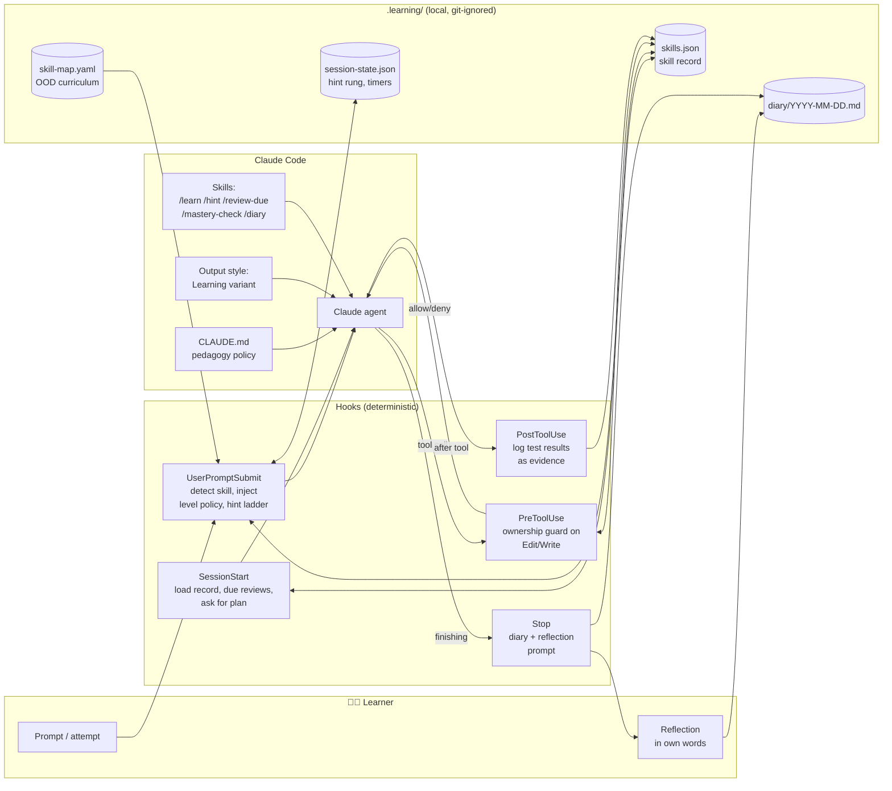

De harnas zet vijf deterministische hooks rond de Claude-agent, en bewaart je vaardighedenregister, dagboek en sessietoestand in een lokale map `.learning/`. CLAUDE.md, de output style en de skills bepalen het didactische gedrag van de agent, maar alleen de hooks dwingen regels af.

**Zoals gebouwd (12 november 2026):** vier hooks, twee commando's die alleen jij draait, drie skills en één agent. Het ontwerp hierboven had een vijfde hook (PostToolUse), een vaardighedenkaart in YAML en meer skills. De bouw verving die vijfde hook door `check.mjs`, dat je zelf draait, en de kaart door `skills.json` (§10).

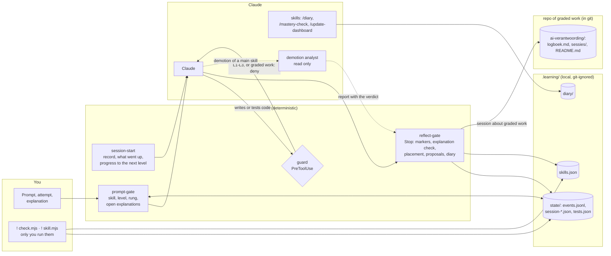

Zoals gebouwd zijn de vier hooks deterministisch. De guard blokkeert code op L1–L3, en elke schrijfactie in beoordeeld werk (§10.8). De reflect-gate controleert markers en uitleg, plaatst een nieuwe vaardigheid en toont voorstellen. De demotie-analist leest alleen, en zijn rapport gaat naar de reflect-gate, niet de chat in.

**Ontwerpkeuzes:**

- **Regels die altijd moeten gelden, horen in hooks.** Hooks zijn deterministisch. Instructies in CLAUDE.md zijn *adviserend*: het model volgt ze meestal, maar in lange sessies kan het ervan afdrijven. Daarom moet de regel "schrijf geen code die van jou is" een hook zijn.
- **Didactisch gedrag hoort in skills, CLAUDE.md en de output style.** Het gaat dan om socratische vragen, uitleg en de toon van de feedback.
- **De harnas bewaart de toestand in gewone bestanden** die je kunt lezen en bewerken (JSON/Markdown). Zo blijft het systeem transparant, en transparantie ondersteunt je autonomie (P10).

### 5.2 De autonomieladder (per vaardigheid)

De harnas geeft elke vaardigheid een eigen niveau. De vijf niveaus volgen cognitive apprenticeship en uitgewerkte voorbeelden die stap voor stap worden afgebouwd. Bovenaan staat automatisering.

| Niveau | Naam | Wie schrijft de code? | Rol van de AI | Jij moet… | Onderbouwing |
|---|---|---|---|---|---|
| **L0** | *Voordoen* | AI | Schrijft een uitgewerkt voorbeeld met **labels voor subdoelen** en legt het uit | Tekstinvoer geven (bedoeling en eisen), daarna 2–3 belangrijke regels **zelf uitleggen** en de uitvoer voorspellen | Uitgewerkte voorbeelden, subdoelen, zelfuitleg |
| **L1** | *Aanvullen* | AI schrijft het skelet, jij schrijft de kern | Schrijft een raamwerk met `TODO(human)`-gaten, of fragmenten in Parsons-stijl | De gaten invullen en de tests draaien | Aanvul- en Parsons-opgaven, achterwaarts afbouwen |
| **L2** | *Begeleid* | Jij | Alleen de hintladder: vraag → concept → pseudocode → gedeeltelijk codefragment (laatste redmiddel, pas na een wachttijd) | Alles zelf schrijven, om hints vragen | Scaffolding, contingente begeleiding, wenselijke moeilijkheid |
| **L3** | *Zelfstandig* | Jij | Beoordeelt **na** je poging: codereview, ontwerpkritiek, ideeën voor tests | Het alleen oplossen en daarna je keuzes verdedigen | Doelbewust oefenen (deliberate practice), feedback |
| **L4** | *Geautomatiseerd* | AI | Schrijft de code. Jij **controleert** de diff en voorspelt bij steekproeven de aanpak | Toezicht houden, plus af en toe een ophaaloefening om het bij te houden | Autonome fase, automatiseringsniveaus, ironieën van automatisering |

**Zoals gebouwd (10 november 2026, §10.4):** een nieuwe vaardigheid begint met jouw poging, en de eerste taak plaatst haar op een niveau. Omlaag gaat automatisch als het bewijs dat laat zien. Omhoog blijft jouw beslissing. Herhalingen om een vaardigheid bij te houden bestaan alleen op L4.

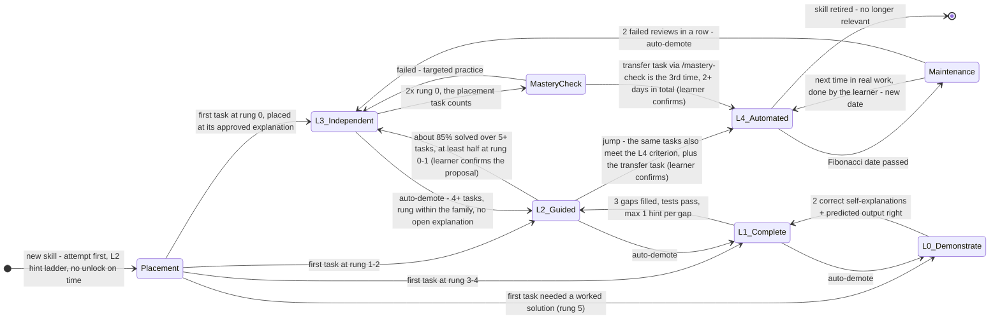

In de autonomieladder zoals gebouwd bepaalt de hoogste hinttrede van de eerste taak het niveau van een nieuwe vaardigheid. Daarna kan een vaardigheid automatisch omlaag, maar omhoog blijft altijd jouw beslissing, en herhalingen om haar bij te houden bestaan alleen op L4.

- **Plaatsing.** Een vaardigheid onder L4 zonder geschiedenis en zonder eigen uitgelegde taken heeft een open plaatsing. Tot dan telt ze als L2, voor de hintladder en voor de guard. Een nieuwe vaardigheid begint dus niet meer op L0: L0 en L1 zijn vormen van hulp die pas *na* een poging komen. De hoogste trede van de eerste taak bepaalt het niveau (§5.3), bij de goedgekeurde uitleg van die taak; hulp over een ander concept telt niet mee (§10.7).
- **Automatisch omlaag** gebeurt alleen als `settings.autoDemote` aan staat; standaard staat het uit. De regel kijkt naar de eigen uitgelegde taken van de vaardigheid sinds haar laatste niveauwijziging, hooguit de laatste 10. Bij minstens 4 daarvan (§10.7; tot 12 november 3) geldt hij als minder dan 70% gelukt is (op trede ≤ 2 binnen de eigen familie) of als de laatste 2 niet gelukt zijn. Hij geldt ook na 2 mislukte herhalingen op rij. Hij wacht zolang er een uitleg van die familie openstaat, en een verlaging die openstaat wordt opnieuw gecontroleerd op het bewijs van het moment waarop hij wordt uitgevoerd. Een microvaardigheid gaat dan één niveau omlaag. Bij een hoofdvaardigheid beslist eerst de demotie-analist of een microvaardigheid of de hoofdvaardigheid omlaag gaat (§10.4.2).
- **Omhoog** gaat nooit automatisch. Elke automatische wijziging kun je terugdraaien met `set`.
- **L3 → L4 (§10.7):** de taak die de vaardigheid plaatste telt mee, en de transfertaak is één van de drie keer zonder hint; haar dag telt als een dag.

??? note "Eerdere versie (7–9 november 2026)"

    ```mermaid
    stateDiagram-v2
        direction LR
        [*] --> L0_Demonstrate : new skill encountered

        L0_Demonstrate --> L1_Complete : 2 correct self-explanations + predicted output right
        L1_Complete --> L2_Guided : 3 gaps filled, tests pass, ≤1 hint per gap
        L2_Guided --> L3_Independent : success rate ≥85% over ≥5 tasks, avg hint rung ≤1
        L3_Independent --> MasteryCheck : 3 independent successes on ≥2 different days
        MasteryCheck --> L4_Automated : novel transfer task passed + explanation correct
        MasteryCheck --> L3_Independent : failed → targeted practice

        L1_Complete --> L0_Demonstrate : stuck twice / under 50% success
        L2_Guided --> L1_Complete : success rate under 70%
        L3_Independent --> L2_Guided : 2 failures in a row

        L4_Automated --> Maintenance : spaced review due
        L3_Independent --> Maintenance : spaced review due (revised: reviews start at L3)
        Maintenance --> L4_Automated : retrieval passed → interval grows
        Maintenance --> L3_Independent : 2 failed reviews in a row → advice to demote (learner decides)

        L4_Automated --> [*] : skill retired - no longer relevant
    ```

    In de eerdere autonomieladder (7–9 november 2026) begon elke nieuwe vaardigheid op L0 en ging ze omhoog op vaste criteria. Herhalingen begonnen op L3, en twee mislukte herhalingen op rij gaven je alleen het advies om omlaag te gaan; de beslissing bleef bij jou.

> **"Alleen tekstinvoer geven" aan het begin** is L0. Je beschrijft je bedoeling en eisen in gewone tekst, en de AI schrijft een volledig toegelicht voorbeeld. Ook hier ben je nooit helemaal passief: op L0 geef je een korte zelfuitleg of voorspelling voordat de sessie als vooruitgang telt (Chi et al., 1989; Kazemitabaar et al., 2025).

### 5.3 Frictie afstemmen en de hintladder

De hintladder brengt twee ideeën in de praktijk: contingente begeleiding (meer hulp na een mislukking, minder na succes; §2.3) en productief worstelen (§2.2). Het bewijs voor hulp in stappen is goed; voor het meebewegen zelf is het zwak (§2.3). Hulp pas na een eigen poging past bij de ene klasstudie waarin meebewegen wel hielp: na een langere tijd zelfstandig werken (van de Pol et al. 2015). Je krijgt de volgende trede pas na **(a)** een zichtbare poging, zoals code die je hebt veranderd of een hypothese die je hebt uitgesproken, **of (b)** als de vastloop-timer afloopt. Die regel houdt het worstelen productief, zodat het niet omslaat in doelloos ploeteren.

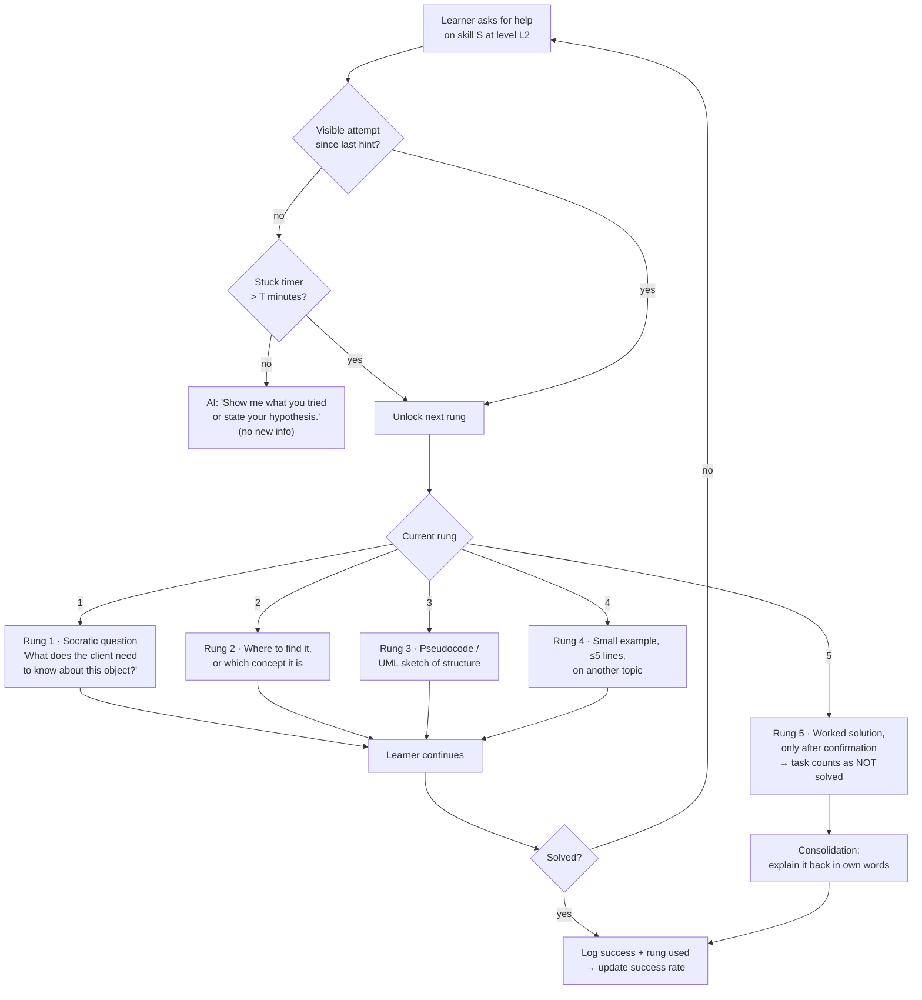

Op niveau L2 ontgrendelt de volgende trede van de hintladder pas na een zichtbare poging, of als de vastloop-timer afloopt. De vijf treden lopen van een socratische vraag tot een uitgewerkte oplossing; een taak die de uitgewerkte oplossing nodig heeft, telt als mislukt.

**Regels voor het afstemmen** (contingente begeleiding, met ongeveer 85% succes als vuistregel; §2.2 legt uit waarom dat een heuristiek is en geen bewijs):

- De harnas houdt per vaardigheid een **voortschrijdend succespercentage** bij. Daarbij tellen alleen successen op trede ≤ 2.
- **> 95%** → te makkelijk. Maak de taken moeilijker, of wissel af met andere vaardigheden (interleaving). Controleer of je aan de criteria voor het volgende niveau voldoet.
- **70–95%** → in de zone. Ga zo door.
- **< 70%** → te moeilijk. Verkort de vastloop-timer `T` (bijv. 15 → 8 min), kies makkelijkere taken of ga één niveau omlaag.
- Voor L2 begint `T` op **10–15 minuten**. Dat valt binnen de tijd waarin verwarring nog productief kan zijn (D'Mello et al., 2014). Je kunt `T` zelf aanpassen.

**Zoals gebouwd (10 november 2026, §10.4):** bij een **nieuwe vaardigheid** waarvan de plaatsing nog open is (§5.2), ontgrendelen treden **niet** op tijd. Een trede gaat alleen omhoog als:

- je zegt dat je vastzit;
- je dezelfde fout of testuitkomst twee keer deelt;
- je zegt dat je het concept niet kent.

Vraag je na een eigen poging om meer uitleg, dan mag Claude meteen naar trede 4 gaan. De trede die Claude echt geeft, wordt gelogd via de marker `[trede N]`, en die telt mee voor de plaatsing. Bij gewone L2-taken blijft de vastloop-timer `T` op 12 minuten, maar hij telt alleen actieve tijd: een pauze langer dan `idleMinutes` (standaard 20) telt niet mee.

### 5.4 Hook-pipeline

Het diagram volgt één sessie en laat zien wanneer elke hook ingrijpt.

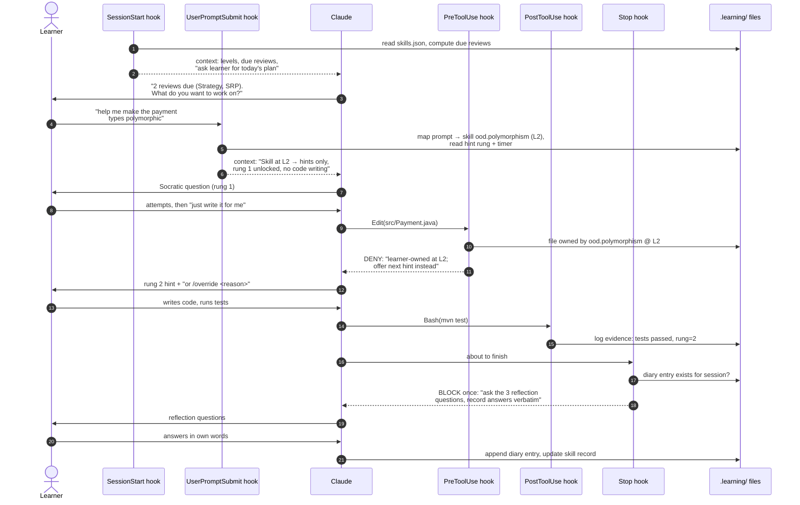

In een voorbeeldsessie blokkeert de PreToolUse-hook dat Claude een bestand van een L2-vaardigheid bewerkt, dus geeft Claude in plaats daarvan de volgende hint. Aan het eind blokkeert de Stop-hook één keer, zodat Claude drie reflectievragen stelt en jij die in je eigen woorden beantwoordt.

**Zoals gebouwd (12 november 2026):** dezelfde sessie met de hooks en het commando die er nu zijn.

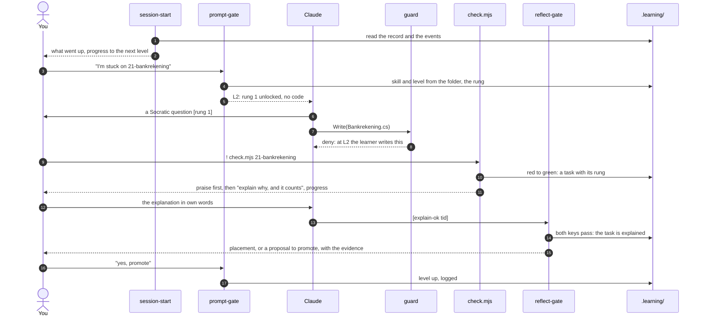

Zoals gebouwd draai je de tests zelf met `check.mjs`. Dat logt de taak, geeft eerst lof en toont je voortgang. De reflect-gate keurt de uitleg goed met twee sleutels. Een plaatsing of een voorstel om door te zetten komt van de harnas zelf, en alleen jouw eigen "ja, doorzetten" zet het niveau hoger.

| Hook | Gebeurtenis | Taak | Kan hij blokkeren? |
|---|---|---|---|
| `session-start.mjs` | `SessionStart` | Geeft Claude een samenvatting van je vaardighedenregister, de herhalingen die vandaag aan de beurt zijn, en de instructie om je naar een plan te vragen (*vooruitdenken*). *Herzien (§10.4, §10.7):* geen herhalingen meer bij de start; hij toont je wat de laatste 7 dagen omhoog ging, je voortgang naar het volgende niveau in stappen, en één keer dat moeite het doel is | Nee (alleen context) |
| `prompt-gate.mjs` | `UserPromptSubmit` | Koppelt je prompt aan een vaardigheid met trefwoorden uit `skill-map.yaml`, voegt het beleid voor dat niveau en de huidige hinttrede toe, start de vastloop-timer of werkt die bij, en handelt `/override` af. *Herzien (§10.2, punt 10):* negeert agentrapporten, taakmeldingen en systeemherinneringen, en logt `prompt-ignored` | Kan context toevoegen. Kan alleen blokkeren bij patronen van misbruik (optioneel) |
| `ownership-guard.mjs` | `PreToolUse` (matcher `Edit\|Write\|MultiEdit\|NotebookEdit`) | Blokkeert bewerkingen door de AI in bestanden, of delen van bestanden, die horen bij een vaardigheid op L1–L3. Op L1 laat hij een schrijfactie alleen toe als er `TODO(human)`-gaten in staan | **Ja** (`permissionDecision: deny`) |
| ~~`evidence-log.mjs`~~ → `check.mjs` (gebouwd) | CLI, die je zelf start met `!` | *Herzien (§10):* omdat je de tests zelf draait, ziet een PostToolUse-hook ze nooit. `check.mjs` draait `dotnet test` met een trx-logger, toont een leesbare samenvatting, onthoudt per testmethode of die groen was, en logt een overgang van rood naar groen als taak, samen met de huidige hinttrede. Het werkt voor elk .NET-testproject (oefenopgaven en projectwerk) | Nee |
| `reflect-gate.mjs` | `Stop` | Als je aan een vaardigheid hebt gewerkt en er nog geen dagboeknotitie is, blokkeert hij **één keer** en zegt hij tegen Claude dat de reflectie moet gebeuren. Hij gebruikt `stop_hook_active` om lussen te voorkomen. *Herzien (§10):* hij leest ook het laatste antwoord van Claude uit het transcript en verwerkt de markers `[trede N]` en `[uitleg-ok <tid>]`. Die tweede marker telt alleen als je eigen bericht door de deterministische uitlegcontrole komt. *Herzien (§10.7):* bij een goedgekeurde uitleg plaatst hij een nieuwe vaardigheid; hij controleert een verlaging die openstaat opnieuw; en hij leest het oordeel van de demotie-analist uit het rapport van de agent. *Herzien (§10.10):* hij logt controlevragen, noteert wanneer Claude naar het zelfvertrouwen vroeg, en schrijft de eigen woorden van de student in het AI-logboek | Ja, één keer |
| `session-end.mjs` | `SessionEnd` | *Toegevoegd (§10.10):* noteert hoe een sessie eindigde en of er werk was zonder dagboek, zodat de volgende start een inhaaldagboek kan aanbieden | Nee |
| `graded-gate.mjs` (gebruikersniveau, optioneel) | `UserPromptSubmit` en `PreToolUse`, in elk project buiten de beoordeelde map | *Toegevoegd (§10.10):* houdt een prompt tegen die de beoordeelde opdracht noemt en weigert elke tool op de paden ervan, ook lezen; de setup (`.claude/`, `CLAUDE.md`) blijft open | **Ja** |

!!! example "Voorbeeld: de situatie van één student"
    De harnas werd voor het eerst uitgeprobeerd door een tweedejaarsstudent HBO-ICT die OOD oefende in C#. Bij de oefenopgaven van de cursus hoorden .NET-unittests, en die draaide de student zelf, niet Claude. Daarom draait `check.mjs` het commando `dotnet test`. De diagrammen en voorbeelden in deze sectie gebruiken nog Java uit het oorspronkelijke ontwerp (`mvn test`, `src/Payment.java`).

### 5.5 Vaardighedenregister (datamodel)

In het vaardighedenregister houdt de harnas je voortgang bij. Het register volgt het idee van knowledge tracing (per vaardigheid een kans op beheersing, die wordt bijgewerkt op basis van bewijs) en de planning van gespreide herhalingen. Het onderwerp is OOD, dus staat het register hier als klassendiagram:

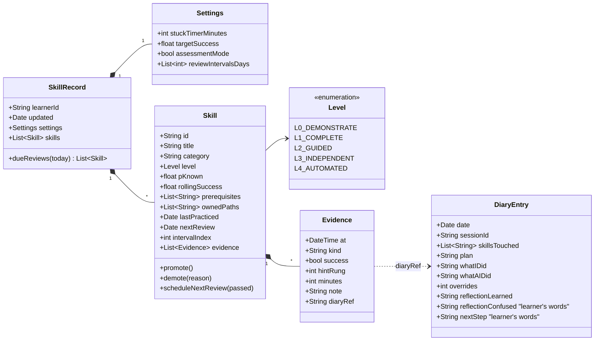

Zoals ontworpen geeft het vaardighedenregister elke vaardigheid een niveau (L0–L4), een kans op beheersing, datums voor herhalingen en eigen bewijs. Elk bewijsstuk legt vast of het lukte, met welke hinttrede en in hoeveel minuten, en kan verwijzen naar een dagboeknotitie.

**Voorbeeld van een item in `skills.json`:**

```json
{
  "id": "ood.strategy-pattern",
  "title": "Strategy pattern",
  "category": "design",
  "level": "L3_INDEPENDENT",
  "pKnown": 0.82,
  "rollingSuccess": 0.86,
  "prerequisites": ["ood.polymorphism", "ood.interfaces"],
  "ownedPaths": ["src/main/java/shop/pricing/**"],
  "lastPracticed": "2026-11-05",
  "nextReview": "2026-11-12",
  "intervalIndex": 1,
  "evidence": [
    {"at": "2026-11-03T14:10", "kind": "task", "success": true, "hintRung": 1, "minutes": 22, "diaryRef": "2026-11-03#s2"},
    {"at": "2026-11-05T10:02", "kind": "task", "success": true, "hintRung": 0, "minutes": 14, "diaryRef": "2026-11-05#s1"}
  ]
}
```

**Zoals gebouwd (na de eerste sessies, §10):** het register is platter dan het klassendiagram hierboven. Elk item heeft `id`, `title`, `level`, `paths`, `nextReview`, `intervalIndex`, `failStreak` en `history`. De harnas slaat bewijs niet op in de vaardigheid zelf. Het bewijs komt in een log dat alleen groeit (append-only), `.learning/state/events.jsonl`, met gebeurtenissen zoals `task`, `task-explained`, `test-green`, `hint-unlock` en `review`. **Microvaardigheden** zijn onderdelen van een vaardigheid: items met een `parent` en hun eigen `keywords`:

```json
{ "id": "cs.basis.void-chaining", "parent": "cs.basis", "title": "void-methoden en chainen",
  "level": "L2", "keywords": ["reverse()", "chainen", "void"], "nextReview": null, "intervalIndex": 0 }
```

### 5.6 AI-dagboek en reflectielus

Het dagboek volgt de cyclus van zelfregulerend leren (Zimmerman, 2002) en gebruikt **leerprotocollen met prompts** (Nückles et al., 2009): je schrijft als antwoord op een paar vaste vragen. De AI legt de feiten vast. Jij schrijft de reflectie.

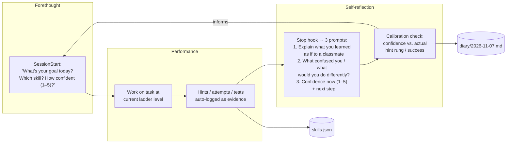

De dagboek- en reflectielus loopt van vooruitdenken (doel en vertrouwen) via uitvoering (werk, gelogd als bewijs) naar zelfreflectie bij de Stop-hook. Een kalibratiecontrole vergelijkt je vertrouwen met je werkelijke hinttrede en succes, en dat neem je mee in je volgende plan.

**Sjabloon voor een dagboeknotitie** (bijvoorbeeld `.learning/diary/2026-11-07.md`):

```markdown
## Session 2 · 14:05–15:10 · skills: ood.polymorphism (L2), ood.srp (review)

**Plan (me):** Refactor PaymentProcessor so new payment types don't need if/else. Confidence: 2/5

**Facts (logged):**
- Hint rungs used: 1, 2 (no rung ≥3) · stuck timer fired: 0×
- Tests: 3 runs, last ✅ 12/12
- AI wrote: test skeleton only · I wrote: Payment interface, 3 implementations
- Overrides: 0 · Review SRP: passed → next review 2026-11-14

**Reflection (my words):**
1. *Learned:* The if/else on type was a smell; each payment class now owns its own `process()` behaviour...
2. *Confused / differently:* Not sure whether `validate()` belongs in the interface or a separate validator...
3. *Confidence now:* 4/5 · *Next:* try the same with discounts (Strategy?)

**Calibration:** predicted 2 → performed at rung ≤2 → under-confident ✅ (good sign)
```

**Wekelijkse terugblik op het dagboek** (15 minuten, `/diary --week`): Claude vat de trends van de week samen: het succespercentage per vaardigheid, het aantal overrides, de verschillen in kalibratie en de vaardigheden die het dichtst bij het volgende niveau zitten. *Jij* bepaalt waar je volgende week op focust. Zo helpt de terugblik je om je eigen leren in de gaten te houden, zonder dat de terugblik dat voor je doet.

### 5.7 Gespreide herhaling na beheersing

Als je een vaardigheid beheerst, blijft de harnas die af en toe controleren. Herhalingen gebruiken **groeiende intervallen**, aangepast aan je resultaten in de stijl van Leitner en half-life regression. Ook **wisselen** ze vaardigheden **af**, en dat traint je in het kiezen van het juiste principe. Het is niet bewezen dat groeiende intervallen beter werken dan gelijke intervallen (§2.5). Het werk zit in spreiding en ophalen. Het schema zorgt er vooral voor dat vroege herhalingen lukken en dat herhalingen vóór je toets vallen. Herhalingstaken zijn *ophaal*taken, geen herlezen:

- *"Zonder te kijken: schets het klassendiagram voor een calculator voor verzendkosten die op Strategy is gebaseerd."*
- *"Hier zijn 3 codefragmenten. Welke schendt LSP, en waarom?"* (onderscheiden bij afwisseling)
- *"Voorspel hoe het ontwerp van de AI voor X eruitziet voordat de AI het genereert, en vergelijk dan."* Deze toezichtcontrole is bedoeld voor L4-vaardigheden.

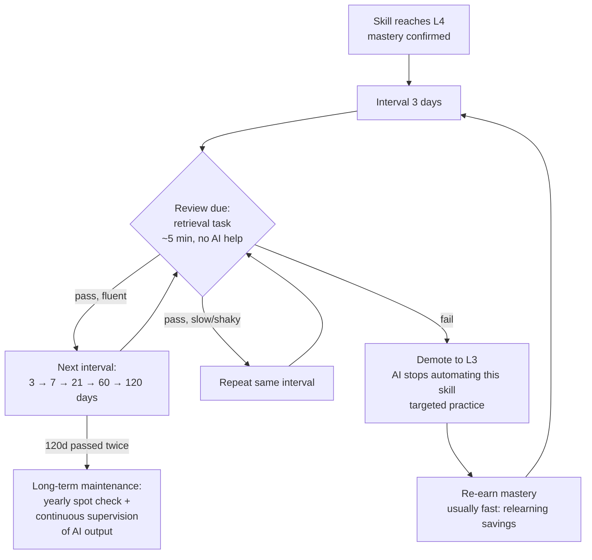

In het oorspronkelijke ontwerp krijgt een L4-vaardigheid herhalingen met een ophaaltaak zonder AI, op groeiende intervallen: 3, 7, 21, 60 en 120 dagen. Is de herhaling wankel, dan blijft het interval gelijk; mislukt ze, dan gaat de vaardigheid terug naar L3 en stopt de AI met automatiseren.

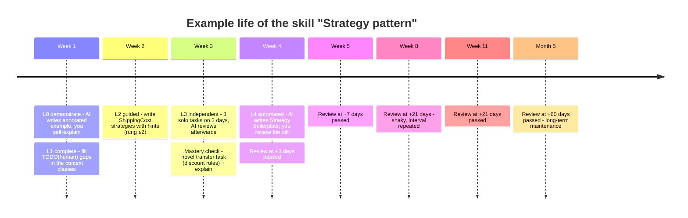

In een voorbeeldtijdlijn uit het oorspronkelijke ontwerp gaat de vaardigheid "Strategy pattern" van L0 in week 1 naar L4 in week 4. Daarna wordt ze nog gecontroleerd, steeds minder vaak, en na een wankele herhaling op +21 dagen blijft dat interval gelijk.

Aan het begin van elke sessie toont de **`SessionStart`-hook** de herhalingen die aan de beurt zijn. Zo gebeurt het versterken vanzelf, en hoef je er zelf niet aan te denken. Dit is het deel "leren afdwingen zolang dat nodig is": een vaardigheid is *nooit voorgoed buiten beeld*. Ze wordt alleen steeds minder vaak gecontroleerd.

**Zoals gebouwd (10 november 2026, §10.4):** herhalingen gebeuren nu in je echte werk, en alleen op L4.

- **Geen losse herhaaloefeningen.** Een herhaling is de **eerstvolgende keer dat de vaardigheid in je echte werk langskomt** na haar datum: via haar map, haar trefwoorden of een run van `check.mjs` die eraan gekoppeld is. De hook meldt dat dan één keer. Deze keer doe jij dat deel zelf, niet de AI: zolang de herhaling klaarstaat, behandelt de guard de paden van de vaardigheid als L3.
- **Fibonacci-intervallen:** 1, 2, 3, 5, 8, 13, 21, 34 … dagen, **alleen voor vaardigheden en microvaardigheden op L4**. Een vaardigheid op L3 heeft geen schema nodig, want die doe je zelf zodra ze langskomt.
- **De trede van die taak bepaalt de uitkomst:**
    - trede 0 → `pass`, één stap omhoog in de reeks;
    - trede 1–2 → `shaky`, het interval herhaalt zich;
    - trede 3–5 of een mislukte taak → `fail`, **twee stappen terug**.
- **Na twee keer `fail` op rij:** de regel voor automatisch omlaag geldt (§5.2, §10.4.2). Staat `autoDemote` uit, dan krijg je het advies om één niveau omlaag te gaan.
- **Als de vaardigheid niet langskomt:** dan gebeurt er niets, en wacht de herhaling. Bij het begin van een sessie verschijnt niets. Het dashboard toont geen "te laat", alleen wanneer je de vaardigheid het laatst zag.
- **Voor je toets:** als `settings.examDate` is ingesteld, valt een herhaling uiterlijk 3 dagen voor de toets. Het vangnet vóór de toets zijn de oefentoetsen van je opleiding. Die staan bewust buiten de harnas.

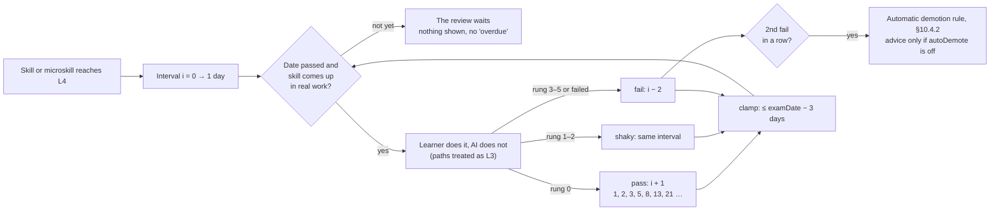

Zoals gebouwd wordt een L4-vaardigheid herhaald zodra ze na haar datum in je echte werk langskomt; dat deel doe je dan zelf. Trede 0 zet het Fibonacci-interval één stap omhoog, trede 1–2 herhaalt het, en trede 3–5 of een mislukking zet het twee stappen terug.

??? note "Eerdere versie zoals gebouwd (§10, 7 november 2026)"

    De harnas verving het schema 3 → 7 → 21 → 60 → 120 hierboven.

    - **Fibonacci-intervallen:** 1, 2, 3, 5, 8, 13, 21, 34 … dagen.
    - **Startpunt:** herhalingen beginnen zodra een vaardigheid of microvaardigheid **L3** bereikt, niet pas bij L4. Dat past bij het doel "beheerst → alleen af en toe versterken".
    - **Na een herhaling:** `pass` gaat één stap omhoog in de reeks, `shaky` herhaalt het interval en `fail` gaat **twee stappen terug**.
    - **Na twee keer `fail` op rij:** de harnas *adviseert* je om één niveau omlaag te gaan. De harnas zet een vaardigheid nooit automatisch lager.
    - **Voor je toets:** als je je toetsdatum instelt in `settings.examDate`, kort de harnas elk interval zo in dat de herhaling uiterlijk 3 dagen voor de toets valt.

    ```mermaid
    flowchart LR
        S[Skill or microskill reaches L3] --> I["Interval i = 0 → 1 day"]
        I --> Q{Retrieval review<br/>~5 min, no help}
        Q -- pass --> UP["i + 1<br/>1, 2, 3, 5, 8, 13, 21 …"]
        Q -- shaky --> SAME[same interval]
        Q -- fail --> BACK["i − 2"]
        BACK --> F{2nd fail<br/>in a row?}
        F -- yes --> ADV[Advice: one level down<br/>learner decides]
        UP & SAME & BACK --> C["clamp: ≤ examDate − 3 days"] --> Q
    ```

    In de eerdere versie zoals gebouwd (7 november 2026) waren herhalingen korte ophaaltaken zonder hulp, op Fibonacci-intervallen vanaf L3. Na twee keer `fail` op rij kreeg je het advies om één niveau omlaag te gaan; de harnas zette een vaardigheid nooit automatisch lager.

### 5.8 OOD-vaardighedenkaart

De OOD-kaart in de harnas (`harness/maps/ood/skills.json`) is een lijst vaardigheden, elk met eigen opdrachtmappen en trefwoorden. Hij is opgebouwd uit de gaten die de diagnostische toets liet zien. Sinds 11 november 2026 hoort daar ook het OO-ontwerp bij dat het eindassessment van het vak beoordeelt: polymorfie, SOLID en modulariteit, lagen met controllers en dependency injection, en het UML-sequentie- en componentdiagram. Later die avond is de kaart naast de toetsbeschrijving, het beoordelingsformulier en de cheatsheet van de pilotstudent gelegd. Daaruit kwamen er tien bij: logging (indicator 3.1.1), integratie-, systeem- en UI-tests (indicator 3.1.4 en het testplan), en uit de cheatsheet upcasting en downcasting, static members, records en structs, object-methodes, overige C# (sealed, indexers, operator overloading, geneste klassen) en de drie families van ontwerppatronen. Een familie is één vaardigheid; oefen je één patroon apart, dan wordt het een microvaardigheid.

De kaart heeft **geen voorkennis-relaties**. De volgorde komt uit de genummerde opdrachten, en een nieuwe vaardigheid begint met een plaatsing: je eerste taak bepaalt het niveau (§5.2). Mist er iets, dan voeg je zelf een vaardigheid toe met `skill.mjs add`.

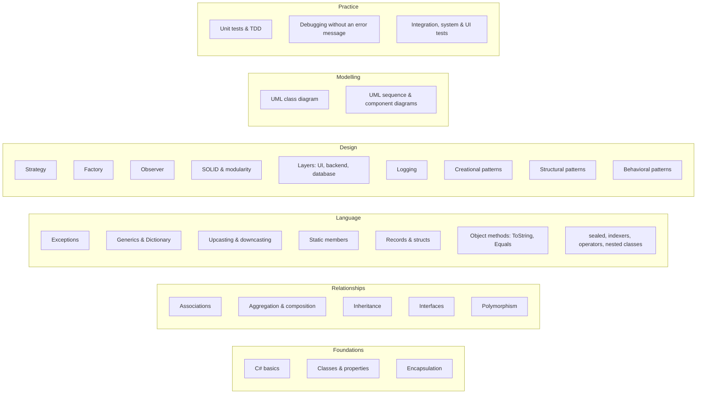

De vaardigheden van de OOD-kaart, per groep. Er lopen geen pijlen tussen: de volgorde komt uit de opdrachten, niet uit de kaart.

**Wat de kaart niet dekt.** Het eindassessment beoordeelt ook security, de cloud en een CI/CD-pipeline, de database en het verslag. Die zitten niet in de kaart; zo koos de pilotstudent op 11 november 2026. De guard beschermt wel de bestanden van zo'n project: naast C# ook `.razor`, `.cshtml`, `.sql`, de pipeline (`.yml`), `Dockerfile` en `appsettings*.json` (zie [Configuratie](configuration.md)).

??? note "Oorspronkelijk ontwerp (7 november 2026): een graaf met voorkennis"

    `skill-map.yaml` legt het curriculum vast als graaf: welke vaardigheden welke andere vrijspelen, en met welke trefwoorden de harnas vaardigheden in je prompts herkent. Een vaardigheid komt beschikbaar op L0 zodra de vereiste vaardigheden op L2 of hoger staan. Een vaardigheid kan alleen geautomatiseerd worden (L4) als de vereiste vaardigheden ook op L4 staan. Zo automatiseert de AI nooit iets waarvan je de basis niet kunt controleren.

    ```mermaid
    flowchart TD
        subgraph Foundations
            A1[Classes & objects<br/>state, identity, behaviour]
            A2[Encapsulation<br/>& access modifiers]
            A3[Constructors &<br/>object lifecycle]
        end
        subgraph Relationships
            B1[Association /<br/>aggregation / composition]
            B2[Inheritance]
            B3[Interfaces &<br/>abstract classes]
            B4[Polymorphism<br/>dynamic dispatch]
        end
        subgraph Modelling
            C1[UML class diagrams]
            C2[UML sequence diagrams]
            C3[Responsibility assignment<br/>GRASP / CRC]
        end
        subgraph Principles
            D1[SRP]
            D2[Open/Closed]
            D3[Liskov Substitution]
            D4[Interface Segregation]
            D5[Dependency Inversion]
            D6[Composition over<br/>inheritance]
        end
        subgraph Patterns
            E1[Strategy]
            E2[Observer]
            E3[Factory Method /<br/>Abstract Factory]
            E4[Decorator]
            E5[Adapter]
            E6[State]
        end
        subgraph Practice
            F1[Unit testing / TDD]
            F2[Code smells &<br/>refactoring]
            F3[Dependency injection]
        end
        A1 --> A2 --> A3
        A1 --> B1 & B2
        B2 --> B3 --> B4
        A1 --> C1
        B1 & B2 --> C1
        C1 --> C2
        C1 --> C3 --> D1
        B4 --> D2 & D3
        B3 --> D4 & D5
        B1 & B2 --> D6
        D2 & B4 --> E1
        D5 --> E2
        D5 --> E3
        D6 --> E4 & E5
        E1 --> E6
        D1 --> F2
        F1 --> F2
        D5 --> F3
    ```

    De OOD-vaardighedenkaart laat zien welke vaardigheden welke andere vrijspelen: van klassen en objecten, via relaties en modelleren, naar principes en daarna patronen. Een vaardigheid kan pas naar L4, het niveau waarop de AI haar automatiseert, als de vereiste vaardigheden ook op L4 staan.

---

<a id="6-evaluatie"></a>

## 6. Evaluatie {#evaluation}

Hoe weet je of de harnas je leren beschermt en niet alleen frictie toevoegt? Controleer deze punten:

1. **Transfertests zonder hulp** aan het begin (nulmeting), na ongeveer een maand en kort voor je toets. Gebruik kleine OOD-taken *zonder AI*: ontwerp een klassendiagram, refactor een klasse met code smells, pas een patroon toe op een nieuw domein. Dit is de meting die het meest telt. Bastani et al. (2025) lieten zien dat hoe goed je het doet bij het oefenen met AI, weinig zegt over hoe goed je het doet zonder AI.
2. **Het succespercentage per vaardigheid** moet rond 70–95% blijven. Blijft het boven 95%, dan is de frictie te laag. Blijft het onder 70%, dan is de frictie te hoog.
3. **Percentage overrides.** Stijgt dat, dan is dat een teken van frustratie (R6) of van het omzeilen van de regels (R5). Lees de redenen in het dagboek.
4. **Kalibratie.** Het verschil tussen het vertrouwen dat je vooraf inschat en hoe zelfstandig je echt werkt, moet in de loop van de tijd kleiner worden (R2).
5. **Het slagingspercentage van herhalingen** voor L4-vaardigheden moet 80% of hoger zijn. Is het lager, verkort dan de intervallen.
6. **Tijd tot beheersing per vaardigheid.** Die moet *afnemen* voor latere vaardigheden die voortbouwen op vereiste vaardigheden die je al beheerst. Dit is een transfereffect.
7. **Proeftoets vs. oefenen (R14).** Maak een proeftoets met tijdslimiet, zonder AI, in dezelfde omgeving (IDE) als je toets. Vergelijk je score met je succespercentage tijdens het oefenen. Is het verschil groot, dan zijn je omstandigheden bij het oefenen te makkelijk, of wijken ze te veel af van de toets.
8. **Toezichtcontrole (R16, na je toets).** Neem een korte klasse die door AI is geschreven en waarin bewust fouten in OOD en tests zijn verstopt. Tel hoeveel fouten je zonder hulp vindt. Herhaal dit elke maand.

### 6.1 Uitnodiging aan onderzoekers: een gerandomiseerd experiment

De controles hierboven zijn voor één lerende. Of de harnas in het algemeen werkt, vraagt om een gerandomiseerd gecontroleerd experiment. De pagina [Voor onderzoekers](researchers.md) stelt er een voor. In het kort:

- **Groepen:** Claude Code zonder beperkingen; Claude Code met alleen een leerprompt (de *Learning* output style); Claude Code met de harnas.
- **Deelnemers:** studenten in een programmeervak, of junior developers met 0–2 jaar ervaring.
- **Primaire uitkomst:** een getimede transfertoets zonder AI, minstens acht weken na het laatste oefenen.
- **Secundaire uitkomsten:** gevonden geplante fouten in code die door AI is geschreven, afgeronde taken, tijd tot L4, en overrides.
- **Onderhoud binnen één persoon:** loot welke L4-vaardigheden herhalingen krijgen.

---

<a id="7-beperkingen"></a>

## 7. Beperkingen {#limitations}

- **De bewijsbasis is jong.** De meeste studies over generatieve AI komen uit 2023–2026. Vaak hebben ze kleine steekproeven of een korte looptijd, of zijn het preprints en working papers (bijv. Kosmyna et al., 2025; Shen & Tamkin, 2026; Lehmann et al., 2025; de meeste experimenten uit 2026 in §2.8). In het hoger onderwijs heeft maar één studie gemeten wat er na meer dan ongeveer een week is blijven hangen: een quasi-experiment met een toets na zeven weken (Albadarin, 2026). Ook het overzicht van Stanford SCALE (november 2026) vindt blijvende leerwinst nog niet aangetoond. Effecten kunnen veranderen als de tools veranderen.
- **Een verhalend literatuuroverzicht, één keer gecorrigeerd.** Er was geen zoekprotocol, en de eerste versie overdreef meerdere bevindingen (§11). Bij de herziening kwamen er bewijsgraden en gerichte zoekacties bij. Toch is het overzicht nog steeds niet systematisch, dus selectiebias is mogelijk.
- **Weinig AI-onderzoek specifiek over OOD, en geen onderzoek over agentische tools.** De meeste studies naar AI in het informaticaonderwijs gaan over programmeertaken uit CS1 (de eerste programmeercursus). Ze toepassen op ontwerpvaardigheden is een afleiding uit onderzoek naar misvattingen bij OOD, aangevuld met algemene leerwetenschap. Er bestaat nog geen gecontroleerde studie naar hoe studenten leren met agentische tools zoals Claude Code.
- **Het bewijs over de verschuiving in vaardigheden is vooral Amerikaans, beschrijvend en commercieel.** Causale studies naar de arbeidsmarkt spreken elkaar tegen. Nederlandse gegevens zijn schaars en correlationeel. De cijfers over hoeveel code AI schrijft, komen vooral van bedrijven die AI verkopen. Geen enkele studie meet de beste mix van oefenen met de hand en oefenen in toezicht op AI-uitvoer. §2.9 en §4.1 zijn dus afleidingen.
- **Belangenconflict.** Dit document is geschreven door Claude, een model van Anthropic, en het steunt op sommige plekken op onderzoek van Anthropic. Controleer de belangrijke beweringen via de gelinkte bronnen.
- **Hooks zijn een middel om jezelf te binden (commitment device), geen beveiliging.** Je kunt ze altijd uitzetten, en de AI vindt soms routes om de regels heen (bijv. shell-commando's die bestanden schrijven). Daarom kan de harnas tegenover een docent niet bewijzen dat een student zonder AI heeft gewerkt. De harnas werkt omdat *jij* ervoor hebt gekozen. Je kunt de `PreToolUse`-matcher uitbreiden naar `Bash` voor veelgebruikte commando's die bestanden schrijven, maar dit wordt nooit waterdicht. Hooks kunnen ook de andere kant op de fout in gaan. In de eerste sessies van de pilot werden rapporten van achtergrondagents behandeld als de eigen prompts van de student, en speelden ze zo hinttreden vrij, totdat dit werd opgelost (§10.2, punt 10).
- **Tot nu toe door één student uitgeprobeerd.** Het ontwerp is voor het eerst uitgeprobeerd in een pilot met één student. Wat §10 beschrijft, komt uit die eerste sessies. Het laat zien wat er misging en wat er is veranderd, niet hoe goed de harnas werkt voor studenten in het algemeen.
- **Niet uitgeprobeerd op het werk.** De onderbouwing voor junior developers op hun werk (§2.12) rust op een experiment op korte termijn, kleine interviewstudies, vergelijkingen met andere beroepen en praktijkbronnen met bewijsgraad D. Nog geen junior developer heeft de harnas op het werk gebruikt.
- **Praktijkbronnen tonen zorg, geen bewijs.** De talks, interviews, nieuwsartikelen en blogs in §2.12 laten zien dat de zorg breed leeft. Ze laten niet zien dat die zorg terecht is.
- **Drempels voor beheersing zijn heuristieken.** De getallen (85%, 3 successen over 2 dagen, de intervallen) komen uit de literatuur, maar zijn niet gevalideerd voor deze opzet. Pas ze aan met je eigen evaluatiegegevens (§6).
- **Vaardigheden herkennen in prompts lukt maar bij benadering.** Koppelen op trefwoorden kiest soms de verkeerde vaardigheid. Laat de AI een vaardigheid voorstellen en bevestig die, of noem de vaardigheid zelf (`/learn ood.strategy`).

---

<a id="zo-citeer-je-dit-onderzoek"></a>

## Zo citeer je dit onderzoek {#cite}

Geschreven door Piet Hanegraaf met Claude (Anthropic); zie de [AI-verklaring](ai-statement.md). Citeer het Engelse origineel: deze Nederlandse versie is een machinevertaling. Noem de versie en de datum waarop je het las, want het onderzoek wordt bijgewerkt.

**APA**

> Hanegraaf, P. (2026). *Learning to code (and OOD) with AI: Literature review, risk assessment and a learning-preserving Claude Code setup* (version of 11 November 2026; written with Claude, Anthropic). https://piethanegraaf.github.io/en/research/

**BibTeX**

```bibtex
@misc{hanegraaf2026learning,
  author       = {Hanegraaf, Piet},
  title        = {Learning to Code (and {OOD}) with {AI}: Literature Review, Risk Assessment and a Learning-Preserving {Claude Code} Setup},
  year         = {2026},
  month        = nov,
  howpublished = {\url{https://piethanegraaf.github.io/en/research/}},
  note         = {Version of 11 November 2026. Written with Claude (Anthropic).}
}
```

---

<a id="8-literatuur"></a>

## 8. Literatuur {#references}

*Klassieke bronnen zijn aangehaald uit gevestigde literatuur. Recente studies over generatieve AI zijn bij het schrijven gecontroleerd aan de hand van de gegevens van de uitgever of van arXiv. Preprints (niet door vakgenoten beoordeeld) zijn gemarkeerd.*

**Hoe de bronnen zijn gecontroleerd.** Twee citatiecontroles vergeleken de claims in dit onderzoek met hun primaire bronnen: één voor de [studies over generatieve AI](https://github.com/piethanegraaf/piethanegraaf.github.io/blob/main/research/citation-checks/citation_check_genai.md) en één voor de [leerwetenschap](https://github.com/piethanegraaf/piethanegraaf.github.io/blob/main/research/citation-checks/citation_check_learning_science.md). De correcties die daaruit kwamen, staan in het [wijzigingslog](#11-wijzigingslog). De controles zelf zijn in het Engels.

**Leren programmeren en OOD**

- Becker, B. A., Denny, P., Finnie-Ansley, J., Luxton-Reilly, A., Prather, J., & Santos, E. A. (2023). Programming is hard – or at least it used to be: Educational opportunities and challenges of AI code generation. *Proc. SIGCSE 2023*, 500–506.
- Chi, M. T. H., Bassok, M., Lewis, M. W., Reimann, P., & Glaser, R. (1989). Self-explanations: How students study and use examples in learning to solve problems. *Cognitive Science, 13*(2), 145–182.
- Eckerdal, A., & Thuné, M. (2005). Novice Java programmers' conceptions of "object" and "class", and variation theory. *Proc. ITiCSE 2005*, 89–93.
- Ericson, B. J., Margulieux, L. E., & Rick, J. (2017). Solving Parsons problems versus fixing and writing code. *Proc. Koli Calling 2017*, 20–29.
- Holland, S., Griffiths, R., & Woodman, M. (1997). Avoiding object misconceptions. *Proc. SIGCSE 1997*, 131–134.
- Kölling, M. (1999). The problem of teaching object-oriented programming, Part 1: Languages. *Journal of Object-Oriented Programming, 11*(8), 8–15.
- Lister, R., et al. (2004). A multi-national study of reading and tracing skills in novice programmers. *ACM SIGCSE Bulletin, 36*(4), 119–150.
- Lopez, M., Whalley, J., Robbins, P., & Lister, R. (2008). Relationships between reading, tracing and writing skills in introductory programming. *Proc. ICER 2008*, 101–112.
- Margulieux, L. E., Catrambone, R., & Guzdial, M. (2012). Subgoal-labeled instructional material improves performance and transfer in learning to develop mobile applications. *Proc. ICER 2012*, 71–78.
- McCracken, M., et al. (2001). A multi-national, multi-institutional study of assessment of programming skills of first-year CS students. *ACM SIGCSE Bulletin, 33*(4), 125–180.
- Morrison, B. B., Margulieux, L. E., & Guzdial, M. (2015). Subgoals, context, and worked examples in learning computing problem solving. *Proc. ICER 2015*, 21–29.
- Parsons, D., & Haden, P. (2006). Parson's programming puzzles: A fun and effective learning tool for first programming courses. *Proc. ACE 2006*, 157–163.
- Ragonis, N., & Ben-Ari, M. (2005). A long-term investigation of the comprehension of OOP concepts by novices. *Computer Science Education, 15*(3), 203–221.
- Robins, A., Rountree, J., & Rountree, N. (2003). Learning and teaching programming: A review and discussion. *Computer Science Education, 13*(2), 137–172.
- Sanders, K., & Thomas, L. (2007). Checklists for grading object-oriented CS1 programs: Concepts and misconceptions. *Proc. ITiCSE 2007*, 166–170.

**Leerwetenschap: frictie, scaffolding, beheersing, onthouden, reflectie**

- Adesope, O. O., Trevisan, D. A., & Sundararajan, N. (2017). Rethinking the use of tests: A meta-analysis of practice testing. *Review of Educational Research, 87*(3), 659–701.
- Aleven, V., & Koedinger, K. R. (2000). Limitations of student control: Do students know when they need help? *Proc. ITS 2000*, LNCS 1839, 292–303.
- Aleven, V., Stahl, E., Schworm, S., Fischer, F., & Wallace, R. (2003). Help seeking and help design in interactive learning environments. *Review of Educational Research, 73*(3), 277–320.
- Anderson, J. R. (1982). Acquisition of cognitive skill. *Psychological Review, 89*(4), 369–406.
- Anderson, J. R., Corbett, A. T., Koedinger, K. R., & Pelletier, R. (1995). Cognitive tutors: Lessons learned. *Journal of the Learning Sciences, 4*(2), 167–207.
- Ariely, D., & Wertenbroch, K. (2002). Procrastination, deadlines, and performance: Self-control by precommitment. *Psychological Science, 13*(3), 219–224.
- Arthur, W., Jr., Bennett, W., Jr., Stanush, P. L., & McNelly, T. L. (1998). Factors that influence skill decay and retention: A quantitative review and analysis. *Human Performance, 11*(1), 57–101.
- Atkinson, R. K., Renkl, A., & Merrill, M. M. (2003). Transitioning from studying examples to solving problems: Effects of self-explanation prompts and fading worked-out steps. *Journal of Educational Psychology, 95*(4), 774–783.
- Baker, R. S., Corbett, A. T., Koedinger, K. R., & Wagner, A. Z. (2004). Off-task behavior in the cognitive tutor classroom: When students "game the system". *Proc. CHI 2004*, 383–390.
- Bertsch, S., Pesta, B. J., Wiscott, R., & McDaniel, M. A. (2007). The generation effect: A meta-analytic review. *Memory & Cognition, 35*(2), 201–210.
- Bjork, R. A. (1994). Memory and metamemory considerations in the training of human beings. In J. Metcalfe & A. Shimamura (Eds.), *Metacognition: Knowing about knowing* (pp. 185–205). MIT Press.
- Bjork, E. L., & Bjork, R. A. (2011). Making things hard on yourself, but in a good way: Creating desirable difficulties to enhance learning. In M. A. Gernsbacher et al. (Eds.), *Psychology and the real world* (pp. 56–64). Worth.
- Bloom, B. S. (1968). Learning for mastery. *Evaluation Comment, 1*(2). UCLA-CSEIP.
- Bloom, B. S. (1984). The 2 sigma problem: The search for methods of group instruction as effective as one-to-one tutoring. *Educational Researcher, 13*(6), 4–16.
- Boud, D., Keogh, R., & Walker, D. (Eds.). (1985). *Reflection: Turning experience into learning*. Kogan Page.
- Brunmair, M., & Richter, T. (2019). Similarity matters: A meta-analysis of interleaved learning and its moderators. *Psychological Bulletin, 145*(11), 1029–1052.
- Cepeda, N. J., Pashler, H., Vul, E., Wixted, J. T., & Rohrer, D. (2006). Distributed practice in verbal recall tasks: A review and quantitative synthesis. *Psychological Bulletin, 132*(3), 354–380.
- Cepeda, N. J., Vul, E., Rohrer, D., Wixted, J. T., & Pashler, H. (2008). Spacing effects in learning: A temporal ridgeline of optimal retention. *Psychological Science, 19*(11), 1095–1102.
- Collins, A., Brown, J. S., & Newman, S. E. (1989). Cognitive apprenticeship: Teaching the crafts of reading, writing, and mathematics. In L. B. Resnick (Ed.), *Knowing, learning, and instruction* (pp. 453–494). Erlbaum.
- Corbett, A. T., & Anderson, J. R. (1994). Knowledge tracing: Modeling the acquisition of procedural knowledge. *User Modeling and User-Adapted Interaction, 4*(4), 253–278.
- Csikszentmihalyi, M. (1990). *Flow: The psychology of optimal experience*. Harper & Row.
- D'Mello, S., Lehman, B., Pekrun, R., & Graesser, A. (2014). Confusion can be beneficial for learning. *Learning and Instruction, 29*, 153–170.
- Dreyfus, S. E., & Dreyfus, H. L. (1980). *A five-stage model of the mental activities involved in directed skill acquisition*. University of California, Berkeley (ORC 80-2).
- Driskell, J. E., Willis, R. P., & Copper, C. (1992). Effect of overlearning on retention. *Journal of Applied Psychology, 77*(5), 615–622.
- Dunlosky, J., Rawson, K. A., Marsh, E. J., Nathan, M. J., & Willingham, D. T. (2013). Improving students' learning with effective learning techniques. *Psychological Science in the Public Interest, 14*(1), 4–58.
- Ebbinghaus, H. (1885/1913). *Memory: A contribution to experimental psychology*. Teachers College.
- Ericsson, K. A., Krampe, R. T., & Tesch-Römer, C. (1993). The role of deliberate practice in the acquisition of expert performance. *Psychological Review, 100*(3), 363–406.
- Fitts, P. M., & Posner, M. I. (1967). *Human performance*. Brooks/Cole.
- Hattie, J., & Timperley, H. (2007). The power of feedback. *Review of Educational Research, 77*(1), 81–112.
- Kalyuga, S., Ayres, P., Chandler, P., & Sweller, J. (2003). The expertise reversal effect. *Educational Psychologist, 38*(1), 23–31.
- Kang, S. H. K. (2016). Spaced repetition promotes efficient and effective learning: Policy implications for instruction. *Policy Insights from the Behavioral and Brain Sciences, 3*(1), 12–19.
- Kapur, M. (2008). Productive failure. *Cognition and Instruction, 26*(3), 379–424.
- Kapur, M. (2016). Examining productive failure, productive success, unproductive failure, and unproductive success in learning. *Educational Psychologist, 51*(2), 289–299.
- Karpicke, J. D., & Roediger, H. L. (2008). The critical importance of retrieval for learning. *Science, 319*(5865), 966–968.
- Kirschner, P. A., Sweller, J., & Clark, R. E. (2006). Why minimal guidance during instruction does not work. *Educational Psychologist, 41*(2), 75–86.
- Koriat, A., & Bjork, R. A. (2005). Illusions of competence in monitoring one's knowledge during study. *Journal of Experimental Psychology: Learning, Memory, and Cognition, 31*(2), 187–194.
- Kornell, N., & Bjork, R. A. (2008). Learning concepts and categories: Is spacing the "enemy of induction"? *Psychological Science, 19*(6), 585–592.
- Kulik, C.-L. C., Kulik, J. A., & Bangert-Drowns, R. L. (1990). Effectiveness of mastery learning programs: A meta-analysis. *Review of Educational Research, 60*(2), 265–299.
- Latimier, A., Peyre, H., & Ramus, F. (2021). A meta-analytic review of the benefit of spacing out retrieval practice episodes on retention. *Educational Psychology Review, 33*, 959–987.
- Leitner, S. (1972). *So lernt man lernen*. Herder.
- Metcalfe, J. (2017). Learning from errors. *Annual Review of Psychology, 68*, 465–489.
- Metcalfe, J., & Kornell, N. (2005). A region of proximal learning model of study time allocation. *Journal of Memory and Language, 52*(4), 463–477.
- Moon, J. A. (2006). *Learning journals: A handbook for reflective practice and professional development* (2nd ed.). Routledge.
- Nückles, M., Hübner, S., & Renkl, A. (2009). Enhancing self-regulated learning by writing learning protocols. *Learning and Instruction, 19*(3), 259–271.
- Nückles, M., Roelle, J., Glogger-Frey, I., Waldeyer, J., & Renkl, A. (2020). The self-regulation-view in writing-to-learn: Using journal writing to optimize cognitive load in self-regulated learning. *Educational Psychology Review, 32*, 1089–1126.
- Pea, R. D. (2004). The social and technological dimensions of scaffolding and related theoretical concepts. *Journal of the Learning Sciences, 13*(3), 423–451.
- Puntambekar, S., & Hübscher, R. (2005). Tools for scaffolding students in a complex learning environment: What have we gained and what have we missed? *Educational Psychologist, 40*(1), 1–12.
- Renkl, A., & Atkinson, R. K. (2003). Structuring the transition from example study to problem solving in cognitive skill acquisition. *Educational Psychologist, 38*(1), 15–22.
- Roediger, H. L., & Karpicke, J. D. (2006). Test-enhanced learning: Taking memory tests improves long-term retention. *Psychological Science, 17*(3), 249–255.
- Rohrer, D., & Taylor, K. (2007). The shuffling of mathematics problems improves learning. *Instructional Science, 35*, 481–498.
- Rohrer, D., Taylor, K., Pashler, H., Wixted, J. T., & Cepeda, N. J. (2005). The effect of overlearning on long-term retention. *Applied Cognitive Psychology, 19*(3), 361–374.
- Ryan, R. M., & Deci, E. L. (2000). Self-determination theory and the facilitation of intrinsic motivation, social development, and well-being. *American Psychologist, 55*(1), 68–78.
- Schön, D. A. (1983). *The reflective practitioner*. Basic Books.
- Settles, B., & Meeder, B. (2016). A trainable spaced repetition model for language learning. *Proc. ACL 2016*, 1848–1858.
- Shute, V. J. (2008). Focus on formative feedback. *Review of Educational Research, 78*(1), 153–189.
- Slamecka, N. J., & Graf, P. (1978). The generation effect: Delineation of a phenomenon. *Journal of Experimental Psychology: Human Learning and Memory, 4*(6), 592–604.
- Sweller, J. (1988). Cognitive load during problem solving: Effects on learning. *Cognitive Science, 12*(2), 257–285.
- Sweller, J., & Cooper, G. A. (1985). The use of worked examples as a substitute for problem solving in learning algebra. *Cognition and Instruction, 2*(1), 59–89.
- VanLehn, K. (2011). The relative effectiveness of human tutoring, intelligent tutoring systems, and other tutoring systems. *Educational Psychologist, 46*(4), 197–221.
- Vygotsky, L. S. (1978). *Mind in society: The development of higher psychological processes*. Harvard University Press.
- Wilson, R. C., Shenhav, A., Straccia, M., & Cohen, J. D. (2019). The eighty five percent rule for optimal learning. *Nature Communications, 10*, 4646.
- Wood, D., Bruner, J. S., & Ross, G. (1976). The role of tutoring in problem solving. *Journal of Child Psychology and Psychiatry, 17*(2), 89–100.
- Wood, H., & Wood, D. (1999). Help seeking, learning and contingent tutoring. *Computers & Education, 33*(2–3), 153–169.
- Zimmerman, B. J. (2002). Becoming a self-regulated learner: An overview. *Theory Into Practice, 41*(2), 64–70.

**Automatisering en cognitief uitbesteden**

- Bainbridge, L. (1983). Ironies of automation. *Automatica, 19*(6), 775–779.
- Endsley, M. R., & Kiris, E. O. (1995). The out-of-the-loop performance problem and level of control in automation. *Human Factors, 37*(2), 381–394.
- Parasuraman, R., & Manzey, D. H. (2010). Complacency and bias in human use of automation: An attentional integration. *Human Factors, 52*(3), 381–410.
- Parasuraman, R., Sheridan, T. B., & Wickens, C. D. (2000). A model for types and levels of human interaction with automation. *IEEE Transactions on Systems, Man, and Cybernetics – Part A, 30*(3), 286–297.
- Risko, E. F., & Gilbert, S. J. (2016). Cognitive offloading. *Trends in Cognitive Sciences, 20*(9), 676–688.
- Sparrow, B., Liu, J., & Wegner, D. M. (2011). Google effects on memory: Cognitive consequences of having information at our fingertips. *Science, 333*(6043), 776–778. [Contested: Experiment 1 failed to replicate (Camerer et al., 2018; Hesselmann, 2020).]

**Generatieve AI en leren (programmeren en algemeen)**

- Anthropic. (2025a, April 8). *Anthropic Education Report: How university students use Claude* [vendor]. https://www.anthropic.com/news/anthropic-education-report-how-university-students-use-claude
- Anthropic. (n.d.). *Output styles* (Claude Code documentation; *Learning* style with `TODO(human)`). https://code.claude.com/docs/en/output-styles
- Anthropic. (n.d.). *Hooks reference* (Claude Code documentation). https://code.claude.com/docs/en/hooks
- Bastani, H., Bastani, O., Sungu, A., Ge, H., Kabakcı, Ö., & Mariman, R. (2025). Generative AI without guardrails can harm learning: Evidence from high school mathematics. *PNAS, 122*(26), e2422633122. https://doi.org/10.1073/pnas.2422633122
- Becker, J., Rush, N., Barnes, E., & Rein, D. (2025). *Measuring the impact of early-2025 AI on experienced open-source developer productivity*. METR. arXiv:2507.09089 [preprint].
- Darvishi, A., Khosravi, H., Sadiq, S., Gašević, D., & Siemens, G. (2024). Impact of AI assistance on student agency. *Computers & Education, 210*, 104967.
- Denny, P., Prather, J., Becker, B. A., et al. (2024). Computing education in the era of generative AI. *Communications of the ACM, 67*(2), 56–67.
- Denny, P., Leinonen, J., Prather, J., et al. (2024b). Prompt problems: A new programming exercise for the generative AI era. *Proc. SIGCSE 2024*, 296–302.
- Fan, Y., Tang, L., Le, H., et al. (2025). Beware of metacognitive laziness: Effects of generative artificial intelligence on learning motivation, processes, and performance. *British Journal of Educational Technology, 56*(2), 489–530. https://doi.org/10.1111/bjet.13544
- Finnie-Ansley, J., Denny, P., Becker, B. A., Luxton-Reilly, A., & Prather, J. (2022). The robots are coming: Exploring the implications of OpenAI Codex on introductory programming. *Proc. ACE 2022*, 10–19.
- Gerlich, M. (2025). AI tools in society: Impacts on cognitive offloading and the future of critical thinking. *Societies, 15*(1), 6. [A correction to a table appeared in *Societies, 15*(9), 252.]
- Hellas, A., Leinonen, J., Sarsa, S., Koutcheme, C., Kujanpää, L., & Sorva, J. (2023). Exploring the responses of large language models to beginner programmers' help requests. *Proc. ICER 2023*, 93–105.
- Jošt, G., Taneski, V., & Karakatič, S. (2024). The impact of large language models on programming education and student learning outcomes. *Applied Sciences, 14*(10), 4115.
- Karpathy, A. (2025, February 2). "There's a new kind of coding I call 'vibe coding'…" [Post on X].
- Kazemitabaar, M., Chow, J., Ma, C. K. T., Ericson, B. J., Weintrop, D., & Grossman, T. (2023). Studying the effect of AI code generators on supporting novice learners in introductory programming. *Proc. CHI 2023*. arXiv:2302.07427.
- Kazemitabaar, M., Hou, X., Henley, A., Ericson, B. J., Weintrop, D., & Grossman, T. (2023b). How novices use LLM-based code generators to solve CS1 coding tasks in a self-paced learning environment. *Proc. Koli Calling 2023*. arXiv:2309.14049.
- Kazemitabaar, M., Ye, R., Wang, X., Henley, A. Z., Denny, P., Craig, M., & Grossman, T. (2024). CodeAid: Evaluating a classroom deployment of an LLM-based programming assistant that balances student and educator needs. *Proc. CHI 2024*. arXiv:2401.11314.
- Kazemitabaar, M., Huang, O., Suh, S., Henley, A. Z., & Grossman, T. (2025). Exploring the design space of cognitive engagement techniques with AI-generated code for enhanced learning. *Proc. IUI 2025*.
- Kestin, G., Miller, K., Klales, A., Milbourne, T., & Ponti, G. (2025). AI tutoring outperforms in-class active learning: An RCT introducing a novel research-based design in an authentic educational setting. *Scientific Reports, 15*, 17458. https://doi.org/10.1038/s41598-025-97652-6
- Kosmyna, N., Hauptmann, E., Yuan, Y. T., et al. (2025). *Your brain on ChatGPT: Accumulation of cognitive debt when using an AI assistant for essay writing task*. arXiv:2506.08872 [preprint, not peer reviewed; v2, December 2025; critiqued by Stanković et al., 2026].
- Lau, S., & Guo, P. (2023). From "Ban it till we understand it" to "Resistance is futile": How university programming instructors plan to adapt as more students use AI code generation and explanation tools such as ChatGPT and GitHub Copilot. *Proc. ICER 2023*, 106–121.
- LearnLM Team, Google. (2024). *LearnLM: Improving Gemini for learning*. arXiv:2412.16429 [preprint]. [LearnLM is no longer a separate model. Its capabilities are part of Gemini 2.5 and later, and the student mode is called "Guided Learning" (August 2025).]
- Lee, H.-P., Sarkar, A., Tankelevitch, L., et al. (2025). The impact of generative AI on critical thinking: Self-reported reductions in cognitive effort and confidence effects from a survey of knowledge workers. *Proc. CHI 2025*.
- Lehmann, M., Cornelius, P. B., & Sting, F. J. (2025). *AI meets the classroom: When do large language models harm learning?* arXiv:2409.09047 [preprint; still unpublished as of November 2026].
- Leinonen, J., Hellas, A., Sarsa, S., et al. (2023). Using large language models to enhance programming error messages. *Proc. SIGCSE 2023*, 563–569.
- Liffiton, M., Sheese, B., Savelka, J., & Denny, P. (2023). CodeHelp: Using large language models with guardrails for scalable support in programming classes. *Proc. Koli Calling 2023*.
- Liu, R., Zenke, C., Liu, C., Holmes, A., Thornton, P., & Malan, D. J. (2024). Teaching CS50 with AI: Leveraging generative artificial intelligence in computer science education. *Proc. SIGCSE 2024*, 750–756.
- Lyu, W., Wang, Y., Chung, T., Sun, Y., & Zhang, Y. (2024). Evaluating the effectiveness of LLMs in introductory computer science education: A semester-long field study. *Proc. L@S 2024*, 63–74.
- Margulieux, L. E., Prather, J., Reeves, B. N., et al. (2024). Self-regulation, self-efficacy, and fear of failure interactions with how novices use LLMs to solve programming problems. *Proc. ITiCSE 2024*, 276–282.
- Peng, S., Kalliamvakou, E., Cihon, P., & Demirer, M. (2023). *The impact of AI on developer productivity: Evidence from GitHub Copilot*. arXiv:2302.06590 [preprint; 95 recruited, 35 per group completed].
- Prather, J., Denny, P., Leinonen, J., et al. (2023). The robots are here: Navigating the generative AI revolution in computing education. *Proc. ITiCSE-WGR 2023*, 108–159.
- Prather, J., Reeves, B. N., Leinonen, J., et al. (2024). The widening gap: The benefits and harms of generative AI for novice programmers. *Proc. ICER 2024*. arXiv:2405.17739.
- Prather, J., Reeves, B. N., Denny, P., et al. (2024b). "It's weird that it knows what I want": Usability and interactions with Copilot for novice programmers. *ACM Transactions on Computer-Human Interaction, 31*(1), 1–31.
- Sarsa, S., Denny, P., Hellas, A., & Leinonen, J. (2022). Automatic generation of programming exercises and code explanations using large language models. *Proc. ICER 2022*, 27–43.
- Shen, J. H., & Tamkin, A. (2026). *How AI impacts skill formation*. arXiv:2601.20245 [preprint, v2 1 February 2026; Anthropic Fellows Program, vendor]. https://arxiv.org/abs/2601.20245
- Stadler, M., Bannert, M., & Sailer, M. (2024). Cognitive ease at a cost: LLMs reduce mental effort but compromise depth in student scientific inquiry. *Computers in Human Behavior, 160*, 108386.
- Zastudil, C., Rogalska, M., Kapp, C., Vaughn, J., & MacNeil, S. (2023). Generative AI in computing education: Perspectives of students and instructors. *Proc. IEEE FIE 2023*.

**Toegevoegd bij de herziening van 8 november 2026**

*Waar die gegevens niet te controleren waren, ontbreken de initialen en staat er "[title not verified]". De DOI of URL leidt naar de bron. Preprints en working papers zijn niet door vakgenoten beoordeeld. Bronlinks per cijfer staan in `research_notes/AI learning and skill shift 2026/`.*

*Leerwetenschap*

- Camerer, C. F., Dreber, A., Holzmeister, F., et al. (2018). Evaluating the replicability of social science experiments in Nature and Science between 2010 and 2015. *Nature Human Behaviour, 2*, 637–644. https://doi.org/10.1038/s41562-018-0399-z
- Driskell, J. E., Johnston, J. H., & Salas, E. (2001). Does stress training generalize to novel settings? *Human Factors, 43*(1), 99–110. https://doi.org/10.1518/001872001775992471
- Ericsson, K. A., & Harwell, K. W. (2019). Deliberate practice and proposed limits on the effects of practice on the acquisition of expert performance: Why the original definition matters and recommendations for future research. *Frontiers in Psychology, 10*, 2396. https://doi.org/10.3389/fpsyg.2019.02396
- Grinschgl, S., Papenmeier, F., & Meyerhoff, H. S. (2021). Consequences of cognitive offloading: Boosting performance but diminishing memory. *Quarterly Journal of Experimental Psychology, 74*(9), 1477–1496. https://doi.org/10.1177/17470218211008060
- Grinschgl et al. (2023). [Cognitive offloading and concurrent-task performance; title not verified]. *Psychonomic Bulletin & Review, 30*(6), 2250–2261. https://doi.org/10.3758/s13423-023-02312-3
- Hesselmann, G. (2020). No conclusive evidence that difficult general knowledge questions cause a "Google Stroop effect". A replication study. *PeerJ, 8*, e10325. https://doi.org/10.7717/peerj.10325
- Hinze, S. R., & Rapp, D. N. (2014). Retrieval (sometimes) enhances learning: Performance pressure reduces the benefits of retrieval practice. *Applied Cognitive Psychology, 28*(4), 597–606. https://doi.org/10.1002/acp.3032
- Kang, S. H. K., Lindsey, R. V., Mozer, M. C., & Pashler, H. (2014). Retrieval practice over the long term: Should spacing be expanding or equal-interval? *Psychonomic Bulletin & Review, 21*(6), 1544–1550. https://doi.org/10.3758/s13423-014-0636-z
- Karpicke, J. D., & Roediger, H. L. (2007). Expanding retrieval practice promotes short-term retention, but equally spaced retrieval enhances long-term retention. *Journal of Experimental Psychology: Learning, Memory, and Cognition, 33*(4), 704–719. https://doi.org/10.1037/0278-7393.33.4.704
- Kluger, A. N., & DeNisi, A. (1996). The effects of feedback interventions on performance: A historical review, a meta-analysis, and a preliminary feedback intervention theory. *Psychological Bulletin, 119*(2), 254–284. https://doi.org/10.1037/0033-2909.119.2.254
- Kulik, J. A., & Fletcher, J. D. (2016). Effectiveness of intelligent tutoring systems: A meta-analytic review. *Review of Educational Research, 86*(1), 42–78. https://doi.org/10.3102/0034654315581420
- Macnamara, B. N., Hambrick, D. Z., & Oswald, F. L. (2014). Deliberate practice and performance in music, games, sports, education, and professions: A meta-analysis. *Psychological Science, 25*(8), 1608–1618. https://doi.org/10.1177/0956797614535810
- Macnamara, B. N., & Maitra, M. (2019). The role of deliberate practice in expert performance: Revisiting Ericsson, Krampe & Tesch-Römer (1993). *Royal Society Open Science, 6*(8), 190327. https://doi.org/10.1098/rsos.190327
- Morris, C. D., Bransford, J. D., & Franks, J. J. (1977). Levels of processing versus transfer appropriate processing. *Journal of Verbal Learning and Verbal Behavior, 16*(5), 519–533. https://doi.org/10.1016/S0022-5371(77)80016-9
- Murre, J. M. J. (2021). The Godden and Baddeley (1975) experiment on context-dependent memory on land and underwater: A replication. *Royal Society Open Science, 8*(11), 200724. https://doi.org/10.1098/rsos.200724
- Nickow, A., Oreopoulos, P., & Quan, V. (2024). The promise of tutoring for PreK–12 learning: A systematic review and meta-analysis of the experimental evidence. *American Educational Research Journal, 61*(1), 74–107. https://doi.org/10.3102/00028312231208687
- Pan, S. C., & Rickard, T. C. (2018). Transfer of test-enhanced learning: Meta-analytic review and synthesis. *Psychological Bulletin, 144*(7), 710–756. https://doi.org/10.1037/bul0000151
- Samani, J., & Pan, S. C. (2021). Interleaved practice enhances memory and problem-solving ability in undergraduate physics. *npj Science of Learning, 6*, 32. https://doi.org/10.1038/s41539-021-00110-x
- Saunders, T., Driskell, J. E., Johnston, J. H., & Salas, E. (1996). The effect of stress inoculation training on anxiety and performance. *Journal of Occupational Health Psychology, 1*(2), 170–186. https://doi.org/10.1037/1076-8998.1.2.170
- Schooler & Storm (2021). Saved information is remembered less well than deleted information, if the saving process is perceived as reliable. *Memory, 29*(9), 1101–1110. https://doi.org/10.1080/09658211.2021.1962356
- Sinha, T., & Kapur, M. (2021). When problem solving followed by instruction works: Evidence for productive failure. *Review of Educational Research, 91*(5), 761–798. https://doi.org/10.3102/00346543211019105
- Slavin, R. E. (1987). Mastery learning reconsidered. *Review of Educational Research, 57*(2), 175–213. https://doi.org/10.3102/00346543057002175
- Slavin, R. E. (1990). Mastery learning re-reconsidered. *Review of Educational Research, 60*(2), 300ff. https://doi.org/10.2307/1170613
- Smith, A. M., Floerke, V. A., & Thomas, A. K. (2016). Retrieval practice protects memory against acute stress. *Science, 354*(6315), 1046–1048. https://doi.org/10.1126/science.aah5067
- Smith, S. M., Handy, J. D., Angello, G., & Manzano, I. (2014). Effects of similarity on environmental context cueing. *Memory, 22*(5), 493–508. https://doi.org/10.1080/09658211.2013.800553
- Smith, S. M., & Vela, E. (2001). Environmental context-dependent memory: A review and meta-analysis. *Psychonomic Bulletin & Review, 8*(2), 203–220. https://doi.org/10.3758/BF03196157
- Storm, B. C., & Stone, S. M. (2015). Saving-enhanced memory: The benefits of saving on the learning and remembering of new information. *Psychological Science, 26*(2), 182–188. https://doi.org/10.1177/0956797614559285
- Tatel & Ackerman (2025). [Meta-analysis of decay in procedural skills; title not verified]. *Psychological Bulletin, 151*(6), 696–736. https://doi.org/10.1037/bul0000481
- Tulving, E., & Thomson, D. M. (1973). Encoding specificity and retrieval processes in episodic memory. *Psychological Review, 80*(5), 352–373. https://doi.org/10.1037/h0020071
- von Hippel, P. T. (2024). Two-sigma tutoring: Separating science fiction from science fact. *Education Next, 24*(2), 22–31. https://www.educationnext.org/two-sigma-tutoring-separating-science-fiction-from-science-fact/
- Wisniewski, B., Zierer, K., & Hattie, J. (2020). The power of feedback revisited: A meta-analysis of educational feedback research. *Frontiers in Psychology, 10*, 3087. https://doi.org/10.3389/fpsyg.2019.03087
- Yang, C., Luo, L., Vadillo, M. A., Yu, R., & Shanks, D. R. (2021). Testing (quizzing) boosts classroom learning: A systematic and meta-analytic review. *Psychological Bulletin, 147*(4), 399–435. https://doi.org/10.1037/bul0000309

*Overmatig vertrouwen, AI-tutors en leren met AI (2021–2026)*

- Ardic, Le Dilavrec, & Zaidman (2026). How students use generative AI for software testing: An observational study. *Empirical Software Engineering*. https://doi.org/10.1007/s10664-026-10898-0
- Bansal, G., Wu, T., Zhou, J., Fok, R., Nushi, B., Kamar, E., Ribeiro, M. T., & Weld, D. (2021). Does the whole exceed its parts? The effect of AI explanations on complementary team performance. *Proc. CHI 2021*. https://doi.org/10.1145/3411764.3445717
- Barth, Thorgeirsson, Etemadi, Leinonen, Cotrini, & Su (2026). Steering AI tutors through system prompts: A crossover study on self-regulated learning and cognitive engagement scaffolds in CS1. *Proc. ICER 2026*. https://doi.org/10.1145/3765964.3811656
- Boolzen, C., Kuhn, J., Flegr, S., Rott, E.-M., Stausberg, N., …, & Küchemann, S. (2026). Evidence of impact and interpretational limits of generative AI in STEM education: A systematic review and meta-analysis on cognitive learning outcomes. *Artificial Intelligence Review, 59*, 223. https://doi.org/10.1007/s10462-026-11665-9
- Buçinca, Z., Malaya, M. B., & Gajos, K. Z. (2021). To trust or to think: Cognitive forcing functions can reduce overreliance on AI in AI-assisted decision-making. *Proceedings of the ACM on Human-Computer Interaction, 5*(CSCW1), 188. https://doi.org/10.1145/3449287
- Contractor, Z., & Reyes, G. (2026). *Experimental evidence on the learning impact of generative AI*. arXiv:2607.08849; IZA Discussion Paper 18792 [working paper]. https://arxiv.org/abs/2607.08849
- Đức Minh (2026). AI-assisted learning and the illusion of competence: Measuring the AI-learning gap through random knowledge verification. *Journal of Interdisciplinary Studies in Education, 15*(4), 45–82. https://doi.org/10.32674/nrmwyw65
- Eleftheriou, Pallis, & Constantinides (2026). Confidence without competence in AI-assisted knowledge work. *Proc. CHIWORK '26*. arXiv:2604.09444.
- Fan, C., Ke, L., Chen, Z., & Lv, P. (2026). Exploring the effect of GenAI on learning outcomes in higher education: A three-level meta-analysis. *Frontiers in Psychology, 17*, 1758670. https://doi.org/10.3389/fpsyg.2026.1758670
- Gajos, K. Z., & Mamykina, L. (2022). Do people engage cognitively with AI? Impact of AI assistance on incidental learning. *Proc. IUI 2022*. https://doi.org/10.1145/3490099.3511138
- Gardella, N., Prather, J., Leinonen, J., Denny, P., Pettit, R., & Riggs, S. L. (2026). Fast and forgettable: A controlled study of novices' performance, learning, workload, and emotion in AI-assisted and human pair programming paradigms. *Proc. ICER 2026*. arXiv:2604.18538.
- Kapoor, Diaz, MacNeil, Porter, & Denny (2025). [AI teaching assistant with an optional "See Solution" guardrail bypass; title not verified]. arXiv:2504.11146 [preprint].
- Lepp & Kaimre (2026). *Revisiting the performance of generative AI on introductory object-oriented programming assessments: Insights from 2026*. arXiv:2608.16318 [preprint].
- Liu, C., Xie, L., & Xu, G. (2026). Generative AI in higher education: A meta-analysis of intellectual and social–emotional outcomes. *Frontiers in Psychology, 17*, 1848745. https://doi.org/10.3389/fpsyg.2026.1848745
- Liu, J., Sweet, T., Chen, M. H., Engelberg, J., Masters, M. C., Clark, M., Persaud, A., Lancaster, A., Hollingsworth, J. K., & Rice, J. K. (2026). *The effects of course-integrated AI tutoring on student performance and engagement: A randomized university trial* (EdWorkingPaper 26-1598). Annenberg Institute at Brown University. https://doi.org/10.26300/y3f8-vh05
- Oreopoulos, Liut, Sungu, & Low (2026). *Making AI tutoring productive: Evidence from a mastery-based math practice experiment* (EdWorkingPaper 26-1552). https://doi.org/10.26300/01qv-6c22
- Pădurean, Riegel, Gotovos, Mahapatra, Ghosh, Denny, Leinonen, Prather, & Singla (2026). When AI is wrong on purpose: How students respond to buggy GenAI code. *Proc. ICER 2026*. arXiv:2607.05068.
- Prather, MacNeil, Luxton-Reilly, Margulieux, Reeves, Denny, Leinonen, Homer, Nabid, & Rossetti (2026). Scaffolding autocomplete: Improving guidance for learners using generative code suggestions. *Proc. ICER 2026*.
- Sankaranarayanan (2026). *Mitigating "epistemic debt" …* [full title not verified]. arXiv:2602.20206 [preprint].
- Stanković et al. (2026). [Methodological critique of Kosmyna et al., 2025; title not verified]. arXiv:2601.00856.
- Strömberg, Lei, & Wu (2026). *The generative AI learning penalty* (CEPR Discussion Paper 21577) [working paper].
- Teo, Jain, Gerstenberg, & Kleiman-Weiner (2026). *AI assistants overassist*. arXiv:2607.21306 [preprint].
- Vasconcelos, H., Jörke, M., Grunde-McLaughlin, M., Gerstenberg, T., Bernstein, M. S., & Krishna, R. (2023). Explanations can reduce overreliance on AI systems during decision-making. *Proceedings of the ACM on Human-Computer Interaction, 7*(CSCW1), 129. https://doi.org/10.1145/3579605
- Wang & Fan (2025). [Meta-analysis of ChatGPT and learning performance]. *Humanities and Social Sciences Communications*. **Retracted in 2026.** https://www.nature.com/articles/s41599-025-04787-y
- Yang, Van Alstyne, & Dellarocas (2026). *When AI tutors speak* [full title not verified]. arXiv:2609.23958 [preprint].

*Verschuiving van vaardigheden: industrie, arbeidsmarkt, vaardigheidsverlies en toetsbeleid*

- Abdulnour, Gin, & Boscardin (2025). Educational strategies for clinical supervision of artificial intelligence use. *New England Journal of Medicine, 393*(8), 786–797. https://doi.org/10.1056/NEJMra2503232
- Anthropic. (2025b, December 2). *How AI is transforming work at Anthropic* [vendor]. https://www.anthropic.com/research/how-ai-is-transforming-work-at-anthropic
- Anthropic. (2026). *When AI builds itself* [vendor; updated 18 September 2026]. https://www.anthropic.com/institute/recursive-self-improvement
- Brynjolfsson, E., Chandar, B., & Chen, R. (2026). *Canaries in the coal mine? Six facts about the recent employment effects of artificial intelligence* (revised August 2026) [working paper]. Stanford Digital Economy Lab. https://digitaleconomy.stanford.edu/news/canariesaug26/
- Budzyń, K., Romańczyk, M., Kitala, D., et al. (2025). Endoscopist deskilling risk after exposure to artificial intelligence in colonoscopy: A multicentre, observational study. *The Lancet Gastroenterology & Hepatology, 10*(10), 896–903. https://doi.org/10.1016/S2468-1253(25)00133-5
- CHE (Christelijke Hogeschool Ede). (2026). *Onderwijs- en examenregeling 2026–2027*: Algemene bepalingen (art. 1.41) and Opleidingsdeel Bachelor ICT (art. 7.11). https://che.nl/algemeen/oer
- Cnossen, F. (2026, July 8). Voor de meeste starters verandert AI de arbeidsmarkt nog niet. *ESB*. https://esb.nu/voor-de-meeste-starters-verandert-ai-de-arbeidsmarkt-nog-niet/
- CodeRabbit. (2025, December 17). *State of AI vs. human code generation* [vendor]. https://www.coderabbit.ai/blog/state-of-ai-vs-human-code-generation-report
- Corbin, T., Dawson, P., & Liu, D. (2025). Talk is cheap: Why structural assessment changes are needed for a time of GenAI. *Assessment & Evaluation in Higher Education*. https://doi.org/10.1080/02602938.2025.2503964
- Crane & Soto (2026). *AI and coder employment: Compiling the evidence* (FEDS 2026-018). Federal Reserve Board. https://www.federalreserve.gov/econres/feds/ai-and-coder-employment-compiling-the-evidence.htm
- Cui, K. Z., Demirer, M., Jaffe, S., Musolff, L., Peng, S., & Salz, T. (2025). *The effects of generative AI on high-skilled work: Evidence from three field experiments with software developers* [working paper; two authors at Microsoft]. https://www.mertdemirer.com/Papers/Demirer_AI_productivity.pdf
- Daniotti, S., Wachs, J., Feng, X., & Neffke, F. (2026). Who is using AI to code? Global diffusion and impact of generative AI. *Science*. https://doi.org/10.1126/science.adz9311 [authors as on the 2025 preprint; publication date not verified]
- Davis (2026, February 24). [AI exposure, experience premiums and wage growth; title not verified]. Federal Reserve Bank of Dallas. https://www.dallasfed.org/research/economics/2026/0224
- DORA. (2025). *State of AI-assisted software development* [Google Cloud]. https://dora.dev/research/2025/dora-report/
- DORA. (2026). *ROI of AI-assisted software development (2026.01)* [Google Cloud]. https://dora.dev/ai/roi/report/
- Emanuel, N., Harrington, E., & Pallais, A. (2026, June 1). Remote work leaves younger workers sidelined. *Liberty Street Economics*, Federal Reserve Bank of New York. https://libertystreeteconomics.newyorkfed.org/2026/06/remote-work-leaves-younger-workers-sidelined/
- European Union. (2024). Regulation (EU) 2024/1689 (Artificial Intelligence Act), Article 4, as amended by the Digital Omnibus on AI (in force 27 July 2026). https://eur-lex.europa.eu/eli/reg/2024/1689/oj
- Eurostat. (2026). *ICT specialists in employment*. https://ec.europa.eu/eurostat/statistics-explained/index.php?title=ICT_specialists_in_employment
- Fairlie & Wu (2026). [Recent-graduate unemployment in summer 2026; title not verified] (NBER Working Paper 35796). https://www.nber.org/papers/w35796
- GitClear. (2026). *AI code quality in 2026: The maintainability gap* [vendor]. https://www.gitclear.com/the_ai_code_quality_maintainability_gap
- GitHub. (2026, October 28). *Octoverse 2026* [vendor]. https://octoverse.github.com/
- Groenewegen, Van Limbergen, & Vrieselaar (2026, January 22). Dalende werkgelegenheid onder Nederlandse jongeren die concurreren met GenAI. *ESB*. https://esb.nu/dalende-werkgelegenheid-onder-nederlandse-jongeren-die-concurreren-met-genai/
- He, Miller, Agarwal, Kästner, & Vasilescu (2026). Does AI-assisted coding deliver? A difference-in-differences study of Cursor's impact on software projects. arXiv:2511.04427; published as "Speed at the cost of quality". https://doi.org/10.1145/3793302.3793349
- Humlum, A., & Vestergaard, E. (2026). *Still waters, rapid currents: Early labor market transformation under generative AI* (NBER Working Paper 33777, revised March 2026; first circulated as "Large language models, small labor market effects"). https://www.nber.org/papers/w33777
- Indeed Hiring Lab (Aidala & Puri). (2026, July 23). *The labor market is tilting toward seniority*. https://hiringlab.indeed.com/2026/07/23/the-labor-market-is-tilting-toward-seniority/
- JetBrains. (2026). *AI coding agent adoption 2026* [vendor survey]. https://blog.jetbrains.com/research/2026/08/ai-coding-agent-adoption-2026/
- Lightcast. (2025, July 23). *Beyond the buzz* [AI skills in job postings]. https://lightcast.io/resources/blog/beyond-the-buzz-press-release-2025-07-23
- LinkedIn Economic Graph. (2026, February). *U.S. software engineer talent landscape* [Microsoft-owned].
- Liu & Bridgeman (2023, December 8). [The two-lane approach to assessment; title not verified]. *Teaching@Sydney*. https://educational-innovation.sydney.edu.au/teaching@sydney/?p=19768
- METR. (2026a, February 24). *Uplift update* [follow-up of the developer-productivity study]. https://metr.org/blog/2026-02-24-uplift-update/
- METR. (2026b, May 19). *Frontier risk report*. https://metr.org/blog/2026-05-19-frontier-risk-report/
- Npuls. (2025). *Visie op toetsing en examinering: Naar een AI-bewuste toetspraktijk*. https://npuls.nl/kennisbank/visie-op-toetsing-examinering-en-ai-handreikingen
- NVAO. (2026). *Startverkenning generatieve artificiële intelligentie*. https://www.nvao.net/files/attachments/.13866/Startverkenning_Generatieve_Artificiele_Intelligentie.pdf
- Paradis et al. (2024). *How much does AI impact development speed? An enterprise-based randomized controlled trial*. arXiv:2410.12944 [preprint; Google].
- PwC. (2026, June 15). *2026 Global AI Jobs Barometer* [industry report].
- ROA. (2025). *De arbeidsmarkt naar opleiding en beroep tot 2030* (ROA-R-2025/8). Maastricht University. https://cris.maastrichtuniversity.nl/ws/portalfiles/portal/286490364/ROA_R_2025_8_anob_tot_2030.pdf
- Salomons, A., & van den Berge, W. (2026, February 6). Niet zeker dat werkgelegenheid onder Nederlandse jongeren daalt door GenAI. *ESB*. https://esb.nu/niet-zeker-dat-werkgelegenheid-onder-nederlandse-jongeren-daalt-door-genai/
- Scarfe et al. (2024). [Blind test of AI-written answers in university take-home exams; title not verified]. *PLOS ONE*.
- Semafor. (2026, April 24). *Google CEO says 75% of company's new code is AI-generated*. https://www.semafor.com/article/04/24/2026/google-ceo-says-75-of-companys-new-code-is-ai-generated
- Sonar. (2026, January 8). *State of Code developer survey* [vendor]. https://www.sonarsource.com/company/press-releases/sonar-data-reveals-critical-verification-gap-in-ai-coding/
- Stack Overflow. (2026, October 6). *2026 Developer Survey*. https://survey.stackoverflow.co/2026/ai
- Tucker (2026). [Early-career employment and AI exposure; title not verified] (CES-WP-26-27). U.S. Census Bureau. https://www.census.gov/library/working-papers/2026/adrm/CES-WP-26-27.html
- U.S. Bureau of Labor Statistics. (2026, August 27). *Occupational Outlook Handbook*: Computer programmers; Software developers, quality assurance analysts, and testers (2025–35 projections). https://www.bls.gov/ooh/computer-and-information-technology/
- University of Sydney. (2026). *Education in the age of AI* [Green Paper]. https://educational-innovation.sydney.edu.au/teaching@sydney/wp-content/uploads/2026/08/AI-in-Education-at-The-University-of-Sydney-Green-Paper.pdf
- UWV. (2026). *ICT-beroepen* [labour-market information]. https://www.uwv.nl/nl/arbeidsmarktinformatie/sector/ict
- Vadaparty et al. (2024). CS1-LLM: Integrating LLMs into CS1 instruction. *Proc. ITiCSE 2024*. arXiv:2406.15379. Outcomes paper: arXiv:2510.18806.
- Veracode. (2026). *2026 GenAI code security report* (28 July) and *Fall 2026 update* (29 October) [vendor]. https://www.veracode.com/blog/fall-2026-genai-code-security
- Yale Budget Lab. (2026). *Tracking the impact of AI on the labor market* (updated 15 September 2026). https://budgetlab.yale.edu/research/tracking-impact-ai-labor-market
- Yu & Moon (2026). Who will become the next senior? How generative AI erodes the development pathway in software engineering. *Proc. AIES 2026*. arXiv:2607.17067.

**Toegevoegd bij de literatuurupdate van 10 november 2026**

*Bronlinks per cijfer staan in de [notities bij de update](/en/notes/update_2026-11-10/){ hreflang="en" } (Engels). Preprints, working papers en het proefschrift zijn niet peer-reviewed.*

- Albadarin, Y. (2026). *Capturing the impact of generative AI on higher-order thinking, creativity, and cognitive dynamics during debugging* [doctoral dissertation, University of Eastern Finland; figures from the university Q&A of 10 November 2026, dissertation not read]. https://phys.org/news/2026-11-qa-exploring-generative-ai-impact.html
- Bergh, C., Tag, B., Vassar, A., & Renzella, J. (2026). *Your programming students' cognition with ChatGPT: Higher performance, lower retention, and reduced ownership*. arXiv:2609.21194 [preprint]. https://arxiv.org/abs/2609.21194
- Chen, F., & Stratton, J. (2026). *Artificial intelligence in the firm: Bottlenecks in software production* [working paper, Harvard University; version of 9 November 2026; data from Jellyfish]. https://fion.ac/jellyfish.pdf
- Demirer, M., Musolff, L., & Yang, L. (2026). *Writing code vs. shipping code: Productivity effects across generations of AI coding tools* (NBER Working Paper 35275; revised September 2026) [working paper]. https://doi.org/10.3386/w35275
- Lepp, M. (2026). Patterns of learner-AI interaction and academic performance in an object-oriented programming course. *Proc. IEEE FIE 2026*. arXiv:2607.24755 [preprint].
- O'Neill, P. (2026). [Audit of AI-in-education meta-analyses; title not verified]. EdArXiv preprint, https://osf.io/preprints/edarxiv/n29zd_v3. Reported by Barshay, J. (2026, October 26), *The Hechinger Report*, https://hechingerreport.org/proof-points-ai-education-meta-analysis/
- Walker, Fesler, Martinez Claeys, Agnew, & Loeb (2026). *The evidence base on AI in K-12: A November 2026 review*. SCALE Initiative, Stanford Graduate School of Education. https://doi.org/10.26300/80wn-ca81

**Toegevoegd op 11 november 2026: junior developers op hun werk**

*Bronlinks per bewering, en de praktijkbronnen (talks, interviews, nieuwsartikelen en blogs), staan in de [notities over het eeuwige-juniorprobleem](/en/notes/eternal_junior/){ hreflang="en" } (Engels).*

- Beane, M. (2019). Shadow learning: Building robotic surgical skill when approved means fail. *Administrative Science Quarterly, 64*(1), 87–123. https://doi.org/10.1177/0001839217751692
- Beane, M. (2024). *The skill code: How to save human ability in an age of intelligent machines*. Harper Business.
- Brynjolfsson, E., Li, D., & Raymond, L. (2025). Generative AI at work. *Quarterly Journal of Economics, 140*(2), 889–942. https://doi.org/10.1093/qje/qjae044
- Casner, S. M., Geven, R. W., Recker, M. P., & Schooler, J. W. (2014). The retention of manual flying skills in the automated cockpit. *Human Factors, 56*(8), 1506–1516. https://doi.org/10.1177/0018720814535628
- Federal Aviation Administration. (2013). *Manual flight operations* (SAFO 13002, 4 January 2013). https://www.faa.gov/sites/faa.gov/files/other_visit/aviation_industry/airline_operators/airline_safety/SAFO13002.pdf
- Federal Aviation Administration. (2017). *Manual flight operations proficiency* (SAFO 17007, 4 May 2017). https://www.faa.gov/sites/faa.gov/files/2022-11/SAFO17007.pdf
- Feng, D., Yun, B., & Wang, A. Y. (2026). From junior to senior: Allocating agency and navigating professional growth in agentic AI-mediated software engineering. *Proc. CHI 2026*. https://doi.org/10.1145/3772318.3791642 (arXiv:2602.00496)

**Toegevoegd op 11 november 2026: uitleg en reviews**

- Bisra, K., Liu, Q., Nesbit, J. C., Salimi, F., & Winne, P. H. (2018). Inducing self-explanation: A meta-analysis. *Educational Psychology Review, 30*(3), 703–725. https://doi.org/10.1007/s10648-018-9434-x
- Graesser, A. C., Lu, S., Jackson, G. T., Mitchell, H. H., Ventura, M., Olney, A., & Louwerse, M. M. (2004). AutoTutor: A tutor with dialogue in natural language. *Behavior Research Methods, Instruments, & Computers, 36*(2), 180–192. https://doi.org/10.3758/BF03195563
- Koedinger, K. R., & Aleven, V. (2007). Exploring the assistance dilemma in experiments with Cognitive Tutors. *Educational Psychology Review, 19*(3), 239–264. https://doi.org/10.1007/s10648-007-9049-0
- Nückles, M., Hübner, S., Dümer, S., & Renkl, A. (2010). Expertise reversal effects in writing-to-learn. *Instructional Science, 38*(3), 237–258. https://doi.org/10.1007/s11251-009-9106-9
- Nye, B. D., Graesser, A. C., & Hu, X. (2014). AutoTutor and family: A review of 17 years of natural language tutoring. *International Journal of Artificial Intelligence in Education, 24*(4), 427–469. https://doi.org/10.1007/s40593-014-0029-5
- Renkl, A. (1997). Learning from worked-out examples: A study on individual differences. *Cognitive Science, 21*(1), 1–29. https://doi.org/10.1207/s15516709cog2101_1
- Rozenblit, L., & Keil, F. (2002). The misunderstood limits of folk science: An illusion of explanatory depth. *Cognitive Science, 26*(5), 521–562. https://doi.org/10.1207/s15516709cog2605_1

**Toegevoegd op 11 november 2026 (review van de middag): hulp per concept en het open leerlingmodel**

- Beck, J. E., & Gong, Y. (2013). Wheel-spinning: Students who fail to master a skill. In *Artificial Intelligence in Education (AIED 2013)*, LNCS 7926, 431–440. https://doi.org/10.1007/978-3-642-39112-5_44
- Bull, S., & Kay, J. (2016). SMILI☺: A framework for interfaces to learning data in open learner models, learning analytics and related fields. *International Journal of Artificial Intelligence in Education, 26*(1), 293–331. https://doi.org/10.1007/s40593-015-0090-8
- Smit, N., de Kleijn, R. A. M., Wicherts, J. M., & van de Pol, J. (2025). What it takes to tutor: A preregistered direct replication of the scaffolding experimental study by D. Wood et al. (1978). *Journal of Educational Psychology, 117*(8), 1313–1329. https://doi.org/10.1037/edu0000965
- VanLehn, K., Siler, S., Murray, C., Yamauchi, T., & Baggett, W. B. (2003). Why do only some events cause learning during human tutoring? *Cognition and Instruction, 21*(3), 209–249. https://doi.org/10.1207/S1532690XCI2103_01
- Wood, D., & Middleton, D. (1975). A study of assisted problem-solving. *British Journal of Psychology, 66*(2), 181–191. https://doi.org/10.1111/j.2044-8295.1975.tb01454.x
- Wood, D., Wood, H., & Middleton, D. (1978). An experimental evaluation of four face-to-face teaching strategies. *International Journal of Behavioral Development, 1*(2), 131–147. https://doi.org/10.1177/016502547800100203

**Toegevoegd op 11 november 2026 (nacht): hulp in stappen en meebewegen**

- Belland, B. R., Walker, A. E., Kim, N. J., & Lefler, M. (2017). Synthesizing results from empirical research on computer-based scaffolding in STEM education: A meta-analysis. *Review of Educational Research, 87*(2), 309–344. https://doi.org/10.3102/0034654316670999
- van de Pol, J., Volman, M., Oort, F., & Beishuizen, J. (2015). The effects of scaffolding in the classroom: Support contingency and student independent working time in relation to student achievement, task effort and appreciation of support. *Instructional Science, 43*(5), 615–641. https://doi.org/10.1007/s11251-015-9351-z

**Toegevoegd op 12 november 2026: positieve feedback, demoties en de fasegeschiedenis**

- Aguilar, S. J. (2018). Examining the relationship between comparative and self-focused academic data visualizations in at-risk college students' academic motivation. *Journal of Research on Technology in Education, 50*(1), 84–103. https://doi.org/10.1080/15391523.2017.1401498
- Baumeister, R. F., Bratslavsky, E., Finkenauer, C., & Vohs, K. D. (2001). Bad is stronger than good. *Review of General Psychology, 5*(4), 323–370. https://doi.org/10.1037/1089-2680.5.4.323
- de Bruin, A. B. H., Biwer, F., Hui, L., Onan, E., David, L., & Wiradhany, W. (2023). Worth the effort: The Start and Stick to Desirable Difficulties (S2D2) framework. *Educational Psychology Review, 35*(2), 41. https://doi.org/10.1007/s10648-023-09766-w
- Deci, E. L., Koestner, R., & Ryan, R. M. (1999). A meta-analytic review of experiments examining the effects of extrinsic rewards on intrinsic motivation. *Psychological Bulletin, 125*(6), 627–668. https://doi.org/10.1037/0033-2909.125.6.627
- Eskreis-Winkler, L., & Fishbach, A. (2019). Not learning from failure—the greatest failure of all. *Psychological Science, 30*(12), 1733–1744. https://doi.org/10.1177/0956797619881133
- Finkelstein, S. R., & Fishbach, A. (2012). Tell me what I did wrong: Experts seek and respond to negative feedback. *Journal of Consumer Research, 39*(1), 22–38. https://doi.org/10.1086/661934
- Gok, S., & Fyfe, E. R. (2024). Learning from failure: The roles of self-focused feedback, task expectations, and subsequent instruction. *Journal of Experimental Psychology: General, 153*(9), 2328–2344. https://doi.org/10.1037/xge0001632
- Hanus, M. D., & Fox, J. (2015). Assessing the effects of gamification in the classroom: A longitudinal study on intrinsic motivation, social comparison, satisfaction, effort, and academic performance. *Computers & Education, 80*, 152–161. https://doi.org/10.1016/j.compedu.2014.08.019
- Harkin, B., Webb, T. L., Chang, B. P. I., Prestwich, A., Conner, M., Kellar, I., Benn, Y., & Sheeran, P. (2016). Does monitoring goal progress promote goal attainment? A meta-analysis of the experimental evidence. *Psychological Bulletin, 142*(2), 198–229. https://doi.org/10.1037/bul0000025
- Henderlong, J., & Lepper, M. R. (2002). The effects of praise on children's intrinsic motivation: A review and synthesis. *Psychological Bulletin, 128*(5), 774–795. https://doi.org/10.1037/0033-2909.128.5.774
- Kaliisa, R., Misiejuk, K., López-Pernas, S., Khalil, M., & Saqr, M. (2024). Have learning analytics dashboards lived up to the hype? A systematic review of impact on students' achievement, motivation, participation and attitude. *Proc. LAK '24*, 295–304. https://doi.org/10.1145/3636555.3636884
- Kay, J., & Kummerfeld, B. (2012). Creating personalized systems that people can scrutinize and control: Drivers, principles and experience. *ACM Transactions on Interactive Intelligent Systems, 2*(4), 1–42. https://doi.org/10.1145/2395123.2395129
- Keith, N., Horvath, D., Klamar, A., & Frese, M. (2022). Failure to learn from failure is mitigated by loss-framing and corrective feedback: A replication and test of the boundary conditions of the tune-out effect. *Journal of Experimental Psychology: General, 151*(8), e19–e25. https://doi.org/10.1037/xge0001170
- Kirk-Johnson, A., Galla, B. M., & Fraundorf, S. H. (2019). Perceiving effort as poor learning: The misinterpreted-effort hypothesis of how experienced effort and perceived learning relate to study strategy choice. *Cognitive Psychology, 115*, 101237. https://doi.org/10.1016/j.cogpsych.2019.101237
- Kivetz, R., Urminsky, O., & Zheng, Y. (2006). The goal-gradient hypothesis resurrected: Purchase acceleration, illusionary goal progress, and customer retention. *Journal of Marketing Research, 43*(1), 39–58. https://doi.org/10.1509/jmkr.43.1.39
- Koo, M., & Fishbach, A. (2012). The small-area hypothesis: Effects of progress monitoring on goal adherence. *Journal of Consumer Research, 39*(3), 493–509. https://doi.org/10.1086/663827
- Long, Y., & Aleven, V. (2017). Enhancing learning outcomes through self-regulated learning support with an open learner model. *User Modeling and User-Adapted Interaction, 27*(1), 55–88. https://doi.org/10.1007/s11257-016-9186-6
- Mekler, E. D., Brühlmann, F., Tuch, A. N., & Opwis, K. (2017). Towards understanding the effects of individual gamification elements on intrinsic motivation and performance. *Computers in Human Behavior, 71*, 525–534. https://doi.org/10.1016/j.chb.2015.08.048
- Mitrovic, A., Ohlsson, S., & Barrow, D. K. (2013). The effect of positive feedback in a constraint-based intelligent tutoring system. *Computers & Education, 60*(1), 264–272. https://doi.org/10.1016/j.compedu.2012.07.002
- Person, N. K., Kreuz, R. J., Zwaan, R. A., & Graesser, A. C. (1995). Pragmatics and pedagogy: Conversational rules and politeness strategies may inhibit effective tutoring. *Cognition and Instruction, 13*(2), 161–188. https://doi.org/10.1207/s1532690xci1302_1
- Rawson, K. A., & Dunlosky, J. (2011). Optimizing schedules of retrieval practice for durable and efficient learning: How much is enough? *Journal of Experimental Psychology: General, 140*(3), 283–302. https://doi.org/10.1037/a0023956
- Rewley, J., Guszcza, J., Dierst-Davies, R., Steier, D., Szwartz, G., & Patel, M. (2021). Loss aversion explains physical activity changes in a behavioral gamification trial. *Games for Health Journal, 10*(6), 430–436. https://doi.org/10.1089/g4h.2021.0130
- Sailer, M., & Homner, L. (2020). The gamification of learning: A meta-analysis. *Educational Psychology Review, 32*(1), 77–112. https://doi.org/10.1007/s10648-019-09498-w
- Shih, S.-S., & Alexander, J. M. (2000). Interacting effects of goal setting and self- or other-referenced feedback on children's development of self-efficacy and cognitive skill within the Taiwanese classroom. *Journal of Educational Psychology, 92*(3), 536–543. https://doi.org/10.1037/0022-0663.92.3.536
- Silverman, J., & Barasch, A. (2023). On or off track: How (broken) streaks affect consumer decisions. *Journal of Consumer Research, 49*(6), 1095–1117. https://doi.org/10.1093/jcr/ucac029
- Soderstrom, N. C., & Bjork, R. A. (2015). Learning versus performance: An integrative review. *Perspectives on Psychological Science, 10*(2), 176–199. https://doi.org/10.1177/1745691615569000
- Usher, E. L., & Pajares, F. (2008). Sources of self-efficacy in school: Critical review of the literature and future directions. *Review of Educational Research, 78*(4), 751–796. https://doi.org/10.3102/0034654308321456
- Villar, A., Callegaro, M., & Yang, Y. (2013). Where am I? A meta-analysis of experiments on the effects of progress indicators for web surveys. *Social Science Computer Review, 31*(6), 744–762. https://doi.org/10.1177/0894439313497468
- Zepeda, C. D., Martin, R. S., & Butler, A. C. (2020). Motivational strategies to engage learners in desirable difficulties. *Journal of Applied Research in Memory and Cognition, 9*(4), 468–474. https://doi.org/10.1016/j.jarmac.2020.08.007

**Toegevoegd op 13 november 2026: beoordeeld werk**

- Loibl, K., Roll, I., & Rummel, N. (2017). Towards a theory of when and how problem solving followed by instruction supports learning. *Educational Psychology Review, 29*(4), 693–715. https://doi.org/10.1007/s10648-016-9379-x
- Shih, B., Koedinger, K. R., & Scheines, R. (2008). A response time model for bottom-out hints as worked examples. *Proc. EDM 2008*, 117–126.
- van Gog, T., Kester, L., & Paas, F. (2011). Effects of worked examples, example-problem, and problem-example pairs on novices' learning. *Contemporary Educational Psychology, 36*(3), 212–218. https://doi.org/10.1016/j.cedpsych.2010.10.004

**Toegevoegd op 13 november 2026: veilige code voor juniors**

- Alahmadi, B. A., Axon, L., & Martinovic, I. (2022). 99% false positives: A qualitative study of SOC analysts' perspectives on security alarms. *Proc. USENIX Security 2022*, 2783–2800. https://www.usenix.org/conference/usenixsecurity22/presentation/alahmadi
- Bappy, F. H., et al. (2026). From preventive to reactive: How AI coding assistants transform developers' security awareness. *Proc. SOUPS 2026*, 257–274. https://www.usenix.org/conference/soups2026/presentation/bappy
- Braz, L., Aeberhard, C., Çalikli, G., & Bacchelli, A. (2022). Less is more: Supporting developers in vulnerability detection during code review. *Proc. ICSE 2022*, 1317–1329. https://doi.org/10.1145/3510003.3511560
- ENISA. (2022). *European Cybersecurity Skills Framework (ECSF): Role profiles* [framework]. https://doi.org/10.2824/859537
- European Parliament & Council. (2024). Regulation (EU) 2024/2847 on horizontal cybersecurity requirements for products with digital elements (Cyber Resilience Act) [law]. https://eur-lex.europa.eu/eli/reg/2024/2847/oj/eng
- Fu, Y., et al. (2025). Security weaknesses of Copilot-generated code in GitHub projects: An empirical study. *ACM Transactions on Software Engineering and Methodology, 34*(8), 1–34. https://doi.org/10.1145/3716848
- ISC2. (2026). *Rethinking AI's impact on cybersecurity roles* [industry survey, 14 July]. https://www.isc2.org/Insights/2026/07/rethinking-ai-impact-on-cybersecurity-roles
- ISO/IEC. (2022). *ISO/IEC 27001:2022, Information security management systems: Requirements* (Annex A, control 8.28 Secure coding) [standard]. https://www.iso.org/standard/27001
- Jost, N., Berens, B., Karl, M., Horstmann, S. A., Johns, M., & Naiakshina, A. (2026). The impact of AI-assisted development on software security: A study of Gemini and developer experience [Preprint]. arXiv:2603.15298. https://arxiv.org/abs/2603.15298
- Khalid, H., Thompson, R. E., Sabater, A., Mussiba, P., Fulton, K. R., & Votipka, D. (2026). (Don't) trust, but (don't) verify: Developers' attention to security in AI-generated code. To appear in *Proc. IEEE S&P 2027*. arXiv:2609.21020. https://arxiv.org/abs/2609.21020
- Klemmer, J. H., et al. (2024). Using AI assistants in software development: A qualitative study on security practices and concerns. *Proc. ACM CCS 2024*, 2726–2740. https://doi.org/10.1145/3658644.3690283
- Majdinasab, V., et al. (2024). Assessing the security of GitHub Copilot's generated code: A targeted replication study. *Proc. SANER 2024*, 435–444. https://doi.org/10.1109/SANER60148.2024.00051
- Mousavi, Z., Islam, C., Babar, M. A., Abuadbba, A., & Moore, K. (2026). Understanding the impact of AI code assistants on security API usage: An empirical study. Accepted at *RAID 2026*. arXiv:2607.11348. https://arxiv.org/abs/2607.11348
- Naiakshina, A., Danilova, A., Tiefenau, C., Herzog, M., Dechand, S., & Smith, M. (2017). Why do developers get password storage wrong? A qualitative usability study. *Proc. ACM CCS 2017*, 311–328. https://doi.org/10.1145/3133956.3134082
- Naiakshina, A., Danilova, A., Gerlitz, E., von Zezschwitz, E., & Smith, M. (2019). "If you want, I can store the encrypted password." A password-storage field study with freelance developers. *Proc. CHI 2019*. https://doi.org/10.1145/3290605.3300370
- NCSC. (2024). *ICT-beveiligingsrichtlijnen voor webapplicaties* [guideline, May]. https://www.ncsc.nl/api/media/sites/default/files/Richtlijn%20ICT%20beveiligingsrichtlijnen%20webapplicaties%2007-24_0.pdf
- Nguyen, D. C., Wermke, D., Acar, Y., Backes, M., Weir, C., & Fahl, S. (2017). A stitch in time: Supporting Android developers in writing secure code. *Proc. ACM CCS 2017*, 1065–1077. https://doi.org/10.1145/3133956.3133977
- OWASP. (2025). *Application Security Verification Standard 5.0.0*; *Software Assurance Maturity Model: Education & Guidance* [standards]. https://owasp.org/www-project-application-security-verification-standard/ ; https://owaspsamm.org/model/governance/education-and-guidance/
- Pearce, H., Ahmad, B., Tan, B., Dolan-Gavitt, B., & Karri, R. (2022). Asleep at the keyboard? Assessing the security of GitHub Copilot's code contributions. *Proc. IEEE S&P 2022*, 754–768. https://doi.org/10.1109/SP46214.2022.9833571
- Perry, N., Srivastava, M., Kumar, D., & Boneh, D. (2023). Do users write more insecure code with AI assistants? *Proc. ACM CCS 2023*, 2785–2799. https://doi.org/10.1145/3576915.3623157
- Platform Talent voor Technologie & Dialogic. (2024). *Onderzoeksrapportage onderwijs en arbeidsmarkt cybersecurity* [report for the Ministry of Economic Affairs; Kamerstuk 26643, nr. 1164]. https://open.overheid.nl/documenten/c0ac3595-28e3-43df-aa85-7d9e8a426c25/file
- Rijksoverheid. (2026, 7 July). *Cyberbeveiligingswet en Wet weerbaarheid kritieke entiteiten vanaf 15 augustus 2026 van kracht* [news]; Cyberbeveiligingswet, Stb. 2026, 187 [law]. https://www.rijksoverheid.nl/actueel/nieuws/2026/07/07/cyberbeveiligingswet-en-wet-weerbaarheid-kritieke-entiteiten-vanaf-15-augustus-2026-van-kracht ; https://zoek.officielebekendmakingen.nl/stb-2026-187.html
- Sandoval, G., Pearce, H., Nys, T., Karri, R., Garg, S., & Dolan-Gavitt, B. (2023). Lost at C: A user study on the security implications of large language model code assistants. *Proc. USENIX Security 2023*, 2205–2222. https://www.usenix.org/conference/usenixsecurity23/presentation/sandoval
- Souppaya, M., Scarfone, K., & Dodson, D. (2022). *Secure Software Development Framework (SSDF) version 1.1* (NIST SP 800-218) [standard]. https://doi.org/10.6028/NIST.SP.800-218
- Spracklen, J., Wijewickrama, R., Sakib, A. H. M. N., Maiti, A., Viswanath, B., & Jadliwala, M. (2025). We have a package for you! A comprehensive analysis of package hallucinations by code generating LLMs. *Proc. USENIX Security 2025*, 3687–3706. https://www.usenix.org/conference/usenixsecurity25/presentation/spracklen
- Tompkins, M., et al. (2026). Do hackers dream of electric teachers? A large-scale, in-situ measurement of cybersecurity student behaviors and educational performance with AI tutors. *Proc. ACM CCS 2026*, 1820–1834. https://doi.org/10.1145/3830454.3846694
- Vero, M., et al. (2025). BaxBench: Can LLMs generate correct and secure backends? *Proc. ICML 2025*, PMLR 267. https://arxiv.org/abs/2502.11844
- Votipka, D., Fulton, K. R., Parker, J., Hou, M., Mazurek, M. L., & Hicks, M. (2020). Understanding security mistakes developers make: Qualitative analysis from Build It, Break It, Fix It. *Proc. USENIX Security 2020*, 109–126. https://www.usenix.org/conference/usenixsecurity20/presentation/votipka-understanding
- Weir, C., Becker, I., Noble, J., Blair, L., Sasse, M. A., & Rashid, A. (2020). Interventions for long-term software security: Creating a lightweight program of assurance techniques for developers. *Software: Practice and Experience, 50*(3), 275–298. https://doi.org/10.1002/spe.2774
- Zhao, S., Wang, D., Zhang, K., Luo, J., Li, Z., & Li, L. (2026). Is vibe coding safe? Benchmarking vulnerability of agent-generated code in real-world tasks (SusVibes). *Proc. ICML 2026*, PMLR 306. https://arxiv.org/abs/2512.03262

**Toegevoegd op 13 november 2026 (nacht): een taak per onderdeel en controlevragen**

- Bandura, A., & Schunk, D. H. (1981). Cultivating competence, self-efficacy, and intrinsic interest through proximal self-motivation. *Journal of Personality and Social Psychology, 41*(3), 586–598. https://doi.org/10.1037/0022-3514.41.3.586
- Yang, C., Luo, L., Vadillo, M. A., Yu, R., & Shanks, D. R. (2021). Testing (quizzing) boosts classroom learning: A systematic and meta-analytic review. *Psychological Bulletin, 147*(4), 399–435. https://doi.org/10.1037/bul0000309

---

<a id="bijlage-implementatieschetsen"></a>

## Bijlage: implementatieschetsen {#appendix}

> Dit zijn **schetsen** die laten zien dat het ontwerp te bouwen is. Ze horen pas bij je Claude Code-configuratie als je ze zelf toevoegt. De paden gaan uit van een `.claude/`-map op projectniveau en een `.learning/`-datamap. We gebruiken Node.js, omdat Claude Code dat al nodig heeft. Zo werkt het op Windows, macOS en Linux op dezelfde manier.

### A. Mapindeling

**Zoals gebouwd voor de pilot:**

```text
ood/
├── CLAUDE.md                     # authoritative rules for Claude (Dutch)
├── .claude/
│   ├── settings.json             # SessionStart, UserPromptSubmit, PreToolUse, Stop
│   ├── hooks/
│   │   ├── lib.mjs               # record, microskills, Fibonacci, tasks, explanation check
│   │   ├── session-start.mjs     # record + due reviews + open explanations + wins/advice
│   │   ├── prompt-gate.mjs       # skill/microskill detection, hint ladder, task logging
│   │   ├── guard.mjs             # PreToolUse: blocks writing/building/testing at L1–L3
│   │   ├── reflect-gate.mjs      # Stop: [trede N] / [uitleg-ok] markers + diary gate
│   │   ├── skill.mjs             # learner CLI (list, status, set, review, add-micro, done, …)
│   │   └── check.mjs             # learner test runner: trx → red→green evidence
│   └── skills/diary/SKILL.md
└── .learning/
    ├── skills.json               # record incl. microskills and settings.examDate
    ├── keywords.json
    ├── diary/JJJJ-MM-DD.md
    └── state/                    # events.jsonl, tests.json, session-*.json, overrides.json
```

*Oorspronkelijke schets:*

```text
ood/
├── CLAUDE.md                     # pedagogy policy (below)
├── .claude/
│   ├── settings.json             # hook registration
│   ├── hooks/
│   │   ├── lib.mjs               # read/write skills.json, skill detection
│   │   ├── session-start.mjs
│   │   ├── prompt-gate.mjs
│   │   ├── ownership-guard.mjs
│   │   ├── evidence-log.mjs
│   │   └── reflect-gate.mjs
│   └── skills/
│       ├── learn/SKILL.md        # ladder-aware tutoring protocol
│       ├── review-due/SKILL.md   # spaced retrieval quiz
│       ├── mastery-check/SKILL.md
│       └── diary/SKILL.md
└── .learning/                    # git-ignored
    ├── skill-map.yaml
    ├── skills.json
    ├── session-state.json
    └── diary/2026-11-07.md
```

### B. `.claude/settings.json` (registratie van de hooks)

```json
{
  "hooks": {
    "SessionStart": [
      { "hooks": [{ "type": "command", "command": "node \"$CLAUDE_PROJECT_DIR/.claude/hooks/session-start.mjs\"" }] }
    ],
    "UserPromptSubmit": [
      { "hooks": [{ "type": "command", "command": "node \"$CLAUDE_PROJECT_DIR/.claude/hooks/prompt-gate.mjs\"" }] }
    ],
    "PreToolUse": [
      { "matcher": "Edit|Write|MultiEdit|NotebookEdit",
        "hooks": [{ "type": "command", "command": "node \"$CLAUDE_PROJECT_DIR/.claude/hooks/ownership-guard.mjs\"" }] }
    ],
    "PostToolUse": [
      { "matcher": "Bash",
        "hooks": [{ "type": "command", "command": "node \"$CLAUDE_PROJECT_DIR/.claude/hooks/evidence-log.mjs\"" }] }
    ],
    "Stop": [
      { "hooks": [{ "type": "command", "command": "node \"$CLAUDE_PROJECT_DIR/.claude/hooks/reflect-gate.mjs\"" }] }
    ]
  }
}
```

### C. `ownership-guard.mjs` (de kern van de handhaving)

```js
// PreToolUse: deny AI edits to learner-owned code for skills at L1–L3.
import { readStdin, loadSkills, skillForPath, isOverrideActive } from "./lib.mjs";

const input = JSON.parse(await readStdin());
const file = input.tool_input?.file_path ?? input.tool_input?.notebook_path;
if (!file) process.exit(0);

const skills = loadSkills();
const skill = skillForPath(skills, file);           // matches ownedPaths globs
if (!skill || isOverrideActive(skill.id)) process.exit(0);

const newText = input.tool_input?.content ?? input.tool_input?.new_string ?? "";
const level = skill.level;

let deny = null;
if (level === "L1_COMPLETE" && !newText.includes("TODO(human)")) {
  deny = `Skill '${skill.title}' is at L1 (complete). You may write scaffolding only ` +
         `if the core logic is left as TODO(human) gaps for the learner.`;
}
if (level === "L2_GUIDED" || level === "L3_INDEPENDENT") {
  deny = `Skill '${skill.title}' is at ${level}. The learner writes this code. ` +
         (level === "L2_GUIDED" ? "Offer the next hint rung instead." :
                                  "Only review after the learner's attempt.") +
         ` The learner can type /override <reason> to bypass (logged).`;
}

if (deny) {
  console.log(JSON.stringify({
    hookSpecificOutput: {
      hookEventName: "PreToolUse",
      permissionDecision: "deny",
      permissionDecisionReason: deny
    }
  }));
}
process.exit(0);
```

### D. `prompt-gate.mjs` (niveaubeleid en hintladder injecteren)

```js
// UserPromptSubmit: detect skill, inject ladder policy + hint rung as context.
import { readStdin, loadSkills, detectSkills, loadState, saveState, logOverride } from "./lib.mjs";

const { prompt, session_id } = JSON.parse(await readStdin());
const skills = loadSkills();
const state = loadState(session_id);

if (prompt.trim().startsWith("/override")) {
  logOverride(state.activeSkill, prompt);           // goes to diary + evidence
}

const hits = detectSkills(skills, prompt);          // keyword map from skill-map.yaml
const POLICY = {
  L0_DEMONSTRATE: "Write a worked example with subgoal labels. Then ask the learner to self-explain 2 lines and predict an output before moving on.",
  L1_COMPLETE:    "Write scaffolding only; leave the core logic as TODO(human). Wait for the learner, then give feedback.",
  L2_GUIDED:      "Do NOT write the solution. Use the hint ladder. Current unlocked rung: {rung}. Require a visible attempt before going higher.",
  L3_INDEPENDENT: "Do NOT write or hint unless asked for review AFTER an attempt. Then give a code/design review with questions.",
  L4_AUTOMATED:   "You may implement directly. Before generating, ask the learner to predict the approach in one sentence; show a reviewable diff."
};

const now = Date.now();
const minutesStuck = (now - (state.lastProgressAt ?? now)) / 60000;
const rung = Math.min(5, (state.rung ?? 0) + (minutesStuck >= skills.settings.stuckTimerMinutes ? 1 : 0));

const ctx = hits.map(s =>
  `[learning-harness] Skill ${s.id} is at ${s.level}. ${POLICY[s.level].replace("{rung}", rung)}`
).join("\n");

saveState(session_id, { ...state, activeSkill: hits[0]?.id ?? state.activeSkill, rung });
if (ctx) console.log(JSON.stringify({
  hookSpecificOutput: { hookEventName: "UserPromptSubmit", additionalContext: ctx }
}));
```

### E. `reflect-gate.mjs` (Stop: zorgen dat de reflectie één keer plaatsvindt)

```js
import { readStdin, loadState, diaryHasEntry } from "./lib.mjs";
const input = JSON.parse(await readStdin());
if (input.stop_hook_active) process.exit(0);        // never loop
const state = loadState(input.session_id);
if (state.activeSkill && !diaryHasEntry(input.session_id)) {
  console.log(JSON.stringify({
    decision: "block",
    reason: "Before finishing: ask the learner the 3 reflection questions " +
            "(learned / confused / confidence+next). Record their answers VERBATIM " +
            "with the logged facts via the /diary skill. Do not write the reflection yourself."
  }));
}
```

### F. Didactisch beleid in `CLAUDE.md` (fragment)

```markdown
# Learning policy (this project is for LEARNING OOD, not just shipping code)

- Treat `[learning-harness]` context as binding for the named skill.
- Never write the learner's reflection; record their words verbatim.
- Prefer explanations, questions and reviews over solutions unless the skill is L4.
- For design skills: ask the learner to propose classes/responsibilities/UML FIRST,
  then critique with trade-off questions (why this abstraction? what changes next?).
- When you are uncertain or the API might be wrong, say so and point to docs/tests.
- If the learner seems stuck >10–15 min or frustrated, offer the next hint rung —
  struggle should be productive, not punishing.
- Assessment mode (graded work): behave as L3 for every skill; log all AI help.
```

### G. Protocol van de skill `/mastery-check` (samenvatting)

1. Genereer een **nieuwe transfertaak** voor de vaardigheid, in een onbekend domein (bijv. Strategy voor belastingregels in plaats van verzending).
2. De student lost die op **zonder hints**. De `prompt-gate` behandelt trede = 0 als vergrendeld.
3. Stel 3 uitlegvragen: *waarom dit ontwerp?*, *wat gaat er mis met alternatief X?*, *wanneer zou je het NIET gebruiken?*
4. Beoordeel het met een rubric. Geslaagd betekent: een werkende oplossing, ≥ 2/3 uitlegantwoorden goed, en ≥ 2 zelfstandige successen in het vaardighedenregister op verschillende dagen.
5. Bij slagen: `level = L4`, `nextReview = today + 3d`. Bij zakken: blijf op L3 en log de concrete hiaten als focus voor de volgende sessie.

---

<a id="10-wat-we-leerden-van-de-eerste-sessies"></a>

## 10. Wat we leerden van de eerste sessies {#first-sessions}

In de eerste sessies van de pilot gebruikte één student de harnas in drie leersessies: de snek-oefeningen opzetten, `02-namen` en `03-lijsten`. Daarna zijn de transcripten en `events.jsonl` geanalyseerd. Deze sectie beschrijft wat er misging en wat er daardoor is veranderd. De leidende eis van de student was: **herken zo snel mogelijk wat beheerst wordt, en versterk dat daarna alleen af en toe, zodat de meeste tijd vóór de toets naar nieuwe stof gaat.**

!!! example "Voorbeeld: de situatie van één student"
    De student in de pilot was een tweedejaars HBO-ICT-student die zich voorbereidde op een OOD-toets zonder AI (AI-niveau 0/1). In de harnas stond `examDate` op de werkdatum 2027-01-20, en de toetsopdracht zou in week 10 verschijnen. De drie sessies vonden plaats op 7 november 2026. Een controle na de eerste maand stond gepland voor 15 december 2026.

### 10.1 Wat de data lieten zien

| Waarneming | Bewijs | Gevolg |
|---|---|---|
| Zelfstandige successen waren onzichtbaar | `02-namen`, `MetDonald`, `EersteDrie`, `ZonderGoofy` en `ZonderE` zijn **zonder hints** opgelost, maar geen ervan is gelogd. De enige gelogde taak was die ene worsteling (`LaatsteDrie`, trede 3) | Het vaardighedenregister liet het omgekeerde van de werkelijkheid zien. De promotiecriteria (≥ 5 taken) waren nooit te halen |
| Loggen op trefwoorden was te smal en te los | "er failt er een minder" en "ik heb een paar unit tests zelfstandig laten slagen" werden gemist. "dat werkt nu met snek" werd gelogd als testtaak | Fout bewijs in beide richtingen |
| Vaardigheden waren te grof | `cs.basis` mengt lijsten filteren (beheerst), strings (beheerst), `GetRange` (trede 2), void/chaining en referentie-vs-kopie (moeilijk) | Eén moeilijk deelonderwerp zette na één taak de hele vaardigheid terug van L3 → L2, in strijd met de vastgelegde regel "< 70% of 2 mislukkingen" |
| Hulp op L3 werd niet gemeten | Op L3 gaf Claude analogieën en uitleg van concepten (in feite trede 2–3), maar er werd geen trede vastgelegd | Een taak kon na flink wat hulp toch als "zelfstandig" gelogd worden |
| Herhalingen bestonden alleen op L4 | `nextReview` werd alleen ingesteld als een vaardigheid op L4 werd gezet | "Beheerst → af en toe versterken" lag nog weken weg |
| Tooling vrat leertijd | Ongeveer een uur ging op aan snek, de `.vs`-lock, de mismatch tussen VS 2022 en .NET 10, en usings die verdwenen bij opslaan | Geen toetsstof. De guard blokkeerde ook `dotnet --list-sdks` en de alleen-lezen-opdracht `find … 2>/dev/null` (vals-positieven) |
| De consoliderende uitleg kwam nooit | Er werd twee keer om gevraagd zonder antwoord, en toch telde de taak mee | Geen consolidatie |
| Testuitvoer lezen was maar half beheerst | Expected/But was werd correct beredeneerd, maar de samenvatting was niet leesbaar. "Ligt het aan de test?" liet een misvatting zien over waarneembaar gedrag | Dit is echte leerstof voor de microvaardigheden `test.*` |

### 10.2 Wat er is veranderd

1. **Objectief bewijs: `check.mjs`.** De student voert het zelf uit. Het werkt voor elk .NET-testproject, voor de snek-oefeningen en voor projectwerk. Een overgang rood→groen wordt gelogd als taak, met de trede die op dat moment gold. De eerste run per map is een nulmeting. Koppeling aan een vaardigheid gaat in deze volgorde: het pad van de solution-map, dan trefwoorden in test- en klassennamen, dan de actieve vaardigheid van de sessie. Claude mag het op L1–L3 niet uitvoeren (guard).
2. **Strenger loggen op trefwoorden, plus het commando `done`.** "het werkt" telt alleen mee met code- of testcontext, en nooit samen met toolingwoorden. Claude stelt het commando `done` voor bij successen zonder tests, zoals ontwerp of UML.
3. **Microvaardigheden.** Items met een `parent`, een eigen niveau, eigen trefwoorden en eigen herhalingen. Ze sturen de hintladder. De guard blijft werken op basis van paden, met het niveau van de bovenliggende vaardigheid. Claude stelt nieuwe voor (`add-micro`) en de student maakt ze aan. De statistieken van de bovenliggende vaardigheid tellen ook de taken van haar microvaardigheden mee. *Gewijzigd op 10 november 2026 (§10.4.2): met `autoDemote` aan kan ook de demotie-analist er een aanmaken.*
4. **Harde controle op uitleg in eigen woorden (twee sleutels).** Een taak blijft open, ook over sessies heen, tot hij is uitgelegd. *Gewijzigd op 10 november 2026 (§10.4.1, D4): de uitleg wordt direct gevraagd, en een open taak vervalt als de sessie eindigt of de student aan een andere opdracht begint.*
            - Sleutel 1: Claude beoordeelt de inhoud en schrijft `[uitleg-ok <tid>]`.
            - Sleutel 2: `reflect-gate.mjs` controleert het eigen bericht van de student deterministisch: minstens 12 woorden buiten code, een causaal verbindingswoord, en hoogstens 40% van de reeksen van 5 woorden overgenomen uit eerdere tekst van Claude.
            - Er is geen CLI-commando om een taak als uitgelegd te markeren. Promotie via `set` wordt geweigerd zolang er taken van die vaardigheid open staan. Claude kan niet schrijven in `.learning/state/`.
            - *Onderbouwing:* zelfuitleg en ophalen uit het geheugen (Chi et al., 1989; Roediger & Karpicke, 2006), en het vermijden van de illusie van competentie (Prather et al., 2024).
5. **Eerlijk loggen van treden op elk niveau.** Claude markeert inhoudelijke hulp met `[trede N]`. De Stop-hook verhoogt op basis daarvan de hoogste trede van de taak.
6. **Actief positieve signalen geven.** Dat gebeurt direct na een taak op trede 0–2, bij de start van een sessie (recente successen op trede 0 en kandidaten voor promotie, met het precieze commando) en in het dagboek. De promotiecriteria zijn *niet* versoepeld. De student koos er bewust voor om geen versnelde route via een uitdaging te nemen.
7. **Fibonacci-herhalingen vanaf L3,** begrensd door de toetsdatum (§5.7). *Gewijzigd op 10 november 2026 (§10.4.1, D3): herhalingen alleen op L4, via echt werk.*
8. **Tooling als L4-zone, plus reparaties aan de guard.**
            - Alleen `dotnet build|test|run|new|add|…` en `check.mjs` tellen als bouwen of testen.
            - Omleidingen naar `/dev/null` of `$null`, en `=>` / `->`, tellen niet meer als schrijven.
            - Een `cd <dir> &&` aan het begin bepaalt de werkelijke werkmap.
            - Paden binnen `.claude/` en `.learning/` zijn geen code van de student.
9. **Discipline bij degraderen.** Eén worsteling leidt tot een microvaardigheid op een lager niveau of tot een korte override, niet tot degradatie van de bovenliggende vaardigheid.
10. **Agentberichten zijn niet de woorden van de student (een latere reparatie).**
                - **Het probleem:** in een sessie met onderzoeksagents op de achtergrond kwam elk agentrapport en elke taakmelding bij `UserPromptSubmit` binnen alsof de student het had getypt.
                        - `prompt-gate.mjs` herkende vaardigheden in de rapporttekst en ontgrendelde hinttreden als "poging herkend", omdat rapporten woorden bevatten als *error* en *I think*.
                        - Een rapport met "all tests passed" had een nep-taak kunnen loggen.
                        - Het rapport werd ook `lastPrompt`: de tekst die de uitlegcontrole leest.
                        - Er zijn vijf onterechte `hint-unlock`-events gelogd, binnen tien minuten in één sessie.
                - **De oplossing:** `learnerText()` en `isLearnerEntry()` in `lib.mjs`.
                        - Een prompt die begint als een agentrapport of taakmelding wordt in zijn geheel genegeerd.
                        - System-reminder-blokken binnen een echt bericht worden verwijderd.
                        - `prompt-gate` logt dan één `prompt-ignored`-event en stopt.
                        - `reflect-gate` ziet alleen de eigen berichten van de student als het begin van "het laatste antwoord".
                - **Waarom op basis van tekst:** de echte hook-invoer heeft geen veld voor de herkomst (`cwd, hook_event_name, permission_mode, prompt, prompt_id, scratchpad_dir, session_id, transcript_path`). Daarom moet de detectie op de tekst steunen.

### 10.3 Open punten om na de eerste maand te evalueren

- **Controles van drempels:**
    - Is 12 woorden / 40% overlap een goede drempel, of wijst die eerlijke korte uitleg af? Bekijk de `explain-rejected`-events.
    - Werkt de koppeling aan vaardigheden op pad of trefwoord in `check.mjs` voor de projectstructuur van de toets?
- **Controles van gedrag:**
    - Markeert Claude hulp op L3 echt met `[trede N]`? Vergelijk de `rung-mark`-events met de transcripten.
    - Blijft het aantal `untask`-events laag? Een hoog aantal zou betekenen dat het loggen nog veel ruis bevat.
- **Guard:** shelltekst die een registercommando alleen maar *noemt* (bijv. in een heredoc), wordt geblokkeerd. Dit is een bewuste afweging: de guard is een zelfbindingsmiddel (commitment device), dus hij kiest bij twijfel voor streng.
- **Agentverkeer:**
    - Controleer dat elk agentrapport een `prompt-ignored`-event oplevert, en dat geen enkel echt bericht dat doet.
    - Filter de vijf onterechte `hint-unlock`-events van die sessie uit elke evaluatie.

### 10.4 Herziening van 10 november 2026: leervolgorde, herhalingen en uitleg

Een latere sessie van de pilot behandelde nog twee opgaven, `05-de-auto` en `06-studenten`. Daarna is de opzet opnieuw beoordeeld: een nieuwe controle van de literatuur, een diagnose van de bugs met bewijs uit de code, en een bouwplan. Die beoordeling is niet gepubliceerd. De student nam zes besluiten (D1–D6). Elk besluit is eerst getoetst aan dit literatuuronderzoek, en ze zijn nu allemaal in de harnas gebouwd. Waar de bouw in details afwijkt van het plan, beschrijft deze sectie de bouw.

**Werkregel (nieuw):** ideeën van de student voor de harnas worden eerst getoetst aan dit literatuuronderzoek (§2, P1–P13). Pas daarna worden ze besloten en gebouwd.

#### 10.4.1 Besluiten

| # | Besluit | Getoetst aan | Oordeel en voorwaarde |
|---|---|---|---|
| D1 | **Eerst proberen, ook bij een nieuwe vaardigheid.** Een vaardigheid onder L4 zonder geschiedenis en zonder eigen taken heeft een open *plaatsing*. Tot haar eerste taak telt ze als L2, voor de hintladder en de guard. De eerste taak plaatst haar op basis van de hoogste trede: 0 → L3, 1–2 → L2, 3–4 → L1, 5 → L0. De hintladder blijft, omdat die het niveau meet. Bij een open plaatsing ontgrendelt een trede nooit op tijd. Een trede gaat alleen omhoog bij een signaal van vastzitten: de student zegt het, deelt dezelfde fout of testuitkomst twee keer, of kent het concept niet. Na een eigen poging mag een uitdrukkelijke vraag om meer uitleg meteen naar trede 4 gaan. De trede die Claude echt geeft, wordt gelogd. | P1, P2; generatie-effect; productief falen (Sinha & Kapur 2021); expertise-omkeereffect (Kalyuga et al. 2003); misbruik van hulp (Aleven et al. 2003) | **Ondersteund.** De consolidatie die productief falen nodig heeft, komt uit D4. Misbruik van hulp corrigeert zichzelf, omdat een gevraagde trede de plaatsing verlaagt. Een plaatsing na één taak is onzeker: D2 vangt een te hoge plaatsing op, en een te lage herstelt de student met `set`. |
| D2 | **Automatisch omlaag, met de hand omhoog.** De regel: minstens 3 uitgelegde taken van de vaardigheid zelf (de laatste 10 sinds haar laatste niveauwijziging), en minder dan 70% gelukt (trede ≤ 2) of de laatste 2 niet gelukt; of 2 mislukte herhalingen op rij. Een microvaardigheid gaat meteen één niveau omlaag. Bij een hoofdvaardigheid beslist eerst de **demotie-analist** (§10.4.2). Achtervang: gaan er binnen 14 dagen twee verschillende microvaardigheden van dezelfde ouder omlaag (of maakt de analist ze aan), dan gaat de ouder ook omlaag. Omhoog gaat nooit automatisch. | P2, P3 (contingente begeleiding, Wood & Wood 1999); illusie van competentie (Koriat & Bjork 2005); P10 (autonomie via een regel die je zelf kiest) | **Ondersteund, maar alleen op betrouwbare data.** Daarom zit het achter `settings.autoDemote`, dat standaard uit staat. De student zet het aan zodra het gerepareerde loggen (§10.4.3) een paar sessies betrouwbare data heeft opgeleverd. Het is een uitzondering op "alleen de student wijzigt het register", en de student koos daar zelf voor: of je een vaardigheid beheerst, blijkt in de praktijk, en daarom zijn er überhaupt tests. Elke wijziging wordt gelogd, en de student kan haar terugdraaien met `set`. |
| D3 | **Herhalingen alleen via echt werk, Fibonacci alleen op L4** (§5.7). Geen losse herhaaloefeningen, niets bij de start van een sessie, geen "te laat". Komt een L4-vaardigheid waarvan de herhaling klaarstaat langs in echt werk, dan doet de student het, niet de AI: trede 0 `pass`, 1–2 `shaky`, 3–5 of mislukt `fail`. Komt de vaardigheid niet langs, dan wacht de herhaling. | P8 (spreiding: sterk); verval van vaardigheden (Arthur et al. 1998; Tatel & Ackerman 2025); transfer-appropriate processing (P12); P7 (bijhouden na automatisering) | **Deels ondersteund. De enige echte spanning:** "het komt toevallig langs" garandeert geen spreiding. Geaccepteerd omdat de snek-oefeningen op elkaar voortbouwen (vanzelf afwisseling), en omdat het vangnet de oefentoetsen van de opleiding zijn, **bewust buiten de harnas**. De reden van de student: een werkcontext is iets anders dan een toetscontext. Alleen trede 0 telt als `pass`. |
| D4 | **Uitleg in eigen woorden alleen direct.** Een taak staat open vanaf het moment dat hij gelogd is. Hij vervalt bij het eerste van deze twee: de sessie eindigt (na het dagboek, of bij de start van de volgende sessie als de sessie open bleef), of de student begint aan een andere opdracht (`check.mjs` in een andere map, of `done` voor een vaardigheid uit een andere familie). Een volgende taak in dezelfde map laat hem niet vervallen, en één bericht mag meer taken uitleggen. Een vervallen taak telt niet mee. Het dashboard toont hem als "overgeslagen", apart van mislukt. De vervolgvragen zijn even streng als eerst. | Zelfuitleg (Chi et al. 1989); consolidatie na worstelen (D'Mello et al. 2014); de kosten van een strenge poort (§2.4) | **Ondersteund.** Het ruimt de stapel verouderde uitleg op die promotie blokkeerde. |
| D5 | Beheersingspoort ongewijzigd (3× trede 0 op ≥ 2 dagen, plus een transfertaak). Vastloop-timer voor gewone L2-taken ongewijzigd (12 min), maar hij telt nu actieve tijd. Een samenvatting na een pauze alleen op verzoek ("Waar was ik?"): de status, zonder nieuwe informatie. | P6 | Geen wijziging. |
| D6 | **Tooling:** promptsuggesties van Claude Code uit (`"promptSuggestionEnabled": false`), omdat een voorgestelde volgende prompt hints weggaf. AI-aanvulling in de IDE uit (bijvoorbeeld Full Line Code Completion in Rider). | P11; Gajos & Mamykina 2022 | Het installatiescript zet het eerste. De installatiehandleiding noemt het tweede. |

#### 10.4.2 De demotie-analist

`check.mjs` logt een taak bijna altijd onder de **hoofdvaardigheid**, dus één zwak deelpatroon zou de hoofdvaardigheid omlaag kunnen halen. Dat zou de AI meer vrijheid geven in *elke* opgave van die vaardigheid. Daarom kijkt bij een hoofdvaardigheid eerst een Claude-agent die alleen leest, `demotie-analist`, naar de mislukte taken:

- Hij leest de testuitvoer, de code en de uitwisseling over hints in het transcript.
- Hij koppelt elke mislukking aan een deelpatroon: een bestaande microvaardigheid (gekoppeld op betekenis, niet op trefwoorden), of een nieuwe. Een eenmalige vergissing of een toolingprobleem telt niet mee.
- Hij geeft een oordeel in JSON: `micro` als alle mislukkingen één deelpatroon delen, of `ouder` als het om twee of meer deelpatronen gaat, of als een mislukking de kern van de hoofdvaardigheid raakt. Bij twijfel kiest hij `micro` en meldt hij dat hij twijfelt.

Zo wordt een oordeel toegepast:

1. Is aan de regel voldaan voor een hoofdvaardigheid, dan zet de Stop-hook een demotie klaar.
2. Bij de volgende prompt vraagt `prompt-gate` Claude om de agent aan te roepen na het punt waar de student nu is, niet midden in een hint.
3. Claude zet de JSON van de agent in zijn antwoord, in een marker `[demotie {...}]`.
4. De Stop-hook voert het oordeel alleen uit als:
    - het schema klopt;
    - de genoemde taken mislukte taken van die familie zijn;
    - het hooguit één niveau omlaag gaat. Een nieuwe microvaardigheid krijgt altijd het niveau van de ouder min 1, ingesteld door de harnas en niet door de agent;
    - de agent in die beurt echt gedraaid heeft: het transcript toont een aanroep van de subagent `demotie-analist`.

Bij `micro` gaat alleen die microvaardigheid één niveau omlaag, of ze wordt aangemaakt, en de mislukte taken gaan naar haar over. Bij `ouder` gaat de hoofdvaardigheid één niveau omlaag. Twijfel wordt in het dagboek genoteerd. Als achtervang gaat de ouder ook omlaag wanneer binnen 14 dagen twee verschillende microvaardigheden ervan omlaag gaan, of door de analist worden aangemaakt. Draait de agent niet in die sessie, dan verandert er niets automatisch; de regel wordt na de volgende uitgelegde taak opnieuw gecontroleerd.

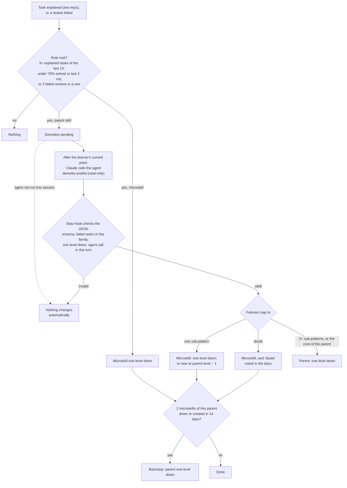

Geldt de regel voor omlaag bij een hoofdvaardigheid, dan beslist de demotie-analist, die alleen leest, of een microvaardigheid of de hoofdvaardigheid omlaag gaat. De Stop-hook voert het oordeel van de agent alleen uit als de JSON door de controles komt; anders verandert er niets automatisch.

#### 10.4.3 Bugs die in dezelfde sessie zijn gevonden (allemaal gerepareerd)

1. **De Stop-hook miste 10 van de 19 markers.** De oorzaak was een race met de gebufferde transcriptschrijver van Claude Code: die schrijft elke 100 ms weg, en niet voordat de hook draait. *Gerepareerd:* de Stop-hook leest ook het veld `last_assistant_message` uit zijn invoer. Vier goedgekeurde uitleggen waren verloren gegaan. Het nieuwe commando `replay` controleert beide sleutels opnieuw vanuit het transcript en logt alleen wat slaagt (bron `replay`), ook voor een taak die intussen vervallen is.
2. **Een mislukte build werd niet opgeslagen als startpunt,** dus het eerste groen na het oplossen van compileerfouten werd nooit gelogd. *Gerepareerd:* een compileerfout is nu een startpunt voor `check.mjs`.
3. **Een trefwoord won van de map.** `prompt-gate` keek nooit naar de map, en treden-markers gingen naar de actieve vaardigheid in plaats van naar de vaardigheid van de taak. *Gerepareerd:* de map bepaalt de familie van de vaardigheid. Een trefwoord kan alleen een microvaardigheid binnen die familie kiezen; `#id` of de naam van een opgave wisselt naar een andere familie.
4. **Vals-positieven van de guard:** `msbuild` en `check.mjs` werden overal in de commandotekst herkend. *Gerepareerd:* de guard splitst een shellcommando in enkelvoudige commando's en beoordeelt elk commando op zijn programma. Hij weigert `eval` en `iex`, omdat hij niet kan zien wat die uitvoeren.
5. **Sessietijd was kloktijd.** De herinnering na een uur kwam na ongeveer 8 minuten echt werk, en een pauze van 12 minuten of meer kon zonder poging een trede ontgrendelen. *Gerepareerd:* het sessie-uur, de minuten per taak en de vastloop-timer tellen actieve tijd. Een pauze langer dan `idleMinutes` (standaard 20) telt niet mee.
6. **Klein:** `!`-commando's gaan langs `prompt-gate` heen, en `check.mjs` hing zich aan het sessiebestand dat het laatst was gewijzigd, wat fout gaat als er twee sessies tegelijk open zijn. *Gerepareerd:* een `!`-commando kiest nu de sessie die aan die familie van vaardigheden werkt.

#### 10.4.4 Levensloop van een taak (D4)

Een taak wacht alleen op uitleg zolang de student nog met die opgave bezig is.

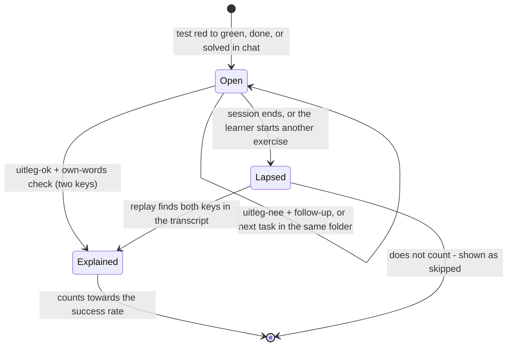

Een taak staat open tot de uitleg in eigen woorden is goedgekeurd, en vervalt als de sessie eindigt of een andere opdracht begint. Alleen een uitgelegde taak telt mee voor het succespercentage; een vervallen taak wordt als overgeslagen getoond, tenzij `replay` de uitleg herstelt.

### 10.5 Herziening van 11 november 2026: het begin van een taak, reviews en uitleg

Na de sessie van 11 november is de setup opnieuw bekeken. Die review is niet gepubliceerd, omdat er leerdata in staan. De student nam zeven besluiten (13–19; de nummering loopt door vanaf de review van 10 november). Elk besluit is eerst aan de literatuur getoetst, en voor 13 en 14 vroeg de student om een kritische toets. Ze zitten nu allemaal in de harnas. Waar de bouw van het plan afwijkt, staat dat in §10.5.3.

#### 10.5.1 Besluiten

| # | Besluit | Getoetst aan | Oordeel |
|---|---|---|---|
| 13 | **De uitleg blijft streng, zonder twee bijzaken van de bouw.** Claude vraagt door tot het principe klopt (D4). De vraag hangt nu af van wat er gebeurde. Na een mislukte poging (rood, een compileerfout of een hint): "waarom werkt het nu, en waarom de eerste poging niet?" Meteen groen: één vraag naar het principe van de opdracht, want "waarom werkt het?" lokt "omdat ik het goed deed" uit. De Stop-hook beoordeelt **alle eigen berichten van de student sinds de taak is gelogd, samen**, met dezelfde eisen als eerst. | Mensen overschatten hoe goed ze een mechanisme begrijpen, tot ze het proberen uit te leggen (Rozenblit & Keil 2002). De kwaliteit van zelfuitleg, zoals het principe noemen, voorspelde het leren, los van de leertijd (Renkl 1997, correlationeel). Zelfuitleg (Chi et al. 1989; Bisra et al. 2018). | **Streng blijft gesteund.** Rozenblit & Keil laten zien dat uitleggen het gat blootlegt; of meer vervolgvragen meer leren opleveren, toetsen ze niet. De twee bijzaken hadden geen onderbouwing: ze kostten rondes zonder meer te meten. Het afbouwen van de uitlegvraag is een open punt: bij Nückles et al. (2010) hielp afbouwen, maar bij strategieën die de studenten al zelf gebruikten. |
| 14 | **De optionele review na een taak blijft, met drie bijsturingen.** Claude biedt hem aan met een onderwerp en een tijdsinschatting. Na één fout antwoord, of bij "snap ik niet", geeft Claude het concept (trede 2), en zo nodig een voorbeeld (trede 4), in plaats van nog een vraag. Wat open blijft, wordt een voorgestelde microvaardigheid, met de opdracht waar het terugkomt. | Verwarring helpt als hij wordt opgelost (D'Mello et al. 2014). AutoTutor gaat van de zet die het minst verklapt naar een bewering, en stopt zodra de student het antwoord geeft (Graesser et al. 2004; de cyclus pump → hint → prompt → assertion bij naam in Nye et al. 2014). Wanneer je hulp geeft of achterhoudt, is een open probleem: het assistentie-dilemma (Koedinger & Aleven 2007). P10 (een keuze met bekende kosten). | **Gesteund.** Een review kan een echte misvatting blootleggen. De oplossing zit in hoe hij oploopt: lukt het de student niet, dan zegt de tutor het. |
| 15 | **Bug: hulp uit een review lekte naar de volgende taak.** Elke `[trede N]` verhoogde de hoogste trede van de sessie, en de volgende gelogde taak nam die over, ook als die taak over iets anders ging. Oplossing: (a) review-hulp wordt apart gelogd (`review-help`), (b) met een eigen marker `[review-trede N #id]`, (c-1) hij telt alleen voor een volgende taak over hetzelfde concept, (c-2) nieuw werk wordt herkend aan vaste signalen, (c-3) een taak begint bij zo'n signaal. | R2 ("zelfstandig" moet eerlijk zijn); P11 (vangrails in de workflow, niet in prompts) | **Opgelost.** Een trefwoord is nooit een signaal: een verkeerd herkende vaardigheid mag geen echte hulp wissen (de bug van 10 november, §10.4.3). Of een agent nieuw werk moet herkennen, is een open punt. |
| 16 | **Een concept-id is verplicht** in een reviewmarker. Zonder geldig id telt hij als gewone trede: de voorzichtige kant. | R2 | Gebouwd. |
| 17 | **Eén map van de OOD-voorbeeldkaart hing aan de verkeerde vaardigheid:** een associatie-opdracht stond onder overerving. Opgelost in de kaart, en met het nieuwe commando `skill.mjs paths` past de student de koppelingen in het eigen register aan. | (data) | Gebouwd. |
| 18 | **Code die vóór de eerste run geschreven was, telde niet.** De eerste run van `check.mjs` was meteen groen, werd de basislijn en logde niets. Nu geeft Claude het `check.mjs`-commando eerst, als de student een opdracht kiest. En een eerste run die helemaal groen is, telt als taak als er in deze sessie code in die map is gewijzigd. | (meetfout) | Gebouwd. De eerste run in een andere map is ook een signaal van nieuw werk (15c-3). |
| 19 | **De zekerheidsvraag één keer,** samen met de gekozen opdracht, en niet herhalen. Zonder antwoord staat er in het dagboek "onbekend". Het mappad van `check.mjs` opschonen is niet gekozen. | P10 | Gebouwd, alleen in de regels voor Claude. |

#### 10.5.2 Hoe een taak begint en eindigt

De harnas wist wanneer een taak **eindigt**: een test gaat van rood naar groen, de student meldt hem af met `done`, of zegt in de chat dat de tests groen zijn. Hij wist niet wanneer een taak **begint**, dus alle hulp sinds de vorige taak telde voor de volgende. Nu begint een taak bij een vast signaal van nieuw werk:

- code gewijzigd in een andere opdrachtmap dan die van de vorige taak;
- `check.mjs` in een andere map;
- de volledige naam van een andere opdrachtmap, of een `#id` van een andere vaardigheidsfamilie, in het eigen bericht van de student.

Bij zo'n signaal beginnen de ladder en de tijd van de taak opnieuw. Gewone hulp sinds de vorige taak hoorde bij werk dat niet werd afgemaakt: die telt niet voor de nieuwe taak, en wordt gelogd als `help-dropped`, zodat hij zichtbaar blijft in het dagboek en op het dashboard. Review-hulp blijft staan: die telt nog als de nieuwe taak over hetzelfde concept gaat.

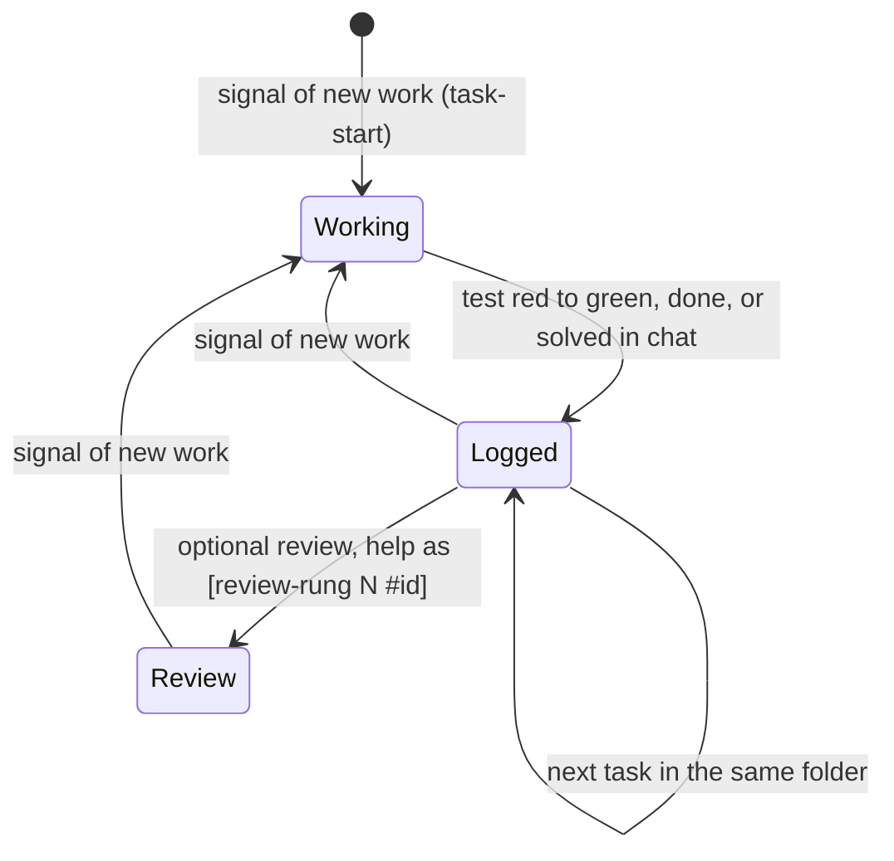

Een taak begint bij een signaal van nieuw werk en eindigt als hij gelogd wordt. Na een gelogde taak kan een optionele review volgen; hulp in die review telt alleen voor een volgende taak over hetzelfde concept.

#### 10.5.3 Waar de bouw van het plan afwijkt

- **`done` voor een andere familie is geen signaal.** Het plan noemde het wel. Maar `done` meldt afgerond werk, en werk zonder code (ontwerp, UML) geeft geen ander signaal. De hulp daar laten vervallen, zou echte hulp verbergen (R2). Daarom houdt `done` alle hulp sinds de vorige taak, zoals eerst.
- **Een reviewmarker zonder id wordt toch herkend,** zodat hij als gewone trede telt in plaats van gemist te worden.
- **Signalen gaan uit van de vorige taak.** Na een signaal is er geen vorige taak, tot er weer een gelogd wordt. Hulp bij werk dat in de tussentijd opnieuw wordt opgegeven, vervalt dan niet: dat is de voorzichtige kant.

### 10.6 Herziening van 11 november 2026 (middag): hulp per concept, een voorstel voor een microvaardigheid, en eerlijke woorden

Na de tweede sessie van 11 november is de opzet nog een keer kritisch bekeken. Ook die review wordt niet gepubliceerd, omdat er leerdata in staan. De nummering loopt door (22–30); 22 en 24 stonden nog open uit de vorige ronde. Elk punt is eerst aan de literatuur getoetst, daarna besliste de student. De gekozen punten zitten nu in de harnas; 24 is niet gekozen. Waar de bouw van het plan afwijkt, staat in §10.6.3.

#### 10.6.1 Besluiten

| # | Besluit | Getoetst aan | Oordeel |
|---|---|---|---|
| 26 | **Hulp wordt per concept gelogd.** Hulp tijdens een taak ging naar de vaardigheid van de opdrachtmap, ook als die over een concept van een andere vaardigheid ging. Die vaardigheid leek dan zwakker dan ze was, en het echte gat bleef uit beeld. Nu zet Claude `[trede N #id]`. De taak houdt zijn hoogste trede, want hij is met die hulp gemaakt. Het concept krijgt een eigen event, `concept-help`. Dat is geen taak van dat concept: `status` laat het zien, en het is bewijs voor 22. | Knowledge tracing houdt per regel een schatting bij en werkt die bij elke kans om die regel toe te passen bij (Corbett & Anderson 1994; Anderson et al. 1995). | **Gesteund (een meetfout).** Dat hulp zelf bewijs is, is een ontwerpkeuze: de gelezen teksten werken bij op goed of fout. Of concepthulp op trede 2 of hoger moet meetellen in het percentage gelukt van die vaardigheid, staat nog open: eerst loggen en tonen, en na een paar sessies beslissen. |
| 22 | **De harnas stelt zelf een microvaardigheid voor,** net als een promotie. Claude noemt het deel met `[micro-voorstel <id> "titel" "trefwoorden"]`. De harnas controleert het en toont het voorstel, op het niveau van de hoofdvaardigheid min 1. Alleen het eigen "ja, toevoegen" van de student voegt hem toe. Er gaat niets automatisch omlaag. | Open leerlingmodellen: de lerende ziet het model en kan erover onderhandelen, met reflectie en zelfsturing als genoemde doelen (Bull & Kay 2016; een raamwerk, geen toets). Een tekst van Claude is geen deel van het model. Ertegen: één fout antwoord is zwak bewijs, dus beslist de student. | **Gesteund.** |
| 27 | **Eerlijke woorden.** `check.mjs` zei "telt als zelfstandig gelukt" bij trede 2, terwijl het register alleen trede 0 zelfstandig noemt. Nu is trede 0 "zelfstandig gelukt", trede 1–2 "gelukt, met hulp tot trede N", en meer hulp zoals het was. Ook in het signaal aan Claude en in de regels. | Illusie van competentie (Koriat & Bjork 2005; R2): een succesmelding moet de hulp eerlijk noemen. | **Gesteund, alleen voor de woorden.** Een strengere grens voor "gelukt" op L3 (hooguit trede 1) wacht op 26: een deel van de hulp hoorde bij een ander concept, en met `autoDemote` zou een strengere grens een vaardigheid om de verkeerde reden kunnen laten zakken. |
| 28 | **De uitleg gaat over het concept van de hoogste hint** als de taak hulp had (trede 1 of hoger). Zonder hulp zoals het was (13). | Leren ging samen met impasses: buiten een impasse ging uitleg zelden samen met leren, op een impasse soms wel (VanLehn et al. 2003, correlationeel). Zelfuitleg levert het meest op bij het principe dat nog niet vastzit (Chi et al. 1989; Bisra et al. 2018). | **Gesteund.** Dat de hoogste hint de impasse aanwijst, is een afleiding. |
| 29 | **Een review gaat alleen over de eigen code van de student.** Een vraag over een alternatief wordt een experiment: ombouwen, `check.mjs` draaien, terugzetten. Geen review na de melding van een uur actieve tijd, of na een taak die trede 2 of hoger kostte; dan alleen het voorstel voor een microvaardigheid (22). | Zonder eigen poging en feedback is er geen impasse (VanLehn et al. 2003). Dat een moeilijke vraag aan het eind het zelfvertrouwen over de hele sessie kleurt: hier is geen bron voor nagekeken, dus een signaal, geen bewijs. | **Gesteund.** |
| 23 | **Bug: de statusregel zei op L3 "trede 0: nog geen hint",** terwijl de taak op trede 2 stond. De regel kwam van de ontgrendelde trede van de L2-ladder, en die blijft op L3 op 0. Hij toont nu de gegeven hulp; op L2 ook de ontgrendelde trede. | (bug) | **Opgelost.** |
| 30 | **`install.mjs --update` let op een lopende sessie.** In de pilot werden de regels midden in een oefensessie vervangen, door een update uit een andere sessie. Er ging niets mis, maar de regels veranderden onder een lopende sessie. | R12 | **Gebouwd** (zie §10.6.3). R12 zelf, de tijd voor harnaswerk begrenzen, blijft de keuze van de student: de pilot gaat er bewust tegenin. |
| 24 | **Vastzitten zonder het te zeggen.** `check.mjs` zou melden "niets veranderd sinds de vorige run", en op L3 zou Claude na een reviewvraag zonder antwoord of met een fout antwoord één trede meer geven. | Studenten zoeken vaak geen hulp als ze die nodig hebben (Aleven & Koedinger 2000; Aleven et al. 2003). Wheel-spinning (Beck & Gong 2013). Contingent tutoren geeft meer hulp na een mislukking (Wood & Wood 1999); Wood & Middleton (1975) zagen het eerst bij moeders en hun kinderen. | **Gesteund, maar niet gekozen:** de student hield het zoals het is. Een vooraf geregistreerde replicatie van het experiment uit 1978 over contingent tutoren (Wood, Wood & Middleton 1978) vond het effect op het zelfstandig presteren van de kinderen niet terug (Smit et al. 2025). Dat raakt de hintladder (P3), en is voor de volgende reviewronde. |
| 25 | **Afwijkingen van Claude.** De zekerheidsvraag kwam twee keer, tegen 19 in. De melding na een uur actieve tijd kwam niet te laat. | — | Ter kennisname. |

#### 10.6.2 Hulp per concept en het voorstel voor een microvaardigheid

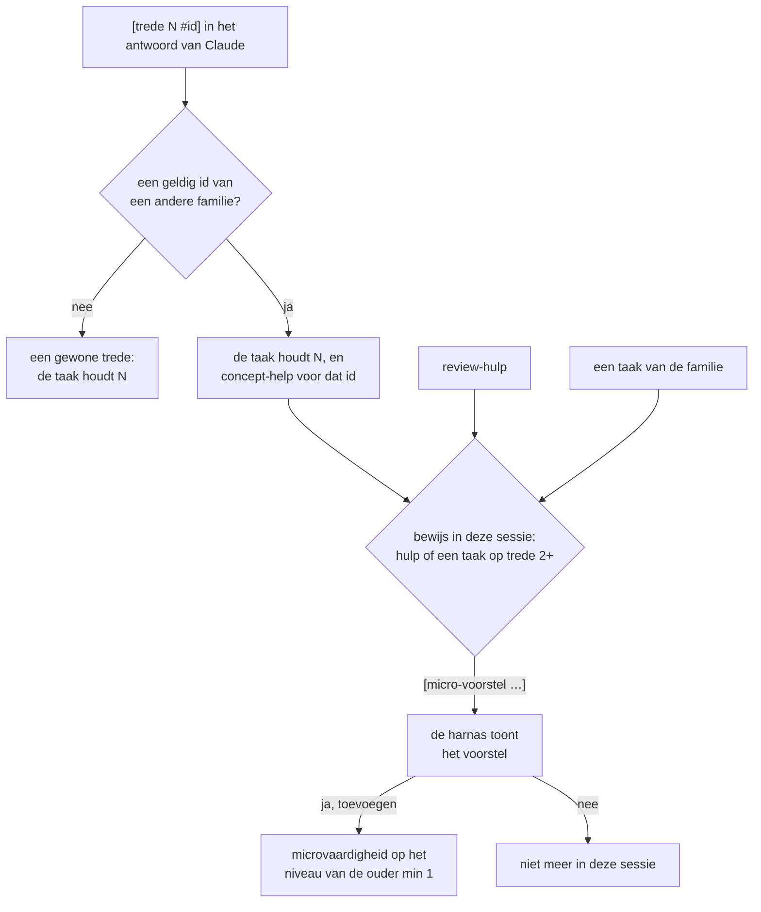

Hulp over een concept van een andere familie blijft bij de taak en wordt ook bij dat concept gelogd. Met bewijs van echte hulp stelt de harnas een microvaardigheid voor, en alleen het eigen "ja" van de student voegt hem toe.

#### 10.6.3 Waar de bouw van het plan afwijkt

- **22: een taak op trede 2 of hoger is ook bewijs.** Het plan noemde alleen review-hulp en concepthulp op trede 2 of hoger. Maar 29 zegt dat er na zo'n taak geen review komt, alleen het voorstel; zonder dit kon dat voorstel niet komen. De student koos dit tijdens de bouw.
- **22: het bewijs moet uit dezelfde sessie en dezelfde familie komen** als de voorgestelde microvaardigheid. Een voorstel dat de student afwees, komt in die sessie niet terug.
- **26: de concepthulp kent zijn taak vooraf.** De hulp wordt gelogd als Claude hem geeft, voordat de taak een id heeft. Daarom reserveert de eerste concepthulp het id dat de taak zal krijgen (`taskTid`). Begint er eerst nieuw werk, dan wordt dat id nooit gebruikt, en `help-dropped` noemt het.
- **26: een concept van dezelfde familie** (de ouder of een microvaardigheid ervan) is het eigen concept van de taak. De trede zegt het al, dus er komt geen extra event. Dit is de familielogica van de reviewmarker (15c-1).
- **28: ook in `check.mjs`.** Na hulp vraagt de regel over de uitleg nu naar het punt waar de hulp nodig was. De Stop-hook is niet veranderd.
- **30: met `--yes` of zonder terminal stopt hij,** tenzij er ook `--force` bij staat. Een vraag alleen had in de pilot niet geholpen: de update kwam uit een andere Claude-sessie, en die kan geen vraag beantwoorden. "Lopend" betekent een sessie die in de laatste `idleMinutes` (standaard 20) actief was. De hooks kunnen oefenen en praten over de harnas niet uit elkaar houden, dus elke sessie in de map telt.

### 10.7 Herziening van 12 november 2026: positieve feedback, demoties en de fasegeschiedenis

Na de sessies van 11 en 12 november zei de student: "waarom heb ik tot nu toe alleen maar automatische demoties gehad en geen promoties?" De setup is kritisch tegen dat gevoel gehouden, en tegen de literatuur over positieve feedback, gamification en desirable difficulties. Die review is niet gepubliceerd, omdat er leerdata in staan. De nummering loopt door (31–46). Elk punt is eerst aan de literatuur getoetst, daarna besliste de student. De gekozen punten zijn in de harnas gebouwd; waar de bouw afwijkt van het plan, staat dat in §10.7.3.

**De feiten tegenover het gevoel.** De log liet 4 keer omhoog zien (1 promotie die de student bevestigde, 3 plaatsingen) en 1 keer omlaag: een nieuwe microvaardigheid, terwijl de ouder op L3 bleef. Een bestaand niveau was nooit automatisch gezakt. Maar de 4 keer omhoog waren stil (één regel in de uitvoer van `check.mjs`), en de ene keer omlaag was het luidste moment van de harnas: een hookmelding, een agent-run en een blok JSON in de chat. Daaromheen was bijna elke goedgekeurde uitleg eerst één keer afgewezen (24 goedgekeurd, 22 afgewezen). Het gevoel was een eerlijk signaal over hoe de feedback *voelde*, niet over hoe de student presteerde.

#### 10.7.1 Besluiten

| # | Besluit | Getoetst aan | Oordeel |
|---|---|---|---|
| 31 | **Omhoog is luid, omlaag is stil.** Een plaatsing of promotie krijgt een eigen melding met ↑ en het bewijs, ook bij de sessiestart en in `status`. Omlaag is één regel, "extra steun voor …", met de weg terug. De harnas leest het oordeel van de demotie-analist uit het rapport van de agent zelf, dus er komt geen JSON in de chat; de controle van het oordeel blijft. | Slechte gebeurtenissen en slechte feedback wegen zwaarder dan goede (Baumeister et al. 2001). Verliesaversie trad in het algemeen op bij levels die verdiend waren, niet bij levels die gegeven werden (Rewley et al. 2021). Een eigen succeservaring is meestal de sterkste bron van self-efficacy (Usher & Pajares 2008), en alleen als die als succes wordt gezien. | **Gesteund.** |
| 32 | **Bug: een verlaging werd uitgevoerd op oud bewijs.** Toen het oordeel van de analist werd verwerkt, klopte het criterium niet meer (3 van 4 gelukt, 75%). Nu wordt het criterium opnieuw gecontroleerd, in de prompt-gate en bij het uitvoeren van het oordeel; klopt het niet meer, dan gaat er niets omlaag (`demotion-cancelled`). Omlaag wacht ook zolang er een uitleg van die familie openstaat, net als omhoog. | (bug) | **Opgelost.** |
| 33 | **Minstens 4 uitgelegde taken voordat het omlaag gaat** (het was 3), voor beide regels. De analist houdt alleen `micro` en `ouder`. | De harnas mikt op ongeveer 85% succes (P4). Met 3 taken is één moeizame taak genoeg: bij precies 85% gebeurt dat in 39% van de gevallen; met 4 taken zijn er twee nodig (ongeveer 11%). Meer dan een derde van de feedbackinterventies verlaagt de prestatie, vooral als de aandacht naar het zelf gaat (Kluger & DeNisi 1996). | **Gesteund.** Het plan was 5 taken en een derde oordeel "niet verlagen"; de student koos 4, als tussenweg. |
| 34 | **Omlaag telt de trede binnen de familie.** Hulp over een concept van een andere familie (`[trede N #id]`) is geen mislukking van de vaardigheid van de taak. De taak houdt zijn volle trede (eerlijk, #26). De analist mag een bestaande microvaardigheid van een andere familie kiezen. | Knowledge tracing: het bewijs hoort bij de regel waar het over ging (Corbett & Anderson 1994). | **Gesteund (een meetfout, zoals #26).** |
| 35 | **De voortgang naar het volgende niveau, in de chat,** in stappen, nooit als percentage: na elke taak, bij `status` en bij de sessiestart. | De inzet stijgt naarmate het doel dichterbij komt (Kivetz et al. 2006); toon aan het begin wat al gedaan is, en dicht bij het doel wat nog rest (Koo & Fishbach 2012). Voortgang bijhouden helpt doelen bereiken (Harkin et al. 2016). Een voortgangsbalk die traag begint verhoogt de uitval (Villar et al. 2013): dus stappen, geen percentage. | **Gesteund.** |
| 36 | **L4 binnen bereik.** (a) De taak die een vaardigheid plaatste telt mee na de plaatsing. (b) De transfertaak is één van de drie keer zonder hint, en haar dag een dag. Zijn de opdrachtmappen van een L3-vaardigheid op, dan wijst Claude een bestaande volgende oefening aan; een oefentoetsvraag telt mee via `done`. Ontwerpdoel: wie dagelijks oefent en de stof beheerst, haalt L4 in ongeveer 3 sessies op 2 dagen; een test bewaakt dat. De dag blijft de UTC-datum. | Mastery learning werkt door voldoende oefenkansen met feedback (Kulik et al. 1990). Een criterium dat niet te halen is, is een plafond, en dat ondermijnt het gevoel van competentie (Ryan & Deci 2000). Opnieuw leren in latere sessies woog zwaarder dan extra goede antwoorden in de eerste sessie (Rawson & Dunlosky 2011). Hun sessies lagen ver uit elkaar en het ging om begrippen, niet om code: "ongeveer 3 sessies op 2 dagen" is een afleiding, en een krappe. | **Gesteund.** In de woorden van de student: de trage weg naar L4 "is niet werkbaar voor een junior dev". |
| 37 | **Eerst lof, dan de eis.** `check.mjs` noemt wat lukte en de (micro)vaardigheid, en geeft de uitleg als uitnodiging. Met hulp: "hier zat het leren: `<concept>`". Een uitwerking (trede 5) heeft een eigen, eerlijke tekst (een bug: die kreeg de zachte tekst van trede 3–4). | Verbale positieve feedback verhoogde de intrinsieke motivatie bij vrije keuze voor studenten, niet voor kinderen (Deci, Koestner & Ryan 1999). Lof werkt als hij oprecht is en wijst op oorzaken die de leerder zelf beïnvloedt (Henderlong & Lepper 2002). Met positieve feedback op juiste stappen leerden studenten in SQL-Tutor even veel in ongeveer de helft van de tijd (Mitrovic et al. 2013; 41 studenten, geen verschil op het tentamen). | **Gesteund.** |
| 38 | **Eerst noemen wat klopt, dan één vervolgvraag.** De eis blijft. De waaromcheck accepteert ook "als …, dan/zou …" in één zin. | Beginners zoeken en gebruiken positieve feedback (Finkelstein & Fishbach 2012). Mensen leerden minder van falen dan van succes, bij dezelfde informatie (Eskreis-Winkler & Fishbach 2019); in replicaties verdween dat effect als er corrigerende feedback of een korte instructie volgde (Keith et al. 2022; Gok & Fyfe 2024), en dat is wat een vervolgvraag doet. Tegen te zacht: beleefdheid kan de fout verbergen (Person et al. 1995), dus het gat wordt wel benoemd. De eis zelf blijft gesteund (zelfuitleg, Bisra et al. 2018). | **Gesteund voor de vorm, niet voor minder strengheid.** De regel "als … dan" kwam uit een sessie waarin een goede uitleg werd afgewezen omdat er geen redenwoord in stond. |
| 39 | **Moeite is het doel, geen falen.** Na een taak met hulp: "hier zat het leren". Eén keer, bij de eerste sessiestart, een korte uitleg. | De prestatie tijdens het oefenen is een slechte maat voor leren (Soderstrom & Bjork 2015). Leerders vonden de strategie die moeite kost minder effectief en kozen haar minder vaak (Kirk-Johnson et al. 2019). Leerders hebben steun nodig om aan desirable difficulties te beginnen en ze vol te houden (de Bruin et al. 2023); één hefboom is moeite anders duiden (Zepeda et al. 2020). | **Gesteund**, als raamwerk: er is nog weinig empirisch werk naar deze hefbomen. |
| 40 | **Bug in de woorden van het dashboard:** de tegel "zelfstandig gelukt" telde trede ≤ 2. Nu twee tegels: "gelukt (trede ≤ 2)" en "zelfstandig (trede 0)". | #27 | **Opgelost.** |
| 45 | **De fasegeschiedenis op het dashboard** (met #41): per vaardigheid één band over de dagen, met "start" apart; taken als stippen; microvaardigheden onder hun ouder; elke wijziging gemarkeerd met hoe hij besloten is; één zin die alleen met jezelf vergelijkt. De export zegt nu hoe een wijziging besloten is (`kind`, een vaste lijst woorden) en laat wijzigingen zonder verschil weg. | Feedback ten opzichte van je eigen eerdere werk gaf meer vaardigheid en self-efficacy dan feedback ten opzichte van klasgenoten (Shih & Alexander 2000, een experiment met 84 kinderen). Een klasgemiddelde ontmoedigde een deel van de studenten (Aguilar 2018, interviews). Het leerdermodel openen kan helpen (Long & Aleven 2017), en een model hoort te laten zien waarop het oordeel rust (Kay & Kummerfeld 2012). | **Gesteund, als afleiding:** er is geen studie gevonden die een geschiedenisweergave van een leerdermodel toetst. Dashboards in het algemeen lieten geen effect op prestaties zien, een bescheiden effect op motivatie en een groter effect op deelname (Kaliisa et al. 2024). De echte toets: na twee weken vragen of het gevoel "alleen omlaag" veranderd is. |
| 42 | **Afwijzingen per taak op het openbare dashboard.** | Voortgang openbaar rapporteren helpt (Harkin et al. 2016); falen kan mensen doen afhaken (Eskreis-Winkler & Fishbach 2019). | **Deels gesteund, niet gekozen:** de student hield ze openbaar, met de redenen. |
| 43 | **Geen punten, badges, reeksen of leaderboards.** Een niveau informeert: het zegt welke hulp je krijgt, niet welke status je hebt. | Zie P14 (§2.11). | **Gesteund, een ontwerpregel.** |
| 44 | **Kleine punten.** De plaatsing gebeurt nu bij de goedgekeurde uitleg. De fouten in het lesmateriaal worden niet gemeld. De Mermaid-diagrammen zijn na de bouw nagelopen. | — | **Gebouwd.** |
| 46 | **Eén taak van de student "zou als zelfstandig moeten tellen"**, omdat de test van het vak fout was. De trede kwam van een vraag over wat de test verwacht, niet van de fout. | Eerlijk loggen (R2). | **Niet gesteund, zo gelaten.** |

#### 10.7.2 Omlaag, zoals gebouwd

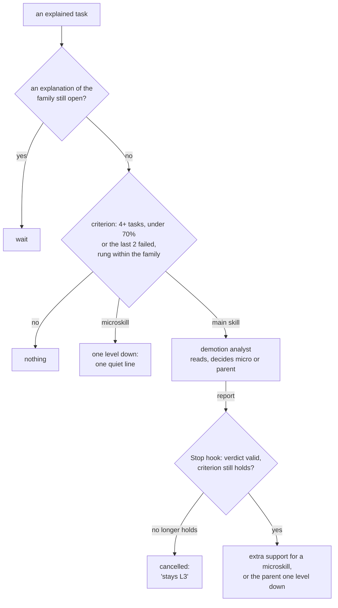

Omlaag wacht op open uitleg, telt alleen de hulp binnen de familie, en wordt opnieuw gecontroleerd op het bewijs van het moment waarop het wordt uitgevoerd. Het rapport van de analist gaat naar de Stop-hook, niet de chat in.

#### 10.7.3 Waar de bouw afwijkt van het plan

- **38: alleen "dan" of "zou".** "Als …" telt alleen als waarom met "dan" of "zou" (of "then"/"would") in dezelfde zin. Lossere woorden ("kan", "is") zouden een kale bewering doorlaten.
- **44 en 36 (a) samen.** Omdat de plaatsing nu bij de uitleg gebeurt, ná de taak, moet de plaatsingstaak expliciet in het venster komen; anders zou (a) nooit tellen. Oudere plaatsingen zonder taak-id vinden die in het event `placement`.
- **34: ook de plaatsing.** Ook de plaatsing gebruikt de trede binnen de familie: hulp over een ander concept zegt niets over de nieuwe vaardigheid.
- **31: het rapport van de analist wordt gelezen, niet geplakt.** Een agent op de achtergrond geeft zijn rapport terug als bericht; de Stop-hook haalt het oordeel daaruit (of uit het resultaat van een agent die direct antwoordt). Een oordeel in dat rapport dat de harnas weigert, blokkeert Claude niet: de verlaging blijft openstaan. De marker `[demotie {...}]` werkt nog als terugval.
- **35: welke vaardigheden.** De voortgangsregels gaan over de vaardigheden met minstens één taak sinds hun laatste niveauwijziging.
- **36: de volgende oefening één keer per sessie.** De hook zegt Claude één keer per vaardigheid en sessie dat de mappen op zijn.
- **45: op het dashboard een microvaardigheid alleen als er iets mee gebeurde** (een taak, een wijziging of extra steun). Een plaatsing telt als een fase hoger als die op L3 of L4 uitkomt.
- **45: `levelChanges` zonder wijzigingen zonder verschil.** De eerste melding "sinds de laatste export" na de update kan één wijziging minder tellen.
- **Een ouder sessiebestand** heeft nog geen familietrede: dat telt alle hulp mee, tot de volgende taak begint.

### 10.8 Herziening van 13 november 2026: beoordeeld werk volgens de OER

De student vroeg om de setup in lijn te brengen met de OER, zodat de harnas kan helpen bij de eindopdracht van het vak. De OER staat daar AI-niveau 1 toe: GenAI als hulpmiddel, "bijvoorbeeld om ideeën te genereren of structuur aan te brengen", met een verantwoording van het gebruik. Ongeoorloofd gebruik van AI die content maakt ("tekst, afbeeldingen, code") is fraude (OER art. 1.41 lid 3c). Het setupdocument met de besluiten blijft privé, omdat het over de eigen opdracht van de student gaat. De nummering loopt door (49–54). De student besliste 49, 50 en 53 met meerkeuzevragen; 51 is meteen gedaan; 52 blijft open.

#### 10.8.1 Besluiten

| # | Besluit | Getoetst aan | Oordeel |
|---|---|---|---|
| 49 | **De hintladder tot trede 4 bij beoordeeld werk.** In de paden van `settings.graded` gelden de ladder van L2 en de vasttimer voor elke vaardigheid, ook op L3 en L4. Trede 5 (een uitwerking) bestaat daar niet; een vraag erom wordt geweigerd met een verwijzing naar de OER. Trede 4 is een voorbeeld van hooguit 5 regels over een ander onderwerp. Claude schrijft daar niets, op geen enkel niveau. | Alleen uitleg *zonder* het antwoord leidde tot leren; een eigen keuze gevolgd door het antwoord van de AI niet (Gajos & Mamykina 2022). Eerst proberen en dan een voorbeeld was voor beginners niet beter dan alleen oefenen (van Gog et al. 2011), terwijl probleemoplossen vóór instructie gemiddeld helpt (Sinha & Kapur 2021), als de instructie voortbouwt op de poging van de student (Loibl et al. 2017). De meest concrete hint kan werken als uitgewerkt voorbeeld als de student erover nadenkt (Shih et al. 2008). AI-tutors trekken de grens verschillend: CodeAid toont algemene voorbeeldcode (Kazemitabaar et al. 2024), CodeHelp haalt alle voorbeeldcode weg (Liffiton et al. 2023). R10: minder eigenaarschap bij onbeperkt ChatGPT (Bergh et al. 2026, preprint), niet getest voor kleine voorbeelden. | **Ondersteund, met voorwaarden.** Het advies is gelijk aan het besluit. Drie voorwaarden gaan in de regels voor Claude: het voorbeeld implementeert geen gedrag uit de opdracht en past niet door hernoemen; de student typt de eigen code en plakt nooit; de uitleg na de taak vraagt ook waarin het voorbeeld verschilt van de oplossing van de student. Of een voorbeeld op trede 4 nog "ideeën genereren of structuur aanbrengen" is, zegt de instelling; het logboek noemt het. |
| 50 | **Een AI-logboek in de repo van de opdracht** (`ai-verantwoording/`): een regel per antwoord (wanneer, sessie, vaardigheid, trede, soort hulp), geschreven door de Stop-hook, een laatste kolom die de student invult ("wat ik ermee deed / hoe gecontroleerd"), een export van elke sessie, en een README met het AI-niveau, een APA-verwijzing en "Claude Code heeft geen deellink". De privacyfilters van de dashboardexport worden hergebruikt: e-mail, de thuismap (wordt `~`), hook- en systeemberichten. | De OER vraagt op niveau 1 promptlinks of de melding dat de applicatie die niet heeft, een APA-verwijzing, en een controle van de uitvoer door de student. Detectie van AI-tekst is onbetrouwbaar (Scarfe et al. 2024), dus de eigen vastlegging van de student is de bescherming (R11). | **Gebouwd.** Een eis uit het beleid, geen claim over leren. |
| 51 | **De prompts bewaren tot het beoordelingsmoment:** Claude Code bewaart transcripten 365 dagen in plaats van 30. | De OER: bewaar de prompts tot het beoordelingsmoment. | **Gedaan** door de student, in de instellingen van Claude Code. |
| 52 | **Oefenen voor de momenten op niveau 0** (de diagnostische toets en de uitbreiding bij het assessment, zonder AI). | — | **Open.** Een voorstel voor januari. |
| 53 | **De harnas in de repo van de opdracht, met één register.** De repo gebruikt het register van de oefenmap (`install.mjs --learning-dir`), zodat een taak in de opdracht meetelt voor dezelfde vaardigheid. `.claude/` en `ai-verantwoording/` gaan in git (de docent ziet welke regels de AI volgde); `.learning/` niet. | Het bewijs hoort bij de vaardigheid waar het over gaat (Corbett & Anderson 1994). R13 (privacy). | **Gebouwd.** |
| 54 | **Bug: de guard liet een schrijfactie buiten het project door.** Een sessie in de oefenmap kon vrij schrijven in de repo van de opdracht. Nu worden de paden van beoordeeld werk altijd getoetst, ook buiten het project. | (bug) | **Opgelost.** |

#### 10.8.2 Beoordeeld werk, zoals gebouwd

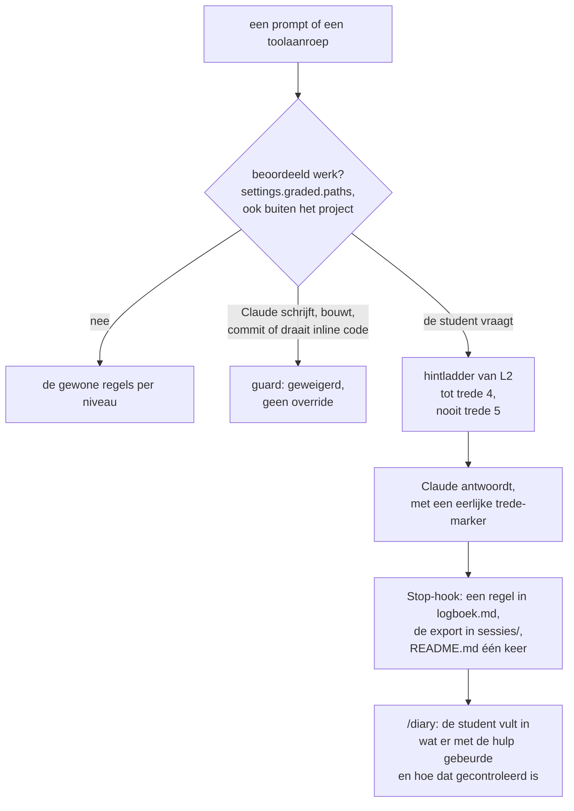

De guard beslist op het pad, niet op het niveau: beoordeeld werk is beschermd op elk niveau en vanuit elke map. Alleen de hooks schrijven het logboek; de student schrijft de laatste kolom.

#### 10.8.3 Waar de bouw afwijkt van het plan

- **De export van een sessie wordt na elk antwoord geschreven**, niet alleen aan het eind. Een sessie die zonder nette afsluiting stopt, staat dus toch helemaal in het logboek.
- **Wanneer een sessie als beoordeeld werk telt:** dit project is beoordeeld werk, de werkmap is het, de prompt noemt de map van de opdracht, of Claude gebruikte een tool op een beoordeeld pad (las er een bestand). Daarna blijft de sessie beoordeeld: de voorzichtige kant.
- **De guard blokkeert ook bouwen en testen** in beoordeeld werk, net als op L2, en git-commando's die de repo wijzigen, en inline code (`node -e`, `python -c`) die daar draait. Lezen mag. Een script dat Claude elders zou schrijven en dat bij het draaien in de repo schrijft, ziet de guard niet; de regels verbieden zo'n omweg.
- **Het pad van het register staat niet in het manifest** maar in `.claude/leerharnas.local.json`, dat niet in git komt: het manifest gaat de repo in, en het pad bevat de thuismap.
- **De laatste kolom wordt niet met de twee sleutels** van de uitlegcheck gecontroleerd: de student schrijft hem in het bestand. `/diary` vraagt erom, en aan het eind van de sessie noemt de harnas de regels die nog leeg zijn.
- **De drie voorwaarden uit de literatuurtoets** zijn regels voor Claude (CLAUDE.md), geen hook dwingt ze af.
- **Open:** de vorm van de APA-verwijzing, getoetst aan de richtlijn van de bibliotheek van de instelling.

### 10.9 Herziening van 13 november 2026 (avond): de securitykaart

De pilotstudent koos voor het hele plan van §2.13 in één keer, met vier losse vaardigheden in plaats van één familie met microvaardigheden.

#### 10.9.1 Besluiten

| Besluit | Gebouwd |
|---|---|
| `security.basics` wordt vier losse vaardigheden | `security.output-encoding`, `security.sql-params`, `security.secrets-config` en `security.ai-review`, op L2, zonder paden, elk met trefwoorden. `review.ai-code` blijft apart, voor review in het algemeen. |
| De aanvaller eerst | In de notities van de kaart: trede 1 is altijd "Wat heeft een aanvaller hier in handen?", en de uitleg van een securitytaak heeft drie delen (wat de aanvaller in handen heeft, welke maatregel dat tegenhoudt, hoe je dat controleert) plus een zekerheid van 1 tot 5 (Braz et al., 2022; Perry et al., 2023). |
| Een analyser naast `dotnet test` | `check.mjs` met de instelling `securityAnalyzer` (aan in `junior-dotnet`): eerst een volledige build met alle securityregels van de analyzers van de .NET SDK, dan de tests. De leerling legt de waarschuwingen uit; Claude lost ze op L1–L3 niet op. |
| Voorbeelden leren geen onveilig patroon aan | Een regel in de regels van élke kaart, ook `ood`: het voorbeeld op trede 4, de uitwerking op trede 5 en een voorbeeld op L0 bevatten nooit geplakte SQL, ongecodeerde invoer in HTML of een log, een geheim in de code, `System.Random` voor een token, of uitgeschakelde certificaatcontrole. |
| Niets over kwetsbaarheden online | Een vaardigheid kan `sensitive` zijn; de vier securityvaardigheden zijn het. De export houdt dan de cijfers van hun taken, maar niet de vrije teksten: de testnamen, de uitleg, de redenen van een afwijzing of correctie, vrije notities bij een niveauwijziging, en de titel van een microvaardigheid eronder. |

#### 10.9.2 Een securitytaak, zoals gebouwd

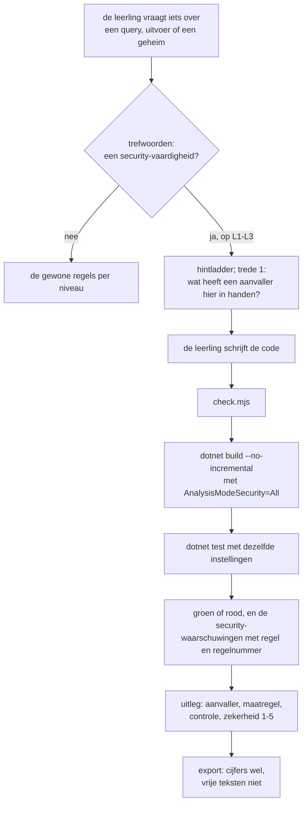

De analyser kijkt alleen naar patronen die hij kent. Een schone run is daarom geen bewijs, en dat zegt `check.mjs` er ook bij.

#### 10.9.3 Waar de bouw afwijkt van het plan

- **De analyser bouwt opnieuw.** Het plan was één build. Een proef met een echt project liet zien dat de analyzers alleen melden als de compiler draait: na een build die al bijgewerkt was, kwam er geen enkele waarschuwing, ook niet voor `System.Random`. `check.mjs` bouwt daarom eerst met `--no-incremental`, en draait de tests met dezelfde instellingen, zodat ze niet nog eens compileren. Dat kost tijd bij een grote solution; de instelling kan uit.
- **Een project dat waarschuwingen als fouten behandelt, blijft bouwen.** `CodeAnalysisTreatWarningsAsErrors=false` houdt de securityregels op waarschuwing, ook met `TreatWarningsAsErrors` in het project. Getest op een echt project.
- **De guard beschermt de securityvaardigheden niet.** Security loopt dwars door bestanden heen, dus de vaardigheden hebben geen paden. Op L1–L3 houdt Claude zich aan de notities van de kaart; geen hook dwingt dat af.
- **Het dashboard toont geen aparte melding** bij een taak zonder teksten. De export zet `withheld: true`; de taak staat er met zijn trede en uitkomst.
- **Een bestaande installatie houdt `security.basics`.** `--update` laat je register staan. Wie de vier vaardigheden wil, voegt ze toe met `add` of installeert opnieuw.
- **Niet gebouwd:** toegangscontrole en afhankelijkheden (§2.13: geen analyser vindt toegangsfouten betrouwbaar, en een controle op pakketten vraagt een netwerk), en oefeningen met aanvalsstrings als tests.

### 10.10 Herziening van 13 november 2026 (nacht): de eerste sessies aan de eindopdracht

De pilotstudent werkte voor het eerst aan de eindopdracht, en de harnas zat op vier plekken in de weg. Claude weigerde het officiële arc42-sjabloon in de repo te zetten, terwijl de OER toestaat dat AI "structuur aanbrengt" en het sjabloon geen AI-inhoud is. Niets liet zien dat de sessie begonnen was, en de vraag naar het zelfvertrouwen bleef zonder spoor onbeantwoord. Een klassendiagram dat de student tussen twee sessies in de IDE afmaakte, telde nergens mee. En de afsluitende vragen kwamen pas toen de student erom vroeg. Een review van die avond vond nog drie gaten: "ik wil stoppen" en "laten we afronden" werden niet als stopverzoek herkend, de guard weigerde `git remote -v` als schrijfactie, en hulp bij de opdracht die in een andere map werd gevraagd, had geen trede-grens en geen regel in het logboek. De student besliste punt 55–62 met meerkeuzevragen; 62 viel weg omdat 61 het dekt. Het setupdocument blijft privé.

#### 10.10.1 Besluiten

| # | Besluit | Getoetst aan | Oordeel |
|---|---|---|---|
| 55 | **Vaste tooling in beoordeeld werk.** De guard laat daar een korte lijst deterministische commando's toe: `dotnet new` (sln, console, classlib, nunit, xunit, gitignore; niet met `--force`), `dotnet sln add`, `dotnet add reference\|package`, `git init`, `git remote add`, `git branch -m`, `mkdir`, en `scaffold.mjs arc42`, dat het officiële sjabloon na een sha256-controle ongewijzigd uitpakt. Elk wordt een regel "tooling (geen AI-inhoud)" in het logboek. Inhoud, commits, de pipeline en de Dockerfile blijven van de student. | Het beoordelingsformulier beoordeelt de code, de UML, de tests, de pipeline, het versiebeheer en het verslag, dus dat blijft allemaal dicht. De OER verbiedt AI die inhoud maakt (art. 1.41 lid 3c); een generator of een officieel sjabloon maakt geen AI-inhoud. | **Beleid, gebouwd.** |
| 56 | **De start blijft automatisch** (een startcommando kun je vergeten, en dan telt er niets). De harnas logt zelf het plan (het eerste bericht) en het zelfvertrouwen (een getal na Claude's "(1–5)"). Een SessionEnd-hook noteert hoe een sessie eindigde; de volgende start biedt één keer een inhaaldagboek aan voor een sessie met werk maar zonder dagboek. | Kalibratie van het eigen oordeel vraagt het zelfvertrouwen vooraf (zie §10.4). | **Gebouwd.** |
| 57 | **Een taak per onderdeel.** Werk zonder test wordt opgeknipt in onderdelen met een naam; elk afgerond onderdeel is een taak met een eigen uitleg. `af: <wat>` (of `done: <what>`) aan het begin van een bericht telt als `done`, zonder `!`-commando. De start noemt de bestanden die sinds de vorige sessie in de beoordeelde map zijn gewijzigd, met hun vaardigheid via `paths` of via de inhoud (een Mermaid-`classDiagram` → `uml.klassendiagram`). | Nabije subdoelen winnen het van een ver doel, voor leren, zelfvertrouwen en een juist oordeel over het eigen kunnen (Bandura & Schunk, 1981). | **Ondersteund, met een voorwaarde:** een onderdeel moet een echte stap zijn die de student los kan uitleggen, anders wordt het doorstroomcriterium gehaald door op te knippen. De regels voor Claude zeggen dat; de uitlegcontrole per onderdeel houdt het eerlijk. |
| 58 | **Afsluiten in één bericht.** Meer stopzinnen ("ik wil stoppen", "laten we afronden", "I want to finish this session"), alleen aan het eind van een kort bericht. Daarna één bericht met de open uitleg, 2–3 controlevragen, de reflectie en de logboekvraag. Controlevragen worden gelogd (`check-question`) als bewijs voor een microvaardigheid, nooit voor een niveau. | Ophalen wint het van opnieuw lezen voor later onthouden (Roediger & Karpicke, 2006; Adesope et al., 2017), ook in echte vakken, met corrigerende feedback als moderator (Yang et al., 2021). Transfer is het grootst bij toepassings- en redeneervragen (Pan & Rickard, 2018). | **Ondersteund, met drie voorwaarden:** antwoorden uit het hoofd; vragen naar een reden of een toepassing in het eigen werk, niet naar een definitie; feedback per antwoord. **Advies, niet gebouwd:** één open vraag opnieuw stellen bij de start van de volgende sessie geeft een gespreide herhaling. |
| 59 | **De eigen woorden van de student in de laatste kolom van het logboek.** Claude markeert het deel van het antwoord met `[logboek "…"]`; de Stop-hook schrijft het alleen als het letterlijk deel is van wat de student typte, en alleen in lege cellen van die sessie. | De OER vraagt de student de output te controleren en te verantwoorden; de woorden moeten van de student zijn (R11). | **Gebouwd.** Twee sleutels, net als bij een uitleg. |
| 60 | **git-commando's die alleen lezen** (`remote -v`, `branch --show-current`, `config --get`, `stash list`, `tag -l` …) mogen in beoordeeld werk. | (bug) | **Opgelost.** |
| 61 | **Beoordeeld werk is dicht vanuit andere mappen.** Een poort op gebruikersniveau (`install.mjs <map> --user-guard`) draait in elk project buiten de beoordeelde map: hij houdt een prompt tegen die de opdracht noemt, en weigert elke tool op de paden ervan, ook lezen. Alleen de setup (`.claude/`, `CLAUDE.md`) blijft open. Een regel in `~/.claude/CLAUDE.md` dekt algemene vragen die een hook niet ziet. | De hulp van die avond kwam uit een sessie in een andere map: geen trede-grens, geen regel in het logboek (R11). | **Gebouwd**, op geen enkele computer geïnstalleerd: dat is de stap van de student. |
| 62 | Buiten de beoordeelde map per beurt loggen in plaats van per sessie. | — | **Vervallen:** 61 sluit de andere mappen af. |

#### 10.10.2 Een sessie aan de eindopdracht, zoals gebouwd

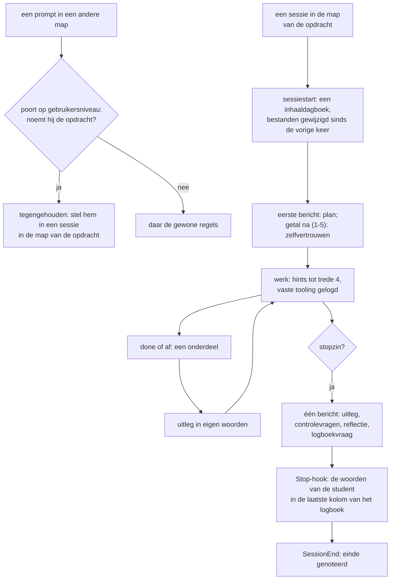

De poort en de eigen harnas van het project beoordelen nooit dezelfde prompt: in de map van de opdracht stapt de poort opzij.

#### 10.10.3 Waar de bouw afwijkt van het plan

- **Het sjabloon ligt vast, en de harnas downloadt het niet.** Het plan was een script dat het sjabloon downloadt. De securitycheck weigert netwerkcode in de harnas (SECURITY.md belooft dat er geen is), en die blokkade kan niet worden toegestaan. Daarom wordt de zip eerst gedownload, buiten de beoordeelde map, door de student of door Claude met `curl`; `scaffold.mjs --from <zip>` controleert dan een sha256 die in het script staat (release 2026.10.19 van arc42, GitHub Markdown, één bestand per hoofdstuk) en pakt hem uit. Een zip met een andere checksum wordt geweigerd: anders zou Claude eigen inhoud in een zip kunnen stoppen. Hij pakt alleen uit in een nieuwe of lege map. De guard telt nu ook een download naar beoordeeld werk (`curl -o`, `curl -O`, `wget`) als schrijfactie.
- **De guard laat alleen zijn eigen kopie toe** van `scaffold.mjs` (`.claude/hooks/`, beschermd zoals elke hook). Een script dat Claude elders schrijft en met `node` draait, ziet de guard nog steeds niet, zoals al in §10.8.3 stond.
- **`af:` vraagt een wijziging in beoordeeld werk.** Een onderdeel telt alleen als er sinds de vorige taak van die vaardigheid een bestand in de opdracht is gewijzigd. Buiten beoordeeld werk werkt `af:` als `done`.
- **Het plan is het eerste bericht**, niet een samenvatting ervan. Een "hoi" wordt dus het plan. Het dagboek gebruikt het zoals het is.
- **Een inhaaldagboek wordt aangeboden voor sessies van de laatste 7 dagen**, één keer per sessie, de nieuwste eerst, en nooit voor een sessie die nog in een ander venster loopt.
- **De poort heeft instellingen nodig** in `~/.claude/leerharnas/graded.json`, die de installer uit het register schrijft. Na `setting graded add` draait de student `--user-guard` opnieuw. Te algemene namen (`src`, `Tests`, `Domain`) worden in prompts niet tegengehouden; een solutionmap zoals `Webshop` wel.
- **Een algemene vraag zonder de naam** van de opdracht ziet een hook niet. Het blok in `~/.claude/CLAUDE.md` vraagt Claude om eerst na te gaan; dat is een regel, geen afdwinging.
- **Deze sectie is §10.10**, omdat §10.9 dezelfde avond al voor de securitykaart werd gebruikt.

### 10.11 Herziening van 13 november 2026 (nacht): een oefenkaart met oefeningen

De securitykaart van §10.9 werkte, maar niet zoals de OOD-oefenmap: er was geen oefenstof, de guard beschermde niets, `check.mjs` vond de vaardigheid alleen via trefwoorden, en code buiten de vaardigheden stond op L4. De pilotstudent koos voor een aparte oefenkaart met twee oefeningen per vaardigheid, en teksten in het Nederlands en het Engels. `junior-dotnet` blijft de kaart voor de repository van een team.

#### 10.11.1 Wat er is gebouwd

| Gat in §10.9 | Nu, met `--map security-dotnet` |
|---|---|
| Geen oefenstof | Acht oefeningen in `oefeningen/`, elk een klein xUnit-project op .NET 10 met een verhaal in de `README.md`. In 01–06 zijn de aanvalstests eerst rood; in 07–08 schreef een AI de code, zijn alle tests groen, en schrijft de leerling eerst zelf een test die faalt. |
| De guard beschermt niets | Elke vaardigheid heeft paden naar haar twee oefeningen. |
| `check.mjs` vindt de vaardigheid alleen via trefwoorden | De map van de oefening bepaalt de vaardigheid, zoals bij OOD. |
| Code buiten de vaardigheden op L4 | `defaultLevel` L2, zoals bij OOD. |

#### 10.11.2 Een oefenmap, zoals gebouwd

```mermaid
flowchart TD
    I["install.mjs --map security-dotnet"] --> O["oefeningen/01 tot 08,<br/>van de leerling"]
    O --> C1["check.mjs oefeningen/01-sql-search"]
    C1 --> B["basislijn: aanvalstests rood,<br/>analyser: CA2100"]
    B --> H["hintladder; trede 1:<br/>wat heeft een aanvaller hier in handen?"]
    H --> F["de leerling repareert de code"]
    F --> C2["check.mjs"]
    C2 --> G["rood naar groen: een taak<br/>voor security.sql-params"]
    G --> U["uitleg: aanvaller, maatregel,<br/>controle, zekerheid 1-5"]
    U --> P["plaatsing of doorstroom,<br/>zoals bij OOD"]
```

#### 10.11.3 Wat opviel, en waar het afwijkt

- **De analyser vindt vier van de acht kwetsbaarheden:** SQL die uit strings wordt gebouwd (01, 02, 08) en `System.Random` (06, 08). Ontbrekende HTML-codering, log injection, ontbrekende validatie en een sleutel in de code ziet hij niet. Dat staat in de README's, en hoort bij de les dat een schone run geen bewijs is.
- **Drie gewone tests zijn ook eerst rood**, omdat ze dezelfde oorzaak hebben als de aanval: een naam met een apostrof (01), een ampersand (03) en een gebruikersnaam met een nieuwe regel aan het eind (04). De README's noemen ze.
- **Oefening 05 en 06 lezen hun eigen broncode** om een sleutel in de code en `System.Random` te vinden. Dat is een grove controle, en zo staat het er ook.
- **De referentieoplossingen staan niet in de repository**, zodat Claude en de leerling ze niet kunnen vinden. Elke oefening is ertegen geverifieerd, met SDK 10.0.401 en SDK 11 rc.
- **Een oefening is van de leerling.** `--update` vervangt nooit een oefening die er al staat; een nieuwe oefening komt erbij.
- **De securitycheck** van de repository staat C#-bestanden alleen toe in de oefeningen van een kaart, en controleert hun inhoud zoals elk ander tekstbestand.
- **Niet gebouwd:** het dashboard leest één oefenmap, dus een tweede oefenmap staat er nog niet op. De kaart is nog niet in een echte oefensessie gebruikt.

---

<a id="11-wijzigingslog"></a>

## 11. Wijzigingslog {#changelog}

### 13 november 2026 (later): securityreview en de oplossingen

Een securityreview van de hele repository, met agents van Claude Code, vond negen bevindingen. Ze staan met hun ernst en hun oplossing in [de securityreview](https://github.com/piethanegraaf/piethanegraaf.github.io/blob/main/research/security-review-2026-11-13.md), en zijn opgelost in volgorde van ernst.

- **Hoog:** een subcommando van `skill.mjs` tussen aanhalingstekens, en beoordeeld werk achter `${HOME}`, een escape of brace-expansie, kwamen door de guard.
- **Middel:** hele mappen van de harnas en het register, mappen van beschermde code, en de bestanden op gebruikersniveau waren niet beschermd.
- **Laag:** links en korte Windows-namen, de reden van een override bij een gevoelige vaardigheid in de export, namen met é of ë in het privacyfilter, en volledige testnamen in een taak.
- **Niet veranderd:** de conclusies van §2, en de grens van §7: de hooks zijn een zelfbindingsmiddel, geen sandbox.

### 13 november 2026 (nacht): een oefenkaart met oefeningen, en de docs weer in sync

- **§10.11 (nieuw):** de oefenkaart `security-dotnet` met acht oefeningen, een diagram van een oefenmap zoals gebouwd, en wat opviel.
- **De site:** README, Start, Installeren, Configuratie, Naslag, Voor junior developers en Voor onderzoekers beschrijven de drie kaarten. Installeren noemt nu alle bestanden die de installer neerzet, `git pull` voor een update, en dat de plaatsing het startniveau bepaalt.
- **Niet veranderd:** de conclusies van §2. Er zijn geen nieuwe bronnen.
### 13 november 2026 (nacht): de eerste sessies aan de eindopdracht

De pilotstudent besliste punt 55–62 na de eerste sessies aan de eindopdracht; 55–61 zijn dezelfde nacht gebouwd, 62 viel weg.

- **§10.10 (nieuw):** de besluiten, een diagram van een sessie aan de eindopdracht zoals gebouwd, en waar de bouw afwijkt van het plan.
- **§8:** 2 nieuwe referenties (Bandura & Schunk, 1981; Yang et al., 2021). Die zijn eerst gecontroleerd, samen met Roediger & Karpicke (2006), Adesope et al. (2017) en Pan & Rickard (2018), die al geciteerd werden; de aantekeningen staan in [de citatiecheck](https://github.com/piethanegraaf/piethanegraaf.github.io/blob/main/research/citation-checks/citation_check_learning_science.md), sectie I. De check voegt voorwaarden toe, geen correctie: een onderdeel moet een echte stap zijn, en een controlevraag vraagt naar een reden of een toepassing. Hij raadt ook een gespreide herhaling van één open vraag bij de volgende start aan; die is niet gebouwd.
- **Niet veranderd:** de conclusies van §2.

### 13 november 2026 (avond): de securitykaart

De pilotstudent koos voor het hele plan van §2.13; het is dezelfde avond gebouwd.

- **§10.9 (nieuw):** de besluiten, een diagram van een securitytaak zoals gebouwd, en waar de bouw afwijkt van het plan (de analyser bouwt opnieuw, de guard beschermt de securityvaardigheden niet).
- **§2.13:** het plan zegt nu wat gebouwd is.
- **Niet veranderd:** de conclusies van §2. Er zijn geen nieuwe bronnen.

### 13 november 2026: veilige code als eerste niche voor juniors

De pilotstudent vroeg of cybersecurity een goede eerste niche is, en welke invalshoek past: junior developers die op het werk basale security leren, of junior securityspecialisten.

- **§2.13 (nieuw):** AI-code en security, vertrouwen dat niet klopt, wat juniors missen, wat wetten en normen van werkgevers vragen, de twee invalshoeken naast elkaar, en het plan als hypothese: hoek A, als verdieping van `junior-dotnet`.
- **§8:** 30 nieuwe bronnen. Ze zijn eerst gecontroleerd; de notities staan in [de citatiecheck](https://github.com/piethanegraaf/piethanegraaf.github.io/blob/main/research/citation-checks/citation_check_learning_science.md), sectie H. De check corrigeerde onder meer de cijfers van SusVibes (57% correct en 11,8% veilig in de ICML-versie, niet 61% en 10,5%), het Staatsblad van de Cyberbeveiligingswet (2026, 187), de bron van een UWV-cijfer (niet meer gebruikt), en dat het effect bij Braz et al. een odds ratio is.
- **Notities:** [veilige code voor juniors](/en/notes/secure_coding_juniors/){ hreflang="en" } (Engels).
- **Niet veranderd:** de harnas zelf. De securitykaart, de analyser en de regel voor voorbeelden zijn nog niet gebouwd.

### 13 november 2026: beoordeeld werk volgens de OER

De pilotstudent besliste over de punten 49–54 van de setup van 13 november; 49, 50, 53 en 54 zijn dezelfde dag gebouwd.

- **§10.8 (nieuw):** de besluiten, de literatuurtoets van trede 4, een diagram van beoordeeld werk zoals gebouwd, en waar de bouw afwijkt van het plan.
- **§3, R11:** de mitigatie noemt wat de harnas nu doet bij beoordeeld werk.
- **§5.1:** de architectuur "zoals gebouwd" toont het AI-logboek in de repo.
- **§8:** drie nieuwe bronnen. De bronnen van besluit 49 zijn eerst gecontroleerd; de notities staan in [de citatiecheck](https://github.com/piethanegraaf/piethanegraaf.github.io/blob/main/research/citation-checks/citation_check_learning_science.md), sectie G. De check vond geen studie van precies dit geval: het bewijs is indirect. Hij vond ook dat Bergh et al. (2026) een preprint is en geen conditie met kleine voorbeelden had.
- **Niet veranderd:** de conclusies van §2.

### 12 november 2026: positieve feedback, demoties en de fasegeschiedenis

De pilotstudent besliste over de punten 31–46 van de review van 12 november; ze zijn dezelfde dag gebouwd.

- **§10.7 (nieuw):** de besluiten, waaraan ze getoetst zijn, een diagram van omlaag zoals gebouwd, en waar de bouw afwijkt van het plan.
- **§2.11, P14 (nieuw):** niveaus informeren, ze belonen niet (besluit 43).
- **§5, de controle van de Mermaid-diagrammen (besluit 44):** een architectuur (§5.1) en een sessie (§5.4) "zoals gebouwd"; het toestandsdiagram met de punten eronder (§5.2) en de hintladder (§5.3) volgen de bouw; de tabel van de hooks noemt wat er veranderde. De diagrammen van §10.4–§10.6 blijven staan als verslag van die herzieningen.
- **§8:** nieuwe bronnen. Elke bron is eerst aan de samenvatting getoetst; de notities staan in [de citatiecheck](https://github.com/piethanegraaf/piethanegraaf.github.io/blob/main/research/citation-checks/citation_check_learning_science.md), sectie F. De controle veranderde een paar beweringen:
  - Rawson & Dunlosky (2011) steunt het ontwerpdoel voor L4 maar deels: hun sessies om opnieuw te leren lagen ver uit elkaar.
  - Eskreis-Winkler & Fishbach (2019) staat erin met de replicaties die het inperken (Keith et al. 2022; Gok & Fyfe 2024).
  - Kirk-Johnson et al. (2019) staat erin voor het oordeel over moeite, niet voor een beter geheugen.
  - Henderlong & Lepper (2002) is de juiste naam.
- **Niet veranderd:** de conclusies van §2.

### 11 november 2026 (nacht, laatste): het bewijs voor meebewegende hints (P3)

De pilotstudent koos deze wijziging na de controle van de bronnen van de middagreview (§10.6, besluit 24).

- **§2.3:** de regel "meer hulp na falen, minder na succes" staat nu bij waar hij vandaan komt (Wood & Middleton 1975; Wood, Wood & Middleton 1978), niet bij Wood & Wood (1999), die hem in een tutor bouwden. Toegevoegd: de mislukte replicatie van het experiment uit 1978 (Smit et al. 2025), een meta-analyse waarin het niet uitmaakte of de hulp in de tijd veranderde (Belland et al. 2017), en een klasexperiment waarin meebewegen alleen hielp na langer zelfstandig werken (van de Pol et al. 2015).
- **§2.11, P3:** het bewijs gaat van matig naar laag tot matig: matig voor getrapte hints, zwak voor het meebewegen zelf.
- **§5.3:** één zin over wat dit betekent voor de hintladder.
- **§8:** nieuwe bronnen. Elke bron is eerst aan de samenvatting getoetst; de notities staan in [de citatiecheck](https://github.com/piethanegraaf/piethanegraaf.github.io/blob/main/research/citation-checks/citation_check_learning_science.md), sectie E.
- **Niet veranderd:** de harnas, en de conclusies van §2.

### 11 november 2026 (nacht, later): de kaart naast de toets en de cheatsheet

- **§5.8:** tien vaardigheden erbij, uit het beoordelingsformulier (logging; integratie-, systeem- en UI-tests) en uit de cheatsheet van de pilotstudent (casting, static, records en structs, object-methodes, overige C#, en de drie families van ontwerppatronen). De kaart heeft nu 29 vaardigheden.
- **Niet veranderd:** de conclusies van §2, en wat de kaart bewust niet dekt (security, cloud en CI/CD, de database, het verslag).

### 11 november 2026 (nacht): hulp per concept, een voorstel voor een microvaardigheid, en eerlijke woorden (besluiten van 11 november, middag)

De pilotstudent besliste deze wijzigingen na de tweede sessie van 11 november, en elke wijziging is eerst aan de literatuur getoetst. Ze zitten nu in de harnas. Details en oordelen staan in §10.6.

- **§10.6, nieuw:** besluiten 22–30, hulp per concept en het voorstel voor een microvaardigheid, en waar de bouw van het plan afwijkt.
- **§3, R13:** publiceren is een keuze van de lerende, en dan gaat alleen een gefilterde selectie online. De tekst zegt niet meer dat er niets online komt.
- **§8:** nieuwe bronnen. Elke bron is eerst aan de primaire bron of de samenvatting getoetst; de notities staan in [de citatiecheck](https://github.com/piethanegraaf/piethanegraaf.github.io/blob/main/research/citation-checks/citation_check_learning_science.md), sectie D. Twee bevindingen zijn voor de volgende ronde: het artikel over knowledge tracing werkt bij op goed of fout, niet op hulp; en het experiment uit 1978 over contingent tutoren is niet gerepliceerd (Smit et al. 2025).
- **Niet veranderd:** de conclusies van §2.

### 11 november 2026 (avond, later): de vaardighedenkaart en het eindassessment

- **§5.8:** toont nu de kaart die echt in de harnas zit, zonder voorkennis-relaties, met vier nieuwe vaardigheden voor het OO-ontwerp van het eindassessment. De oorspronkelijke graaf staat ingeklapt.
- **Niet veranderd:** de conclusies van §2.

### 11 november 2026 (avond): het begin van een taak, reviews en uitleg (besluiten van 11 november)

De pilotstudent besloot deze wijzigingen na een volgende sessie, en elk besluit is eerst aan de literatuur getoetst. Ze zitten nu in de harnas. De details en de oordelen staan in §10.5.

- **§10.5, nieuw:** besluiten 13–19, hoe een taak begint en eindigt, en waar de bouw van het plan afwijkt.
- **§8:** nieuwe bronnen. Elke bron is eerst aan de primaire bron of de samenvatting getoetst; de notities staan in [de citatiecheck](https://github.com/piethanegraaf/piethanegraaf.github.io/blob/main/research/citation-checks/citation_check_learning_science.md), sectie C.
- **Niet veranderd:** de conclusies van §2.

### 11 november 2026 (later): junior developers op hun werk, en een uitnodiging aan onderzoekers

- **Een tweede doelgroep.** Het onderzoek gaat nu ook over junior developers op hun werk, die junior dreigen te blijven als een agent het werk doet voordat ze het zelf kunnen (§1, §2.0, §2.10).
- **§2.12, nieuw:** het eeuwige-juniorprobleem. Het bewijs voor het mechanisme, de praktijkbronnen (bewijsgraad D), het tegenbewijs, wat ontbreekt, de afweging van de harnas (opbouwen, uitbesteden, onderhouden), de luchtvaart als vergelijking voor onderhoud op L4, en wat de harnas niet oplost.
- **§2.11:** één zin die de principes groepeert in opbouwen, uitbesteden en onderhouden.
- **Een voorbeeldkaart voor juniors op het werk** (`junior-dotnet`, C#/.NET), waarin code buiten de vaardigheden van de kaart op L4 staat (§2.12, "Wat de harnas niet oplost").
- **§6.1, nieuw:** een uitnodiging voor een gerandomiseerd experiment, met het volledige voorstel op de pagina [Voor onderzoekers](researchers.md).
- **§7:** twee nieuwe beperkingen: niet uitgeprobeerd op het werk, en praktijkbronnen tonen zorg, geen bewijs.
- **§8:** nieuwe literatuur, met de bronlinks in de [notities over het eeuwige-juniorprobleem](/en/notes/eternal_junior/){ hreflang="en" } (Engels).
- **Hoe sterk de bewering is.** De harnas wordt gepresenteerd als opgebouwd uit principes met empirische steun, met een combinatie die niet is getest. Hij wordt niet gepresenteerd als de beste of de best gevalideerde aanpak: een narratief literatuuroverzicht kan dat niet laten zien.
- **Niet veranderd:** het ontwerp (§5) en de conclusies van §2.1–2.11.
- **Hoe:** gerichte zoekopdrachten op het web door Claude in één sessie. Elke wetenschappelijke bron is nagelopen in de primaire tekst of op de pagina van de uitgever. De praktijkbronnen zijn nagelopen op hun eigen pagina; de notities zeggen waar dat niet lukte.

### 11 november 2026: leervolgorde, herhalingen en uitleg herzien (besluiten van 10 november)

De student in de pilot besloot tot deze wijzigingen na een latere sessie, en elke wijziging is eerst getoetst aan §2. Ze zijn nu in de harnas gebouwd. Details en oordelen staan in §10.4.

- **§5.2:** een nieuw diagram van de autonomieladder: plaatsing door een eerste poging, automatisch omlaag, en bijhouden alleen op L4. Het eerdere diagram staat in een ingeklapt blok.
- **§5.3:** regels voor het ontgrendelen bij nieuwe vaardigheden: niet op tijd, alleen bij signalen van vastzitten, of bij een uitdrukkelijke vraag na een eerste poging.
- **§5.7:** herhalingen via echt werk, alleen op L4, met een nieuw diagram. De eerdere versie "zoals gebouwd" staat in een ingeklapt blok.
- **§10.4:** nieuw: besluiten D1–D6, de demotie-analist, de bugs die in dezelfde sessie zijn gevonden (allemaal gerepareerd), en de levensloop van een taak.
- **Elders:** de statusnotitie bovenaan, en korte notities bij §10.2, punten 3, 4 en 7.

### 10 november 2026 (later): literatuurupdate, 8–10 november

Een korte zoektocht naar studies die na de notities van 7 november verschenen, en naar studies die die zoekopdrachten hadden gemist. De notities, met een link bij elk cijfer, staan in de [notities bij de update](/en/notes/update_2026-11-10/){ hreflang="en" } (Engels).

- **Nieuw sinds 8 november:**
    - Albadarin (2026), proefschrift: in een quasi-experiment onthield de groep zonder AI na zeven weken meer (§1, §2.8, §3 R1, §7);
    - het bewijsoverzicht van Stanford SCALE over 52 causale studies (§2.8, §7);
    - Chen & Stratton (2026), versie van 9 november: de eerste onafhankelijke meting van het knelpunt bij review (§1, §2.9).
- **Gemist door de zoekopdrachten van 7 november:**
    - Bergh et al. (2026): hogere programmeerscores met ChatGPT, maar minder onthouden en minder eigenaarschap (§2.8; §3 R1 en R10);
    - Lepp (2026): in een OOP-vak geen verschil in toetsscores zonder AI tussen gebruiksprofielen (§2.8);
    - O'Neill (2026): een audit van 14 positieve meta-analyses (§1, §2.8, §3 R18);
    - Demirer, Musolff & Yang (2026): code schrijven tegenover software opleveren (§2.9).
- **Veranderd:** "Onbekend" in §2.8 heet nu "Onbekend of dun". §7 zegt niet meer dat geen enkele studie in het hoger onderwijs retentie na meer dan ongeveer een week heeft gemeten.
- **Niet veranderd:** de conclusies van §2.8–2.11 en het ontwerp (§5). De nieuwe studies ondersteunen de bestaande conclusies.
- **Bekeken en niet toegevoegd:** Nathaniel et al. (2026, *Frontiers in Computer Science*; geen uitkomst gemeten zonder AI), een narratieve review op Zenodo (niets nieuws) en twee rapporten van leveranciers (OpenAI, Google). Het experiment van OpenAI moet nog gecontroleerd worden, omdat de pagina niet te openen was.
- **Hoe:** ongeveer twintig gerichte zoekopdrachten op het web door Claude in één sessie, en elke vondst gecontroleerd in de primaire bron waar die bereikbaar was. De cijfers van Albadarin komen uit een interview van de universiteit; het proefschrift zelf is niet gelezen.

### 10 november 2026: herschreven voor studenten en docenten

- **Algemene hoofdtekst.** De hoofdtekst richt zich nu tot studenten die leren programmeren met AI. De situatie van de student voor wie het document eerst geschreven is, blijft staan in korte, geanonimiseerde voorbeeldkaders. Bewijs, bewijsgraden, citaties en literatuur zijn niet veranderd.
- **§4 als stappenplan.** §4 is nu een algemeen stappenplan, met een timing ten opzichte van de eigen toetsdatum van de lezer. De grafiek met vaste data is een tabel geworden.
- **§4.2 voor docenten en opleidingen.** §4.2 is nu een apart deel voor docenten en opleidingen.
- **§10 als ervaringsverslag.** §10 beschrijft nu, in de derde persoon, wat de eerste sessies van de pilot lieten zien en wat er daardoor is veranderd.

### 8 november 2026: onderzoeksupdate en kritische beoordeling van het literatuuronderzoek

**Waarom.** De eerste versie (7 november) had drie zwakke punten:

- **Geen methode:** er was geen zoekmethode.
- **Gemengd bewijs:** bewijs van heel verschillende sterkte stond naast elkaar.
- **Eenzijdige risico's:** alleen de risico's van het *gebruik* van AI kwamen aan bod.

Een kritische lezing en twee citatiecontroles tegen de primaire bronnen brachten de problemen hieronder aan het licht. Vier gerichte zoekrondes besloegen mei–november 2026. De volledige citatiecontroles staan in de [repository](https://github.com/piethanegraaf/piethanegraaf.github.io/tree/main/research/citation-checks).

**Ter plekke gecorrigeerde beweringen:**

| Waar | Was | Nu | Bron van de correctie |
|---|---|---|---|
| §1, §2.8 | "Het interactiepatroon bepaalt het leerresultaat" ("waar het vakgebied het over eens is") | De effecten van de patronen zijn correlationeel; de beste werkhypothese, geen bevinding | In elke studie kozen studenten zelf hun patroon. De patronen van Shen & Tamkin zijn achteraf vastgesteld, met 2–7 personen per patroon |
| §1, §2.8 | Lehmann et al.: oplossingen vs. uitleg; LLM's vergroten verschillen | Geen van beide labexperimenten vond een gemiddeld effect; het contrast is observationeel; de "groeiende kloof" is een verkennende mediaansplitsing | Citatiecontrole |
| §2.8 | Kazemitabaar 2023b: kopiëren en plakken "hangt samen met slechter onthouden" | Observationeel; trends, niet significant | Citatiecontrole |
| §2.8 | Lyu 2024: "winst voor AI-gebruikers" | Niet gerandomiseerd; geen directe statistische toets tussen de groepen | Citatiecontrole |
| §1, §2.8 | Kestin 2025: AI-tutors "presteren beter dan" actief leren | Alleen korte termijn; geen retentietest | Citatiecontrole |
| §2.7 | Fan 2025 aangehaald voor het verlies van het nut van reflectie als AI die schrijft | Fan onderzocht geen reflecties; "metacognitieve luiheid" is een interpretatie | Citatiecontrole |
| §1, §2.2 | De 85%-regel als "bruikbaar kwantitatief doel" | Een vuistregel: afgeleid voor lerende algoritmen met gradient descent, alleen aangetoond in simulaties | Wilson et al. 2019, volledige tekst |
| §2.4 | Blooms 2 sigma zonder voorbehoud | Omstreden; menselijke tutoring ≈ 0.79 SD, tutoringprogramma's ≈ 0.29 SD | VanLehn 2011; von Hippel 2024; Nickow et al. 2024 |
| §2.4 | Mastery learning "bevestigd" | Winst op toetsen die aansluiten bij de cursus, ongeveer nul op gestandaardiseerde toetsen | Slavin 1987, 1990 |
| §2.4 | Deliberate practice als "de motor van expertise" | Een kwaliteitsprincipe; verklaart in het onderwijs 4% van de variantie | Macnamara et al. 2014 |
| §2.5 | Optimale tussenpoos bij spreiding "10–20% van het retentie-interval" | 20–40% bij een uitstel van een week, dalend naar 5–10% bij een uitstel van een jaar | Cepeda et al. 2008 |
| §2.5, §5.7 | Gesuggereerd dat groeiende intervallen beter zijn | Niet beter dan gelijke tussenpozen bij een uitgestelde test | Latimier et al. 2021; Karpicke & Roediger 2007; Kang et al. 2014 |
| §2.10 | Het "Google-effect" van Sparrow als bevinding | Omstreden: de replicatie van het eerste experiment mislukte | Camerer et al. 2018; Hesselmann 2020 |
| §2.10 | Uitbesteden "vermindert het interne geheugen" | Het kan ook capaciteit vrijmaken; het kost vooral geheugen als er geen leerdoel is | Storm & Stone 2015; Grinschgl et al. 2021 |
| §2.7 | Feedback d ≈ 0.79 (Hattie & Timperley) | d = 0.48; meer dan een derde van de feedbackinterventies schaadt de prestatie | Wisniewski et al. 2020; Kluger & DeNisi 1996 |
| §2.8 | Peng et al.: "n = 95" | 95 geworven, 35 per groep maakten het af | Citatiecontrole |
| §2.8 | METR "19% langzamer" als het actuele beeld | Het vervolgonderzoek van februari 2026 was onbetrouwbaar, en METR ontwerpt de studie opnieuw | METR 2026a |
| §2.8 | LearnLM als actueel product | Geen apart model meer: "Guided Learning" in Gemini | Citatiecontrole |
| §2.8 | Anthropic Education Report: CS "sterk oververtegenwoordigd" | 36.8% (kernbevindingen) of 38.6% (hoofdtekst) van de gesprekken vs. 5.4% van de Amerikaanse diploma's | Citatiecontrole |

**Toegevoegd:**

- **§2.0:** methode, bewijsgraden A–D, belangenconflicten (ook die van dit document zelf) en de twee tijdshorizonnen.
- **§2.6:** oefenomstandigheden en transfer naar de toets.
- **§2.8:** bewijsgraden in de tabellen, de studies van mei–november 2026, de intrekking van Wang & Fan (2025) en conclusies met een bewijsgraad.
- **§2.9:** de verschuiving in gevraagde vaardigheden: hoeveel code AI schrijft, productiviteit, kwaliteit, kosten, banen (VS, EU, Nederland), verwachtingen van werkgevers, curricula en de eigen AI-niveaus van een instelling, en een oordeel met bewijsgraad over "met de hand geschreven code is niet meer rendabel".
- **§2.10:** cognitive forcing en overmatig vertrouwen, plus vaardigheidsverlies en de "paradox van het toezicht".
- **§2.11:** principes P11–P13 en een kolom voor de sterkte van het bewijs.
- **§3:** bewijsgraden en een horizon voor elk risico; R9 en R12 opnieuw gescoord; nieuwe risico's R14–R18.
- **§4:** maatregelen voor R14–R18, plus §4.1 (het oefenen opnieuw in balans brengen) en §4.2 (gesprekspunten voor het gesprek over AI-beleid).
- **Elders:**
    - §6, punten 7–8, en de beperkingen in §7;
    - in §8 correcties op bestaande verwijzingen en meer dan 100 nieuwe;
    - §10.2, punt 10 (de reparatie van de hook).

**Niet veranderd:** het ontwerp van de harnas (§5) en de regels ervan (`CLAUDE.md`). De wijzigingen in het vaardighedenregister in §4.1 zijn voorstellen; de student die de harnas gebruikt, beslist of ze worden doorgevoerd.

**Hoe deze herziening tot stand kwam:**

- **Onderzoek:** zes onderzoeksagents van Claude zochten op 7–8 november 2026 op het web. Vier zochten nieuw bewijs en twee controleerden de oorspronkelijke citaties.
- **Notities:** hun notities, met een link bij elk cijfer, staan in de [onderzoeksnotities](notes/index.md). Cijfers die de agents alleen in zoekfragmenten of in secundaire berichtgeving zagen, zijn daar als zodanig gemarkeerd.
- **Synthese:** er is een apart syntheserapport geprobeerd, maar de schrijvende agent liep twee keer vast. Daarom is de synthese vanuit de notities direct in dit document geschreven.
