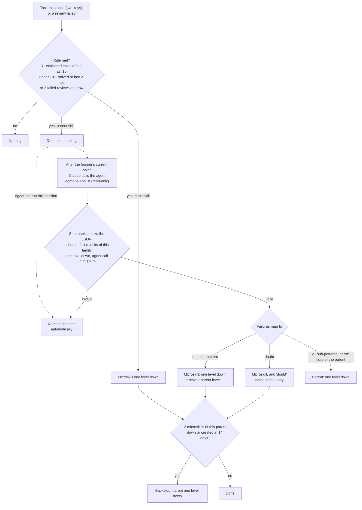
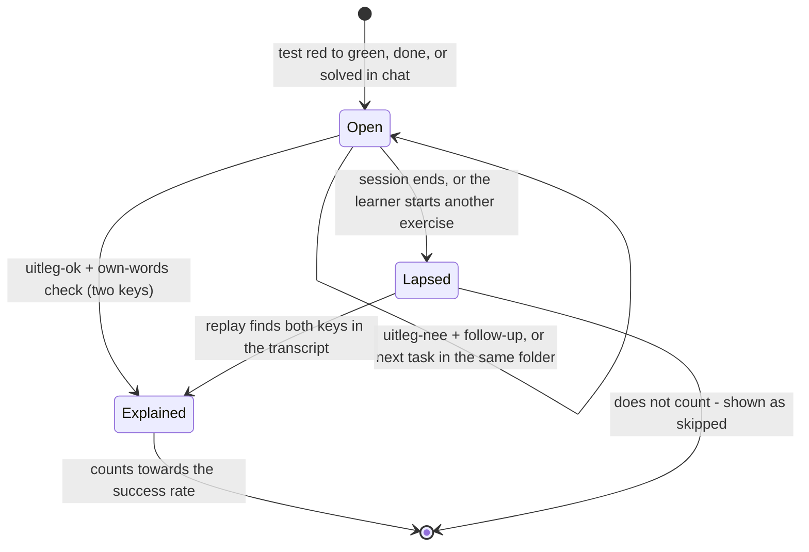
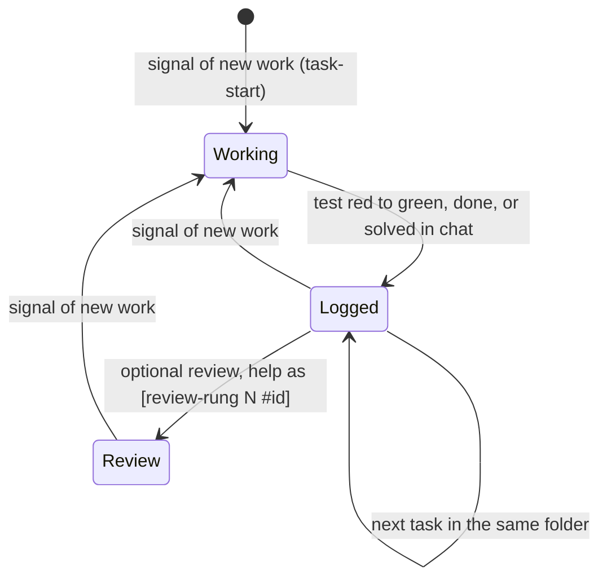
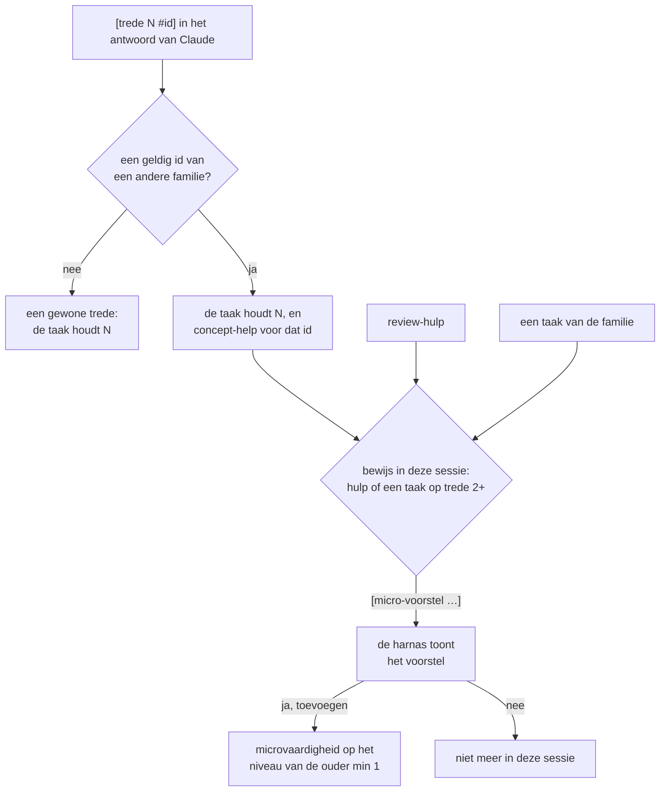
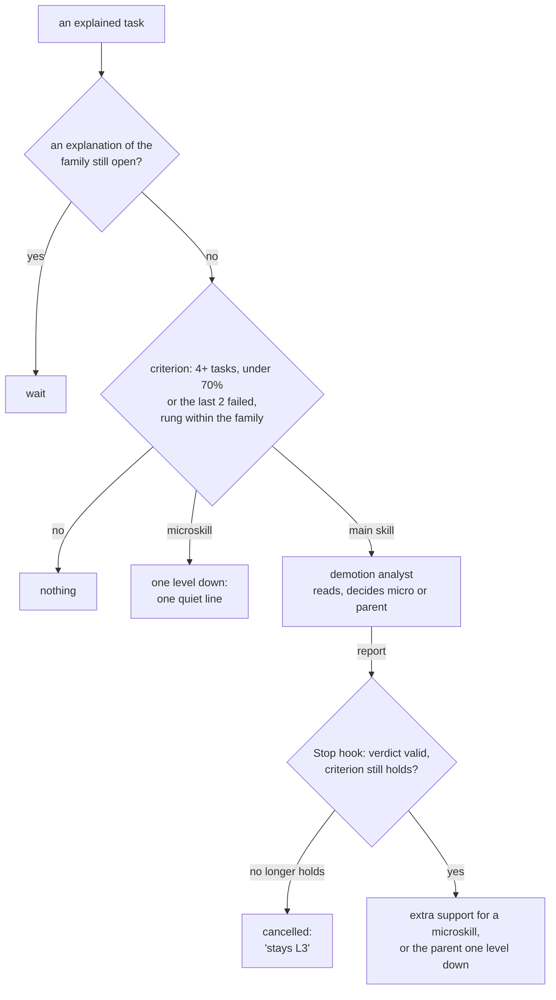
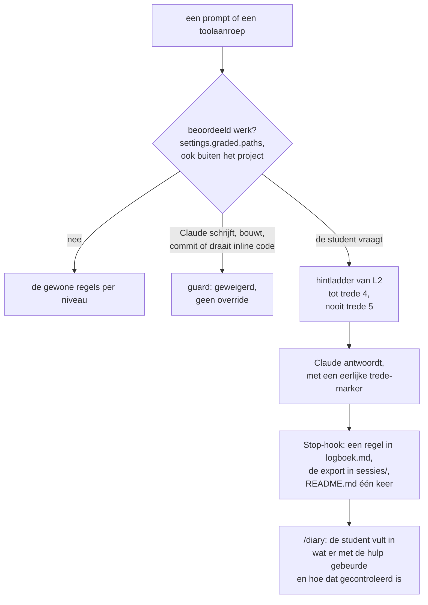
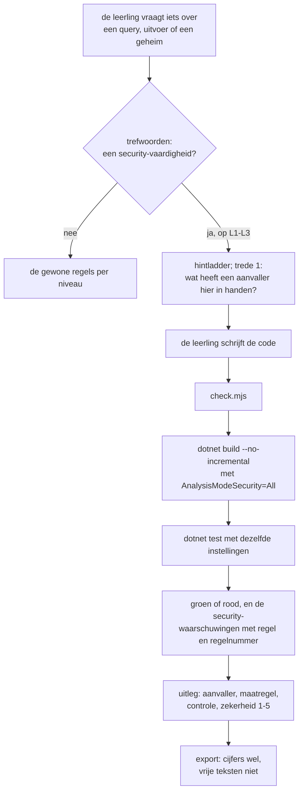
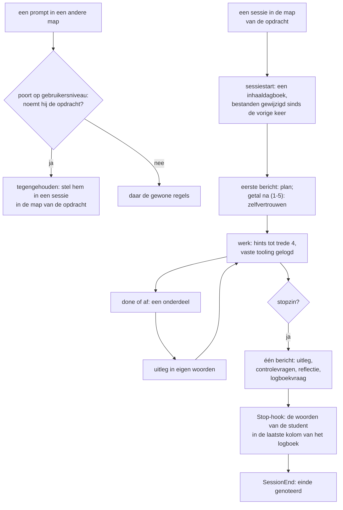
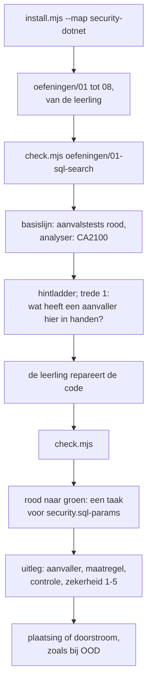

# Bouwlog: de eerste sessies en het wijzigingslog

!!! warning "Machinevertaling"
    Dit is een machinevertaling door Claude (Anthropic) van het [Engelse origineel](/research/build-log/). Een mens heeft de vertaling niet nagekeken. Bij twijfel geldt de Engelse tekst.

Deze pagina bewaart de geschiedenis van de leerharnas en van dit onderzoek. De andere pagina's beschrijven hoe het er nu voor staat; de datums, de besluiten en de redenen voor elke wijziging staan hier.

- **§10** beschrijft wat de eerste oefensessies lieten zien, en elke herziening van het ontwerp die daarop volgde: de besluiten, hoe ze zijn gebouwd, en waar de bouw afwijkt van het plan.
- **[Eerdere versies van het ontwerp](#earlier-versions)** bewaart de delen van het ontwerp die zijn vervangen.
- **[§11](#changelog)** is het wijzigingslog van het onderzoek zelf, het nieuwste eerst.

<a id="10-wat-we-leerden-van-de-eerste-sessies"></a>

## 10. Wat we leerden van de eerste sessies {#first-sessions}

In de eerste sessies van de pilot gebruikte één student de harnas in drie leersessies: de snek-oefeningen opzetten, `02-namen` en `03-lijsten`. Daarna zijn de transcripten en `events.jsonl` geanalyseerd. Deze sectie beschrijft wat er misging en wat er daardoor is veranderd. De leidende eis van de student was: **herken zo snel mogelijk wat beheerst wordt, en versterk dat daarna alleen af en toe, zodat de meeste tijd vóór de toets naar nieuwe stof gaat.**

!!! example "Voorbeeld: de situatie van één student"
    De student in de pilot was een tweedejaars HBO-ICT-student die zich voorbereidde op een OOD-toets zonder AI (AI-niveau 0/1). In de harnas stond `examDate` op de werkdatum 2027-01-20, en de toetsopdracht zou in week 10 verschijnen. De drie sessies vonden plaats op 7 november 2026. Een controle na de eerste maand stond gepland voor 15 december 2026.

### 10.1 Wat de data lieten zien

| Waarneming | Bewijs | Gevolg |
|---|---|---|
| Zelfstandige successen waren onzichtbaar | `02-namen`, `MetDonald`, `EersteDrie`, `ZonderGoofy` en `ZonderE` zijn **zonder hints** opgelost, maar geen ervan is gelogd. De enige gelogde taak was die ene worsteling (`LaatsteDrie`, trede 3) | Het vaardighedenregister liet het omgekeerde van de werkelijkheid zien. De promotiecriteria (≥ 5 taken) waren nooit te halen |
| Loggen op trefwoorden was te smal en te los | "er failt er een minder" en "ik heb een paar unit tests zelfstandig laten slagen" werden gemist. "dat werkt nu met snek" werd gelogd als testtaak | Fout bewijs in beide richtingen |
| Vaardigheden waren te grof | `cs.basis` mengt lijsten filteren (beheerst), strings (beheerst), `GetRange` (trede 2), void/chaining en referentie-vs-kopie (moeilijk) | Eén moeilijk deelonderwerp zette na één taak de hele vaardigheid terug van L3 → L2, in strijd met de vastgelegde regel "< 70% of 2 mislukkingen" |
| Hulp op L3 werd niet gemeten | Op L3 gaf Claude analogieën en uitleg van concepten (in feite trede 2–3), maar er werd geen trede vastgelegd | Een taak kon na flink wat hulp toch als "zelfstandig" gelogd worden |
| Herhalingen bestonden alleen op L4 | `nextReview` werd alleen ingesteld als een vaardigheid op L4 werd gezet | "Beheerst → af en toe versterken" lag nog weken weg |
| Tooling vrat leertijd | Ongeveer een uur ging op aan snek, de `.vs`-lock, de mismatch tussen VS 2022 en .NET 10, en usings die verdwenen bij opslaan | Geen toetsstof. De guard blokkeerde ook `dotnet --list-sdks` en de alleen-lezen-opdracht `find … 2>/dev/null` (vals-positieven) |
| De consoliderende uitleg kwam nooit | Er werd twee keer om gevraagd zonder antwoord, en toch telde de taak mee | Geen consolidatie |
| Testuitvoer lezen was maar half beheerst | Expected/But was werd correct beredeneerd, maar de samenvatting was niet leesbaar. "Ligt het aan de test?" liet een misvatting zien over waarneembaar gedrag | Dit is echte leerstof voor de microvaardigheden `test.*` |

### 10.2 Wat er is veranderd

1. **Objectief bewijs: `check.mjs`.** De student voert het zelf uit. Het werkt voor elk .NET-testproject, voor de snek-oefeningen en voor projectwerk. Een overgang rood→groen wordt gelogd als taak, met de trede die op dat moment gold. De eerste run per map is een nulmeting. Koppeling aan een vaardigheid gaat in deze volgorde: het pad van de solution-map, dan trefwoorden in test- en klassennamen, dan de actieve vaardigheid van de sessie. Claude mag het op L1–L3 niet uitvoeren (guard).
2. **Strenger loggen op trefwoorden, plus het commando `done`.** "het werkt" telt alleen mee met code- of testcontext, en nooit samen met toolingwoorden. Claude stelt het commando `done` voor bij successen zonder tests, zoals ontwerp of UML.
3. **Microvaardigheden.** Items met een `parent`, een eigen niveau, eigen trefwoorden en eigen herhalingen. Ze sturen de hintladder. De guard blijft werken op basis van paden, met het niveau van de bovenliggende vaardigheid. Claude stelt nieuwe voor (`add-micro`) en de student maakt ze aan. De statistieken van de bovenliggende vaardigheid tellen ook de taken van haar microvaardigheden mee. *Gewijzigd op 10 november 2026 (§10.4.2): met `autoDemote` aan kan ook de demotie-analist er een aanmaken.*
4. **Harde controle op uitleg in eigen woorden (twee sleutels).** Een taak blijft open, ook over sessies heen, tot hij is uitgelegd. *Gewijzigd op 10 november 2026 (§10.4.1, D4): de uitleg wordt direct gevraagd, en een open taak vervalt als de sessie eindigt of de student aan een andere opdracht begint.*
    - Sleutel 1: Claude beoordeelt de inhoud en schrijft `[uitleg-ok <tid>]`.
    - Sleutel 2: `reflect-gate.mjs` controleert het eigen bericht van de student deterministisch: minstens 12 woorden buiten code, een causaal verbindingswoord, en hoogstens 40% van de reeksen van 5 woorden overgenomen uit eerdere tekst van Claude.
    - Er is geen CLI-commando om een taak als uitgelegd te markeren. Promotie via `set` wordt geweigerd zolang er taken van die vaardigheid open staan. Claude kan niet schrijven in `.learning/state/`.
    - *Onderbouwing:* zelfuitleg en ophalen uit het geheugen ([Chi et al., 1989](https://doi.org/10.1207/s15516709cog1302_1); [Roediger & Karpicke, 2006](https://doi.org/10.1111/j.1467-9280.2006.01693.x)), en het vermijden van de illusie van competentie ([Prather et al., 2024](https://arxiv.org/abs/2405.17739)).
5. **Eerlijk loggen van treden op elk niveau.** Claude markeert inhoudelijke hulp met `[trede N]`. De Stop-hook verhoogt op basis daarvan de hoogste trede van de taak.
6. **Actief positieve signalen geven.** Dat gebeurt direct na een taak op trede 0–2, bij de start van een sessie (recente successen op trede 0 en kandidaten voor promotie, met het precieze commando) en in het dagboek. De promotiecriteria zijn *niet* versoepeld. De student koos er bewust voor om geen versnelde route via een uitdaging te nemen.
7. **Fibonacci-herhalingen vanaf L3,** begrensd door de toetsdatum (§5.7). *Gewijzigd op 10 november 2026 (§10.4.1, D3): herhalingen alleen op L4, via echt werk.*
8. **Tooling als L4-zone, plus reparaties aan de guard.**
    - Alleen `dotnet build|test|run|new|add|…` en `check.mjs` tellen als bouwen of testen.
    - Omleidingen naar `/dev/null` of `$null`, en `=>` / `->`, tellen niet meer als schrijven.
    - Een `cd <dir> &&` aan het begin bepaalt de werkelijke werkmap.
    - Paden binnen `.claude/` en `.learning/` zijn geen code van de student.
9. **Discipline bij degraderen.** Eén worsteling leidt tot een microvaardigheid op een lager niveau of tot een korte override, niet tot degradatie van de bovenliggende vaardigheid.
10. **Agentberichten zijn niet de woorden van de student (een latere reparatie).**
                - **Het probleem:** in een sessie met onderzoeksagents op de achtergrond kwam elk agentrapport en elke taakmelding bij `UserPromptSubmit` binnen alsof de student het had getypt.
                        - `prompt-gate.mjs` herkende vaardigheden in de rapporttekst en ontgrendelde hinttreden als "poging herkend", omdat rapporten woorden bevatten als *error* en *I think*.
                        - Een rapport met "all tests passed" had een nep-taak kunnen loggen.
                        - Het rapport werd ook `lastPrompt`: de tekst die de uitlegcontrole leest.
                        - Er zijn vijf onterechte `hint-unlock`-events gelogd, binnen tien minuten in één sessie.
                - **De oplossing:** `learnerText()` en `isLearnerEntry()` in `lib.mjs`.
                        - Een prompt die begint als een agentrapport of taakmelding wordt in zijn geheel genegeerd.
                        - System-reminder-blokken binnen een echt bericht worden verwijderd.
                        - `prompt-gate` logt dan één `prompt-ignored`-event en stopt.
                        - `reflect-gate` ziet alleen de eigen berichten van de student als het begin van "het laatste antwoord".
                - **Waarom op basis van tekst:** de echte hook-invoer heeft geen veld voor de herkomst (`cwd, hook_event_name, permission_mode, prompt, prompt_id, scratchpad_dir, session_id, transcript_path`). Daarom moet de detectie op de tekst steunen.

### 10.3 Open punten om na de eerste maand te evalueren

- **Controles van drempels:**
    - Is 12 woorden / 40% overlap een goede drempel, of wijst die eerlijke korte uitleg af? Bekijk de `explain-rejected`-events.
    - Werkt de koppeling aan vaardigheden op pad of trefwoord in `check.mjs` voor de projectstructuur van de toets?
- **Controles van gedrag:**
    - Markeert Claude hulp op L3 echt met `[trede N]`? Vergelijk de `rung-mark`-events met de transcripten.
    - Blijft het aantal `untask`-events laag? Een hoog aantal zou betekenen dat het loggen nog veel ruis bevat.
- **Guard:** shelltekst die een registercommando alleen maar *noemt* (bijv. in een heredoc), wordt geblokkeerd. Dit is een bewuste afweging: de guard is een zelfbindingsmiddel (commitment device), dus hij kiest bij twijfel voor streng.
- **Agentverkeer:**
    - Controleer dat elk agentrapport een `prompt-ignored`-event oplevert, en dat geen enkel echt bericht dat doet.
    - Filter de vijf onterechte `hint-unlock`-events van die sessie uit elke evaluatie.

### 10.4 Herziening van 10 november 2026: leervolgorde, herhalingen en uitleg

Een latere sessie van de pilot behandelde nog twee opgaven, `05-de-auto` en `06-studenten`. Daarna is de opzet opnieuw beoordeeld: een nieuwe controle van de literatuur, een diagnose van de bugs met bewijs uit de code, en een bouwplan. Die beoordeling is niet gepubliceerd. De student nam zes besluiten (D1–D6). Elk besluit is eerst getoetst aan dit literatuuronderzoek, en ze zijn nu allemaal in de harnas gebouwd. Waar de bouw in details afwijkt van het plan, beschrijft deze sectie de bouw.

**Werkregel (nieuw):** ideeën van de student voor de harnas worden eerst getoetst aan dit literatuuronderzoek (§2, P1–P13). Pas daarna worden ze besloten en gebouwd.

#### 10.4.1 Besluiten

| # | Besluit | Getoetst aan | Oordeel en voorwaarde |
|---|---|---|---|
| D1 | **Eerst proberen, ook bij een nieuwe vaardigheid.** Een vaardigheid onder L4 zonder geschiedenis en zonder eigen taken heeft een open *plaatsing*. Tot haar eerste taak telt ze als L2, voor de hintladder en de guard. De eerste taak plaatst haar op basis van de hoogste trede: 0 → L3, 1–2 → L2, 3–4 → L1, 5 → L0. De hintladder blijft, omdat die het niveau meet. Bij een open plaatsing ontgrendelt een trede nooit op tijd. Een trede gaat alleen omhoog bij een signaal van vastzitten: de student zegt het, deelt dezelfde fout of testuitkomst twee keer, of kent het concept niet. Na een eigen poging mag een uitdrukkelijke vraag om meer uitleg meteen naar trede 4 gaan. De trede die Claude echt geeft, wordt gelogd. | P1, P2; generatie-effect; productief falen ([Sinha & Kapur 2021](https://doi.org/10.3102/00346543211019105)); expertise-omkeereffect ([Kalyuga et al. 2003](https://doi.org/10.1207/s15326985ep3801_4)); misbruik van hulp ([Aleven et al. 2003](https://doi.org/10.3102/00346543073003277)) | **Ondersteund.** De consolidatie die productief falen nodig heeft, komt uit D4. Misbruik van hulp corrigeert zichzelf, omdat een gevraagde trede de plaatsing verlaagt. Een plaatsing na één taak is onzeker: D2 vangt een te hoge plaatsing op, en een te lage herstelt de student met `set`. |
| D2 | **Automatisch omlaag, met de hand omhoog.** De regel: minstens 3 uitgelegde taken van de vaardigheid zelf (de laatste 10 sinds haar laatste niveauwijziging), en minder dan 70% gelukt (trede ≤ 2) of de laatste 2 niet gelukt; of 2 mislukte herhalingen op rij. Een microvaardigheid gaat meteen één niveau omlaag. Bij een hoofdvaardigheid beslist eerst de **demotie-analist** (§10.4.2). Achtervang: gaan er binnen 14 dagen twee verschillende microvaardigheden van dezelfde ouder omlaag (of maakt de analist ze aan), dan gaat de ouder ook omlaag. Omhoog gaat nooit automatisch. | P2, P3 (contingente begeleiding, [Wood & Wood 1999](https://doi.org/10.1016/s0360-1315%2899%2900030-5)); illusie van competentie ([Koriat & Bjork 2005](https://doi.org/10.1037/0278-7393.31.2.187)); P10 (autonomie via een regel die je zelf kiest) | **Ondersteund, maar alleen op betrouwbare data.** Daarom zit het achter `settings.autoDemote`, dat standaard uit staat. De student zet het aan zodra het gerepareerde loggen (§10.4.3) een paar sessies betrouwbare data heeft opgeleverd. Het is een uitzondering op "alleen de student wijzigt het register", en de student koos daar zelf voor: of je een vaardigheid beheerst, blijkt in de praktijk, en daarom zijn er überhaupt tests. Elke wijziging wordt gelogd, en de student kan haar terugdraaien met `set`. |
| D3 | **Herhalingen alleen via echt werk, Fibonacci alleen op L4** (§5.7). Geen losse herhaaloefeningen, niets bij de start van een sessie, geen "te laat". Komt een L4-vaardigheid waarvan de herhaling klaarstaat langs in echt werk, dan doet de student het, niet de AI: trede 0 `pass`, 1–2 `shaky`, 3–5 of mislukt `fail`. Komt de vaardigheid niet langs, dan wacht de herhaling. | P8 (spreiding: sterk); verval van vaardigheden ([Arthur et al. 1998](https://doi.org/10.1207/s15327043hup1101_3); [Tatel & Ackerman 2025](https://doi.org/10.1037/bul0000481)); transfer-appropriate processing (P12); P7 (bijhouden na automatisering) | **Deels ondersteund. De enige echte spanning:** "het komt toevallig langs" garandeert geen spreiding. Geaccepteerd omdat de snek-oefeningen op elkaar voortbouwen (vanzelf afwisseling), en omdat het vangnet de oefentoetsen van de opleiding zijn, **bewust buiten de harnas**. De reden van de student: een werkcontext is iets anders dan een toetscontext. Alleen trede 0 telt als `pass`. |
| D4 | **Uitleg in eigen woorden alleen direct.** Een taak staat open vanaf het moment dat hij gelogd is. Hij vervalt bij het eerste van deze twee: de sessie eindigt (na het dagboek, of bij de start van de volgende sessie als de sessie open bleef), of de student begint aan een andere opdracht (`check.mjs` in een andere map, of `done` voor een vaardigheid uit een andere familie). Een volgende taak in dezelfde map laat hem niet vervallen, en één bericht mag meer taken uitleggen. Een vervallen taak telt niet mee. Het dashboard toont hem als "overgeslagen", apart van mislukt. De vervolgvragen zijn even streng als eerst. | Zelfuitleg ([Chi et al. 1989](https://doi.org/10.1207/s15516709cog1302_1)); consolidatie na worstelen ([D'Mello et al. 2014](https://doi.org/10.1016/j.learninstruc.2012.05.003)); de kosten van een strenge poort (§2.4) | **Ondersteund.** Het ruimt de stapel verouderde uitleg op die promotie blokkeerde. |
| D5 | Beheersingspoort ongewijzigd (3× trede 0 op ≥ 2 dagen, plus een transfertaak). Vastloop-timer voor gewone L2-taken ongewijzigd (12 min), maar hij telt nu actieve tijd. Een samenvatting na een pauze alleen op verzoek ("Waar was ik?"): de status, zonder nieuwe informatie. | P6 | Geen wijziging. |
| D6 | **Tooling:** promptsuggesties van Claude Code uit (`"promptSuggestionEnabled": false`), omdat een voorgestelde volgende prompt hints weggaf. AI-aanvulling in de IDE uit (bijvoorbeeld Full Line Code Completion in Rider). | P11; [Gajos & Mamykina 2022](https://doi.org/10.1145/3490099.3511138) | Het installatiescript zet het eerste. De installatiehandleiding noemt het tweede. |

#### 10.4.2 De demotie-analist

`check.mjs` logt een taak bijna altijd onder de **hoofdvaardigheid**, dus één zwak deelpatroon zou de hoofdvaardigheid omlaag kunnen halen. Dat zou de AI meer vrijheid geven in *elke* opgave van die vaardigheid. Daarom kijkt bij een hoofdvaardigheid eerst een Claude-agent die alleen leest, `demotie-analist`, naar de mislukte taken:

- Hij leest de testuitvoer, de code en de uitwisseling over hints in het transcript.
- Hij koppelt elke mislukking aan een deelpatroon: een bestaande microvaardigheid (gekoppeld op betekenis, niet op trefwoorden), of een nieuwe. Een eenmalige vergissing of een toolingprobleem telt niet mee.
- Hij geeft een oordeel in JSON: `micro` als alle mislukkingen één deelpatroon delen, of `ouder` als het om twee of meer deelpatronen gaat, of als een mislukking de kern van de hoofdvaardigheid raakt. Bij twijfel kiest hij `micro` en meldt hij dat hij twijfelt.

Zo wordt een oordeel toegepast:

1. Is aan de regel voldaan voor een hoofdvaardigheid, dan zet de Stop-hook een demotie klaar.
2. Bij de volgende prompt vraagt `prompt-gate` Claude om de agent aan te roepen na het punt waar de student nu is, niet midden in een hint.
3. Claude zet de JSON van de agent in zijn antwoord, in een marker `[demotie {...}]`.
4. De Stop-hook voert het oordeel alleen uit als:
    - het schema klopt;
    - de genoemde taken mislukte taken van die familie zijn;
    - het hooguit één niveau omlaag gaat. Een nieuwe microvaardigheid krijgt altijd het niveau van de ouder min 1, ingesteld door de harnas en niet door de agent;
    - de agent in die beurt echt gedraaid heeft: het transcript toont een aanroep van de subagent `demotie-analist`.

Bij `micro` gaat alleen die microvaardigheid één niveau omlaag, of ze wordt aangemaakt, en de mislukte taken gaan naar haar over. Bij `ouder` gaat de hoofdvaardigheid één niveau omlaag. Twijfel wordt in het dagboek genoteerd. Als achtervang gaat de ouder ook omlaag wanneer binnen 14 dagen twee verschillende microvaardigheden ervan omlaag gaan, of door de analist worden aangemaakt. Draait de agent niet in die sessie, dan verandert er niets automatisch; de regel wordt na de volgende uitgelegde taak opnieuw gecontroleerd.



Geldt de regel voor omlaag bij een hoofdvaardigheid, dan beslist de demotie-analist, die alleen leest, of een microvaardigheid of de hoofdvaardigheid omlaag gaat. De Stop-hook voert het oordeel van de agent alleen uit als de JSON door de controles komt; anders verandert er niets automatisch.

#### 10.4.3 Bugs die in dezelfde sessie zijn gevonden (allemaal gerepareerd)

1. **De Stop-hook miste 10 van de 19 markers.** De oorzaak was een race met de gebufferde transcriptschrijver van Claude Code: die schrijft elke 100 ms weg, en niet voordat de hook draait. *Gerepareerd:* de Stop-hook leest ook het veld `last_assistant_message` uit zijn invoer. Vier goedgekeurde uitleggen waren verloren gegaan. Het nieuwe commando `replay` controleert beide sleutels opnieuw vanuit het transcript en logt alleen wat slaagt (bron `replay`), ook voor een taak die intussen vervallen is.
2. **Een mislukte build werd niet opgeslagen als startpunt,** dus het eerste groen na het oplossen van compileerfouten werd nooit gelogd. *Gerepareerd:* een compileerfout is nu een startpunt voor `check.mjs`.
3. **Een trefwoord won van de map.** `prompt-gate` keek nooit naar de map, en treden-markers gingen naar de actieve vaardigheid in plaats van naar de vaardigheid van de taak. *Gerepareerd:* de map bepaalt de familie van de vaardigheid. Een trefwoord kan alleen een microvaardigheid binnen die familie kiezen; `#id` of de naam van een opgave wisselt naar een andere familie.
4. **Vals-positieven van de guard:** `msbuild` en `check.mjs` werden overal in de commandotekst herkend. *Gerepareerd:* de guard splitst een shellcommando in enkelvoudige commando's en beoordeelt elk commando op zijn programma. Hij weigert `eval` en `iex`, omdat hij niet kan zien wat die uitvoeren.
5. **Sessietijd was kloktijd.** De herinnering na een uur kwam na ongeveer 8 minuten echt werk, en een pauze van 12 minuten of meer kon zonder poging een trede ontgrendelen. *Gerepareerd:* het sessie-uur, de minuten per taak en de vastloop-timer tellen actieve tijd. Een pauze langer dan `idleMinutes` (standaard 20) telt niet mee.
6. **Klein:** `!`-commando's gaan langs `prompt-gate` heen, en `check.mjs` hing zich aan het sessiebestand dat het laatst was gewijzigd, wat fout gaat als er twee sessies tegelijk open zijn. *Gerepareerd:* een `!`-commando kiest nu de sessie die aan die familie van vaardigheden werkt.

#### 10.4.4 Levensloop van een taak (D4)

Een taak wacht alleen op uitleg zolang de student nog met die opgave bezig is.



Een taak staat open tot de uitleg in eigen woorden is goedgekeurd, en vervalt als de sessie eindigt of een andere opdracht begint. Alleen een uitgelegde taak telt mee voor het succespercentage; een vervallen taak wordt als overgeslagen getoond, tenzij `replay` de uitleg herstelt.

### 10.5 Herziening van 11 november 2026: het begin van een taak, reviews en uitleg

Na de sessie van 11 november is de setup opnieuw bekeken. Die review is niet gepubliceerd, omdat er leerdata in staan. De student nam zeven besluiten (13–19; de nummering loopt door vanaf de review van 10 november). Elk besluit is eerst aan de literatuur getoetst, en voor 13 en 14 vroeg de student om een kritische toets. Ze zitten nu allemaal in de harnas. Waar de bouw van het plan afwijkt, staat dat in §10.5.3.

#### 10.5.1 Besluiten

| # | Besluit | Getoetst aan | Oordeel |
|---|---|---|---|
| 13 | **De uitleg blijft streng, zonder twee bijzaken van de bouw.** Claude vraagt door tot het principe klopt (D4). De vraag hangt nu af van wat er gebeurde. Na een mislukte poging (rood, een compileerfout of een hint): "waarom werkt het nu, en waarom de eerste poging niet?" Meteen groen: één vraag naar het principe van de opdracht, want "waarom werkt het?" lokt "omdat ik het goed deed" uit. De Stop-hook beoordeelt **alle eigen berichten van de student sinds de taak is gelogd, samen**, met dezelfde eisen als eerst. | Mensen overschatten hoe goed ze een mechanisme begrijpen, tot ze het proberen uit te leggen ([Rozenblit & Keil 2002](https://doi.org/10.1207/s15516709cog2605_1)). De kwaliteit van zelfuitleg, zoals het principe noemen, voorspelde het leren, los van de leertijd ([Renkl 1997](https://doi.org/10.1207/s15516709cog2101_1), correlationeel). Zelfuitleg ([Chi et al. 1989](https://doi.org/10.1207/s15516709cog1302_1); [Bisra et al. 2018](https://doi.org/10.1007/s10648-018-9434-x)). | **Streng blijft gesteund.** Rozenblit & Keil laten zien dat uitleggen het gat blootlegt; of meer vervolgvragen meer leren opleveren, toetsen ze niet. De twee bijzaken hadden geen onderbouwing: ze kostten rondes zonder meer te meten. Het afbouwen van de uitlegvraag is een open punt: bij [Nückles et al. (2010)](https://doi.org/10.1007/s11251-009-9106-9) hielp afbouwen, maar bij strategieën die de studenten al zelf gebruikten. |
| 14 | **De optionele review na een taak blijft, met drie bijsturingen.** Claude biedt hem aan met een onderwerp en een tijdsinschatting. Na één fout antwoord, of bij "snap ik niet", geeft Claude het concept (trede 2), en zo nodig een voorbeeld (trede 4), in plaats van nog een vraag. Wat open blijft, wordt een voorgestelde microvaardigheid, met de opdracht waar het terugkomt. | Verwarring helpt als hij wordt opgelost ([D'Mello et al. 2014](https://doi.org/10.1016/j.learninstruc.2012.05.003)). AutoTutor gaat van de zet die het minst verklapt naar een bewering, en stopt zodra de student het antwoord geeft ([Graesser et al. 2004](https://doi.org/10.3758/BF03195563); de cyclus pump → hint → prompt → assertion bij naam in [Nye et al. 2014](https://doi.org/10.1007/s40593-014-0029-5)). Wanneer je hulp geeft of achterhoudt, is een open probleem: het assistentie-dilemma ([Koedinger & Aleven 2007](https://doi.org/10.1007/s10648-007-9049-0)). P10 (een keuze met bekende kosten). | **Gesteund.** Een review kan een echte misvatting blootleggen. De oplossing zit in hoe hij oploopt: lukt het de student niet, dan zegt de tutor het. |
| 15 | **Bug: hulp uit een review lekte naar de volgende taak.** Elke `[trede N]` verhoogde de hoogste trede van de sessie, en de volgende gelogde taak nam die over, ook als die taak over iets anders ging. Oplossing: (a) review-hulp wordt apart gelogd (`review-help`), (b) met een eigen marker `[review-trede N #id]`, (c-1) hij telt alleen voor een volgende taak over hetzelfde concept, (c-2) nieuw werk wordt herkend aan vaste signalen, (c-3) een taak begint bij zo'n signaal. | R2 ("zelfstandig" moet eerlijk zijn); P11 (vangrails in de workflow, niet in prompts) | **Opgelost.** Een trefwoord is nooit een signaal: een verkeerd herkende vaardigheid mag geen echte hulp wissen (de bug van 10 november, §10.4.3). Of een agent nieuw werk moet herkennen, is een open punt. |
| 16 | **Een concept-id is verplicht** in een reviewmarker. Zonder geldig id telt hij als gewone trede: de voorzichtige kant. | R2 | Gebouwd. |
| 17 | **Eén map van de OOD-voorbeeldkaart hing aan de verkeerde vaardigheid:** een associatie-opdracht stond onder overerving. Opgelost in de kaart, en met het nieuwe commando `skill.mjs paths` past de student de koppelingen in het eigen register aan. | (data) | Gebouwd. |
| 18 | **Code die vóór de eerste run geschreven was, telde niet.** De eerste run van `check.mjs` was meteen groen, werd de basislijn en logde niets. Nu geeft Claude het `check.mjs`-commando eerst, als de student een opdracht kiest. En een eerste run die helemaal groen is, telt als taak als er in deze sessie code in die map is gewijzigd. | (meetfout) | Gebouwd. De eerste run in een andere map is ook een signaal van nieuw werk (15c-3). |
| 19 | **De zekerheidsvraag één keer,** samen met de gekozen opdracht, en niet herhalen. Zonder antwoord staat er in het dagboek "onbekend". Het mappad van `check.mjs` opschonen is niet gekozen. | P10 | Gebouwd, alleen in de regels voor Claude. |

#### 10.5.2 Hoe een taak begint en eindigt

De harnas wist wanneer een taak **eindigt**: een test gaat van rood naar groen, de student meldt hem af met `done`, of zegt in de chat dat de tests groen zijn. Hij wist niet wanneer een taak **begint**, dus alle hulp sinds de vorige taak telde voor de volgende. Nu begint een taak bij een vast signaal van nieuw werk:

- code gewijzigd in een andere opdrachtmap dan die van de vorige taak;
- `check.mjs` in een andere map;
- de volledige naam van een andere opdrachtmap, of een `#id` van een andere vaardigheidsfamilie, in het eigen bericht van de student.

Bij zo'n signaal beginnen de ladder en de tijd van de taak opnieuw. Gewone hulp sinds de vorige taak hoorde bij werk dat niet werd afgemaakt: die telt niet voor de nieuwe taak, en wordt gelogd als `help-dropped`, zodat hij zichtbaar blijft in het dagboek en op het dashboard. Review-hulp blijft staan: die telt nog als de nieuwe taak over hetzelfde concept gaat.



Een taak begint bij een signaal van nieuw werk en eindigt als hij gelogd wordt. Na een gelogde taak kan een optionele review volgen; hulp in die review telt alleen voor een volgende taak over hetzelfde concept.

#### 10.5.3 Waar de bouw van het plan afwijkt

- **`done` voor een andere familie is geen signaal.** Het plan noemde het wel. Maar `done` meldt afgerond werk, en werk zonder code (ontwerp, UML) geeft geen ander signaal. De hulp daar laten vervallen, zou echte hulp verbergen (R2). Daarom houdt `done` alle hulp sinds de vorige taak, zoals eerst.
- **Een reviewmarker zonder id wordt toch herkend,** zodat hij als gewone trede telt in plaats van gemist te worden.
- **Signalen gaan uit van de vorige taak.** Na een signaal is er geen vorige taak, tot er weer een gelogd wordt. Hulp bij werk dat in de tussentijd opnieuw wordt opgegeven, vervalt dan niet: dat is de voorzichtige kant.

### 10.6 Herziening van 11 november 2026 (middag): hulp per concept, een voorstel voor een microvaardigheid, en eerlijke woorden

Na de tweede sessie van 11 november is de opzet nog een keer kritisch bekeken. Ook die review wordt niet gepubliceerd, omdat er leerdata in staan. De nummering loopt door (22–30); 22 en 24 stonden nog open uit de vorige ronde. Elk punt is eerst aan de literatuur getoetst, daarna besliste de student. De gekozen punten zitten nu in de harnas; 24 is niet gekozen. Waar de bouw van het plan afwijkt, staat in §10.6.3.

#### 10.6.1 Besluiten

| # | Besluit | Getoetst aan | Oordeel |
|---|---|---|---|
| 26 | **Hulp wordt per concept gelogd.** Hulp tijdens een taak ging naar de vaardigheid van de opdrachtmap, ook als die over een concept van een andere vaardigheid ging. Die vaardigheid leek dan zwakker dan ze was, en het echte gat bleef uit beeld. Nu zet Claude `[trede N #id]`. De taak houdt zijn hoogste trede, want hij is met die hulp gemaakt. Het concept krijgt een eigen event, `concept-help`. Dat is geen taak van dat concept: `status` laat het zien, en het is bewijs voor 22. | Knowledge tracing houdt per regel een schatting bij en werkt die bij elke kans om die regel toe te passen bij ([Corbett & Anderson 1994](https://doi.org/10.1007/bf01099821); [Anderson et al. 1995](https://doi.org/10.1207/s15327809jls0402_2)). | **Gesteund (een meetfout).** Dat hulp zelf bewijs is, is een ontwerpkeuze: de gelezen teksten werken bij op goed of fout. Of concepthulp op trede 2 of hoger moet meetellen in het percentage gelukt van die vaardigheid, staat nog open: eerst loggen en tonen, en na een paar sessies beslissen. |
| 22 | **De harnas stelt zelf een microvaardigheid voor,** net als een promotie. Claude noemt het deel met `[micro-voorstel <id> "titel" "trefwoorden"]`. De harnas controleert het en toont het voorstel, op het niveau van de hoofdvaardigheid min 1. Alleen het eigen "ja, toevoegen" van de student voegt hem toe. Er gaat niets automatisch omlaag. | Open leerlingmodellen: de lerende ziet het model en kan erover onderhandelen, met reflectie en zelfsturing als genoemde doelen ([Bull & Kay 2016](https://doi.org/10.1007/s40593-015-0090-8); een raamwerk, geen toets). Een tekst van Claude is geen deel van het model. Ertegen: één fout antwoord is zwak bewijs, dus beslist de student. | **Gesteund.** |
| 27 | **Eerlijke woorden.** `check.mjs` zei "telt als zelfstandig gelukt" bij trede 2, terwijl het register alleen trede 0 zelfstandig noemt. Nu is trede 0 "zelfstandig gelukt", trede 1–2 "gelukt, met hulp tot trede N", en meer hulp zoals het was. Ook in het signaal aan Claude en in de regels. | Illusie van competentie ([Koriat & Bjork 2005](https://doi.org/10.1037/0278-7393.31.2.187); R2): een succesmelding moet de hulp eerlijk noemen. | **Gesteund, alleen voor de woorden.** Een strengere grens voor "gelukt" op L3 (hooguit trede 1) wacht op 26: een deel van de hulp hoorde bij een ander concept, en met `autoDemote` zou een strengere grens een vaardigheid om de verkeerde reden kunnen laten zakken. |
| 28 | **De uitleg gaat over het concept van de hoogste hint** als de taak hulp had (trede 1 of hoger). Zonder hulp zoals het was (13). | Leren ging samen met impasses: buiten een impasse ging uitleg zelden samen met leren, op een impasse soms wel ([VanLehn et al. 2003](https://doi.org/10.1207/S1532690XCI2103_01), correlationeel). Zelfuitleg levert het meest op bij het principe dat nog niet vastzit ([Chi et al. 1989](https://doi.org/10.1207/s15516709cog1302_1); [Bisra et al. 2018](https://doi.org/10.1007/s10648-018-9434-x)). | **Gesteund.** Dat de hoogste hint de impasse aanwijst, is een afleiding. |
| 29 | **Een review gaat alleen over de eigen code van de student.** Een vraag over een alternatief wordt een experiment: ombouwen, `check.mjs` draaien, terugzetten. Geen review na de melding van een uur actieve tijd, of na een taak die trede 2 of hoger kostte; dan alleen het voorstel voor een microvaardigheid (22). | Zonder eigen poging en feedback is er geen impasse ([VanLehn et al. 2003](https://doi.org/10.1207/S1532690XCI2103_01)). Dat een moeilijke vraag aan het eind het zelfvertrouwen over de hele sessie kleurt: hier is geen bron voor nagekeken, dus een signaal, geen bewijs. | **Gesteund.** |
| 23 | **Bug: de statusregel zei op L3 "trede 0: nog geen hint",** terwijl de taak op trede 2 stond. De regel kwam van de ontgrendelde trede van de L2-ladder, en die blijft op L3 op 0. Hij toont nu de gegeven hulp; op L2 ook de ontgrendelde trede. | (bug) | **Opgelost.** |
| 30 | **`install.mjs --update` let op een lopende sessie.** In de pilot werden de regels midden in een oefensessie vervangen, door een update uit een andere sessie. Er ging niets mis, maar de regels veranderden onder een lopende sessie. | R12 | **Gebouwd** (zie §10.6.3). R12 zelf, de tijd voor harnaswerk begrenzen, blijft de keuze van de student: de pilot gaat er bewust tegenin. |
| 24 | **Vastzitten zonder het te zeggen.** `check.mjs` zou melden "niets veranderd sinds de vorige run", en op L3 zou Claude na een reviewvraag zonder antwoord of met een fout antwoord één trede meer geven. | Studenten zoeken vaak geen hulp als ze die nodig hebben ([Aleven & Koedinger 2000](https://doi.org/10.1007/3-540-45108-0_33); [Aleven et al. 2003](https://doi.org/10.3102/00346543073003277)). Wheel-spinning ([Beck & Gong 2013](https://doi.org/10.1007/978-3-642-39112-5_44)). Contingent tutoren geeft meer hulp na een mislukking ([Wood & Wood 1999](https://doi.org/10.1016/s0360-1315%2899%2900030-5)); [Wood & Middleton (1975)](https://doi.org/10.1111/j.2044-8295.1975.tb01454.x) zagen het eerst bij moeders en hun kinderen. | **Gesteund, maar niet gekozen:** de student hield het zoals het is. Een vooraf geregistreerde replicatie van het experiment uit 1978 over contingent tutoren ([Wood, Wood & Middleton 1978](https://doi.org/10.1177/016502547800100203)) vond het effect op het zelfstandig presteren van de kinderen niet terug ([Smit et al. 2025](https://doi.org/10.1037/edu0000965)). Dat raakt de hintladder (P3), en is voor de volgende reviewronde. |
| 25 | **Afwijkingen van Claude.** De zekerheidsvraag kwam twee keer, tegen 19 in. De melding na een uur actieve tijd kwam niet te laat. | — | Ter kennisname. |

#### 10.6.2 Hulp per concept en het voorstel voor een microvaardigheid



Hulp over een concept van een andere familie blijft bij de taak en wordt ook bij dat concept gelogd. Met bewijs van echte hulp stelt de harnas een microvaardigheid voor, en alleen het eigen "ja" van de student voegt hem toe.

#### 10.6.3 Waar de bouw van het plan afwijkt

- **22: een taak op trede 2 of hoger is ook bewijs.** Het plan noemde alleen review-hulp en concepthulp op trede 2 of hoger. Maar 29 zegt dat er na zo'n taak geen review komt, alleen het voorstel; zonder dit kon dat voorstel niet komen. De student koos dit tijdens de bouw.
- **22: het bewijs moet uit dezelfde sessie en dezelfde familie komen** als de voorgestelde microvaardigheid. Een voorstel dat de student afwees, komt in die sessie niet terug.
- **26: de concepthulp kent zijn taak vooraf.** De hulp wordt gelogd als Claude hem geeft, voordat de taak een id heeft. Daarom reserveert de eerste concepthulp het id dat de taak zal krijgen (`taskTid`). Begint er eerst nieuw werk, dan wordt dat id nooit gebruikt, en `help-dropped` noemt het.
- **26: een concept van dezelfde familie** (de ouder of een microvaardigheid ervan) is het eigen concept van de taak. De trede zegt het al, dus er komt geen extra event. Dit is de familielogica van de reviewmarker (15c-1).
- **28: ook in `check.mjs`.** Na hulp vraagt de regel over de uitleg nu naar het punt waar de hulp nodig was. De Stop-hook is niet veranderd.
- **30: met `--yes` of zonder terminal stopt hij,** tenzij er ook `--force` bij staat. Een vraag alleen had in de pilot niet geholpen: de update kwam uit een andere Claude-sessie, en die kan geen vraag beantwoorden. "Lopend" betekent een sessie die in de laatste `idleMinutes` (standaard 20) actief was. De hooks kunnen oefenen en praten over de harnas niet uit elkaar houden, dus elke sessie in de map telt.

### 10.7 Herziening van 12 november 2026: positieve feedback, demoties en de fasegeschiedenis

Na de sessies van 11 en 12 november zei de student: "waarom heb ik tot nu toe alleen maar automatische demoties gehad en geen promoties?" De setup is kritisch tegen dat gevoel gehouden, en tegen de literatuur over positieve feedback, gamification en desirable difficulties. Die review is niet gepubliceerd, omdat er leerdata in staan. De nummering loopt door (31–46). Elk punt is eerst aan de literatuur getoetst, daarna besliste de student. De gekozen punten zijn in de harnas gebouwd; waar de bouw afwijkt van het plan, staat dat in §10.7.3.

**De feiten tegenover het gevoel.** De log liet 4 keer omhoog zien (1 promotie die de student bevestigde, 3 plaatsingen) en 1 keer omlaag: een nieuwe microvaardigheid, terwijl de ouder op L3 bleef. Een bestaand niveau was nooit automatisch gezakt. Maar de 4 keer omhoog waren stil (één regel in de uitvoer van `check.mjs`), en de ene keer omlaag was het luidste moment van de harnas: een hookmelding, een agent-run en een blok JSON in de chat. Daaromheen was bijna elke goedgekeurde uitleg eerst één keer afgewezen (24 goedgekeurd, 22 afgewezen). Het gevoel was een eerlijk signaal over hoe de feedback *voelde*, niet over hoe de student presteerde.

#### 10.7.1 Besluiten

| # | Besluit | Getoetst aan | Oordeel |
|---|---|---|---|
| 31 | **Omhoog is luid, omlaag is stil.** Een plaatsing of promotie krijgt een eigen melding met ↑ en het bewijs, ook bij de sessiestart en in `status`. Omlaag is één regel, "extra steun voor …", met de weg terug. De harnas leest het oordeel van de demotie-analist uit het rapport van de agent zelf, dus er komt geen JSON in de chat; de controle van het oordeel blijft. | Slechte gebeurtenissen en slechte feedback wegen zwaarder dan goede ([Baumeister et al. 2001](https://doi.org/10.1037/1089-2680.5.4.323)). Verliesaversie trad in het algemeen op bij levels die verdiend waren, niet bij levels die gegeven werden ([Rewley et al. 2021](https://doi.org/10.1089/g4h.2021.0130)). Een eigen succeservaring is meestal de sterkste bron van self-efficacy ([Usher & Pajares 2008](https://doi.org/10.3102/0034654308321456)), en alleen als die als succes wordt gezien. | **Gesteund.** |
| 32 | **Bug: een verlaging werd uitgevoerd op oud bewijs.** Toen het oordeel van de analist werd verwerkt, klopte het criterium niet meer (3 van 4 gelukt, 75%). Nu wordt het criterium opnieuw gecontroleerd, in de prompt-gate en bij het uitvoeren van het oordeel; klopt het niet meer, dan gaat er niets omlaag (`demotion-cancelled`). Omlaag wacht ook zolang er een uitleg van die familie openstaat, net als omhoog. | (bug) | **Opgelost.** |
| 33 | **Minstens 4 uitgelegde taken voordat het omlaag gaat** (het was 3), voor beide regels. De analist houdt alleen `micro` en `ouder`. | De harnas mikt op ongeveer 85% succes (P4). Met 3 taken is één moeizame taak genoeg: bij precies 85% gebeurt dat in 39% van de gevallen; met 4 taken zijn er twee nodig (ongeveer 11%). Meer dan een derde van de feedbackinterventies verlaagt de prestatie, vooral als de aandacht naar het zelf gaat ([Kluger & DeNisi 1996](https://doi.org/10.1037/0033-2909.119.2.254)). | **Gesteund.** Het plan was 5 taken en een derde oordeel "niet verlagen"; de student koos 4, als tussenweg. |
| 34 | **Omlaag telt de trede binnen de familie.** Hulp over een concept van een andere familie (`[trede N #id]`) is geen mislukking van de vaardigheid van de taak. De taak houdt zijn volle trede (eerlijk, #26). De analist mag een bestaande microvaardigheid van een andere familie kiezen. | Knowledge tracing: het bewijs hoort bij de regel waar het over ging ([Corbett & Anderson 1994](https://doi.org/10.1007/bf01099821)). | **Gesteund (een meetfout, zoals #26).** |
| 35 | **De voortgang naar het volgende niveau, in de chat,** in stappen, nooit als percentage: na elke taak, bij `status` en bij de sessiestart. | De inzet stijgt naarmate het doel dichterbij komt ([Kivetz et al. 2006](https://doi.org/10.1509/jmkr.43.1.39)); toon aan het begin wat al gedaan is, en dicht bij het doel wat nog rest ([Koo & Fishbach 2012](https://doi.org/10.1086/663827)). Voortgang bijhouden helpt doelen bereiken ([Harkin et al. 2016](https://doi.org/10.1037/bul0000025)). Een voortgangsbalk die traag begint verhoogt de uitval ([Villar et al. 2013](https://doi.org/10.1177/0894439313497468)): dus stappen, geen percentage. | **Gesteund.** |
| 36 | **L4 binnen bereik.** (a) De taak die een vaardigheid plaatste telt mee na de plaatsing. (b) De transfertaak is één van de drie keer zonder hint, en haar dag een dag. Zijn de opdrachtmappen van een L3-vaardigheid op, dan wijst Claude een bestaande volgende oefening aan; een oefentoetsvraag telt mee via `done`. Ontwerpdoel: wie dagelijks oefent en de stof beheerst, haalt L4 in ongeveer 3 sessies op 2 dagen; een test bewaakt dat. De dag blijft de UTC-datum. | Mastery learning werkt door voldoende oefenkansen met feedback ([Kulik et al. 1990](https://doi.org/10.2307/1170612)). Een criterium dat niet te halen is, is een plafond, en dat ondermijnt het gevoel van competentie ([Ryan & Deci 2000](https://doi.org/10.1037/0003-066x.55.1.68)). Opnieuw leren in latere sessies woog zwaarder dan extra goede antwoorden in de eerste sessie ([Rawson & Dunlosky 2011](https://doi.org/10.1037/a0023956)). Hun sessies lagen ver uit elkaar en het ging om begrippen, niet om code: "ongeveer 3 sessies op 2 dagen" is een afleiding, en een krappe. | **Gesteund.** In de woorden van de student: de trage weg naar L4 "is niet werkbaar voor een junior dev". |
| 37 | **Eerst lof, dan de eis.** `check.mjs` noemt wat lukte en de (micro)vaardigheid, en geeft de uitleg als uitnodiging. Met hulp: "hier zat het leren: `<concept>`". Een uitwerking (trede 5) heeft een eigen, eerlijke tekst (een bug: die kreeg de zachte tekst van trede 3–4). | Verbale positieve feedback verhoogde de intrinsieke motivatie bij vrije keuze voor studenten, niet voor kinderen ([Deci, Koestner & Ryan 1999](https://doi.org/10.1037/0033-2909.125.6.627)). Lof werkt als hij oprecht is en wijst op oorzaken die de leerder zelf beïnvloedt ([Henderlong & Lepper 2002](https://doi.org/10.1037/0033-2909.128.5.774)). Met positieve feedback op juiste stappen leerden studenten in SQL-Tutor even veel in ongeveer de helft van de tijd ([Mitrovic et al. 2013](https://doi.org/10.1016/j.compedu.2012.07.002); 41 studenten, geen verschil op het tentamen). | **Gesteund.** |
| 38 | **Eerst noemen wat klopt, dan één vervolgvraag.** De eis blijft. De waaromcheck accepteert ook "als …, dan/zou …" in één zin. | Beginners zoeken en gebruiken positieve feedback ([Finkelstein & Fishbach 2012](https://doi.org/10.1086/661934)). Mensen leerden minder van falen dan van succes, bij dezelfde informatie ([Eskreis-Winkler & Fishbach 2019](https://doi.org/10.1177/0956797619881133)); in replicaties verdween dat effect als er corrigerende feedback of een korte instructie volgde ([Keith et al. 2022](https://doi.org/10.1037/xge0001170); [Gok & Fyfe 2024](https://doi.org/10.1037/xge0001632)), en dat is wat een vervolgvraag doet. Tegen te zacht: beleefdheid kan de fout verbergen ([Person et al. 1995](https://doi.org/10.1207/s1532690xci1302_1)), dus het gat wordt wel benoemd. De eis zelf blijft gesteund (zelfuitleg, [Bisra et al. 2018](https://doi.org/10.1007/s10648-018-9434-x)). | **Gesteund voor de vorm, niet voor minder strengheid.** De regel "als … dan" kwam uit een sessie waarin een goede uitleg werd afgewezen omdat er geen redenwoord in stond. |
| 39 | **Moeite is het doel, geen falen.** Na een taak met hulp: "hier zat het leren". Eén keer, bij de eerste sessiestart, een korte uitleg. | De prestatie tijdens het oefenen is een slechte maat voor leren ([Soderstrom & Bjork 2015](https://doi.org/10.1177/1745691615569000)). Leerders vonden de strategie die moeite kost minder effectief en kozen haar minder vaak ([Kirk-Johnson et al. 2019](https://doi.org/10.1016/j.cogpsych.2019.101237)). Leerders hebben steun nodig om aan desirable difficulties te beginnen en ze vol te houden ([de Bruin et al. 2023](https://doi.org/10.1007/s10648-023-09766-w)); één hefboom is moeite anders duiden ([Zepeda et al. 2020](https://doi.org/10.1016/j.jarmac.2020.08.007)). | **Gesteund**, als raamwerk: er is nog weinig empirisch werk naar deze hefbomen. |
| 40 | **Bug in de woorden van het dashboard:** de tegel "zelfstandig gelukt" telde trede ≤ 2. Nu twee tegels: "gelukt (trede ≤ 2)" en "zelfstandig (trede 0)". | #27 | **Opgelost.** |
| 45 | **De fasegeschiedenis op het dashboard** (met #41): per vaardigheid één band over de dagen, met "start" apart; taken als stippen; microvaardigheden onder hun ouder; elke wijziging gemarkeerd met hoe hij besloten is; één zin die alleen met jezelf vergelijkt. De export zegt nu hoe een wijziging besloten is (`kind`, een vaste lijst woorden) en laat wijzigingen zonder verschil weg. | Feedback ten opzichte van je eigen eerdere werk gaf meer vaardigheid en self-efficacy dan feedback ten opzichte van klasgenoten ([Shih & Alexander 2000](https://doi.org/10.1037/0022-0663.92.3.536), een experiment met 84 kinderen). Een klasgemiddelde ontmoedigde een deel van de studenten ([Aguilar 2018](https://doi.org/10.1080/15391523.2017.1401498), interviews). Het leerdermodel openen kan helpen ([Long & Aleven 2017](https://doi.org/10.1007/s11257-016-9186-6)), en een model hoort te laten zien waarop het oordeel rust ([Kay & Kummerfeld 2012](https://doi.org/10.1145/2395123.2395129)). | **Gesteund, als afleiding:** er is geen studie gevonden die een geschiedenisweergave van een leerdermodel toetst. Dashboards in het algemeen lieten geen effect op prestaties zien, een bescheiden effect op motivatie en een groter effect op deelname ([Kaliisa et al. 2024](https://doi.org/10.1145/3636555.3636884)). De echte toets: na twee weken vragen of het gevoel "alleen omlaag" veranderd is. |
| 42 | **Afwijzingen per taak op het openbare dashboard.** | Voortgang openbaar rapporteren helpt ([Harkin et al. 2016](https://doi.org/10.1037/bul0000025)); falen kan mensen doen afhaken ([Eskreis-Winkler & Fishbach 2019](https://doi.org/10.1177/0956797619881133)). | **Deels gesteund, niet gekozen:** de student hield ze openbaar, met de redenen. |
| 43 | **Geen punten, badges, reeksen of leaderboards.** Een niveau informeert: het zegt welke hulp je krijgt, niet welke status je hebt. | Zie P14 (§2.11). | **Gesteund, een ontwerpregel.** |
| 44 | **Kleine punten.** De plaatsing gebeurt nu bij de goedgekeurde uitleg. De fouten in het lesmateriaal worden niet gemeld. De Mermaid-diagrammen zijn na de bouw nagelopen. | — | **Gebouwd.** |
| 46 | **Eén taak van de student "zou als zelfstandig moeten tellen"**, omdat de test van het vak fout was. De trede kwam van een vraag over wat de test verwacht, niet van de fout. | Eerlijk loggen (R2). | **Niet gesteund, zo gelaten.** |

#### 10.7.2 Omlaag, zoals gebouwd



Omlaag wacht op open uitleg, telt alleen de hulp binnen de familie, en wordt opnieuw gecontroleerd op het bewijs van het moment waarop het wordt uitgevoerd. Het rapport van de analist gaat naar de Stop-hook, niet de chat in.

#### 10.7.3 Waar de bouw afwijkt van het plan

- **38: alleen "dan" of "zou".** "Als …" telt alleen als waarom met "dan" of "zou" (of "then"/"would") in dezelfde zin. Lossere woorden ("kan", "is") zouden een kale bewering doorlaten.
- **44 en 36 (a) samen.** Omdat de plaatsing nu bij de uitleg gebeurt, ná de taak, moet de plaatsingstaak expliciet in het venster komen; anders zou (a) nooit tellen. Oudere plaatsingen zonder taak-id vinden die in het event `placement`.
- **34: ook de plaatsing.** Ook de plaatsing gebruikt de trede binnen de familie: hulp over een ander concept zegt niets over de nieuwe vaardigheid.
- **31: het rapport van de analist wordt gelezen, niet geplakt.** Een agent op de achtergrond geeft zijn rapport terug als bericht; de Stop-hook haalt het oordeel daaruit (of uit het resultaat van een agent die direct antwoordt). Een oordeel in dat rapport dat de harnas weigert, blokkeert Claude niet: de verlaging blijft openstaan. De marker `[demotie {...}]` werkt nog als terugval.
- **35: welke vaardigheden.** De voortgangsregels gaan over de vaardigheden met minstens één taak sinds hun laatste niveauwijziging.
- **36: de volgende oefening één keer per sessie.** De hook zegt Claude één keer per vaardigheid en sessie dat de mappen op zijn.
- **45: op het dashboard een microvaardigheid alleen als er iets mee gebeurde** (een taak, een wijziging of extra steun). Een plaatsing telt als een fase hoger als die op L3 of L4 uitkomt.
- **45: `levelChanges` zonder wijzigingen zonder verschil.** De eerste melding "sinds de laatste export" na de update kan één wijziging minder tellen.
- **Een ouder sessiebestand** heeft nog geen familietrede: dat telt alle hulp mee, tot de volgende taak begint.

### 10.8 Herziening van 13 november 2026: beoordeeld werk volgens de OER

De student vroeg om de setup in lijn te brengen met de OER, zodat de harnas kan helpen bij de eindopdracht van het vak. De OER staat daar AI-niveau 1 toe: GenAI als hulpmiddel, "bijvoorbeeld om ideeën te genereren of structuur aan te brengen", met een verantwoording van het gebruik. Ongeoorloofd gebruik van AI die content maakt ("tekst, afbeeldingen, code") is fraude (OER art. 1.41 lid 3c). Het setupdocument met de besluiten blijft privé, omdat het over de eigen opdracht van de student gaat. De nummering loopt door (49–54). De student besliste 49, 50 en 53 met meerkeuzevragen; 51 is meteen gedaan; 52 blijft open.

#### 10.8.1 Besluiten

| # | Besluit | Getoetst aan | Oordeel |
|---|---|---|---|
| 49 | **De hintladder tot trede 4 bij beoordeeld werk.** In de paden van `settings.graded` gelden de ladder van L2 en de vasttimer voor elke vaardigheid, ook op L3 en L4. Trede 5 (een uitwerking) bestaat daar niet; een vraag erom wordt geweigerd met een verwijzing naar de OER. Trede 4 is een voorbeeld van hooguit 5 regels over een ander onderwerp. Claude schrijft daar niets, op geen enkel niveau. | Alleen uitleg *zonder* het antwoord leidde tot leren; een eigen keuze gevolgd door het antwoord van de AI niet ([Gajos & Mamykina 2022](https://doi.org/10.1145/3490099.3511138)). Eerst proberen en dan een voorbeeld was voor beginners niet beter dan alleen oefenen ([van Gog et al. 2011](https://doi.org/10.1016/j.cedpsych.2010.10.004)), terwijl probleemoplossen vóór instructie gemiddeld helpt ([Sinha & Kapur 2021](https://doi.org/10.3102/00346543211019105)), als de instructie voortbouwt op de poging van de student ([Loibl et al. 2017](https://doi.org/10.1007/s10648-016-9379-x)). De meest concrete hint kan werken als uitgewerkt voorbeeld als de student erover nadenkt ([Shih et al. 2008](references.md#ref-shih-2008)). AI-tutors trekken de grens verschillend: CodeAid toont algemene voorbeeldcode ([Kazemitabaar et al. 2024](https://arxiv.org/abs/2401.11314)), CodeHelp haalt alle voorbeeldcode weg ([Liffiton et al. 2023](https://doi.org/10.1145/3631802.3631830)). R10: minder eigenaarschap bij onbeperkt ChatGPT ([Bergh et al. 2026](https://arxiv.org/abs/2609.21194), preprint), niet getest voor kleine voorbeelden. | **Ondersteund, met voorwaarden.** Het advies is gelijk aan het besluit. Drie voorwaarden gaan in de regels voor Claude: het voorbeeld implementeert geen gedrag uit de opdracht en past niet door hernoemen; de student typt de eigen code en plakt nooit; de uitleg na de taak vraagt ook waarin het voorbeeld verschilt van de oplossing van de student. Of een voorbeeld op trede 4 nog "ideeën genereren of structuur aanbrengen" is, zegt de instelling; het logboek noemt het. |
| 50 | **Een AI-logboek in de repo van de opdracht** (`ai-verantwoording/`): een regel per antwoord (wanneer, sessie, vaardigheid, trede, soort hulp), geschreven door de Stop-hook, een laatste kolom die de student invult ("wat ik ermee deed / hoe gecontroleerd"), een export van elke sessie, en een README met het AI-niveau, een APA-verwijzing en "Claude Code heeft geen deellink". De privacyfilters van de dashboardexport worden hergebruikt: e-mail, de thuismap (wordt `~`), hook- en systeemberichten. | De OER vraagt op niveau 1 promptlinks of de melding dat de applicatie die niet heeft, een APA-verwijzing, en een controle van de uitvoer door de student. Detectie van AI-tekst is onbetrouwbaar ([Scarfe et al. 2024](references.md#ref-scarfe-2024)), dus de eigen vastlegging van de student is de bescherming (R11). | **Gebouwd.** Een eis uit het beleid, geen claim over leren. |
| 51 | **De prompts bewaren tot het beoordelingsmoment:** Claude Code bewaart transcripten 365 dagen in plaats van 30. | De OER: bewaar de prompts tot het beoordelingsmoment. | **Gedaan** door de student, in de instellingen van Claude Code. |
| 52 | **Oefenen voor de momenten op niveau 0** (de diagnostische toets en de uitbreiding bij het assessment, zonder AI). | — | **Open.** Een voorstel voor januari. |
| 53 | **De harnas in de repo van de opdracht, met één register.** De repo gebruikt het register van de oefenmap (`install.mjs --learning-dir`), zodat een taak in de opdracht meetelt voor dezelfde vaardigheid. `.claude/` en `ai-verantwoording/` gaan in git (de docent ziet welke regels de AI volgde); `.learning/` niet. | Het bewijs hoort bij de vaardigheid waar het over gaat ([Corbett & Anderson 1994](https://doi.org/10.1007/bf01099821)). R13 (privacy). | **Gebouwd.** |
| 54 | **Bug: de guard liet een schrijfactie buiten het project door.** Een sessie in de oefenmap kon vrij schrijven in de repo van de opdracht. Nu worden de paden van beoordeeld werk altijd getoetst, ook buiten het project. | (bug) | **Opgelost.** |

#### 10.8.2 Beoordeeld werk, zoals gebouwd



De guard beslist op het pad, niet op het niveau: beoordeeld werk is beschermd op elk niveau en vanuit elke map. Alleen de hooks schrijven het logboek; de student schrijft de laatste kolom.

#### 10.8.3 Waar de bouw afwijkt van het plan

- **De export van een sessie wordt na elk antwoord geschreven**, niet alleen aan het eind. Een sessie die zonder nette afsluiting stopt, staat dus toch helemaal in het logboek.
- **Wanneer een sessie als beoordeeld werk telt:** dit project is beoordeeld werk, de werkmap is het, de prompt noemt de map van de opdracht, of Claude gebruikte een tool op een beoordeeld pad (las er een bestand). Daarna blijft de sessie beoordeeld: de voorzichtige kant.
- **De guard blokkeert ook bouwen en testen** in beoordeeld werk, net als op L2, en git-commando's die de repo wijzigen, en inline code (`node -e`, `python -c`) die daar draait. Lezen mag. Een script dat Claude elders zou schrijven en dat bij het draaien in de repo schrijft, ziet de guard niet; de regels verbieden zo'n omweg.
- **Het pad van het register staat niet in het manifest** maar in `.claude/leerharnas.local.json`, dat niet in git komt: het manifest gaat de repo in, en het pad bevat de thuismap.
- **De laatste kolom wordt niet met de twee sleutels** van de uitlegcheck gecontroleerd: de student schrijft hem in het bestand. `/diary` vraagt erom, en aan het eind van de sessie noemt de harnas de regels die nog leeg zijn.
- **De drie voorwaarden uit de literatuurtoets** zijn regels voor Claude (CLAUDE.md), geen hook dwingt ze af.
- **Open:** de vorm van de APA-verwijzing, getoetst aan de richtlijn van de bibliotheek van de instelling.

### 10.9 Herziening van 13 november 2026 (avond): de securitykaart

De pilotstudent koos voor het hele plan van §2.13 in één keer, met vier losse vaardigheden in plaats van één familie met microvaardigheden.

#### 10.9.1 Besluiten

| Besluit | Gebouwd |
|---|---|
| `security.basics` wordt vier losse vaardigheden | `security.output-encoding`, `security.sql-params`, `security.secrets-config` en `security.ai-review`, op L2, zonder paden, elk met trefwoorden. `review.ai-code` blijft apart, voor review in het algemeen. |
| De aanvaller eerst | In de notities van de kaart: trede 1 is altijd "Wat heeft een aanvaller hier in handen?", en de uitleg van een securitytaak heeft drie delen (wat de aanvaller in handen heeft, welke maatregel dat tegenhoudt, hoe je dat controleert) plus een zekerheid van 1 tot 5 ([Braz et al., 2022](https://doi.org/10.1145/3510003.3511560); [Perry et al., 2023](https://doi.org/10.1145/3576915.3623157)). |
| Een analyser naast `dotnet test` | `check.mjs` met de instelling `securityAnalyzer` (aan in `junior-dotnet`): eerst een volledige build met alle securityregels van de analyzers van de .NET SDK, dan de tests. De leerling legt de waarschuwingen uit; Claude lost ze op L1–L3 niet op. |
| Voorbeelden leren geen onveilig patroon aan | Een regel in de regels van élke kaart, ook `ood`: het voorbeeld op trede 4, de uitwerking op trede 5 en een voorbeeld op L0 bevatten nooit geplakte SQL, ongecodeerde invoer in HTML of een log, een geheim in de code, `System.Random` voor een token, of uitgeschakelde certificaatcontrole. |
| Niets over kwetsbaarheden online | Een vaardigheid kan `sensitive` zijn; de vier securityvaardigheden zijn het. De export houdt dan de cijfers van hun taken, maar niet de vrije teksten: de testnamen, de uitleg, de redenen van een afwijzing of correctie, vrije notities bij een niveauwijziging, en de titel van een microvaardigheid eronder. |

#### 10.9.2 Een securitytaak, zoals gebouwd



De analyser kijkt alleen naar patronen die hij kent. Een schone run is daarom geen bewijs, en dat zegt `check.mjs` er ook bij.

#### 10.9.3 Waar de bouw afwijkt van het plan

- **De analyser bouwt opnieuw.** Het plan was één build. Een proef met een echt project liet zien dat de analyzers alleen melden als de compiler draait: na een build die al bijgewerkt was, kwam er geen enkele waarschuwing, ook niet voor `System.Random`. `check.mjs` bouwt daarom eerst met `--no-incremental`, en draait de tests met dezelfde instellingen, zodat ze niet nog eens compileren. Dat kost tijd bij een grote solution; de instelling kan uit.
- **Een project dat waarschuwingen als fouten behandelt, blijft bouwen.** `CodeAnalysisTreatWarningsAsErrors=false` houdt de securityregels op waarschuwing, ook met `TreatWarningsAsErrors` in het project. Getest op een echt project.
- **De guard beschermt de securityvaardigheden niet.** Security loopt dwars door bestanden heen, dus de vaardigheden hebben geen paden. Op L1–L3 houdt Claude zich aan de notities van de kaart; geen hook dwingt dat af.
- **Het dashboard toont geen aparte melding** bij een taak zonder teksten. De export zet `withheld: true`; de taak staat er met zijn trede en uitkomst.
- **Een bestaande installatie houdt `security.basics`.** `--update` laat je register staan. Wie de vier vaardigheden wil, voegt ze toe met `add` of installeert opnieuw.
- **Niet gebouwd:** toegangscontrole en afhankelijkheden (§2.13: geen analyser vindt toegangsfouten betrouwbaar, en een controle op pakketten vraagt een netwerk), en oefeningen met aanvalsstrings als tests.

### 10.10 Herziening van 13 november 2026 (nacht): de eerste sessies aan de eindopdracht

De pilotstudent werkte voor het eerst aan de eindopdracht, en de harnas zat op vier plekken in de weg. Claude weigerde het officiële arc42-sjabloon in de repo te zetten, terwijl de OER toestaat dat AI "structuur aanbrengt" en het sjabloon geen AI-inhoud is. Niets liet zien dat de sessie begonnen was, en de vraag naar het zelfvertrouwen bleef zonder spoor onbeantwoord. Een klassendiagram dat de student tussen twee sessies in de IDE afmaakte, telde nergens mee. En de afsluitende vragen kwamen pas toen de student erom vroeg. Een review van die avond vond nog drie gaten: "ik wil stoppen" en "laten we afronden" werden niet als stopverzoek herkend, de guard weigerde `git remote -v` als schrijfactie, en hulp bij de opdracht die in een andere map werd gevraagd, had geen trede-grens en geen regel in het logboek. De student besliste punt 55–62 met meerkeuzevragen; 62 viel weg omdat 61 het dekt. Het setupdocument blijft privé.

#### 10.10.1 Besluiten

| # | Besluit | Getoetst aan | Oordeel |
|---|---|---|---|
| 55 | **Vaste tooling in beoordeeld werk.** De guard laat daar een korte lijst deterministische commando's toe: `dotnet new` (sln, console, classlib, nunit, xunit, gitignore; niet met `--force`), `dotnet sln add`, `dotnet add reference\|package`, `git init`, `git remote add`, `git branch -m`, `mkdir`, en `scaffold.mjs arc42`, dat het officiële sjabloon na een sha256-controle ongewijzigd uitpakt. Elk wordt een regel "tooling (geen AI-inhoud)" in het logboek. Inhoud, commits, de pipeline en de Dockerfile blijven van de student. | Het beoordelingsformulier beoordeelt de code, de UML, de tests, de pipeline, het versiebeheer en het verslag, dus dat blijft allemaal dicht. De OER verbiedt AI die inhoud maakt (art. 1.41 lid 3c); een generator of een officieel sjabloon maakt geen AI-inhoud. | **Beleid, gebouwd.** |
| 56 | **De start blijft automatisch** (een startcommando kun je vergeten, en dan telt er niets). De harnas logt zelf het plan (het eerste bericht) en het zelfvertrouwen (een getal na Claude's "(1–5)"). Een SessionEnd-hook noteert hoe een sessie eindigde; de volgende start biedt één keer een inhaaldagboek aan voor een sessie met werk maar zonder dagboek. | Kalibratie van het eigen oordeel vraagt het zelfvertrouwen vooraf (zie §10.4). | **Gebouwd.** |
| 57 | **Een taak per onderdeel.** Werk zonder test wordt opgeknipt in onderdelen met een naam; elk afgerond onderdeel is een taak met een eigen uitleg. `af: <wat>` (of `done: <what>`) aan het begin van een bericht telt als `done`, zonder `!`-commando. De start noemt de bestanden die sinds de vorige sessie in de beoordeelde map zijn gewijzigd, met hun vaardigheid via `paths` of via de inhoud (een Mermaid-`classDiagram` → `uml.klassendiagram`). | Nabije subdoelen winnen het van een ver doel, voor leren, zelfvertrouwen en een juist oordeel over het eigen kunnen ([Bandura & Schunk, 1981](https://doi.org/10.1037/0022-3514.41.3.586)). | **Ondersteund, met een voorwaarde:** een onderdeel moet een echte stap zijn die de student los kan uitleggen, anders wordt het doorstroomcriterium gehaald door op te knippen. De regels voor Claude zeggen dat; de uitlegcontrole per onderdeel houdt het eerlijk. |
| 58 | **Afsluiten in één bericht.** Meer stopzinnen ("ik wil stoppen", "laten we afronden", "I want to finish this session"), alleen aan het eind van een kort bericht. Daarna één bericht met de open uitleg, 2–3 controlevragen, de reflectie en de logboekvraag. Controlevragen worden gelogd (`check-question`) als bewijs voor een microvaardigheid, nooit voor een niveau. | Ophalen wint het van opnieuw lezen voor later onthouden ([Roediger & Karpicke, 2006](https://doi.org/10.1111/j.1467-9280.2006.01693.x); [Adesope et al., 2017](https://doi.org/10.3102/0034654316689306)), ook in echte vakken, met corrigerende feedback als moderator ([Yang et al., 2021](https://doi.org/10.1037/bul0000309)). Transfer is het grootst bij toepassings- en redeneervragen ([Pan & Rickard, 2018](https://doi.org/10.1037/bul0000151)). | **Ondersteund, met drie voorwaarden:** antwoorden uit het hoofd; vragen naar een reden of een toepassing in het eigen werk, niet naar een definitie; feedback per antwoord. **Advies, niet gebouwd:** één open vraag opnieuw stellen bij de start van de volgende sessie geeft een gespreide herhaling. |
| 59 | **De eigen woorden van de student in de laatste kolom van het logboek.** Claude markeert het deel van het antwoord met `[logboek "…"]`; de Stop-hook schrijft het alleen als het letterlijk deel is van wat de student typte, en alleen in lege cellen van die sessie. | De OER vraagt de student de output te controleren en te verantwoorden; de woorden moeten van de student zijn (R11). | **Gebouwd.** Twee sleutels, net als bij een uitleg. |
| 60 | **git-commando's die alleen lezen** (`remote -v`, `branch --show-current`, `config --get`, `stash list`, `tag -l` …) mogen in beoordeeld werk. | (bug) | **Opgelost.** |
| 61 | **Beoordeeld werk is dicht vanuit andere mappen.** Een poort op gebruikersniveau (`install.mjs <map> --user-guard`) draait in elk project buiten de beoordeelde map: hij houdt een prompt tegen die de opdracht noemt, en weigert elke tool op de paden ervan, ook lezen. Alleen de setup (`.claude/`, `CLAUDE.md`) blijft open. Een regel in `~/.claude/CLAUDE.md` dekt algemene vragen die een hook niet ziet. | De hulp van die avond kwam uit een sessie in een andere map: geen trede-grens, geen regel in het logboek (R11). | **Gebouwd**, op geen enkele computer geïnstalleerd: dat is de stap van de student. |
| 62 | Buiten de beoordeelde map per beurt loggen in plaats van per sessie. | — | **Vervallen:** 61 sluit de andere mappen af. |

#### 10.10.2 Een sessie aan de eindopdracht, zoals gebouwd



De poort en de eigen harnas van het project beoordelen nooit dezelfde prompt: in de map van de opdracht stapt de poort opzij.

#### 10.10.3 Waar de bouw afwijkt van het plan

- **Het sjabloon ligt vast, en de harnas downloadt het niet.** Het plan was een script dat het sjabloon downloadt. De securitycheck weigert netwerkcode in de harnas (SECURITY.md belooft dat er geen is), en die blokkade kan niet worden toegestaan. Daarom wordt de zip eerst gedownload, buiten de beoordeelde map, door de student of door Claude met `curl`; `scaffold.mjs --from <zip>` controleert dan een sha256 die in het script staat (release 2026.10.19 van arc42, GitHub Markdown, één bestand per hoofdstuk) en pakt hem uit. Een zip met een andere checksum wordt geweigerd: anders zou Claude eigen inhoud in een zip kunnen stoppen. Hij pakt alleen uit in een nieuwe of lege map. De guard telt nu ook een download naar beoordeeld werk (`curl -o`, `curl -O`, `wget`) als schrijfactie.
- **De guard laat alleen zijn eigen kopie toe** van `scaffold.mjs` (`.claude/hooks/`, beschermd zoals elke hook). Een script dat Claude elders schrijft en met `node` draait, ziet de guard nog steeds niet, zoals al in §10.8.3 stond.
- **`af:` vraagt een wijziging in beoordeeld werk.** Een onderdeel telt alleen als er sinds de vorige taak van die vaardigheid een bestand in de opdracht is gewijzigd. Buiten beoordeeld werk werkt `af:` als `done`.
- **Het plan is het eerste bericht**, niet een samenvatting ervan. Een "hoi" wordt dus het plan. Het dagboek gebruikt het zoals het is.
- **Een inhaaldagboek wordt aangeboden voor sessies van de laatste 7 dagen**, één keer per sessie, de nieuwste eerst, en nooit voor een sessie die nog in een ander venster loopt.
- **De poort heeft instellingen nodig** in `~/.claude/leerharnas/graded.json`, die de installer uit het register schrijft. Na `setting graded add` draait de student `--user-guard` opnieuw. Te algemene namen (`src`, `Tests`, `Domain`) worden in prompts niet tegengehouden; een solutionmap zoals `Webshop` wel.
- **Een algemene vraag zonder de naam** van de opdracht ziet een hook niet. Het blok in `~/.claude/CLAUDE.md` vraagt Claude om eerst na te gaan; dat is een regel, geen afdwinging.
- **Deze sectie is §10.10**, omdat §10.9 dezelfde avond al voor de securitykaart werd gebruikt.

### 10.11 Herziening van 13 november 2026 (nacht): een oefenkaart met oefeningen

De securitykaart van §10.9 werkte, maar niet zoals de OOD-oefenmap: er was geen oefenstof, de guard beschermde niets, `check.mjs` vond de vaardigheid alleen via trefwoorden, en code buiten de vaardigheden stond op L4. De pilotstudent koos voor een aparte oefenkaart met twee oefeningen per vaardigheid, en teksten in het Nederlands en het Engels. `junior-dotnet` blijft de kaart voor de repository van een team.

#### 10.11.1 Wat er is gebouwd

| Gat in §10.9 | Nu, met `--map security-dotnet` |
|---|---|
| Geen oefenstof | Acht oefeningen in `oefeningen/`, elk een klein xUnit-project op .NET 10 met een verhaal in de `README.md`. In 01–06 zijn de aanvalstests eerst rood; in 07–08 schreef een AI de code, zijn alle tests groen, en schrijft de leerling eerst zelf een test die faalt. |
| De guard beschermt niets | Elke vaardigheid heeft paden naar haar twee oefeningen. |
| `check.mjs` vindt de vaardigheid alleen via trefwoorden | De map van de oefening bepaalt de vaardigheid, zoals bij OOD. |
| Code buiten de vaardigheden op L4 | `defaultLevel` L2, zoals bij OOD. |

#### 10.11.2 Een oefenmap, zoals gebouwd



#### 10.11.3 Wat opviel, en waar het afwijkt

- **De analyser vindt vier van de acht kwetsbaarheden:** SQL die uit strings wordt gebouwd (01, 02, 08) en `System.Random` (06, 08). Ontbrekende HTML-codering, log injection, ontbrekende validatie en een sleutel in de code ziet hij niet. Dat staat in de README's, en hoort bij de les dat een schone run geen bewijs is.
- **Drie gewone tests zijn ook eerst rood**, omdat ze dezelfde oorzaak hebben als de aanval: een naam met een apostrof (01), een ampersand (03) en een gebruikersnaam met een nieuwe regel aan het eind (04). De README's noemen ze.
- **Oefening 05 en 06 lezen hun eigen broncode** om een sleutel in de code en `System.Random` te vinden. Dat is een grove controle, en zo staat het er ook.
- **De referentieoplossingen staan niet in de repository**, zodat Claude en de leerling ze niet kunnen vinden. Elke oefening is ertegen geverifieerd, met SDK 10.0.401 en SDK 11 rc.
- **Een oefening is van de leerling.** `--update` vervangt nooit een oefening die er al staat; een nieuwe oefening komt erbij.
- **De securitycheck** van de repository staat C#-bestanden alleen toe in de oefeningen van een kaart, en controleert hun inhoud zoals elk ander tekstbestand.
- **Niet gebouwd:** het dashboard leest één oefenmap, dus een tweede oefenmap staat er nog niet op. De kaart is nog niet in een echte oefensessie gebruikt.


---

## Eerdere versies van het ontwerp {#earlier-versions}

Deze delen van het ontwerp zijn vervangen. Ze stonden op de [ontwerppagina](design.md), in de sectie die boven elk deel staat.

**Uit [§5.2 De autonomieladder](design.md#52-leerfasen-per-vaardigheid) (nu: leerfasen):**

??? note "Eerdere versie (7–9 november 2026)"

    ```mermaid
    stateDiagram-v2
        direction LR
        [*] --> L0_Demonstrate : new skill encountered

        L0_Demonstrate --> L1_Complete : 2 correct self-explanations + predicted output right
        L1_Complete --> L2_Guided : 3 gaps filled, tests pass, ≤1 hint per gap
        L2_Guided --> L3_Independent : success rate ≥85% over ≥5 tasks, avg hint rung ≤1
        L3_Independent --> MasteryCheck : 3 independent successes on ≥2 different days
        MasteryCheck --> L4_Automated : novel transfer task passed + explanation correct
        MasteryCheck --> L3_Independent : failed → targeted practice

        L1_Complete --> L0_Demonstrate : stuck twice / under 50% success
        L2_Guided --> L1_Complete : success rate under 70%
        L3_Independent --> L2_Guided : 2 failures in a row

        L4_Automated --> Maintenance : spaced review due
        L3_Independent --> Maintenance : spaced review due (revised: reviews start at L3)
        Maintenance --> L4_Automated : retrieval passed → interval grows
        Maintenance --> L3_Independent : 2 failed reviews in a row → advice to demote (learner decides)

        L4_Automated --> [*] : skill retired - no longer relevant
    ```

    In de eerdere autonomieladder (7–9 november 2026) begon elke nieuwe vaardigheid op L0 en ging ze omhoog op vaste criteria. Herhalingen begonnen op L3, en twee mislukte herhalingen op rij gaven je alleen het advies om omlaag te gaan; de beslissing bleef bij jou.

**Uit [§5.7 Gespreide herhaling na beheersing](design.md#57-gespreide-herhaling-na-beheersing):**

??? note "Eerdere versie zoals gebouwd (§10, 7 november 2026)"

    De harnas verving het schema 3 → 7 → 21 → 60 → 120 hierboven.

    - **Fibonacci-intervallen:** 1, 2, 3, 5, 8, 13, 21, 34 … dagen.
    - **Startpunt:** herhalingen beginnen zodra een vaardigheid of microvaardigheid **L3** bereikt, niet pas bij L4. Dat past bij het doel "beheerst → alleen af en toe versterken".
    - **Na een herhaling:** `pass` gaat één stap omhoog in de reeks, `shaky` herhaalt het interval en `fail` gaat **twee stappen terug**.
    - **Na twee keer `fail` op rij:** de harnas *adviseert* je om één niveau omlaag te gaan. De harnas zet een vaardigheid nooit automatisch lager.
    - **Voor je toets:** als je je toetsdatum instelt in `settings.examDate`, kort de harnas elk interval zo in dat de herhaling uiterlijk 3 dagen voor de toets valt.

    ```mermaid
    flowchart LR
        S[Skill or microskill reaches L3] --> I["Interval i = 0 → 1 day"]
        I --> Q{Retrieval review<br/>~5 min, no help}
        Q -- pass --> UP["i + 1<br/>1, 2, 3, 5, 8, 13, 21 …"]
        Q -- shaky --> SAME[same interval]
        Q -- fail --> BACK["i − 2"]
        BACK --> F{2nd fail<br/>in a row?}
        F -- yes --> ADV[Advice: one level down<br/>learner decides]
        UP & SAME & BACK --> C["clamp: ≤ examDate − 3 days"] --> Q
    ```

    In de eerdere versie zoals gebouwd (7 november 2026) waren herhalingen korte ophaaltaken zonder hulp, op Fibonacci-intervallen vanaf L3. Na twee keer `fail` op rij kreeg je het advies om één niveau omlaag te gaan; de harnas zette een vaardigheid nooit automatisch lager.

**Uit [§5.8 OOD-vaardighedenkaart](design.md#58-ood-vaardighedenkaart):**

??? note "Oorspronkelijk ontwerp (7 november 2026): een graaf met voorkennis"

    `skill-map.yaml` legt het curriculum vast als graaf: welke vaardigheden welke andere vrijspelen, en met welke trefwoorden de harnas vaardigheden in je prompts herkent. Een vaardigheid komt beschikbaar op L0 zodra de vereiste vaardigheden op L2 of hoger staan. Een vaardigheid kan alleen geautomatiseerd worden (L4) als de vereiste vaardigheden ook op L4 staan. Zo automatiseert de AI nooit iets waarvan je de basis niet kunt controleren.

    ```mermaid
    flowchart TD
        subgraph Foundations
            A1[Classes & objects<br/>state, identity, behaviour]
            A2[Encapsulation<br/>& access modifiers]
            A3[Constructors &<br/>object lifecycle]
        end
        subgraph Relationships
            B1[Association /<br/>aggregation / composition]
            B2[Inheritance]
            B3[Interfaces &<br/>abstract classes]
            B4[Polymorphism<br/>dynamic dispatch]
        end
        subgraph Modelling
            C1[UML class diagrams]
            C2[UML sequence diagrams]
            C3[Responsibility assignment<br/>GRASP / CRC]
        end
        subgraph Principles
            D1[SRP]
            D2[Open/Closed]
            D3[Liskov Substitution]
            D4[Interface Segregation]
            D5[Dependency Inversion]
            D6[Composition over<br/>inheritance]
        end
        subgraph Patterns
            E1[Strategy]
            E2[Observer]
            E3[Factory Method /<br/>Abstract Factory]
            E4[Decorator]
            E5[Adapter]
            E6[State]
        end
        subgraph Practice
            F1[Unit testing / TDD]
            F2[Code smells &<br/>refactoring]
            F3[Dependency injection]
        end
        A1 --> A2 --> A3
        A1 --> B1 & B2
        B2 --> B3 --> B4
        A1 --> C1
        B1 & B2 --> C1
        C1 --> C2
        C1 --> C3 --> D1
        B4 --> D2 & D3
        B3 --> D4 & D5
        B1 & B2 --> D6
        D2 & B4 --> E1
        D5 --> E2
        D5 --> E3
        D6 --> E4 & E5
        E1 --> E6
        D1 --> F2
        F1 --> F2
        D5 --> F3
    ```

    De OOD-vaardighedenkaart laat zien welke vaardigheden welke andere vrijspelen: van klassen en objecten, via relaties en modelleren, naar principes en daarna patronen. Een vaardigheid kan pas naar L4, het niveau waarop de AI haar automatiseert, als de vereiste vaardigheden ook op L4 staan.

---

<a id="11-wijzigingslog"></a>

## 11. Wijzigingslog {#changelog}

### 14 november 2026 (avond): gelukt is niet zelfstandig, en de AI-verantwoording in één stap

De pilotstudent besliste punt 63–67 na een sessie aan het klassendiagram van de eindopdracht. Die lukte alleen dankzij Socratische vragen (trede 1), terwijl het niveau "L3 Zelfstandig" heet en de taak meetelde als gelukt.

- **#63 Gelukt en zelfstandig apart.** Gelukt blijft trede 0–2, zelfstandig is alleen trede 0, op elk niveau. De taak van die sessie was dus gelukt, maar niet zelfstandig, en telde terecht niet mee voor L4. Wat misging waren de woorden: naast "L3 Zelfstandig" stond alleen "succes 3/3", en het kopje "Wat ging goed (zelfstandig)" van het dagboek noemde trede 0–2 zelfstandig. Nu tonen de prompt-gate, de sessiestart en `status` beide getallen ("gelukt 3/3, waarvan zelfstandig 2"), en het dagboek schrijft "zelfstandig" alleen bij trede 0. Eerst is overwogen om hulp op L3 als niet gelukt te tellen; de student koos ervoor dat het gelukt blijft maar niet zelfstandig heet, zodat er met terugwerkende kracht niets zakt.
- **#64 De AI-verantwoording committen.** Na `/diary` vraagt de harnas "AI-verantwoording nu committen en pushen?"; bij ja draait Claude `commit-log.mjs`, dat alleen de map van het logboek commit, met een vaste tekst. Het werk zelf en eigen commits van de student blijven buiten bereik.
- **#65 Alleen het dashboard bijgewerkt:** geen inhaaldagboek en geen dagboekvraag bij het stoppen. De guard logt de export, en zo'n sessie telt niet als werk.
- **#66 Eerst het inhaaldagboek, dan de zekerheid.** Een los "1" op een startbericht met genummerde punten werd als zelfvertrouwen gelogd.
- **#67 Trefwoorden binnen een langer trefwoord** tellen niet meer: "class diagrammen" koos `ood.klassen-properties` (via "class ") in plaats van `uml.klassendiagram`.
- **Niet veranderd:** AI-niveau 1 in beoordeeld werk. De casus vraagt een verantwoording "conform de OER (niveau 0/1)" en een uitbreiding ter plekke zonder AI, dus ook op L4 schrijft Claude daar niets.

### 14 november 2026: het onderzoek in pagina's, een link naar elke bron, en een herschrijving per pagina

Het onderzoek was één pagina van ongeveer 51.000 woorden, eerst geschreven voor één student en later uitgebreid voor studenten en docenten, junior developers op hun werk, en onderzoekers. Het is nu een overzicht met zes pagina's eronder, elk herschreven voor de eigen lezer.

- **In pagina's.** Het [overzicht](index.md) (belangrijkste bevindingen, samenvatting, evaluatie, beperkingen, zo citeer je dit) is voor studenten en junior developers, en vraagt docenten en onderzoekers om de harnas te helpen testen. De [literatuur](literature.md), [de verschuiving in gevraagde vaardigheden](skill-shift.md) en de [risico's](risks.md) zijn neutraal geschreven, voor lezers die het bewijs willen controleren. Het [ontwerp](design.md) is in de ik-vorm geschreven, door de ontwerper. De §-nummers blijven, en oude links naar secties van het onderzoek leiden naar de pagina waar die secties nu staan.
- **Een link naar elke bron.** Verwijzingen in de tekst linken direct naar de studie: de DOI, het arXiv-record of de URL. Een zoekactie in Crossref voegde de DOI van 95 bronnen toe; elke DOI is alleen overgenomen als titel, eerste auteur en jaar overeenkwamen, en de onzekere gevallen zijn met de hand nagekeken. Bronnen zonder DOI, vooral boeken, linken naar hun vermelding in de [literatuurlijst](references.md), die nu één alfabetische lijst is.
- **Een label per ontwerpkeuze.** Elk ontwerpprincipe en elk onderdeel van de opzet zegt of het rust op sterk bewijs of op beperkt bewijs, of dat het een pragmatische keuze is.
- **Herzieningsnotities hierheen verplaatst.** De notities over eerdere versies staan nu bij [eerdere versies van het ontwerp](#earlier-versions); de datums van wijzigingen zijn uit de tekst gehaald en staan nu in dit log.
- **Een ingetrokken bron.** Ariely & Wertenbroch (2002), over deadlines als zelfbindingsmiddel, is op 2 september 2026 ingetrokken door *Psychological Science*. Het onderzoek citeert die studie niet meer. Principe P10 rust op [Ryan & Deci (2000)](https://doi.org/10.1037/0003-066x.55.1.68), en de hooks als zelfbindingsmiddel dat de lerende zelf kiest, hebben nu het label pragmatische keuze.
- **Niet veranderd:** de bevindingen, de getallen en de bewijsgraden.

### 13 november 2026 (later): securityreview en de oplossingen

Een securityreview van de hele repository, met agents van Claude Code, vond negen bevindingen. Ze staan met hun ernst en hun oplossing in [de securityreview](https://github.com/piethanegraaf/piethanegraaf.github.io/blob/main/research/security-review-2026-11-13.md), en zijn opgelost in volgorde van ernst.

- **Hoog:** een subcommando van `skill.mjs` tussen aanhalingstekens, en beoordeeld werk achter `${HOME}`, een escape of brace-expansie, kwamen door de guard.
- **Middel:** hele mappen van de harnas en het register, mappen van beschermde code, en de bestanden op gebruikersniveau waren niet beschermd.
- **Laag:** links en korte Windows-namen, de reden van een override bij een gevoelige vaardigheid in de export, namen met é of ë in het privacyfilter, en volledige testnamen in een taak.
- **Niet veranderd:** de conclusies van §2, en de grens van §7: de hooks zijn een zelfbindingsmiddel, geen sandbox.

### 13 november 2026 (nacht): een oefenkaart met oefeningen, en de docs weer in sync

- **§10.11 (nieuw):** de oefenkaart `security-dotnet` met acht oefeningen, een diagram van een oefenmap zoals gebouwd, en wat opviel.
- **De site:** README, Start, Installeren, Configuratie, Naslag, Voor junior developers en Voor onderzoekers beschrijven de drie kaarten. Installeren noemt nu alle bestanden die de installer neerzet, `git pull` voor een update, en dat de plaatsing het startniveau bepaalt.
- **Niet veranderd:** de conclusies van §2. Er zijn geen nieuwe bronnen.
### 13 november 2026 (nacht): de eerste sessies aan de eindopdracht

De pilotstudent besliste punt 55–62 na de eerste sessies aan de eindopdracht; 55–61 zijn dezelfde nacht gebouwd, 62 viel weg.

- **§10.10 (nieuw):** de besluiten, een diagram van een sessie aan de eindopdracht zoals gebouwd, en waar de bouw afwijkt van het plan.
- **§8:** 2 nieuwe referenties ([Bandura & Schunk, 1981](https://doi.org/10.1037/0022-3514.41.3.586); [Yang et al., 2021](https://doi.org/10.1037/bul0000309)). Die zijn eerst gecontroleerd, samen met [Roediger & Karpicke (2006)](https://doi.org/10.1111/j.1467-9280.2006.01693.x), [Adesope et al. (2017)](https://doi.org/10.3102/0034654316689306) en [Pan & Rickard (2018)](https://doi.org/10.1037/bul0000151), die al geciteerd werden; de aantekeningen staan in [de citatiecheck](https://github.com/piethanegraaf/piethanegraaf.github.io/blob/main/research/citation-checks/citation_check_learning_science.md), sectie I. De check voegt voorwaarden toe, geen correctie: een onderdeel moet een echte stap zijn, en een controlevraag vraagt naar een reden of een toepassing. Hij raadt ook een gespreide herhaling van één open vraag bij de volgende start aan; die is niet gebouwd.
- **Niet veranderd:** de conclusies van §2.

### 13 november 2026 (avond): de securitykaart

De pilotstudent koos voor het hele plan van §2.13; het is dezelfde avond gebouwd.

- **§10.9 (nieuw):** de besluiten, een diagram van een securitytaak zoals gebouwd, en waar de bouw afwijkt van het plan (de analyser bouwt opnieuw, de guard beschermt de securityvaardigheden niet).
- **§2.13:** het plan zegt nu wat gebouwd is.
- **Niet veranderd:** de conclusies van §2. Er zijn geen nieuwe bronnen.

### 13 november 2026: veilige code als eerste niche voor juniors

De pilotstudent vroeg of cybersecurity een goede eerste niche is, en welke invalshoek past: junior developers die op het werk basale security leren, of junior securityspecialisten.

- **§2.13 (nieuw):** AI-code en security, vertrouwen dat niet klopt, wat juniors missen, wat wetten en normen van werkgevers vragen, de twee invalshoeken naast elkaar, en het plan als hypothese: hoek A, als verdieping van `junior-dotnet`.
- **§8:** 30 nieuwe bronnen. Ze zijn eerst gecontroleerd; de notities staan in [de citatiecheck](https://github.com/piethanegraaf/piethanegraaf.github.io/blob/main/research/citation-checks/citation_check_learning_science.md), sectie H. De check corrigeerde onder meer de cijfers van SusVibes (57% correct en 11,8% veilig in de ICML-versie, niet 61% en 10,5%), het Staatsblad van de Cyberbeveiligingswet (2026, 187), de bron van een UWV-cijfer (niet meer gebruikt), en dat het effect bij Braz et al. een odds ratio is.
- **Notities:** [veilige code voor juniors](/notes/secure_coding_juniors/){ hreflang="en" } (Engels).
- **Niet veranderd:** de harnas zelf. De securitykaart, de analyser en de regel voor voorbeelden zijn nog niet gebouwd.

### 13 november 2026: beoordeeld werk volgens de OER

De pilotstudent besliste over de punten 49–54 van de setup van 13 november; 49, 50, 53 en 54 zijn dezelfde dag gebouwd.

- **§10.8 (nieuw):** de besluiten, de literatuurtoets van trede 4, een diagram van beoordeeld werk zoals gebouwd, en waar de bouw afwijkt van het plan.
- **§3, R11:** de mitigatie noemt wat de harnas nu doet bij beoordeeld werk.
- **§5.1:** de architectuur "zoals gebouwd" toont het AI-logboek in de repo.
- **§8:** drie nieuwe bronnen. De bronnen van besluit 49 zijn eerst gecontroleerd; de notities staan in [de citatiecheck](https://github.com/piethanegraaf/piethanegraaf.github.io/blob/main/research/citation-checks/citation_check_learning_science.md), sectie G. De check vond geen studie van precies dit geval: het bewijs is indirect. Hij vond ook dat [Bergh et al. (2026)](https://arxiv.org/abs/2609.21194) een preprint is en geen conditie met kleine voorbeelden had.
- **Niet veranderd:** de conclusies van §2.

### 12 november 2026: positieve feedback, demoties en de fasegeschiedenis

De pilotstudent besliste over de punten 31–46 van de review van 12 november; ze zijn dezelfde dag gebouwd.

- **§10.7 (nieuw):** de besluiten, waaraan ze getoetst zijn, een diagram van omlaag zoals gebouwd, en waar de bouw afwijkt van het plan.
- **§2.11, P14 (nieuw):** niveaus informeren, ze belonen niet (besluit 43).
- **§5, de controle van de Mermaid-diagrammen (besluit 44):** een architectuur (§5.1) en een sessie (§5.4) "zoals gebouwd"; het toestandsdiagram met de punten eronder (§5.2) en de hintladder (§5.3) volgen de bouw; de tabel van de hooks noemt wat er veranderde. De diagrammen van §10.4–§10.6 blijven staan als verslag van die herzieningen.
- **§8:** nieuwe bronnen. Elke bron is eerst aan de samenvatting getoetst; de notities staan in [de citatiecheck](https://github.com/piethanegraaf/piethanegraaf.github.io/blob/main/research/citation-checks/citation_check_learning_science.md), sectie F. De controle veranderde een paar beweringen:
  - [Rawson & Dunlosky (2011)](https://doi.org/10.1037/a0023956) steunt het ontwerpdoel voor L4 maar deels: hun sessies om opnieuw te leren lagen ver uit elkaar.
  - [Eskreis-Winkler & Fishbach (2019)](https://doi.org/10.1177/0956797619881133) staat erin met de replicaties die het inperken ([Keith et al. 2022](https://doi.org/10.1037/xge0001170); [Gok & Fyfe 2024](https://doi.org/10.1037/xge0001632)).
  - [Kirk-Johnson et al. (2019)](https://doi.org/10.1016/j.cogpsych.2019.101237) staat erin voor het oordeel over moeite, niet voor een beter geheugen.
  - [Henderlong & Lepper (2002)](https://doi.org/10.1037/0033-2909.128.5.774) is de juiste naam.
- **Niet veranderd:** de conclusies van §2.

### 11 november 2026 (nacht, laatste): het bewijs voor meebewegende hints (P3)

De pilotstudent koos deze wijziging na de controle van de bronnen van de middagreview (§10.6, besluit 24).

- **§2.3:** de regel "meer hulp na falen, minder na succes" staat nu bij waar hij vandaan komt ([Wood & Middleton 1975](https://doi.org/10.1111/j.2044-8295.1975.tb01454.x); [Wood, Wood & Middleton 1978](https://doi.org/10.1177/016502547800100203)), niet bij [Wood & Wood (1999)](https://doi.org/10.1016/s0360-1315%2899%2900030-5), die hem in een tutor bouwden. Toegevoegd: de mislukte replicatie van het experiment uit 1978 ([Smit et al. 2025](https://doi.org/10.1037/edu0000965)), een meta-analyse waarin het niet uitmaakte of de hulp in de tijd veranderde ([Belland et al. 2017](https://doi.org/10.3102/0034654316670999)), en een klasexperiment waarin meebewegen alleen hielp na langer zelfstandig werken ([van de Pol et al. 2015](https://doi.org/10.1007/s11251-015-9351-z)).
- **§2.11, P3:** het bewijs gaat van matig naar laag tot matig: matig voor getrapte hints, zwak voor het meebewegen zelf.
- **§5.3:** één zin over wat dit betekent voor de hintladder.
- **§8:** nieuwe bronnen. Elke bron is eerst aan de samenvatting getoetst; de notities staan in [de citatiecheck](https://github.com/piethanegraaf/piethanegraaf.github.io/blob/main/research/citation-checks/citation_check_learning_science.md), sectie E.
- **Niet veranderd:** de harnas, en de conclusies van §2.

### 11 november 2026 (nacht, later): de kaart naast de toets en de cheatsheet

- **§5.8:** tien vaardigheden erbij, uit het beoordelingsformulier (logging; integratie-, systeem- en UI-tests) en uit de cheatsheet van de pilotstudent (casting, static, records en structs, object-methodes, overige C#, en de drie families van ontwerppatronen). De kaart heeft nu 29 vaardigheden.
- **Niet veranderd:** de conclusies van §2, en wat de kaart bewust niet dekt (security, cloud en CI/CD, de database, het verslag).

### 11 november 2026 (nacht): hulp per concept, een voorstel voor een microvaardigheid, en eerlijke woorden (besluiten van 11 november, middag)

De pilotstudent besliste deze wijzigingen na de tweede sessie van 11 november, en elke wijziging is eerst aan de literatuur getoetst. Ze zitten nu in de harnas. Details en oordelen staan in §10.6.

- **§10.6, nieuw:** besluiten 22–30, hulp per concept en het voorstel voor een microvaardigheid, en waar de bouw van het plan afwijkt.
- **§3, R13:** publiceren is een keuze van de lerende, en dan gaat alleen een gefilterde selectie online. De tekst zegt niet meer dat er niets online komt.
- **§8:** nieuwe bronnen. Elke bron is eerst aan de primaire bron of de samenvatting getoetst; de notities staan in [de citatiecheck](https://github.com/piethanegraaf/piethanegraaf.github.io/blob/main/research/citation-checks/citation_check_learning_science.md), sectie D. Twee bevindingen zijn voor de volgende ronde: het artikel over knowledge tracing werkt bij op goed of fout, niet op hulp; en het experiment uit 1978 over contingent tutoren is niet gerepliceerd ([Smit et al. 2025](https://doi.org/10.1037/edu0000965)).
- **Niet veranderd:** de conclusies van §2.

### 11 november 2026 (avond, later): de vaardighedenkaart en het eindassessment

- **§5.8:** toont nu de kaart die echt in de harnas zit, zonder voorkennis-relaties, met vier nieuwe vaardigheden voor het OO-ontwerp van het eindassessment. De oorspronkelijke graaf staat ingeklapt.
- **Niet veranderd:** de conclusies van §2.

### 11 november 2026 (avond): het begin van een taak, reviews en uitleg (besluiten van 11 november)

De pilotstudent besloot deze wijzigingen na een volgende sessie, en elk besluit is eerst aan de literatuur getoetst. Ze zitten nu in de harnas. De details en de oordelen staan in §10.5.

- **§10.5, nieuw:** besluiten 13–19, hoe een taak begint en eindigt, en waar de bouw van het plan afwijkt.
- **§8:** nieuwe bronnen. Elke bron is eerst aan de primaire bron of de samenvatting getoetst; de notities staan in [de citatiecheck](https://github.com/piethanegraaf/piethanegraaf.github.io/blob/main/research/citation-checks/citation_check_learning_science.md), sectie C.
- **Niet veranderd:** de conclusies van §2.

### 11 november 2026 (later): junior developers op hun werk, en een uitnodiging aan onderzoekers

- **Een tweede doelgroep.** Het onderzoek gaat nu ook over junior developers op hun werk, die junior dreigen te blijven als een agent het werk doet voordat ze het zelf kunnen (§1, §2.0, §2.10).
- **§2.12, nieuw:** het eeuwige-juniorprobleem. Het bewijs voor het mechanisme, de praktijkbronnen (bewijsgraad D), het tegenbewijs, wat ontbreekt, de afweging van de harnas (opbouwen, uitbesteden, onderhouden), de luchtvaart als vergelijking voor onderhoud op L4, en wat de harnas niet oplost.
- **§2.11:** één zin die de principes groepeert in opbouwen, uitbesteden en onderhouden.
- **Een voorbeeldkaart voor juniors op het werk** (`junior-dotnet`, C#/.NET), waarin code buiten de vaardigheden van de kaart op L4 staat (§2.12, "Wat de harnas niet oplost").
- **§6.1, nieuw:** een uitnodiging voor een gerandomiseerd experiment, met het volledige voorstel op de pagina [Voor onderzoekers](../researchers.md).
- **§7:** twee nieuwe beperkingen: niet uitgeprobeerd op het werk, en praktijkbronnen tonen zorg, geen bewijs.
- **§8:** nieuwe literatuur, met de bronlinks in de [notities over het eeuwige-juniorprobleem](/notes/eternal_junior/){ hreflang="en" } (Engels).
- **Hoe sterk de bewering is.** De harnas wordt gepresenteerd als opgebouwd uit principes met empirische steun, met een combinatie die niet is getest. Hij wordt niet gepresenteerd als de beste of de best gevalideerde aanpak: een narratief literatuuroverzicht kan dat niet laten zien.
- **Niet veranderd:** het ontwerp (§5) en de conclusies van §2.1–2.11.
- **Hoe:** gerichte zoekopdrachten op het web door Claude in één sessie. Elke wetenschappelijke bron is nagelopen in de primaire tekst of op de pagina van de uitgever. De praktijkbronnen zijn nagelopen op hun eigen pagina; de notities zeggen waar dat niet lukte.

### 11 november 2026: leervolgorde, herhalingen en uitleg herzien (besluiten van 10 november)

De student in de pilot besloot tot deze wijzigingen na een latere sessie, en elke wijziging is eerst getoetst aan §2. Ze zijn nu in de harnas gebouwd. Details en oordelen staan in §10.4.

- **§5.2:** een nieuw diagram van de autonomieladder: plaatsing door een eerste poging, automatisch omlaag, en bijhouden alleen op L4. Het eerdere diagram staat in een ingeklapt blok.
- **§5.3:** regels voor het ontgrendelen bij nieuwe vaardigheden: niet op tijd, alleen bij signalen van vastzitten, of bij een uitdrukkelijke vraag na een eerste poging.
- **§5.7:** herhalingen via echt werk, alleen op L4, met een nieuw diagram. De eerdere versie "zoals gebouwd" staat in een ingeklapt blok.
- **§10.4:** nieuw: besluiten D1–D6, de demotie-analist, de bugs die in dezelfde sessie zijn gevonden (allemaal gerepareerd), en de levensloop van een taak.
- **Elders:** de statusnotitie bovenaan, en korte notities bij §10.2, punten 3, 4 en 7.

### 10 november 2026 (later): literatuurupdate, 8–10 november

Een korte zoektocht naar studies die na de notities van 7 november verschenen, en naar studies die die zoekopdrachten hadden gemist. De notities, met een link bij elk cijfer, staan in de [notities bij de update](/notes/update_2026-11-10/){ hreflang="en" } (Engels).

- **Nieuw sinds 8 november:**
    - [Albadarin (2026)](https://phys.org/news/2026-11-qa-exploring-generative-ai-impact.html), proefschrift: in een quasi-experiment onthield de groep zonder AI na zeven weken meer (§1, §2.8, §3 R1, §7);
    - het bewijsoverzicht van Stanford SCALE over 52 causale studies (§2.8, §7);
    - [Chen & Stratton (2026)](https://fion.ac/jellyfish.pdf), versie van 9 november: de eerste onafhankelijke meting van het knelpunt bij review (§1, §2.9).
- **Gemist door de zoekopdrachten van 7 november:**
    - [Bergh et al. (2026)](https://arxiv.org/abs/2609.21194): hogere programmeerscores met ChatGPT, maar minder onthouden en minder eigenaarschap (§2.8; §3 R1 en R10);
    - [Lepp (2026)](https://arxiv.org/abs/2607.24755): in een OOP-vak geen verschil in toetsscores zonder AI tussen gebruiksprofielen (§2.8);
    - [O'Neill (2026)](https://hechingerreport.org/proof-points-ai-education-meta-analysis/): een audit van 14 positieve meta-analyses (§1, §2.8, §3 R18);
    - [Demirer, Musolff & Yang (2026)](https://doi.org/10.3386/w35275): code schrijven tegenover software opleveren (§2.9).
- **Veranderd:** "Onbekend" in §2.8 heet nu "Onbekend of dun". §7 zegt niet meer dat geen enkele studie in het hoger onderwijs retentie na meer dan ongeveer een week heeft gemeten.
- **Niet veranderd:** de conclusies van §2.8–2.11 en het ontwerp (§5). De nieuwe studies ondersteunen de bestaande conclusies.
- **Bekeken en niet toegevoegd:** Nathaniel et al. (2026, *Frontiers in Computer Science*; geen uitkomst gemeten zonder AI), een narratieve review op Zenodo (niets nieuws) en twee rapporten van leveranciers (OpenAI, Google). Het experiment van OpenAI moet nog gecontroleerd worden, omdat de pagina niet te openen was.
- **Hoe:** ongeveer twintig gerichte zoekopdrachten op het web door Claude in één sessie, en elke vondst gecontroleerd in de primaire bron waar die bereikbaar was. De cijfers van Albadarin komen uit een interview van de universiteit; het proefschrift zelf is niet gelezen.

### 10 november 2026: herschreven voor studenten en docenten

- **Algemene hoofdtekst.** De hoofdtekst richt zich nu tot studenten die leren programmeren met AI. De situatie van de student voor wie het document eerst geschreven is, blijft staan in korte, geanonimiseerde voorbeeldkaders. Bewijs, bewijsgraden, citaties en literatuur zijn niet veranderd.
- **§4 als stappenplan.** §4 is nu een algemeen stappenplan, met een timing ten opzichte van de eigen toetsdatum van de lezer. De grafiek met vaste data is een tabel geworden.
- **§4.2 voor docenten en opleidingen.** §4.2 is nu een apart deel voor docenten en opleidingen.
- **§10 als ervaringsverslag.** §10 beschrijft nu, in de derde persoon, wat de eerste sessies van de pilot lieten zien en wat er daardoor is veranderd.

### 8 november 2026: onderzoeksupdate en kritische beoordeling van het literatuuronderzoek

**Waarom.** De eerste versie (7 november) had drie zwakke punten:

- **Geen methode:** er was geen zoekmethode.
- **Gemengd bewijs:** bewijs van heel verschillende sterkte stond naast elkaar.
- **Eenzijdige risico's:** alleen de risico's van het *gebruik* van AI kwamen aan bod.

Een kritische lezing en twee citatiecontroles tegen de primaire bronnen brachten de problemen hieronder aan het licht. Vier gerichte zoekrondes besloegen mei–november 2026. De volledige citatiecontroles staan in de [repository](https://github.com/piethanegraaf/piethanegraaf.github.io/tree/main/research/citation-checks).

**Ter plekke gecorrigeerde beweringen:**

| Waar | Was | Nu | Bron van de correctie |
|---|---|---|---|
| §1, §2.8 | "Het interactiepatroon bepaalt het leerresultaat" ("waar het vakgebied het over eens is") | De effecten van de patronen zijn correlationeel; de beste werkhypothese, geen bevinding | In elke studie kozen studenten zelf hun patroon. De patronen van Shen & Tamkin zijn achteraf vastgesteld, met 2–7 personen per patroon |
| §1, §2.8 | Lehmann et al.: oplossingen vs. uitleg; LLM's vergroten verschillen | Geen van beide labexperimenten vond een gemiddeld effect; het contrast is observationeel; de "groeiende kloof" is een verkennende mediaansplitsing | Citatiecontrole |
| §2.8 | [Kazemitabaar 2023b](https://arxiv.org/abs/2309.14049): kopiëren en plakken "hangt samen met slechter onthouden" | Observationeel; trends, niet significant | Citatiecontrole |
| §2.8 | [Lyu 2024](https://doi.org/10.1145/3657604.3662036): "winst voor AI-gebruikers" | Niet gerandomiseerd; geen directe statistische toets tussen de groepen | Citatiecontrole |
| §1, §2.8 | [Kestin 2025](https://doi.org/10.1038/s41598-025-97652-6): AI-tutors "presteren beter dan" actief leren | Alleen korte termijn; geen retentietest | Citatiecontrole |
| §2.7 | [Fan 2025](https://doi.org/10.1111/bjet.13544) aangehaald voor het verlies van het nut van reflectie als AI die schrijft | Fan onderzocht geen reflecties; "metacognitieve luiheid" is een interpretatie | Citatiecontrole |
| §1, §2.2 | De 85%-regel als "bruikbaar kwantitatief doel" | Een vuistregel: afgeleid voor lerende algoritmen met gradient descent, alleen aangetoond in simulaties | [Wilson et al. 2019](https://doi.org/10.1038/s41467-019-12552-4), volledige tekst |
| §2.4 | Blooms 2 sigma zonder voorbehoud | Omstreden; menselijke tutoring ≈ 0.79 SD, tutoringprogramma's ≈ 0.29 SD | [VanLehn 2011](https://doi.org/10.1080/00461520.2011.611369); [von Hippel 2024](https://www.educationnext.org/two-sigma-tutoring-separating-science-fiction-from-science-fact/); [Nickow et al. 2024](https://doi.org/10.3102/00028312231208687) |
| §2.4 | Mastery learning "bevestigd" | Winst op toetsen die aansluiten bij de cursus, ongeveer nul op gestandaardiseerde toetsen | [Slavin 1987](https://doi.org/10.3102/00346543057002175), 1990 |
| §2.4 | Deliberate practice als "de motor van expertise" | Een kwaliteitsprincipe; verklaart in het onderwijs 4% van de variantie | [Macnamara et al. 2014](https://doi.org/10.1177/0956797614535810) |
| §2.5 | Optimale tussenpoos bij spreiding "10–20% van het retentie-interval" | 20–40% bij een uitstel van een week, dalend naar 5–10% bij een uitstel van een jaar | [Cepeda et al. 2008](https://doi.org/10.1111/j.1467-9280.2008.02209.x) |
| §2.5, §5.7 | Gesuggereerd dat groeiende intervallen beter zijn | Niet beter dan gelijke tussenpozen bij een uitgestelde test | [Latimier et al. 2021](https://doi.org/10.1007/s10648-020-09572-8); [Karpicke & Roediger 2007](https://doi.org/10.1037/0278-7393.33.4.704); [Kang et al. 2014](https://doi.org/10.3758/s13423-014-0636-z) |
| §2.10 | Het "Google-effect" van Sparrow als bevinding | Omstreden: de replicatie van het eerste experiment mislukte | [Camerer et al. 2018](https://doi.org/10.1038/s41562-018-0399-z); [Hesselmann 2020](https://doi.org/10.7717/peerj.10325) |
| §2.10 | Uitbesteden "vermindert het interne geheugen" | Het kan ook capaciteit vrijmaken; het kost vooral geheugen als er geen leerdoel is | [Storm & Stone 2015](https://doi.org/10.1177/0956797614559285); [Grinschgl et al. 2021](https://doi.org/10.1177/17470218211008060) |
| §2.7 | Feedback d ≈ 0.79 (Hattie & Timperley) | d = 0.48; meer dan een derde van de feedbackinterventies schaadt de prestatie | [Wisniewski et al. 2020](https://doi.org/10.3389/fpsyg.2019.03087); [Kluger & DeNisi 1996](https://doi.org/10.1037/0033-2909.119.2.254) |
| §2.8 | Peng et al.: "n = 95" | 95 geworven, 35 per groep maakten het af | Citatiecontrole |
| §2.8 | METR "19% langzamer" als het actuele beeld | Het vervolgonderzoek van februari 2026 was onbetrouwbaar, en METR ontwerpt de studie opnieuw | [METR 2026a](https://metr.org/blog/2026-02-24-uplift-update/) |
| §2.8 | LearnLM als actueel product | Geen apart model meer: "Guided Learning" in Gemini | Citatiecontrole |
| §2.8 | Anthropic Education Report: CS "sterk oververtegenwoordigd" | 36.8% (kernbevindingen) of 38.6% (hoofdtekst) van de gesprekken vs. 5.4% van de Amerikaanse diploma's | Citatiecontrole |

**Toegevoegd:**

- **§2.0:** methode, bewijsgraden A–D, belangenconflicten (ook die van dit document zelf) en de twee tijdshorizonnen.
- **§2.6:** oefenomstandigheden en transfer naar de toets.
- **§2.8:** bewijsgraden in de tabellen, de studies van mei–november 2026, de intrekking van [Wang & Fan (2025)](https://www.nature.com/articles/s41599-025-04787-y) en conclusies met een bewijsgraad.
- **§2.9:** de verschuiving in gevraagde vaardigheden: hoeveel code AI schrijft, productiviteit, kwaliteit, kosten, banen (VS, EU, Nederland), verwachtingen van werkgevers, curricula en de eigen AI-niveaus van een instelling, en een oordeel met bewijsgraad over "met de hand geschreven code is niet meer rendabel".
- **§2.10:** cognitive forcing en overmatig vertrouwen, plus vaardigheidsverlies en de "paradox van het toezicht".
- **§2.11:** principes P11–P13 en een kolom voor de sterkte van het bewijs.
- **§3:** bewijsgraden en een horizon voor elk risico; R9 en R12 opnieuw gescoord; nieuwe risico's R14–R18.
- **§4:** maatregelen voor R14–R18, plus §4.1 (het oefenen opnieuw in balans brengen) en §4.2 (gesprekspunten voor het gesprek over AI-beleid).
- **Elders:**
    - §6, punten 7–8, en de beperkingen in §7;
    - in §8 correcties op bestaande verwijzingen en meer dan 100 nieuwe;
    - §10.2, punt 10 (de reparatie van de hook).

**Niet veranderd:** het ontwerp van de harnas (§5) en de regels ervan (`CLAUDE.md`). De wijzigingen in het vaardighedenregister in §4.1 zijn voorstellen; de student die de harnas gebruikt, beslist of ze worden doorgevoerd.

**Hoe deze herziening tot stand kwam:**

- **Onderzoek:** zes onderzoeksagents van Claude zochten op 7–8 november 2026 op het web. Vier zochten nieuw bewijs en twee controleerden de oorspronkelijke citaties.
- **Notities:** hun notities, met een link bij elk cijfer, staan in de [onderzoeksnotities](../notes/index.md). Cijfers die de agents alleen in zoekfragmenten of in secundaire berichtgeving zagen, zijn daar als zodanig gemarkeerd.
- **Synthese:** er is een apart syntheserapport geprobeerd, maar de schrijvende agent liep twee keer vast. Daarom is de synthese vanuit de notities direct in dit document geschreven.
