# Ontwerp: principes en inrichting van Claude Code

!!! warning "Machinevertaling"
    Dit is een machinevertaling door Claude (Anthropic) van het [Engelse origineel](/research/design/). Een mens heeft de vertaling niet nagekeken. Bij twijfel geldt de Engelse tekst.

Deze pagina beschrijft het ontwerp van de leerharnas: de principes die ik uit [de literatuur](literature.md) haalde (§2.11) en de inrichting van Claude Code die ze in de praktijk brengt (§5). Bij elke keuze zeg ik hoe sterk het bewijs erachter is, met een van drie labels: **Sterk bewijs**, **Beperkt bewijs** of **Pragmatische keuze**. Een pragmatische keuze is een regel die de harnas nodig heeft waar het onderzoek geen uitsluitsel geeft; ik zeg waarom ik die keuze maakte.

!!! note "Waar de bouw afwijkt van dit ontwerp"
    Ik schreef §5 als voorstel, en de harnas zoals gebouwd wijkt er op zeven punten van af:

    - **Microvaardigheden.** Een vaardigheid kan onderdelen hebben met een eigen niveau en een eigen hintladder.
    - **Een testrunner in plaats van een bewijs-hook.** De lerende draait de tests met `check.mjs`. Er is geen PostToolUse-hook die bewijs logt.
    - **Een harde controle op uitleg in eigen woorden.** Een taak telt pas als de lerende haar in eigen woorden uitlegt: Claude beoordeelt de inhoud, en de Stop-hook controleert dat de woorden van de lerende zelf zijn.
    - **Plaatsing door een eerste poging.** Een nieuwe vaardigheid begint met een poging van de lerende, en de eerste taak bepaalt haar niveau.
    - **Automatisch omlaag op basis van bewijs.** Met `autoDemote` aan gaat een vaardigheid omlaag als het bewijs dat laat zien. Omhoog blijft de beslissing van de lerende.
    - **Fibonacci-herhalingen op L4, via echt werk.** Er zijn geen losse herhaaloefeningen.
    - **Een toolingzone.** De ontwikkelomgeving, SDK-versies, IDE-instellingen, `.gitignore` en lockbestanden tellen als L4. In beoordeeld werk laat de guard alleen een korte lijst vaste tooling-commando's toe.

    [Hoe het werkt](../how-it-works.md) en de [Naslag](../reference.md) beschrijven de harnas zoals gebouwd. Het [bouwlog](build-log.md#first-sessions) legt elke wijziging uit. Voor de dagelijkse regels is de eigen `CLAUDE.md` van de harnas leidend.

## 2.11 Synthese: ontwerpprincipes

Uit de literatuur haalde ik veertien principes. De kolom Label zegt hoe sterk het bewijs voor elk principe is.

| # | Principe | Bewijsbasis | Label |
|---|---|---|---|
| P1 | **Eerst zelf proberen, dan hulp.** De lerende bedenkt eerst zelf iets, voordat de AI iets laat zien. Eerst proberen is op zich niet genoeg: het leren komt uit wat erna volgt. | Generatie-effect; productief falen ([Sinha & Kapur 2021](https://doi.org/10.3102/00346543211019105)); [Bastani 2025](https://doi.org/10.1073/pnas.2422633122); [Gajos & Mamykina 2022](https://doi.org/10.1145/3490099.3511138) (eerst proberen en dan het antwoord zien leverde geen leren op) | **Beperkt bewijs.** Productief falen heeft steun, maar eerst proberen leverde geen leren op als het antwoord gewoon volgde. |
| P2 | **Hulp volgt de expertise per vaardigheid en wordt afgebouwd.** | Expertise-omkeereffect; afgebouwde uitgewerkte voorbeelden; cognitief leerlingschap | **Sterk bewijs.** Het expertise-omkeereffect en afgebouwde uitgewerkte voorbeelden zijn goed onderbouwd in onderzoek naar instructie. |
| P3 | **Getrapte hints, na een eigen poging** (meer na falen, minder na succes). Dat de hulp elk succes en elke mislukking volgt, is het zwakkere deel. | Hulp in stappen: [Belland et al. 2017](https://doi.org/10.3102/0034654316670999) (meta-analyse, ḡ = 0,46); [Aleven et al. 2003](https://doi.org/10.3102/00346543073003277); [Kestin 2025](https://doi.org/10.1038/s41598-025-97652-6) (korte termijn). Het meebewegen: [Wood & Wood 1999](https://doi.org/10.1016/s0360-1315%2899%2900030-5) (een tutor die het toepast); geen extra effect in [Belland et al. 2017](https://doi.org/10.3102/0034654316670999); alleen na langer zelfstandig werken in [van de Pol et al. 2015](https://doi.org/10.1007/s11251-015-9351-z); het klassieke experiment is niet gerepliceerd ([Smit et al. 2025](https://doi.org/10.1037/edu0000965)) | **Beperkt bewijs.** Matig voor getrapte hints, zwak voor het meebewegen, waarvan het klassieke experiment niet is gerepliceerd. |
| P4 | **Houd oefening zo moeilijk dat de lerende soms faalt** (als vuistregel ongeveer 70–90% succes), en begrens hoe lang die vastzit. | Wenselijke moeilijkheden; [Kapur 2016](https://doi.org/10.1080/00461520.2016.1155457); [D'Mello 2014](https://doi.org/10.1016/j.learninstruc.2012.05.003). [Wilson et al. 2019](https://doi.org/10.1038/s41467-019-12552-4) alleen als computationele inspiratie | **Pragmatische keuze.** De studies ondersteunen enig falen en enige verwarring, niet de bandbreedte van 70–90% zelf. |
| P5 | **Liever uitleg zonder het antwoord dan oplossingen.** De lerende legt AI-uitvoer aan zichzelf uit. | [Gajos & Mamykina 2022](https://doi.org/10.1145/3490099.3511138); [Bastani 2025](https://doi.org/10.1073/pnas.2422633122) (tutorarm); [Kazemitabaar 2025](https://doi.org/10.1145/3708359.3712104); [Chi 1989](https://doi.org/10.1207/s15516709cog1302_1) | **Beperkt bewijs.** Zelfuitleg is al lang onderbouwd; de AI-studies achter uitleg in plaats van oplossingen zijn schaars en recent. |
| P6 | **Beheersingspoort met transfer en uitleg**, niet alleen "het werkt". | Leren tot beheersing (winst op afgestemde toetsen; [Kulik 1990](https://doi.org/10.2307/1170612), [Slavin 1990](https://doi.org/10.2307/1170613)); Corbett & Anderson; illusie van bekwaamheid ([Đức Minh 2026](https://doi.org/10.32674/nrmwyw65); [Eleftheriou 2026](https://arxiv.org/abs/2604.09444)) | **Beperkt bewijs.** De winst van leren tot beheersing blijkt vooral op afgestemde toetsen, en de studies over de illusie van bekwaamheid zijn recent. |
| P7 | **Automatiseer pas na beheersing; blijf toezicht houden.** | Fitts & Posner; Bainbridge; Parasuraman & Manzey; vaardigheidsverlies ([Budzyń 2025](https://doi.org/10.1016/S2468-1253%2825%2900133-5)) | **Beperkt bewijs.** Onderzoek naar vaardigheidsverwerving en automatisering ondersteunt de volgorde; het bewijs voor vaardigheidsverlies is één observationele studie in de geneeskunde. |
| P8 | **Gespreide, afgewisselde ophaaloefening na beheersing; een niveau terug bij falen.** Gespreid oefenen telt zwaarder dan oplopende intervallen. | [Cepeda 2008](https://doi.org/10.1111/j.1467-9280.2008.02209.x); [Latimier 2021](https://doi.org/10.1007/s10648-020-09572-8); Roediger & Karpicke; [Arthur 1998](https://doi.org/10.1207/s15327043hup1101_3); [Tatel & Ackerman 2025](https://doi.org/10.1037/bul0000481) | **Sterk bewijs** voor gespreid oefenen en ophalen; het bewijs voor oplopende boven gelijke intervallen is zwak. |
| P9 | **Reflectie die de lerende zelf schrijft, in een gestructureerd dagboek.** | [Nückles 2009](https://doi.org/10.1016/j.learninstruc.2008.05.002); [Zimmerman 2002](https://doi.org/10.1207/s15430421tip4102_2); generatie-effect | **Beperkt bewijs.** Schrijven als antwoord op vaste vragen heeft experimentele steun; het gebruik in een AI-dagboek is mijn eigen stap. |
| P10 | **Handhaving die autonomie ondersteunt en transparant is**, en die de lerende zelf heeft gekozen. De hooks zijn een zelfbindingsmechanisme dat de lerende op zich neemt. | [Ryan & Deci 2000](https://doi.org/10.1037/0003-066x.55.1.68); acceptatieprijs van forcing functions ([Buçinca 2021](https://doi.org/10.1145/3449287)) | **Beperkt bewijs.** De zelfdeterminatietheorie en één studie naar forcing functions ondersteunen het; het zelfbindingsmechanisme is een pragmatische keuze zonder direct bewijs. |
| P11 | **Handhaaf vangrails in de workflow, niet alleen in prompts.** | [Barth 2026](https://doi.org/10.1145/3765964.3811656) (alleen prompts: geen effect); [Oreopoulos 2026](https://doi.org/10.26300/01qv-6c22); [Sankaranarayanan 2026](https://arxiv.org/abs/2602.20206); [Teo 2026](https://arxiv.org/abs/2607.21306) (tutors helpen te veel) | **Beperkt bewijs.** Recente studies, deels preprints, zijn het erover eens dat prompts alleen niet voorkomen dat een AI-tutor te veel helpt. |
| P12 | **Oefen onder toetsomstandigheden vóór de toets**: op tijd, zonder AI, in de IDE van de toets, na eerst leren zonder druk. | Transfer-appropriate processing ([Morris 1977](https://doi.org/10.1016/S0022-5371%2877%2980016-9)); [Pan & Rickard 2018](https://doi.org/10.1037/bul0000151); [Hinze & Rapp 2014](https://doi.org/10.1002/acp.3032); [Driskell 2001](https://doi.org/10.1518/001872001775992471) | **Beperkt bewijs.** Oefenen dat aansluit bij de toetsomstandigheden heeft steun, maar geen studie keek naar de IDE van de toets zelf. |
| P13 | **Train toezicht als aparte vaardigheid**: AI-uitvoer lezen, testen, debuggen en specificeren, bij onderwerpen die de lerende al zelf kan schrijven. | Paradox van het toezicht ([Anthropic 2025b](https://www.anthropic.com/research/how-ai-is-transforming-work-at-anthropic)); sollicitatievormen van werkgevers; CS1-LLM; [Pădurean 2026](https://arxiv.org/abs/2607.05068); §2.9 | **Pragmatische keuze.** Een afleiding waarover meerdere bronnen het eens zijn, geen geteste interventie. |
| P14 | **Niveaus informeren, ze belonen niet.** Geen punten, badges, reeksen of leaderboards: een niveau zegt welke hulp de lerende krijgt, niet welke status die heeft. Voortgang wordt getoond ten opzichte van het eigen eerdere werk van de lerende, niet ten opzichte van anderen. | Gamification: kleine effecten, alleen het cognitieve blijft staan in strenge studies ([Sailer & Homner 2020](https://doi.org/10.1007/s10648-019-09498-w)); punten, levels en leaderboards verhoogden de hoeveelheid werk, niet de kwaliteit of de intrinsieke motivatie ([Mekler et al. 2017](https://doi.org/10.1016/j.chb.2015.08.048)); een vak met badges en een leaderboard ging samen met minder motivatie en lagere tentamencijfers ([Hanus & Fox 2015](https://doi.org/10.1016/j.compedu.2014.08.019), twee vakken vergeleken); beloningen die afhangen van prestatie verlaagden de motivatie bij vrije keuze ([Deci et al. 1999](https://doi.org/10.1037/0033-2909.125.6.627)); een gebroken reeks verlaagt de inzet ([Silverman & Barasch 2023](https://doi.org/10.1093/jcr/ucac029)); feedback ten opzichte van het eigen werk werkte beter dan sociale vergelijking ([Shih & Alexander 2000](https://doi.org/10.1037/0022-0663.92.3.536)) | **Beperkt bewijs**, tegen het toevoegen van deze elementen: de winst van gamification is klein, en meerdere studies vonden schade. |

Samen genomen bouwen P1–P6 en P11 een vaardigheid op, besteden P7 en P13 die uit, en houdt P8 die op peil. P14 houdt de niveaus informatief en toont de voortgang van de lerende ten opzichte van het eigen eerdere werk. [§2.12](literature.md#212-het-eeuwige-juniorprobleem) past die afweging toe op junior developers op hun werk.

**Wat de harnas op het werk niet oplost.**

- **Contact.** Contact met experts, de derde voorwaarde van Beane, levert een tool niet. De harnas vervangt geen mentor en geen review door een senior.
- **De organisatie.** Of een junior tijd krijgt om met de hand te oefenen, hangt af van het team ([Feng, Yun & Wang, 2026](https://doi.org/10.1145/3772318.3791642); [Yu & Moon, 2026](https://arxiv.org/abs/2607.17067)). Ik ontwierp de harnas als een zelfbindingsmechanisme dat de junior zelf kiest (P10). Legt een werkgever hem op, dan geldt dat argument niet meer, en dan vragen de leerdata om andere privacyregels.
- **De kaart.** Er is een voorbeeldkaart voor juniors op het werk in C#/.NET (`junior-dotnet`). Daarin staat code buiten de vaardigheden van de kaart op L4: die mag de AI schrijven, en alleen de vaardigheden die de junior leert, zijn beschermd. Een junior moet de paden aanpassen aan de eigen codebase, de guard beschermt alleen vaardigheden met paden, en taken automatisch vastleggen vanuit tests werkt alleen met `dotnet test`.


---

<a id="5-voorgestelde-inrichting-van-claude-code"></a>

## 5. De inrichting van Claude Code {#setup}

Deze sectie beschrijft wat de harnas tijdens een sessie doet, en waarom ik hem zo heb gebouwd. Voor een docent laat ze zien welke regels de harnas afdwingt en welke alleen advies aan de AI zijn. Waar de bouw afwijkt van het voorstel, toont een sectie eerst het voorstel en daarna de harnas zoals gebouwd.

### 5.1 Architectuur

**Label:** Pragmatische keuze. Dat de regels in hooks staan, volgt P11 (beperkt bewijs); de rest van de verdeling volgt uit hoe Claude Code werkt.

In het voorstel bestaat de harnas uit een klein aantal onderdelen in het project van de lerende: een `CLAUDE.md` met het didactische beleid, een output style, een paar skills, vijf hooks en een lokale map `.learning/` met de gegevens van de lerende.

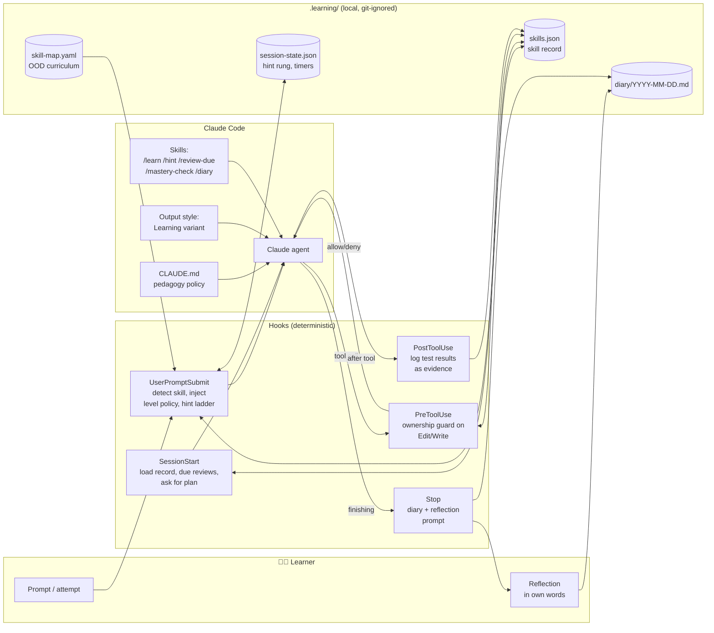

In het voorstel staan vijf deterministische hooks rond de Claude-agent, en staan het vaardighedenregister, het dagboek en de sessietoestand van de lerende in een lokale map `.learning/`. CLAUDE.md, de output style en de skills bepalen het didactische gedrag van de agent, maar alleen de hooks dwingen regels af.

**Zoals gebouwd:** de installer zet vijf hooks in het project. Het diagram hieronder toont de vier die een sessie sturen, twee commando's die alleen de lerende draait, drie skills en één agent. De tabel in §5.4 voegt de vijfde toe (`session-end`, die alleen aantekeningen maakt) en de optionele poort op gebruikersniveau voor beoordeeld werk (`graded-gate.mjs`). Het voorstel had een vijfde hook (PostToolUse), een vaardighedenkaart in YAML en meer skills. Ik verving de vijfde hook door `check.mjs`, dat de lerende zelf draait, en de kaart door `skills.json`.

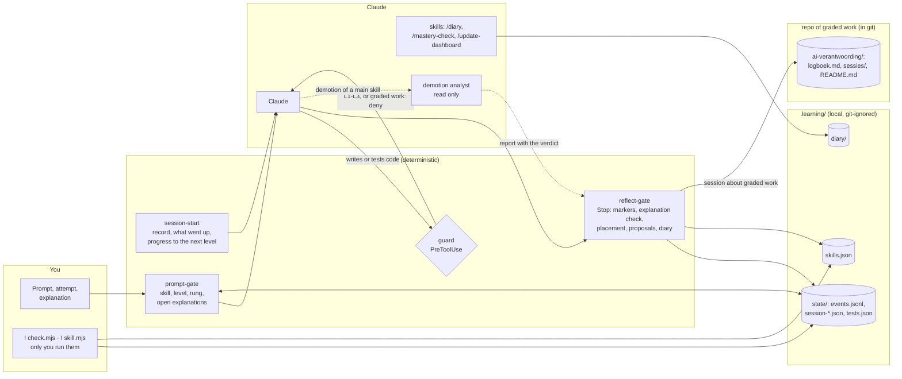

Zoals gebouwd zijn de hooks deterministisch. De guard blokkeert code op L1–L3, en elke schrijfactie in [beoordeeld werk](../how-it-works.md#beoordeeld-werk). De reflect-gate controleert markers en uitleg, plaatst een nieuwe vaardigheid en toont voorstellen. De demotie-analist leest alleen, en zijn rapport gaat naar de reflect-gate, niet de chat in.

**Ontwerpkeuzes.** Ik verdeelde het werk zo:

- **Regels die altijd moeten gelden, horen in hooks.** Hooks zijn deterministisch. Instructies in CLAUDE.md zijn *adviserend*: het model volgt ze meestal, maar in lange sessies kan het ervan afdrijven. Daarom moet de regel "schrijf geen code die van de lerende is" een hook zijn (P11).
- **Didactisch gedrag hoort in skills, CLAUDE.md en de output style.** Het gaat dan om socratische vragen, uitleg en de toon van de feedback.
- **De harnas bewaart de toestand in gewone bestanden** die de lerende kan lezen en bewerken (JSON/Markdown). Zo blijft het systeem transparant, en transparantie ondersteunt de autonomie van de lerende (P10).

<a id="52-de-autonomieladder-per-vaardigheid"></a>

### 5.2 Leerfasen (per vaardigheid)

**Label:** Sterk bewijs. Hulp die afneemt naarmate de expertise per vaardigheid groeit, is goed onderbouwd (P2); het aantal niveaus, de plaatsing en de drempels zijn pragmatische keuzes, hieronder aangegeven.

Ik gaf elke vaardigheid een eigen niveau. De vijf niveaus volgen cognitive apprenticeship en uitgewerkte voorbeelden die stap voor stap worden afgebouwd. Bovenaan staat automatisering.

| Niveau | Naam | Wie schrijft de code? | Rol van de AI | De lerende moet… | Onderbouwing |
|---|---|---|---|---|---|
| **L0** | *Voordoen* | AI | Schrijft een uitgewerkt voorbeeld met **labels voor subdoelen** en legt het uit | Tekstinvoer geven (bedoeling en eisen), daarna 2–3 belangrijke regels **zelf uitleggen** en de uitvoer voorspellen | Uitgewerkte voorbeelden, subdoelen, zelfuitleg |
| **L1** | *Aanvullen* | AI schrijft het skelet, de lerende schrijft de kern | Schrijft een raamwerk met `TODO(human)`-gaten, of fragmenten in Parsons-stijl | De gaten invullen en de tests draaien | Aanvul- en Parsons-opgaven, achterwaarts afbouwen |
| **L2** | *Begeleid* | De lerende | Alleen de hintladder: vraag → concept → pseudocode → gedeeltelijk codefragment (laatste redmiddel, pas na een wachttijd) | Alles zelf schrijven, om hints vragen | Scaffolding, contingente begeleiding, wenselijke moeilijkheid |
| **L3** | *Zelfstandig* | De lerende | Beoordeelt **na** de poging van de lerende: codereview, ontwerpkritiek, ideeën voor tests | Het alleen oplossen en daarna de gemaakte keuzes verdedigen | Doelbewust oefenen (deliberate practice), feedback |
| **L4** | *Geautomatiseerd* | AI | Schrijft de code. De lerende **controleert** de diff en voorspelt bij steekproeven de aanpak | Toezicht houden, plus af en toe een ophaaloefening om het bij te houden | Autonome fase, automatiseringsniveaus, ironieën van automatisering |

**Zoals gebouwd:** een nieuwe vaardigheid begint met een poging van de lerende, en de hoogste hinttrede van de eerste taak bepaalt haar niveau. Daarna kan een vaardigheid automatisch omlaag als `autoDemote` aan staat (standaard staat het uit), maar omhoog blijft altijd de beslissing van de lerende, en herhalingen om haar bij te houden bestaan alleen op L4.

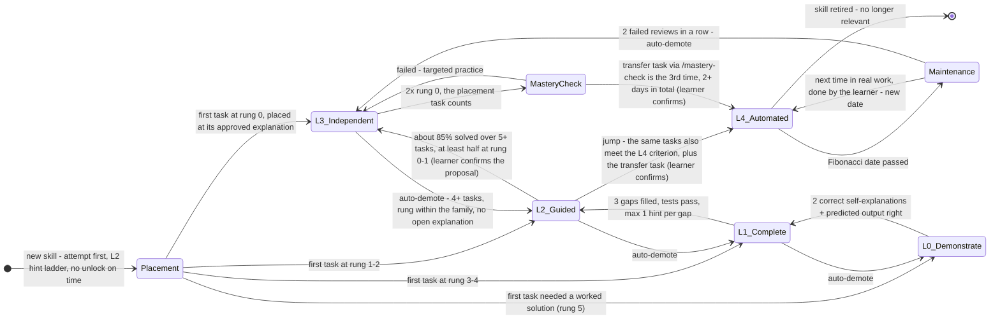

- **Plaatsing.** Een vaardigheid onder L4 zonder geschiedenis en zonder eigen uitgelegde taken heeft een open plaatsing. Tot dan telt ze als L2, voor de hintladder en voor de guard. Een nieuwe vaardigheid begint dus niet op L0: L0 en L1 zijn vormen van hulp die pas *na* een poging komen (P1). De hoogste trede van de eerste taak bepaalt het niveau (§5.3), bij de goedgekeurde uitleg van die taak; hulp over een ander concept telt niet mee. *Pragmatische keuze:* één taak is een onnauwkeurige meting, dus vangt automatisch omlaag een te hoge plaatsing op, en corrigeert de lerende een te lage plaatsing met `set`.
- **Drempels om door te stromen.** De criteria in het diagram (2 keer een juiste zelfuitleg, 3 ingevulde gaten, ongeveer 85% gelukt over 5 of meer taken, en 3 keer zonder hint op minstens 2 dagen, waarvan één keer de transfertaak) zijn een *pragmatische keuze*. De 85% is een vuistregel (P4), geen bevinding; de transfertaak volgt P6.
- **Automatisch omlaag** gebeurt alleen als `settings.autoDemote` aan staat; standaard staat het uit. De regel kijkt naar de eigen uitgelegde taken van de vaardigheid sinds haar laatste niveauwijziging, hooguit de laatste 10. Bij minstens 4 daarvan geldt hij als minder dan 70% gelukt is (op trede ≤ 2 binnen de eigen familie) of als de laatste 2 niet gelukt zijn. Hij geldt ook na 2 mislukte herhalingen op rij. Hij wacht zolang er een uitleg van die familie openstaat, en een verlaging die openstaat wordt opnieuw gecontroleerd op het bewijs van het moment waarop hij wordt uitgevoerd. Een microvaardigheid gaat dan één niveau omlaag. Bij een hoofdvaardigheid beslist eerst de demotie-analist of een microvaardigheid of de hoofdvaardigheid omlaag gaat (zie [Hoe het werkt](../how-it-works.md#doorstromen-en-herhalingen)). *Pragmatische keuze:* de drempels (4 taken, 70%, 2 op rij) zijn van mij, en de regel zit achter een instelling die standaard uit staat, omdat hij alleen op betrouwbare gegevens mag draaien.
- **Omhoog** gaat nooit automatisch. De lerende kan elke automatische wijziging terugdraaien met `set`.
- **L3 → L4:** de taak die de vaardigheid plaatste telt mee, en de transfertaak is één van de drie keer zonder hint; haar dag telt als een dag.

> **"Alleen tekstinvoer geven"** is L0. De lerende beschrijft bedoeling en eisen in gewone tekst, en de AI schrijft een volledig toegelicht voorbeeld. Ook hier is de lerende nooit helemaal passief: op L0 geeft die een korte zelfuitleg of voorspelling voordat de sessie als vooruitgang telt ([Chi et al., 1989](https://doi.org/10.1207/s15516709cog1302_1); [Kazemitabaar et al., 2025](https://doi.org/10.1145/3708359.3712104)). Zoals gebouwd komt L0 alleen na een poging.

### 5.3 Frictie afstemmen en de hintladder

**Label:** Beperkt bewijs. Hulp in stappen heeft matige steun, en hulp die elk succes en elke mislukking volgt, heeft zwakke steun (P3); het succesdoel en de vastloop-timer zijn pragmatische keuzes.

De hintladder brengt twee ideeën in de praktijk: contingente begeleiding (meer hulp na een mislukking, minder na succes; §2.3) en productief worstelen (§2.2). Het bewijs voor hulp in stappen is matig (P3); voor het meebewegen zelf is het zwak (§2.3). Ik koos voor hulp pas na een eigen poging, omdat dat past bij de ene klasstudie waarin meebewegen wel hielp: na een langere tijd zelfstandig werken ([van de Pol et al. 2015](https://doi.org/10.1007/s11251-015-9351-z)). De lerende krijgt de volgende trede pas na **(a)** een zichtbare poging, zoals veranderde code of een uitgesproken hypothese, **of (b)** als de vastloop-timer afloopt. Die regel houdt het worstelen productief, zodat het niet omslaat in doelloos ploeteren.

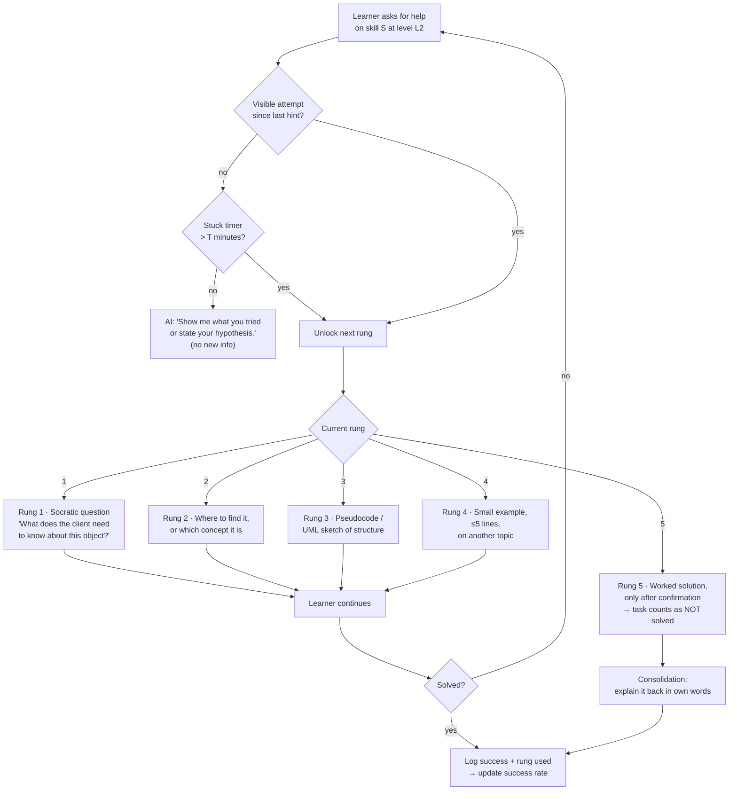

Op niveau L2 ontgrendelt de volgende trede van de hintladder pas na een zichtbare poging, of als de vastloop-timer afloopt. De vijf treden lopen van een socratische vraag tot een uitgewerkte oplossing; een taak die de uitgewerkte oplossing nodig heeft, telt als mislukt. *Pragmatische keuze:* de vijf treden en wat elke trede geeft, zijn van mij; hun volgorde, van de minste hulp naar de meeste, volgt de getrapte hints (P3).

**Regels voor het afstemmen** (contingente begeleiding). *Pragmatische keuze:* het doel van ongeveer 85% succes is een vuistregel, net als de grenzen hieronder; §2.2 legt uit waarom dat een heuristiek is en geen bewijs.

- De harnas houdt per vaardigheid een **voortschrijdend succespercentage** bij. Daarbij tellen alleen successen op trede ≤ 2.
- **> 95%** → te makkelijk. Maak de taken moeilijker, of wissel af met andere vaardigheden (interleaving). Controleer of de lerende aan de criteria voor het volgende niveau voldoet.
- **70–95%** → in de zone. Ga zo door.
- **< 70%** → te moeilijk. Verkort de vastloop-timer `T` (bijv. 15 → 8 min), kies makkelijkere taken of ga één niveau omlaag.
- Voor L2 begint `T` op **10–15 minuten**. *Beperkt bewijs:* dat valt binnen de tijd waarin verwarring nog productief kan zijn ([D'Mello et al., 2014](https://doi.org/10.1016/j.learninstruc.2012.05.003)). De lerende kan `T` aanpassen.

**Zoals gebouwd:** bij een **nieuwe vaardigheid** waarvan de plaatsing nog open is (§5.2), ontgrendelen treden **niet** op tijd. Een trede gaat alleen omhoog als de lerende:

- zegt vast te zitten;
- dezelfde fout of testuitkomst twee keer deelt;
- zegt het concept niet te kennen.

Vraagt de lerende na een eigen poging om meer uitleg, dan mag Claude meteen naar trede 4 gaan. De trede die Claude echt geeft, wordt gelogd via de marker `[trede N]`, en die telt mee voor de plaatsing. *Pragmatische keuze:* hier meet de trede het niveau, dus mag tijd alleen de trede niet verhogen. Bij gewone L2-taken is de vastloop-timer `T` 12 minuten, maar hij telt alleen actieve tijd: een pauze langer dan `idleMinutes` (standaard 20) telt niet mee. *Pragmatische keuze:* 12 en 20 minuten zijn instellingen, geen bevindingen, en doordat alleen actieve tijd telt, ontgrendelt een pauze geen trede zonder poging.

### 5.4 Hook-pipeline

**Label:** Pragmatische keuze. Elke taak zit bij de gebeurtenis in Claude Code waarop ze kan ingrijpen; dat is techniek, geen bevinding uit onderzoek.

Het eerste diagram volgt één sessie in het voorstel en laat zien wanneer elke hook ingrijpt.

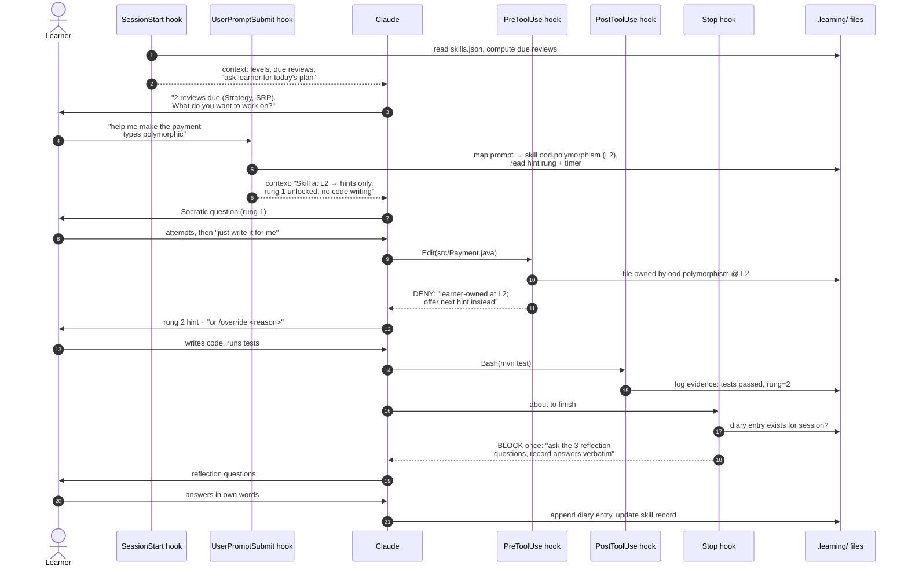

In een voorbeeldsessie blokkeert de PreToolUse-hook dat Claude een bestand van een L2-vaardigheid bewerkt, dus geeft Claude in plaats daarvan de volgende hint. Aan het eind blokkeert de Stop-hook één keer, zodat Claude drie reflectievragen stelt en de lerende die in eigen woorden beantwoordt.

**Zoals gebouwd:** dezelfde sessie met de hooks van de bouw en de testrunner `check.mjs`.

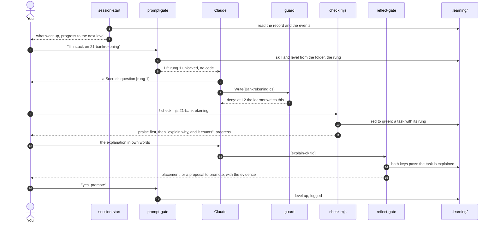

Zoals gebouwd draait de lerende de tests met `check.mjs`. Dat logt de taak, geeft eerst lof en toont de voortgang van de lerende. De reflect-gate keurt de uitleg goed met twee sleutels. Een plaatsing of een voorstel om door te zetten komt van de harnas zelf, en alleen het eigen "ja, doorzetten" van de lerende zet het niveau hoger.

De tabel geeft de taak van elke hook in het voorstel en, waar die afwijkt, in de bouw.

| Hook | Gebeurtenis | Taak | Kan hij blokkeren? |
|---|---|---|---|
| `session-start.mjs` | `SessionStart` | *Voorstel:* geeft Claude een samenvatting van het vaardighedenregister van de lerende, de herhalingen die vandaag aan de beurt zijn, en de instructie om de lerende naar een plan te vragen (*vooruitdenken*). *Zoals gebouwd:* geen herhalingen bij de start; hij toont wat de laatste 7 dagen omhoog ging, de voortgang naar het volgende niveau in stappen, en één keer dat moeite het doel is | Nee (alleen context) |
| `prompt-gate.mjs` | `UserPromptSubmit` | Koppelt de prompt van de lerende aan een vaardigheid met trefwoorden uit `skill-map.yaml`, voegt het beleid voor dat niveau en de huidige hinttrede toe, start de vastloop-timer of werkt die bij, en handelt `/override` af. *Zoals gebouwd* negeert hij ook agentrapporten, taakmeldingen en systeemherinneringen, en logt hij `prompt-ignored` | Kan context toevoegen. Kan alleen blokkeren bij patronen van misbruik (optioneel) |
| `ownership-guard.mjs` | `PreToolUse` (matcher `Edit\|Write\|MultiEdit\|NotebookEdit`) | Blokkeert bewerkingen door de AI in bestanden, of delen van bestanden, die horen bij een vaardigheid op L1–L3. Op L1 laat hij een schrijfactie alleen toe als er `TODO(human)`-gaten in staan. *Zoals gebouwd:* `guard.mjs`, die ook bouwen en testen op L1–L3 blokkeert | **Ja** (`permissionDecision: deny`) |
| `check.mjs` (gebouwd in plaats van het voorgestelde `evidence-log.mjs`) | CLI, die de lerende start met `!` (het voorstel gebruikte `PostToolUse`) | De lerende draait de tests, dus een PostToolUse-hook zou ze nooit zien. `check.mjs` draait `dotnet test` met een trx-logger, toont een leesbare samenvatting, onthoudt per testmethode of die groen was, en logt een overgang van rood naar groen als taak, samen met de huidige hinttrede. Het werkt voor elk .NET-testproject (oefenopgaven en projectwerk) | Nee |
| `reflect-gate.mjs` | `Stop` | Als de lerende aan een vaardigheid heeft gewerkt en er nog geen dagboeknotitie is, blokkeert hij **één keer** en zegt hij tegen Claude dat de reflectie moet gebeuren. Hij gebruikt `stop_hook_active` om lussen te voorkomen. *Zoals gebouwd* leest hij ook het laatste antwoord van Claude uit het transcript en verwerkt hij de markers `[trede N]` en `[uitleg-ok <tid>]`. Die tweede marker telt alleen als het eigen bericht van de lerende door de deterministische uitlegcontrole komt. Bij een goedgekeurde uitleg plaatst hij een nieuwe vaardigheid; hij controleert een verlaging die openstaat opnieuw; en hij leest het oordeel van de demotie-analist uit het rapport van de agent. Hij logt controlevragen, noteert wanneer Claude naar het zelfvertrouwen vroeg, en schrijft de eigen woorden van de lerende in het AI-logboek | Ja, één keer |
| `session-end.mjs` | `SessionEnd` | *Alleen in de bouw:* noteert hoe een sessie eindigde en of er werk was zonder dagboek, zodat de volgende start een inhaaldagboek kan aanbieden | Nee |
| `graded-gate.mjs` (gebruikersniveau, optioneel) | `UserPromptSubmit` en `PreToolUse`, in elk project buiten de beoordeelde map | *Alleen in de bouw:* houdt een prompt tegen die de beoordeelde opdracht noemt en weigert elke tool op de paden ervan, ook lezen; de setup (`.claude/`, `CLAUDE.md`) blijft open | **Ja** |

!!! example "Voorbeeld: de situatie van één student"
    De harnas werd voor het eerst uitgeprobeerd door een tweedejaarsstudent HBO-ICT die OOD oefende in C#. Bij de oefenopgaven van de cursus hoorden .NET-unittests, en die draaide de student zelf, niet Claude. Daarom draait `check.mjs` het commando `dotnet test`. De diagrammen en voorbeelden in deze sectie gebruiken nog Java uit het oorspronkelijke ontwerp (`mvn test`, `src/Payment.java`).

### 5.5 Vaardighedenregister (datamodel)

**Label:** Pragmatische keuze. Het register leent ideeën van knowledge tracing en gespreide herhaling, maar de velden zijn een praktische beslissing, geen getest model.

In het vaardighedenregister houdt de harnas de voortgang van de lerende bij. In het voorstel volgt het register het idee van knowledge tracing (per vaardigheid een kans op beheersing, die wordt bijgewerkt op basis van bewijs) en de planning van gespreide herhalingen. Het onderwerp is OOD, dus staat het register hier als klassendiagram:

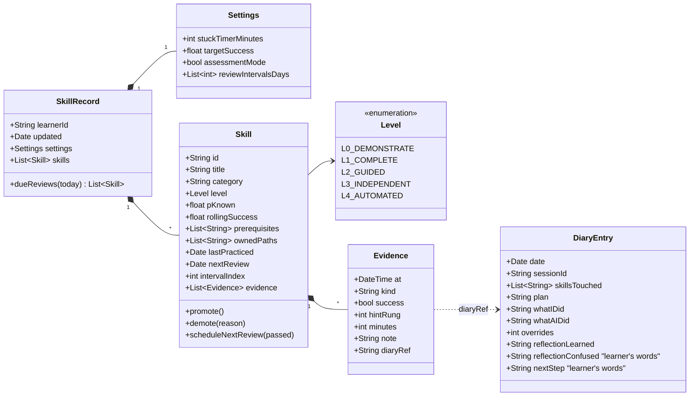

Zoals ontworpen geeft het vaardighedenregister elke vaardigheid een niveau (L0–L4), een kans op beheersing, datums voor herhalingen en eigen bewijs. Elk bewijsstuk legt vast of het lukte, met welke hinttrede en in hoeveel minuten, en kan verwijzen naar een dagboeknotitie.

**Voorbeeld van een item in `skills.json` (voorstel):**

```json
{
  "id": "ood.strategy-pattern",
  "title": "Strategy pattern",
  "category": "design",
  "level": "L3_INDEPENDENT",
  "pKnown": 0.82,
  "rollingSuccess": 0.86,
  "prerequisites": ["ood.polymorphism", "ood.interfaces"],
  "ownedPaths": ["src/main/java/shop/pricing/**"],
  "lastPracticed": "2026-11-05",
  "nextReview": "2026-11-12",
  "intervalIndex": 1,
  "evidence": [
    {"at": "2026-11-03T14:10", "kind": "task", "success": true, "hintRung": 1, "minutes": 22, "diaryRef": "2026-11-03#s2"},
    {"at": "2026-11-05T10:02", "kind": "task", "success": true, "hintRung": 0, "minutes": 14, "diaryRef": "2026-11-05#s1"}
  ]
}
```

**Zoals gebouwd:** het register is platter dan het klassendiagram hierboven. Elk item heeft `id`, `title`, `level`, `paths`, `nextReview`, `intervalIndex`, `failStreak` en `history`. De harnas slaat bewijs niet op in de vaardigheid zelf. Het bewijs komt in een log dat alleen groeit (append-only), `.learning/state/events.jsonl`, met gebeurtenissen zoals `task`, `task-explained`, `test-green`, `hint-unlock` en `review`. **Microvaardigheden** zijn onderdelen van een vaardigheid: items met een `parent` en hun eigen `keywords`:

```json
{ "id": "cs.basis.void-chaining", "parent": "cs.basis", "title": "void-methoden en chainen",
  "level": "L2", "keywords": ["reverse()", "chainen", "void"], "nextReview": null, "intervalIndex": 0 }
```

### 5.6 AI-dagboek en reflectielus

**Label:** Beperkt bewijs. Schrijven als antwoord op vaste vragen heeft experimentele steun (P9); de drie vragen, de schaal voor vertrouwen en de kalibratiecontrole zijn pragmatische keuzes.

Het dagboek volgt de cyclus van zelfregulerend leren ([Zimmerman, 2002](https://doi.org/10.1207/s15430421tip4102_2)) en gebruikt **leerprotocollen met prompts** ([Nückles et al., 2009](https://doi.org/10.1016/j.learninstruc.2008.05.002)): de lerende schrijft als antwoord op een paar vaste vragen. De AI legt de feiten vast. De lerende schrijft de reflectie. Ik verdeelde het zo, zodat de reflectie het eigen werk van de lerende blijft (P9).

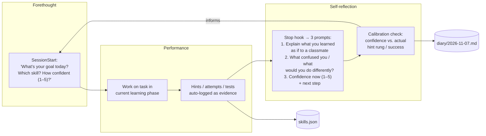

De dagboek- en reflectielus loopt van vooruitdenken (doel en vertrouwen) via uitvoering (werk, gelogd als bewijs) naar zelfreflectie bij de Stop-hook. Een kalibratiecontrole vergelijkt het vertrouwen van de lerende met de werkelijke hinttrede en het succes, en dat gaat mee in het volgende plan.

**Sjabloon voor een dagboeknotitie** (bijvoorbeeld `.learning/diary/2026-11-07.md`):

```markdown
## Session 2 · 14:05–15:10 · skills: ood.polymorphism (L2), ood.srp (review)

**Plan (me):** Refactor PaymentProcessor so new payment types don't need if/else. Confidence: 2/5

**Facts (logged):**
- Hint rungs used: 1, 2 (no rung ≥3) · stuck timer fired: 0×
- Tests: 3 runs, last ✅ 12/12
- AI wrote: test skeleton only · I wrote: Payment interface, 3 implementations
- Overrides: 0 · Review SRP: passed → next review 2026-11-14

**Reflection (my words):**
1. *Learned:* The if/else on type was a smell; each payment class now owns its own `process()` behaviour...
2. *Confused / differently:* Not sure whether `validate()` belongs in the interface or a separate validator...
3. *Confidence now:* 4/5 · *Next:* try the same with discounts (Strategy?)

**Calibration:** predicted 2 → performed at rung ≤2 → under-confident ✅ (good sign)
```

**Wekelijkse terugblik op het dagboek** (15 minuten, `/diary --week`): Claude vat de trends van de week samen: het succespercentage per vaardigheid, het aantal overrides, de verschillen in kalibratie en de vaardigheden die het dichtst bij het volgende niveau zitten. *De lerende* bepaalt waar de focus volgende week ligt. Zo helpt de terugblik de lerende om het eigen leren in de gaten te houden, zonder dat de terugblik dat overneemt. *Pragmatische keuze:* het wekelijkse ritme en de 15 minuten zijn van mij.

### 5.7 Gespreide herhaling na beheersing

**Label:** Sterk bewijs. Gespreid oefenen en ophalen zijn goed onderbouwd (P8); het bewijs voor groeiende intervallen is zwak, dus het precieze schema is een pragmatische keuze.

Als de lerende een vaardigheid beheerst, blijft de harnas die af en toe controleren. In het voorstel gebruiken herhalingen **groeiende intervallen**, aangepast aan de resultaten van de lerende in de stijl van Leitner en half-life regression. Ook **wisselen** ze vaardigheden **af**, en dat traint de lerende in het kiezen van het juiste principe. Het is niet bewezen dat groeiende intervallen beter werken dan gelijke intervallen (§2.5). Het werk zit in spreiding en ophalen. Het schema zorgt er vooral voor dat vroege herhalingen lukken en dat herhalingen vóór de toets vallen. Herhalingstaken zijn *ophaal*taken, geen herlezen:

- *"Zonder te kijken: schets het klassendiagram voor een calculator voor verzendkosten die op Strategy is gebaseerd."*
- *"Hier zijn 3 codefragmenten. Welke schendt LSP, en waarom?"* (onderscheiden bij afwisseling)
- *"Voorspel hoe het ontwerp van de AI voor X eruitziet voordat de AI het genereert, en vergelijk dan."* Deze toezichtcontrole is bedoeld voor L4-vaardigheden.

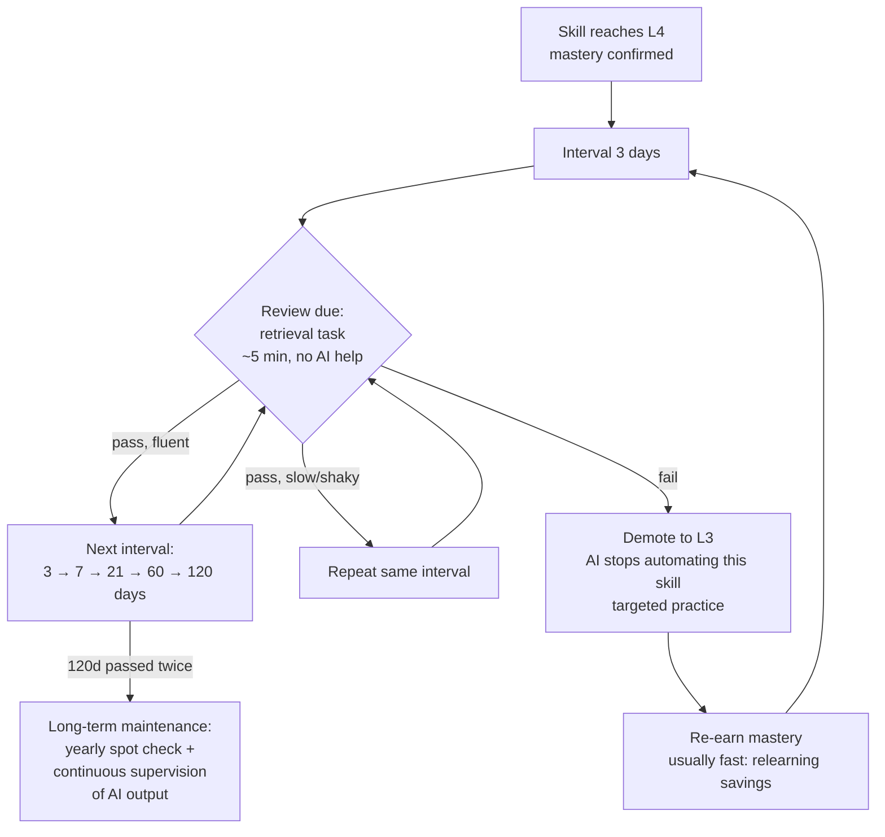

In het voorstel krijgt een L4-vaardigheid herhalingen met een ophaaltaak zonder AI, op groeiende intervallen: 3, 7, 21, 60 en 120 dagen. Is de herhaling wankel, dan blijft het interval gelijk; mislukt ze, dan gaat de vaardigheid terug naar L3 en stopt de AI met automatiseren. *Pragmatische keuze:* deze intervallen zijn van mij; het bewijs voor groeiende intervallen is zwak (P8).

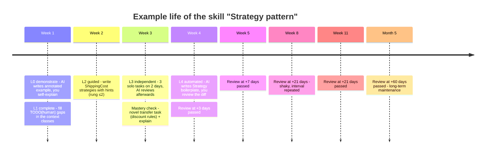

In een voorbeeldtijdlijn uit het voorstel gaat de vaardigheid "Strategy pattern" van L0 in week 1 naar L4 in week 4. Daarna wordt ze nog gecontroleerd, steeds minder vaak, en na een wankele herhaling op +21 dagen blijft dat interval gelijk.

In het voorstel toont de **`SessionStart`-hook** aan het begin van elke sessie de herhalingen die aan de beurt zijn. Zo gebeurt het versterken vanzelf, en hoeft de lerende er niet aan te denken. Dit is het deel "leren afdwingen zolang dat nodig is": een vaardigheid is *nooit voorgoed buiten beeld*. Ze wordt alleen steeds minder vaak gecontroleerd.

**Zoals gebouwd:** herhalingen gebeuren in het echte werk van de lerende, en alleen op L4. *Pragmatische keuze:* dat een vaardigheid toevallig in echt werk langskomt, garandeert geen spreiding. Dat accepteerde ik, omdat de opdrachten op elkaar voortbouwen, waardoor vaardigheden vanzelf afwisselen, en omdat de oefentoetsen van het vak het vangnet zijn.

- **Geen losse herhaaloefeningen.** Een herhaling is de **eerstvolgende keer dat de vaardigheid in het echte werk van de lerende langskomt** na haar datum: via haar map, haar trefwoorden of een run van `check.mjs` die eraan gekoppeld is. De hook meldt dat dan één keer. Deze keer doet de lerende dat deel, niet de AI: zolang de herhaling klaarstaat, behandelt de guard de paden van de vaardigheid als L3.
- **Fibonacci-intervallen:** 1, 2, 3, 5, 8, 13, 21, 34 … dagen, **alleen voor vaardigheden en microvaardigheden op L4**. Een vaardigheid op L3 heeft geen schema nodig, want die doet de lerende zodra ze langskomt. *Pragmatische keuze:* de reeks begint kort, zodat vroege herhalingen meestal lukken; geen enkele groeiende reeks heeft sterk bewijs achter zich (P8).
- **De trede van die taak bepaalt de uitkomst** (*pragmatische keuze*: alleen trede 0 telt als geslaagd):
    - trede 0 → `pass`, één stap omhoog in de reeks;
    - trede 1–2 → `shaky`, het interval herhaalt zich;
    - trede 3–5 of een mislukte taak → `fail`, **twee stappen terug**.
- **Na twee keer `fail` op rij:** de regel voor automatisch omlaag geldt (§5.2). Staat `autoDemote` uit, dan krijgt de lerende het advies om één niveau omlaag te gaan.
- **Als de vaardigheid niet langskomt:** dan gebeurt er niets, en wacht de herhaling. Bij het begin van een sessie verschijnt niets. Het dashboard toont geen "te laat", alleen wanneer de lerende de vaardigheid het laatst zag.
- **Voor de toets:** als `settings.examDate` is ingesteld, valt een herhaling uiterlijk 3 dagen voor de toets (*pragmatische keuze*). Het vangnet vóór de toets zijn de oefentoetsen van het vak. Die staan bewust buiten de harnas.

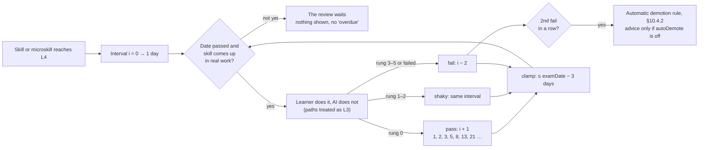

Zoals gebouwd wordt een L4-vaardigheid herhaald zodra ze na haar datum in echt werk langskomt; dat deel doet de lerende. Trede 0 zet het Fibonacci-interval één stap omhoog, trede 1–2 herhaalt het, en trede 3–5 of een mislukking zet het twee stappen terug.

### 5.8 OOD-vaardighedenkaart

**Label:** Pragmatische keuze. De kaart volgt één vak (de opdrachten, het eindassessment en de gaten uit een diagnostische toets), geen leertheorie.

De OOD-kaart in de harnas (`harness/maps/ood/skills.json`) is een lijst vaardigheden, elk met eigen opdrachtmappen en trefwoorden. Ik bouwde hem op uit de gaten die de diagnostische toets liet zien. Er hoort ook het OO-ontwerp bij dat het eindassessment van het vak beoordeelt: polymorfie, SOLID en modulariteit, lagen met controllers en dependency injection, en het UML-sequentie- en componentdiagram. Daarna legde ik de kaart naast de toetsbeschrijving, het beoordelingsformulier en de cheatsheet van de pilotstudent. Daaruit kwamen er tien bij: logging (indicator 3.1.1), integratie-, systeem- en UI-tests (indicator 3.1.4 en het testplan), en uit de cheatsheet upcasting en downcasting, static members, records en structs, object-methodes, overige C# (sealed, indexers, operator overloading, geneste klassen) en de drie families van ontwerppatronen. Een familie is één vaardigheid; oefent de lerende één patroon apart, dan wordt het een microvaardigheid.

De kaart heeft **geen voorkennis-relaties**. De volgorde komt uit de genummerde opdrachten, en een nieuwe vaardigheid begint met een plaatsing: de eerste taak van de lerende bepaalt het niveau (§5.2). Mist er iets, dan voegt de lerende een vaardigheid toe met `skill.mjs add`. *Pragmatische keuze:* de genummerde opdrachten van het vak bepalen de volgorde al, en een eerste poging bepaalt het niveau, dus de kaart heeft geen graaf nodig.

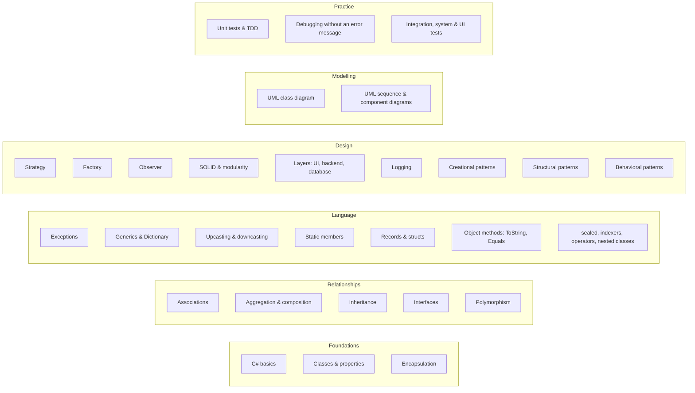

De vaardigheden van de OOD-kaart, per groep. Er lopen geen pijlen tussen: de volgorde komt uit de opdrachten, niet uit de kaart.

**Wat de kaart niet dekt.** Het eindassessment beoordeelt ook security, de cloud en een CI/CD-pipeline, de database en het verslag. Die zitten niet in de kaart; zo koos de pilotstudent. De guard beschermt wel de bestanden van zo'n project: naast C# ook `.razor`, `.cshtml`, `.sql`, de pipeline (`.yml`), `Dockerfile` en `appsettings*.json` (zie [Configuratie](../configuration.md)).

---

<a id="bijlage-implementatieschetsen"></a>

## Bijlage: implementatieschetsen {#appendix}

> Ik schreef deze **schetsen** vroeg, om te laten zien dat het ontwerp te bouwen is; de gebouwde code staat in de map `harness/` van de repository. De schetsen gaan uit van een `.claude/`-map op projectniveau en een `.learning/`-datamap. Ze gebruiken Node.js, omdat Claude Code dat al nodig heeft. Zo werken ze op Windows, macOS en Linux op dezelfde manier.

### A. Mapindeling

**Zoals gebouwd voor de pilot:**

```text
ood/
├── CLAUDE.md                     # authoritative rules for Claude (Dutch)
├── .claude/
│   ├── settings.json             # SessionStart, UserPromptSubmit, PreToolUse, Stop
│   ├── hooks/
│   │   ├── lib.mjs               # record, microskills, Fibonacci, tasks, explanation check
│   │   ├── session-start.mjs     # record + due reviews + open explanations + wins/advice
│   │   ├── prompt-gate.mjs       # skill/microskill detection, hint ladder, task logging
│   │   ├── guard.mjs             # PreToolUse: blocks writing/building/testing at L1–L3
│   │   ├── reflect-gate.mjs      # Stop: [trede N] / [uitleg-ok] markers + diary gate
│   │   ├── skill.mjs             # learner CLI (list, status, set, review, add-micro, done, …)
│   │   └── check.mjs             # learner test runner: trx → red→green evidence
│   └── skills/diary/SKILL.md
└── .learning/
    ├── skills.json               # record incl. microskills and settings.examDate
    ├── keywords.json
    ├── diary/JJJJ-MM-DD.md
    └── state/                    # events.jsonl, tests.json, session-*.json, overrides.json
```

*Oorspronkelijke schets:*

```text
ood/
├── CLAUDE.md                     # pedagogy policy (below)
├── .claude/
│   ├── settings.json             # hook registration
│   ├── hooks/
│   │   ├── lib.mjs               # read/write skills.json, skill detection
│   │   ├── session-start.mjs
│   │   ├── prompt-gate.mjs
│   │   ├── ownership-guard.mjs
│   │   ├── evidence-log.mjs
│   │   └── reflect-gate.mjs
│   └── skills/
│       ├── learn/SKILL.md        # ladder-aware tutoring protocol
│       ├── review-due/SKILL.md   # spaced retrieval quiz
│       ├── mastery-check/SKILL.md
│       └── diary/SKILL.md
└── .learning/                    # git-ignored
    ├── skill-map.yaml
    ├── skills.json
    ├── session-state.json
    └── diary/2026-11-07.md
```

### B. `.claude/settings.json` (registratie van de hooks)

```json
{
  "hooks": {
    "SessionStart": [
      { "hooks": [{ "type": "command", "command": "node \"$CLAUDE_PROJECT_DIR/.claude/hooks/session-start.mjs\"" }] }
    ],
    "UserPromptSubmit": [
      { "hooks": [{ "type": "command", "command": "node \"$CLAUDE_PROJECT_DIR/.claude/hooks/prompt-gate.mjs\"" }] }
    ],
    "PreToolUse": [
      { "matcher": "Edit|Write|MultiEdit|NotebookEdit",
        "hooks": [{ "type": "command", "command": "node \"$CLAUDE_PROJECT_DIR/.claude/hooks/ownership-guard.mjs\"" }] }
    ],
    "PostToolUse": [
      { "matcher": "Bash",
        "hooks": [{ "type": "command", "command": "node \"$CLAUDE_PROJECT_DIR/.claude/hooks/evidence-log.mjs\"" }] }
    ],
    "Stop": [
      { "hooks": [{ "type": "command", "command": "node \"$CLAUDE_PROJECT_DIR/.claude/hooks/reflect-gate.mjs\"" }] }
    ]
  }
}
```

### C. `ownership-guard.mjs` (de kern van de handhaving)

```js
// PreToolUse: deny AI edits to learner-owned code for skills at L1–L3.
import { readStdin, loadSkills, skillForPath, isOverrideActive } from "./lib.mjs";

const input = JSON.parse(await readStdin());
const file = input.tool_input?.file_path ?? input.tool_input?.notebook_path;
if (!file) process.exit(0);

const skills = loadSkills();
const skill = skillForPath(skills, file);           // matches ownedPaths globs
if (!skill || isOverrideActive(skill.id)) process.exit(0);

const newText = input.tool_input?.content ?? input.tool_input?.new_string ?? "";
const level = skill.level;

let deny = null;
if (level === "L1_COMPLETE" && !newText.includes("TODO(human)")) {
  deny = `Skill '${skill.title}' is at L1 (complete). You may write scaffolding only ` +
         `if the core logic is left as TODO(human) gaps for the learner.`;
}
if (level === "L2_GUIDED" || level === "L3_INDEPENDENT") {
  deny = `Skill '${skill.title}' is at ${level}. The learner writes this code. ` +
         (level === "L2_GUIDED" ? "Offer the next hint rung instead." :
                                  "Only review after the learner's attempt.") +
         ` The learner can type /override <reason> to bypass (logged).`;
}

if (deny) {
  console.log(JSON.stringify({
    hookSpecificOutput: {
      hookEventName: "PreToolUse",
      permissionDecision: "deny",
      permissionDecisionReason: deny
    }
  }));
}
process.exit(0);
```

### D. `prompt-gate.mjs` (niveaubeleid en hintladder injecteren)

```js
// UserPromptSubmit: detect skill, inject ladder policy + hint rung as context.
import { readStdin, loadSkills, detectSkills, loadState, saveState, logOverride } from "./lib.mjs";

const { prompt, session_id } = JSON.parse(await readStdin());
const skills = loadSkills();
const state = loadState(session_id);

if (prompt.trim().startsWith("/override")) {
  logOverride(state.activeSkill, prompt);           // goes to diary + evidence
}

const hits = detectSkills(skills, prompt);          // keyword map from skill-map.yaml
const POLICY = {
  L0_DEMONSTRATE: "Write a worked example with subgoal labels. Then ask the learner to self-explain 2 lines and predict an output before moving on.",
  L1_COMPLETE:    "Write scaffolding only; leave the core logic as TODO(human). Wait for the learner, then give feedback.",
  L2_GUIDED:      "Do NOT write the solution. Use the hint ladder. Current unlocked rung: {rung}. Require a visible attempt before going higher.",
  L3_INDEPENDENT: "Do NOT write or hint unless asked for review AFTER an attempt. Then give a code/design review with questions.",
  L4_AUTOMATED:   "You may implement directly. Before generating, ask the learner to predict the approach in one sentence; show a reviewable diff."
};

const now = Date.now();
const minutesStuck = (now - (state.lastProgressAt ?? now)) / 60000;
const rung = Math.min(5, (state.rung ?? 0) + (minutesStuck >= skills.settings.stuckTimerMinutes ? 1 : 0));

const ctx = hits.map(s =>
  `[learning-harness] Skill ${s.id} is at ${s.level}. ${POLICY[s.level].replace("{rung}", rung)}`
).join("\n");

saveState(session_id, { ...state, activeSkill: hits[0]?.id ?? state.activeSkill, rung });
if (ctx) console.log(JSON.stringify({
  hookSpecificOutput: { hookEventName: "UserPromptSubmit", additionalContext: ctx }
}));
```

### E. `reflect-gate.mjs` (Stop: zorgen dat de reflectie één keer plaatsvindt)

```js
import { readStdin, loadState, diaryHasEntry } from "./lib.mjs";
const input = JSON.parse(await readStdin());
if (input.stop_hook_active) process.exit(0);        // never loop
const state = loadState(input.session_id);
if (state.activeSkill && !diaryHasEntry(input.session_id)) {
  console.log(JSON.stringify({
    decision: "block",
    reason: "Before finishing: ask the learner the 3 reflection questions " +
            "(learned / confused / confidence+next). Record their answers VERBATIM " +
            "with the logged facts via the /diary skill. Do not write the reflection yourself."
  }));
}
```

### F. Didactisch beleid in `CLAUDE.md` (fragment)

```markdown
# Learning policy (this project is for LEARNING OOD, not just shipping code)

- Treat `[learning-harness]` context as binding for the named skill.
- Never write the learner's reflection; record their words verbatim.
- Prefer explanations, questions and reviews over solutions unless the skill is L4.
- For design skills: ask the learner to propose classes/responsibilities/UML FIRST,
  then critique with trade-off questions (why this abstraction? what changes next?).
- When you are uncertain or the API might be wrong, say so and point to docs/tests.
- If the learner seems stuck >10–15 min or frustrated, offer the next hint rung —
  struggle should be productive, not punishing.
- Assessment mode (graded work): behave as L3 for every skill; log all AI help.
```

### G. Protocol van de skill `/mastery-check` (samenvatting)

1. Genereer een **nieuwe transfertaak** voor de vaardigheid, in een onbekend domein (bijv. Strategy voor belastingregels in plaats van verzending).
2. De lerende lost die op **zonder hints**. De `prompt-gate` behandelt trede = 0 als vergrendeld.
3. Stel 3 uitlegvragen: *waarom dit ontwerp?*, *wat gaat er mis met alternatief X?*, *wanneer zou je het NIET gebruiken?*
4. Beoordeel het met een rubric. Geslaagd betekent: een werkende oplossing, ≥ 2/3 uitlegantwoorden goed, en ≥ 2 zelfstandige successen in het vaardighedenregister op verschillende dagen.
5. Bij slagen: `level = L4`, `nextReview = today + 3d`. Bij zakken: blijf op L3 en log de concrete hiaten als focus voor de volgende sessie.
