# Ontwerp: principes en inrichting van Claude Code

!!! warning "Machinevertaling"
    Dit is een machinevertaling door Claude (Anthropic) van het [Engelse origineel](/research/design/). Een mens heeft de vertaling niet nagekeken. Bij twijfel geldt de Engelse tekst.

## 2.11 Synthese: ontwerpprincipes

| # | Principe | Bewijsbasis | Sterkte |
|---|---|---|---|
| P1 | **Eerst zelf proberen, dan hulp.** Je bedenkt eerst zelf iets, voordat de AI iets laat zien. Eerst proberen is op zich niet genoeg: het leren komt uit wat erna volgt. | Generatie-effect; productief falen (Sinha & Kapur 2021); Bastani 2025; Gajos & Mamykina 2022 (eerst proberen en dan het antwoord zien leverde geen leren op) | Matig |
| P2 | **Hulp volgt de expertise per vaardigheid en wordt afgebouwd.** | Expertise-omkeereffect; afgebouwde uitgewerkte voorbeelden; cognitief leerlingschap | Sterk |
| P3 | **Getrapte hints, na een eigen poging** (meer na falen, minder na succes). Dat de hulp elk succes en elke mislukking volgt, is het zwakkere deel. | Hulp in stappen: Belland et al. 2017 (meta-analyse, ḡ = 0,46); Aleven et al. 2003; Kestin 2025 (korte termijn). Het meebewegen: Wood & Wood 1999 (een tutor die het toepast); geen extra effect in Belland et al. 2017; alleen na langer zelfstandig werken in van de Pol et al. 2015; het klassieke experiment is niet gerepliceerd (Smit et al. 2025) | Laag tot matig: matig (getrapte hints), zwak (meebewegen) |
| P4 | **Houd oefening zo moeilijk dat je soms faalt** (als vuistregel ongeveer 70–90% succes), en begrens hoe lang je vastzit. | Wenselijke moeilijkheden; Kapur 2016; D'Mello 2014. Wilson et al. 2019 alleen als computationele inspiratie | Vuistregel |
| P5 | **Liever uitleg zonder het antwoord dan oplossingen.** Leg AI-uitvoer aan jezelf uit. | Gajos & Mamykina 2022; Bastani 2025 (tutorarm); Kazemitabaar 2025; Chi 1989 | Matig |
| P6 | **Beheersingspoort met transfer en uitleg**, niet alleen "het werkt". | Leren tot beheersing (winst op afgestemde toetsen; Kulik 1990, Slavin 1990); Corbett & Anderson; illusie van bekwaamheid (Đức Minh 2026; Eleftheriou 2026) | Matig |
| P7 | **Automatiseer pas na beheersing; blijf toezicht houden.** | Fitts & Posner; Bainbridge; Parasuraman & Manzey; vaardigheidsverlies (Budzyń 2025) | Matig |
| P8 | **Gespreide, afgewisselde ophaaloefening na beheersing; een niveau terug bij falen.** Gespreid oefenen telt zwaarder dan oplopende intervallen. | Cepeda 2008; Latimier 2021; Roediger & Karpicke; Arthur 1998; Tatel & Ackerman 2025 | Sterk (gespreid oefenen), zwak (oplopende intervallen) |
| P9 | **Reflectie die je zelf schrijft, in een gestructureerd dagboek.** | Nückles 2009; Zimmerman 2002; generatie-effect | Matig |
| P10 | **Handhaving die autonomie ondersteunt en transparant is**, en die je zelf hebt gekozen. | Ryan & Deci 2000; Ariely & Wertenbroch 2002; acceptatieprijs van forcing functions (Buçinca 2021) | Matig |
| P11 | **Handhaaf vangrails in de workflow, niet alleen in prompts.** | Barth 2026 (alleen prompts: geen effect); Oreopoulos 2026; Sankaranarayanan 2026; Teo 2026 (tutors helpen te veel) | Matig |
| P12 | **Oefen onder toetsomstandigheden vóór de toets**: op tijd, zonder AI, in de IDE van je toets, na eerst leren zonder druk. | Transfer-appropriate processing (Morris 1977); Pan & Rickard 2018; Hinze & Rapp 2014; Driskell 2001 | Matig (geen IDE-specifieke studie) |
| P13 | **Train toezicht als aparte vaardigheid**: AI-uitvoer lezen, testen, debuggen en specificeren, bij onderwerpen die je al zelf kunt schrijven. | Paradox van het toezicht (Anthropic 2025b); sollicitatievormen van werkgevers; CS1-LLM; Pădurean 2026; §2.9 | Afleiding, consistent over bronnen heen |
| P14 | **Niveaus informeren, ze belonen niet.** Geen punten, badges, reeksen of leaderboards: een niveau zegt welke hulp je krijgt, niet welke status je hebt. Toon voortgang ten opzichte van je eigen eerdere werk, niet ten opzichte van anderen. | Gamification: kleine effecten, alleen het cognitieve blijft staan in strenge studies (Sailer & Homner 2020); punten, levels en leaderboards verhoogden de hoeveelheid werk, niet de kwaliteit of de intrinsieke motivatie (Mekler et al. 2017); een vak met badges en een leaderboard ging samen met minder motivatie en lagere tentamencijfers (Hanus & Fox 2015, twee vakken vergeleken); beloningen die afhangen van prestatie verlaagden de motivatie bij vrije keuze (Deci et al. 1999); een gebroken reeks verlaagt de inzet (Silverman & Barasch 2023); feedback ten opzichte van je eigen werk werkte beter dan sociale vergelijking (Shih & Alexander 2000) | Matig (tegen het toevoegen van deze elementen) |

Samen genomen bouwen P1–P6 en P11 een vaardigheid op, besteden P7 en P13 die uit, en houdt P8 die op peil. P14 houdt de niveaus informatief, en toont voortgang ten opzichte van jezelf (§10.7). §2.12 past die afweging toe op junior developers op hun werk.


---

<a id="5-voorgestelde-inrichting-van-claude-code"></a>

## 5. Voorgestelde inrichting van Claude Code {#setup}

Deze sectie beschrijft wat de harnas tijdens een sessie doet, en waarom. Installeer je de harnas, dan is dit waarmee je werkt. Geef je les, dan zie je hier welke regels de harnas afdwingt en welke alleen advies aan de AI zijn.

### 5.1 Architectuur

De harnas bestaat uit een klein aantal onderdelen in je project: een `CLAUDE.md` met het didactische beleid, een output style, een paar skills, vijf hooks en een lokale map `.learning/` met je gegevens.

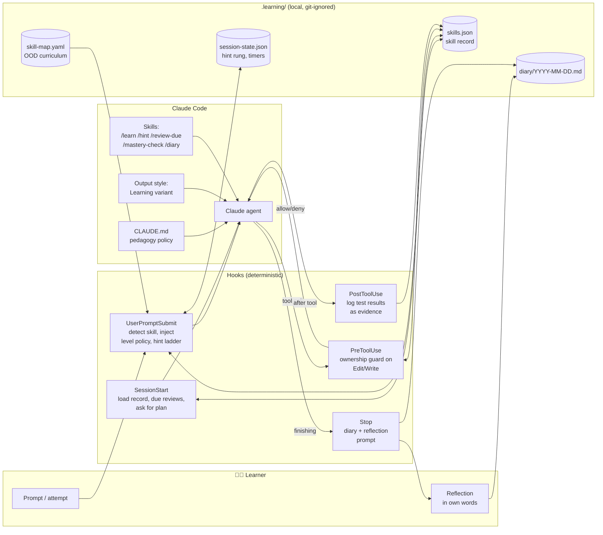

De harnas zet vijf deterministische hooks rond de Claude-agent, en bewaart je vaardighedenregister, dagboek en sessietoestand in een lokale map `.learning/`. CLAUDE.md, de output style en de skills bepalen het didactische gedrag van de agent, maar alleen de hooks dwingen regels af.

**Zoals gebouwd (12 november 2026):** vier hooks, twee commando's die alleen jij draait, drie skills en één agent. Het ontwerp hierboven had een vijfde hook (PostToolUse), een vaardighedenkaart in YAML en meer skills. De bouw verving die vijfde hook door `check.mjs`, dat je zelf draait, en de kaart door `skills.json` (§10).

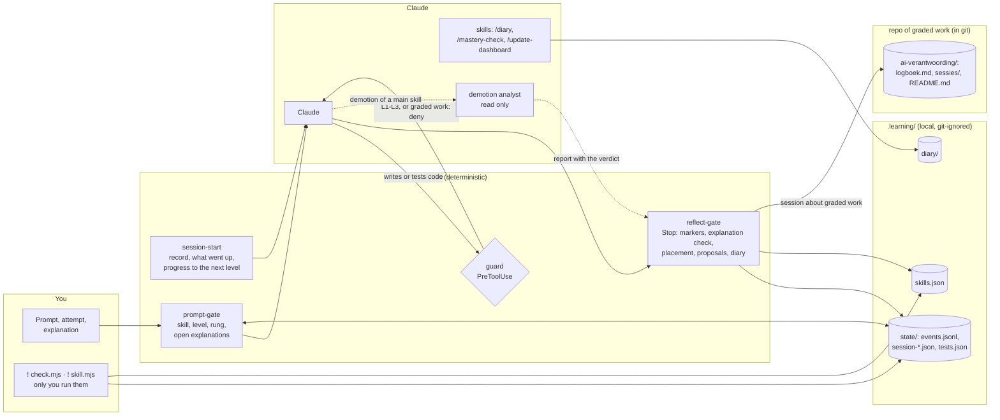

Zoals gebouwd zijn de vier hooks deterministisch. De guard blokkeert code op L1–L3, en elke schrijfactie in beoordeeld werk (§10.8). De reflect-gate controleert markers en uitleg, plaatst een nieuwe vaardigheid en toont voorstellen. De demotie-analist leest alleen, en zijn rapport gaat naar de reflect-gate, niet de chat in.

**Ontwerpkeuzes:**

- **Regels die altijd moeten gelden, horen in hooks.** Hooks zijn deterministisch. Instructies in CLAUDE.md zijn *adviserend*: het model volgt ze meestal, maar in lange sessies kan het ervan afdrijven. Daarom moet de regel "schrijf geen code die van jou is" een hook zijn.
- **Didactisch gedrag hoort in skills, CLAUDE.md en de output style.** Het gaat dan om socratische vragen, uitleg en de toon van de feedback.
- **De harnas bewaart de toestand in gewone bestanden** die je kunt lezen en bewerken (JSON/Markdown). Zo blijft het systeem transparant, en transparantie ondersteunt je autonomie (P10).

### 5.2 De autonomieladder (per vaardigheid)

De harnas geeft elke vaardigheid een eigen niveau. De vijf niveaus volgen cognitive apprenticeship en uitgewerkte voorbeelden die stap voor stap worden afgebouwd. Bovenaan staat automatisering.

| Niveau | Naam | Wie schrijft de code? | Rol van de AI | Jij moet… | Onderbouwing |
|---|---|---|---|---|---|
| **L0** | *Voordoen* | AI | Schrijft een uitgewerkt voorbeeld met **labels voor subdoelen** en legt het uit | Tekstinvoer geven (bedoeling en eisen), daarna 2–3 belangrijke regels **zelf uitleggen** en de uitvoer voorspellen | Uitgewerkte voorbeelden, subdoelen, zelfuitleg |
| **L1** | *Aanvullen* | AI schrijft het skelet, jij schrijft de kern | Schrijft een raamwerk met `TODO(human)`-gaten, of fragmenten in Parsons-stijl | De gaten invullen en de tests draaien | Aanvul- en Parsons-opgaven, achterwaarts afbouwen |
| **L2** | *Begeleid* | Jij | Alleen de hintladder: vraag → concept → pseudocode → gedeeltelijk codefragment (laatste redmiddel, pas na een wachttijd) | Alles zelf schrijven, om hints vragen | Scaffolding, contingente begeleiding, wenselijke moeilijkheid |
| **L3** | *Zelfstandig* | Jij | Beoordeelt **na** je poging: codereview, ontwerpkritiek, ideeën voor tests | Het alleen oplossen en daarna je keuzes verdedigen | Doelbewust oefenen (deliberate practice), feedback |
| **L4** | *Geautomatiseerd* | AI | Schrijft de code. Jij **controleert** de diff en voorspelt bij steekproeven de aanpak | Toezicht houden, plus af en toe een ophaaloefening om het bij te houden | Autonome fase, automatiseringsniveaus, ironieën van automatisering |

**Zoals gebouwd (10 november 2026, §10.4):** een nieuwe vaardigheid begint met jouw poging, en de eerste taak plaatst haar op een niveau. Omlaag gaat automatisch als het bewijs dat laat zien. Omhoog blijft jouw beslissing. Herhalingen om een vaardigheid bij te houden bestaan alleen op L4.

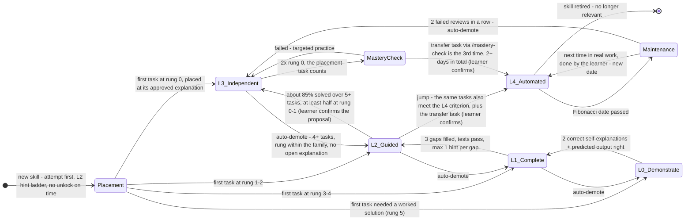

In de autonomieladder zoals gebouwd bepaalt de hoogste hinttrede van de eerste taak het niveau van een nieuwe vaardigheid. Daarna kan een vaardigheid automatisch omlaag, maar omhoog blijft altijd jouw beslissing, en herhalingen om haar bij te houden bestaan alleen op L4.

- **Plaatsing.** Een vaardigheid onder L4 zonder geschiedenis en zonder eigen uitgelegde taken heeft een open plaatsing. Tot dan telt ze als L2, voor de hintladder en voor de guard. Een nieuwe vaardigheid begint dus niet meer op L0: L0 en L1 zijn vormen van hulp die pas *na* een poging komen. De hoogste trede van de eerste taak bepaalt het niveau (§5.3), bij de goedgekeurde uitleg van die taak; hulp over een ander concept telt niet mee (§10.7).
- **Automatisch omlaag** gebeurt alleen als `settings.autoDemote` aan staat; standaard staat het uit. De regel kijkt naar de eigen uitgelegde taken van de vaardigheid sinds haar laatste niveauwijziging, hooguit de laatste 10. Bij minstens 4 daarvan (§10.7; tot 12 november 3) geldt hij als minder dan 70% gelukt is (op trede ≤ 2 binnen de eigen familie) of als de laatste 2 niet gelukt zijn. Hij geldt ook na 2 mislukte herhalingen op rij. Hij wacht zolang er een uitleg van die familie openstaat, en een verlaging die openstaat wordt opnieuw gecontroleerd op het bewijs van het moment waarop hij wordt uitgevoerd. Een microvaardigheid gaat dan één niveau omlaag. Bij een hoofdvaardigheid beslist eerst de demotie-analist of een microvaardigheid of de hoofdvaardigheid omlaag gaat (§10.4.2).
- **Omhoog** gaat nooit automatisch. Elke automatische wijziging kun je terugdraaien met `set`.
- **L3 → L4 (§10.7):** de taak die de vaardigheid plaatste telt mee, en de transfertaak is één van de drie keer zonder hint; haar dag telt als een dag.

??? note "Eerdere versie (7–9 november 2026)"

    ```mermaid
    stateDiagram-v2
        direction LR
        [*] --> L0_Demonstrate : new skill encountered

        L0_Demonstrate --> L1_Complete : 2 correct self-explanations + predicted output right
        L1_Complete --> L2_Guided : 3 gaps filled, tests pass, ≤1 hint per gap
        L2_Guided --> L3_Independent : success rate ≥85% over ≥5 tasks, avg hint rung ≤1
        L3_Independent --> MasteryCheck : 3 independent successes on ≥2 different days
        MasteryCheck --> L4_Automated : novel transfer task passed + explanation correct
        MasteryCheck --> L3_Independent : failed → targeted practice

        L1_Complete --> L0_Demonstrate : stuck twice / under 50% success
        L2_Guided --> L1_Complete : success rate under 70%
        L3_Independent --> L2_Guided : 2 failures in a row

        L4_Automated --> Maintenance : spaced review due
        L3_Independent --> Maintenance : spaced review due (revised: reviews start at L3)
        Maintenance --> L4_Automated : retrieval passed → interval grows
        Maintenance --> L3_Independent : 2 failed reviews in a row → advice to demote (learner decides)

        L4_Automated --> [*] : skill retired - no longer relevant
    ```

    In de eerdere autonomieladder (7–9 november 2026) begon elke nieuwe vaardigheid op L0 en ging ze omhoog op vaste criteria. Herhalingen begonnen op L3, en twee mislukte herhalingen op rij gaven je alleen het advies om omlaag te gaan; de beslissing bleef bij jou.

> **"Alleen tekstinvoer geven" aan het begin** is L0. Je beschrijft je bedoeling en eisen in gewone tekst, en de AI schrijft een volledig toegelicht voorbeeld. Ook hier ben je nooit helemaal passief: op L0 geef je een korte zelfuitleg of voorspelling voordat de sessie als vooruitgang telt (Chi et al., 1989; Kazemitabaar et al., 2025).

### 5.3 Frictie afstemmen en de hintladder

De hintladder brengt twee ideeën in de praktijk: contingente begeleiding (meer hulp na een mislukking, minder na succes; §2.3) en productief worstelen (§2.2). Het bewijs voor hulp in stappen is goed; voor het meebewegen zelf is het zwak (§2.3). Hulp pas na een eigen poging past bij de ene klasstudie waarin meebewegen wel hielp: na een langere tijd zelfstandig werken (van de Pol et al. 2015). Je krijgt de volgende trede pas na **(a)** een zichtbare poging, zoals code die je hebt veranderd of een hypothese die je hebt uitgesproken, **of (b)** als de vastloop-timer afloopt. Die regel houdt het worstelen productief, zodat het niet omslaat in doelloos ploeteren.

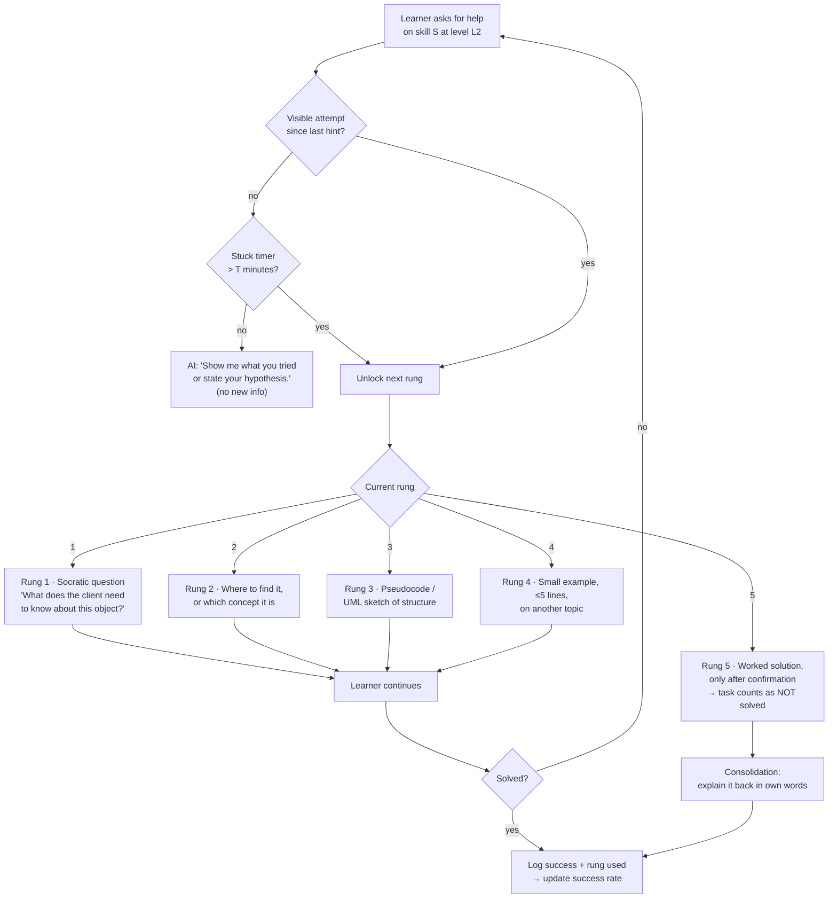

Op niveau L2 ontgrendelt de volgende trede van de hintladder pas na een zichtbare poging, of als de vastloop-timer afloopt. De vijf treden lopen van een socratische vraag tot een uitgewerkte oplossing; een taak die de uitgewerkte oplossing nodig heeft, telt als mislukt.

**Regels voor het afstemmen** (contingente begeleiding, met ongeveer 85% succes als vuistregel; §2.2 legt uit waarom dat een heuristiek is en geen bewijs):

- De harnas houdt per vaardigheid een **voortschrijdend succespercentage** bij. Daarbij tellen alleen successen op trede ≤ 2.
- **> 95%** → te makkelijk. Maak de taken moeilijker, of wissel af met andere vaardigheden (interleaving). Controleer of je aan de criteria voor het volgende niveau voldoet.
- **70–95%** → in de zone. Ga zo door.
- **< 70%** → te moeilijk. Verkort de vastloop-timer `T` (bijv. 15 → 8 min), kies makkelijkere taken of ga één niveau omlaag.
- Voor L2 begint `T` op **10–15 minuten**. Dat valt binnen de tijd waarin verwarring nog productief kan zijn (D'Mello et al., 2014). Je kunt `T` zelf aanpassen.

**Zoals gebouwd (10 november 2026, §10.4):** bij een **nieuwe vaardigheid** waarvan de plaatsing nog open is (§5.2), ontgrendelen treden **niet** op tijd. Een trede gaat alleen omhoog als:

- je zegt dat je vastzit;
- je dezelfde fout of testuitkomst twee keer deelt;
- je zegt dat je het concept niet kent.

Vraag je na een eigen poging om meer uitleg, dan mag Claude meteen naar trede 4 gaan. De trede die Claude echt geeft, wordt gelogd via de marker `[trede N]`, en die telt mee voor de plaatsing. Bij gewone L2-taken blijft de vastloop-timer `T` op 12 minuten, maar hij telt alleen actieve tijd: een pauze langer dan `idleMinutes` (standaard 20) telt niet mee.

### 5.4 Hook-pipeline

Het diagram volgt één sessie en laat zien wanneer elke hook ingrijpt.

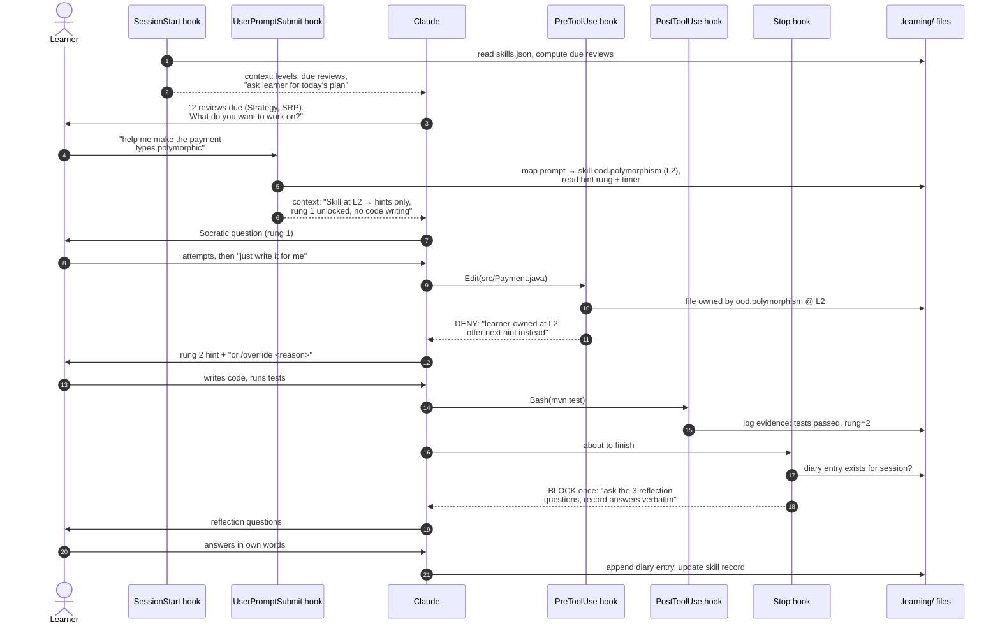

In een voorbeeldsessie blokkeert de PreToolUse-hook dat Claude een bestand van een L2-vaardigheid bewerkt, dus geeft Claude in plaats daarvan de volgende hint. Aan het eind blokkeert de Stop-hook één keer, zodat Claude drie reflectievragen stelt en jij die in je eigen woorden beantwoordt.

**Zoals gebouwd (12 november 2026):** dezelfde sessie met de hooks en het commando die er nu zijn.

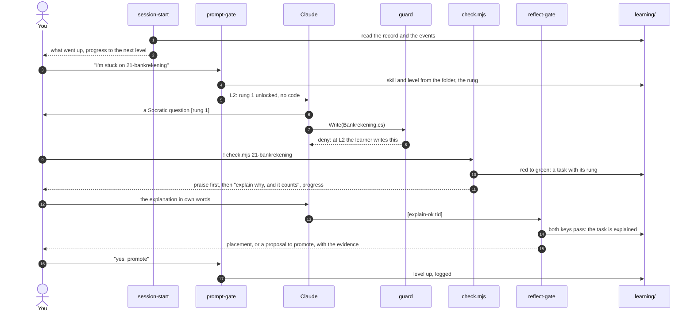

Zoals gebouwd draai je de tests zelf met `check.mjs`. Dat logt de taak, geeft eerst lof en toont je voortgang. De reflect-gate keurt de uitleg goed met twee sleutels. Een plaatsing of een voorstel om door te zetten komt van de harnas zelf, en alleen jouw eigen "ja, doorzetten" zet het niveau hoger.

| Hook | Gebeurtenis | Taak | Kan hij blokkeren? |
|---|---|---|---|
| `session-start.mjs` | `SessionStart` | Geeft Claude een samenvatting van je vaardighedenregister, de herhalingen die vandaag aan de beurt zijn, en de instructie om je naar een plan te vragen (*vooruitdenken*). *Herzien (§10.4, §10.7):* geen herhalingen meer bij de start; hij toont je wat de laatste 7 dagen omhoog ging, je voortgang naar het volgende niveau in stappen, en één keer dat moeite het doel is | Nee (alleen context) |
| `prompt-gate.mjs` | `UserPromptSubmit` | Koppelt je prompt aan een vaardigheid met trefwoorden uit `skill-map.yaml`, voegt het beleid voor dat niveau en de huidige hinttrede toe, start de vastloop-timer of werkt die bij, en handelt `/override` af. *Herzien (§10.2, punt 10):* negeert agentrapporten, taakmeldingen en systeemherinneringen, en logt `prompt-ignored` | Kan context toevoegen. Kan alleen blokkeren bij patronen van misbruik (optioneel) |
| `ownership-guard.mjs` | `PreToolUse` (matcher `Edit\|Write\|MultiEdit\|NotebookEdit`) | Blokkeert bewerkingen door de AI in bestanden, of delen van bestanden, die horen bij een vaardigheid op L1–L3. Op L1 laat hij een schrijfactie alleen toe als er `TODO(human)`-gaten in staan | **Ja** (`permissionDecision: deny`) |
| ~~`evidence-log.mjs`~~ → `check.mjs` (gebouwd) | CLI, die je zelf start met `!` | *Herzien (§10):* omdat je de tests zelf draait, ziet een PostToolUse-hook ze nooit. `check.mjs` draait `dotnet test` met een trx-logger, toont een leesbare samenvatting, onthoudt per testmethode of die groen was, en logt een overgang van rood naar groen als taak, samen met de huidige hinttrede. Het werkt voor elk .NET-testproject (oefenopgaven en projectwerk) | Nee |
| `reflect-gate.mjs` | `Stop` | Als je aan een vaardigheid hebt gewerkt en er nog geen dagboeknotitie is, blokkeert hij **één keer** en zegt hij tegen Claude dat de reflectie moet gebeuren. Hij gebruikt `stop_hook_active` om lussen te voorkomen. *Herzien (§10):* hij leest ook het laatste antwoord van Claude uit het transcript en verwerkt de markers `[trede N]` en `[uitleg-ok <tid>]`. Die tweede marker telt alleen als je eigen bericht door de deterministische uitlegcontrole komt. *Herzien (§10.7):* bij een goedgekeurde uitleg plaatst hij een nieuwe vaardigheid; hij controleert een verlaging die openstaat opnieuw; en hij leest het oordeel van de demotie-analist uit het rapport van de agent. *Herzien (§10.10):* hij logt controlevragen, noteert wanneer Claude naar het zelfvertrouwen vroeg, en schrijft de eigen woorden van de student in het AI-logboek | Ja, één keer |
| `session-end.mjs` | `SessionEnd` | *Toegevoegd (§10.10):* noteert hoe een sessie eindigde en of er werk was zonder dagboek, zodat de volgende start een inhaaldagboek kan aanbieden | Nee |
| `graded-gate.mjs` (gebruikersniveau, optioneel) | `UserPromptSubmit` en `PreToolUse`, in elk project buiten de beoordeelde map | *Toegevoegd (§10.10):* houdt een prompt tegen die de beoordeelde opdracht noemt en weigert elke tool op de paden ervan, ook lezen; de setup (`.claude/`, `CLAUDE.md`) blijft open | **Ja** |

!!! example "Voorbeeld: de situatie van één student"
    De harnas werd voor het eerst uitgeprobeerd door een tweedejaarsstudent HBO-ICT die OOD oefende in C#. Bij de oefenopgaven van de cursus hoorden .NET-unittests, en die draaide de student zelf, niet Claude. Daarom draait `check.mjs` het commando `dotnet test`. De diagrammen en voorbeelden in deze sectie gebruiken nog Java uit het oorspronkelijke ontwerp (`mvn test`, `src/Payment.java`).

### 5.5 Vaardighedenregister (datamodel)

In het vaardighedenregister houdt de harnas je voortgang bij. Het register volgt het idee van knowledge tracing (per vaardigheid een kans op beheersing, die wordt bijgewerkt op basis van bewijs) en de planning van gespreide herhalingen. Het onderwerp is OOD, dus staat het register hier als klassendiagram:

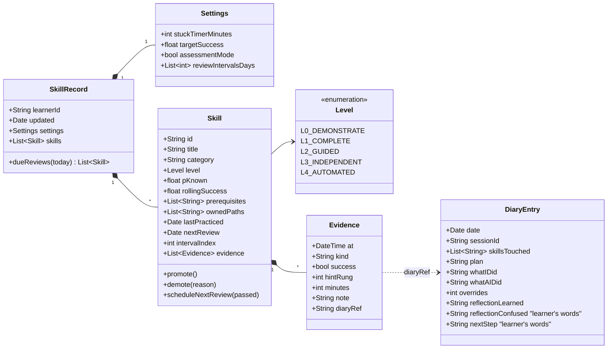

Zoals ontworpen geeft het vaardighedenregister elke vaardigheid een niveau (L0–L4), een kans op beheersing, datums voor herhalingen en eigen bewijs. Elk bewijsstuk legt vast of het lukte, met welke hinttrede en in hoeveel minuten, en kan verwijzen naar een dagboeknotitie.

**Voorbeeld van een item in `skills.json`:**

```json
{
  "id": "ood.strategy-pattern",
  "title": "Strategy pattern",
  "category": "design",
  "level": "L3_INDEPENDENT",
  "pKnown": 0.82,
  "rollingSuccess": 0.86,
  "prerequisites": ["ood.polymorphism", "ood.interfaces"],
  "ownedPaths": ["src/main/java/shop/pricing/**"],
  "lastPracticed": "2026-11-05",
  "nextReview": "2026-11-12",
  "intervalIndex": 1,
  "evidence": [
    {"at": "2026-11-03T14:10", "kind": "task", "success": true, "hintRung": 1, "minutes": 22, "diaryRef": "2026-11-03#s2"},
    {"at": "2026-11-05T10:02", "kind": "task", "success": true, "hintRung": 0, "minutes": 14, "diaryRef": "2026-11-05#s1"}
  ]
}
```

**Zoals gebouwd (na de eerste sessies, §10):** het register is platter dan het klassendiagram hierboven. Elk item heeft `id`, `title`, `level`, `paths`, `nextReview`, `intervalIndex`, `failStreak` en `history`. De harnas slaat bewijs niet op in de vaardigheid zelf. Het bewijs komt in een log dat alleen groeit (append-only), `.learning/state/events.jsonl`, met gebeurtenissen zoals `task`, `task-explained`, `test-green`, `hint-unlock` en `review`. **Microvaardigheden** zijn onderdelen van een vaardigheid: items met een `parent` en hun eigen `keywords`:

```json
{ "id": "cs.basis.void-chaining", "parent": "cs.basis", "title": "void-methoden en chainen",
  "level": "L2", "keywords": ["reverse()", "chainen", "void"], "nextReview": null, "intervalIndex": 0 }
```

### 5.6 AI-dagboek en reflectielus

Het dagboek volgt de cyclus van zelfregulerend leren (Zimmerman, 2002) en gebruikt **leerprotocollen met prompts** (Nückles et al., 2009): je schrijft als antwoord op een paar vaste vragen. De AI legt de feiten vast. Jij schrijft de reflectie.

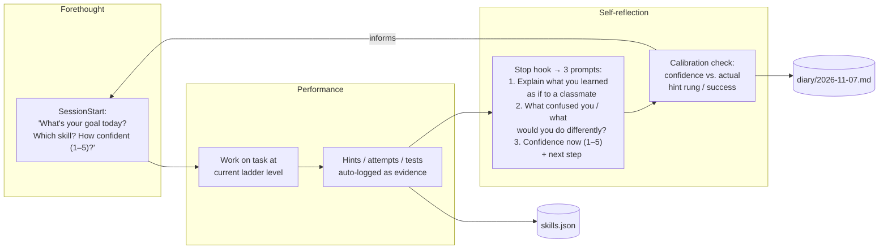

De dagboek- en reflectielus loopt van vooruitdenken (doel en vertrouwen) via uitvoering (werk, gelogd als bewijs) naar zelfreflectie bij de Stop-hook. Een kalibratiecontrole vergelijkt je vertrouwen met je werkelijke hinttrede en succes, en dat neem je mee in je volgende plan.

**Sjabloon voor een dagboeknotitie** (bijvoorbeeld `.learning/diary/2026-11-07.md`):

```markdown
## Session 2 · 14:05–15:10 · skills: ood.polymorphism (L2), ood.srp (review)

**Plan (me):** Refactor PaymentProcessor so new payment types don't need if/else. Confidence: 2/5

**Facts (logged):**
- Hint rungs used: 1, 2 (no rung ≥3) · stuck timer fired: 0×
- Tests: 3 runs, last ✅ 12/12
- AI wrote: test skeleton only · I wrote: Payment interface, 3 implementations
- Overrides: 0 · Review SRP: passed → next review 2026-11-14

**Reflection (my words):**
1. *Learned:* The if/else on type was a smell; each payment class now owns its own `process()` behaviour...
2. *Confused / differently:* Not sure whether `validate()` belongs in the interface or a separate validator...
3. *Confidence now:* 4/5 · *Next:* try the same with discounts (Strategy?)

**Calibration:** predicted 2 → performed at rung ≤2 → under-confident ✅ (good sign)
```

**Wekelijkse terugblik op het dagboek** (15 minuten, `/diary --week`): Claude vat de trends van de week samen: het succespercentage per vaardigheid, het aantal overrides, de verschillen in kalibratie en de vaardigheden die het dichtst bij het volgende niveau zitten. *Jij* bepaalt waar je volgende week op focust. Zo helpt de terugblik je om je eigen leren in de gaten te houden, zonder dat de terugblik dat voor je doet.

### 5.7 Gespreide herhaling na beheersing

Als je een vaardigheid beheerst, blijft de harnas die af en toe controleren. Herhalingen gebruiken **groeiende intervallen**, aangepast aan je resultaten in de stijl van Leitner en half-life regression. Ook **wisselen** ze vaardigheden **af**, en dat traint je in het kiezen van het juiste principe. Het is niet bewezen dat groeiende intervallen beter werken dan gelijke intervallen (§2.5). Het werk zit in spreiding en ophalen. Het schema zorgt er vooral voor dat vroege herhalingen lukken en dat herhalingen vóór je toets vallen. Herhalingstaken zijn *ophaal*taken, geen herlezen:

- *"Zonder te kijken: schets het klassendiagram voor een calculator voor verzendkosten die op Strategy is gebaseerd."*
- *"Hier zijn 3 codefragmenten. Welke schendt LSP, en waarom?"* (onderscheiden bij afwisseling)
- *"Voorspel hoe het ontwerp van de AI voor X eruitziet voordat de AI het genereert, en vergelijk dan."* Deze toezichtcontrole is bedoeld voor L4-vaardigheden.

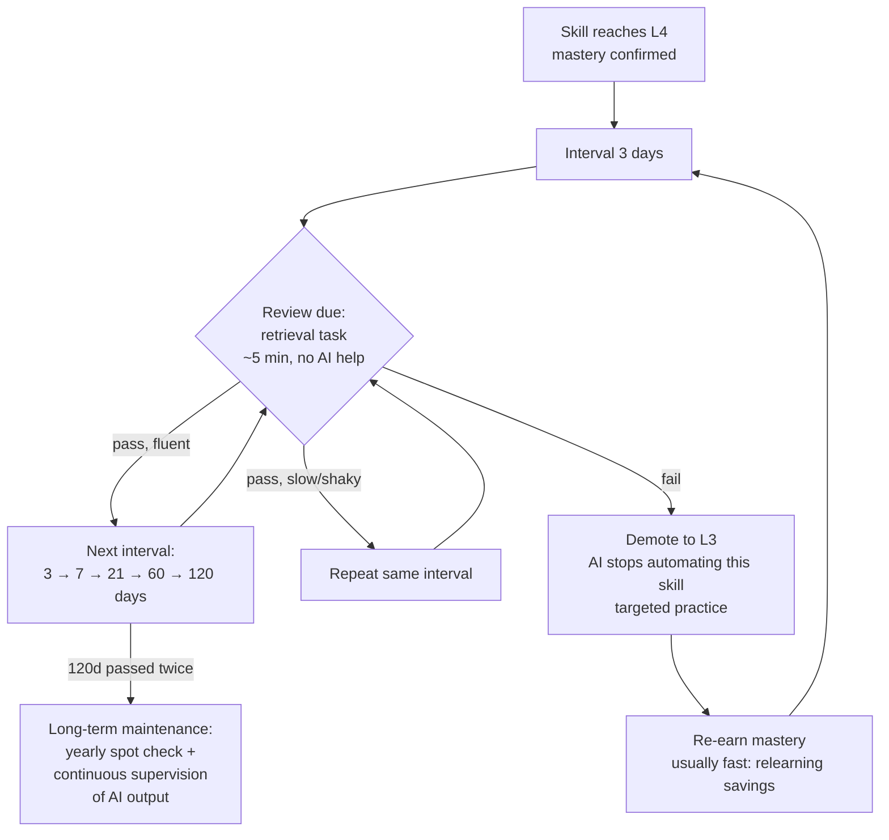

In het oorspronkelijke ontwerp krijgt een L4-vaardigheid herhalingen met een ophaaltaak zonder AI, op groeiende intervallen: 3, 7, 21, 60 en 120 dagen. Is de herhaling wankel, dan blijft het interval gelijk; mislukt ze, dan gaat de vaardigheid terug naar L3 en stopt de AI met automatiseren.

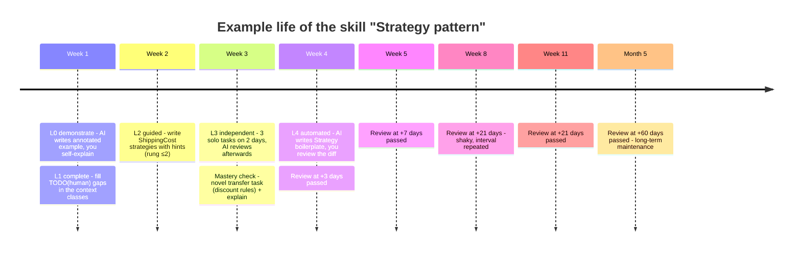

In een voorbeeldtijdlijn uit het oorspronkelijke ontwerp gaat de vaardigheid "Strategy pattern" van L0 in week 1 naar L4 in week 4. Daarna wordt ze nog gecontroleerd, steeds minder vaak, en na een wankele herhaling op +21 dagen blijft dat interval gelijk.

Aan het begin van elke sessie toont de **`SessionStart`-hook** de herhalingen die aan de beurt zijn. Zo gebeurt het versterken vanzelf, en hoef je er zelf niet aan te denken. Dit is het deel "leren afdwingen zolang dat nodig is": een vaardigheid is *nooit voorgoed buiten beeld*. Ze wordt alleen steeds minder vaak gecontroleerd.

**Zoals gebouwd (10 november 2026, §10.4):** herhalingen gebeuren nu in je echte werk, en alleen op L4.

- **Geen losse herhaaloefeningen.** Een herhaling is de **eerstvolgende keer dat de vaardigheid in je echte werk langskomt** na haar datum: via haar map, haar trefwoorden of een run van `check.mjs` die eraan gekoppeld is. De hook meldt dat dan één keer. Deze keer doe jij dat deel zelf, niet de AI: zolang de herhaling klaarstaat, behandelt de guard de paden van de vaardigheid als L3.
- **Fibonacci-intervallen:** 1, 2, 3, 5, 8, 13, 21, 34 … dagen, **alleen voor vaardigheden en microvaardigheden op L4**. Een vaardigheid op L3 heeft geen schema nodig, want die doe je zelf zodra ze langskomt.
- **De trede van die taak bepaalt de uitkomst:**
    - trede 0 → `pass`, één stap omhoog in de reeks;
    - trede 1–2 → `shaky`, het interval herhaalt zich;
    - trede 3–5 of een mislukte taak → `fail`, **twee stappen terug**.
- **Na twee keer `fail` op rij:** de regel voor automatisch omlaag geldt (§5.2, §10.4.2). Staat `autoDemote` uit, dan krijg je het advies om één niveau omlaag te gaan.
- **Als de vaardigheid niet langskomt:** dan gebeurt er niets, en wacht de herhaling. Bij het begin van een sessie verschijnt niets. Het dashboard toont geen "te laat", alleen wanneer je de vaardigheid het laatst zag.
- **Voor je toets:** als `settings.examDate` is ingesteld, valt een herhaling uiterlijk 3 dagen voor de toets. Het vangnet vóór de toets zijn de oefentoetsen van je opleiding. Die staan bewust buiten de harnas.

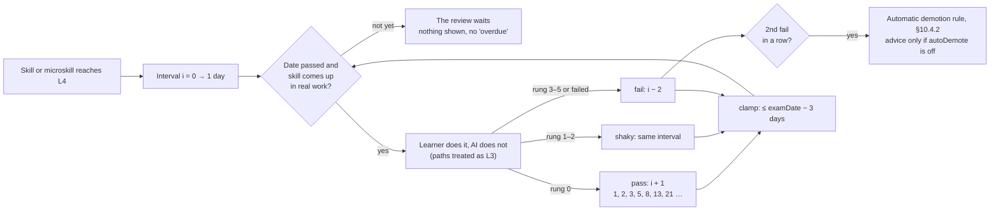

Zoals gebouwd wordt een L4-vaardigheid herhaald zodra ze na haar datum in je echte werk langskomt; dat deel doe je dan zelf. Trede 0 zet het Fibonacci-interval één stap omhoog, trede 1–2 herhaalt het, en trede 3–5 of een mislukking zet het twee stappen terug.

??? note "Eerdere versie zoals gebouwd (§10, 7 november 2026)"

    De harnas verving het schema 3 → 7 → 21 → 60 → 120 hierboven.

    - **Fibonacci-intervallen:** 1, 2, 3, 5, 8, 13, 21, 34 … dagen.
    - **Startpunt:** herhalingen beginnen zodra een vaardigheid of microvaardigheid **L3** bereikt, niet pas bij L4. Dat past bij het doel "beheerst → alleen af en toe versterken".
    - **Na een herhaling:** `pass` gaat één stap omhoog in de reeks, `shaky` herhaalt het interval en `fail` gaat **twee stappen terug**.
    - **Na twee keer `fail` op rij:** de harnas *adviseert* je om één niveau omlaag te gaan. De harnas zet een vaardigheid nooit automatisch lager.
    - **Voor je toets:** als je je toetsdatum instelt in `settings.examDate`, kort de harnas elk interval zo in dat de herhaling uiterlijk 3 dagen voor de toets valt.

    ```mermaid
    flowchart LR
        S[Skill or microskill reaches L3] --> I["Interval i = 0 → 1 day"]
        I --> Q{Retrieval review<br/>~5 min, no help}
        Q -- pass --> UP["i + 1<br/>1, 2, 3, 5, 8, 13, 21 …"]
        Q -- shaky --> SAME[same interval]
        Q -- fail --> BACK["i − 2"]
        BACK --> F{2nd fail<br/>in a row?}
        F -- yes --> ADV[Advice: one level down<br/>learner decides]
        UP & SAME & BACK --> C["clamp: ≤ examDate − 3 days"] --> Q
    ```

    In de eerdere versie zoals gebouwd (7 november 2026) waren herhalingen korte ophaaltaken zonder hulp, op Fibonacci-intervallen vanaf L3. Na twee keer `fail` op rij kreeg je het advies om één niveau omlaag te gaan; de harnas zette een vaardigheid nooit automatisch lager.

### 5.8 OOD-vaardighedenkaart

De OOD-kaart in de harnas (`harness/maps/ood/skills.json`) is een lijst vaardigheden, elk met eigen opdrachtmappen en trefwoorden. Hij is opgebouwd uit de gaten die de diagnostische toets liet zien. Sinds 11 november 2026 hoort daar ook het OO-ontwerp bij dat het eindassessment van het vak beoordeelt: polymorfie, SOLID en modulariteit, lagen met controllers en dependency injection, en het UML-sequentie- en componentdiagram. Later die avond is de kaart naast de toetsbeschrijving, het beoordelingsformulier en de cheatsheet van de pilotstudent gelegd. Daaruit kwamen er tien bij: logging (indicator 3.1.1), integratie-, systeem- en UI-tests (indicator 3.1.4 en het testplan), en uit de cheatsheet upcasting en downcasting, static members, records en structs, object-methodes, overige C# (sealed, indexers, operator overloading, geneste klassen) en de drie families van ontwerppatronen. Een familie is één vaardigheid; oefen je één patroon apart, dan wordt het een microvaardigheid.

De kaart heeft **geen voorkennis-relaties**. De volgorde komt uit de genummerde opdrachten, en een nieuwe vaardigheid begint met een plaatsing: je eerste taak bepaalt het niveau (§5.2). Mist er iets, dan voeg je zelf een vaardigheid toe met `skill.mjs add`.

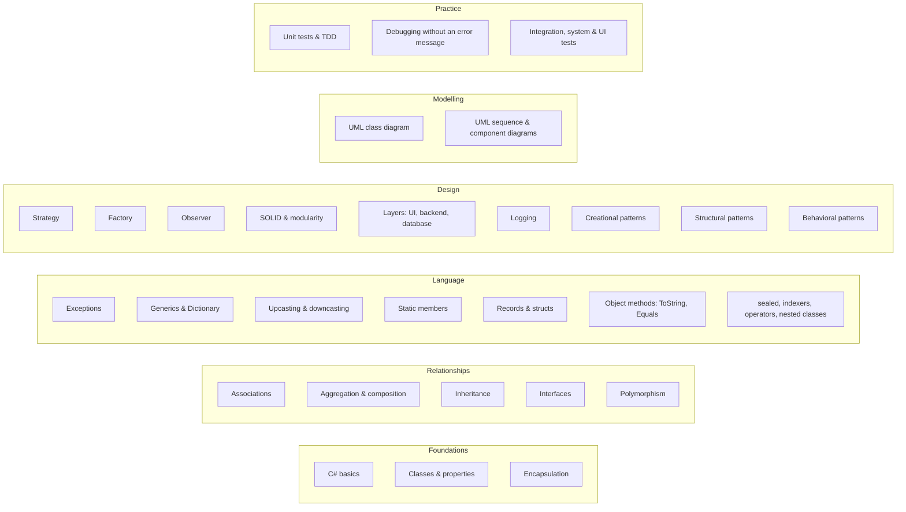

De vaardigheden van de OOD-kaart, per groep. Er lopen geen pijlen tussen: de volgorde komt uit de opdrachten, niet uit de kaart.

**Wat de kaart niet dekt.** Het eindassessment beoordeelt ook security, de cloud en een CI/CD-pipeline, de database en het verslag. Die zitten niet in de kaart; zo koos de pilotstudent op 11 november 2026. De guard beschermt wel de bestanden van zo'n project: naast C# ook `.razor`, `.cshtml`, `.sql`, de pipeline (`.yml`), `Dockerfile` en `appsettings*.json` (zie [Configuratie](../configuration.md)).

??? note "Oorspronkelijk ontwerp (7 november 2026): een graaf met voorkennis"

    `skill-map.yaml` legt het curriculum vast als graaf: welke vaardigheden welke andere vrijspelen, en met welke trefwoorden de harnas vaardigheden in je prompts herkent. Een vaardigheid komt beschikbaar op L0 zodra de vereiste vaardigheden op L2 of hoger staan. Een vaardigheid kan alleen geautomatiseerd worden (L4) als de vereiste vaardigheden ook op L4 staan. Zo automatiseert de AI nooit iets waarvan je de basis niet kunt controleren.

    ```mermaid
    flowchart TD
        subgraph Foundations
            A1[Classes & objects<br/>state, identity, behaviour]
            A2[Encapsulation<br/>& access modifiers]
            A3[Constructors &<br/>object lifecycle]
        end
        subgraph Relationships
            B1[Association /<br/>aggregation / composition]
            B2[Inheritance]
            B3[Interfaces &<br/>abstract classes]
            B4[Polymorphism<br/>dynamic dispatch]
        end
        subgraph Modelling
            C1[UML class diagrams]
            C2[UML sequence diagrams]
            C3[Responsibility assignment<br/>GRASP / CRC]
        end
        subgraph Principles
            D1[SRP]
            D2[Open/Closed]
            D3[Liskov Substitution]
            D4[Interface Segregation]
            D5[Dependency Inversion]
            D6[Composition over<br/>inheritance]
        end
        subgraph Patterns
            E1[Strategy]
            E2[Observer]
            E3[Factory Method /<br/>Abstract Factory]
            E4[Decorator]
            E5[Adapter]
            E6[State]
        end
        subgraph Practice
            F1[Unit testing / TDD]
            F2[Code smells &<br/>refactoring]
            F3[Dependency injection]
        end
        A1 --> A2 --> A3
        A1 --> B1 & B2
        B2 --> B3 --> B4
        A1 --> C1
        B1 & B2 --> C1
        C1 --> C2
        C1 --> C3 --> D1
        B4 --> D2 & D3
        B3 --> D4 & D5
        B1 & B2 --> D6
        D2 & B4 --> E1
        D5 --> E2
        D5 --> E3
        D6 --> E4 & E5
        E1 --> E6
        D1 --> F2
        F1 --> F2
        D5 --> F3
    ```

    De OOD-vaardighedenkaart laat zien welke vaardigheden welke andere vrijspelen: van klassen en objecten, via relaties en modelleren, naar principes en daarna patronen. Een vaardigheid kan pas naar L4, het niveau waarop de AI haar automatiseert, als de vereiste vaardigheden ook op L4 staan.

---

<a id="bijlage-implementatieschetsen"></a>

## Bijlage: implementatieschetsen {#appendix}

> Dit zijn **schetsen** die laten zien dat het ontwerp te bouwen is. Ze horen pas bij je Claude Code-configuratie als je ze zelf toevoegt. De paden gaan uit van een `.claude/`-map op projectniveau en een `.learning/`-datamap. We gebruiken Node.js, omdat Claude Code dat al nodig heeft. Zo werkt het op Windows, macOS en Linux op dezelfde manier.

### A. Mapindeling

**Zoals gebouwd voor de pilot:**

```text
ood/
├── CLAUDE.md                     # authoritative rules for Claude (Dutch)
├── .claude/
│   ├── settings.json             # SessionStart, UserPromptSubmit, PreToolUse, Stop
│   ├── hooks/
│   │   ├── lib.mjs               # record, microskills, Fibonacci, tasks, explanation check
│   │   ├── session-start.mjs     # record + due reviews + open explanations + wins/advice
│   │   ├── prompt-gate.mjs       # skill/microskill detection, hint ladder, task logging
│   │   ├── guard.mjs             # PreToolUse: blocks writing/building/testing at L1–L3
│   │   ├── reflect-gate.mjs      # Stop: [trede N] / [uitleg-ok] markers + diary gate
│   │   ├── skill.mjs             # learner CLI (list, status, set, review, add-micro, done, …)
│   │   └── check.mjs             # learner test runner: trx → red→green evidence
│   └── skills/diary/SKILL.md
└── .learning/
    ├── skills.json               # record incl. microskills and settings.examDate
    ├── keywords.json
    ├── diary/JJJJ-MM-DD.md
    └── state/                    # events.jsonl, tests.json, session-*.json, overrides.json
```

*Oorspronkelijke schets:*

```text
ood/
├── CLAUDE.md                     # pedagogy policy (below)
├── .claude/
│   ├── settings.json             # hook registration
│   ├── hooks/
│   │   ├── lib.mjs               # read/write skills.json, skill detection
│   │   ├── session-start.mjs
│   │   ├── prompt-gate.mjs
│   │   ├── ownership-guard.mjs
│   │   ├── evidence-log.mjs
│   │   └── reflect-gate.mjs
│   └── skills/
│       ├── learn/SKILL.md        # ladder-aware tutoring protocol
│       ├── review-due/SKILL.md   # spaced retrieval quiz
│       ├── mastery-check/SKILL.md
│       └── diary/SKILL.md
└── .learning/                    # git-ignored
    ├── skill-map.yaml
    ├── skills.json
    ├── session-state.json
    └── diary/2026-11-07.md
```

### B. `.claude/settings.json` (registratie van de hooks)

```json
{
  "hooks": {
    "SessionStart": [
      { "hooks": [{ "type": "command", "command": "node \"$CLAUDE_PROJECT_DIR/.claude/hooks/session-start.mjs\"" }] }
    ],
    "UserPromptSubmit": [
      { "hooks": [{ "type": "command", "command": "node \"$CLAUDE_PROJECT_DIR/.claude/hooks/prompt-gate.mjs\"" }] }
    ],
    "PreToolUse": [
      { "matcher": "Edit|Write|MultiEdit|NotebookEdit",
        "hooks": [{ "type": "command", "command": "node \"$CLAUDE_PROJECT_DIR/.claude/hooks/ownership-guard.mjs\"" }] }
    ],
    "PostToolUse": [
      { "matcher": "Bash",
        "hooks": [{ "type": "command", "command": "node \"$CLAUDE_PROJECT_DIR/.claude/hooks/evidence-log.mjs\"" }] }
    ],
    "Stop": [
      { "hooks": [{ "type": "command", "command": "node \"$CLAUDE_PROJECT_DIR/.claude/hooks/reflect-gate.mjs\"" }] }
    ]
  }
}
```

### C. `ownership-guard.mjs` (de kern van de handhaving)

```js
// PreToolUse: deny AI edits to learner-owned code for skills at L1–L3.
import { readStdin, loadSkills, skillForPath, isOverrideActive } from "./lib.mjs";

const input = JSON.parse(await readStdin());
const file = input.tool_input?.file_path ?? input.tool_input?.notebook_path;
if (!file) process.exit(0);

const skills = loadSkills();
const skill = skillForPath(skills, file);           // matches ownedPaths globs
if (!skill || isOverrideActive(skill.id)) process.exit(0);

const newText = input.tool_input?.content ?? input.tool_input?.new_string ?? "";
const level = skill.level;

let deny = null;
if (level === "L1_COMPLETE" && !newText.includes("TODO(human)")) {
  deny = `Skill '${skill.title}' is at L1 (complete). You may write scaffolding only ` +
         `if the core logic is left as TODO(human) gaps for the learner.`;
}
if (level === "L2_GUIDED" || level === "L3_INDEPENDENT") {
  deny = `Skill '${skill.title}' is at ${level}. The learner writes this code. ` +
         (level === "L2_GUIDED" ? "Offer the next hint rung instead." :
                                  "Only review after the learner's attempt.") +
         ` The learner can type /override <reason> to bypass (logged).`;
}

if (deny) {
  console.log(JSON.stringify({
    hookSpecificOutput: {
      hookEventName: "PreToolUse",
      permissionDecision: "deny",
      permissionDecisionReason: deny
    }
  }));
}
process.exit(0);
```

### D. `prompt-gate.mjs` (niveaubeleid en hintladder injecteren)

```js
// UserPromptSubmit: detect skill, inject ladder policy + hint rung as context.
import { readStdin, loadSkills, detectSkills, loadState, saveState, logOverride } from "./lib.mjs";

const { prompt, session_id } = JSON.parse(await readStdin());
const skills = loadSkills();
const state = loadState(session_id);

if (prompt.trim().startsWith("/override")) {
  logOverride(state.activeSkill, prompt);           // goes to diary + evidence
}

const hits = detectSkills(skills, prompt);          // keyword map from skill-map.yaml
const POLICY = {
  L0_DEMONSTRATE: "Write a worked example with subgoal labels. Then ask the learner to self-explain 2 lines and predict an output before moving on.",
  L1_COMPLETE:    "Write scaffolding only; leave the core logic as TODO(human). Wait for the learner, then give feedback.",
  L2_GUIDED:      "Do NOT write the solution. Use the hint ladder. Current unlocked rung: {rung}. Require a visible attempt before going higher.",
  L3_INDEPENDENT: "Do NOT write or hint unless asked for review AFTER an attempt. Then give a code/design review with questions.",
  L4_AUTOMATED:   "You may implement directly. Before generating, ask the learner to predict the approach in one sentence; show a reviewable diff."
};

const now = Date.now();
const minutesStuck = (now - (state.lastProgressAt ?? now)) / 60000;
const rung = Math.min(5, (state.rung ?? 0) + (minutesStuck >= skills.settings.stuckTimerMinutes ? 1 : 0));

const ctx = hits.map(s =>
  `[learning-harness] Skill ${s.id} is at ${s.level}. ${POLICY[s.level].replace("{rung}", rung)}`
).join("\n");

saveState(session_id, { ...state, activeSkill: hits[0]?.id ?? state.activeSkill, rung });
if (ctx) console.log(JSON.stringify({
  hookSpecificOutput: { hookEventName: "UserPromptSubmit", additionalContext: ctx }
}));
```

### E. `reflect-gate.mjs` (Stop: zorgen dat de reflectie één keer plaatsvindt)

```js
import { readStdin, loadState, diaryHasEntry } from "./lib.mjs";
const input = JSON.parse(await readStdin());
if (input.stop_hook_active) process.exit(0);        // never loop
const state = loadState(input.session_id);
if (state.activeSkill && !diaryHasEntry(input.session_id)) {
  console.log(JSON.stringify({
    decision: "block",
    reason: "Before finishing: ask the learner the 3 reflection questions " +
            "(learned / confused / confidence+next). Record their answers VERBATIM " +
            "with the logged facts via the /diary skill. Do not write the reflection yourself."
  }));
}
```

### F. Didactisch beleid in `CLAUDE.md` (fragment)

```markdown
# Learning policy (this project is for LEARNING OOD, not just shipping code)

- Treat `[learning-harness]` context as binding for the named skill.
- Never write the learner's reflection; record their words verbatim.
- Prefer explanations, questions and reviews over solutions unless the skill is L4.
- For design skills: ask the learner to propose classes/responsibilities/UML FIRST,
  then critique with trade-off questions (why this abstraction? what changes next?).
- When you are uncertain or the API might be wrong, say so and point to docs/tests.
- If the learner seems stuck >10–15 min or frustrated, offer the next hint rung —
  struggle should be productive, not punishing.
- Assessment mode (graded work): behave as L3 for every skill; log all AI help.
```

### G. Protocol van de skill `/mastery-check` (samenvatting)

1. Genereer een **nieuwe transfertaak** voor de vaardigheid, in een onbekend domein (bijv. Strategy voor belastingregels in plaats van verzending).
2. De student lost die op **zonder hints**. De `prompt-gate` behandelt trede = 0 als vergrendeld.
3. Stel 3 uitlegvragen: *waarom dit ontwerp?*, *wat gaat er mis met alternatief X?*, *wanneer zou je het NIET gebruiken?*
4. Beoordeel het met een rubric. Geslaagd betekent: een werkende oplossing, ≥ 2/3 uitlegantwoorden goed, en ≥ 2 zelfstandige successen in het vaardighedenregister op verschillende dagen.
5. Bij slagen: `level = L4`, `nextReview = today + 3d`. Bij zakken: blijf op L3 en log de concrete hiaten als focus voor de volgende sessie.
